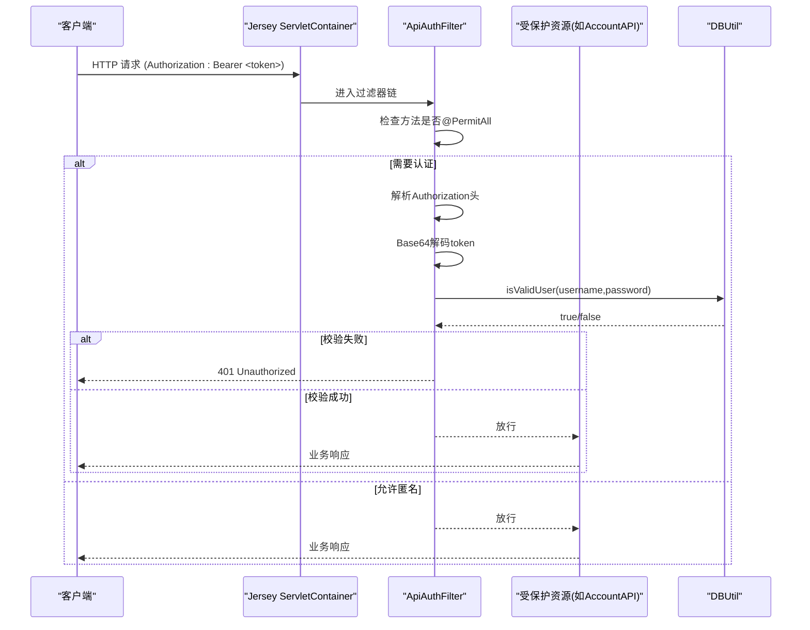
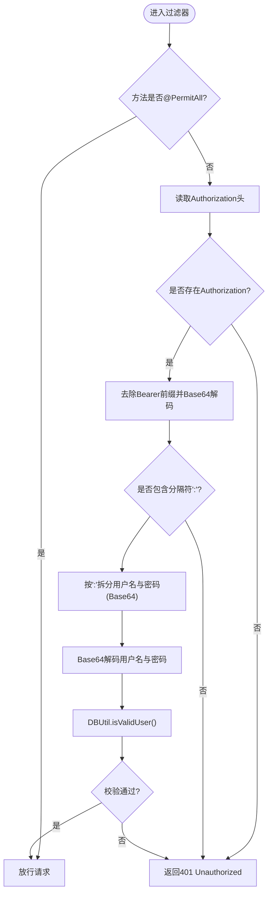
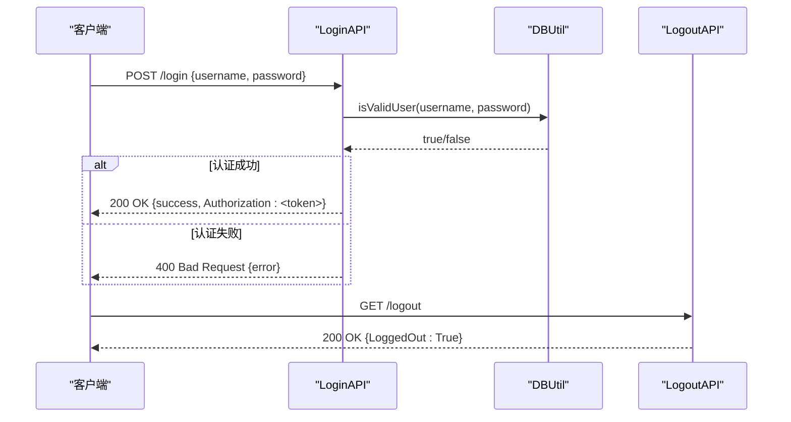
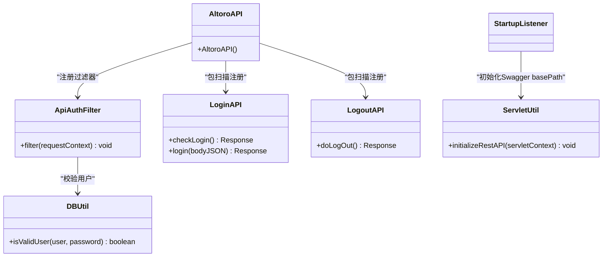

# API概览与认证

<cite>
**本文引用的文件**   
- [AltoroAPI.java](file://src/com/ibm/security/appscan/altoromutual/api/AltoroAPI.java)
- [ApiAuthFilter.java](file://src/com/ibm/security/appscan/altoromutual/filter/ApiAuthFilter.java)
- [LoginAPI.java](file://src/com/ibm/security/appscan/altoromutual/api/LoginAPI.java)
- [LogoutAPI.java](file://src/com/ibm/security/appscan/altoromutual/api/LogoutAPI.java)
- [web.xml](file://WebContent/WEB-INF/web.xml)
- [StartupListener.java](file://src/com/ibm/security/appscan/altoromutual/listener/StartupListener.java)
- [DBUtil.java](file://src/com/ibm/security/appscan/altoromutual/util/DBUtil.java)
- [ServletUtil.java](file://src/com/ibm/security/appscan/altoromutual/util/ServletUtil.java)
</cite>

## 目录
1. [简介](#简介)
2. [项目结构](#项目结构)
3. [核心组件](#核心组件)
4. [架构总览](#架构总览)
5. [详细组件分析](#详细组件分析)
6. [依赖关系分析](#依赖关系分析)
7. [性能考虑](#性能考虑)
8. [故障排查指南](#故障排查指南)
9. [结论](#结论)
10. [附录：客户端集成与最佳实践](#附录客户端集成与最佳实践)

## 简介
本文件为 AltoroJ REST API 的概览与认证机制文档。系统基于 Jersey（JAX-RS）提供 RESTful 服务，采用全局过滤器实现 Bearer Token 认证，并通过数据库校验用户凭证。文档涵盖：
- REST 基础路径配置、包扫描与全局过滤器注册
- Bearer Token 认证流程、会话管理与权限控制
- API 调用示例、请求头格式、错误响应与状态码
- API 版本管理策略与向后兼容性建议
- 客户端集成指南与最佳实践

## 项目结构
REST API 相关代码位于 com.ibm.security.appscan.altoromutual.api 包下；认证过滤器位于 filter 包；启动监听器在 listener 包；工具类在 util 包。

```mermaid
graph TB
subgraph "Web容器"
webxml["web.xml<br/>定义Jersey ServletContainer"]
startup["StartupListener<br/>应用初始化"]
end
subgraph "Jersey应用"
app["AltoroAPI<br/>@ApplicationPath(\"api\")"]
scan["packages(\"com.ibm.security.appscan.altoromutual.api\")"]
filter_reg["register(ApiAuthFilter.class)"]
end
subgraph "资源端点"
login["LoginAPI<br/>/login"]
logout["LogoutAPI<br/>/logout"]
others["其他API资源..."]
end
subgraph "过滤器"
authf["ApiAuthFilter<br/>Bearer Token验证"]
end
subgraph "数据层"
dbutil["DBUtil<br/>isValidUser等"]
end
webxml --> app
startup --> app
app --> scan
app --> filter_reg
app --> login
app --> logout
app --> others
login --> authf
logout --> authf
authf --> dbutil
```

图表来源
- [web.xml:60-68](file://WebContent/WEB-INF/web.xml#L60-L68)
- [AltoroAPI.java:9-14](file://src/com/ibm/security/appscan/altoromutual/api/AltoroAPI.java#L9-L14)
- [StartupListener.java:13-23](file://src/com/ibm/security/appscan/altoromutual/listener/StartupListener.java#L13-L23)
- [LoginAPI.java:19-27](file://src/com/ibm/security/appscan/altoromutual/api/LoginAPI.java#L19-L27)
- [LogoutAPI.java:13-28](file://src/com/ibm/security/appscan/altoromutual/api/LogoutAPI.java#L13-L28)
- [ApiAuthFilter.java:20-74](file://src/com/ibm/security/appscan/altoromutual/filter/ApiAuthFilter.java#L20-L74)
- [DBUtil.java:212-232](file://src/com/ibm/security/appscan/altoromutual/util/DBUtil.java#L212-L232)

章节来源
- [web.xml:60-68](file://WebContent/WEB-INF/web.xml#L60-L68)
- [AltoroAPI.java:9-14](file://src/com/ibm/security/appscan/altoromutual/api/AltoroAPI.java#L9-L14)
- [StartupListener.java:13-23](file://src/com/ibm/security/appscan/altoromutual/listener/StartupListener.java#L13-L23)

## 核心组件
- Jersey 应用入口与基础路径
  - 通过 @ApplicationPath("api") 将 REST API 暴露于 /api 路径下。
  - 使用 packages(...) 自动扫描并注册 api 包下的所有 JAX-RS 资源。
  - 通过 register(ApiAuthFilter.class) 注册全局认证过滤器。
- 认证过滤器
  - ApiAuthFilter 实现 ContainerRequestFilter，对未标注 @PermitAll 的资源进行 Bearer Token 校验。
  - 从 Authorization 头解析 Bearer token，解码后按“用户名:密码”结构拆分，再调用 DBUtil.isValidUser 校验。
- 登录与登出
  - LoginAPI 提供 GET /checkLogin 与 POST /login。POST 返回包含 Authorization 字段的 JSON，值为 Base64 编码的 token。
  - LogoutAPI 提供 GET /logout，清除会话中的用户属性。
- 启动监听器与Swagger基础路径
  - StartupListener 在应用启动时执行初始化，包括调用 ServletUtil.initializeRestAPI 更新 Swagger basePath 为 /api。
  - ServletUtil 读取并写入 swagger/properties.json，确保 basePath 与应用上下文一致。

章节来源
- [AltoroAPI.java:9-14](file://src/com/ibm/security/appscan/altoromutual/api/AltoroAPI.java#L9-L14)
- [ApiAuthFilter.java:20-74](file://src/com/ibm/security/appscan/altoromutual/filter/ApiAuthFilter.java#L20-L74)
- [LoginAPI.java:19-84](file://src/com/ibm/security/appscan/altoromutual/api/LoginAPI.java#L19-L84)
- [LogoutAPI.java:13-28](file://src/com/ibm/security/appscan/altoromutual/api/LogoutAPI.java#L13-L28)
- [StartupListener.java:13-23](file://src/com/ibm/security/appscan/altoromutual/listener/StartupListener.java#L13-L23)
- [ServletUtil.java:375-409](file://src/com/ibm/security/appscan/altoromutual/util/ServletUtil.java#L375-L409)

## 架构总览
下图展示一次受保护 API 调用的完整流程：客户端携带 Bearer Token 访问受保护资源，过滤器拦截并校验，通过后交由具体资源方法处理。



图表来源
- [web.xml:60-68](file://WebContent/WEB-INF/web.xml#L60-L68)
- [ApiAuthFilter.java:29-74](file://src/com/ibm/security/appscan/altoromutual/filter/ApiAuthFilter.java#L29-L74)
- [DBUtil.java:212-232](file://src/com/ibm/security/appscan/altoromutual/util/DBUtil.java#L212-L232)

## 详细组件分析

### REST 基础路径与包扫描
- 基础路径
  - 通过 @ApplicationPath("api") 设置 REST API 的基础路径为 /api。
- 包扫描
  - packages("com.ibm.security.appscan.altoromutual.api") 自动发现并注册该包下的所有 JAX-RS 资源类与方法。
- 全局过滤器注册
  - register(ApiAuthFilter.class) 将认证过滤器注册到 Jersey 过滤器链中，对所有资源生效。

章节来源
- [AltoroAPI.java:9-14](file://src/com/ibm/security/appscan/altoromutual/api/AltoroAPI.java#L9-L14)

### Bearer Token 认证机制
- 令牌生成
  - 登录接口 POST /login 成功后返回 JSON，其中 Authorization 字段为 Base64 编码的字符串，内部结构为“用户名Base64:密码Base64:随机串”。
- 令牌校验
  - 过滤器从 Authorization 头提取 Bearer token，Base64 解码得到原始字符串。
  - 校验字符串是否包含分隔符“:”，并按“:”拆分为用户名与密码（均为 Base64 编码）。
  - 再次 Base64 解码用户名与密码，调用 DBUtil.isValidUser 进行数据库校验。
- 权限控制
  - 若目标方法标注 @PermitAll，则跳过认证。
  - 否则必须提供有效 Bearer Token，否则返回 401。



图表来源
- [ApiAuthFilter.java:29-74](file://src/com/ibm/security/appscan/altoromutual/filter/ApiAuthFilter.java#L29-L74)
- [DBUtil.java:212-232](file://src/com/ibm/security/appscan/altoromutual/util/DBUtil.java#L212-L232)

章节来源
- [ApiAuthFilter.java:20-74](file://src/com/ibm/security/appscan/altoromutual/filter/ApiAuthFilter.java#L20-L74)
- [LoginAPI.java:29-84](file://src/com/ibm/security/appscan/altoromutual/api/LoginAPI.java#L29-L84)
- [DBUtil.java:212-232](file://src/com/ibm/security/appscan/altoromutual/util/DBUtil.java#L212-L232)

### 登录与登出流程
- 登录
  - GET /login/checkLogin：返回登录状态（示例返回 loggedin=true）。
  - POST /login：接收 JSON 请求体，包含 username 与 password；校验通过后返回 JSON，包含 success 消息与 Authorization 字段（Bearer token 值）。
- 登出
  - GET /logout：移除会话中的用户属性，返回 LoggedOut=True。



图表来源
- [LoginAPI.java:22-84](file://src/com/ibm/security/appscan/altoromutual/api/LoginAPI.java#L22-L84)
- [LogoutAPI.java:16-28](file://src/com/ibm/security/appscan/altoromutual/api/LogoutAPI.java#L16-L28)
- [DBUtil.java:212-232](file://src/com/ibm/security/appscan/altoromutual/util/DBUtil.java#L212-L232)

章节来源
- [LoginAPI.java:19-84](file://src/com/ibm/security/appscan/altoromutual/api/LoginAPI.java#L19-L84)
- [LogoutAPI.java:13-28](file://src/com/ibm/security/appscan/altoromutual/api/LogoutAPI.java#L13-L28)

### Swagger 基础路径初始化
- 启动时通过 StartupListener 调用 ServletUtil.initializeRestAPI，读取并更新 swagger/properties.json 中的 basePath 为当前上下文 + "/api"，保证 Swagger UI 能正确指向 REST API。

章节来源
- [StartupListener.java:13-23](file://src/com/ibm/security/appscan/altoromutual/listener/StartupListener.java#L13-L23)
- [ServletUtil.java:375-409](file://src/com/ibm/security/appscan/altoromutual/util/ServletUtil.java#L375-L409)

## 依赖关系分析
- Jersey 容器
  - web.xml 中声明 org.glassfish.jersey.servlet.ServletContainer，并将 javax.ws.rs.Application 指向 AltoroAPI。
- 应用配置
  - AltoroAPI 继承 ResourceConfig，设置 @ApplicationPath("api")，扫描 api 包，注册 ApiAuthFilter。
- 过滤器与资源
  - ApiAuthFilter 依赖 DBUtil 进行用户校验；LoginAPI/LogoutAPI 作为 JAX-RS 资源对外暴露。
- 工具与数据
  - DBUtil 负责数据库连接与查询；ServletUtil 提供会话与Swagger初始化辅助方法。



图表来源
- [web.xml:60-68](file://WebContent/WEB-INF/web.xml#L60-L68)
- [AltoroAPI.java:9-14](file://src/com/ibm/security/appscan/altoromutual/api/AltoroAPI.java#L9-L14)
- [ApiAuthFilter.java:20-74](file://src/com/ibm/security/appscan/altoromutual/filter/ApiAuthFilter.java#L20-L74)
- [LoginAPI.java:19-84](file://src/com/ibm/security/appscan/altoromutual/api/LoginAPI.java#L19-L84)
- [LogoutAPI.java:13-28](file://src/com/ibm/security/appscan/altoromutual/api/LogoutAPI.java#L13-L28)
- [DBUtil.java:212-232](file://src/com/ibm/security/appscan/altoromutual/util/DBUtil.java#L212-L232)
- [ServletUtil.java:375-409](file://src/com/ibm/security/appscan/altoromutual/util/ServletUtil.java#L375-L409)

章节来源
- [web.xml:60-68](file://WebContent/WEB-INF/web.xml#L60-L68)
- [AltoroAPI.java:9-14](file://src/com/ibm/security/appscan/altoromutual/api/AltoroAPI.java#L9-L14)
- [ApiAuthFilter.java:20-74](file://src/com/ibm/security/appscan/altoromutual/filter/ApiAuthFilter.java#L20-L74)
- [DBUtil.java:212-232](file://src/com/ibm/security/appscan/altoromutual/util/DBUtil.java#L212-L232)
- [ServletUtil.java:375-409](file://src/com/ibm/security/appscan/altoromutual/util/ServletUtil.java#L375-L409)

## 性能考虑
- 认证开销
  - 每次请求均进行 Base64 解码与数据库校验，存在一定 CPU 与 I/O 开销。可考虑引入缓存或短期令牌以减轻数据库压力。
- 数据库连接
  - DBUtil 使用单例连接池方式获取连接，注意在高并发场景下合理配置连接池大小与超时。
- 过滤器链
  - 过滤器在 Jersey 过滤器链中执行，应避免在过滤器中进行复杂逻辑，必要时异步化或预取必要信息。

[本节为通用指导，不直接分析具体文件]

## 故障排查指南
- 401 Unauthorized
  - 可能原因：缺少 Authorization 头、Bearer token 格式不正确、用户名/密码无效。
  - 定位步骤：检查请求头、确认登录接口返回的 Authorization 字段、核对 DBUtil.isValidUser 返回值。
- 400 Bad Request
  - 可能原因：登录请求体非 JSON 或缺少必填字段。
  - 定位步骤：检查请求体结构与字段名，参考 LoginAPI 的错误分支。
- 500 Internal Server Error
  - 可能原因：数据库异常或过滤器内部异常。
  - 定位步骤：查看服务器日志与 DBUtil 抛出的 SQLException。

章节来源
- [ApiAuthFilter.java:42-73](file://src/com/ibm/security/appscan/altoromutual/filter/ApiAuthFilter.java#L42-L73)
- [LoginAPI.java:34-81](file://src/com/ibm/security/appscan/altoromutual/api/LoginAPI.java#L34-L81)

## 结论
AltoroJ 的 REST API 基于 Jersey 构建，通过 @ApplicationPath 与包扫描快速暴露资源，并使用全局过滤器实现统一的 Bearer Token 认证。登录接口返回 Base64 编码的 token，后续请求需在 Authorization 头携带该 token。系统通过 DBUtil 校验用户凭证，结合 @PermitAll 注解实现细粒度权限控制。Swagger 基础路径在启动时自动更新，便于文档与调试。

[本节为总结性内容，不直接分析具体文件]

## 附录：客户端集成与最佳实践

- API 基础路径
  - 所有 REST 资源均以 /api 为前缀，例如 /api/login、/api/logout。
- 认证流程
  - 先调用 POST /login 获取 Authorization 字段值。
  - 后续请求在请求头添加 Authorization: Bearer <token>。
- 请求头格式
  - Content-Type: application/json（用于登录等 JSON 请求）
  - Authorization: Bearer <token>（用于受保护资源）
- 错误响应与状态码
  - 200 OK：成功
  - 400 Bad Request：请求体格式错误或参数缺失
  - 401 Unauthorized：未认证或认证失败
  - 500 Internal Server Error：服务器内部错误
- 版本管理与向后兼容
  - 当前代码未显式实现 API 版本控制。建议在资源路径中加入版本号（如 /api/v1/...），并在路由层做兼容映射，逐步迁移旧版本。
  - 保持响应结构稳定，新增字段应可选，避免破坏现有客户端。
- 客户端最佳实践
  - 安全存储 token，避免明文记录；优先使用 HTTPS。
  - 实现重试与退避策略，针对 401 自动刷新 token 或引导重新登录。
  - 对登录失败与网络异常进行统一错误处理与用户提示。

[本节为通用指导，不直接分析具体文件]