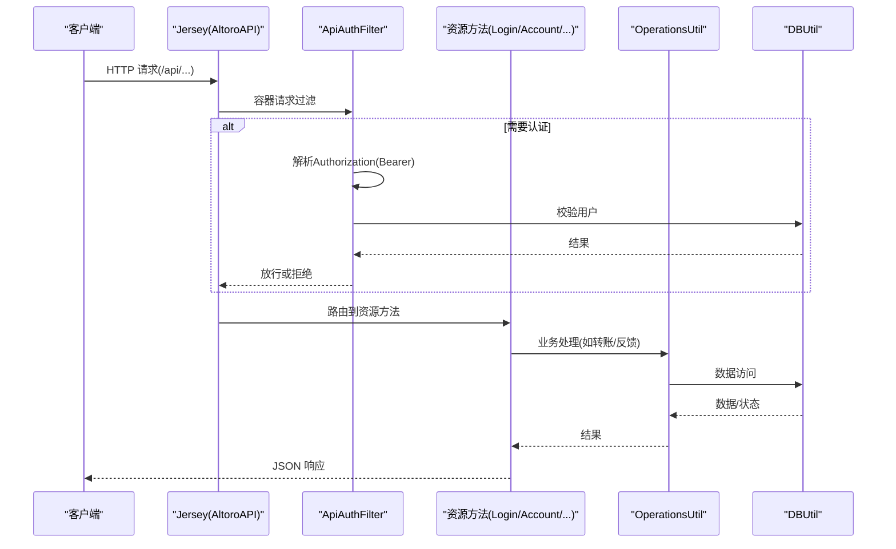
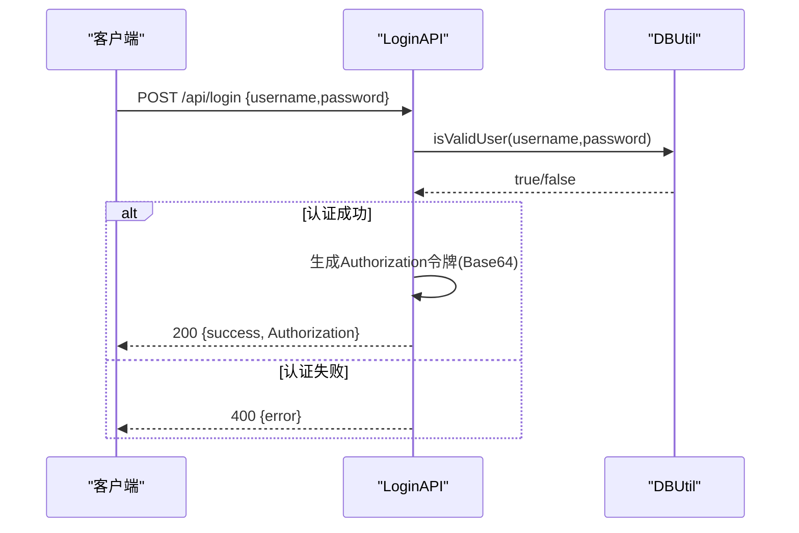
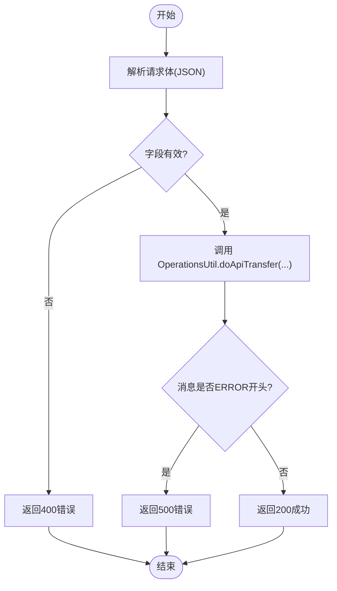
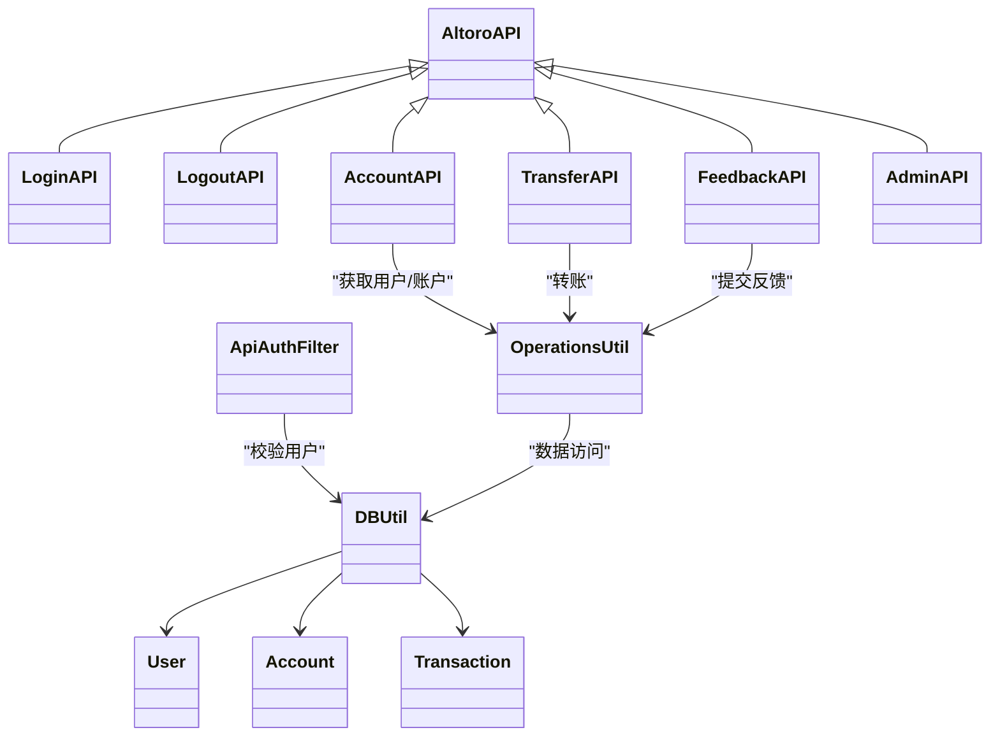

# REST API文档

<cite>
**本文引用的文件**   
- [AltoroAPI.java](file://src/com/ibm/security/appscan/altoromutual/api/AltoroAPI.java)
- [LoginAPI.java](file://src/com/ibm/security/appscan/altoromutual/api/LoginAPI.java)
- [LogoutAPI.java](file://src/com/ibm/security/appscan/altoromutual/api/LogoutAPI.java)
- [AccountAPI.java](file://src/com/ibm/security/appscan/altoromutual/api/AccountAPI.java)
- [AdminAPI.java](file://src/com/ibm/security/appscan/altoromutual/api/AdminAPI.java)
- [TransferAPI.java](file://src/com/ibm/security/appscan/altoromutual/api/TransferAPI.java)
- [FeedbackAPI.java](file://src/com/ibm/security/appscan/altoromutual/api/FeedbackAPI.java)
- [ApiAuthFilter.java](file://src/com/ibm/security/appscan/altoromutual/filter/ApiAuthFilter.java)
- [OperationsUtil.java](file://src/com/ibm/security/appscan/altoromutual/util/OperationsUtil.java)
- [DBUtil.java](file://src/com/ibm/security/appscan/altoromutual/util/DBUtil.java)
- [User.java](file://src/com/ibm/security/appscan/altoromutual/model/User.java)
- [Account.java](file://src/com/ibm/security/appscan/altoromutual/model/Account.java)
- [Transaction.java](file://src/com/ibm/security/appscan/altoromutual/model/Transaction.java)
- [web.xml](file://WebContent/WEB-INF/web.xml)
</cite>

## 目录
1. [简介](#简介)
2. [项目结构](#项目结构)
3. [核心组件](#核心组件)
4. [架构总览](#架构总览)
5. [详细接口规范](#详细接口规范)
6. [依赖关系分析](#依赖关系分析)
7. [性能与可扩展性](#性能与可扩展性)
8. [故障排查指南](#故障排查指南)
9. [结论](#结论)
10. [附录：安全与合规建议](#附录安全与合规建议)

## 简介
本文件为 AltoroJ 的 REST API 提供完整的技术文档。该服务基于 Jersey（JAX-RS）实现，统一挂载在 /api 路径下，并通过自定义过滤器进行认证鉴权。API 覆盖用户认证、账户查询、转账、反馈提交与管理员操作等能力。所有响应默认使用 JSON 格式。

## 项目结构
- REST 应用入口与注册
  - JAX-RS Application 类负责扫描资源包并注册全局过滤器。
  - web.xml 中配置 Jersey ServletContainer 指向 Application 类。
- 资源类（Resource）
  - 登录、登出、账户、转账、反馈、管理员等 REST 端点。
- 过滤器
  - 统一的 Bearer Token 认证过滤器，对未标记 PermitAll 的方法强制校验。
- 工具与模型
  - 业务工具类封装转账、反馈、用户解析等逻辑；数据访问层通过 DBUtil 访问 Derby 或外部 DataSource。
  - 领域模型包括 User、Account、Transaction 等。

```mermaid
graph TB
Client["客户端"] --> WebXML["web.xml<br/>Jersey ServletContainer"]
WebXML --> App["AltoroAPI<br/>@ApplicationPath(\"api\")"]
App --> Filter["ApiAuthFilter<br/>Bearer 认证"]
App --> Login["LoginAPI"]
App --> Logout["LogoutAPI"]
App --> Account["AccountAPI"]
App --> Transfer["TransferAPI"]
App --> Feedback["FeedbackAPI"]
App --> Admin["AdminAPI"]
Account --> Ops["OperationsUtil"]
Transfer --> Ops
Feedback --> Ops
Ops --> DB["DBUtil"]
DB --> Model["User/Account/Transaction"]
```

图表来源
- [AltoroAPI.java:9-14](file://src/com/ibm/security/appscan/altoromutual/api/AltoroAPI.java#L9-L14)
- [web.xml:60-68](file://WebContent/WEB-INF/web.xml#L60-L68)
- [ApiAuthFilter.java:20-74](file://src/com/ibm/security/appscan/altoromutual/filter/ApiAuthFilter.java#L20-L74)

章节来源
- [AltoroAPI.java:1-16](file://src/com/ibm/security/appscan/altoromutual/api/AltoroAPI.java#L1-L16)
- [web.xml:60-68](file://WebContent/WEB-INF/web.xml#L60-L68)

## 核心组件
- 应用装配
  - 通过 @ApplicationPath("api") 暴露 REST 根路径。
  - 自动扫描 api 包下的资源类。
  - 注册 ApiAuthFilter 作为容器请求过滤器。
- 认证过滤器
  - 支持 Bearer Token 认证。
  - 跳过标注了 @PermitAll 的资源方法。
  - 从 Authorization 头解析 Base64 编码的 token，校验用户名/密码有效性。
- 工具与数据访问
  - OperationsUtil 封装转账、反馈、用户解析等跨模块逻辑。
  - DBUtil 提供数据库连接、CRUD 与事务相关操作。
- 领域模型
  - User、Account、Transaction 描述核心实体。

章节来源
- [AltoroAPI.java:9-14](file://src/com/ibm/security/appscan/altoromutual/api/AltoroAPI.java#L9-L14)
- [ApiAuthFilter.java:20-74](file://src/com/ibm/security/appscan/altoromutual/filter/ApiAuthFilter.java#L20-L74)
- [OperationsUtil.java:18-36](file://src/com/ibm/security/appscan/altoromutual/util/OperationsUtil.java#L18-L36)
- [DBUtil.java:45-138](file://src/com/ibm/security/appscan/altoromutual/util/DBUtil.java#L45-L138)
- [User.java:30-107](file://src/com/ibm/security/appscan/altoromutual/model/User.java#L30-L107)
- [Account.java:32-121](file://src/com/ibm/security/appscan/altoromutual/model/Account.java#L32-L121)
- [Transaction.java:28-63](file://src/com/ibm/security/appscan/altoromutual/model/Transaction.java#L28-L63)

## 架构总览
下图展示了典型请求的生命周期：客户端请求进入 Jersey，经过认证过滤器，路由到具体资源方法，调用工具类与数据访问层，最终返回 JSON 响应。



图表来源
- [AltoroAPI.java:9-14](file://src/com/ibm/security/appscan/altoromutual/api/AltoroAPI.java#L9-L14)
- [ApiAuthFilter.java:29-74](file://src/com/ibm/security/appscan/altoromutual/filter/ApiAuthFilter.java#L29-L74)
- [OperationsUtil.java:18-36](file://src/com/ibm/security/appscan/altoromutual/util/OperationsUtil.java#L18-L36)
- [DBUtil.java:212-232](file://src/com/ibm/security/appscan/altoromutual/util/DBUtil.java#L212-L232)

## 详细接口规范

### 通用约定
- 基础路径
  - /api
- 内容类型
  - 请求/响应默认 application/json
- 认证方式
  - Bearer Token（Authorization: Bearer <token>）
  - 部分端点标注 @PermitAll，无需认证
- 错误响应
  - 多数错误以 JSON 对象形式返回，包含 error 字段
  - 常见HTTP状态码：200、400、401、500

### 认证与会话
- 登录
  - 方法：POST
  - URL：/api/login
  - 认证：无需认证（@PermitAll）
  - 请求体：JSON，包含 username、password
  - 成功响应：JSON，包含 success 与 Authorization（Base64 编码的令牌）
  - 失败响应：JSON，包含 error
- 检查登录状态
  - 方法：GET
  - URL：/api/login
  - 认证：无需认证（@PermitAll）
  - 响应：JSON，表示已登录状态
- 登出
  - 方法：GET
  - URL：/api/logout
  - 认证：无需认证（@PermitAll）
  - 响应：JSON，指示已登出



图表来源
- [LoginAPI.java:19-83](file://src/com/ibm/security/appscan/altoromutual/api/LoginAPI.java#L19-L83)
- [DBUtil.java:212-232](file://src/com/ibm/security/appscan/altoromutual/util/DBUtil.java#L212-L232)

章节来源
- [LoginAPI.java:19-83](file://src/com/ibm/security/appscan/altoromutual/api/LoginAPI.java#L19-L83)
- [LogoutAPI.java:13-29](file://src/com/ibm/security/appscan/altoromutual/api/LogoutAPI.java#L13-L29)

### 账户管理
- 获取当前用户的所有账户
  - 方法：GET
  - URL：/api/account
  - 认证：需要 Bearer Token
  - 响应：JSON，包含 Accounts 数组（id、Name）
- 获取指定账户余额与最近交易
  - 方法：GET
  - URL：/api/account/{accountNo}
  - 认证：需要 Bearer Token
  - 路径参数：accountNo（账户ID）
  - 响应：JSON，包含 balance、last_10_transactions、credits、debits、accountId
- 获取最近10笔交易
  - 方法：GET
  - URL：/api/account/{accountNo}/transactions
  - 认证：需要 Bearer Token
  - 路径参数：accountNo
  - 响应：JSON，包含 last_10_transactions
- 按日期范围查询交易
  - 方法：POST
  - URL：/api/account/{accountNo}/transactions
  - 认证：需要 Bearer Token
  - 路径参数：accountNo
  - 请求体：JSON，包含 startDate、endDate
  - 响应：JSON，包含 transactions 数组（id、date、account、type、amount），最多返回100条

注意
- 当前实现中对 accountNo 的权限校验较弱，存在越权风险。生产环境应严格校验“当前用户是否拥有该账户”。

章节来源
- [AccountAPI.java:23-237](file://src/com/ibm/security/appscan/altoromutual/api/AccountAPI.java#L23-L237)
- [OperationsUtil.java:134-144](file://src/com/ibm/security/appscan/altoromutual/util/OperationsUtil.java#L134-L144)
- [DBUtil.java:375-427](file://src/com/ibm/security/appscan/altoromutual/util/DBUtil.java#L375-L427)

### 转账
- 发起转账
  - 方法：POST
  - URL：/api/transfer
  - 认证：需要 Bearer Token
  - 请求体：JSON，包含 toAccount（收款账户）、fromAccount（付款账户）、transferAmount（金额）
  - 成功响应：JSON，包含 success 消息
  - 失败响应：JSON，包含 error 消息



图表来源
- [TransferAPI.java:14-44](file://src/com/ibm/security/appscan/altoromutual/api/TransferAPI.java#L14-L44)
- [OperationsUtil.java:18-36](file://src/com/ibm/security/appscan/altoromutual/util/OperationsUtil.java#L18-L36)

章节来源
- [TransferAPI.java:14-44](file://src/com/ibm/security/appscan/altoromutual/api/TransferAPI.java#L14-L44)
- [OperationsUtil.java:18-36](file://src/com/ibm/security/appscan/altoromutual/util/OperationsUtil.java#L18-L36)

### 反馈
- 提交反馈
  - 方法：POST
  - URL：/api/feedback/submit
  - 认证：无需认证（@PermitAll）
  - 请求体：JSON，包含 name、email、subject、message
  - 成功响应：JSON，包含 status 与 feedbackId（若启用反馈存储）
  - 失败响应：JSON，包含 Error
- 查询反馈详情
  - 方法：GET
  - URL：/api/feedback/{feedbackId}
  - 认证：需要 Bearer Token
  - 路径参数：feedbackId
  - 响应：JSON，包含 name、email、subject、message

章节来源
- [FeedbackAPI.java:19-92](file://src/com/ibm/security/appscan/altoromutual/api/FeedbackAPI.java#L19-L92)
- [OperationsUtil.java:119-132](file://src/com/ibm/security/appscan/altoromutual/util/OperationsUtil.java#L119-L132)

### 管理员操作
- 修改密码
  - 方法：POST
  - URL：/api/admin/changePassword
  - 认证：需要 Bearer Token
  - 请求体：JSON，包含 username、password1、password2
  - 成功响应：JSON，包含 success
  - 失败响应：JSON，包含 error
- 添加用户
  - 方法：POST
  - URL：/api/admin/addUser
  - 认证：需要 Bearer Token
  - 请求体：JSON，包含 firstname、lastname、username、password1、password2
  - 成功响应：JSON，包含 success
  - 失败响应：JSON，包含 error

注意
- 管理员功能受应用属性 enableAdminFunctions 控制，仅在开启时执行实际变更。

章节来源
- [AdminAPI.java:17-112](file://src/com/ibm/security/appscan/altoromutual/api/AdminAPI.java#L17-L112)
- [DBUtil.java:495-517](file://src/com/ibm/security/appscan/altoromutual/util/DBUtil.java#L495-L517)

## 依赖关系分析
- 资源类依赖
  - LoginAPI、LogoutAPI、AccountAPI、TransferAPI、FeedbackAPI、AdminAPI 均继承自 AltoroAPI，共享过滤器与应用配置。
- 过滤器依赖
  - ApiAuthFilter 依赖 DBUtil 进行用户校验。
- 工具与数据访问
  - OperationsUtil 依赖 DBUtil 与 ServletUtil（用于读取应用属性）。
  - DBUtil 直接访问数据库，构造 SQL 语句并返回领域对象。
- 模型依赖
  - User、Account、Transaction 由 DBUtil 构建并返回给上层。



图表来源
- [AltoroAPI.java:9-14](file://src/com/ibm/security/appscan/altoromutual/api/AltoroAPI.java#L9-L14)
- [ApiAuthFilter.java:20-74](file://src/com/ibm/security/appscan/altoromutual/filter/ApiAuthFilter.java#L20-L74)
- [OperationsUtil.java:18-36](file://src/com/ibm/security/appscan/altoromutual/util/OperationsUtil.java#L18-L36)
- [DBUtil.java:45-138](file://src/com/ibm/security/appscan/altoromutual/util/DBUtil.java#L45-L138)

章节来源
- [AltoroAPI.java:1-16](file://src/com/ibm/security/appscan/altoromutual/api/AltoroAPI.java#L1-L16)
- [ApiAuthFilter.java:20-74](file://src/com/ibm/security/appscan/altoromutual/filter/ApiAuthFilter.java#L20-L74)
- [OperationsUtil.java:18-155](file://src/com/ibm/security/appscan/altoromutual/util/OperationsUtil.java#L18-L155)
- [DBUtil.java:45-536](file://src/com/ibm/security/appscan/altoromutual/util/DBUtil.java#L45-L536)

## 性能与可扩展性
- 数据库连接
  - DBUtil 支持外部 DataSource 或内置 Derby；可通过应用属性切换。
  - 建议在部署环境中配置连接池以提升并发性能。
- 查询限制
  - 交易查询默认限制返回100条，避免大结果集影响性能。
- 序列化
  - 当前大量字符串拼接构建 JSON，建议使用结构化 JSON 库提升性能与可读性。
- 缓存
  - 可考虑对频繁读取的用户信息、账户列表进行短期缓存，降低数据库压力。
- 速率限制
  - 当前未实现速率限制；建议在生产环境引入网关或过滤器进行限流与防刷。

[本节为通用指导，不直接分析具体文件]

## 故障排查指南
- 认证失败
  - 现象：401 Unauthorized，提示未登录
  - 排查：确认 Authorization 头是否为 Bearer Token；Token 是否由 /api/login 返回；用户名/密码是否正确
- 请求体格式错误
  - 现象：400 Bad Request，提示非 JSON 或缺少字段
  - 排查：确保 Content-Type 为 application/json；请求体包含必需字段
- 数据库异常
  - 现象：500 Internal Server Error
  - 排查：检查数据库连接、表结构与初始化脚本；查看日志中的 SQL 错误
- 管理员功能不可用
  - 现象：管理员接口返回错误或无效果
  - 排查：确认应用属性 enableAdminFunctions 是否开启

章节来源
- [ApiAuthFilter.java:29-74](file://src/com/ibm/security/appscan/altoromutual/filter/ApiAuthFilter.java#L29-L74)
- [LoginAPI.java:29-83](file://src/com/ibm/security/appscan/altoromutual/api/LoginAPI.java#L29-L83)
- [DBUtil.java:99-138](file://src/com/ibm/security/appscan/altoromutual/util/DBUtil.java#L99-L138)

## 结论
AltoroJ 的 REST API 基于 Jersey 提供了基础的银行场景能力，涵盖认证、账户查询、转账、反馈与管理员操作。当前实现适合演示与测试，但在安全性（SQL注入、越权）、健壮性（错误处理一致性）与性能（序列化、连接池、限流）方面仍有改进空间。建议在生产环境中强化认证与授权、采用参数化查询、完善错误模型与监控告警。

[本节为总结性内容，不直接分析具体文件]

## 附录：安全与合规建议
- 认证与授权
  - 将 Bearer Token 替换为更安全的机制（如 JWT），并设置过期时间。
  - 对所有敏感接口实施细粒度权限控制，避免 IDOR 漏洞。
- 输入校验
  - 对所有输入进行白名单校验与长度限制，防止注入与溢出。
- 数据安全
  - 传输层强制 TLS；敏感字段加密存储；避免在日志中输出敏感信息。
- 审计与监控
  - 记录关键操作的审计日志；接入指标与告警系统。
- 版本管理
  - 建议引入 API 版本前缀（如 /api/v1）以便向后兼容与平滑升级。

[本节为通用指导，不直接分析具体文件]