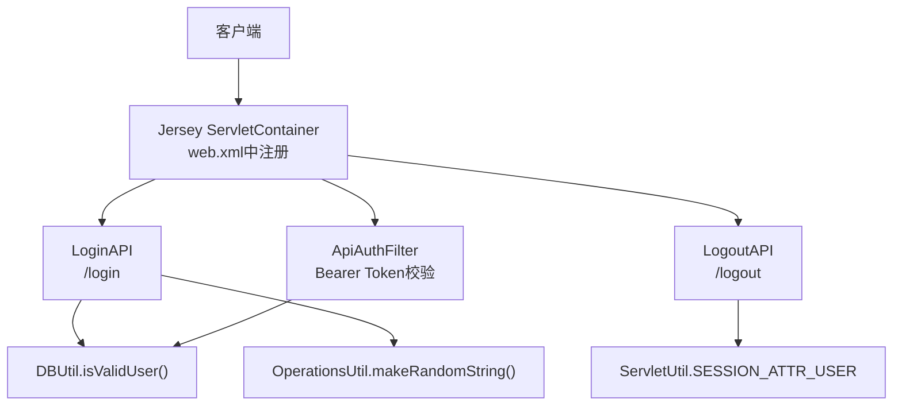
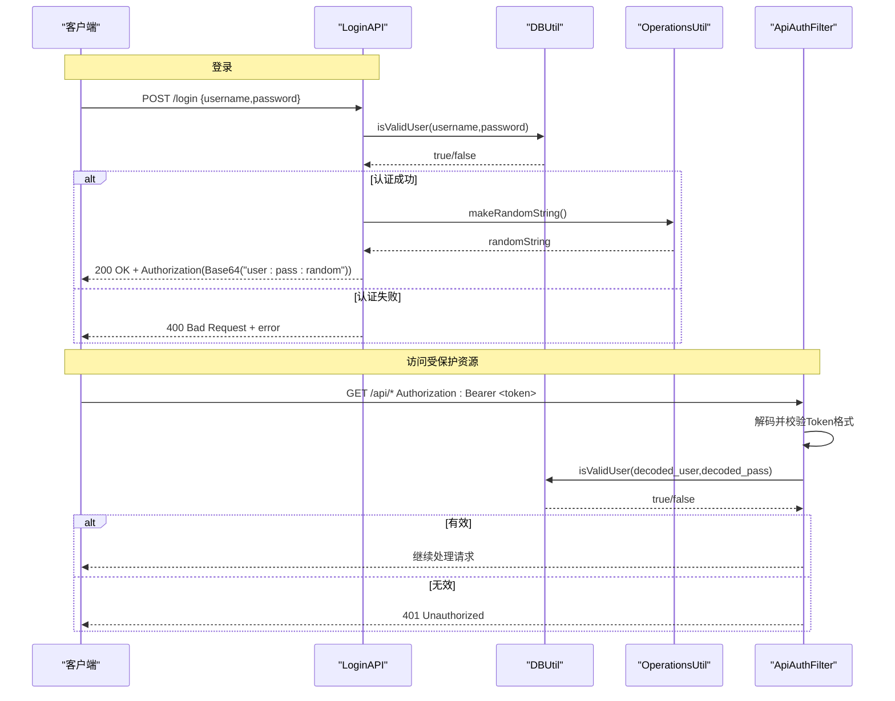
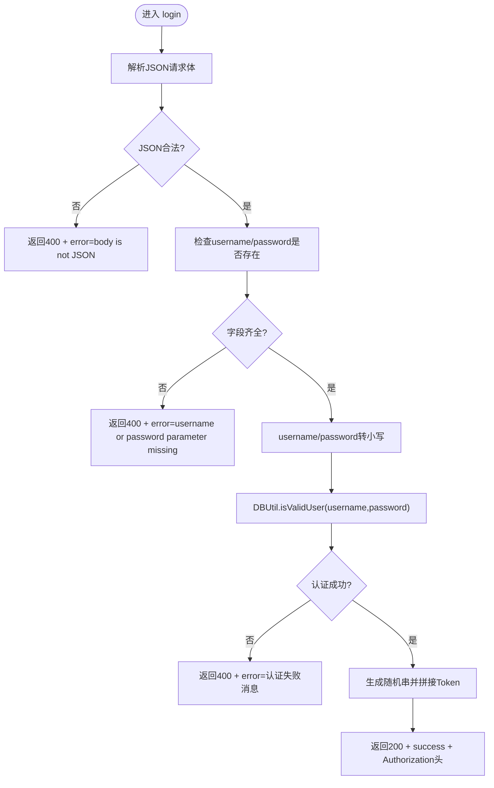
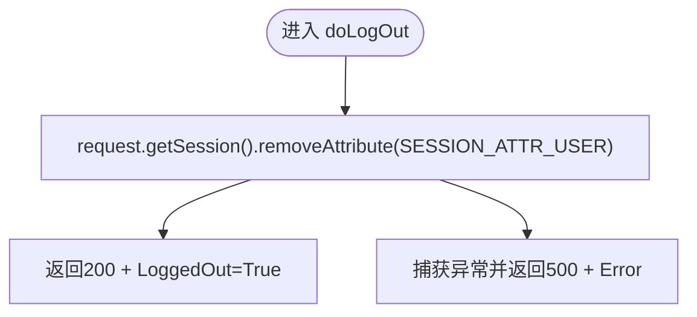
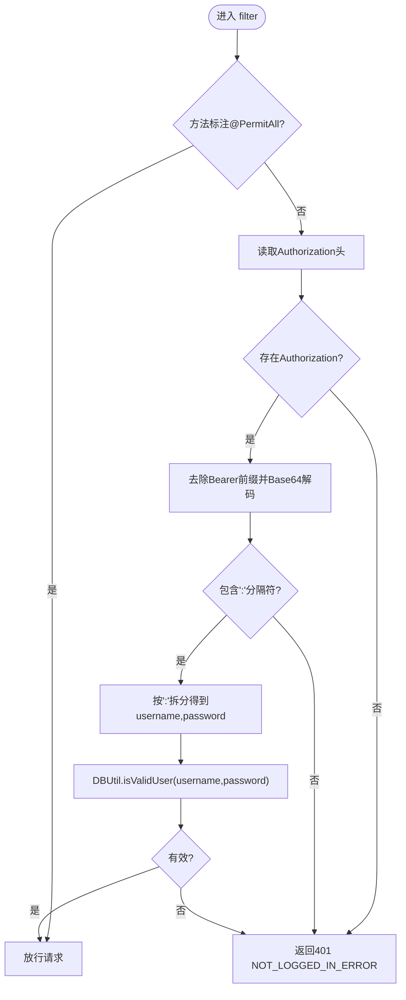
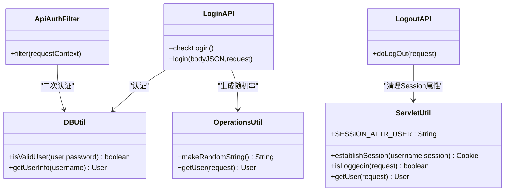

# 用户认证API

<cite>
**本文引用的文件**   
- [LoginAPI.java](file://src/com/ibm/security/appscan/altoromutual/api/LoginAPI.java)
- [LogoutAPI.java](file://src/com/ibm/security/appscan/altoromutual/api/LogoutAPI.java)
- [ApiAuthFilter.java](file://src/com/ibm/security/appscan/altoromutual/filter/ApiAuthFilter.java)
- [AuthFilter.java](file://src/com/ibm/security/appscan/altoromutual/filter/AuthFilter.java)
- [DBUtil.java](file://src/com/ibm/security/appscan/altoromutual/util/DBUtil.java)
- [OperationsUtil.java](file://src/com/ibm/security/appscan/altoromutual/util/OperationsUtil.java)
- [ServletUtil.java](file://src/com/ibm/security/appscan/altoromutual/util/ServletUtil.java)
- [User.java](file://src/com/ibm/security/appscan/altoromutual/model/User.java)
- [web.xml](file://WebContent/WEB-INF/web.xml)
</cite>

## 目录
1. [简介](#简介)
2. [项目结构](#项目结构)
3. [核心组件](#核心组件)
4. [架构总览](#架构总览)
5. [详细组件分析](#详细组件分析)
6. [依赖关系分析](#依赖关系分析)
7. [性能与可扩展性](#性能与可扩展性)
8. [故障排查指南](#故障排查指南)
9. [结论](#结论)
10. [附录：API规范与调用示例](#附录api规范与调用示例)

## 简介
本文件为用户认证相关REST API的权威文档，覆盖登录、登出等认证操作的端点规范、身份验证流程、会话与Token机制、错误处理策略、密码安全考虑以及最佳实践建议。该实现基于JAX-RS（Jersey）提供REST接口，并通过过滤器进行鉴权；同时结合数据库工具类完成用户校验。

## 项目结构
认证相关的代码主要分布在以下模块：
- REST API层：登录与登出接口
- 鉴权过滤器：对REST请求进行Bearer Token校验
- 业务工具类：数据库访问、随机字符串生成、会话辅助
- 模型类：用户实体
- Web部署配置：Servlet容器与过滤器映射

图表来源
- [web.xml:60-68](file://WebContent/WEB-INF/web.xml#L60-L68)
- [LoginAPI.java:19-83](file://src/com/ibm/security/appscan/altoromutual/api/LoginAPI.java#L19-L83)
- [LogoutAPI.java:13-29](file://src/com/ibm/security/appscan/altoromutual/api/LogoutAPI.java#L13-L29)
- [ApiAuthFilter.java:20-75](file://src/com/ibm/security/appscan/altoromutual/filter/ApiAuthFilter.java#L20-L75)
- [DBUtil.java:212-232](file://src/com/ibm/security/appscan/altoromutual/util/DBUtil.java#L212-L232)
- [OperationsUtil.java:146-152](file://src/com/ibm/security/appscan/altoromutual/util/OperationsUtil.java#L146-L152)
- [ServletUtil.java:60-68](file://src/com/ibm/security/appscan/altoromutual/util/ServletUtil.java#L60-L68)

章节来源
- [web.xml:60-68](file://WebContent/WEB-INF/web.xml#L60-L68)

## 核心组件
- 登录接口（POST /login）
  - 接收JSON体，包含username与password字段
  - 校验参数完整性
  - 通过DBUtil.isValidUser进行用户名密码校验
  - 成功后返回成功消息与Authorization头（Base64编码的自定义Token）
- 登出接口（GET /logout）
  - 从当前Session移除用户属性
  - 返回登出成功响应
- 鉴权过滤器（ApiAuthFilter）
  - 对未标注@PermitAll的资源强制要求Authorization头
  - 解析Bearer Token，解码后按“用户名:密码:随机串”格式校验
  - 使用DBUtil.isValidUser再次校验用户有效性
- 数据库工具（DBUtil）
  - isValidUser用于用户认证
  - getUserInfo用于根据用户名获取用户信息
- 会话工具（ServletUtil）
  - 定义Session属性键常量
  - 提供建立会话、判断是否登录等方法（主要用于传统Servlet/JSP路径）

章节来源
- [LoginAPI.java:19-83](file://src/com/ibm/security/appscan/altoromutual/api/LoginAPI.java#L19-L83)
- [LogoutAPI.java:13-29](file://src/com/ibm/security/appscan/altoromutual/api/LogoutAPI.java#L13-L29)
- [ApiAuthFilter.java:20-75](file://src/com/ibm/security/appscan/altoromutual/filter/ApiAuthFilter.java#L20-L75)
- [DBUtil.java:212-232](file://src/com/ibm/security/appscan/altoromutual/util/DBUtil.java#L212-L232)
- [ServletUtil.java:60-68](file://src/com/ibm/security/appscan/altoromutual/util/ServletUtil.java#L60-L68)

## 架构总览
认证流程分为两条主线：
- 登录流程：客户端提交用户名密码 → 服务端校验 → 生成并返回Token
- 受保护资源访问：客户端携带Bearer Token → 过滤器校验 → 允许或拒绝访问

图表来源
- [LoginAPI.java:29-81](file://src/com/ibm/security/appscan/altoromutual/api/LoginAPI.java#L29-L81)
- [ApiAuthFilter.java:30-74](file://src/com/ibm/security/appscan/altoromutual/filter/ApiAuthFilter.java#L30-L74)
- [DBUtil.java:212-232](file://src/com/ibm/security/appscan/altoromutual/util/DBUtil.java#L212-L232)
- [OperationsUtil.java:146-152](file://src/com/ibm/security/appscan/altoromutual/util/OperationsUtil.java#L146-L152)

## 详细组件分析

### 登录接口（POST /login）
- 功能说明
  - 校验请求体是否为合法JSON，且包含username与password
  - 将用户名和密码统一转为小写后校验
  - 调用DBUtil.isValidUser进行认证
  - 认证成功后返回success消息与Authorization头
- 输入规范
  - Content-Type: application/json
  - Body: {"username": "...", "password": "..."}
- 输出规范
  - 成功：200 OK，Body包含success字段，Header包含Authorization
  - 失败：400 Bad Request，Body包含error字段
- 关键逻辑
  - 参数缺失或JSON非法时直接返回错误
  - 认证失败抛出异常并被捕获，返回错误消息
  - Token构造为Base64("username:password:random")

图表来源
- [LoginAPI.java:29-81](file://src/com/ibm/security/appscan/altoromutual/api/LoginAPI.java#L29-L81)
- [DBUtil.java:212-232](file://src/com/ibm/security/appscan/altoromutual/util/DBUtil.java#L212-L232)
- [OperationsUtil.java:146-152](file://src/com/ibm/security/appscan/altoromutual/util/OperationsUtil.java#L146-L152)

章节来源
- [LoginAPI.java:29-81](file://src/com/ibm/security/appscan/altoromutual/api/LoginAPI.java#L29-L81)

### 登出接口（GET /logout）
- 功能说明
  - 从当前Session移除用户属性（SESSION_ATTR_USER）
  - 返回登出成功响应
- 输入规范
  - 无特殊输入要求
- 输出规范
  - 成功：200 OK，Body包含LoggedOut字段
  - 失败：500 Internal Server Error，Body包含Error字段
- 注意
  - 该接口仅清理Session中的用户属性，不销毁整个Session
  - 对于REST API鉴权，登出不会使已颁发的Token失效

图表来源
- [LogoutAPI.java:16-28](file://src/com/ibm/security/appscan/altoromutual/api/LogoutAPI.java#L16-L28)
- [ServletUtil.java:60-68](file://src/com/ibm/security/appscan/altoromutual/util/ServletUtil.java#L60-L68)

章节来源
- [LogoutAPI.java:16-28](file://src/com/ibm/security/appscan/altoromutual/api/LogoutAPI.java#L16-L28)

### 鉴权过滤器（ApiAuthFilter）
- 功能说明
  - 对未标注@PermitAll的资源强制要求Authorization头
  - 支持Bearer方案，解码Token并按“用户名:密码:随机串”格式校验
  - 使用DBUtil.isValidUser二次校验用户有效性
- 输入规范
  - Header: Authorization: Bearer <Base64("username:password:random")>
- 输出规范
  - 未授权：401 Unauthorized，Body包含NOT_LOGGED_IN_ERROR
  - 服务器错误：500 Internal Server Error，Body包含错误详情
- 关键逻辑
  - 若缺少Authorization头或格式不符，直接拒绝
  - 解码后若不含分隔符“:”，拒绝
  - 使用DBUtil.isValidUser校验用户名密码

图表来源
- [ApiAuthFilter.java:30-74](file://src/com/ibm/security/appscan/altoromutual/filter/ApiAuthFilter.java#L30-L74)
- [DBUtil.java:212-232](file://src/com/ibm/security/appscan/altoromutual/util/DBUtil.java#L212-L232)

章节来源
- [ApiAuthFilter.java:30-74](file://src/com/ibm/security/appscan/altoromutual/filter/ApiAuthFilter.java#L30-L74)

### 数据模型与工具类
- User模型
  - 包含用户名、姓名、角色、最近访问时间等属性
  - 提供账户查询、交易查询等方法（与认证无直接耦合）
- DBUtil
  - isValidUser：用户认证的核心方法
  - getUserInfo：根据用户名获取用户信息
- OperationsUtil
  - makeRandomString：生成随机字符串，用于Token拼接
  - getUser：从Authorization头解析用户名并获取用户信息（供其他API使用）
- ServletUtil
  - SESSION_ATTR_USER：Session中存储用户的键
  - establishSession/isLoggedin/getUser：传统Servlet/JSP路径的会话管理

章节来源
- [User.java:30-107](file://src/com/ibm/security/appscan/altoromutual/model/User.java#L30-L107)
- [DBUtil.java:212-232](file://src/com/ibm/security/appscan/altoromutual/util/DBUtil.java#L212-L232)
- [OperationsUtil.java:134-152](file://src/com/ibm/security/appscan/altoromutual/util/OperationsUtil.java#L134-L152)
- [ServletUtil.java:60-68](file://src/com/ibm/security/appscan/altoromutual/util/ServletUtil.java#L60-L68)

## 依赖关系分析
- LoginAPI依赖
  - DBUtil.isValidUser：用户认证
  - OperationsUtil.makeRandomString：生成随机串
  - Base64：编码Token
- ApiAuthFilter依赖
  - Base64：解码Authorization头
  - DBUtil.isValidUser：二次校验用户有效性
- LogoutAPI依赖
  - ServletUtil.SESSION_ATTR_USER：Session属性键
- web.xml
  - 注册Jersey ServletContainer，指向AltoroAPI应用类

图表来源
- [LoginAPI.java:19-83](file://src/com/ibm/security/appscan/altoromutual/api/LoginAPI.java#L19-L83)
- [LogoutAPI.java:13-29](file://src/com/ibm/security/appscan/altoromutual/api/LogoutAPI.java#L13-L29)
- [ApiAuthFilter.java:20-75](file://src/com/ibm/security/appscan/altoromutual/filter/ApiAuthFilter.java#L20-L75)
- [DBUtil.java:212-232](file://src/com/ibm/security/appscan/altoromutual/util/DBUtil.java#L212-L232)
- [OperationsUtil.java:134-152](file://src/com/ibm/security/appscan/altoromutual/util/OperationsUtil.java#L134-L152)
- [ServletUtil.java:60-68](file://src/com/ibm/security/appscan/altoromutual/util/ServletUtil.java#L60-L68)

章节来源
- [web.xml:60-68](file://WebContent/WEB-INF/web.xml#L60-L68)

## 性能与可扩展性
- 认证路径涉及数据库查询，建议在高频场景下引入缓存（如Redis）以减少DB压力
- Token生成目前使用简单随机串，可升级为JWT以支持有效期控制与签名校验
- 鉴权过滤器在每次请求都进行Base64解码与DB校验，可考虑本地缓存用户凭据哈希以提升性能
- 建议增加限流与防暴力破解机制（如失败次数限制、账号锁定）

[本节为通用指导，不涉及具体文件分析]

## 故障排查指南
- 登录失败
  - 检查请求体是否为合法JSON且包含username与password
  - 确认用户名密码是否正确（DBUtil.isValidUser）
  - 查看返回的错误消息定位问题
- 访问受保护资源被拒
  - 确认Authorization头是否存在且格式正确（Bearer + Base64 Token）
  - 检查Token是否由登录接口返回且未被篡改
  - 查看过滤器日志或返回的401错误消息
- 登出后仍被拒绝
  - 登出仅清理Session属性，不影响已颁发的Token
  - 如需立即失效，需实现Token黑名单或缩短有效期

章节来源
- [LoginAPI.java:29-81](file://src/com/ibm/security/appscan/altoromutual/api/LoginAPI.java#L29-L81)
- [ApiAuthFilter.java:30-74](file://src/com/ibm/security/appscan/altoromutual/filter/ApiAuthFilter.java#L30-L74)
- [LogoutAPI.java:16-28](file://src/com/ibm/security/appscan/altoromutual/api/LogoutAPI.java#L16-L28)

## 结论
该认证实现提供了基础的登录、登出与Bearer Token鉴权能力。其优点是实现简洁、易于理解；缺点在于Token安全性较弱（明文密码参与Token）、缺乏有效期控制与刷新机制。建议在生产环境中采用标准JWT、HTTPS传输、密码哈希存储、速率限制与会话绑定等安全措施。

[本节为总结性内容，不涉及具体文件分析]

## 附录：API规范与调用示例

### 登录
- 端点
  - POST /login
- 请求头
  - Content-Type: application/json
- 请求体
  - {"username": "jsmith", "password": "demo1234"}
- 成功响应
  - 状态码：200 OK
  - Body: {"success": "...", "Authorization": "<Base64('username:password:random')>"}
- 失败响应
  - 状态码：400 Bad Request
  - Body: {"error": "..."}

章节来源
- [LoginAPI.java:29-81](file://src/com/ibm/security/appscan/altoromutual/api/LoginAPI.java#L29-L81)

### 登出
- 端点
  - GET /logout
- 成功响应
  - 状态码：200 OK
  - Body: {"LoggedOut": "True"}
- 失败响应
  - 状态码：500 Internal Server Error
  - Body: {"Error": "Unknown error encountered"}

章节来源
- [LogoutAPI.java:16-28](file://src/com/ibm/security/appscan/altoromutual/api/LogoutAPI.java#L16-L28)

### 受保护资源访问
- 请求头
  - Authorization: Bearer <Base64("username:password:random")>
- 成功
  - 继续处理目标API
- 失败
  - 401 Unauthorized，Body包含NOT_LOGGED_IN_ERROR

章节来源
- [ApiAuthFilter.java:30-74](file://src/com/ibm/security/appscan/altoromutual/filter/ApiAuthFilter.java#L30-L74)

### 认证失败的错误处理策略
- 登录阶段
  - JSON非法或缺少必要字段：400 Bad Request + error
  - 用户名密码错误：400 Bad Request + error
  - 内部异常：500 Internal Server Error + error
- 鉴权阶段
  - 缺少Authorization头或格式错误：401 Unauthorized
  - 用户无效：401 Unauthorized
  - 数据库异常：500 Internal Server Error

章节来源
- [LoginAPI.java:29-81](file://src/com/ibm/security/appscan/altoromutual/api/LoginAPI.java#L29-L81)
- [ApiAuthFilter.java:30-74](file://src/com/ibm/security/appscan/altoromutual/filter/ApiAuthFilter.java#L30-L74)

### 密码安全考虑与最佳实践
- 当前实现将明文密码参与Token构造，存在泄露风险
- 建议：
  - 使用HTTPS传输所有认证请求
  - 密码在数据库中应使用强哈希算法存储（如bcrypt）
  - Token应使用JWT并设置过期时间，支持刷新令牌
  - 实施速率限制与账号锁定策略
  - 避免在日志中记录敏感信息

[本节为通用指导，不涉及具体文件分析]

### 会话管理与Token有效期控制
- 当前实现
  - Session仅在传统Servlet/JSP路径中使用，REST API通过Bearer Token鉴权
  - Token无有效期控制，登出不影响已颁发Token
- 建议改进
  - 引入JWT并设置exp字段
  - 实现Token黑名单或短期有效期+刷新机制
  - 将用户上下文（如角色）放入Token载荷，减少后续DB查询

章节来源
- [ServletUtil.java:60-68](file://src/com/ibm/security/appscan/altoromutual/util/ServletUtil.java#L60-L68)
- [ApiAuthFilter.java:30-74](file://src/com/ibm/security/appscan/altoromutual/filter/ApiAuthFilter.java#L30-L74)