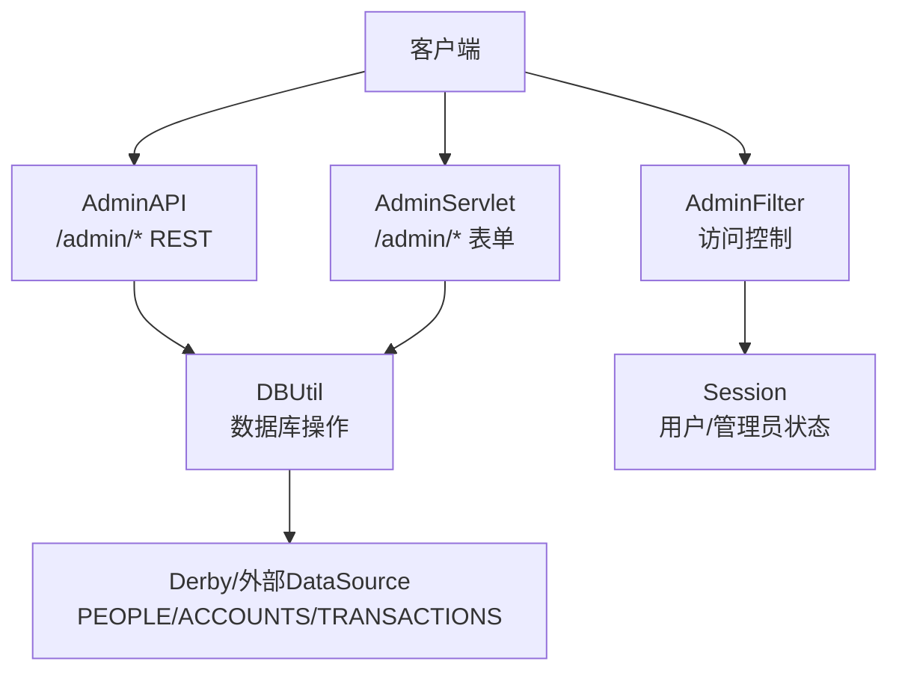
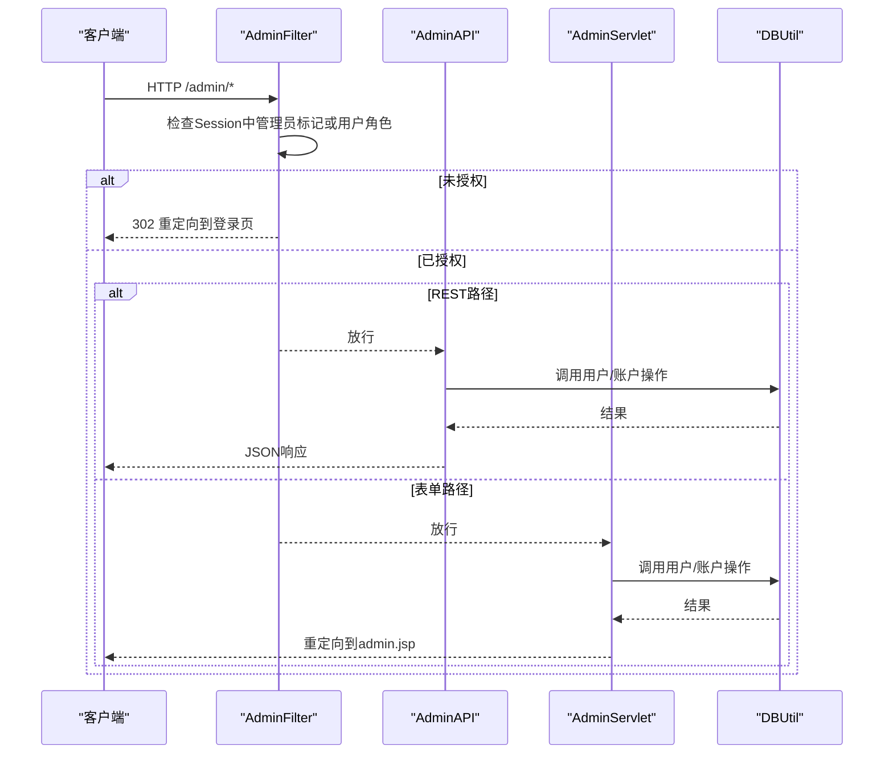
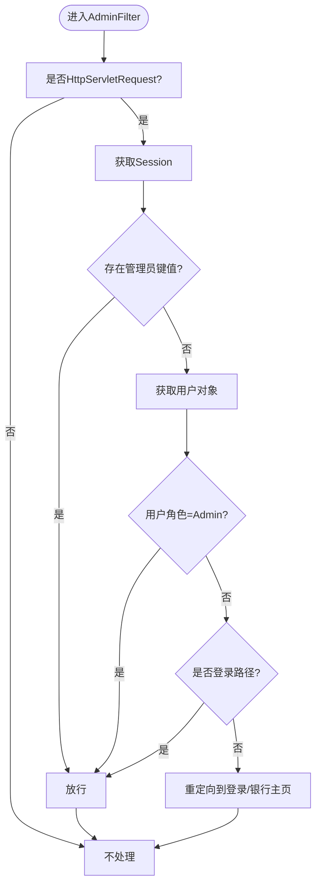
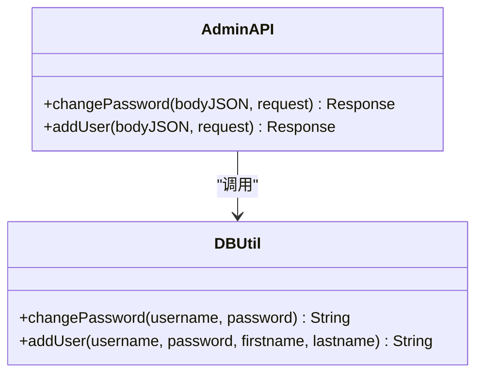
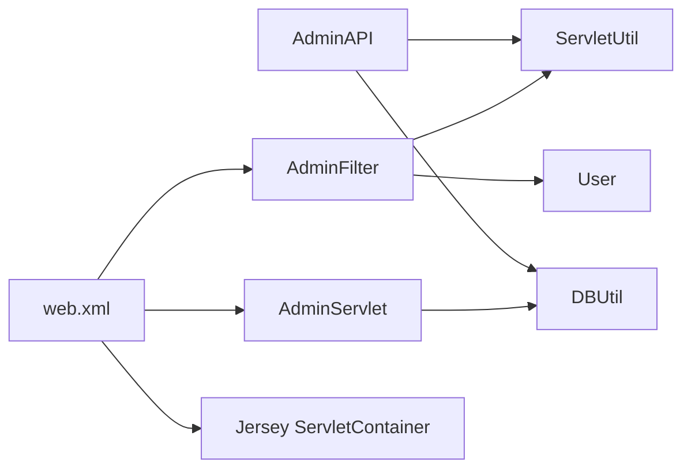

# 管理员API

<cite>
**本文引用的文件**   
- [AdminAPI.java](file://src/com/ibm/security/appscan/altoromutual/api/AdminAPI.java)
- [AdminFilter.java](file://src/com/ibm/security/appscan/altoromutual/filter/AdminFilter.java)
- [AdminServlet.java](file://src/com/ibm/security/appscan/altoromutual/servlet/AdminServlet.java)
- [DBUtil.java](file://src/com/ibm/security/appscan/altoromutual/util/DBUtil.java)
- [ServletUtil.java](file://src/com/ibm/security/appscan/altoromutual/util/ServletUtil.java)
- [User.java](file://src/com/ibm/security/appscan/altoromutual/model/User.java)
- [Account.java](file://src/com/ibm/security/appscan/altoromutual/model/Account.java)
- [web.xml](file://WebContent/WEB-INF/web.xml)
- [properties.json](file://WebContent/swagger/properties.json)
</cite>

## 目录
1. [简介](#简介)
2. [项目结构](#项目结构)
3. [核心组件](#核心组件)
4. [架构总览](#架构总览)
5. [详细组件分析](#详细组件分析)
6. [依赖关系分析](#依赖关系分析)
7. [性能与事务特性](#性能与事务特性)
8. [安全与审计](#安全与审计)
9. [故障排查指南](#故障排查指南)
10. [结论](#结论)
11. [附录：管理员接口规范](#附录管理员接口规范)

## 简介
本文件为管理员专用REST API的权威文档，覆盖用户管理、账户管理与系统配置等能力。重点说明：
- 管理员权限验证机制与角色控制逻辑
- 用户CRUD（创建、修改密码）、账户管理等接口的完整规范
- 请求示例与响应格式（含批量操作与事务处理现状）
- 安全防护措施与审计日志记录
- 最佳实践与安全建议

## 项目结构
管理员相关功能由以下层次组成：
- REST层：JAX-RS资源类 AdminAPI，暴露 /admin/* 端点
- Web层：传统Servlet AdminServlet，提供表单式管理入口
- 过滤器：AdminFilter，对/admin路径进行访问控制
- 数据层：DBUtil，封装数据库操作（用户、账户、交易等）
- 模型层：User、Account，承载领域对象
- 配置：web.xml定义Servlet与Filter映射；Swagger properties.json描述API元信息

图表来源
- [AdminAPI.java:17-112](file://src/com/ibm/security/appscan/altoromutual/api/AdminAPI.java#L17-L112)
- [AdminServlet.java:33-124](file://src/com/ibm/security/appscan/altoromutual/servlet/AdminServlet.java#L33-L124)
- [AdminFilter.java:40-81](file://src/com/ibm/security/appscan/altoromutual/filter/AdminFilter.java#L40-L81)
- [DBUtil.java:45-167](file://src/com/ibm/security/appscan/altoromutual/util/DBUtil.java#L45-L167)
- [web.xml:12-51](file://WebContent/WEB-INF/web.xml#L12-L51)

章节来源
- [AdminAPI.java:17-112](file://src/com/ibm/security/appscan/altoromutual/api/AdminAPI.java#L17-L112)
- [AdminServlet.java:33-124](file://src/com/ibm/security/appscan/altoromutual/servlet/AdminServlet.java#L33-L124)
- [AdminFilter.java:40-81](file://src/com/ibm/security/appscan/altoromutual/filter/AdminFilter.java#L40-L81)
- [web.xml:12-51](file://WebContent/WEB-INF/web.xml#L12-L51)

## 核心组件
- AdminAPI：基于JAX-RS的管理员REST接口，当前实现包含“重置密码”和“添加用户”。
- AdminFilter：对/admin路径进行鉴权，要求会话中存在管理员标记或用户角色为Admin。
- AdminServlet：传统表单式管理入口，支持添加账户、添加用户、重置密码。
- DBUtil：统一数据库访问，提供用户/账户/交易的增删改查与初始化。
- ServletUtil：应用属性读取、会话建立、Swagger基础路径初始化等工具方法。
- User/Account：领域模型，User包含角色枚举Role(User/Admin)。

章节来源
- [AdminAPI.java:17-112](file://src/com/ibm/security/appscan/altoromutual/api/AdminAPI.java#L17-L112)
- [AdminFilter.java:40-81](file://src/com/ibm/security/appscan/altoromutual/filter/AdminFilter.java#L40-L81)
- [AdminServlet.java:33-124](file://src/com/ibm/security/appscan/altoromutual/servlet/AdminServlet.java#L33-L124)
- [DBUtil.java:45-536](file://src/com/ibm/security/appscan/altoromutual/util/DBUtil.java#L45-L536)
- [ServletUtil.java:58-412](file://src/com/ibm/security/appscan/altoromutual/util/ServletUtil.java#L58-L412)
- [User.java:30-108](file://src/com/ibm/security/appscan/altoromutual/model/User.java#L30-L108)
- [Account.java:32-122](file://src/com/ibm/security/appscan/altoromutual/model/Account.java#L32-L122)

## 架构总览
管理员API的请求流程如下：
- 客户端发起HTTP请求到/admin/*
- 若命中AdminFilter，则校验会话中的管理员标识或用户角色是否为Admin
- 通过过滤后进入AdminAPI（REST）或AdminServlet（表单）
- 业务逻辑调用DBUtil执行数据库操作
- 返回JSON或重定向至管理页面

图表来源
- [AdminFilter.java:58-81](file://src/com/ibm/security/appscan/altoromutual/filter/AdminFilter.java#L58-L81)
- [AdminAPI.java:20-112](file://src/com/ibm/security/appscan/altoromutual/api/AdminAPI.java#L20-L112)
- [AdminServlet.java:39-120](file://src/com/ibm/security/appscan/altoromutual/servlet/AdminServlet.java#L39-L120)
- [DBUtil.java:495-517](file://src/com/ibm/security/appscan/altoromutual/util/DBUtil.java#L495-L517)

## 详细组件分析

### 管理员权限验证与角色控制
- AdminFilter在doFilter中检查：
  - 会话中是否存在管理员键值（SESSION_ATTR_ADMIN_KEY/SESSION_ATTR_ADMIN_VALUE）
  - 或当前用户对象的Role为Admin
- 允许的路径包括/admin/login.jsp与/admin/doAdminLogin
- 未登录或非管理员将被重定向到登录页或银行主页

图表来源
- [AdminFilter.java:58-81](file://src/com/ibm/security/appscan/altoromutual/filter/AdminFilter.java#L58-L81)
- [ServletUtil.java:60-62](file://src/com/ibm/security/appscan/altoromutual/util/ServletUtil.java#L60-L62)
- [User.java:34-54](file://src/com/ibm/security/appscan/altoromutual/model/User.java#L34-L54)

章节来源
- [AdminFilter.java:40-81](file://src/com/ibm/security/appscan/altoromutual/filter/AdminFilter.java#L40-L81)
- [ServletUtil.java:60-62](file://src/com/ibm/security/appscan/altoromutual/util/ServletUtil.java#L60-L62)
- [User.java:34-54](file://src/com/ibm/security/appscan/altoromutual/model/User.java#L34-L54)

### REST接口：AdminAPI
- 基路径：/admin
- 当前实现：
  - POST /admin/changePassword：管理员重置用户密码
  - POST /admin/addUser：管理员新增用户
- 参数解析：从请求体JSON中解析字段
- 开关控制：仅当应用属性 enableAdminFunctions=true 时执行实际数据库操作
- 错误处理：
  - JSON解析失败返回500并提示非JSON格式
  - 必填字段缺失返回500或400
  - 两次密码不一致返回500或400
  - 数据库操作失败返回500并携带错误信息
- 成功响应：200，JSON success消息

图表来源
- [AdminAPI.java:17-112](file://src/com/ibm/security/appscan/altoromutual/api/AdminAPI.java#L17-L112)
- [DBUtil.java:495-517](file://src/com/ibm/security/appscan/altoromutual/util/DBUtil.java#L495-L517)

章节来源
- [AdminAPI.java:17-112](file://src/com/ibm/security/appscan/altoromutual/api/AdminAPI.java#L17-L112)
- [DBUtil.java:495-517](file://src/com/ibm/security/appscan/altoromutual/util/DBUtil.java#L495-L517)

### 表单式管理：AdminServlet
- 路由：/admin/addAccount、/admin/addUser、/admin/changePassword
- 功能：
  - addAccount：为指定用户添加账户
  - addUser：新增用户（含姓名、用户名、密码）
  - changePassword：重置用户密码
- 输入校验：必填字段为空或两次密码不一致将设置错误消息
- 输出：将消息写入Session并重定向到admin.jsp

章节来源
- [AdminServlet.java:39-120](file://src/com/ibm/security/appscan/altoromutual/servlet/AdminServlet.java#L39-L120)
- [web.xml:200-214](file://WebContent/WEB-INF/web.xml#L200-L214)

### 数据模型：User与Account
- User：
  - 字段：username、firstName、lastName、role、lastAccessDate
  - Role枚举：User、Admin
  - 方法：getAccounts、lookupAccount、getCreditCardNumber、getUserTransactions
- Account：
  - 字段：accountId、accountName、balance
  - 静态方法：getAccount、fromBase64List、toBase64List

章节来源
- [User.java:30-108](file://src/com/ibm/security/appscan/altoromutual/model/User.java#L30-L108)
- [Account.java:32-122](file://src/com/ibm/security/appscan/altoromutual/model/Account.java#L32-L122)

## 依赖关系分析
- AdminAPI依赖：
  - ServletUtil.getAppProperty用于读取enableAdminFunctions开关
  - DBUtil.changePassword/addUser执行数据库变更
- AdminServlet依赖：
  - DBUtil.addAccount/addUser/changePassword
- AdminFilter依赖：
  - ServletUtil.SESSION_ATTR_*常量
  - User.Role判断管理员权限
- web.xml：
  - 注册Jersey容器作为REST入口
  - 注册AdminFilter与AuthFilter
  - 映射AdminServlet与AdminLoginServlet

图表来源
- [AdminAPI.java:17-112](file://src/com/ibm/security/appscan/altoromutual/api/AdminAPI.java#L17-L112)
- [AdminServlet.java:39-120](file://src/com/ibm/security/appscan/altoromutual/servlet/AdminServlet.java#L39-L120)
- [AdminFilter.java:58-81](file://src/com/ibm/security/appscan/altoromutual/filter/AdminFilter.java#L58-L81)
- [web.xml:12-51](file://WebContent/WEB-INF/web.xml#L12-L51)
- [web.xml:60-68](file://WebContent/WEB-INF/web.xml#L60-L68)

章节来源
- [AdminAPI.java:17-112](file://src/com/ibm/security/appscan/altoromutual/api/AdminAPI.java#L17-L112)
- [AdminServlet.java:39-120](file://src/com/ibm/security/appscan/altoromutual/servlet/AdminServlet.java#L39-L120)
- [AdminFilter.java:58-81](file://src/com/ibm/security/appscan/altoromutual/filter/AdminFilter.java#L58-L81)
- [web.xml:12-51](file://WebContent/WEB-INF/web.xml#L12-L51)
- [web.xml:60-68](file://WebContent/WEB-INF/web.xml#L60-L68)

## 性能与事务特性
- 数据库连接：
  - DBUtil优先使用外部DataSource（若配置），否则使用内置Derby
  - 支持启动时根据配置重新初始化数据库
- 事务处理：
  - 转账逻辑中注释表明应原子化更新余额与交易记录，但当前实现为多条SQL语句顺序执行，未显式开启事务
  - 管理员新增用户/账户/重置密码为单条SQL，不涉及多表一致性
- 性能建议：
  - 使用预编译语句替代字符串拼接，避免SQL注入与重复解析
  - 引入连接池与事务边界，确保批量操作的原子性与一致性
  - 对高频查询增加索引与分页限制

章节来源
- [DBUtil.java:71-138](file://src/com/ibm/security/appscan/altoromutual/util/DBUtil.java#L71-L138)
- [DBUtil.java:303-364](file://src/com/ibm/security/appscan/altoromutual/util/DBUtil.java#L303-L364)

## 安全与审计
- 权限控制：
  - AdminFilter强制管理员会话或Admin角色
  - REST接口通过应用属性enableAdminFunctions开关控制是否执行敏感操作
- 输入校验：
  - AdminAPI与AdminServlet对必填字段与密码一致性进行校验
- 审计日志：
  - 转账操作通过Log4AltoroJ记录交易摘要
  - 其他管理员操作未直接记录审计日志
- 建议：
  - 对所有管理员操作实施统一的审计日志记录（操作人、时间、IP、动作、影响范围）
  - 启用HTTPS与强认证（如OAuth2/JWT），并在API网关层做速率限制与防重放
  - 使用参数化查询与严格的输入白名单校验

章节来源
- [AdminFilter.java:58-81](file://src/com/ibm/security/appscan/altoromutual/filter/AdminFilter.java#L58-L81)
- [AdminAPI.java:55-56](file://src/com/ibm/security/appscan/altoromutual/api/AdminAPI.java#L55-L56)
- [DBUtil.java:343-352](file://src/com/ibm/security/appscan/altoromutual/util/DBUtil.java#L343-L352)

## 故障排查指南
- 常见错误与定位：
  - JSON格式错误：AdminAPI在解析bodyJSON失败时返回500并提示非JSON格式
  - 必填字段缺失：返回500或400，检查请求体字段是否齐全
  - 密码不一致：返回500或400，确认password1与password2一致
  - 数据库异常：DBUtil抛出SQLException，AdminAPI/AdminServlet将其包装为错误消息
- 调试步骤：
  - 确认enableAdminFunctions配置为true
  - 检查AdminFilter是否放行（会话管理员标记或用户角色）
  - 查看数据库连接与表结构是否正确初始化
  - 核对web.xml中servlet与filter映射是否生效

章节来源
- [AdminAPI.java:38-59](file://src/com/ibm/security/appscan/altoromutual/api/AdminAPI.java#L38-L59)
- [AdminServlet.java:46-107](file://src/com/ibm/security/appscan/altoromutual/servlet/AdminServlet.java#L46-L107)
- [DBUtil.java:495-517](file://src/com/ibm/security/appscan/altoromutual/util/DBUtil.java#L495-L517)

## 结论
管理员API提供了基础的账户与用户管理能力，并通过AdminFilter与应用属性开关进行权限与功能控制。当前实现适合演示与测试环境，但在生产环境中需要强化认证、授权、审计与事务一致性。建议在现有基础上引入标准化鉴权框架、统一审计日志、参数化查询与事务边界，以提升安全性与可维护性。

## 附录：管理员接口规范

### REST接口清单
- 基路径：/admin
- 认证：需通过AdminFilter（会话管理员标记或用户角色Admin）
- 功能开关：enableAdminFunctions=true才执行敏感操作

#### 重置密码
- 方法：POST
- 路径：/admin/changePassword
- 请求体（JSON）：
  - username：string，必填
  - password1：string，必填
  - password2：string，必填，须与password1一致
- 成功响应：200，JSON包含success字段
- 失败响应：
  - 400/500：JSON包含error字段，描述错误原因（非JSON、必填缺失、密码不一致、数据库错误）

章节来源
- [AdminAPI.java:20-63](file://src/com/ibm/security/appscan/altoromutual/api/AdminAPI.java#L20-L63)
- [DBUtil.java:507-517](file://src/com/ibm/security/appscan/altoromutual/util/DBUtil.java#L507-L517)

#### 新增用户
- 方法：POST
- 路径：/admin/addUser
- 请求体（JSON）：
  - firstname：string，可选
  - lastname：string，可选
  - username：string，必填
  - password1：string，必填
  - password2：string，必填，须与password1一致
- 成功响应：200，JSON包含success字段
- 失败响应：
  - 400/500：JSON包含error字段，描述错误原因（非JSON、必填缺失、密码不一致、数据库错误）

章节来源
- [AdminAPI.java:65-110](file://src/com/ibm/security/appscan/altoromutual/api/AdminAPI.java#L65-L110)
- [DBUtil.java:495-505](file://src/com/ibm/security/appscan/altoromutual/util/DBUtil.java#L495-L505)

### 表单式管理接口（AdminServlet）
- 添加账户
  - 路径：/admin/addAccount
  - 方法：POST
  - 参数：username、accttypes
- 新增用户
  - 路径：/admin/addUser
  - 方法：POST
  - 参数：firstname、lastname、username、password1、password2
- 重置密码
  - 路径：/admin/changePassword
  - 方法：POST
  - 参数：username、password1、password2

章节来源
- [AdminServlet.java:43-107](file://src/com/ibm/security/appscan/altoromutual/servlet/AdminServlet.java#L43-L107)
- [web.xml:200-210](file://WebContent/WEB-INF/web.xml#L200-L210)

### 批量操作与事务处理
- 当前REST接口不支持批量操作
- 数据库操作未显式开启事务，建议对涉及多表更新的场景引入事务边界与原子性保证

章节来源
- [DBUtil.java:303-364](file://src/com/ibm/security/appscan/altoromutual/util/DBUtil.java#L303-L364)

### Swagger与API元信息
- Swagger基础路径由ServletUtil.initializeRestAPI动态设置为/contextPath/api
- properties.json中定义了API标签与路径元信息

章节来源
- [ServletUtil.java:375-409](file://src/com/ibm/security/appscan/altoromutual/util/ServletUtil.java#L375-L409)
- [properties.json:1-34](file://WebContent/swagger/properties.json#L1-L34)