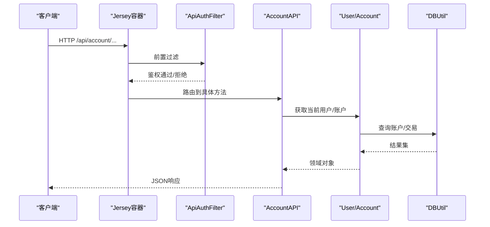
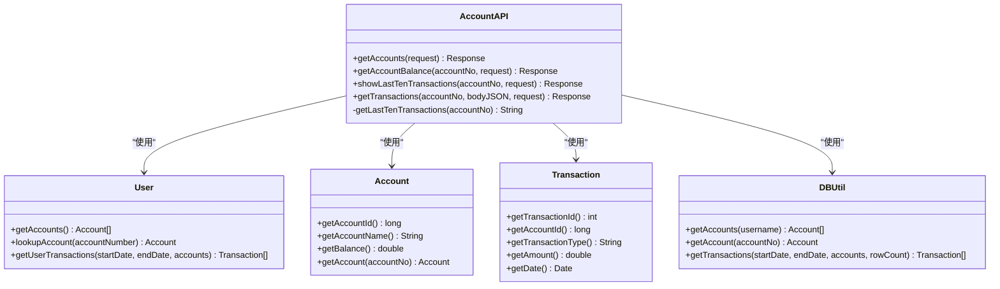

# 账户管理API

<cite>
**本文引用的文件**   
- [AccountAPI.java](file://src/com/ibm/security/appscan/altoromutual/api/AccountAPI.java)
- [AltoroAPI.java](file://src/com/ibm/security/appscan/altoromutual/api/AltoroAPI.java)
- [ApiAuthFilter.java](file://src/com/ibm/security/appscan/altoromutual/filter/ApiAuthFilter.java)
- [web.xml](file://WebContent/WEB-INF/web.xml)
- [Account.java](file://src/com/ibm/security/appscan/altoromutual/model/Account.java)
- [Transaction.java](file://src/com/ibm/security/appscan/altoromutual/model/Transaction.java)
- [User.java](file://src/com/ibm/security/appscan/altoromutual/model/User.java)
- [DBUtil.java](file://src/com/ibm/security/appscan/altoromutual/util/DBUtil.java)
</cite>

## 目录
1. [简介](#简介)
2. [项目结构](#项目结构)
3. [核心组件](#核心组件)
4. [架构总览](#架构总览)
5. [详细接口说明](#详细接口说明)
6. [依赖关系分析](#依赖关系分析)
7. [性能与可扩展性](#性能与可扩展性)
8. [故障排查指南](#故障排查指南)
9. [结论](#结论)
10. [附录：集成示例与安全建议](#附录集成示例与安全建议)

## 简介
本文件为“账户管理”相关REST API的权威文档，覆盖以下能力：
- 查询当前登录用户的所有账户
- 获取指定账户余额及最近交易摘要
- 获取指定账户的交易历史（最近10条或按日期范围查询）

所有API均通过Jersey容器暴露，基础路径为 /api。鉴权采用自定义过滤器，基于Authorization头进行校验。

## 项目结构
- REST资源类位于 api 包，账户相关端点由 AccountAPI 提供
- 应用根路径由 AltoroAPI 配置为 /api
- 鉴权过滤器 ApiAuthFilter 对所有未标注 PermitAll 的资源进行拦截
- 数据访问集中在 DBUtil，模型对象包括 Account、Transaction、User
- web.xml 注册 Jersey ServletContainer 并指向 AltoroAPI

```mermaid
graph TB
Client["客户端"] --> WebXML["web.xml<br/>注册Jersey容器"]
WebXML --> AltoroAPI["AltoroAPI.java<br/>@ApplicationPath(\"api\")"]
AltoroAPI --> Filter["ApiAuthFilter.java<br/>鉴权过滤器"]
Filter --> AccountAPI["AccountAPI.java<br/>账户REST资源"]
AccountAPI --> ModelA["Account.java"]
AccountAPI --> ModelT["Transaction.java"]
AccountAPI --> ModelU["User.java"]
AccountAPI --> Util["DBUtil.java<br/>数据库访问"]
```

**图表来源**
- [AltoroAPI.java:9-14](file://src/com/ibm/security/appscan/altoromutual/api/AltoroAPI.java#L9-L14)
- [ApiAuthFilter.java:20-74](file://src/com/ibm/security/appscan/altoromutual/filter/ApiAuthFilter.java#L20-L74)
- [AccountAPI.java:23-237](file://src/com/ibm/security/appscan/altoromutual/api/AccountAPI.java#L23-L237)
- [web.xml:60-68](file://WebContent/WEB-INF/web.xml#L60-L68)

**章节来源**
- [AltoroAPI.java:9-14](file://src/com/ibm/security/appscan/altoromutual/api/AltoroAPI.java#L9-L14)
- [web.xml:60-68](file://WebContent/WEB-INF/web.xml#L60-L68)

## 核心组件
- AccountAPI：定义账户相关的REST端点，负责请求解析、业务编排与响应组装
- AltoroAPI：Jersey应用入口，注册过滤器与扫描资源包
- ApiAuthFilter：统一鉴权，校验Authorization头中的凭证
- DBUtil：数据库连接、初始化与CRUD操作封装
- 模型：Account、Transaction、User 描述领域实体

**章节来源**
- [AccountAPI.java:23-237](file://src/com/ibm/security/appscan/altoromutual/api/AccountAPI.java#L23-L237)
- [AltoroAPI.java:9-14](file://src/com/ibm/security/appscan/altoromutual/api/AltoroAPI.java#L9-L14)
- [ApiAuthFilter.java:20-74](file://src/com/ibm/security/appscan/altoromutual/filter/ApiAuthFilter.java#L20-L74)
- [DBUtil.java:45-167](file://src/com/ibm/security/appscan/altoromutual/util/DBUtil.java#L45-L167)
- [Account.java:32-121](file://src/com/ibm/security/appscan/altoromutual/model/Account.java#L32-L121)
- [Transaction.java:28-63](file://src/com/ibm/security/appscan/altoromutual/model/Transaction.java#L28-L63)
- [User.java:30-107](file://src/com/ibm/security/appscan/altoromutual/model/User.java#L30-L107)

## 架构总览
账户API的请求处理流程如下：
1. 客户端向 /api/account/* 发起HTTP请求
2. Jersey根据 @Path 路由到 AccountAPI 对应方法
3. ApiAuthFilter 在到达资源前执行鉴权
4. AccountAPI 调用 User/Account/DBUtil 完成业务逻辑
5. 返回JSON响应



**图表来源**
- [AltoroAPI.java:9-14](file://src/com/ibm/security/appscan/altoromutual/api/AltoroAPI.java#L9-L14)
- [ApiAuthFilter.java:30-74](file://src/com/ibm/security/appscan/altoromutual/filter/ApiAuthFilter.java#L30-L74)
- [AccountAPI.java:23-237](file://src/com/ibm/security/appscan/altoromutual/api/AccountAPI.java#L23-L237)
- [DBUtil.java:275-293](file://src/com/ibm/security/appscan/altoromutual/util/DBUtil.java#L275-L293)

## 详细接口说明

### 通用约定
- 基础路径：/api
- 内容类型：application/json
- 鉴权：Authorization: Bearer <token>
  - token 格式：Base64(Base64(username):Base64(password))
- 错误码：
  - 401 Unauthorized：未携带或无效Authorization头
  - 400 Bad Request：请求体格式不正确
  - 500 Internal Server Error：服务器内部异常

**章节来源**
- [AltoroAPI.java:9-14](file://src/com/ibm/security/appscan/altoromutual/api/AltoroAPI.java#L9-L14)
- [ApiAuthFilter.java:27-74](file://src/com/ibm/security/appscan/altoromutual/filter/ApiAuthFilter.java#L27-L74)

### GET /account
- 功能：返回当前登录用户的所有账户列表
- 鉴权：需要
- 路径参数：无
- 请求体：无
- 成功响应字段：
  - Accounts：数组，元素包含 Name、id
- 错误响应：
  - 500：服务器异常

示例响应（简化）：
{
  "Accounts": [
    {"Name": "Checking", "id": "800002"},
    {"Name": "Savings", "id": "800001"}
  ]
}

**章节来源**
- [AccountAPI.java:27-51](file://src/com/ibm/security/appscan/altoromutual/api/AccountAPI.java#L27-L51)

### GET /account/{accountNo}
- 功能：获取指定账户的余额与最近10笔交易摘要
- 鉴权：需要
- 路径参数：
  - accountNo：字符串形式的账户ID
- 成功响应字段：
  - balance：字符串格式的余额（含货币符号）
  - accountId：账户ID
  - last_10_transactions：数组，元素包含 date、transaction_type、ammount
  - credits/debits：固定示例数据（注意：该实现中为硬编码示例，非实时数据）
- 错误响应：
  - 500：服务器异常或JSON构建失败

示例响应（简化）：
{
  "balance": "$15,000.39",
  "accountId": "800002",
  "last_10_transactions": [
    {"date": "2019-03-11", "transaction_type": "Withdrawal", "ammount": "$400.00"}
  ],
  "credits": [...],
  "debits": [...]
}

注意：credits/debits 在当前实现中为示例数据，不代表真实交易流水。

**章节来源**
- [AccountAPI.java:54-104](file://src/com/ibm/security/appscan/altoromutual/api/AccountAPI.java#L54-L104)
- [AccountAPI.java:210-235](file://src/com/ibm/security/appscan/altoromutual/api/AccountAPI.java#L210-L235)

### GET /account/{accountNo}/transactions
- 功能：获取指定账户最近10笔交易
- 鉴权：需要
- 路径参数：
  - accountNo：字符串形式的账户ID
- 成功响应字段：
  - last_10_transactions：数组，元素包含 date、transaction_type、ammount
- 错误响应：
  - 500：服务器异常或JSON构建失败

示例响应（简化）：
{
  "last_10_transactions": [
    {"date": "2019-03-11", "transaction_type": "Withdrawal", "ammount": "$400.00"}
  ]
}

**章节来源**
- [AccountAPI.java:109-139](file://src/com/ibm/security/appscan/altoromutual/api/AccountAPI.java#L109-L139)
- [AccountAPI.java:210-235](file://src/com/ibm/security/appscan/altoromutual/api/AccountAPI.java#L210-L235)

### POST /account/{accountNo}/transactions
- 功能：按日期范围查询指定账户的交易历史
- 鉴权：需要
- 路径参数：
  - accountNo：字符串形式的账户ID
- 请求体（JSON）：
  - startDate：起始日期时间（yyyy-MM-dd HH:mm）
  - endDate：结束日期时间（yyyy-MM-dd HH:mm）
- 成功响应字段：
  - transactions：数组，元素包含 id、date、account、type、amount
- 错误响应：
  - 400：请求体格式不正确
  - 500：数据库查询异常或JSON构建失败

示例请求体：
{
  "startDate": "2019-01-01 00:00",
  "endDate": "2019-03-31 23:59"
}

示例响应（简化）：
{
  "transactions": [
    {"id": "2311", "date": "2019-03-11 16:00", "account": "800002", "type": "Withdrawal", "amount": "$400.00"}
  ]
}

**章节来源**
- [AccountAPI.java:142-207](file://src/com/ibm/security/appscan/altoromutual/api/AccountAPI.java#L142-L207)
- [DBUtil.java:375-427](file://src/com/ibm/security/appscan/altoromutual/util/DBUtil.java#L375-L427)

## 依赖关系分析
- AccountAPI 依赖：
  - User：用于获取当前用户及其账户集合
  - Account：用于按账户号获取账户信息
  - Transaction：用于表示交易记录
  - DBUtil：用于数据库访问
- AltoroAPI 注册 ApiAuthFilter，对未标注 PermitAll 的方法进行鉴权
- web.xml 将 Jersey 容器映射到 /api



**图表来源**
- [AccountAPI.java:23-237](file://src/com/ibm/security/appscan/altoromutual/api/AccountAPI.java#L23-L237)
- [User.java:76-106](file://src/com/ibm/security/appscan/altoromutual/model/User.java#L76-L106)
- [Account.java:32-121](file://src/com/ibm/security/appscan/altoromutual/model/Account.java#L32-L121)
- [Transaction.java:28-63](file://src/com/ibm/security/appscan/altoromutual/model/Transaction.java#L28-L63)
- [DBUtil.java:275-293](file://src/com/ibm/security/appscan/altoromutual/util/DBUtil.java#L275-L293)
- [DBUtil.java:452-470](file://src/com/ibm/security/appscan/altoromutual/util/DBUtil.java#L452-L470)
- [DBUtil.java:375-427](file://src/com/ibm/security/appscan/altoromutual/util/DBUtil.java#L375-L427)

**章节来源**
- [AccountAPI.java:23-237](file://src/com/ibm/security/appscan/altoromutual/api/AccountAPI.java#L23-L237)
- [User.java:76-106](file://src/com/ibm/security/appscan/altoromutual/model/User.java#L76-L106)
- [Account.java:32-121](file://src/com/ibm/security/appscan/altoromutual/model/Account.java#L32-L121)
- [Transaction.java:28-63](file://src/com/ibm/security/appscan/altoromutual/model/Transaction.java#L28-L63)
- [DBUtil.java:275-293](file://src/com/ibm/security/appscan/altoromutual/util/DBUtil.java#L275-L293)
- [DBUtil.java:452-470](file://src/com/ibm/security/appscan/altoromutual/util/DBUtil.java#L452-L470)
- [DBUtil.java:375-427](file://src/com/ibm/security/appscan/altoromutual/util/DBUtil.java#L375-L427)

## 性能与可扩展性
- 交易查询限制：GET /account/{accountNo}/transactions 默认返回最近10条；POST 查询最多返回100条（代码中存在硬限制）
- 金额格式化：使用 DecimalFormat 进行本地化格式化，可能带来额外开销
- 数据库访问：DBUtil 直接拼接SQL语句，存在潜在注入风险且不利于优化；建议使用预编译语句与分页
- 扩展建议：
  - 引入分页参数与排序选项
  - 缓存热点账户余额与最近交易
  - 统一响应结构与错误码规范

[本节为通用指导，不直接分析具体文件]

## 故障排查指南
- 401 Unauthorized：
  - 检查 Authorization 头是否包含 Bearer 前缀
  - 检查 token 是否为 Base64(Base64(username):Base64(password)) 格式
  - 确认用户名密码有效
- 400 Bad Request：
  - 检查 POST /account/{accountNo}/transactions 的请求体是否包含 startDate 与 endDate
- 500 Internal Server Error：
  - 检查数据库连接与表结构是否正确初始化
  - 检查 JSON 构建过程是否抛出异常

**章节来源**
- [ApiAuthFilter.java:42-74](file://src/com/ibm/security/appscan/altoromutual/filter/ApiAuthFilter.java#L42-L74)
- [AccountAPI.java:156-163](file://src/com/ibm/security/appscan/altoromutual/api/AccountAPI.java#L156-L163)
- [DBUtil.java:117-133](file://src/com/ibm/security/appscan/altoromutual/util/DBUtil.java#L117-L133)

## 结论
账户管理API提供了基础的账户查询、余额与交易历史能力。鉴权机制通过自定义过滤器实现，但当前实现存在若干安全与健壮性问题（如SQL拼接、示例数据混入等）。建议在后续迭代中强化输入校验、统一错误响应、引入分页与缓存，并替换不安全的数据访问方式。

[本节为总结性内容，不直接分析具体文件]

## 附录：集成示例与安全建议

### 鉴权Token构造
- 步骤：
  1. 对 username 进行 Base64 编码得到 u
  2. 对 password 进行 Base64 编码得到 p
  3. 拼接 u:p
  4. 对 u:p 再次进行 Base64 编码得到 token
  5. 设置请求头 Authorization: Bearer <token>

**章节来源**
- [ApiAuthFilter.java:49-64](file://src/com/ibm/security/appscan/altoromutual/filter/ApiAuthFilter.java#L49-L64)

### 常见用例
- 获取当前用户账户列表
  - 方法：GET
  - URL：/api/account
  - 头部：Authorization: Bearer <token>
  - 响应：{"Accounts":[{"Name":"...","id":"..."}]}
- 获取指定账户余额与最近交易
  - 方法：GET
  - URL：/api/account/{accountNo}
  - 头部：Authorization: Bearer <token>
  - 响应：{"balance":"$...","accountId":"...","last_10_transactions":[...],"credits":[...],"debits":[...]}
- 获取最近10笔交易
  - 方法：GET
  - URL：/api/account/{accountNo}/transactions
  - 头部：Authorization: Bearer <token>
  - 响应：{"last_10_transactions":[...]}
- 按日期范围查询交易
  - 方法：POST
  - URL：/api/account/{accountNo}/transactions
  - 头部：Authorization: Bearer <token>
  - 请求体：{"startDate":"yyyy-MM-dd HH:mm","endDate":"yyyy-MM-dd HH:mm"}
  - 响应：{"transactions":[{"id":"...","date":"...","account":"...","type":"...","amount":"$..."}]}

**章节来源**
- [AccountAPI.java:27-51](file://src/com/ibm/security/appscan/altoromutual/api/AccountAPI.java#L27-L51)
- [AccountAPI.java:54-104](file://src/com/ibm/security/appscan/altoromutual/api/AccountAPI.java#L54-L104)
- [AccountAPI.java:109-139](file://src/com/ibm/security/appscan/altoromutual/api/AccountAPI.java#L109-L139)
- [AccountAPI.java:142-207](file://src/com/ibm/security/appscan/altoromutual/api/AccountAPI.java#L142-L207)

### 安全性考虑
- 鉴权实现：
  - 使用 Authorization 头承载凭证，但未使用标准OAuth2/JWT
  - 令牌解码与校验逻辑在过滤器中实现
- SQL注入风险：
  - DBUtil 多处直接拼接用户输入到SQL语句
- 越权访问风险：
  - 部分接口未对用户可访问的账户做严格校验
- 建议：
  - 使用参数化查询与ORM框架
  - 引入标准认证授权方案（如JWT+RBAC）
  - 增加细粒度权限控制与审计日志

**章节来源**
- [ApiAuthFilter.java:27-74](file://src/com/ibm/security/appscan/altoromutual/filter/ApiAuthFilter.java#L27-L74)
- [DBUtil.java:212-232](file://src/com/ibm/security/appscan/altoromutual/util/DBUtil.java#L212-L232)
- [DBUtil.java:275-293](file://src/com/ibm/security/appscan/altoromutual/util/DBUtil.java#L275-L293)
- [DBUtil.java:452-470](file://src/com/ibm/security/appscan/altoromutual/util/DBUtil.java#L452-L470)