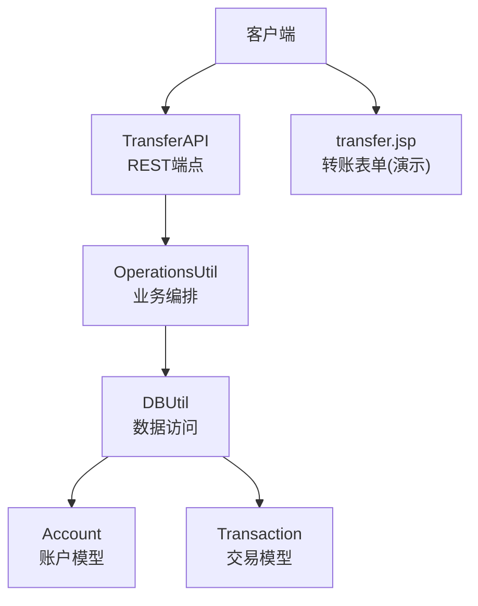
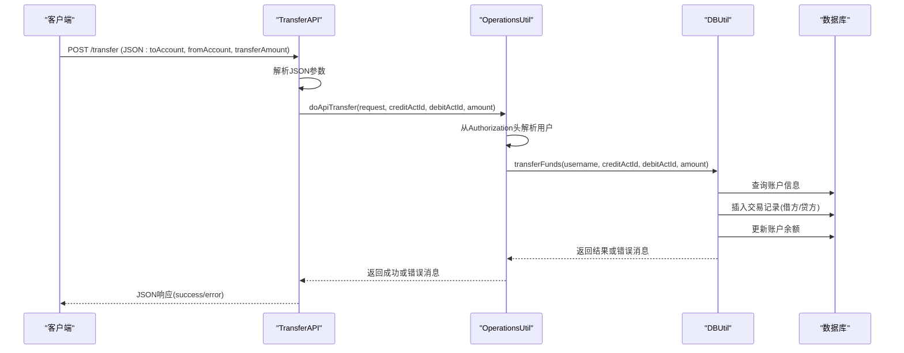
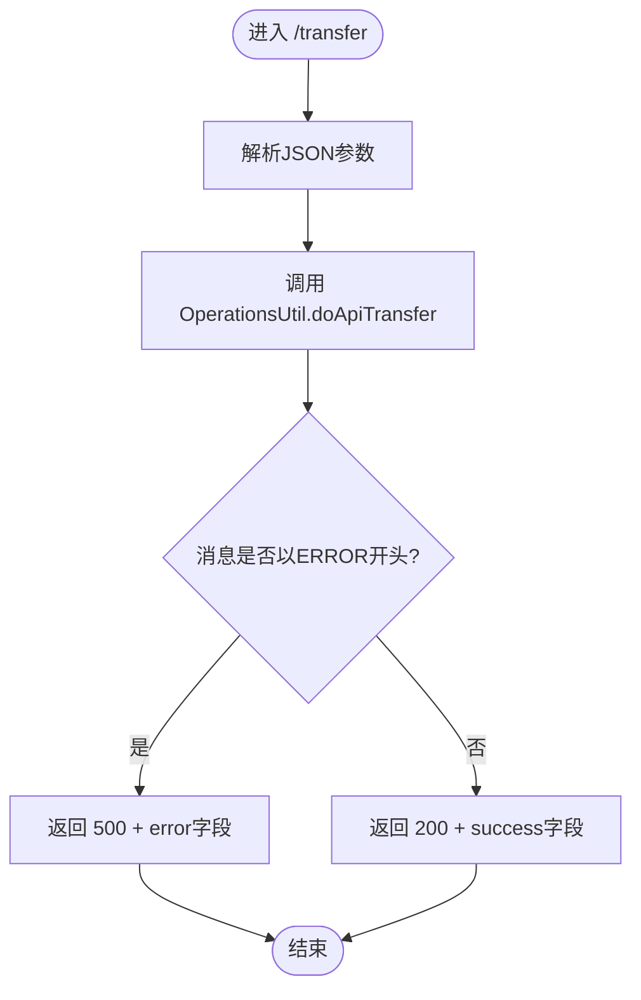
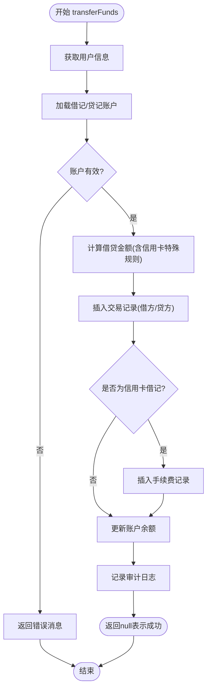
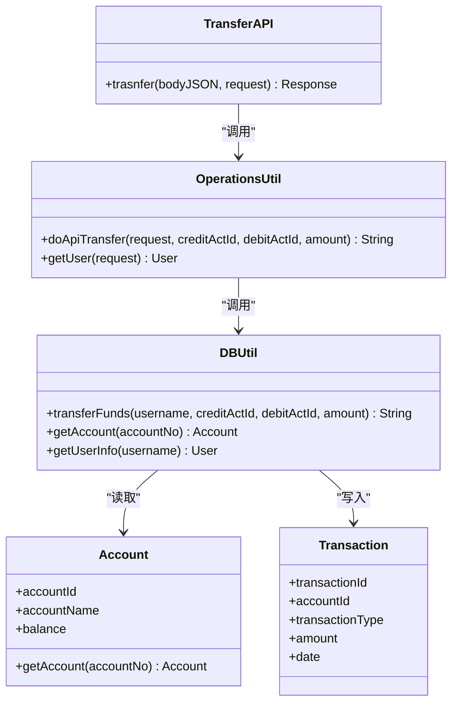
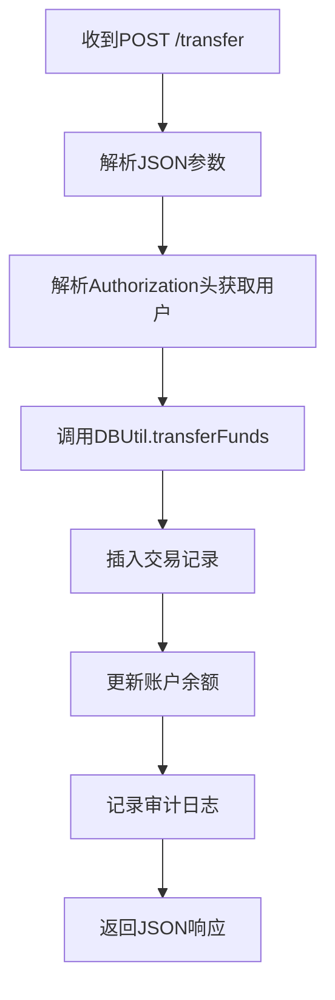

# 转账API

<cite>
**本文引用的文件**   
- [TransferAPI.java](file://src/com/ibm/security/appscan/altoromutual/api/TransferAPI.java)
- [OperationsUtil.java](file://src/com/ibm/security/appscan/altoromutual/util/OperationsUtil.java)
- [DBUtil.java](file://src/com/ibm/security/appscan/altoromutual/util/DBUtil.java)
- [Account.java](file://src/com/ibm/security/appscan/altoromutual/model/Account.java)
- [Transaction.java](file://src/com/ibm/security/appscan/altoromutual/model/Transaction.java)
- [transfer.jsp](file://WebContent/bank/transfer.jsp)
</cite>

## 目录
1. [简介](#简介)
2. [项目结构](#项目结构)
3. [核心组件](#核心组件)
4. [架构总览](#架构总览)
5. [详细组件分析](#详细组件分析)
6. [依赖关系分析](#依赖关系分析)
7. [性能与一致性考虑](#性能与一致性考虑)
8. [故障排查指南](#故障排查指南)
9. [结论](#结论)
10. [附录：接口规范与示例](#附录接口规范与示例)

## 简介
本文件为资金转账相关REST API的完整技术文档，覆盖转账发起、参数校验、业务处理、事务与一致性、审计日志与监控指标、错误处理与回滚机制，以及请求/响应数据结构和调用示例。该API用于在用户账户之间进行资金划转，包含借记账户扣款与贷记账户入账，并记录交易流水。

## 项目结构
转账功能由以下层次组成：
- REST层：JAX-RS资源类负责接收HTTP请求、解析JSON参数、返回统一响应体。
- 业务工具层：封装鉴权、参数校验、业务编排。
- 数据访问层：数据库连接、账户查询、交易记录写入、余额更新。
- 模型层：账户与交易实体定义。
- Web前端：转账表单页面（用于演示）。

图表来源
- [TransferAPI.java:14-43](file://src/com/ibm/security/appscan/altoromutual/api/TransferAPI.java#L14-L43)
- [OperationsUtil.java:18-36](file://src/com/ibm/security/appscan/altoromutual/util/OperationsUtil.java#L18-L36)
- [DBUtil.java:303-364](file://src/com/ibm/security/appscan/altoromutual/util/DBUtil.java#L303-L364)
- [Account.java:32-48](file://src/com/ibm/security/appscan/altoromutual/model/Account.java#L32-L48)
- [Transaction.java:28-63](file://src/com/ibm/security/appscan/altoromutual/model/Transaction.java#L28-L63)
- [transfer.jsp:58-95](file://WebContent/bank/transfer.jsp#L58-L95)

章节来源
- [TransferAPI.java:14-43](file://src/com/ibm/security/appscan/altoromutual/api/TransferAPI.java#L14-L43)
- [OperationsUtil.java:18-36](file://src/com/ibm/security/appscan/altoromutual/util/OperationsUtil.java#L18-L36)
- [DBUtil.java:303-364](file://src/com/ibm/security/appscan/altoromutual/util/DBUtil.java#L303-L364)
- [Account.java:32-48](file://src/com/ibm/security/appscan/altoromutual/model/Account.java#L32-L48)
- [Transaction.java:28-63](file://src/com/ibm/security/appscan/altoromutual/model/Transaction.java#L28-L63)
- [transfer.jsp:58-95](file://WebContent/bank/transfer.jsp#L58-L95)

## 核心组件
- TransferAPI：定义POST /transfer端点，解析JSON参数，调用业务层，返回统一JSON响应。
- OperationsUtil：从请求头提取用户身份，调用DBUtil执行转账，封装成功/失败消息。
- DBUtil：实现转账核心逻辑，包括账户校验、交易记录插入、余额更新、手续费处理与日志记录。
- Account/Transaction：账户与交易的领域模型。
- transfer.jsp：转账表单页面，提供前端校验与提交入口。

章节来源
- [TransferAPI.java:14-43](file://src/com/ibm/security/appscan/altoromutual/api/TransferAPI.java#L14-L43)
- [OperationsUtil.java:18-36](file://src/com/ibm/security/appscan/altoromutual/util/OperationsUtil.java#L18-L36)
- [DBUtil.java:303-364](file://src/com/ibm/security/appscan/altoromutual/util/DBUtil.java#L303-L364)
- [Account.java:32-48](file://src/com/ibm/security/appscan/altoromutual/model/Account.java#L32-L48)
- [Transaction.java:28-63](file://src/com/ibm/security/appscan/altoromutual/model/Transaction.java#L28-L63)
- [transfer.jsp:58-95](file://WebContent/bank/transfer.jsp#L58-L95)

## 架构总览
转账API的请求-处理-响应时序如下：

图表来源
- [TransferAPI.java:17-43](file://src/com/ibm/security/appscan/altoromutual/api/TransferAPI.java#L17-L43)
- [OperationsUtil.java:18-36](file://src/com/ibm/security/appscan/altoromutual/util/OperationsUtil.java#L18-L36)
- [DBUtil.java:303-364](file://src/com/ibm/security/appscan/altoromutual/util/DBUtil.java#L303-L364)

## 详细组件分析

### REST端点：TransferAPI
- 路径与方法：POST /transfer
- 输入：请求体JSON，字段包括toAccount、fromAccount、transferAmount
- 输出：JSON响应，成功时包含success字段；失败时包含error字段
- 行为：
  - 解析JSON，提取目标账户、源账户、金额
  - 调用OperationsUtil.doApiTransfer执行业务
  - 根据返回消息设置HTTP状态码与响应体

图表来源
- [TransferAPI.java:17-43](file://src/com/ibm/security/appscan/altoromutual/api/TransferAPI.java#L17-L43)

章节来源
- [TransferAPI.java:17-43](file://src/com/ibm/security/appscan/altoromutual/api/TransferAPI.java#L17-L43)

### 业务编排：OperationsUtil
- 职责：
  - 从Authorization头解析用户身份（Bearer Base64(token)，token为Base64(user:pass)）
  - 调用DBUtil.transferFunds执行转账
  - 将业务结果包装为统一消息字符串
- 关键点：
  - 若DBUtil返回非空错误消息，则前缀“ERROR:”
  - 成功时生成包含时间戳的成功消息

章节来源
- [OperationsUtil.java:18-36](file://src/com/ibm/security/appscan/altoromutual/util/OperationsUtil.java#L18-L36)
- [OperationsUtil.java:134-143](file://src/com/ibm/security/appscan/altoromutual/util/OperationsUtil.java#L134-L143)

### 数据访问与转账核心：DBUtil.transferFunds
- 主要步骤：
  - 获取当前用户信息
  - 查询借记账户与贷记账户
  - 校验账户有效性
  - 计算借贷金额（信用卡账户特殊处理）
  - 插入交易记录（借方/贷方），必要时插入现金预支手续费记录
  - 更新双方账户余额
  - 记录审计日志
- 返回值：
  - 成功返回null
  - 失败返回错误消息字符串

图表来源
- [DBUtil.java:303-364](file://src/com/ibm/security/appscan/altoromutual/util/DBUtil.java#L303-L364)

章节来源
- [DBUtil.java:303-364](file://src/com/ibm/security/appscan/altoromutual/util/DBUtil.java#L303-L364)

### 模型：Account 与 Transaction
- Account：账户标识、名称、余额，提供按账号查询静态方法
- Transaction：交易ID、账户ID、类型、金额、日期

章节来源
- [Account.java:32-48](file://src/com/ibm/security/appscan/altoromutual/model/Account.java#L32-L48)
- [Transaction.java:28-63](file://src/com/ibm/security/appscan/altoromutual/model/Transaction.java#L28-L63)

### 前端表单：transfer.jsp
- 提供转账表单，包含源账户下拉框、目标账户下拉框、转账金额输入框
- 前端校验：禁止同账户互转、金额必须大于0
- 提交到后端Servlet（演示用途），与REST API解耦

章节来源
- [transfer.jsp:35-52](file://WebContent/bank/transfer.jsp#L35-L52)
- [transfer.jsp:58-95](file://WebContent/bank/transfer.jsp#L58-L95)

## 依赖关系分析
- TransferAPI依赖OperationsUtil进行业务编排
- OperationsUtil依赖DBUtil进行数据访问
- DBUtil依赖Account与Transaction模型
- DBUtil通过JDBC访问数据库，使用Log4AltoroJ进行日志记录

图表来源
- [TransferAPI.java:14-43](file://src/com/ibm/security/appscan/altoromutual/api/TransferAPI.java#L14-L43)
- [OperationsUtil.java:18-36](file://src/com/ibm/security/appscan/altoromutual/util/OperationsUtil.java#L18-L36)
- [DBUtil.java:303-364](file://src/com/ibm/security/appscan/altoromutual/util/DBUtil.java#L303-L364)
- [Account.java:32-48](file://src/com/ibm/security/appscan/altoromutual/model/Account.java#L32-L48)
- [Transaction.java:28-63](file://src/com/ibm/security/appscan/altoromutual/model/Transaction.java#L28-L63)

## 性能与一致性考虑
- 事务与原子性：
  - 当前实现未使用显式事务边界，存在多语句间不一致风险（注释中已指出应作为原子操作）
  - 建议将插入交易记录与更新余额置于同一事务内，确保要么全部成功，要么全部回滚
- 并发与幂等：
  - 缺少防重复提交机制（如唯一请求ID、分布式锁、乐观锁）
  - 建议引入幂等键（idempotency-key）并在数据库层做唯一约束，防止重复入账
- 余额检查：
  - 当前未在执行前检查余额是否充足，可能导致透支
  - 建议在事务内对借记账户余额进行加锁检查与扣减
- 性能优化：
  - 批量操作时使用PreparedStatement减少SQL拼接开销
  - 合理索引ACCOUNT_ID、DATE字段以提升查询与排序效率

[本节为通用指导，不直接分析具体文件]

## 故障排查指南
- 常见错误与定位：
  - JSON解析异常：检查请求体字段名与类型是否正确
  - 账户无效：确认fromAccount/toAccount是否存在且属于当前用户
  - 金额非法：确保transferAmount为正数
  - 数据库异常：查看日志中的SQL错误或连接问题
- 日志与审计：
  - 转账成功后会记录审计日志（包含账户信息与金额）
  - 若发生异常，错误消息会被包装并返回给客户端
- 回滚机制：
  - 当前代码未显式回滚，出现异常时可能部分更新
  - 建议引入事务管理，确保失败时自动回滚

章节来源
- [TransferAPI.java:34-42](file://src/com/ibm/security/appscan/altoromutual/api/TransferAPI.java#L34-L42)
- [OperationsUtil.java:33-35](file://src/com/ibm/security/appscan/altoromutual/util/OperationsUtil.java#L33-L35)
- [DBUtil.java:361-363](file://src/com/ibm/security/appscan/altoromutual/util/DBUtil.java#L361-L363)

## 结论
该转账API提供了基础的跨账户资金划转能力，具备基本的参数解析、业务编排与数据持久化。但在事务一致性、并发控制、余额校验与防重等方面仍需增强。建议在生产环境引入事务边界、幂等键、余额预检与更完善的错误处理策略，以确保资金安全与系统稳定性。

[本节为总结性内容，不直接分析具体文件]

## 附录：接口规范与示例

### 接口定义
- 路径：POST /transfer
- 认证：Authorization: Bearer <Base64(user:pass)>
- 请求体（JSON）：
  - toAccount: 数字，目标账户ID
  - fromAccount: 数字，源账户ID
  - transferAmount: 数字，转账金额（需大于0）
- 响应体（JSON）：
  - 成功：{ "success": "<消息>" }
  - 失败：{ "error": "<消息>" }
- HTTP状态码：
  - 200：成功
  - 400：请求体解析失败
  - 500：业务或数据库异常

章节来源
- [TransferAPI.java:17-43](file://src/com/ibm/security/appscan/altoromutual/api/TransferAPI.java#L17-L43)
- [OperationsUtil.java:18-36](file://src/com/ibm/security/appscan/altoromutual/util/OperationsUtil.java#L18-L36)

### 调用示例
- 请求示例（JSON）：
  - { "toAccount": 800002, "fromAccount": 800003, "transferAmount": 100.00 }
- 成功响应示例：
  - { "success": "100.0 was successfully transferred from Account 800003 into Account 800002 at ..." }
- 失败响应示例：
  - { "error": "ERROR: Destination account is invalid" }

章节来源
- [TransferAPI.java:38-42](file://src/com/ibm/security/appscan/altoromutual/api/TransferAPI.java#L38-L42)
- [OperationsUtil.java:24-31](file://src/com/ibm/security/appscan/altoromutual/util/OperationsUtil.java#L24-L31)

### 业务流程图（端到端）

图表来源
- [TransferAPI.java:17-43](file://src/com/ibm/security/appscan/altoromutual/api/TransferAPI.java#L17-L43)
- [OperationsUtil.java:18-36](file://src/com/ibm/security/appscan/altoromutual/util/OperationsUtil.java#L18-L36)
- [DBUtil.java:303-364](file://src/com/ibm/security/appscan/altoromutual/util/DBUtil.java#L303-L364)