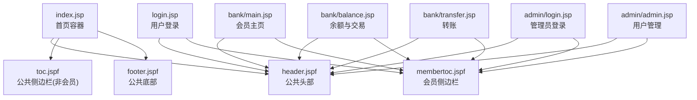
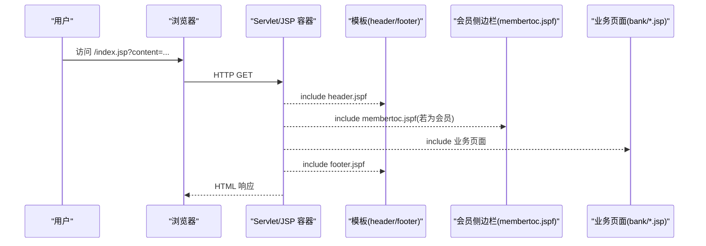
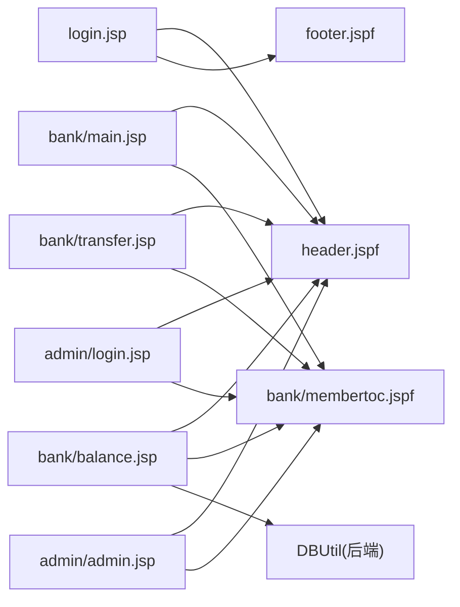

# 前端界面

<cite>
**本文引用的文件**   
- [index.jsp](file://WebContent/index.jsp)
- [style.css](file://WebContent/style.css)
- [header.jspf](file://WebContent/header.jspf)
- [footer.jspf](file://WebContent/footer.jspf)
- [toc.jspf](file://WebContent/toc.jspf)
- [login.jsp](file://WebContent/login.jsp)
- [bank/main.jsp](file://WebContent/bank/main.jsp)
- [bank/membertoc.jspf](file://WebContent/bank/membertoc.jspf)
- [bank/balance.jsp](file://WebContent/bank/balance.jsp)
- [bank/transfer.jsp](file://WebContent/bank/transfer.jsp)
- [admin/admin.jsp](file://WebContent/admin/admin.jsp)
- [admin/login.jsp](file://WebContent/admin/login.jsp)
</cite>

## 目录
1. [简介](#简介)
2. [项目结构](#项目结构)
3. [核心组件](#核心组件)
4. [架构总览](#架构总览)
5. [详细组件分析](#详细组件分析)
6. [依赖关系分析](#依赖关系分析)
7. [性能与可访问性](#性能与可访问性)
8. [故障排查指南](#故障排查指南)
9. [结论](#结论)

## 简介
本文件为 AltoroJ 的前端界面提供系统化文档，聚焦 JSP 页面结构、样式与布局、用户交互行为、响应式与可访问性建议、主题定制方式、跨浏览器兼容性与性能优化，以及银行业务界面、管理界面和用户界面的设计理念与实现要点。AltoroJ 采用传统 JSP + CSS 的服务器端渲染模式，通过 header.jspf 与 footer.jspf 复用公共头部与底部，使用 toc.jspf 与 membertoc.jspf 作为侧边导航模板，业务页面在中间区域动态加载内容。

## 项目结构
- 公共模板
  - header.jspf：站点头部、全局搜索、登录状态切换、主导航入口
  - footer.jspf：站点底部链接、版权信息、免责声明
- 通用布局
  - index.jsp：首页容器，根据 content 参数动态包含静态或“高级静态页处理”逻辑
  - style.css：全局样式（字体、颜色、边框、浮动布局等）
- 用户侧页面
  - login.jsp：在线银行登录
  - bank/main.jsp：会员主页（账户摘要入口）
  - bank/membertoc.jspf：会员侧边栏（含管理员菜单条件显示）
  - bank/balance.jsp：账户余额与最近交易列表
  - bank/transfer.jsp：转账表单与客户端校验
- 管理侧页面
  - admin/login.jsp：管理员登录
  - admin/admin.jsp：用户编辑、添加账户、修改密码、新增用户

图表来源
- [index.jsp:28-108](file://WebContent/index.jsp#L28-L108)
- [header.jspf:22-63](file://WebContent/header.jspf#L22-L63)
- [footer.jspf:21-53](file://WebContent/footer.jspf#L21-L53)
- [toc.jspf:21-56](file://WebContent/toc.jspf#L21-L56)
- [bank/membertoc.jspf:29-56](file://WebContent/bank/membertoc.jspf#L29-L56)

章节来源
- [index.jsp:28-108](file://WebContent/index.jsp#L28-L108)
- [header.jspf:22-63](file://WebContent/header.jspf#L22-L63)
- [footer.jspf:21-53](file://WebContent/footer.jspf#L21-L53)
- [toc.jspf:21-56](file://WebContent/toc.jspf#L21-L56)
- [bank/membertoc.jspf:29-56](file://WebContent/bank/membertoc.jspf#L29-L56)

## 核心组件
- 公共头部（header.jspf）
  - 功能：站点标题、字符集、全局样式引入、Logo、登录/登出切换、联系与反馈入口、搜索框
  - 交互：根据会话中是否存在用户属性决定显示“Sign In”或“Sign Off”，并调整“ONLINE BANKING LOGIN”链接
  - 布局：表格布局，顶部一行用于 Logo 与工具区，第二行展示背景图；下方四列导航条
- 公共底部（footer.jspf）
  - 功能：隐私与安全声明、服务状态检查、REST API 入口、版权与开源提示、免责声明
- 首页容器（index.jsp）
  - 功能：根据 content 参数加载静态页面或启用“高级静态页处理”（存在安全风险，不建议在生产环境启用）
  - 布局：wrapper 包裹主体，左侧 toc.jspf，右侧内容区
- 全局样式（style.css）
  - 风格：Verdana/Arial/Sans-Serif 字体族，浅灰背景色块，紫色强调色，边框类 .bt/.br/.bb 用于表格分割
  - 交互：a:hover 变色，.focus 加粗高亮，.err 错误背景，.disclaimer 警告框
- 会员侧边栏（membertoc.jspf）
  - 功能：常用操作（查看账户摘要、最近交易、转账、新闻搜索、语言自定义），管理员角色时显示“ADMINISTRATION”子菜单
  - 缓存控制：设置 Expires/Cache-Control/Pragma 禁止缓存

章节来源
- [header.jspf:22-63](file://WebContent/header.jspf#L22-L63)
- [footer.jspf:21-53](file://WebContent/footer.jspf#L21-L53)
- [index.jsp:28-108](file://WebContent/index.jsp#L28-L108)
- [style.css:1-87](file://WebContent/style.css#L1-L87)
- [bank/membertoc.jspf:23-56](file://WebContent/bank/membertoc.jspf#L23-L56)

## 架构总览
AltoroJ 前端采用“模板 + 内容”的组合模式：
- 所有页面通过 jsp:include 组合 header.jspf 与 footer.jspf
- 非会员页面使用 toc.jspf 作为站点导航
- 会员页面使用 membertoc.jspf 作为功能导航，并根据用户角色动态显示管理入口
- 业务数据由后端模型（User/Account/Transaction）注入到 JSP 进行渲染

图表来源
- [index.jsp:28-108](file://WebContent/index.jsp#L28-L108)
- [header.jspf:22-63](file://WebContent/header.jspf#L22-L63)
- [bank/membertoc.jspf:29-56](file://WebContent/bank/membertoc.jspf#L29-L56)

## 详细组件分析

### 登录界面（login.jsp）
- 视觉外观
  - 标题“Online Banking Login”，红色错误消息区域
  - 用户名与密码输入框，宽度固定，居中对齐
- 行为与交互
  - 提交至 doLogin，onsubmit 调用 confirminput 做客户端非空校验
  - window.onload 自动聚焦用户名或密码字段
  - 服务端将错误信息写入 session 属性 loginError，页面读取并清空
- 可访问性
  - 建议为输入框增加 label 与 aria-describedby 关联错误信息
- 示例路径
  - [login.jsp:45-72](file://WebContent/login.jsp#L45-L72)
  - [login.jsp:76-100](file://WebContent/login.jsp#L76-L100)

章节来源
- [login.jsp:24-104](file://WebContent/login.jsp#L24-L104)

### 会员主页（bank/main.jsp）
- 视觉外观
  - 欢迎语显示用户姓名，账户选择下拉框与 GO 按钮
  - 促销横幅（信用卡预审批）
- 行为与交互
  - 从 session 获取 User 对象，遍历其 Accounts 构建下拉选项
  - 提交 showAccount 以查看账户详情
- 可访问性
  - 为下拉框与按钮增加语义化标签与键盘可达性
- 示例路径
  - [bank/main.jsp:32-62](file://WebContent/bank/main.jsp#L32-L62)

章节来源
- [bank/main.jsp:24-68](file://WebContent/bank/main.jsp#L24-L68)

### 余额与交易（bank/balance.jsp）
- 视觉外观
  - 账户历史标题，余额明细表（期末余额、可用余额）
  - “最近10笔交易”、“Credits”、“Debits”三个滚动区域
- 行为与交互
  - 根据 acctId 参数定位当前账户，格式化金额与日期
  - 调用 DBUtil.getTransactions 获取交易列表并渲染
- 可访问性
  - 为表格增加 caption、scope，滚动区域建议使用 role="region" 与 aria-label
- 示例路径
  - [bank/balance.jsp:37-113](file://WebContent/bank/balance.jsp#L37-L113)

章节来源
- [bank/balance.jsp:26-132](file://WebContent/bank/balance.jsp#L26-L132)

### 转账（bank/transfer.jsp）
- 视觉外观
  - From Account、To Account 下拉框，Amount 输入框，Transfer Money 按钮
- 行为与交互
  - 客户端校验：不得选择相同账户，金额必须大于 0
  - 提交至 doTransfer，服务端返回 message 属性用于显示结果
- 可访问性
  - 为每个输入项添加 label，错误信息使用 aria-live 区域播报
- 示例路径
  - [bank/transfer.jsp:35-54](file://WebContent/bank/transfer.jsp#L35-L54)
  - [bank/transfer.jsp:58-105](file://WebContent/bank/transfer.jsp#L58-L105)

章节来源
- [bank/transfer.jsp:24-112](file://WebContent/bank/transfer.jsp#L24-L112)

### 管理员登录（admin/login.jsp）
- 视觉外观
  - 标题“Administration Login”，密码输入框与提交按钮
- 行为与交互
  - 提交至 doAdminLogin，服务端将错误信息写入 request.getAttribute("loginError")
  - window.onload 自动聚焦密码输入框
- 可访问性
  - 为密码输入框增加 label，错误信息使用 aria-live 播报
- 示例路径
  - [admin/login.jsp:33-55](file://WebContent/admin/login.jsp#L33-L55)

章节来源
- [admin/login.jsp:24-59](file://WebContent/admin/login.jsp#L24-L59)

### 用户管理（admin/admin.jsp）
- 视觉外观
  - 三组表单：为用户添加账户、修改密码、新增用户
  - 用户下拉列表由 ServletUtil.getBankUsers() 生成
- 行为与交互
  - 表单 action 根据 enableAdminFunctions 配置开关启用
  - 客户端校验密码一致性（confirmpass）
- 可访问性
  - 为每个表单元素添加 label，错误信息使用 aria-live 播报
- 示例路径
  - [admin/admin.jsp:30-52](file://WebContent/admin/admin.jsp#L30-L52)
  - [admin/admin.jsp:70-186](file://WebContent/admin/admin.jsp#L70-L186)

章节来源
- [admin/admin.jsp:23-193](file://WebContent/admin/admin.jsp#L23-L193)

### 公共模板与侧边栏
- header.jspf
  - 登录状态判断与链接切换
  - 搜索框与联系方式、反馈入口
- footer.jspf
  - 链接聚合与版权信息
- toc.jspf
  - 非会员站点导航（个人、小企业、内部信息）
- membertoc.jspf
  - 会员功能导航，管理员角色下显示管理菜单
  - 特殊链接 specialLink 支持外部跳转

章节来源
- [header.jspf:22-63](file://WebContent/header.jspf#L22-L63)
- [footer.jspf:21-53](file://WebContent/footer.jspf#L21-L53)
- [toc.jspf:21-56](file://WebContent/toc.jspf#L21-L56)
- [bank/membertoc.jspf:29-56](file://WebContent/bank/membertoc.jspf#L29-L56)

## 依赖关系分析
- 页面依赖
  - 所有页面依赖 header.jspf 与 footer.jspf
  - 会员页面依赖 membertoc.jspf
  - 非会员页面依赖 toc.jspf
- 数据依赖
  - User/Account/Transaction 模型由后端注入到 JSP
  - balance.jsp 依赖 DBUtil 获取交易数据
- 配置依赖
  - admin/admin.jsp 依赖 enableAdminFunctions 开关
  - membertoc.jspf 依赖 specialLink 与 enableFeedbackRetention 开关

图表来源
- [bank/balance.jsp:104-113](file://WebContent/bank/balance.jsp#L104-L113)
- [bank/membertoc.jspf:40-55](file://WebContent/bank/membertoc.jspf#L40-L55)
- [admin/admin.jsp:30-52](file://WebContent/admin/admin.jsp#L30-L52)

章节来源
- [bank/balance.jsp:104-113](file://WebContent/bank/balance.jsp#L104-L113)
- [bank/membertoc.jspf:40-55](file://WebContent/bank/membertoc.jspf#L40-L55)
- [admin/admin.jsp:30-52](file://WebContent/admin/admin.jsp#L30-L52)

## 性能与可访问性

### 性能优化建议
- 减少内联脚本与重复 DOM 操作
  - 将登录与转账的客户端校验函数抽取为独立 JS 文件，避免重复定义
- 图片与资源优化
  - 对 logo.gif、gradient.jpg、header_pic.jpg 进行压缩与懒加载
- 缓存策略
  - 静态资源（CSS/JS/图片）开启浏览器缓存；敏感页面（如余额、交易）保持 no-cache
- 服务端渲染优化
  - 避免在 JSP 中进行复杂计算，尽量在后端完成数据准备与格式化
- 禁用危险特性
  - 关闭 advancedStaticPageProcessing，防止命令执行风险

### 可访问性合规指南
- 语义化标签
  - 使用 <main>、<nav>、<header>、<footer>、<section>、<table> 的 caption/scope
- 键盘可达性
  - 确保所有交互元素可通过 Tab 访问，焦点顺序合理
- 屏幕阅读器
  - 为图标与图片提供 alt 文本，错误信息使用 aria-live 播报
- 对比度与色彩
  - 遵循 WCAG 对比度要求，避免仅用颜色传达状态
- 表单无障碍
  - 每个输入框有对应 label，错误信息关联 aria-describedby

### 响应式设计建议
- 当前布局基于表格与固定宽度，建议在移动端：
  - 将四列导航改为堆叠布局
  - 将侧边栏折叠为汉堡菜单
  - 使用媒体查询替换固定 width 与 float
- 滚动区域
  - 将 overflow-y 的 DIV 改为现代滚动容器，并提供键盘与触摸友好性

### 主题与样式定制
- 主题变量
  - 将颜色、字体、边框等提取为 CSS 变量，便于多主题切换
- 样式组织
  - 将全局样式拆分为 base、layout、components、themes 模块
- 暗色模式
  - 通过 prefers-color-scheme 媒体查询提供暗色主题

### 跨浏览器兼容性
- 字符集与编码
  - 统一使用 UTF-8，避免 ISO-8859-1 导致的乱码问题
- 旧版浏览器
  - 避免使用现代 CSS 特性（如 flex/grid），或使用 polyfill
- 表单验证
  - 保留服务端校验，客户端校验仅作增强

## 故障排查指南
- 登录后无权限或空白页
  - 检查 session 中 user 属性是否设置成功
  - 确认 header.jspf 中的登录状态判断逻辑
- 余额与交易不显示
  - 检查 acctId 参数是否正确传递
  - 确认 DBUtil.getTransactions 返回数据为空时的处理
- 管理员功能不可用
  - 检查 enableAdminFunctions 配置是否为 true
  - 确认 admin/admin.jsp 的表单 action 是否被正确启用
- 转账失败提示
  - 检查客户端校验逻辑（同账户、金额>0）
  - 查看服务端返回的 message 属性

章节来源
- [header.jspf:27-43](file://WebContent/header.jspf#L27-L43)
- [bank/balance.jsp:37-113](file://WebContent/bank/balance.jsp#L37-L113)
- [admin/admin.jsp:70-186](file://WebContent/admin/admin.jsp#L70-L186)
- [bank/transfer.jsp:35-54](file://WebContent/bank/transfer.jsp#L35-L54)

## 结论
AltoroJ 的前端界面采用经典的 JSP 模板组合模式，通过 header.jspf 与 footer.jspf 提供一致的站点框架，使用 toc.jspf 与 membertoc.jspf 区分非会员与会员导航。样式层面依赖全局 style.css，交互逻辑以内联 JavaScript 为主。为提升用户体验与可维护性，建议：
- 重构布局为现代响应式方案
- 抽取客户端脚本为独立模块
- 强化可访问性与主题系统
- 严格禁用危险的高级静态页处理
- 完善错误提示与无障碍支持