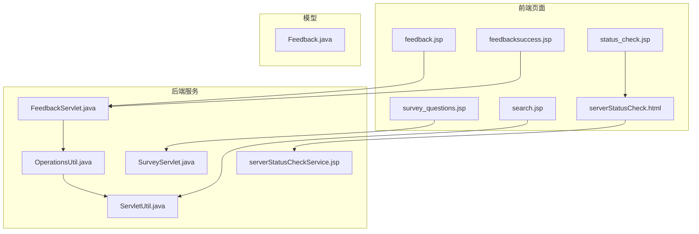
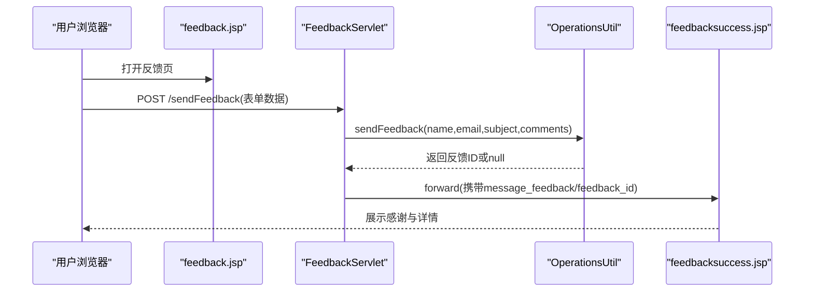
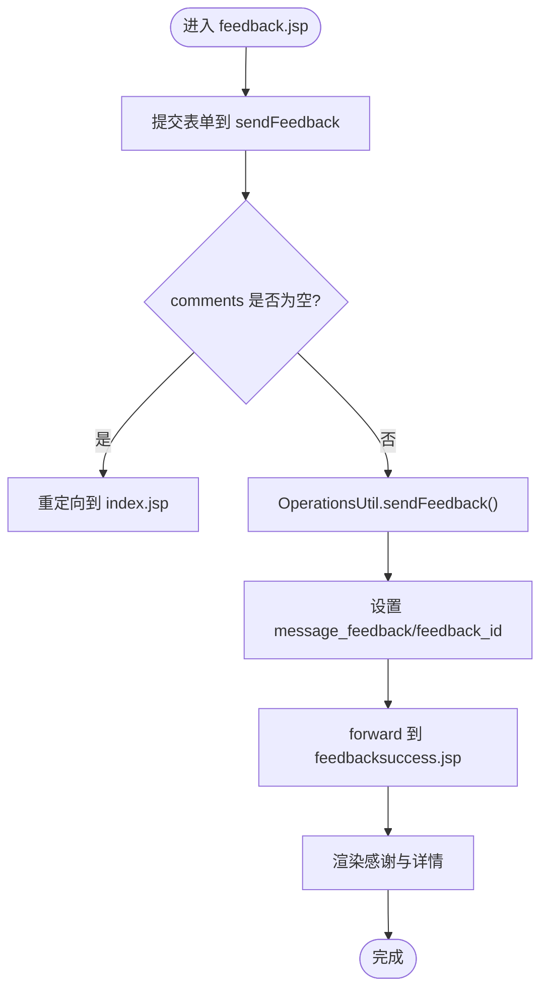
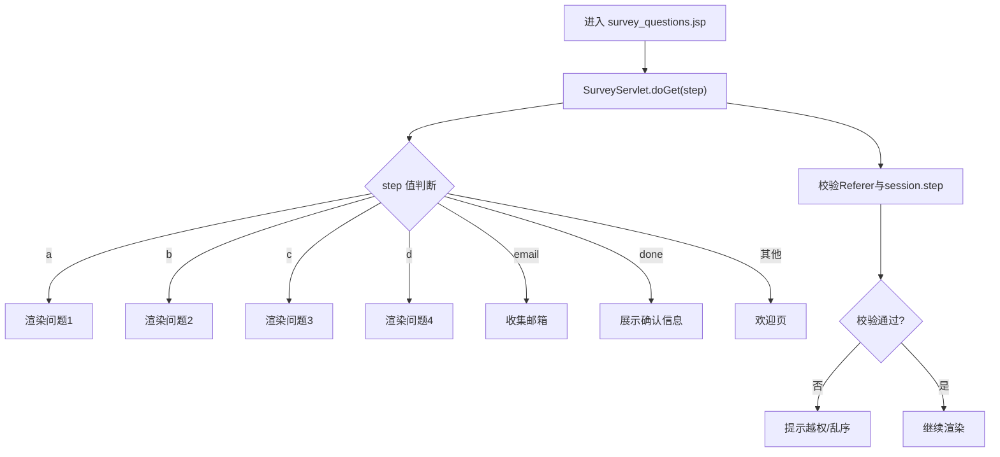
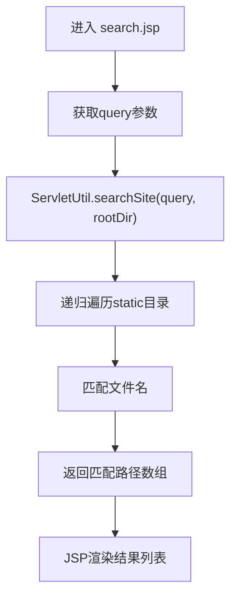
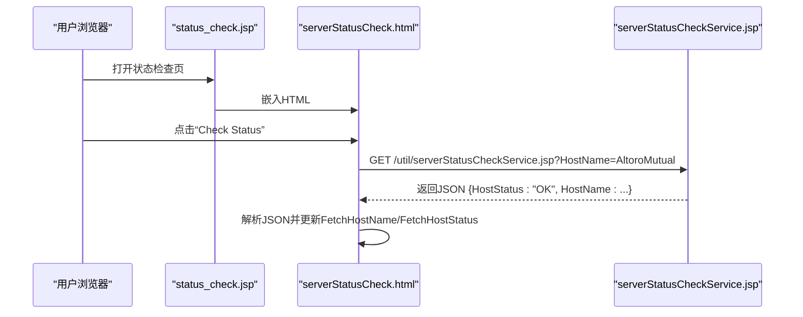
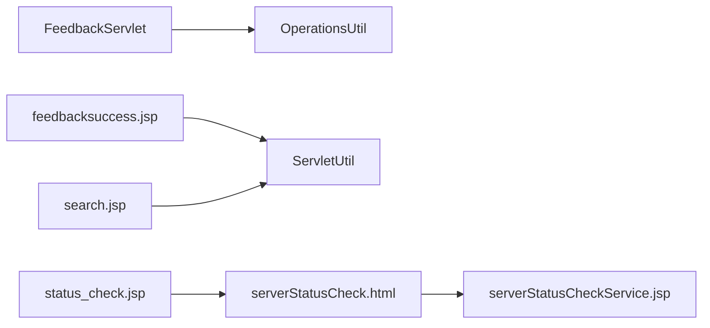

# 工具与辅助界面

<cite>
**本文引用的文件**   
- [feedback.jsp](file://WebContent/feedback.jsp)
- [feedbacksuccess.jsp](file://WebContent/feedbacksuccess.jsp)
- [survey_questions.jsp](file://WebContent/survey_questions.jsp)
- [search.jsp](file://WebContent/search.jsp)
- [status_check.jsp](file://WebContent/status_check.jsp)
- [serverStatusCheck.html](file://WebContent/util/serverStatusCheck.html)
- [serverStatusCheckService.jsp](file://WebContent/util/serverStatusCheckService.jsp)
- [FeedbackServlet.java](file://src/com/ibm/security/appscan/altoromutual/servlet/FeedbackServlet.java)
- [SurveyServlet.java](file://src/com/ibm/security/appscan/altoromutual/servlet/SurveyServlet.java)
- [OperationsUtil.java](file://src/com/ibm/security/appscan/altoromutual/util/OperationsUtil.java)
- [ServletUtil.java](file://src/com/ibm/security/appscan/altoromutual/util/ServletUtil.java)
- [Feedback.java](file://src/com/ibm/security/appscan/altoromutual/model/Feedback.java)
</cite>

## 目录
1. [简介](#简介)
2. [项目结构](#项目结构)
3. [核心组件](#核心组件)
4. [架构总览](#架构总览)
5. [详细组件分析](#详细组件分析)
6. [依赖关系分析](#依赖关系分析)
7. [性能考虑](#性能考虑)
8. [故障排查指南](#故障排查指南)
9. [结论](#结论)
10. [附录](#附录)

## 简介
本章节面向 AltoroJ 的“工具与辅助界面”，聚焦以下能力：
- 用户反馈提交与结果展示
- 在线调查（多步骤、动态生成问题）
- 站内搜索（基于静态资源的搜索入口）
- 系统状态检查（AJAX 异步请求，实时显示主机名与状态）

这些功能通过 JSP 页面与 Servlet 协作实现，部分使用纯前端 AJAX 调用后端服务返回 JSON。文档将详细说明各功能的界面设计、处理流程、数据流转，并给出优化与扩展建议。

## 项目结构
围绕工具与辅助界面的关键文件分布如下：
- 反馈相关：feedback.jsp、feedbacksuccess.jsp、FeedbackServlet.java、OperationsUtil.java、Feedback.java
- 调查相关：survey_questions.jsp、SurveyServlet.java
- 搜索相关：search.jsp、ServletUtil.java
- 状态检查相关：status_check.jsp、serverStatusCheck.html、serverStatusCheckService.jsp

图表来源
- [feedback.jsp:46-77](file://WebContent/feedback.jsp#L46-L77)
- [feedbacksuccess.jsp:40-91](file://WebContent/feedbacksuccess.jsp#L40-L91)
- [FeedbackServlet.java:42-68](file://src/com/ibm/security/appscan/altoromutual/servlet/FeedbackServlet.java#L42-L68)
- [OperationsUtil.java:119-132](file://src/com/ibm/security/appscan/altoromutual/util/OperationsUtil.java#L119-L132)
- [ServletUtil.java:155-165](file://src/com/ibm/security/appscan/altoromutual/util/ServletUtil.java#L155-L165)
- [survey_questions.jsp:24-26](file://WebContent/survey_questions.jsp#L24-L26)
- [SurveyServlet.java:45-104](file://src/com/ibm/security/appscan/altoromutual/servlet/SurveyServlet.java#L45-L104)
- [search.jsp:31-36](file://WebContent/search.jsp#L31-L36)
- [status_check.jsp:24-30](file://WebContent/status_check.jsp#L24-L30)
- [serverStatusCheck.html:29-78](file://WebContent/util/serverStatusCheck.html#L29-L78)
- [serverStatusCheckService.jsp:1-6](file://WebContent/util/serverStatusCheckService.jsp#L1-L6)

章节来源
- [feedback.jsp:1-89](file://WebContent/feedback.jsp#L1-L89)
- [feedbacksuccess.jsp:1-96](file://WebContent/feedbacksuccess.jsp#L1-L96)
- [survey_questions.jsp:1-27](file://WebContent/survey_questions.jsp#L1-L27)
- [search.jsp:1-50](file://WebContent/search.jsp#L1-L50)
- [status_check.jsp:1-34](file://WebContent/status_check.jsp#L1-L34)
- [serverStatusCheck.html:1-121](file://WebContent/util/serverStatusCheck.html#L1-L121)
- [serverStatusCheckService.jsp:1-6](file://WebContent/util/serverStatusCheckService.jsp#L1-L6)
- [FeedbackServlet.java:1-70](file://src/com/ibm/security/appscan/altoromutual/servlet/FeedbackServlet.java#L1-L70)
- [SurveyServlet.java:1-106](file://src/com/ibm/security/appscan/altoromutual/servlet/SurveyServlet.java#L1-L106)
- [OperationsUtil.java:1-155](file://src/com/ibm/security/appscan/altoromutual/util/OperationsUtil.java#L1-L155)
- [ServletUtil.java:1-412](file://src/com/ibm/security/appscan/altoromutual/util/ServletUtil.java#L1-L412)
- [Feedback.java:1-48](file://src/com/ibm/security/appscan/altoromutual/model/Feedback.java#L1-L48)

## 核心组件
- 反馈表单与处理：feedback.jsp 提供表单；FeedbackServlet.java 接收 POST；OperationsUtil.java 负责持久化；feedbacksuccess.jsp 展示结果与详情。
- 在线调查：survey_questions.jsp 作为入口；SurveyServlet.java 根据 step 参数动态渲染问题与导航。
- 站内搜索：search.jsp 调用 ServletUtil.searchSite 对静态资源进行检索。
- 系统状态检查：status_check.jsp 嵌入 serverStatusCheck.html；HTML 通过 XMLHttpRequest 异步调用 serverStatusCheckService.jsp 获取 JSON 并更新 UI。

章节来源
- [feedback.jsp:46-77](file://WebContent/feedback.jsp#L46-L77)
- [FeedbackServlet.java:42-68](file://src/com/ibm/security/appscan/altoromutual/servlet/FeedbackServlet.java#L42-L68)
- [OperationsUtil.java:119-132](file://src/com/ibm/security/appscan/altoromutual/util/OperationsUtil.java#L119-L132)
- [feedbacksuccess.jsp:40-91](file://WebContent/feedbacksuccess.jsp#L40-L91)
- [survey_questions.jsp:24-26](file://WebContent/survey_questions.jsp#L24-L26)
- [SurveyServlet.java:45-104](file://src/com/ibm/security/appscan/altoromutual/servlet/SurveyServlet.java#L45-L104)
- [search.jsp:31-36](file://WebContent/search.jsp#L31-L36)
- [ServletUtil.java:155-165](file://src/com/ibm/security/appscan/altoromutual/util/ServletUtil.java#L155-L165)
- [status_check.jsp:24-30](file://WebContent/status_check.jsp#L24-L30)
- [serverStatusCheck.html:29-78](file://WebContent/util/serverStatusCheck.html#L29-L78)
- [serverStatusCheckService.jsp:1-6](file://WebContent/util/serverStatusCheckService.jsp#L1-L6)

## 架构总览
整体交互遵循“页面 → Servlet/服务 → 工具类 → 视图”的模式：
- 反馈：JSP 表单 → FeedbackServlet → OperationsUtil → feedbacksuccess.jsp
- 调查：JSP 入口 → SurveyServlet 动态渲染 HTML
- 搜索：JSP → ServletUtil 静态文件检索
- 状态检查：JSP 嵌入 HTML → XMLHttpRequest → serverStatusCheckService.jsp 返回 JSON

图表来源
- [feedback.jsp:46-77](file://WebContent/feedback.jsp#L46-L77)
- [FeedbackServlet.java:42-68](file://src/com/ibm/security/appscan/altoromutual/servlet/FeedbackServlet.java#L42-L68)
- [OperationsUtil.java:119-132](file://src/com/ibm/security/appscan/altoromutual/util/OperationsUtil.java#L119-L132)
- [feedbacksuccess.jsp:40-91](file://WebContent/feedbacksuccess.jsp#L40-L91)

## 详细组件分析

### 反馈提交与结果展示
- 界面设计
  - feedback.jsp 提供姓名、邮箱、主题、评论等字段，并将数据以 POST 方式提交到 sendFeedback。
  - feedbacksuccess.jsp 展示感谢信息，并根据配置决定是否展示已提交的反馈详情。
- 处理流程
  - FeedbackServlet.doPost 校验 comments 是否存在；若存在则调用 OperationsUtil.sendFeedback 持久化，并将 feedback_id 放入 request 属性；最终转发至 feedbacksuccess.jsp。
  - feedbacksuccess.jsp 从 request 中读取 message_feedback 与 feedback_id，并在 enableFeedbackRetention 为 true 时查询并展示反馈详情。
- 数据流转
  - 前端表单 → Servlet → 工具类持久化 → 成功页展示。
- 关键点
  - 邮件格式校验与 XSS 过滤在 success 页中进行。
  - 是否持久化由应用属性控制。

图表来源
- [feedback.jsp:46-77](file://WebContent/feedback.jsp#L46-L77)
- [FeedbackServlet.java:42-68](file://src/com/ibm/security/appscan/altoromutual/servlet/FeedbackServlet.java#L42-L68)
- [OperationsUtil.java:119-132](file://src/com/ibm/security/appscan/altoromutual/util/OperationsUtil.java#L119-L132)
- [feedbacksuccess.jsp:40-91](file://WebContent/feedbacksuccess.jsp#L40-L91)

章节来源
- [feedback.jsp:46-77](file://WebContent/feedback.jsp#L46-L77)
- [FeedbackServlet.java:42-68](file://src/com/ibm/security/appscan/altoromutual/servlet/FeedbackServlet.java#L42-L68)
- [OperationsUtil.java:119-132](file://src/com/ibm/security/appscan/altoromutual/util/OperationsUtil.java#L119-L132)
- [feedbacksuccess.jsp:40-91](file://WebContent/feedbacksuccess.jsp#L40-L91)

### 在线调查（动态问题生成）
- 界面设计
  - survey_questions.jsp 作为入口，通过 jsp:param 传递 content=doSurvey，实际内容由 SurveyServlet 动态生成。
- 处理逻辑
  - SurveyServlet.doGet 根据 step 参数渲染不同问题与下一步链接，维护 previousStep 用于防跳转校验。
  - 通过 Referer 与 session 中的 surveyStep 校验访问顺序，防止跳过或重复步骤。
- 用户体验
  - 逐步引导式问答，最后收集邮箱并展示确认信息。

图表来源
- [survey_questions.jsp:24-26](file://WebContent/survey_questions.jsp#L24-L26)
- [SurveyServlet.java:45-104](file://src/com/ibm/security/appscan/altoromutual/servlet/SurveyServlet.java#L45-L104)

章节来源
- [survey_questions.jsp:24-26](file://WebContent/survey_questions.jsp#L24-L26)
- [SurveyServlet.java:45-104](file://src/com/ibm/security/appscan/altoromutual/servlet/SurveyServlet.java#L45-L104)

### 站内搜索
- 界面设计
  - search.jsp 接收 query 参数，调用 ServletUtil.searchSite 对 static 目录下的静态资源进行搜索。
- 处理逻辑
  - ServletUtil.searchSite 递归遍历目录并匹配文件名（当前实现未扫描文件内容）。
  - 搜索结果以绝对路径数组形式返回，JSP 中可进一步渲染列表。
- 现状说明
  - 当前 searchFiles 对文件内容不做扫描，因此仅能按文件名匹配。

图表来源
- [search.jsp:31-36](file://WebContent/search.jsp#L31-L36)
- [ServletUtil.java:155-192](file://src/com/ibm/security/appscan/altoromutual/util/ServletUtil.java#L155-L192)

章节来源
- [search.jsp:31-36](file://WebContent/search.jsp#L31-L36)
- [ServletUtil.java:155-192](file://src/com/ibm/security/appscan/altoromutual/util/ServletUtil.java#L155-L192)

### 系统状态检查（AJAX 异步请求）
- 界面设计
  - status_check.jsp 嵌入 util/serverStatusCheck.html，提供“Hostname”和“Status”两个展示区域以及“Check Status”按钮。
- 异步流程
  - serverStatusCheck.html 创建 XMLHttpRequest，GET 调用 util/serverStatusCheckService.jsp?HostName=...
  - 根据响应状态码（200/404/401/302/500）更新页面元素文本。
  - serverStatusCheckService.jsp 返回简单 JSON，包含 HostName 与 HostStatus。
- 实时更新
  - 通过 onreadystatechange 监听状态变化，动态替换 DOM 内容。

图表来源
- [status_check.jsp:24-30](file://WebContent/status_check.jsp#L24-L30)
- [serverStatusCheck.html:29-78](file://WebContent/util/serverStatusCheck.html#L29-L78)
- [serverStatusCheckService.jsp:1-6](file://WebContent/util/serverStatusCheckService.jsp#L1-L6)

章节来源
- [status_check.jsp:24-30](file://WebContent/status_check.jsp#L24-L30)
- [serverStatusCheck.html:29-78](file://WebContent/util/serverStatusCheck.html#L29-L78)
- [serverStatusCheckService.jsp:1-6](file://WebContent/util/serverStatusCheckService.jsp#L1-L6)

## 依赖关系分析
- 组件耦合
  - FeedbackServlet 依赖 OperationsUtil 进行反馈持久化。
  - feedbacksuccess.jsp 依赖 ServletUtil 获取反馈详情与应用属性。
  - search.jsp 依赖 ServletUtil 的搜索方法。
  - status_check.jsp 依赖 serverStatusCheck.html 与 serverStatusCheckService.jsp。
- 外部依赖
  - 数据库操作通过 DBUtil（在 OperationsUtil 与 ServletUtil 中被间接调用），但具体实现不在本仓库范围内。
- 潜在循环依赖
  - 未发现直接循环依赖；各层职责清晰。

图表来源
- [FeedbackServlet.java:42-68](file://src/com/ibm/security/appscan/altoromutual/servlet/FeedbackServlet.java#L42-L68)
- [OperationsUtil.java:119-132](file://src/com/ibm/security/appscan/altoromutual/util/OperationsUtil.java#L119-L132)
- [feedbacksuccess.jsp:40-91](file://WebContent/feedbacksuccess.jsp#L40-L91)
- [search.jsp:31-36](file://WebContent/search.jsp#L31-L36)
- [status_check.jsp:24-30](file://WebContent/status_check.jsp#L24-L30)
- [serverStatusCheck.html:29-78](file://WebContent/util/serverStatusCheck.html#L29-L78)
- [serverStatusCheckService.jsp:1-6](file://WebContent/util/serverStatusCheckService.jsp#L1-L6)

章节来源
- [FeedbackServlet.java:42-68](file://src/com/ibm/security/appscan/altoromutual/servlet/FeedbackServlet.java#L42-L68)
- [OperationsUtil.java:119-132](file://src/com/ibm/security/appscan/altoromutual/util/OperationsUtil.java#L119-L132)
- [feedbacksuccess.jsp:40-91](file://WebContent/feedbacksuccess.jsp#L40-L91)
- [search.jsp:31-36](file://WebContent/search.jsp#L31-L36)
- [status_check.jsp:24-30](file://WebContent/status_check.jsp#L24-L30)
- [serverStatusCheck.html:29-78](file://WebContent/util/serverStatusCheck.html#L29-L78)
- [serverStatusCheckService.jsp:1-6](file://WebContent/util/serverStatusCheckService.jsp#L1-L6)

## 性能考虑
- 反馈提交
  - 避免在 success 页频繁查询数据库；可在 FeedbackServlet 中缓存已提交的反馈对象以减少往返。
- 调查流程
  - 将问题模板与文案外置（如配置文件或模板引擎），减少服务端拼接字符串开销。
- 站内搜索
  - 当前仅匹配文件名，可扩展为全文索引（如 Elasticsearch）以提升准确性与性能。
- 状态检查
  - 可将 HostStatus 改为真实探测（HTTP/TCP 连通性），并加入缓存与超时控制，避免频繁网络请求。

[本节为通用指导，不直接分析具体文件]

## 故障排查指南
- 反馈提交失败
  - 检查 FeedbackServlet 是否正确转发到 feedbacksuccess.jsp，以及 enableFeedbackRetention 配置是否开启。
  - 若未显示反馈详情，确认 feedback_id 是否正确传入且 getFeedback 能返回对象。
- 调查步骤异常
  - 若出现“Request Out of Order”，检查 Referer 与 session.surveyStep 是否一致；确保用户按顺序访问。
- 搜索无结果
  - 确认 query 非空且 static 目录可读；当前实现仅匹配文件名，需调整搜索策略以匹配内容。
- 状态检查报错
  - 若返回 404/401/302/500，检查 serverStatusCheckService.jsp 部署路径与权限；确保 JSON 返回格式正确。

章节来源
- [FeedbackServlet.java:42-68](file://src/com/ibm/security/appscan/altoromutual/servlet/FeedbackServlet.java#L42-L68)
- [feedbacksuccess.jsp:40-91](file://WebContent/feedbacksuccess.jsp#L40-L91)
- [SurveyServlet.java:89-104](file://src/com/ibm/security/appscan/altoromutual/servlet/SurveyServlet.java#L89-L104)
- [search.jsp:31-36](file://WebContent/search.jsp#L31-L36)
- [serverStatusCheck.html:37-78](file://WebContent/util/serverStatusCheck.html#L37-L78)
- [serverStatusCheckService.jsp:1-6](file://WebContent/util/serverStatusCheckService.jsp#L1-L6)

## 结论
AltoroJ 的工具与辅助界面通过简洁的 JSP+Servlet 架构实现了反馈、调查、搜索与状态检查等功能。其中：
- 反馈流程具备基础的数据持久化与结果展示能力，可通过配置开关控制行为。
- 调查采用服务端动态渲染，具备基本的步骤校验机制。
- 搜索目前仅支持文件名匹配，可扩展为全文检索。
- 状态检查通过 AJAX 异步获取 JSON，具备良好的可扩展性与可视化效果。

建议在后续迭代中引入模板引擎、统一错误处理、输入校验与安全加固，并提升搜索与状态探测的真实性和性能。

[本节为总结性内容，不直接分析具体文件]

## 附录
- 关键代码片段路径
  - 反馈表单提交与处理：[feedback.jsp:46-77](file://WebContent/feedback.jsp#L46-L77)、[FeedbackServlet.java:42-68](file://src/com/ibm/security/appscan/altoromutual/servlet/FeedbackServlet.java#L42-L68)
  - 反馈结果展示与详情查询：[feedbacksuccess.jsp:40-91](file://WebContent/feedbacksuccess.jsp#L40-L91)、[ServletUtil.java:220-235](file://src/com/ibm/security/appscan/altoromutual/util/ServletUtil.java#L220-L235)
  - 调查步骤渲染与校验：[SurveyServlet.java:45-104](file://src/com/ibm/security/appscan/altoromutual/servlet/SurveyServlet.java#L45-L104)
  - 站内搜索实现：[search.jsp:31-36](file://WebContent/search.jsp#L31-L36)、[ServletUtil.java:155-192](file://src/com/ibm/security/appscan/altoromutual/util/ServletUtil.java#L155-L192)
  - 状态检查 AJAX 流程：[serverStatusCheck.html:29-78](file://WebContent/util/serverStatusCheck.html#L29-L78)、[serverStatusCheckService.jsp:1-6](file://WebContent/util/serverStatusCheckService.jsp#L1-L6)

[本节为参考路径汇总，不直接分析具体文件]