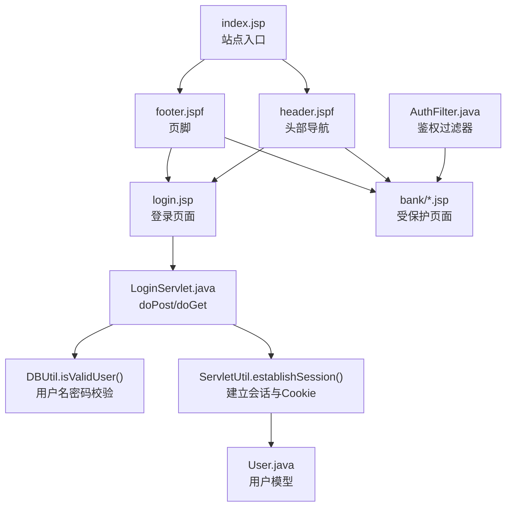
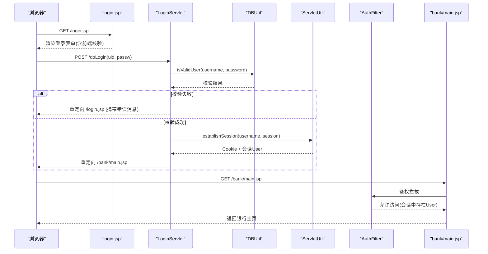
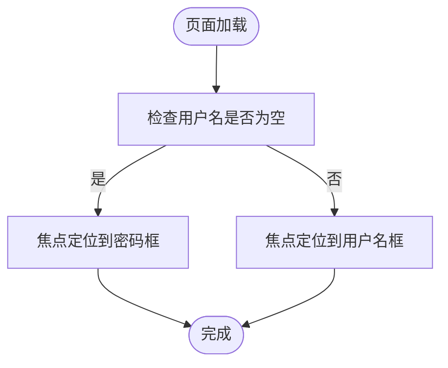
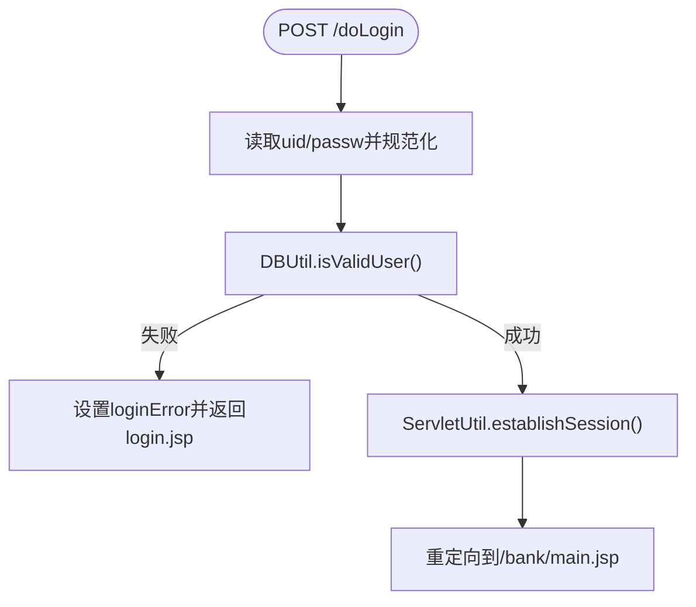
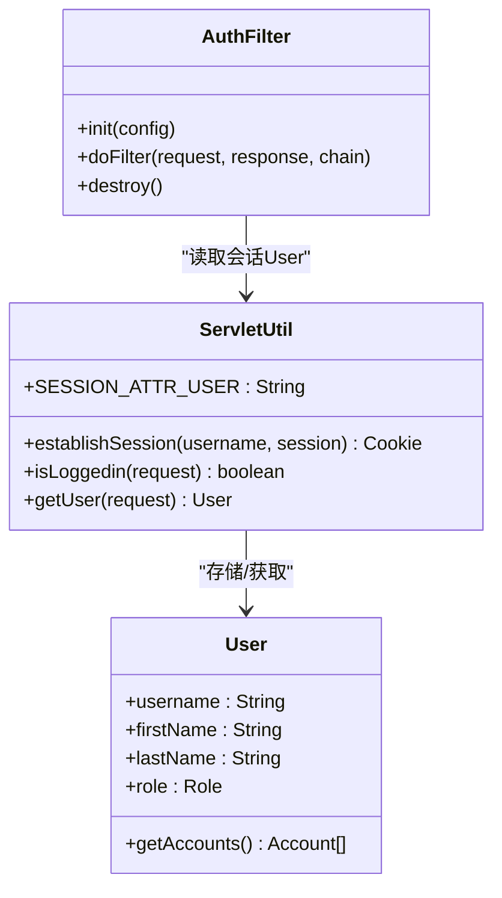
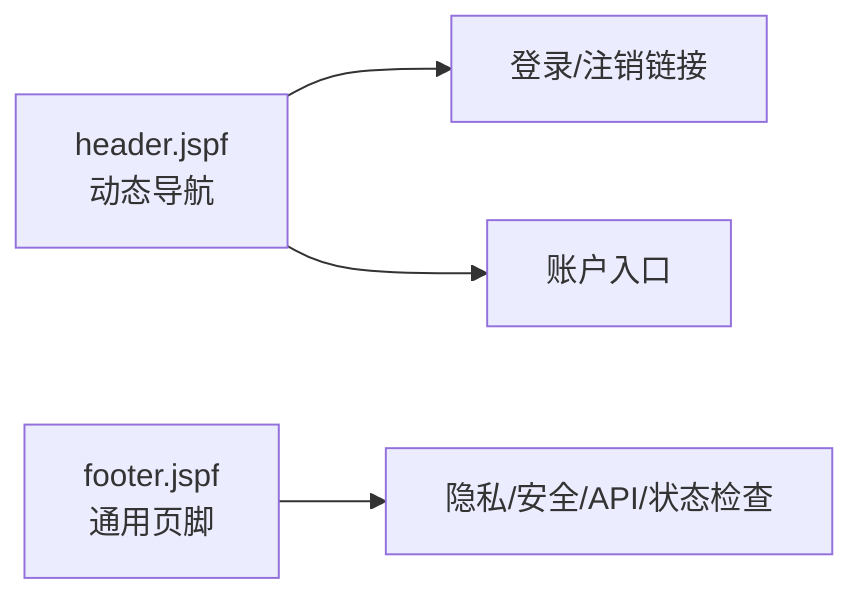
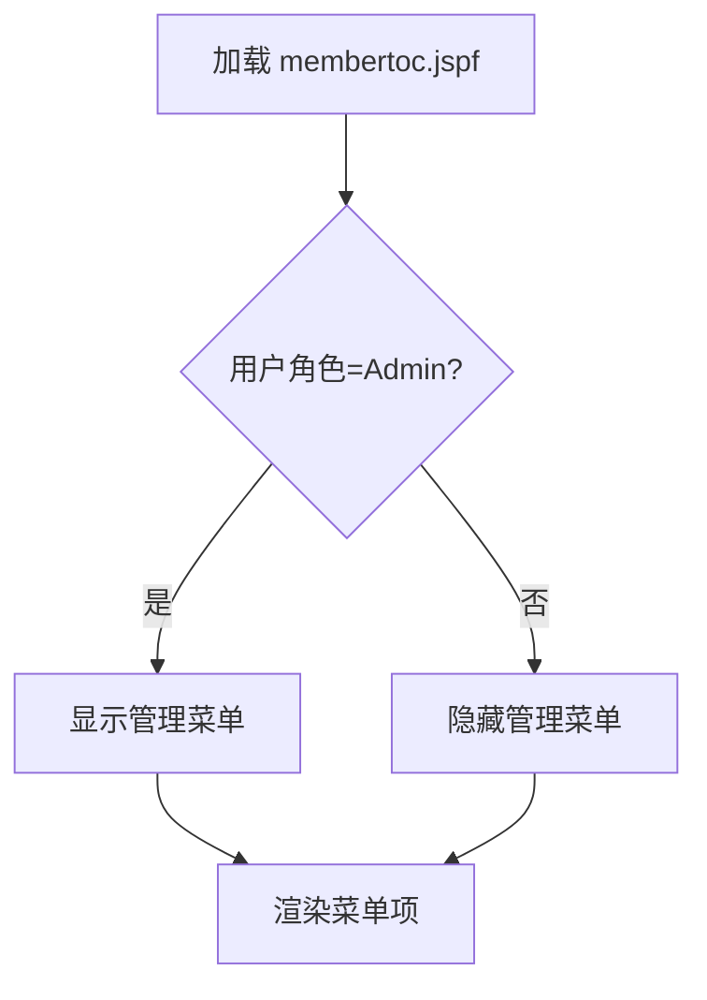
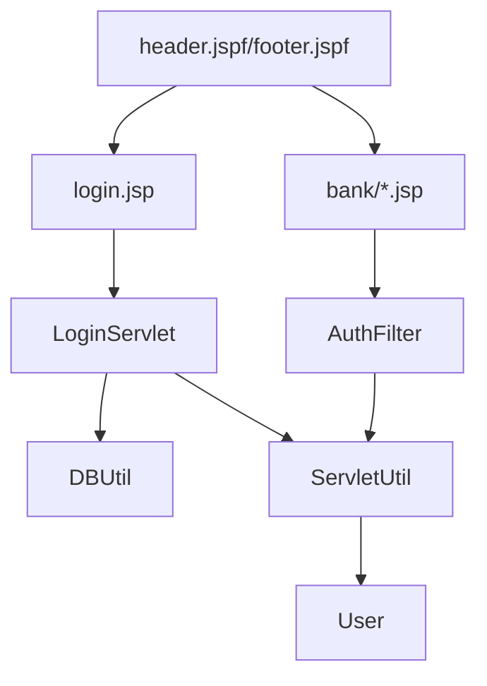

# 用户认证界面

<cite>
**本文引用的文件**   
- [login.jsp](file://WebContent/login.jsp)
- [LoginServlet.java](file://src/com/ibm/security/appscan/altoromutual/servlet/LoginServlet.java)
- [AuthFilter.java](file://src/com/ibm/security/appscan/altoromutual/filter/AuthFilter.java)
- [header.jspf](file://WebContent/header.jspf)
- [footer.jspf](file://WebContent/footer.jspf)
- [index.jsp](file://WebContent/index.jsp)
- [ServletUtil.java](file://src/com/ibm/security/appscan/altoromutual/util/ServletUtil.java)
- [User.java](file://src/com/ibm/security/appscan/altoromutual/model/User.java)
- [membertoc.jspf](file://WebContent/bank/membertoc.jspf)
</cite>

## 目录
1. [简介](#简介)
2. [项目结构](#项目结构)
3. [核心组件](#核心组件)
4. [架构总览](#架构总览)
5. [详细组件分析](#详细组件分析)
6. [依赖关系分析](#依赖关系分析)
7. [性能与可用性考虑](#性能与可用性考虑)
8. [故障排查指南](#故障排查指南)
9. [结论](#结论)

## 简介
本文件聚焦 AltoroJ 的用户认证相关界面与实现，覆盖登录表单的 HTML 结构与 JSP 动态内容、前端验证与安全策略、会话管理与鉴权过滤、头部导航与页脚等模板复用机制。文档同时给出认证流程优化、用户体验改进与安全最佳实践建议，帮助读者在理解现有实现的基础上进行安全加固与体验提升。

## 项目结构
围绕用户认证的页面与后端逻辑主要分布在以下位置：
- WebContent/login.jsp：登录页面（含表单与前端校验）
- src/.../servlet/LoginServlet.java：处理登录与登出请求
- src/.../filter/AuthFilter.java：受保护资源的访问控制过滤器
- WebContent/header.jspf / footer.jspf：页面头部与页脚模板
- WebContent/index.jsp：站点入口与静态内容加载
- src/.../util/ServletUtil.java：会话建立、用户信息存取、工具方法
- src/.../model/User.java：用户模型
- WebContent/bank/membertoc.jspf：会员侧边栏（登录后菜单）

图表来源
- [login.jsp:24-104](file://WebContent/login.jsp#L24-L104)
- [LoginServlet.java:51-104](file://src/com/ibm/security/appscan/altoromutual/servlet/LoginServlet.java#L51-L104)
- [AuthFilter.java:58-69](file://src/com/ibm/security/appscan/altoromutual/filter/AuthFilter.java#L58-L69)
- [header.jspf:27-63](file://WebContent/header.jspf#L27-L63)
- [footer.jspf:21-53](file://WebContent/footer.jspf#L21-L53)
- [index.jsp:28-110](file://WebContent/index.jsp#L28-L110)
- [ServletUtil.java:340-353](file://src/com/ibm/security/appscan/altoromutual/util/ServletUtil.java#L340-L353)
- [User.java:30-108](file://src/com/ibm/security/appscan/altoromutual/model/User.java#L30-L108)

章节来源
- [login.jsp:24-104](file://WebContent/login.jsp#L24-L104)
- [LoginServlet.java:51-104](file://src/com/ibm/security/appscan/altoromutual/servlet/LoginServlet.java#L51-L104)
- [AuthFilter.java:58-69](file://src/com/ibm/security/appscan/altoromutual/filter/AuthFilter.java#L58-L69)
- [header.jspf:27-63](file://WebContent/header.jspf#L27-L63)
- [footer.jspf:21-53](file://WebContent/footer.jspf#L21-L53)
- [index.jsp:28-110](file://WebContent/index.jsp#L28-L110)
- [ServletUtil.java:340-353](file://src/com/ibm/security/appscan/altoromutual/util/ServletUtil.java#L340-L353)
- [User.java:30-108](file://src/com/ibm/security/appscan/altoromutual/model/User.java#L30-L108)

## 核心组件
- 登录页面 login.jsp
  - 包含用户名与密码输入框，提交到 doLogin 动作；使用 onsubmit 前端校验必填项；通过 request.getSession().getAttribute("loginError") 显示错误消息。
- 登录处理 LoginServlet
  - doGet 用于登出：移除会话中的用户属性并重定向至首页。
  - doPost 用于登录：读取 uid/passw，调用 DBUtil.isValidUser 校验；失败则设置 loginError 并返回登录页；成功则通过 ServletUtil.establishSession 建立会话与 Cookie，重定向至银行主页。
- 鉴权过滤器 AuthFilter
  - 对受保护资源进行检查：若会话中不存在有效的 User 对象，则重定向到登录页。
- 模板 header.jspf / footer.jspf
  - 头部根据是否已登录切换“登录/注销”链接与账户入口；页脚提供隐私、安全声明、状态检查与 API 文档链接。
- 工具类 ServletUtil
  - establishSession：查询用户信息、生成账户列表 Base64 字符串写入 Cookie，并在会话中保存 User 对象。
  - isLoggedin/getUser：便捷判断登录状态与获取当前用户。
- 用户模型 User
  - 封装用户名、姓名、角色、最近访问时间等，并提供账户查询等方法。

章节来源
- [login.jsp:34-43](file://WebContent/login.jsp#L34-L43)
- [login.jsp:45-72](file://WebContent/login.jsp#L45-L72)
- [login.jsp:76-100](file://WebContent/login.jsp#L76-L100)
- [LoginServlet.java:51-62](file://src/com/ibm/security/appscan/altoromutual/servlet/LoginServlet.java#L51-L62)
- [LoginServlet.java:67-104](file://src/com/ibm/security/appscan/altoromutual/servlet/LoginServlet.java#L67-L104)
- [AuthFilter.java:58-69](file://src/com/ibm/security/appscan/altoromutual/filter/AuthFilter.java#L58-L69)
- [header.jspf:27-63](file://WebContent/header.jspf#L27-L63)
- [footer.jspf:21-53](file://WebContent/footer.jspf#L21-L53)
- [ServletUtil.java:340-353](file://src/com/ibm/security/appscan/altoromutual/util/ServletUtil.java#L340-L353)
- [ServletUtil.java:355-373](file://src/com/ibm/security/appscan/altoromutual/util/ServletUtil.java#L355-L373)
- [User.java:30-108](file://src/com/ibm/security/appscan/altoromutual/model/User.java#L30-L108)

## 架构总览
下图展示从浏览器发起登录到进入受保护页面的完整交互流程，包括前端校验、服务端校验、会话建立与鉴权拦截。

图表来源
- [login.jsp:45-72](file://WebContent/login.jsp#L45-L72)
- [LoginServlet.java:67-104](file://src/com/ibm/security/appscan/altoromutual/servlet/LoginServlet.java#L67-L104)
- [AuthFilter.java:58-69](file://src/com/ibm/security/appscan/altoromutual/filter/AuthFilter.java#L58-L69)
- [ServletUtil.java:340-353](file://src/com/ibm/security/appscan/altoromutual/util/ServletUtil.java#L340-L353)

## 详细组件分析

### 登录表单与前端验证
- HTML 结构
  - 表单 action="doLogin" method="post"，字段 uid 与 passw。
  - 通过 onsubmit 调用 confirminput 函数进行非空校验，未填写时提示并阻止提交。
- 动态错误消息
  - 页面从会话中读取 loginError 属性并输出，随后移除该属性以避免重复显示。
- 自动焦点
  - 页面加载后根据用户名是否为空决定将焦点置于用户名或密码输入框，提升易用性。

图表来源
- [login.jsp:76-100](file://WebContent/login.jsp#L76-L100)

章节来源
- [login.jsp:34-43](file://WebContent/login.jsp#L34-L43)
- [login.jsp:45-72](file://WebContent/login.jsp#L45-L72)
- [login.jsp:76-100](file://WebContent/login.jsp#L76-L100)

### 登录处理与会话管理
- 登录流程
  - 读取 uid/passw，统一转为小写（注意：实际生产环境密码应区分大小写）。
  - 调用 DBUtil.isValidUser 进行用户名密码校验；失败则在会话中设置 loginError 并返回登录页。
  - 成功后调用 ServletUtil.establishSession 建立会话与 Cookie，并重定向到银行主页。
- 登出流程
  - doGet 移除会话中的用户属性，然后重定向到首页。

图表来源
- [LoginServlet.java:67-104](file://src/com/ibm/security/appscan/altoromutual/servlet/LoginServlet.java#L67-L104)
- [ServletUtil.java:340-353](file://src/com/ibm/security/appscan/altoromutual/util/ServletUtil.java#L340-L353)

章节来源
- [LoginServlet.java:51-62](file://src/com/ibm/security/appscan/altoromutual/servlet/LoginServlet.java#L51-L62)
- [LoginServlet.java:67-104](file://src/com/ibm/security/appscan/altoromutual/servlet/LoginServlet.java#L67-L104)
- [ServletUtil.java:340-353](file://src/com/ibm/security/appscan/altoromutual/util/ServletUtil.java#L340-L353)

### 鉴权过滤器与会话状态
- 鉴权逻辑
  - 过滤器从会话中读取 User 对象；若为空或类型不匹配，则重定向到登录页。
- 会话键与常量
  - 使用 ServletUtil.SESSION_ATTR_USER 作为会话键，确保一致性。

图表来源
- [AuthFilter.java:58-69](file://src/com/ibm/security/appscan/altoromutual/filter/AuthFilter.java#L58-L69)
- [ServletUtil.java:60-62](file://src/com/ibm/security/appscan/altoromutual/util/ServletUtil.java#L60-L62)
- [ServletUtil.java:340-353](file://src/com/ibm/security/appscan/altoromutual/util/ServletUtil.java#L340-L353)
- [User.java:30-108](file://src/com/ibm/security/appscan/altoromutual/model/User.java#L30-L108)

章节来源
- [AuthFilter.java:58-69](file://src/com/ibm/security/appscan/altoromutual/filter/AuthFilter.java#L58-L69)
- [ServletUtil.java:60-62](file://src/com/ibm/security/appscan/altoromutual/util/ServletUtil.java#L60-L62)
- [ServletUtil.java:340-353](file://src/com/ibm/security/appscan/altoromutual/util/ServletUtil.java#L340-L353)
- [User.java:30-108](file://src/com/ibm/security/appscan/altoromutual/model/User.java#L30-L108)

### 头部导航与页脚模板复用
- 头部导航
  - 根据会话中是否存在 user 属性，动态显示“登录/注销”链接与“我的账户”入口。
  - 搜索框与站点导航链接统一由 header.jspf 提供。
- 页脚
  - 提供隐私政策、安全声明、服务器状态检查与 REST API 文档链接，以及版权信息。

图表来源
- [header.jspf:27-63](file://WebContent/header.jspf#L27-L63)
- [footer.jspf:21-53](file://WebContent/footer.jspf#L21-L53)

章节来源
- [header.jspf:27-63](file://WebContent/header.jspf#L27-L63)
- [footer.jspf:21-53](file://WebContent/footer.jspf#L21-L53)

### 会员侧边栏与权限菜单
- 会员侧边栏
  - 登录后显示常用功能（查看账户、交易、转账、新闻搜索、语言定制）。
  - 当用户角色为 Admin 时，显示“编辑用户”“审核反馈”等管理菜单。
- 配置开关
  - 通过 ServletUtil.getAppProperty 读取应用属性以启用/禁用特定功能。

图表来源
- [membertoc.jspf:29-57](file://WebContent/bank/membertoc.jspf#L29-L57)
- [ServletUtil.java:201-218](file://src/com/ibm/security/appscan/altoromutual/util/ServletUtil.java#L201-L218)

章节来源
- [membertoc.jspf:29-57](file://WebContent/bank/membertoc.jspf#L29-L57)
- [ServletUtil.java:201-218](file://src/com/ibm/security/appscan/altoromutual/util/ServletUtil.java#L201-L218)

### 注册功能现状说明
- 当前代码库未发现面向普通用户的“注册”页面或对应 Servlet/JSP。
- 管理员后台存在“添加用户”功能（admin/admin.jsp 与 AdminServlet/AdminAPI），但属于管理员操作，并非公开注册入口。
- 如需新增用户注册能力，建议在现有认证体系基础上扩展独立的注册流程，并与数据库层集成。

章节来源
- [WebContent/admin/admin.jsp:142-186](file://WebContent/admin/admin.jsp#L142-L186)
- [src/.../servlet/AdminServlet.java:55-86](file://src/com/ibm/security/appscan/altoromutual/servlet/AdminServlet.java#L55-L86)

## 依赖关系分析
- 登录链路依赖
  - login.jsp → LoginServlet.doPost → DBUtil.isValidUser → ServletUtil.establishSession → Cookie + Session(User)
- 鉴权链路依赖
  - 受保护页面 → AuthFilter.doFilter → 检查 Session(User) → 放行或重定向
- 模板依赖
  - 所有页面通过 jsp:include 复用 header.jspf 与 footer.jspf，保证导航与页脚一致性

图表来源
- [login.jsp:45-72](file://WebContent/login.jsp#L45-L72)
- [LoginServlet.java:67-104](file://src/com/ibm/security/appscan/altoromutual/servlet/LoginServlet.java#L67-L104)
- [AuthFilter.java:58-69](file://src/com/ibm/security/appscan/altoromutual/filter/AuthFilter.java#L58-L69)
- [ServletUtil.java:340-353](file://src/com/ibm/security/appscan/altoromutual/util/ServletUtil.java#L340-L353)
- [header.jspf:27-63](file://WebContent/header.jspf#L27-L63)
- [footer.jspf:21-53](file://WebContent/footer.jspf#L21-L53)

章节来源
- [login.jsp:45-72](file://WebContent/login.jsp#L45-L72)
- [LoginServlet.java:67-104](file://src/com/ibm/security/appscan/altoromutual/servlet/LoginServlet.java#L67-L104)
- [AuthFilter.java:58-69](file://src/com/ibm/security/appscan/altoromutual/filter/AuthFilter.java#L58-L69)
- [ServletUtil.java:340-353](file://src/com/ibm/security/appscan/altoromutual/util/ServletUtil.java#L340-L353)
- [header.jspf:27-63](file://WebContent/header.jspf#L27-L63)
- [footer.jspf:21-53](file://WebContent/footer.jspf#L21-L53)

## 性能与可用性考虑
- 前端校验
  - 当前仅做非空校验，建议增加格式校验（如邮箱/手机号）、弱口令提示与防抖，减少无效请求。
- 会话与 Cookie
  - 建议使用 HttpOnly、Secure、SameSite 属性增强 Cookie 安全性；合理设置会话超时时间。
- 模板复用
  - 继续使用 header.jspf/footer.jspf 保持 UI 一致性与可维护性；可将更多公共模块抽取为 .jspf 片段。
- 错误提示
  - 登录失败时避免泄露过多细节（例如具体哪个字段错误），统一提示“用户名或密码不正确”。

[本节为通用指导，无需引用具体文件]

## 故障排查指南
- 登录失败
  - 检查 DBUtil.isValidUser 返回值与日志；确认用户名与密码是否正确且未被转换为小写导致差异。
  - 确认 loginError 是否在登录页正确显示并被消费后清除。
- 无法进入受保护页面
  - 检查会话中是否存在 User 对象；确认 AuthFilter 是否正确配置并生效。
- 导航异常
  - 检查 header.jspf 中 loggedIn 的判断逻辑与上下文路径是否正确。
- 管理员菜单不显示
  - 确认用户角色为 Admin，且应用属性 enableFeedbackRetention 等开关配置正确。

章节来源
- [LoginServlet.java:82-90](file://src/com/ibm/security/appscan/altoromutual/servlet/LoginServlet.java#L82-L90)
- [AuthFilter.java:58-69](file://src/com/ibm/security/appscan/altoromutual/filter/AuthFilter.java#L58-L69)
- [header.jspf:27-63](file://WebContent/header.jspf#L27-L63)
- [membertoc.jspf:40-55](file://WebContent/bank/membertoc.jspf#L40-L55)

## 结论
AltoroJ 的用户认证界面采用 JSP + Servlet + Filter 的经典架构，登录表单在前端进行基础校验，服务端通过 DBUtil 校验凭据并使用 ServletUtil 建立会话与 Cookie，AuthFilter 负责受保护资源的鉴权。头部与页脚通过模板复用保持一致性。为提升安全性与用户体验，建议引入更严格的前端校验、安全的 Cookie 与会话策略、统一的错误提示与更强的密码策略，并在需要时扩展用户注册流程。

[本节为总结性内容，无需引用具体文件]