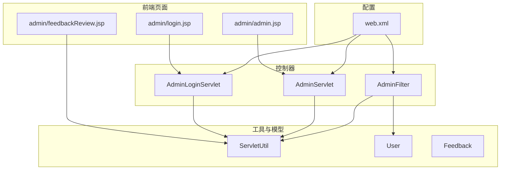
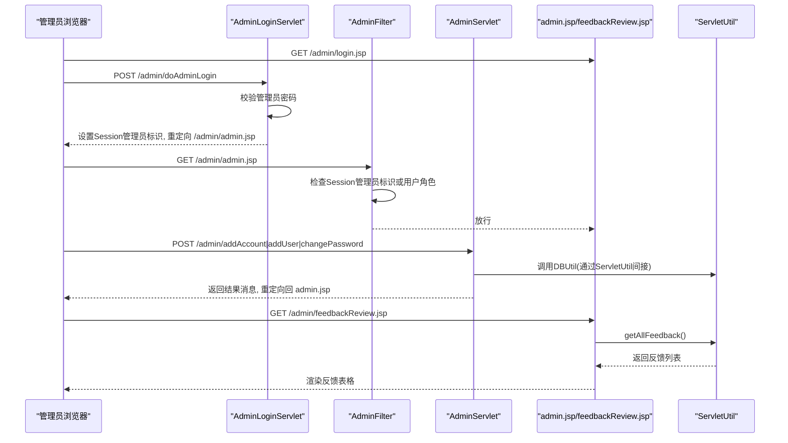
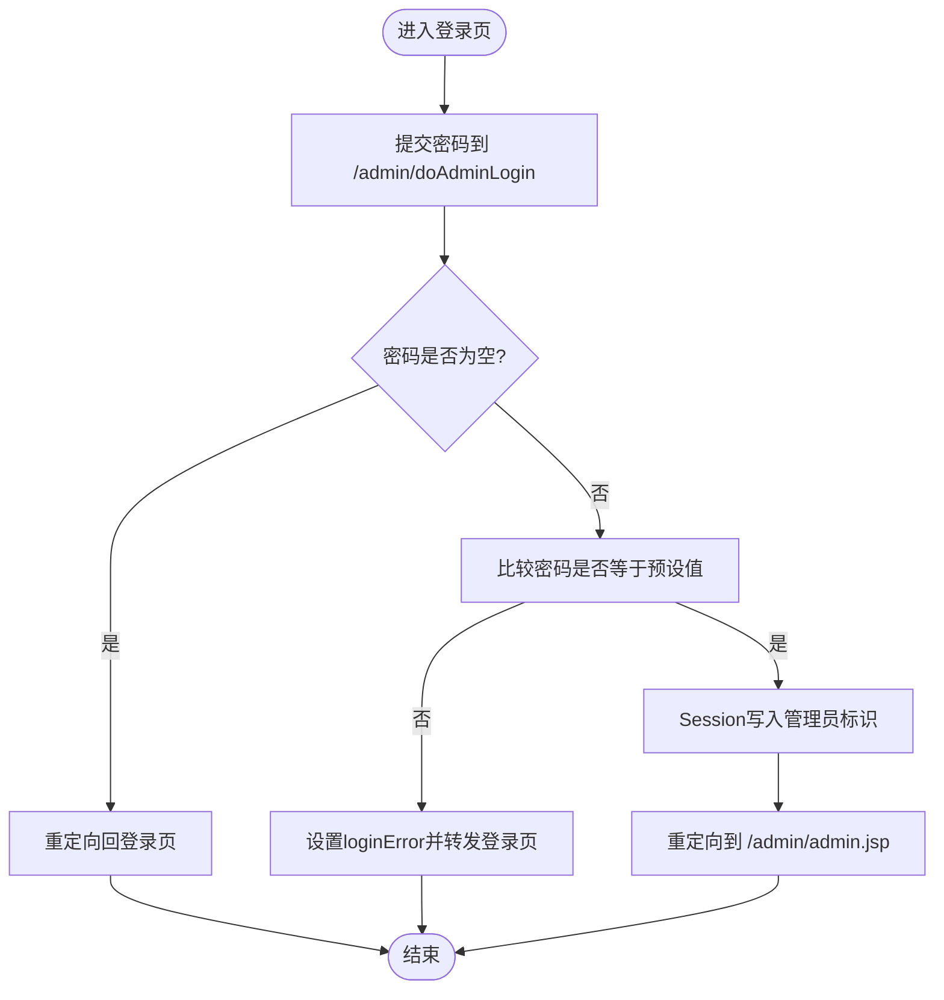
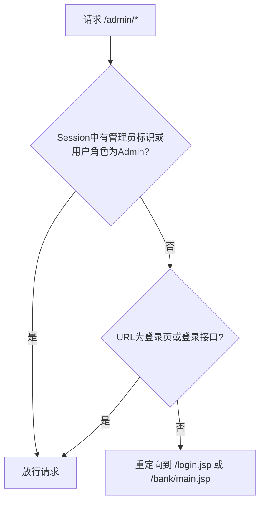
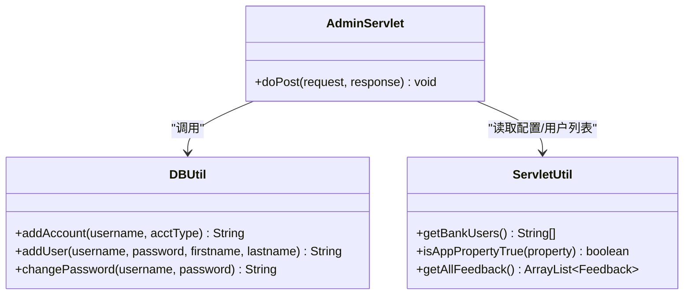
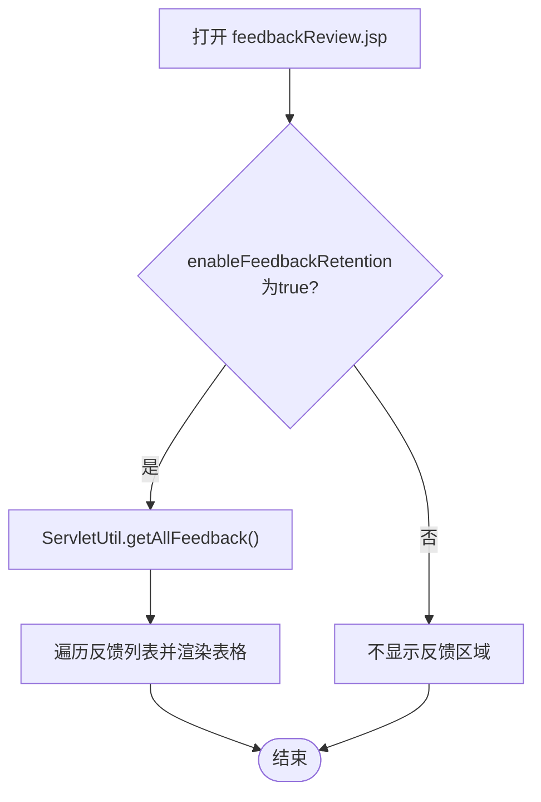
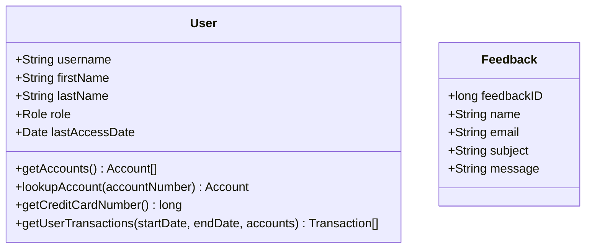
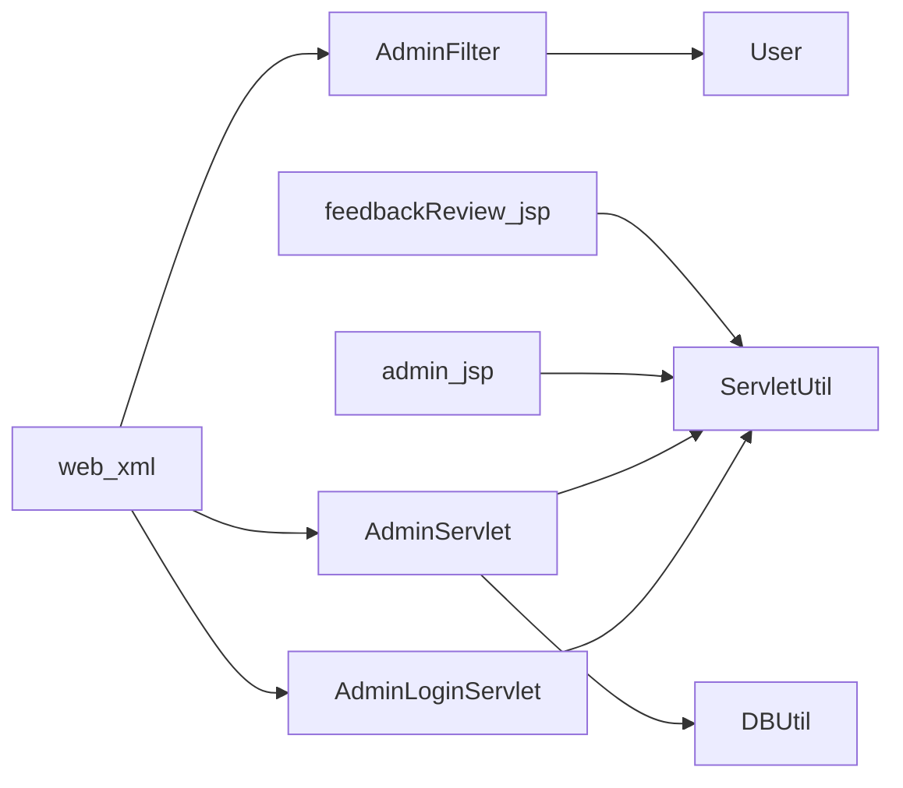

# 管理界面

<cite>
**本文引用的文件**   
- [WebContent/admin/login.jsp](file://WebContent/admin/login.jsp)
- [WebContent/admin/admin.jsp](file://WebContent/admin/admin.jsp)
- [WebContent/admin/feedbackReview.jsp](file://WebContent/admin/feedbackReview.jsp)
- [src/com/ibm/security/appscan/altoromutual/servlet/AdminLoginServlet.java](file://src/com/ibm/security/appscan/altoromutual/servlet/AdminLoginServlet.java)
- [src/com/ibm/security/appscan/altoromutual/servlet/AdminServlet.java](file://src/com/ibm/security/appscan/altoromutual/servlet/AdminServlet.java)
- [src/com/ibm/security/appscan/altoromutual/filter/AdminFilter.java](file://src/com/ibm/security/appscan/altoromutual/filter/AdminFilter.java)
- [src/com/ibm/security/appscan/altoromutual/util/ServletUtil.java](file://src/com/ibm/security/appscan/altoromutual/util/ServletUtil.java)
- [src/com/ibm/security/appscan/altoromutual/model/User.java](file://src/com/ibm/security/appscan/altoromutual/model/User.java)
- [src/com/ibm/security/appscan/altoromutual/model/Feedback.java](file://src/com/ibm/security/appscan/altoromutual/model/Feedback.java)
- [WebContent/WEB-INF/web.xml](file://WebContent/WEB-INF/web.xml)
</cite>

## 目录
1. [简介](#简介)
2. [项目结构](#项目结构)
3. [核心组件](#核心组件)
4. [架构总览](#架构总览)
5. [详细组件分析](#详细组件分析)
6. [依赖关系分析](#依赖关系分析)
7. [性能与可用性建议](#性能与可用性建议)
8. [故障排查指南](#故障排查指南)
9. [结论](#结论)

## 简介
本文件为 AltoroJ 的管理员界面提供系统化文档，覆盖管理员登录认证、用户管理（新增用户、修改密码、为用户添加账户）、反馈内容审核等高级管理功能。文档从系统架构、组件职责、数据流、权限验证与安全控制、错误处理与审计日志等方面展开，并给出优化与改进建议，帮助读者理解现有实现并指导后续加固与扩展。

## 项目结构
管理员相关的前端页面位于 WebContent/admin 下，后端逻辑由 Servlet 与 Filter 承担，模型类封装用户与反馈实体，工具类提供配置读取、会话属性常量与数据访问辅助方法。web.xml 中注册了过滤器和 Servlet 映射，构成请求路由与访问控制的入口。

图表来源
- [WebContent/admin/login.jsp:24-55](file://WebContent/admin/login.jsp#L24-L55)
- [WebContent/admin/admin.jsp:23-188](file://WebContent/admin/admin.jsp#L23-L188)
- [WebContent/admin/feedbackReview.jsp:26-69](file://WebContent/admin/feedbackReview.jsp#L26-L69)
- [src/com/ibm/security/appscan/altoromutual/servlet/AdminLoginServlet.java:40-53](file://src/com/ibm/security/appscan/altoromutual/servlet/AdminLoginServlet.java#L40-L53)
- [src/com/ibm/security/appscan/altoromutual/servlet/AdminServlet.java:39-120](file://src/com/ibm/security/appscan/altoromutual/servlet/AdminServlet.java#L39-L120)
- [src/com/ibm/security/appscan/altoromutual/filter/AdminFilter.java:58-80](file://src/com/ibm/security/appscan/altoromutual/filter/AdminFilter.java#L58-L80)
- [src/com/ibm/security/appscan/altoromutual/util/ServletUtil.java:60-62](file://src/com/ibm/security/appscan/altoromutual/util/ServletUtil.java#L60-L62)
- [WebContent/WEB-INF/web.xml:12-51](file://WebContent/WEB-INF/web.xml#L12-L51)
- [WebContent/WEB-INF/web.xml:132-214](file://WebContent/WEB-INF/web.xml#L132-L214)

章节来源
- [WebContent/admin/login.jsp:24-55](file://WebContent/admin/login.jsp#L24-L55)
- [WebContent/admin/admin.jsp:23-188](file://WebContent/admin/admin.jsp#L23-L188)
- [WebContent/admin/feedbackReview.jsp:26-69](file://WebContent/admin/feedbackReview.jsp#L26-L69)
- [src/com/ibm/security/appscan/altoromutual/servlet/AdminLoginServlet.java:40-53](file://src/com/ibm/security/appscan/altoromutual/servlet/AdminLoginServlet.java#L40-L53)
- [src/com/ibm/security/appscan/altoromutual/servlet/AdminServlet.java:39-120](file://src/com/ibm/security/appscan/altoromutual/servlet/AdminServlet.java#L39-L120)
- [src/com/ibm/security/appscan/altoromutual/filter/AdminFilter.java:58-80](file://src/com/ibm/security/appscan/altoromutual/filter/AdminFilter.java#L58-L80)
- [WebContent/WEB-INF/web.xml:12-51](file://WebContent/WEB-INF/web.xml#L12-L51)
- [WebContent/WEB-INF/web.xml:132-214](file://WebContent/WEB-INF/web.xml#L132-L214)

## 核心组件
- 管理员登录页：admin/login.jsp 提供管理员密码输入表单，提交至 /admin/doAdminLogin。
- 管理员主控制台：admin/admin.jsp 展示用户列表下拉框，并提供“为用户添加账户”、“修改用户密码”、“新增用户”三个操作表单；通过 ServletUtil.isAppPropertyTrue("enableAdminFunctions") 控制是否启用这些功能。
- 反馈审核页：admin/feedbackReview.jsp 在 enableFeedbackRetention 开启时列出所有反馈条目，供管理员审阅。
- 管理员登录控制器：AdminLoginServlet 校验管理员密码，成功后在 Session 中写入管理员标识键值对，并重定向到 admin/admin.jsp。
- 管理员业务控制器：AdminServlet 根据 URL 后缀分发 addAccount/addUser/changePassword 等操作，调用 DBUtil 执行数据库变更，统一返回结果消息。
- 管理员访问过滤器：AdminFilter 拦截 /admin/* 请求，检查 Session 中的管理员标记或用户角色是否为 Admin，否则重定向到登录或普通主页。
- 工具类：ServletUtil 提供会话属性常量、应用属性开关读取、用户名单获取、反馈数据获取、HTML 转义等能力。
- 模型：User 包含用户名、姓名、角色等；Feedback 包含反馈 ID、姓名、邮箱、主题、消息。

章节来源
- [WebContent/admin/login.jsp:33-50](file://WebContent/admin/login.jsp#L33-L50)
- [WebContent/admin/admin.jsp:30-188](file://WebContent/admin/admin.jsp#L30-L188)
- [WebContent/admin/feedbackReview.jsp:33-69](file://WebContent/admin/feedbackReview.jsp#L33-L69)
- [src/com/ibm/security/appscan/altoromutual/servlet/AdminLoginServlet.java:40-53](file://src/com/ibm/security/appscan/altoromutual/servlet/AdminLoginServlet.java#L40-L53)
- [src/com/ibm/security/appscan/altoromutual/servlet/AdminServlet.java:39-120](file://src/com/ibm/security/appscan/altoromutual/servlet/AdminServlet.java#L39-L120)
- [src/com/ibm/security/appscan/altoromutual/filter/AdminFilter.java:58-80](file://src/com/ibm/security/appscan/altoromutual/filter/AdminFilter.java#L58-L80)
- [src/com/ibm/security/appscan/altoromutual/util/ServletUtil.java:60-62](file://src/com/ibm/security/appscan/altoromutual/util/ServletUtil.java#L60-L62)
- [src/com/ibm/security/appscan/altoromutual/util/ServletUtil.java:201-242](file://src/com/ibm/security/appscan/altoromutual/util/ServletUtil.java#L201-L242)
- [src/com/ibm/security/appscan/altoromutual/model/User.java:30-54](file://src/com/ibm/security/appscan/altoromutual/model/User.java#L30-L54)
- [src/com/ibm/security/appscan/altoromutual/model/Feedback.java:6-47](file://src/com/ibm/security/appscan/altoromutual/model/Feedback.java#L6-L47)

## 架构总览
管理员界面的请求流程如下：
- 管理员访问 /admin/login.jsp，输入密码并提交到 /admin/doAdminLogin。
- AdminLoginServlet 校验密码，成功则在 Session 中设置管理员标识，重定向到 /admin/admin.jsp。
- 管理员在 /admin/admin.jsp 进行用户管理操作，表单提交到 /admin/addAccount、/admin/addUser、/admin/changePassword，由 AdminServlet 处理。
- 管理员访问 /admin/feedbackReview.jsp 查看反馈列表，页面通过 ServletUtil.getAllFeedback() 拉取数据。
- 所有 /admin/* 请求均经过 AdminFilter 进行权限校验。

图表来源
- [WebContent/admin/login.jsp:33-50](file://WebContent/admin/login.jsp#L33-L50)
- [src/com/ibm/security/appscan/altoromutual/servlet/AdminLoginServlet.java:40-53](file://src/com/ibm/security/appscan/altoromutual/servlet/AdminLoginServlet.java#L40-L53)
- [src/com/ibm/security/appscan/altoromutual/filter/AdminFilter.java:58-80](file://src/com/ibm/security/appscan/altoromutual/filter/AdminFilter.java#L58-L80)
- [WebContent/admin/admin.jsp:70-188](file://WebContent/admin/admin.jsp#L70-L188)
- [src/com/ibm/security/appscan/altoromutual/servlet/AdminServlet.java:39-120](file://src/com/ibm/security/appscan/altoromutual/servlet/AdminServlet.java#L39-L120)
- [WebContent/admin/feedbackReview.jsp:33-69](file://WebContent/admin/feedbackReview.jsp#L33-L69)
- [src/com/ibm/security/appscan/altoromutual/util/ServletUtil.java:221-242](file://src/com/ibm/security/appscan/altoromutual/util/ServletUtil.java#L221-L242)

## 详细组件分析

### 管理员登录认证
- 界面：admin/login.jsp 提供密码输入框，提交到 /admin/doAdminLogin。
- 控制器：AdminLoginServlet 接收 password 参数，若为空则重定向回登录页；若密码不等于预设值，设置 loginError 属性并转发回登录页；若正确，则在 Session 中写入管理员标识键值对，并重定向到 admin/admin.jsp。
- 安全要点：当前使用硬编码口令比较，存在安全风险；应替换为安全的凭据存储与校验机制，并引入防暴力破解策略（如失败计数、锁定、验证码）。

图表来源
- [WebContent/admin/login.jsp:33-50](file://WebContent/admin/login.jsp#L33-L50)
- [src/com/ibm/security/appscan/altoromutual/servlet/AdminLoginServlet.java:40-53](file://src/com/ibm/security/appscan/altoromutual/servlet/AdminLoginServlet.java#L40-L53)

章节来源
- [WebContent/admin/login.jsp:33-50](file://WebContent/admin/login.jsp#L33-L50)
- [src/com/ibm/security/appscan/altoromutual/servlet/AdminLoginServlet.java:40-53](file://src/com/ibm/security/appscan/altoromutual/servlet/AdminLoginServlet.java#L40-L53)

### 管理员访问控制（过滤器）
- 过滤器：AdminFilter 拦截 /admin/* 请求，检查 Session 中是否存在管理员标识或当前用户角色是否为 Admin；允许访问登录页与登录接口；未登录或非管理员重定向到 /login.jsp 或 /bank/main.jsp。
- web.xml 中定义了 AuthFilter 与 AdminFilter 的映射，但注意 AdminFilter 的 url-pattern 存在拼写错误（/adimn/*），可能导致该过滤器未生效。

图表来源
- [src/com/ibm/security/appscan/altoromutual/filter/AdminFilter.java:58-80](file://src/com/ibm/security/appscan/altoromutual/filter/AdminFilter.java#L58-L80)
- [WebContent/WEB-INF/web.xml:12-51](file://WebContent/WEB-INF/web.xml#L12-L51)

章节来源
- [src/com/ibm/security/appscan/altoromutual/filter/AdminFilter.java:58-80](file://src/com/ibm/security/appscan/altoromutual/filter/AdminFilter.java#L58-L80)
- [WebContent/WEB-INF/web.xml:12-51](file://WebContent/WEB-INF/web.xml#L12-L51)

### 用户管理（admin.jsp）
- 功能：
  - 为用户添加账户：选择用户与账户类型（Checking/Savings/IRA），提交到 /admin/addAccount。
  - 修改用户密码：选择用户并输入新密码及确认，提交到 /admin/changePassword。
  - 新增用户：输入姓名、用户名、密码及确认，提交到 /admin/addUser。
- 启用开关：通过 ServletUtil.isAppPropertyTrue("enableAdminFunctions") 控制表单 action 是否可用。
- 数据处理：AdminServlet 根据 URL 后缀分发操作，调用 DBUtil 执行数据库变更，并将结果消息存入 Session，再重定向回 admin.jsp。

图表来源
- [src/com/ibm/security/appscan/altoromutual/servlet/AdminServlet.java:39-120](file://src/com/ibm/security/appscan/altoromutual/servlet/AdminServlet.java#L39-L120)
- [src/com/ibm/security/appscan/altoromutual/util/ServletUtil.java:201-242](file://src/com/ibm/security/appscan/altoromutual/util/ServletUtil.java#L201-L242)

章节来源
- [WebContent/admin/admin.jsp:70-188](file://WebContent/admin/admin.jsp#L70-L188)
- [src/com/ibm/security/appscan/altoromutual/servlet/AdminServlet.java:39-120](file://src/com/ibm/security/appscan/altoromutual/servlet/AdminServlet.java#L39-L120)
- [src/com/ibm/security/appscan/altoromutual/util/ServletUtil.java:201-242](file://src/com/ibm/security/appscan/altoromutual/util/ServletUtil.java#L201-L242)

### 反馈审核（feedbackReview.jsp）
- 显示条件：当 ServletUtil.isAppPropertyTrue("enableFeedbackRetention") 为真时，页面加载反馈列表。
- 数据来源：ServletUtil.getAllFeedback() 调用 DBUtil.getFeedback(Feedback.FEEDBACK_ALL) 获取全部反馈。
- 展示字段：反馈ID、客户姓名、邮箱、主题、问题/评论内容。

图表来源
- [WebContent/admin/feedbackReview.jsp:33-69](file://WebContent/admin/feedbackReview.jsp#L33-L69)
- [src/com/ibm/security/appscan/altoromutual/util/ServletUtil.java:221-224](file://src/com/ibm/security/appscan/altoromutual/util/ServletUtil.java#L221-L224)

章节来源
- [WebContent/admin/feedbackReview.jsp:33-69](file://WebContent/admin/feedbackReview.jsp#L33-L69)
- [src/com/ibm/security/appscan/altoromutual/util/ServletUtil.java:221-224](file://src/com/ibm/security/appscan/altoromutual/util/ServletUtil.java#L221-L224)

### 数据模型
- User：包含用户名、姓名、角色（User/Admin）、最后访问时间等；提供账户查询等方法。
- Feedback：包含反馈ID、姓名、邮箱、主题、消息等字段。

图表来源
- [src/com/ibm/security/appscan/altoromutual/model/User.java:30-107](file://src/com/ibm/security/appscan/altoromutual/model/User.java#L30-L107)
- [src/com/ibm/security/appscan/altoromutual/model/Feedback.java:6-47](file://src/com/ibm/security/appscan/altoromutual/model/Feedback.java#L6-L47)

章节来源
- [src/com/ibm/security/appscan/altoromutual/model/User.java:30-107](file://src/com/ibm/security/appscan/altoromutual/model/User.java#L30-L107)
- [src/com/ibm/security/appscan/altoromutual/model/Feedback.java:6-47](file://src/com/ibm/security/appscan/altoromutual/model/Feedback.java#L6-L47)

## 依赖关系分析
- 控制器与工具：AdminLoginServlet 与 AdminServlet 依赖 ServletUtil 提供的会话属性常量与应用属性开关；AdminServlet 还依赖 DBUtil 执行数据库操作。
- 过滤器与模型：AdminFilter 依赖 User 的 Role 枚举判断管理员角色。
- 视图与工具：admin.jsp 与 feedbackReview.jsp 依赖 ServletUtil 获取用户列表与反馈数据。
- 配置：web.xml 定义过滤器与 Servlet 映射，决定请求路由与访问控制范围。

图表来源
- [src/com/ibm/security/appscan/altoromutual/servlet/AdminLoginServlet.java:40-53](file://src/com/ibm/security/appscan/altoromutual/servlet/AdminLoginServlet.java#L40-L53)
- [src/com/ibm/security/appscan/altoromutual/servlet/AdminServlet.java:39-120](file://src/com/ibm/security/appscan/altoromutual/servlet/AdminServlet.java#L39-L120)
- [src/com/ibm/security/appscan/altoromutual/filter/AdminFilter.java:58-80](file://src/com/ibm/security/appscan/altoromutual/filter/AdminFilter.java#L58-L80)
- [WebContent/admin/admin.jsp:30-188](file://WebContent/admin/admin.jsp#L30-L188)
- [WebContent/admin/feedbackReview.jsp:33-69](file://WebContent/admin/feedbackReview.jsp#L33-L69)
- [WebContent/WEB-INF/web.xml:12-51](file://WebContent/WEB-INF/web.xml#L12-L51)
- [WebContent/WEB-INF/web.xml:132-214](file://WebContent/WEB-INF/web.xml#L132-L214)

章节来源
- [src/com/ibm/security/appscan/altoromutual/servlet/AdminLoginServlet.java:40-53](file://src/com/ibm/security/appscan/altoromutual/servlet/AdminLoginServlet.java#L40-L53)
- [src/com/ibm/security/appscan/altoromutual/servlet/AdminServlet.java:39-120](file://src/com/ibm/security/appscan/altoromutual/servlet/AdminServlet.java#L39-L120)
- [src/com/ibm/security/appscan/altoromutual/filter/AdminFilter.java:58-80](file://src/com/ibm/security/appscan/altoromutual/filter/AdminFilter.java#L58-L80)
- [WebContent/WEB-INF/web.xml:12-51](file://WebContent/WEB-INF/web.xml#L12-L51)
- [WebContent/WEB-INF/web.xml:132-214](file://WebContent/WEB-INF/web.xml#L132-L214)

## 性能与可用性建议
- 管理员登录
  - 引入强口令策略与多因素认证，避免硬编码口令比较。
  - 增加验证码与失败次数限制，防止暴力破解。
  - 记录登录尝试与结果到审计日志，便于追踪异常行为。
- 用户管理
  - 将 enableAdminFunctions 开关与后台权限控制结合，确保敏感操作仅在授权环境下启用。
  - 对用户输入进行服务端校验与转义，防止注入与XSS。
  - 批量操作（如批量改密、批量开户）需加入事务与幂等性保护，并输出详细审计日志。
- 反馈审核
  - 分页加载反馈列表，避免一次性渲染大量数据导致页面卡顿。
  - 对反馈内容进行脱敏展示，必要时提供导出与归档功能。
  - 支持按时间、主题、状态筛选与批量处理（通过/拒绝、标记已读）。
- 界面可用性
  - 统一错误提示样式与位置，提升可读性。
  - 为关键操作增加二次确认与操作说明。
  - 提供键盘快捷键与无障碍支持，提高管理员工作效率。

[本节为通用建议，不直接分析具体文件]

## 故障排查指南
- 管理员无法进入管理页面
  - 检查 AdminFilter 的 url-pattern 是否正确（当前存在 /adimn/* 的拼写错误），应修正为 /admin/*。
  - 确认 Session 中管理员标识是否设置成功，以及用户角色是否为 Admin。
- 用户管理操作失败
  - 检查 AdminServlet 的参数校验逻辑与 DBUtil 返回值，确认数据库连接与表结构。
  - 查看 Session 中的 message 属性以获取错误信息。
- 反馈列表不显示
  - 确认 enableFeedbackRetention 属性是否设置为 true。
  - 检查 ServletUtil.getAllFeedback() 是否能正常返回数据。
- 审计日志
  - 关注 Log4AltoroJ 的错误日志输出，定位初始化属性或日志文件失败的异常。

章节来源
- [WebContent/WEB-INF/web.xml:44-51](file://WebContent/WEB-INF/web.xml#L44-L51)
- [src/com/ibm/security/appscan/altoromutual/filter/AdminFilter.java:58-80](file://src/com/ibm/security/appscan/altoromutual/filter/AdminFilter.java#L58-L80)
- [src/com/ibm/security/appscan/altoromutual/servlet/AdminServlet.java:113-120](file://src/com/ibm/security/appscan/altoromutual/servlet/AdminServlet.java#L113-L120)
- [WebContent/admin/feedbackReview.jsp:33-69](file://WebContent/admin/feedbackReview.jsp#L33-L69)
- [src/com/ibm/security/appscan/altoromutual/util/ServletUtil.java:256-299](file://src/com/ibm/security/appscan/altoromutual/util/ServletUtil.java#L256-L299)

## 结论
AltoroJ 的管理员界面提供了基础的登录认证、用户管理与反馈审核能力，整体采用 Servlet+Filter+JSP 的传统架构。当前实现存在若干安全隐患与可改进点，包括硬编码口令、过滤器路径拼写错误、缺少输入校验与审计日志等。建议在后续迭代中强化身份认证与权限控制、完善输入校验与输出转义、引入分页与批量操作、增强审计与监控，以提升安全性与可用性。

[本节为总结性内容，不直接分析具体文件]