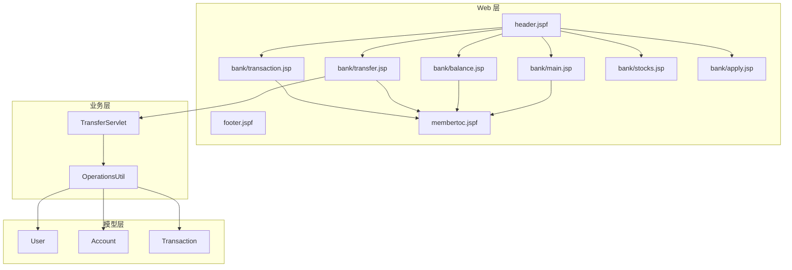
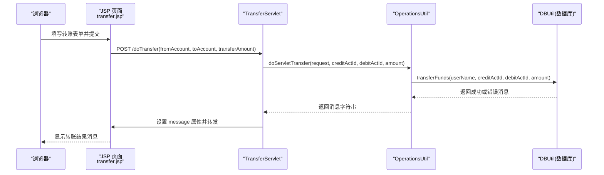
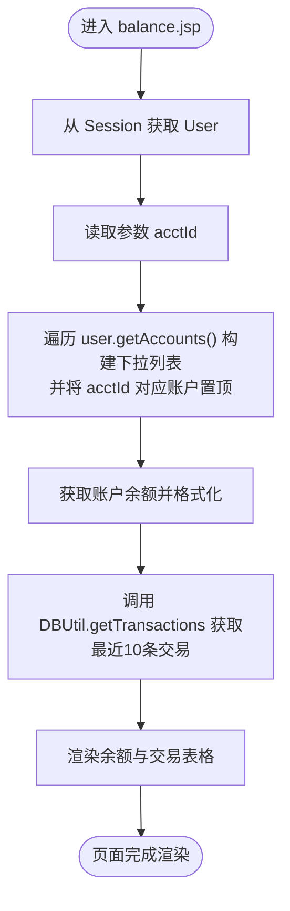
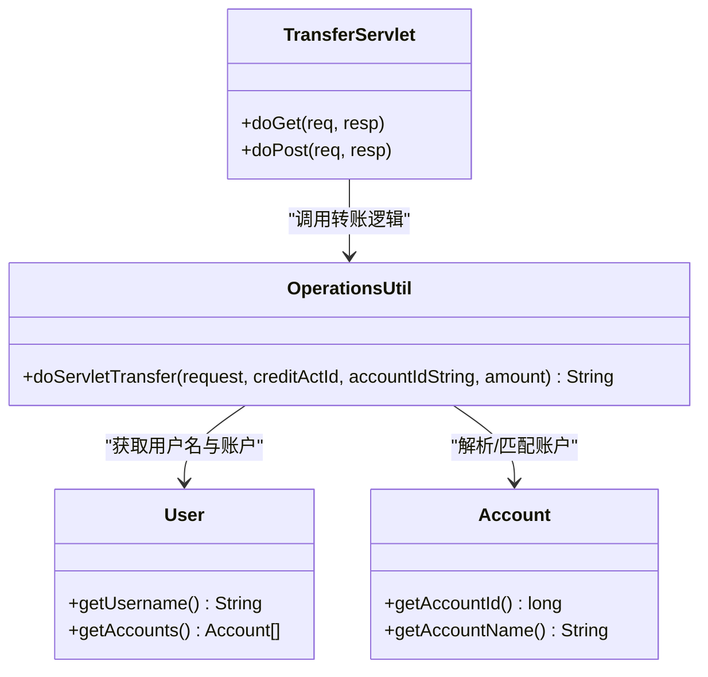
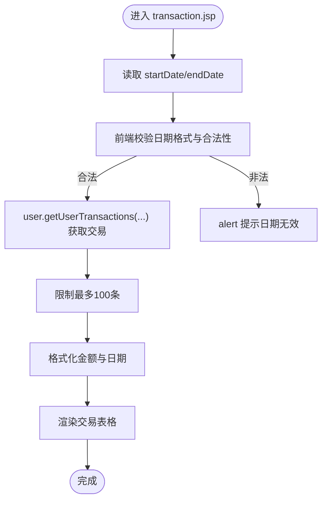
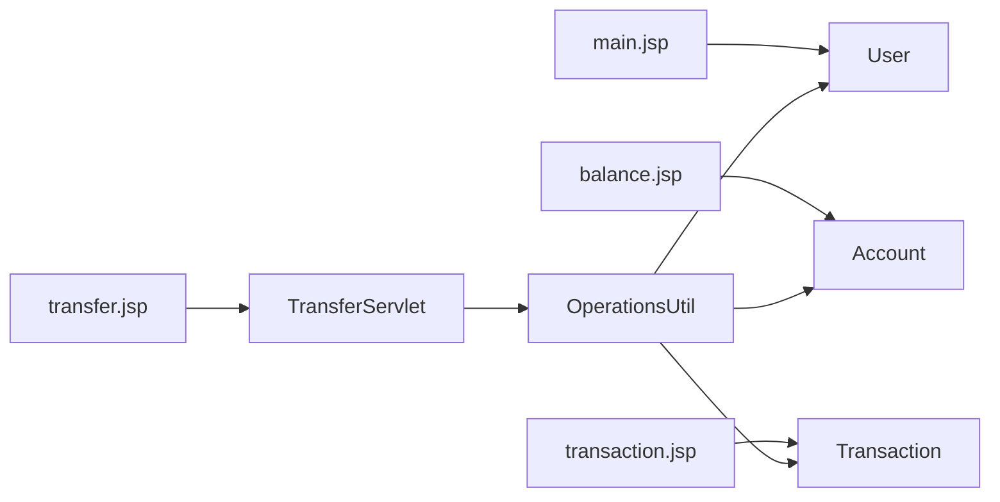

# 银行业务界面

<cite>
**本文引用的文件**   
- [WebContent/bank/main.jsp](file://WebContent/bank/main.jsp)
- [WebContent/bank/membertoc.jspf](file://WebContent/bank/membertoc.jspf)
- [WebContent/bank/balance.jsp](file://WebContent/bank/balance.jsp)
- [WebContent/bank/transfer.jsp](file://WebContent/bank/transfer.jsp)
- [WebContent/bank/transaction.jsp](file://WebContent/bank/transaction.jsp)
- [WebContent/bank/stocks.jsp](file://WebContent/bank/stocks.jsp)
- [WebContent/bank/apply.jsp](file://WebContent/bank/apply.jsp)
- [WebContent/header.jspf](file://WebContent/header.jspf)
- [WebContent/footer.jspf](file://WebContent/footer.jspf)
- [src/com/ibm/security/appscan/altoromutual/servlet/TransferServlet.java](file://src/com/ibm/security/appscan/altoromutual/servlet/TransferServlet.java)
- [src/com/ibm/security/appscan/altoromutual/model/User.java](file://src/com/ibm/security/appscan/altoromutual/model/User.java)
- [src/com/ibm/security/appscan/altoromutual/model/Account.java](file://src/com/ibm/security/appscan/altoromutual/model/Account.java)
- [src/com/ibm/security/appscan/altoromutual/model/Transaction.java](file://src/com/ibm/security/appscan/altoromutual/model/Transaction.java)
- [src/com/ibm/security/appscan/altoromutual/util/OperationsUtil.java](file://src/com/ibm/security/appscan/altoromutual/util/OperationsUtil.java)
</cite>

## 目录
1. [简介](#简介)
2. [项目结构](#项目结构)
3. [核心组件](#核心组件)
4. [架构总览](#架构总览)
5. [详细组件分析](#详细组件分析)
6. [依赖关系分析](#依赖关系分析)
7. [性能考虑](#性能考虑)
8. [故障排查指南](#故障排查指南)
9. [结论](#结论)
10. [附录](#附录)

## 简介
本文件为 AltoroJ 的“银行业务界面”提供系统化文档，聚焦用户登录后的主要银行业务功能页面与交互流程，包括：
- 账户余额查询（账户明细）
- 资金转账
- 交易历史查看
- 股票投资入口
- 信用卡申请

文档将说明各页面的 HTML/JSP 结构、动态数据渲染、表单验证与用户反馈机制；梳理页面间导航逻辑、会话状态管理、错误处理；并给出用户体验优化建议与响应式设计考量。

## 项目结构
AltoroJ 采用传统 JSP + Servlet 的分层组织方式：
- WebContent/bank 下为银行功能页面（JSP）
- WebContent/header.jspf / footer.jspf 为公共头部与尾部片段
- WebContent/bank/membertoc.jspf 为登录后侧边导航菜单
- src 下包含模型类（User/Account/Transaction）、工具类（OperationsUtil）以及处理转账请求的 Servlet

图表来源
- [WebContent/header.jspf:22-64](file://WebContent/header.jspf#L22-L64)
- [WebContent/footer.jspf:21-54](file://WebContent/footer.jspf#L21-L54)
- [WebContent/bank/membertoc.jspf:29-57](file://WebContent/bank/membertoc.jspf#L29-L57)
- [WebContent/bank/main.jsp:24-68](file://WebContent/bank/main.jsp#L24-L68)
- [WebContent/bank/balance.jsp:26-132](file://WebContent/bank/balance.jsp#L26-L132)
- [WebContent/bank/transfer.jsp:24-112](file://WebContent/bank/transfer.jsp#L24-L112)
- [WebContent/bank/transaction.jsp:27-162](file://WebContent/bank/transaction.jsp#L27-L162)
- [WebContent/bank/stocks.jsp:24-58](file://WebContent/bank/stocks.jsp#L24-L58)
- [WebContent/bank/apply.jsp:24-47](file://WebContent/bank/apply.jsp#L24-L47)
- [src/com/ibm/security/appscan/altoromutual/servlet/TransferServlet.java:38-71](file://src/com/ibm/security/appscan/altoromutual/servlet/TransferServlet.java#L38-L71)
- [src/com/ibm/security/appscan/altoromutual/util/OperationsUtil.java:39-117](file://src/com/ibm/security/appscan/altoromutual/util/OperationsUtil.java#L39-L117)

章节来源
- [WebContent/header.jspf:22-64](file://WebContent/header.jspf#L22-L64)
- [WebContent/footer.jspf:21-54](file://WebContent/footer.jspf#L21-L54)
- [WebContent/bank/membertoc.jspf:29-57](file://WebContent/bank/membertoc.jspf#L29-L57)

## 核心组件
- 页面组件
  - main.jsp：登录后首页，展示欢迎信息与账户选择下拉框，并提供跳转到“查看账户详情”的入口。
  - balance.jsp：账户余额与最近交易列表，支持切换账户查看不同账户的余额与交易。
  - transfer.jsp：资金转账表单，含前端校验与结果消息回显。
  - transaction.jsp：交易历史查询，支持按日期范围筛选，前端对日期进行合法性校验。
  - stocks.jsp：股票投资入口（Flash 嵌入）。
  - apply.jsp：信用卡申请页，通过密码提交触发申请流程。
- 服务端组件
  - TransferServlet：处理转账 POST 请求，调用 OperationsUtil 执行业务逻辑，并将结果写回 request 转发至 transfer.jsp。
  - OperationsUtil：封装转账等通用操作，内部委托 DBUtil 执行数据库事务。
- 数据模型
  - User：用户信息、角色、账户集合、交易查询方法。
  - Account：账户号、名称、余额，以及 Base64 序列化/反序列化工具。
  - Transaction：交易记录实体。

章节来源
- [WebContent/bank/main.jsp:24-68](file://WebContent/bank/main.jsp#L24-L68)
- [WebContent/bank/balance.jsp:26-132](file://WebContent/bank/balance.jsp#L26-L132)
- [WebContent/bank/transfer.jsp:24-112](file://WebContent/bank/transfer.jsp#L24-L112)
- [WebContent/bank/transaction.jsp:27-162](file://WebContent/bank/transaction.jsp#L27-L162)
- [WebContent/bank/stocks.jsp:24-58](file://WebContent/bank/stocks.jsp#L24-L58)
- [WebContent/bank/apply.jsp:24-47](file://WebContent/bank/apply.jsp#L24-L47)
- [src/com/ibm/security/appscan/altoromutual/servlet/TransferServlet.java:38-71](file://src/com/ibm/security/appscan/altoromutual/servlet/TransferServlet.java#L38-L71)
- [src/com/ibm/security/appscan/altoromutual/util/OperationsUtil.java:39-117](file://src/com/ibm/security/appscan/altoromutual/util/OperationsUtil.java#L39-L117)
- [src/com/ibm/security/appscan/altoromutual/model/User.java:30-108](file://src/com/ibm/security/appscan/altoromutual/model/User.java#L30-L108)
- [src/com/ibm/security/appscan/altoromutual/model/Account.java:32-122](file://src/com/ibm/security/appscan/altoromutual/model/Account.java#L32-L122)
- [src/com/ibm/security/appscan/altoromutual/model/Transaction.java:28-64](file://src/com/ibm/security/appscan/altoromutual/model/Transaction.java#L28-L64)

## 架构总览
下图展示了从浏览器到后端的核心交互路径，涵盖转账流程的关键步骤。

图表来源
- [WebContent/bank/transfer.jsp:35-106](file://WebContent/bank/transfer.jsp#L35-L106)
- [src/com/ibm/security/appscan/altoromutual/servlet/TransferServlet.java:51-68](file://src/com/ibm/security/appscan/altoromutual/servlet/TransferServlet.java#L51-L68)
- [src/com/ibm/security/appscan/altoromutual/util/OperationsUtil.java:39-117](file://src/com/ibm/security/appscan/altoromutual/util/OperationsUtil.java#L39-L117)

## 详细组件分析

### 账户余额查询（balance.jsp）
- 页面结构与动态内容
  - 使用 header.jspf 与 memb er toc.jspf 构建统一布局与侧边导航。
  - 从 session 中获取当前用户，根据 URL 参数 acctId 定位目标账户，并在下拉列表中将该账户置顶。
  - 计算并格式化余额（DecimalFormat），展示“期末余额”和“可用余额”。
  - 通过 DBUtil.getTransactions 拉取最近 10 笔交易，并按金额与日期格式化输出。
- 交互流程
  - 用户在“Balance Detail”区域的下拉框中选择账户后提交表单，跳转至 showAccount（由其他控制器处理，此处仅展示视图）。
- 关键实现要点
  - 账户列表动态生成，当前选中账户置顶。
  - 金额格式化处理，避免小数位数不一致导致的视觉问题。
  - 交易列表滚动容器固定高度，提升长列表可读性。

图表来源
- [WebContent/bank/balance.jsp:37-113](file://WebContent/bank/balance.jsp#L37-L113)

章节来源
- [WebContent/bank/balance.jsp:26-132](file://WebContent/bank/balance.jsp#L26-L132)
- [src/com/ibm/security/appscan/altoromutual/model/User.java:76-83](file://src/com/ibm/security/appscan/altoromutual/model/User.java#L76-L83)
- [src/com/ibm/security/appscan/altoromutual/model/Account.java:37-48](file://src/com/ibm/security/appscan/altoromutual/model/Account.java#L37-L48)

### 资金转账（transfer.jsp + TransferServlet + OperationsUtil）
- 页面结构与表单
  - 两个下拉框分别用于选择转出账户与转入账户，均从 user.getAccounts() 动态填充。
  - 金额输入框配合 JavaScript 客户端校验：转出与转入不能相同、金额必须大于 0。
  - 提交后，服务器端在 request 中写入 message，页面以红色文本显示结果。
- 服务端处理
  - TransferServlet.doPost 校验登录态，解析 fromAccount/toAccount/transferAmount，调用 OperationsUtil.doServletTransfer。
  - OperationsUtil 从 Cookie 或 Session 中解析转出账户，校验转入账户、转出账户与金额有效性，最终调用 DBUtil.transferFunds 执行转账。
- 错误处理与反馈
  - 若转入/转出账户无效或金额为负数，返回相应错误消息；否则返回成功消息，包含时间戳。
  - 前端通过 alert 提示常见输入错误，减少无效请求。

图表来源
- [src/com/ibm/security/appscan/altoromutual/servlet/TransferServlet.java:38-71](file://src/com/ibm/security/appscan/altoromutual/servlet/TransferServlet.java#L38-L71)
- [src/com/ibm/security/appscan/altoromutual/util/OperationsUtil.java:39-117](file://src/com/ibm/security/appscan/altoromutual/util/OperationsUtil.java#L39-L117)
- [src/com/ibm/security/appscan/altoromutual/model/User.java:64-83](file://src/com/ibm/security/appscan/altoromutual/model/User.java#L64-L83)
- [src/com/ibm/security/appscan/altoromutual/model/Account.java:56-74](file://src/com/ibm/security/appscan/altoromutual/model/Account.java#L56-L74)

章节来源
- [WebContent/bank/transfer.jsp:35-106](file://WebContent/bank/transfer.jsp#L35-L106)
- [src/com/ibm/security/appscan/altoromutual/servlet/TransferServlet.java:51-68](file://src/com/ibm/security/appscan/altoromutual/servlet/TransferServlet.java#L51-L68)
- [src/com/ibm/security/appscan/altoromutual/util/OperationsUtil.java:39-117](file://src/com/ibm/security/appscan/altoromutual/util/OperationsUtil.java#L39-L117)

### 交易历史查看（transaction.jsp）
- 页面结构与动态内容
  - 提供“After/Before”日期输入框，前端 JS 校验日期格式与合理性（月份范围、天数规则、闰年判断、不得晚于当天）。
  - 提交后调用 user.getUserTransactions(startDate, endDate, accounts) 获取交易列表，限制最多 100 条。
  - 每条交易展示 ID、时间、账户号、类型与金额，金额与日期均做格式化。
- 交互流程
  - 用户输入日期范围并提交，页面刷新显示符合条件的交易记录。
- 关键点
  - 前端日期校验严格，避免非法日期导致后端异常。
  - 交易数量上限控制，防止大结果集影响渲染性能。

图表来源
- [WebContent/bank/transaction.jsp:53-119](file://WebContent/bank/transaction.jsp#L53-L119)
- [WebContent/bank/transaction.jsp:122-153](file://WebContent/bank/transaction.jsp#L122-L153)
- [src/com/ibm/security/appscan/altoromutual/model/User.java:101-106](file://src/com/ibm/security/appscan/altoromutual/model/User.java#L101-L106)

章节来源
- [WebContent/bank/transaction.jsp:27-162](file://WebContent/bank/transaction.jsp#L27-L162)
- [src/com/ibm/security/appscan/altoromutual/model/User.java:101-106](file://src/com/ibm/security/appscan/altoromutual/model/User.java#L101-L106)

### 股票投资（stocks.jsp）
- 页面结构
  - 通过 swfobject 注册 Flash 对象，加载 EasyStock.swf 作为股票投资入口。
  - 页面底部还包含一个隐藏的 Flash 对象（示例用途）。
- 交互说明
  - 该页面为静态嵌入，具体交互由 Flash 应用负责。

章节来源
- [WebContent/bank/stocks.jsp:24-58](file://WebContent/bank/stocks.jsp#L24-L58)

### 信用卡申请（apply.jsp）
- 页面结构
  - 标题与说明文案引导用户输入密码以申请信用卡。
  - 表单提交至 ccApply，成功后可显示错误消息（从 session 中读取 loginError 并清除）。
- 交互说明
  - 用户输入密码并提交，服务端处理后可能设置 session 中的错误消息，页面刷新时展示。

章节来源
- [WebContent/bank/apply.jsp:24-47](file://WebContent/bank/apply.jsp#L24-L47)

### 登录后首页与导航（main.jsp + memb er toc.jspf）
- main.jsp
  - 从 session 获取 user，展示欢迎语与账户选择下拉框，提交至 showAccount。
  - 包含预审批信用卡推广链接，指向 apply.jsp。
- memb er toc.jspf
  - 侧边栏提供常用功能链接：查看账户摘要、查看近期交易、转账、搜索新闻文章、自定义语言。
  - 管理员角色可见“编辑用户”、“审核反馈”等管理入口。
  - 通过 ServletUtil.getAppProperty("specialLink") 动态配置“搜索新闻文章”的目标地址。

章节来源
- [WebContent/bank/main.jsp:24-68](file://WebContent/bank/main.jsp#L24-L68)
- [WebContent/bank/membertoc.jspf:29-57](file://WebContent/bank/membertoc.jspf#L29-L57)

## 依赖关系分析
- 页面依赖
  - 所有银行功能页面均包含 header.jspf 与 footer.jspf，保证一致的站点外观与全局导航。
  - 银行功能页面普遍包含 memb er toc.jspf，提供登录后侧边导航。
- 数据访问依赖
  - User.getAccounts() 与 User.getUserTransactions(...) 均依赖 DBUtil 进行数据库访问。
  - OperationsUtil.doServletTransfer 依赖 DBUtil.transferFunds 执行转账。
- 模型依赖
  - Account 提供 Base64 序列化/反序列化方法，供 Cookie 存储账户列表时使用。
  - Transaction 作为交易记录的载体，被 JSP 直接渲染。

图表来源
- [WebContent/bank/main.jsp:24-68](file://WebContent/bank/main.jsp#L24-L68)
- [WebContent/bank/balance.jsp:26-132](file://WebContent/bank/balance.jsp#L26-L132)
- [WebContent/bank/transaction.jsp:27-162](file://WebContent/bank/transaction.jsp#L27-L162)
- [WebContent/bank/transfer.jsp:24-112](file://WebContent/bank/transfer.jsp#L24-L112)
- [src/com/ibm/security/appscan/altoromutual/servlet/TransferServlet.java:38-71](file://src/com/ibm/security/appscan/altoromutual/servlet/TransferServlet.java#L38-L71)
- [src/com/ibm/security/appscan/altoromutual/util/OperationsUtil.java:39-117](file://src/com/ibm/security/appscan/altoromutual/util/OperationsUtil.java#L39-L117)
- [src/com/ibm/security/appscan/altoromutual/model/User.java:30-108](file://src/com/ibm/security/appscan/altoromutual/model/User.java#L30-L108)
- [src/com/ibm/security/appscan/altoromutual/model/Account.java:32-122](file://src/com/ibm/security/appscan/altoromutual/model/Account.java#L32-L122)
- [src/com/ibm/security/appscan/altoromutual/model/Transaction.java:28-64](file://src/com/ibm/security/appscan/altoromutual/model/Transaction.java#L28-L64)

章节来源
- [WebContent/header.jspf:22-64](file://WebContent/header.jspf#L22-L64)
- [WebContent/footer.jspf:21-54](file://WebContent/footer.jspf#L21-L54)
- [WebContent/bank/membertoc.jspf:29-57](file://WebContent/bank/membertoc.jspf#L29-L57)

## 性能考虑
- 列表渲染
  - balance.jsp 的交易列表限制为最近 10 条，transaction.jsp 限制最多 100 条，避免大结果集导致页面卡顿。
- 数据格式化
  - 使用 DecimalFormat 与 SimpleDateFormat 进行金额与日期格式化，注意在大量行渲染时可能带来 CPU 开销，建议在后端预处理或缓存格式化结果。
- 资源加载
  - stocks.jsp 依赖 Flash 插件，现代浏览器已不再支持，建议迁移至 HTML5/JS 方案以提升兼容性与性能。
- 缓存策略
  - memb er toc.jspf 设置了 no-cache 头，确保敏感导航与权限相关内容的实时性，但会增加重复请求开销，可按需调整缓存策略。

[本节为通用指导，不直接分析具体文件]

## 故障排查指南
- 转账失败
  - 检查前端校验是否阻止了无效输入（转出=转入、金额<=0）。
  - 查看服务器端 message 属性是否正确回显（红色文本）。
  - 确认 TransferServlet 是否正确转发至 transfer.jsp 并设置 message。
- 交易查询为空
  - 检查日期输入是否符合 yyyy-mm-dd 格式且未超过当前日期。
  - 确认 user.getUserTransactions 的参数传递正确。
- 账户余额显示异常
  - 核对 acctId 参数是否有效，账户是否存在。
  - 检查 Account.getAccount 与 DBUtil 的数据一致性。
- 登录态丢失
  - 确认 header.jspf 中基于 session.getAttribute("user") 的判断逻辑。
  - 检查 memb er toc.jspf 中是否需要管理员权限的分支逻辑。

章节来源
- [WebContent/bank/transfer.jsp:35-106](file://WebContent/bank/transfer.jsp#L35-L106)
- [src/com/ibm/security/appscan/altoromutual/servlet/TransferServlet.java:51-68](file://src/com/ibm/security/appscan/altoromutual/servlet/TransferServlet.java#L51-L68)
- [WebContent/bank/transaction.jsp:53-119](file://WebContent/bank/transaction.jsp#L53-L119)
- [WebContent/bank/balance.jsp:37-113](file://WebContent/bank/balance.jsp#L37-L113)
- [WebContent/header.jspf:27-56](file://WebContent/header.jspf#L27-L56)
- [WebContent/bank/membertoc.jspf:44-55](file://WebContent/bank/membertoc.jspf#L44-L55)

## 结论
AltoroJ 的银行业务界面通过 JSP 页面与少量 Servlet 协作，实现了账户余额查询、转账、交易历史查看、股票投资入口与信用卡申请等核心功能。页面结构清晰，依赖 header/footer 与成员导航片段保持一致体验；服务端通过 OperationsUtil 集中处理转账逻辑，结合模型类完成数据访问。建议在后续迭代中：
- 将 Flash 股票投资替换为现代技术栈
- 增强前端与后端双重校验，提升健壮性
- 引入分页与异步加载优化大数据量场景
- 完善错误提示与可访问性，提升用户体验

[本节为总结性内容，不直接分析具体文件]

## 附录
- 页面导航与入口
  - 登录后首页：main.jsp
  - 账户余额：balance.jsp
  - 转账：transfer.jsp
  - 交易历史：transaction.jsp
  - 股票投资：stocks.jsp
  - 信用卡申请：apply.jsp
- 公共片段
  - 头部：header.jspf
  - 尾部：footer.jspf
  - 成员导航：memb er toc.jspf

[本节为索引性内容，不直接分析具体文件]