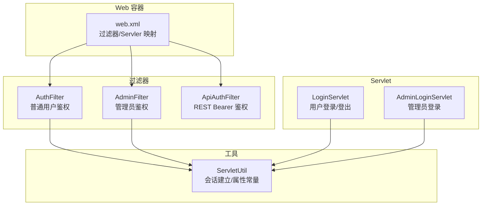
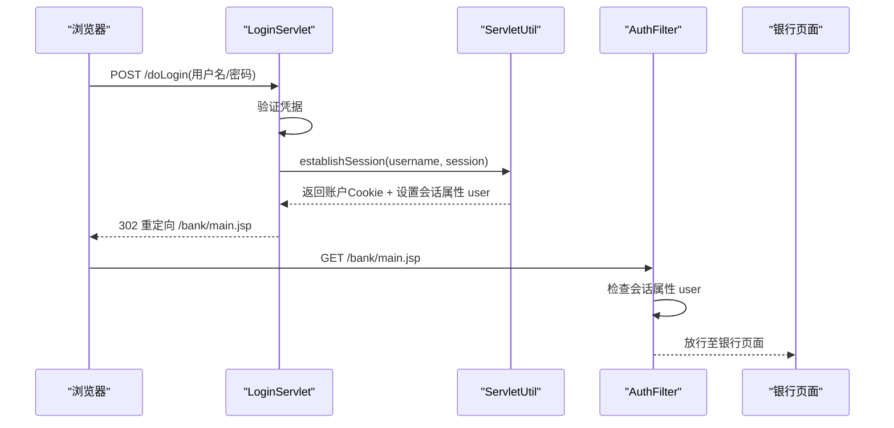
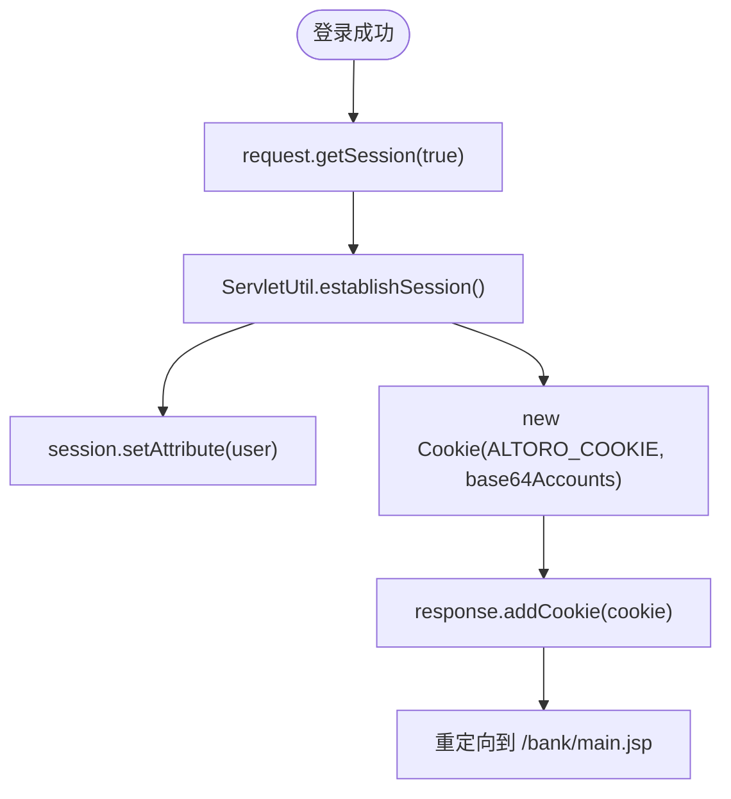
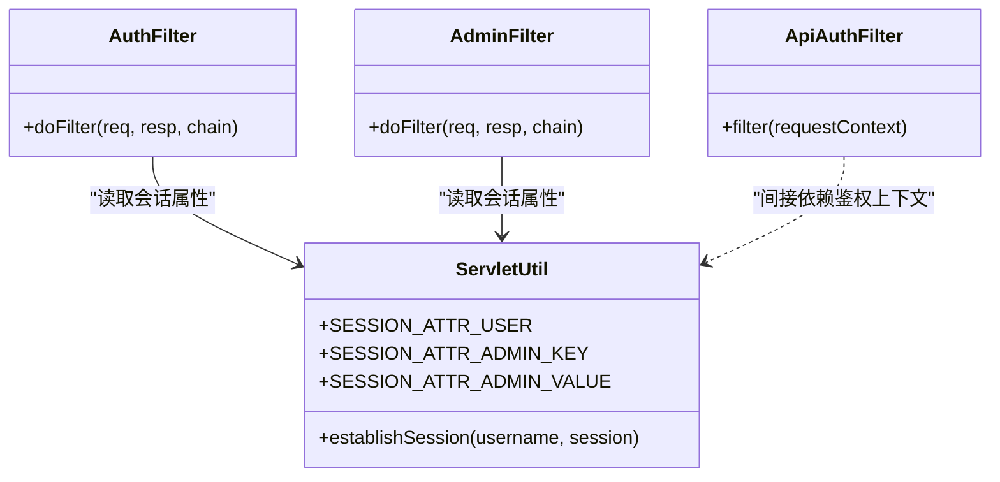
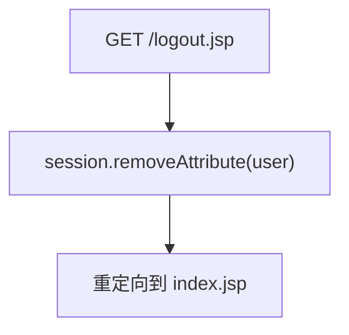
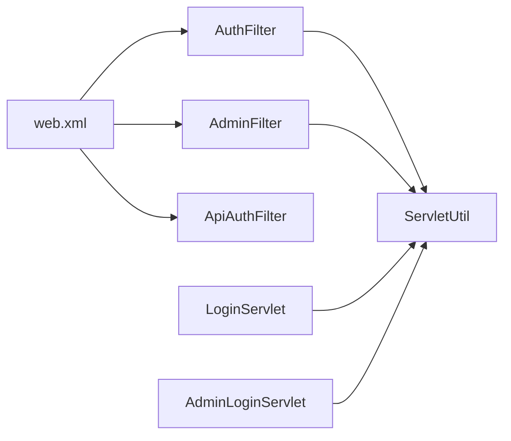

# 会话安全

<cite>
**本文引用的文件**   
- [web.xml](file://WebContent/WEB-INF/web.xml)
- [LoginServlet.java](file://src/com/ibm/security/appscan/altoromutual/servlet/LoginServlet.java)
- [AdminLoginServlet.java](file://src/com/ibm/security/appscan/altoromutual/servlet/AdminLoginServlet.java)
- [AuthFilter.java](file://src/com/ibm/security/appscan/altoromutual/filter/AuthFilter.java)
- [AdminFilter.java](file://src/com/ibm/security/appscan/altoromutual/filter/AdminFilter.java)
- [ApiAuthFilter.java](file://src/com/ibm/security/appscan/altoromutual/filter/ApiAuthFilter.java)
- [ServletUtil.java](file://src/com/ibm/security/appscan/altoromutual/util/ServletUtil.java)
- [app.properties](file://WebContent/WEB-INF/app.properties)
</cite>

## 目录
1. [引言](#引言)
2. [项目结构](#项目结构)
3. [核心组件](#核心组件)
4. [架构总览](#架构总览)
5. [详细组件分析](#详细组件分析)
6. [依赖关系分析](#依赖关系分析)
7. [性能与可扩展性](#性能与可扩展性)
8. [故障排查指南](#故障排查指南)
9. [结论](#结论)
10. [附录：最佳实践与加固清单](#附录最佳实践与加固清单)

## 引言
本文件聚焦 AltoroJ 的会话安全机制，覆盖会话创建、存储、鉴权校验、管理与销毁的全生命周期；深入说明会话 ID 生成与 Cookie 行为、会话属性存储、超时配置现状；记录会话劫持防护、会话固定攻击防护、跨站请求伪造(CSRF)防护的实现现状与改进建议；并提供会话安全配置、Cookie 安全属性与监控策略的实践指导。

## 项目结构
AltoroJ 采用传统 J2EE Web 应用结构：
- 过滤器层：统一拦截受保护路径，进行登录态与管理员权限校验
- Servlet 层：处理登录、登出、管理端登录等关键流程
- 工具类：封装会话建立、用户信息获取等通用逻辑
- 部署描述符：定义过滤器映射、Servlet 映射与应用级监听器

图表来源
- [web.xml:12-59](file://WebContent/WEB-INF/web.xml#L12-L59)
- [AuthFilter.java:58-70](file://src/com/ibm/security/appscan/altoromutual/filter/AuthFilter.java#L58-L70)
- [AdminFilter.java:58-81](file://src/com/ibm/security/appscan/altoromutual/filter/AdminFilter.java#L58-L81)
- [ApiAuthFilter.java:29-60](file://src/com/ibm/security/appscan/altoromutual/filter/ApiAuthFilter.java#L29-L60)
- [LoginServlet.java:67-105](file://src/com/ibm/security/appscan/altoromutual/servlet/LoginServlet.java#L67-L105)
- [AdminLoginServlet.java:40-54](file://src/com/ibm/security/appscan/altoromutual/servlet/AdminLoginServlet.java#L40-L54)
- [ServletUtil.java:340-353](file://src/com/ibm/security/appscan/altoromutual/util/ServletUtil.java#L340-L353)

章节来源
- [web.xml:1-227](file://WebContent/WEB-INF/web.xml#L1-L227)

## 核心组件
- AuthFilter：对 /bank/*、/admin/*、/account.jsp 等路径进行登录态校验，未登录则重定向到登录页
- AdminFilter：对管理端路径进行管理员角色或临时管理员标记校验
- ApiAuthFilter：对 REST API 进行基于 Authorization: Bearer 的鉴权（Base64 编码的用户名:密码:时间戳）
- LoginServlet：处理用户登录与登出，建立会话并写入 Cookie
- AdminLoginServlet：处理管理员登录，设置管理员会话标记
- ServletUtil：提供会话建立、会话属性常量、登录状态判断等工具方法

章节来源
- [AuthFilter.java:58-70](file://src/com/ibm/security/appscan/altoromutual/filter/AuthFilter.java#L58-L70)
- [AdminFilter.java:58-81](file://src/com/ibm/security/appscan/altoromutual/filter/AdminFilter.java#L58-L81)
- [ApiAuthFilter.java:29-60](file://src/com/ibm/security/appscan/altoromutual/filter/ApiAuthFilter.java#L29-L60)
- [LoginServlet.java:67-105](file://src/com/ibm/security/appscan/altoromutual/servlet/LoginServlet.java#L67-L105)
- [AdminLoginServlet.java:40-54](file://src/com/ibm/security/appscan/altoromutual/servlet/AdminLoginServlet.java#L40-L54)
- [ServletUtil.java:60-68, 340-373:60-68](file://src/com/ibm/security/appscan/altoromutual/util/ServletUtil.java#L60-L68)

## 架构总览
下图展示一次典型“用户登录”的会话建立流程，以及后续受保护资源的访问控制点。

图表来源
- [LoginServlet.java:67-105](file://src/com/ibm/security/appscan/altoromutual/servlet/LoginServlet.java#L67-L105)
- [ServletUtil.java:340-353](file://src/com/ibm/security/appscan/altoromutual/util/ServletUtil.java#L340-L353)
- [AuthFilter.java:58-70](file://src/com/ibm/security/appscan/altoromutual/filter/AuthFilter.java#L58-L70)

## 详细组件分析

### 会话创建与存储
- 会话创建
  - 用户登录成功后，LoginServlet 通过 request.getSession(true) 确保存在会话
  - 调用 ServletUtil.establishSession 将用户对象存入会话属性 SESSION_ATTR_USER
  - 同时创建一个名为 ALTORO_COOKIE 的 Cookie，值为 Base64 编码的账户列表字符串
- 会话属性
  - 用户对象以键 SESSION_ATTR_USER 存储在 HttpSession 中
  - 管理员会话使用键 SESSION_ATTR_ADMIN_KEY 与值 SESSION_ATTR_ADMIN_VALUE 作为临时管理员标记
- Cookie 行为
  - 当前实现未显式设置 Secure、HttpOnly、SameSite、Path、Domain、Max-Age 等安全属性
  - 该 Cookie 用于携带账户信息，但并非标准的 JSESSIONID 会话标识载体

图表来源
- [LoginServlet.java:67-105](file://src/com/ibm/security/appscan/altoromutual/servlet/LoginServlet.java#L67-L105)
- [ServletUtil.java:340-353](file://src/com/ibm/security/appscan/altoromutual/util/ServletUtil.java#L340-L353)

章节来源
- [LoginServlet.java:67-105](file://src/com/ibm/security/appscan/altoromutual/servlet/LoginServlet.java#L67-L105)
- [ServletUtil.java:60-68, 340-353:60-68](file://src/com/ibm/security/appscan/altoromutual/util/ServletUtil.java#L60-L68)

### 会话访问控制（鉴权）
- 普通用户访问控制
  - AuthFilter 在 /bank/*、/admin/*、/account.jsp 等路径上检查会话属性 user 是否存在且为 User 类型
  - 未通过则重定向到登录页
- 管理员访问控制
  - AdminFilter 检查会话中是否包含管理员角色或管理员临时标记
  - 允许直接访问 admin/login.jsp 与管理端登录接口
- REST API 鉴权
  - ApiAuthFilter 要求 Authorization: Bearer <Base64(username:password:timestamp)>
  - 无授权头或格式错误时返回 401

图表来源
- [AuthFilter.java:58-70](file://src/com/ibm/security/appscan/altoromutual/filter/AuthFilter.java#L58-L70)
- [AdminFilter.java:58-81](file://src/com/ibm/security/appscan/altoromutual/filter/AdminFilter.java#L58-L81)
- [ApiAuthFilter.java:29-60](file://src/com/ibm/security/appscan/altoromutual/filter/ApiAuthFilter.java#L29-L60)
- [ServletUtil.java:60-68](file://src/com/ibm/security/appscan/altoromutual/util/ServletUtil.java#L60-L68)

章节来源
- [AuthFilter.java:58-70](file://src/com/ibm/security/appscan/altoromutual/filter/AuthFilter.java#L58-L70)
- [AdminFilter.java:58-81](file://src/com/ibm/security/appscan/altoromutual/filter/AdminFilter.java#L58-L81)
- [ApiAuthFilter.java:29-60](file://src/com/ibm/security/appscan/altoromutual/filter/ApiAuthFilter.java#L29-L60)

### 会话销毁
- 用户登出
  - LoginServlet.doGet 移除会话中的 user 属性后重定向到首页
  - 注意：当前实现未主动使会话失效（invalidate），也未删除自定义 Cookie
- 管理员登出
  - 代码中未发现专门的管理员登出入口；管理员标记仍保留在会话中直至会话过期或被清理

图表来源
- [LoginServlet.java:51-62](file://src/com/ibm/security/appscan/altoromutual/servlet/LoginServlet.java#L51-L62)

章节来源
- [LoginServlet.java:51-62](file://src/com/ibm/security/appscan/altoromutual/servlet/LoginServlet.java#L51-L62)

### 会话 ID 生成与传输
- 会话 ID 生成
  - 由 Web 容器（如 Tomcat）负责生成和管理 JSESSIONID
  - 应用层未自定义会话 ID 生成算法
- 会话 ID 传输
  - 默认通过 Cookie 传输
  - 当前未强制启用 SameSite、Secure、HttpOnly 等 Cookie 安全属性
  - 应用还自定义了 ALTORO_COOKIE 用于携带账户数据，非标准会话标识

章节来源
- [web.xml:1-227](file://WebContent/WEB-INF/web.xml#L1-L227)
- [ServletUtil.java:68](file://src/com/ibm/security/appscan/altoromutual/util/ServletUtil.java#L68)

### 会话超时配置
- 当前未在 web.xml 中配置 <session-config><session-timeout>
- 因此使用容器默认超时（通常为 30 分钟，取决于容器配置）
- 建议在部署描述符中明确设置会话超时，并结合敏感操作进行二次确认

章节来源
- [web.xml:1-227](file://WebContent/WEB-INF/web.xml#L1-L227)

### 会话固定攻击防护
- 现状
  - 登录成功后未显式重建会话（例如 invalidate 后再 new Session），存在会话固定风险
- 建议
  - 登录后调用 invalidate 再重新创建会话，确保新会话 ID
  - 对敏感操作（转账、修改密码）进行二次认证

章节来源
- [LoginServlet.java:67-105](file://src/com/ibm/security/appscan/altoromutual/servlet/LoginServlet.java#L67-L105)

### 会话劫持防护
- 现状
  - 未设置 Cookie 的 Secure、HttpOnly、SameSite 属性
  - 自定义 Cookie 包含敏感数据（账户列表 Base64），增加泄露风险
- 建议
  - 对所有 Cookie 设置 HttpOnly、Secure、SameSite=Strict/Lax
  - 避免在 Cookie 中存放敏感业务数据，仅保留必要标识
  - 强制 HTTPS，确保 Cookie 仅在加密通道传输

章节来源
- [ServletUtil.java:340-353](file://src/com/ibm/security/appscan/altoromutual/util/ServletUtil.java#L340-L353)

### CSRF 防护
- 现状
  - 未发现统一的 CSRF Token 校验机制
  - 表单提交与 AJAX 请求未附加一次性令牌
- 建议
  - 引入服务端生成的 CSRF Token，并在所有写操作请求中校验
  - 对敏感操作（转账、改密）额外校验 Referer/Origin 与双提交 Token

章节来源
- [web.xml:1-227](file://WebContent/WEB-INF/web.xml#L1-L227)

### REST API 鉴权与令牌
- 现状
  - ApiAuthFilter 使用 Authorization: Bearer <Base64(username:password:timestamp)>
  - 若缺少授权头或格式不正确，返回 401
- 风险与建议
  - 明文密码参与令牌构造，存在泄露风险
  - 建议使用短期有效的 JWT/OAuth2 Access Token，并进行签名与时效校验
  - 在服务端缓存或校验时间戳，防止重放

章节来源
- [ApiAuthFilter.java:29-60](file://src/com/ibm/security/appscan/altoromutual/filter/ApiAuthFilter.java#L29-L60)

## 依赖关系分析
- 过滤器依赖 ServletUtil 提供的会话属性常量与工具方法
- Servlet 依赖 ServletUtil 完成会话建立与用户信息获取
- web.xml 集中声明过滤器与 Servlet 的映射关系

图表来源
- [web.xml:12-59](file://WebContent/WEB-INF/web.xml#L12-L59)
- [AuthFilter.java:58-70](file://src/com/ibm/security/appscan/altoromutual/filter/AuthFilter.java#L58-L70)
- [AdminFilter.java:58-81](file://src/com/ibm/security/appscan/altoromutual/filter/AdminFilter.java#L58-L81)
- [ApiAuthFilter.java:29-60](file://src/com/ibm/security/appscan/altoromutual/filter/ApiAuthFilter.java#L29-L60)
- [LoginServlet.java:67-105](file://src/com/ibm/security/appscan/altoromutual/servlet/LoginServlet.java#L67-L105)
- [AdminLoginServlet.java:40-54](file://src/com/ibm/security/appscan/altoromutual/servlet/AdminLoginServlet.java#L40-L54)
- [ServletUtil.java:60-68](file://src/com/ibm/security/appscan/altoromutual/util/ServletUtil.java#L60-L68)

章节来源
- [web.xml:1-227](file://WebContent/WEB-INF/web.xml#L1-L227)

## 性能与可扩展性
- 会话存储
  - 当前将完整用户对象放入会话，可能带来序列化与内存开销
  - 建议仅存储最小化标识（如用户 ID），按需从数据库加载详情
- 自定义 Cookie
  - 账户列表 Base64 编码会增加 Cookie 体积，影响网络传输
  - 建议移除业务数据入 Cookie，仅保留会话标识
- 鉴权扩展
  - 可引入统一的鉴权中间件，集中处理会话校验、CSRF、速率限制等

[本节为通用建议，不直接分析具体文件]

## 故障排查指南
- 登录后仍被重定向到登录页
  - 检查会话属性 user 是否正确设置
  - 检查过滤器映射是否覆盖目标路径
- 管理员无法进入管理端
  - 检查会话中是否包含管理员标记或用户角色是否为管理员
- REST API 返回 401
  - 检查 Authorization 头是否存在且格式正确
  - 检查 Base64 内容是否符合 username:password:timestamp 结构

章节来源
- [AuthFilter.java:58-70](file://src/com/ibm/security/appscan/altoromutual/filter/AuthFilter.java#L58-L70)
- [AdminFilter.java:58-81](file://src/com/ibm/security/appscan/altoromutual/filter/AdminFilter.java#L58-L81)
- [ApiAuthFilter.java:29-60](file://src/com/ibm/security/appscan/altoromutual/filter/ApiAuthFilter.java#L29-L60)

## 结论
AltoroJ 的会话安全机制基于容器管理的 HttpSession 与自定义 Cookie，结合过滤器实现基本鉴权。当前实现存在若干安全风险：未设置 Cookie 安全属性、未实施会话固定防护、未实现 CSRF 防护、REST 令牌构造方式不安全。建议优先加固 Cookie 安全属性、实施会话重建与 CSRF Token、优化令牌方案，并明确会话超时与销毁策略。

[本节为总结性内容，不直接分析具体文件]

## 附录：最佳实践与加固清单
- 会话创建
  - 登录后立即重建会话（invalidate + new Session）
  - 仅存储最小化会话属性，避免大对象
- 会话存储
  - 不在 Cookie 中存放敏感业务数据
  - 使用容器默认的 JSESSIONID，避免自定义会话标识
- 会话传输
  - 强制 HTTPS
  - 设置 Cookie 的 Secure、HttpOnly、SameSite=Strict/Lax
- 会话超时
  - 在 web.xml 中明确设置 session-timeout
  - 对敏感操作触发会话刷新与二次认证
- 会话销毁
  - 登出时 invalidate 会话并删除相关 Cookie
- CSRF 防护
  - 引入服务端 CSRF Token，校验所有写操作
  - 校验 Referer/Origin，必要时使用双提交
- 会话监控
  - 记录登录/登出事件与会话创建/销毁日志
  - 监控异常会话行为（频繁切换 IP、并发会话数异常）
- 配置项参考
  - app.properties 用于功能开关与数据库初始化等，不包含会话安全参数
  - 会话安全相关应集中在 web.xml 与安全框架配置中

章节来源
- [app.properties:1-74](file://WebContent/WEB-INF/app.properties#L1-L74)