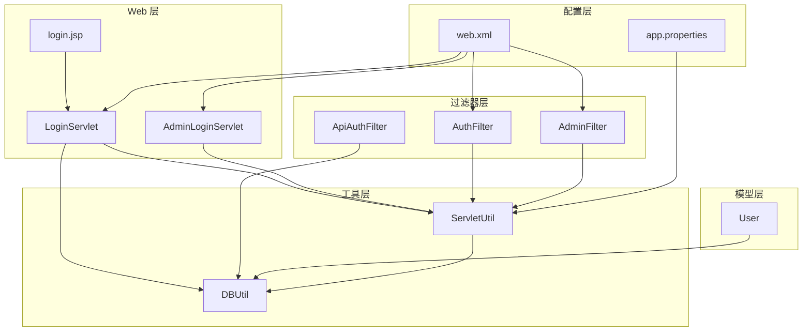
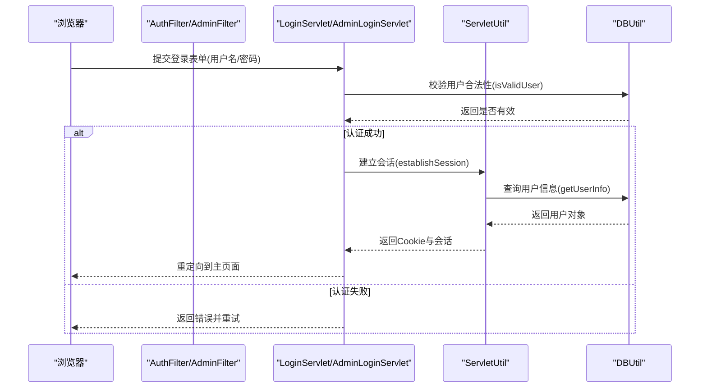
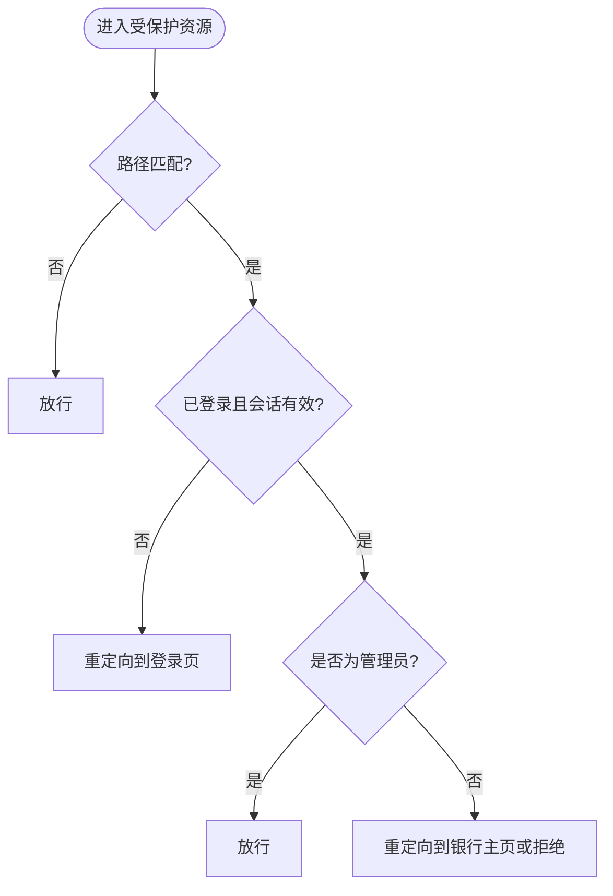
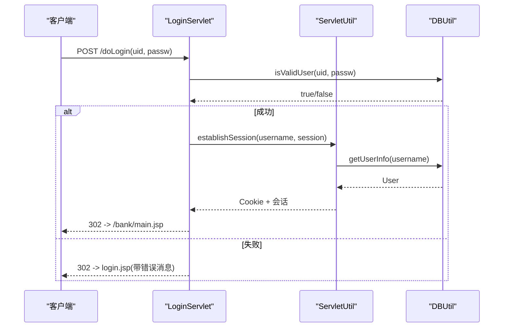
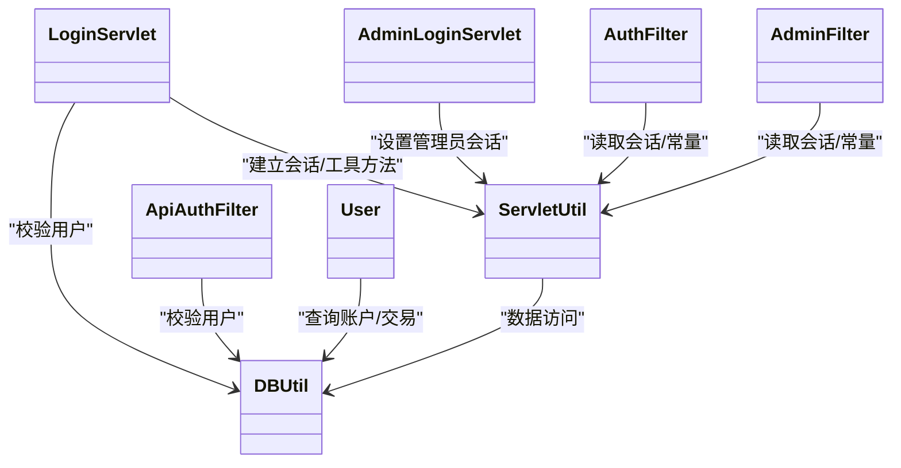

# 安全机制

<cite>
**本文引用的文件**   
- [README.md](file://README.md)
- [web.xml](file://WebContent/WEB-INF/web.xml)
- [AuthFilter.java](file://src/com/ibm/security/appscan/altoromutual/filter/AuthFilter.java)
- [AdminFilter.java](file://src/com/ibm/security/appscan/altoromutual/filter/AdminFilter.java)
- [ApiAuthFilter.java](file://src/com/ibm/security/appscan/altoromutual/filter/ApiAuthFilter.java)
- [User.java](file://src/com/ibm/security/appscan/altoromutual/model/User.java)
- [ServletUtil.java](file://src/com/ibm/security/appscan/altoromutual/util/ServletUtil.java)
- [DBUtil.java](file://src/com/ibm/security/appscan/altoromutual/util/DBUtil.java)
- [LoginServlet.java](file://src/com/ibm/security/appscan/altoromutual/servlet/LoginServlet.java)
- [AdminLoginServlet.java](file://src/com/ibm/security/appscan/altoromutual/servlet/AdminLoginServlet.java)
- [login.jsp](file://WebContent/login.jsp)
- [app.properties](file://WebContent/WEB-INF/app.properties)
</cite>

## 目录
1. [简介](#简介)
2. [项目结构](#项目结构)
3. [核心组件](#核心组件)
4. [架构总览](#架构总览)
5. [详细组件分析](#详细组件分析)
6. [依赖关系分析](#依赖关系分析)
7. [性能与安全特性](#性能与安全特性)
8. [故障排查与审计清单](#故障排查与审计清单)
9. [结论](#结论)
10. [附录：常见漏洞与防护指南](#附录常见漏洞与防护指南)

## 简介
本文件聚焦 AltoroJ 的安全机制，围绕过滤器架构、权限控制策略、会话管理、输入验证与输出编码等关键主题展开。同时总结常见的 Web 安全漏洞（SQL 注入、XSS、CSRF、会话劫持等）及其在代码中的体现与修复建议，并提供安全配置指南、审计清单与渗透测试建议，帮助读者在理解现有实现的同时掌握加固方法。

## 项目结构
AltoroJ 采用传统 J2EE 分层组织：
- Web 层：JSP 页面与 Servlet 控制器
- 过滤器层：统一认证与授权拦截
- 业务模型层：用户、账户、交易等实体
- 工具层：数据库访问、会话与通用工具
- 配置层：web.xml、应用属性 app.properties

图表来源
- [web.xml:12-51](file://WebContent/WEB-INF/web.xml#L12-L51)
- [AuthFilter.java:40-70](file://src/com/ibm/security/appscan/altoromutual/filter/AuthFilter.java#L40-L70)
- [AdminFilter.java:40-81](file://src/com/ibm/security/appscan/altoromutual/filter/AdminFilter.java#L40-L81)
- [ApiAuthFilter.java:20-75](file://src/com/ibm/security/appscan/altoromutual/filter/ApiAuthFilter.java#L20-L75)
- [User.java:30-54](file://src/com/ibm/security/appscan/altoromutual/model/User.java#L30-L54)
- [ServletUtil.java:58-78](file://src/com/ibm/security/appscan/altoromutual/util/ServletUtil.java#L58-L78)
- [DBUtil.java:45-97](file://src/com/ibm/security/appscan/altoromutual/util/DBUtil.java#L45-L97)
- [LoginServlet.java:38-107](file://src/com/ibm/security/appscan/altoromutual/servlet/LoginServlet.java#L38-L107)
- [AdminLoginServlet.java:34-55](file://src/com/ibm/security/appscan/altoromutual/servlet/AdminLoginServlet.java#L34-L55)
- [app.properties:25-74](file://WebContent/WEB-INF/app.properties#L25-L74)

章节来源
- [web.xml:1-227](file://WebContent/WEB-INF/web.xml#L1-L227)
- [app.properties:1-74](file://WebContent/WEB-INF/app.properties#L1-L74)

## 核心组件
- 过滤器
  - AuthFilter：对 /bank/*、/admin/*、/account.jsp 等路径进行登录态校验，未登录则重定向至登录页。
  - AdminFilter：对管理员区域进行角色或会话标记校验，允许 admin/login.jsp 和 doAdminLogin 通过，其他请求需具备管理员身份。
  - ApiAuthFilter：REST API 鉴权，基于 Authorization 头解析令牌并调用 DBUtil 校验用户有效性。
- 会话与权限
  - ServletUtil：提供会话建立、登录态检查、常量定义、输出净化等能力。
  - User：用户模型，包含角色枚举 Role(User/Admin)。
- 数据访问
  - DBUtil：封装 Derby 连接、建库初始化、CRUD 操作；多处存在 SQL 拼接问题，是重点加固点。
- 登录流程
  - LoginServlet：处理用户登录/登出，成功后建立会话并写入 Cookie。
  - AdminLoginServlet：管理员简易口令校验，设置管理员会话标记。

章节来源
- [AuthFilter.java:40-70](file://src/com/ibm/security/appscan/altoromutual/filter/AuthFilter.java#L40-L70)
- [AdminFilter.java:40-81](file://src/com/ibm/security/appscan/altoromutual/filter/AdminFilter.java#L40-L81)
- [ApiAuthFilter.java:20-75](file://src/com/ibm/security/appscan/altoromutual/filter/ApiAuthFilter.java#L20-L75)
- [ServletUtil.java:58-78](file://src/com/ibm/security/appscan/altoromutual/util/ServletUtil.java#L58-L78)
- [User.java:30-54](file://src/com/ibm/security/appscan/altoromutual/model/User.java#L30-L54)
- [DBUtil.java:45-97](file://src/com/ibm/security/appscan/altoromutual/util/DBUtil.java#L45-L97)
- [LoginServlet.java:38-107](file://src/com/ibm/security/appscan/altoromutual/servlet/LoginServlet.java#L38-L107)
- [AdminLoginServlet.java:34-55](file://src/com/ibm/security/appscan/altoromutual/servlet/AdminLoginServlet.java#L34-L55)

## 架构总览
下图展示从浏览器到后端的核心交互路径，包括过滤器拦截、Servlet 处理、会话建立与数据库访问。

图表来源
- [LoginServlet.java:67-107](file://src/com/ibm/security/appscan/altoromutual/servlet/LoginServlet.java#L67-L107)
- [ServletUtil.java:340-353](file://src/com/ibm/security/appscan/altoromutual/util/ServletUtil.java#L340-L353)
- [DBUtil.java:212-232](file://src/com/ibm/security/appscan/altoromutual/util/DBUtil.java#L212-L232)

## 详细组件分析

### 过滤器架构与权限控制
- AuthFilter
  - 作用域：/bank/*、/admin/*、/account.jsp
  - 逻辑：从 Session 中读取用户对象，若不存在或类型不匹配，则重定向到登录页。
- AdminFilter
  - 作用域：/admin/*（注意 web.xml 中存在拼写为 /adimn/* 的映射，应修正）
  - 逻辑：允许 admin/login.jsp 与 /admin/doAdminLogin 直接放行；其余请求需满足“用户角色为 Admin”或“会话中存在管理员标记键值”。
- ApiAuthFilter
  - 作用域：REST API（Jersey）
  - 逻辑：解析 Authorization 头，解码令牌后调用 DBUtil.isValidUser 校验；无头或无效令牌返回 401。

图表来源
- [AuthFilter.java:58-70](file://src/com/ibm/security/appscan/altoromutual/filter/AuthFilter.java#L58-L70)
- [AdminFilter.java:58-81](file://src/com/ibm/security/appscan/altoromutual/filter/AdminFilter.java#L58-L81)
- [web.xml:28-51](file://WebContent/WEB-INF/web.xml#L28-L51)

章节来源
- [AuthFilter.java:40-70](file://src/com/ibm/security/appscan/altoromutual/filter/AuthFilter.java#L40-L70)
- [AdminFilter.java:40-81](file://src/com/ibm/security/appscan/altoromutual/filter/AdminFilter.java#L40-L81)
- [ApiAuthFilter.java:20-75](file://src/com/ibm/security/appscan/altoromutual/filter/ApiAuthFilter.java#L20-L75)
- [web.xml:12-51](file://WebContent/WEB-INF/web.xml#L12-L51)

### 会话管理与登录流程
- 用户登录
  - LoginServlet 接收 uid/passw，调用 DBUtil.isValidUser 校验；成功则通过 ServletUtil.establishSession 建立会话并写入 Cookie，随后重定向到银行主页。
  - 登出时移除会话中的用户属性并重定向到首页。
- 管理员登录
  - AdminLoginServlet 使用硬编码口令校验，通过后在会话中写入管理员标记键值，用于 AdminFilter 放行。
- 会话常量
  - ServletUtil 定义了用户会话键、管理员会话键与默认值，以及 Cookie 名称等。

图表来源
- [LoginServlet.java:67-107](file://src/com/ibm/security/appscan/altoromutual/servlet/LoginServlet.java#L67-L107)
- [ServletUtil.java:340-353](file://src/com/ibm/security/appscan/altoromutual/util/ServletUtil.java#L340-L353)
- [DBUtil.java:212-232](file://src/com/ibm/security/appscan/altoromutual/util/DBUtil.java#L212-L232)

章节来源
- [LoginServlet.java:38-107](file://src/com/ibm/security/appscan/altoromutual/servlet/LoginServlet.java#L38-L107)
- [AdminLoginServlet.java:34-55](file://src/com/ibm/security/appscan/altoromutual/servlet/AdminLoginServlet.java#L34-L55)
- [ServletUtil.java:340-373](file://src/com/ibm/security/appscan/altoromutual/util/ServletUtil.java#L340-L373)

### 输入验证与输出编码
- 输入验证
  - 登录表单仅做前端非空校验，服务端依赖 DBUtil.isValidUser 进行合法性判断。
  - DBUtil 多处直接将用户输入拼接到 SQL 语句中，存在严重 SQL 注入风险。
- 输出编码
  - ServletUtil.sanitizeWeb 使用 HTML 转义工具进行输出净化，可用于缓解 XSS。
  - 另有 sanitzieHtmlWithRegex 使用正则过滤危险片段，但覆盖范围有限，不建议作为唯一防护手段。

章节来源
- [login.jsp:45-72](file://WebContent/login.jsp#L45-L72)
- [ServletUtil.java:244-254](file://src/com/ibm/security/appscan/altoromutual/util/ServletUtil.java#L244-L254)
- [DBUtil.java:212-232](file://src/com/ibm/security/appscan/altoromutual/util/DBUtil.java#L212-L232)

### REST API 鉴权
- ApiAuthFilter 对未标注 PermitAll 的资源强制鉴权，Authorization 头格式为 “Bearer <Base64Token>”，令牌内容期望为 “Base64(username):Base64(password)”，并通过 DBUtil.isValidUser 校验。
- 该实现存在安全风险：令牌以 Base64 明文传输，易被嗅探；鉴权逻辑与 HTTP Basic 混淆，不符合现代 OAuth2/Bearer 实践。

章节来源
- [ApiAuthFilter.java:20-75](file://src/com/ibm/security/appscan/altoromutual/filter/ApiAuthFilter.java#L20-L75)
- [DBUtil.java:212-232](file://src/com/ibm/security/appscan/altoromutual/util/DBUtil.java#L212-L232)

## 依赖关系分析
- 组件耦合
  - Servlet 依赖 ServletUtil 进行会话与工具方法调用。
  - ServletUtil 依赖 DBUtil 进行数据访问。
  - 过滤器依赖 ServletUtil 获取会话与常量。
  - ApiAuthFilter 直接依赖 DBUtil 进行用户校验。
- 外部依赖
  - Jersey（REST）、Derby（内嵌数据库）、Apache Commons Lang（HTML 转义）。

图表来源
- [LoginServlet.java:38-107](file://src/com/ibm/security/appscan/altoromutual/servlet/LoginServlet.java#L38-L107)
- [AdminLoginServlet.java:34-55](file://src/com/ibm/security/appscan/altoromutual/servlet/AdminLoginServlet.java#L34-L55)
- [AuthFilter.java:40-70](file://src/com/ibm/security/appscan/altoromutual/filter/AuthFilter.java#L40-L70)
- [AdminFilter.java:40-81](file://src/com/ibm/security/appscan/altoromutual/filter/AdminFilter.java#L40-L81)
- [ApiAuthFilter.java:20-75](file://src/com/ibm/security/appscan/altoromutual/filter/ApiAuthFilter.java#L20-L75)
- [ServletUtil.java:58-78](file://src/com/ibm/security/appscan/altoromutual/util/ServletUtil.java#L58-L78)
- [DBUtil.java:45-97](file://src/com/ibm/security/appscan/altoromutual/util/DBUtil.java#L45-L97)
- [User.java:30-54](file://src/com/ibm/security/appscan/altoromutual/model/User.java#L30-L54)

章节来源
- [web.xml:60-158](file://WebContent/WEB-INF/web.xml#L60-L158)
- [ServletUtil.java:58-78](file://src/com/ibm/security/appscan/altoromutual/util/ServletUtil.java#L58-L78)
- [DBUtil.java:45-97](file://src/com/ibm/security/appscan/altoromutual/util/DBUtil.java#L45-L97)

## 性能与安全特性
- 性能
  - 内嵌 Derby 数据库首次登录自动初始化，适合演示环境；生产环境建议使用外部 DataSource 并启用连接池。
  - 过滤器链在每次请求执行，需注意避免在过滤器中进行重型 I/O 或复杂计算。
- 安全特性现状
  - 会话：使用 Servlet 内置 Session，未显式设置 Cookie 安全属性（如 Secure、HttpOnly），存在会话劫持风险。
  - 输入验证：多处 SQL 拼接，极易遭受 SQL 注入。
  - 输出编码：提供 HTML 转义工具，但未在所有输出点强制使用。
  - API 鉴权：令牌以 Base64 传输，未使用加密与签名，易被窃取与伪造。

[本节为通用指导，不直接分析具体文件]

## 故障排查与审计清单
- 常见问题
  - 数据库无法创建：检查 user.home 目录权限或 Tomcat 启动参数 user.home。
  - 编译错误：确保 Gradle 构建下载依赖并正确配置 Java 版本。
- 安全审计清单
  - 过滤器
    - 确认所有敏感路径均被 AuthFilter/AdminFilter 覆盖，修正 web.xml 中 /adimn/* 的拼写错误。
    - 对 AdminFilter 的管理员口令校验改为强口令策略与多因素认证。
  - 会话
    - 为 Cookie 设置 HttpOnly、Secure、SameSite=Strict/Lax。
    - 登录后生成新 Session ID，避免会话固定攻击。
    - 设置合理的会话超时与失效策略。
  - 输入验证
    - 将所有 SQL 拼接替换为 PreparedStatement 参数化查询。
    - 对所有用户输入实施白名单校验与长度限制。
  - 输出编码
    - 在所有 JSP/HTML 输出点统一使用 sanitizeWeb 或框架级输出编码。
  - API 安全
    - 将 Base64 令牌替换为 JWT 或 OAuth2 Access Token，并使用 HTTPS 传输。
    - 对敏感接口增加速率限制与防重放机制。
  - 日志与监控
    - 记录登录失败、鉴权失败、异常堆栈摘要（不含敏感信息）。
    - 集中化日志收集与告警。

章节来源
- [README.md:44-56](file://README.md#L44-L56)
- [web.xml:44-51](file://WebContent/WEB-INF/web.xml#L44-L51)
- [ServletUtil.java:340-373](file://src/com/ibm/security/appscan/altoromutual/util/ServletUtil.java#L340-L373)
- [DBUtil.java:212-232](file://src/com/ibm/security/appscan/altoromutual/util/DBUtil.java#L212-L232)

## 结论
AltoroJ 提供了清晰的过滤器与权限控制骨架，但在输入验证、输出编码、会话安全与 API 鉴权方面存在明显安全隐患。建议优先修复 SQL 注入、强化会话安全、规范 API 鉴权，并在全链路统一输入校验与输出编码。结合安全配置与审计清单，可显著提升系统整体安全性。

[本节为总结性内容，不直接分析具体文件]

## 附录：常见漏洞与防护指南
- SQL 注入
  - 现象：DBUtil 多处直接使用字符串拼接构造 SQL。
  - 修复：全面改用 PreparedStatement 参数化查询；对输入进行严格白名单校验。
  - 参考位置
    - [DBUtil.java:212-232](file://src/com/ibm/security/appscan/altoromutual/util/DBUtil.java#L212-L232)
    - [DBUtil.java:241-267](file://src/com/ibm/security/appscan/altoromutual/util/DBUtil.java#L241-L267)
    - [DBUtil.java:275-293](file://src/com/ibm/security/appscan/altoromutual/util/DBUtil.java#L275-L293)
    - [DBUtil.java:303-364](file://src/com/ibm/security/appscan/altoromutual/util/DBUtil.java#L303-L364)
    - [DBUtil.java:452-470](file://src/com/ibm/security/appscan/altoromutual/util/DBUtil.java#L452-L470)
- XSS（跨站脚本）
  - 现象：输出未统一编码；sanitzieHtmlWithRegex 仅部分场景使用。
  - 修复：统一使用 sanitizeWeb 进行 HTML 转义；必要时引入 CSP 与 Content-Type 设置。
  - 参考位置
    - [ServletUtil.java:244-254](file://src/com/ibm/security/appscan/altoromutual/util/ServletUtil.java#L244-L254)
- CSRF（跨站请求伪造）
  - 现象：状态变更接口未校验 CSRF Token。
  - 修复：为所有写操作接口添加 CSRF Token 校验，或使用 SameSite Cookie 与双重提交方案。
- 会话劫持
  - 现象：Cookie 未设置 HttpOnly/Secure/SameSite；登录后未轮换 Session ID。
  - 修复：设置 Cookie 安全属性；登录后生成新 Session ID；设置会话超时。
  - 参考位置
    - [ServletUtil.java:340-353](file://src/com/ibm/security/appscan/altoromutual/util/ServletUtil.java#L340-L353)
- 弱口令与硬编码
  - 现象：AdminLoginServlet 使用硬编码口令；DBUtil 对特定用户存在硬编码绕过。
  - 修复：移除硬编码口令，采用强口令策略与多因素认证；移除硬编码绕过逻辑。
  - 参考位置
    - [AdminLoginServlet.java:40-55](file://src/com/ibm/security/appscan/altoromutual/servlet/AdminLoginServlet.java#L40-L55)
    - [DBUtil.java:216-219](file://src/com/ibm/security/appscan/altoromutual/util/DBUtil.java#L216-L219)
- API 鉴权不安全
  - 现象：Authorization 头使用 Base64 明文令牌，未加密与签名。
  - 修复：采用 JWT/OAuth2，HTTPS 传输，短期令牌与刷新机制。
  - 参考位置
    - [ApiAuthFilter.java:20-75](file://src/com/ibm/security/appscan/altoromutual/filter/ApiAuthFilter.java#L20-L75)

章节来源
- [DBUtil.java:212-364](file://src/com/ibm/security/appscan/altoromutual/util/DBUtil.java#L212-L364)
- [DBUtil.java:452-470](file://src/com/ibm/security/appscan/altoromutual/util/DBUtil.java#L452-L470)
- [ServletUtil.java:244-254](file://src/com/ibm/security/appscan/altoromutual/util/ServletUtil.java#L244-L254)
- [ServletUtil.java:340-353](file://src/com/ibm/security/appscan/altoromutual/util/ServletUtil.java#L340-L353)
- [AdminLoginServlet.java:40-55](file://src/com/ibm/security/appscan/altoromutual/servlet/AdminLoginServlet.java#L40-L55)
- [ApiAuthFilter.java:20-75](file://src/com/ibm/security/appscan/altoromutual/filter/ApiAuthFilter.java#L20-L75)