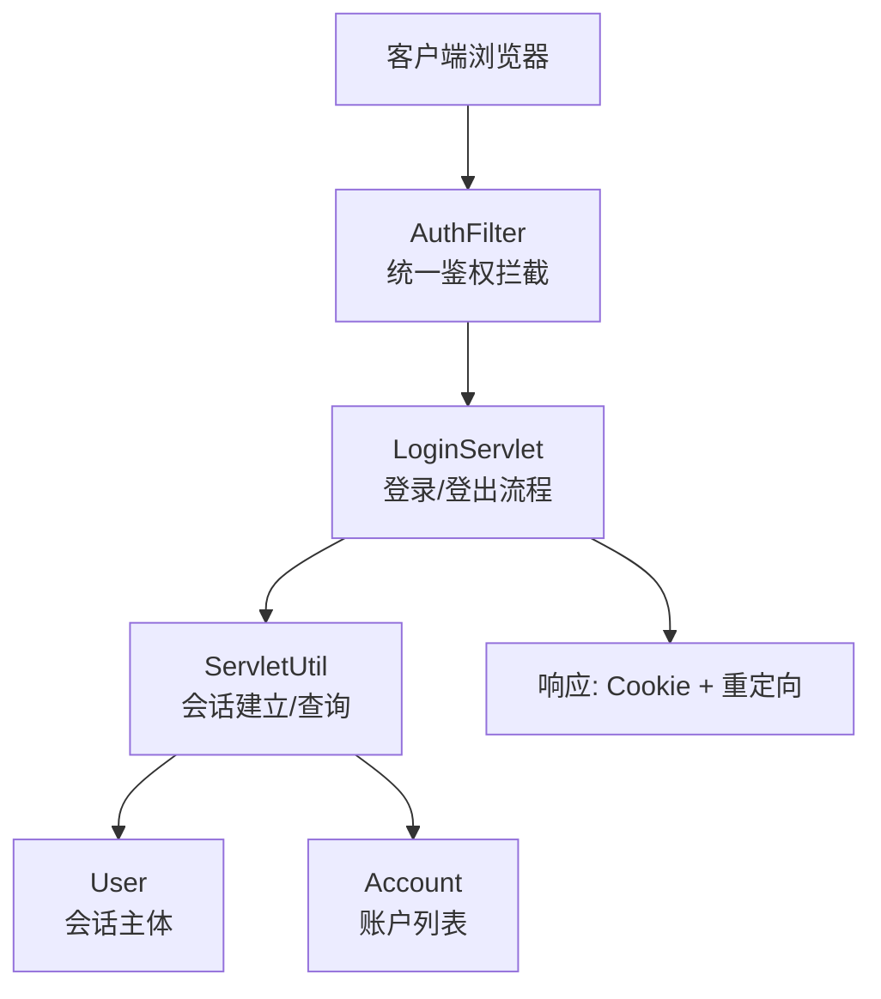
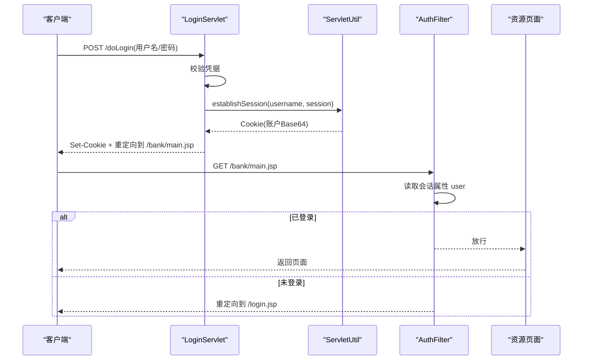
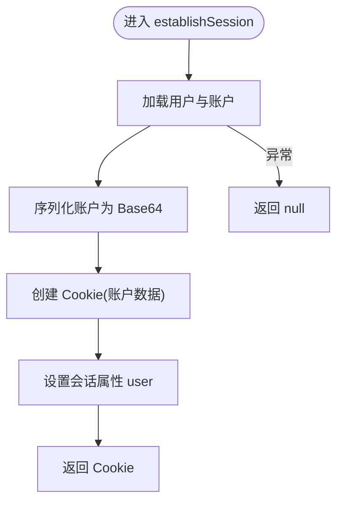
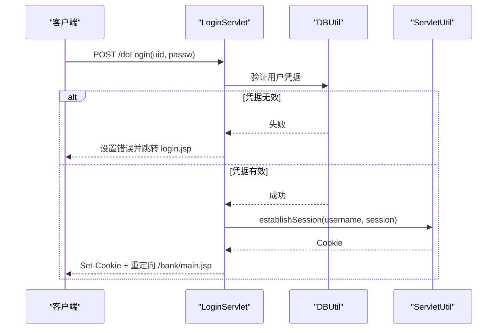
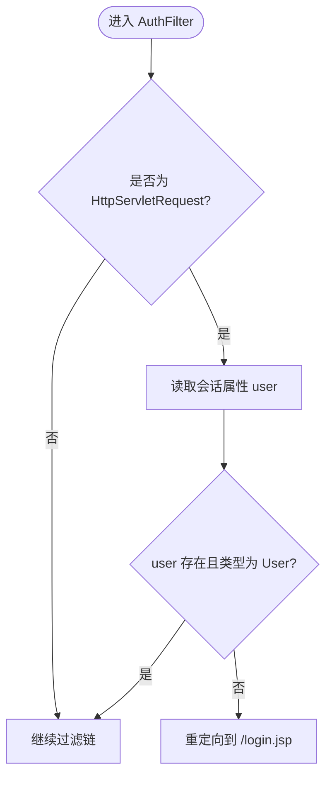
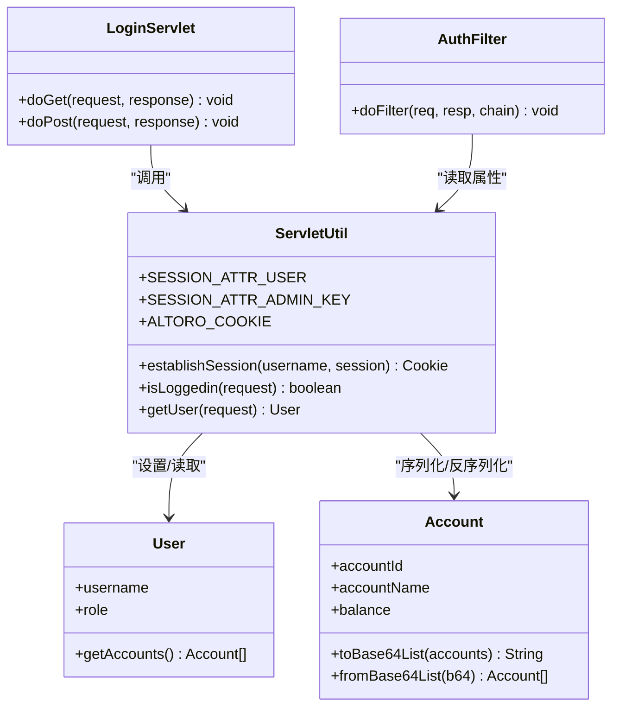
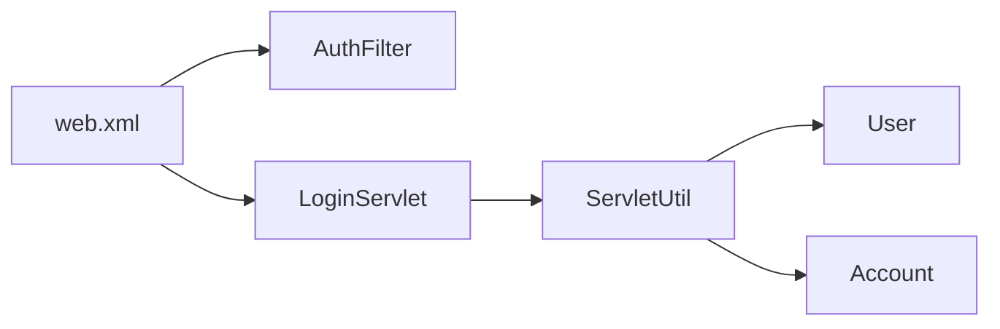

# 会话管理

<cite>
**本文引用的文件**   
- [ServletUtil.java](file://src/com/ibm/security/appscan/altoromutual/util/ServletUtil.java)
- [LoginServlet.java](file://src/com/ibm/security/appscan/altoromutual/servlet/LoginServlet.java)
- [AuthFilter.java](file://src/com/ibm/security/appscan/altoromutual/filter/AuthFilter.java)
- [web.xml](file://WebContent/WEB-INF/web.xml)
- [User.java](file://src/com/ibm/security/appscan/altoromutual/model/User.java)
- [Account.java](file://src/com/ibm/security/appscan/altoromutual/model/Account.java)
</cite>

## 目录
1. [引言](#引言)
2. [项目结构](#项目结构)
3. [核心组件](#核心组件)
4. [架构总览](#架构总览)
5. [详细组件分析](#详细组件分析)
6. [依赖关系分析](#依赖关系分析)
7. [性能与可扩展性](#性能与可扩展性)
8. [故障排查指南](#故障排查指南)
9. [结论](#结论)

## 引言
本文件系统性梳理 AltoroJ 的会话管理机制，覆盖会话创建、存储、维护与销毁的全生命周期。重点解析 ServletUtil.establishSession 的实现原理，包括 Cookie 设置、会话属性管理与安全配置；记录会话超时处理、并发会话控制与会话劫持防护措施；说明会话 ID 生成机制、Cookie 安全属性与跨域访问控制；并提供会话监控、调试技巧与性能优化建议。

## 项目结构
AltoroJ 使用标准 Java EE Web 应用结构：
- 控制器层：登录/登出等流程由 Servlet 处理（如 LoginServlet）。
- 过滤器层：统一鉴权拦截（AuthFilter）保护敏感路径。
- 工具层：会话建立与通用逻辑集中在 ServletUtil。
- 模型层：用户与账户对象用于会话状态承载。
- 部署描述符：web.xml 定义过滤器映射、Servlet 映射与应用级配置。

图表来源
- [LoginServlet.java:67-101](file://src/com/ibm/security/appscan/altoromutual/servlet/LoginServlet.java#L67-L101)
- [ServletUtil.java:340-353](file://src/com/ibm/security/appscan/altoromutual/util/ServletUtil.java#L340-L353)
- [AuthFilter.java:58-70](file://src/com/ibm/security/appscan/altoromutual/filter/AuthFilter.java#L58-L70)

章节来源
- [web.xml:1-227](file://WebContent/WEB-INF/web.xml#L1-L227)

## 核心组件
- ServletUtil：提供会话建立、登录态判断、用户获取等静态方法；定义会话属性键与 Cookie 名称常量。
- LoginServlet：处理登录与登出，负责创建/清理会话并写入 Cookie。
- AuthFilter：对 /bank/*、/admin/* 等路径进行鉴权，检查会话中是否包含有效用户。
- User/Account：作为会话中的业务数据载体，Account 还提供 Base64 编解码以在 Cookie 中传输账户摘要。

章节来源
- [ServletUtil.java:58-78](file://src/com/ibm/security/appscan/altoromutual/util/ServletUtil.java#L58-L78)
- [LoginServlet.java:38-108](file://src/com/ibm/security/appscan/altoromutual/servlet/LoginServlet.java#L38-L108)
- [AuthFilter.java:40-79](file://src/com/ibm/security/appscan/altoromutual/filter/AuthFilter.java#L40-L79)
- [User.java:30-108](file://src/com/ibm/security/appscan/altoromutual/model/User.java#L30-L108)
- [Account.java:32-122](file://src/com/ibm/security/appscan/altoromutual/model/Account.java#L32-L122)

## 架构总览
下图展示一次典型登录请求的完整调用链，以及后续受保护资源的鉴权流程。

图表来源
- [LoginServlet.java:67-101](file://src/com/ibm/security/appscan/altoromutual/servlet/LoginServlet.java#L67-L101)
- [ServletUtil.java:340-353](file://src/com/ibm/security/appscan/altoromutual/util/ServletUtil.java#L340-L353)
- [AuthFilter.java:58-70](file://src/com/ibm/security/appscan/altoromutual/filter/AuthFilter.java#L58-L70)

## 详细组件分析

### 会话建立：ServletUtil.establishSession
职责与行为
- 根据用户名加载用户信息及其账户列表。
- 将账户数组序列化为 Base64 字符串，放入名为固定值的 Cookie。
- 在 HttpSession 中设置用户对象为会话属性，供后续鉴权使用。
- 返回该 Cookie，由调用方写入响应。

关键实现要点
- 会话属性键：使用统一的常量，避免魔法字符串。
- Cookie 名称：使用统一常量，便于集中管理。
- 异常处理：捕获数据库异常并返回 null，调用方需做空值处理。

图表来源
- [ServletUtil.java:340-353](file://src/com/ibm/security/appscan/altoromutual/util/ServletUtil.java#L340-L353)

章节来源
- [ServletUtil.java:340-353](file://src/com/ibm/security/appscan/altoromutual/util/ServletUtil.java#L340-L353)

### 登录流程：LoginServlet
职责与行为
- GET 请求：登出逻辑，移除会话中的用户属性并重定向至首页。
- POST 请求：登录逻辑，校验凭据成功后建立会话、写入 Cookie 并重定向到银行主页。

关键点
- 登录失败时，将错误信息写入会话属性并跳转回登录页。
- 成功登录后，通过 ServletUtil.establishSession 建立会话并添加 Cookie。

图表来源
- [LoginServlet.java:67-101](file://src/com/ibm/security/appscan/altoromutual/servlet/LoginServlet.java#L67-L101)
- [ServletUtil.java:340-353](file://src/com/ibm/security/appscan/altoromutual/util/ServletUtil.java#L340-L353)

章节来源
- [LoginServlet.java:51-101](file://src/com/ibm/security/appscan/altoromutual/servlet/LoginServlet.java#L51-L101)

### 鉴权拦截：AuthFilter
职责与行为
- 对 /bank/*、/admin/* 等路径进行拦截。
- 从当前会话中读取用户属性，若不存在或类型不匹配则重定向到登录页。
- 否则放行请求。

图表来源
- [AuthFilter.java:58-70](file://src/com/ibm/security/appscan/altoromutual/filter/AuthFilter.java#L58-L70)

章节来源
- [AuthFilter.java:58-70](file://src/com/ibm/security/appscan/altoromutual/filter/AuthFilter.java#L58-L70)

### 会话属性与模型
- 会话属性键：
  - 用户属性键：统一常量，避免散落的魔法字符串。
  - 管理员属性键：用于管理员会话标记。
- 模型对象：
  - User：会话主体，包含角色、访问时间等。
  - Account：账户信息，支持 Base64 编解码以便在 Cookie 中传输账户摘要。

图表来源
- [ServletUtil.java:58-78](file://src/com/ibm/security/appscan/altoromutual/util/ServletUtil.java#L58-L78)
- [ServletUtil.java:340-373](file://src/com/ibm/security/appscan/altoromutual/util/ServletUtil.java#L340-L373)
- [LoginServlet.java:38-108](file://src/com/ibm/security/appscan/altoromutual/servlet/LoginServlet.java#L38-L108)
- [AuthFilter.java:40-79](file://src/com/ibm/security/appscan/altoromutual/filter/AuthFilter.java#L40-L79)
- [User.java:30-108](file://src/com/ibm/security/appscan/altoromutual/model/User.java#L30-L108)
- [Account.java:32-122](file://src/com/ibm/security/appscan/altoromutual/model/Account.java#L32-L122)

章节来源
- [ServletUtil.java:58-78](file://src/com/ibm/security/appscan/altoromutual/util/ServletUtil.java#L58-L78)
- [User.java:30-108](file://src/com/ibm/security/appscan/altoromutual/model/User.java#L30-L108)
- [Account.java:32-122](file://src/com/ibm/security/appscan/altoromutual/model/Account.java#L32-L122)

## 依赖关系分析
- web.xml 定义了过滤器与 Servlet 的映射关系，决定请求如何被拦截与路由。
- LoginServlet 依赖 DBUtil 进行凭据校验，依赖 ServletUtil 建立会话。
- AuthFilter 依赖 ServletUtil 提供的会话属性键常量，确保一致性。
- Account 的 Base64 编解码用于在 Cookie 中传输账户摘要，减少服务端负载但带来安全风险（见后文“安全注意事项”）。

图表来源
- [web.xml:12-68](file://WebContent/WEB-INF/web.xml#L12-L68)
- [LoginServlet.java:67-101](file://src/com/ibm/security/appscan/altoromutual/servlet/LoginServlet.java#L67-L101)
- [ServletUtil.java:340-353](file://src/com/ibm/security/appscan/altoromutual/util/ServletUtil.java#L340-L353)

章节来源
- [web.xml:12-68](file://WebContent/WEB-INF/web.xml#L12-L68)

## 性能与可扩展性
- 会话大小
  - 当前将用户对象存入会话，同时通过 Cookie 传输账户摘要。建议在会话中仅保留最小必要信息（如用户标识），账户详情按需从数据库加载，以降低会话内存占用。
- Cookie 体积
  - 账户列表经 Base64 编码后可能较大，影响网络开销与缓存命中。建议仅在必要时传输，或采用服务端签名+短令牌方案。
- 鉴权路径
  - AuthFilter 对所有受保护路径进行拦截，建议结合白名单与细粒度权限控制，减少不必要的鉴权开销。
- 分布式部署
  - web.xml 声明了可分发（distributable），表明会话可跨节点共享。需确保容器会话复制策略与一致性，避免频繁复制带来的性能损耗。

[本节为通用指导，不直接分析具体文件]

## 故障排查指南
常见问题与定位思路
- 登录后仍被重定向到登录页
  - 检查会话属性 user 是否正确设置（ServletUtil.establishSession）。
  - 检查 AuthFilter 是否正确读取会话属性。
  - 确认 Cookie 是否被浏览器拒绝（SameSite、Secure、HttpOnly 等限制）。
- 登出后仍可访问受保护资源
  - 检查登出逻辑是否正确移除会话属性。
  - 检查过滤器映射是否覆盖目标路径。
- 账户数据不一致
  - 检查 Account.toBase64List/fromBase64List 的序列化/反序列化逻辑。
  - 核对数据库账户数据与 Cookie 中内容的一致性。

实用调试技巧
- 在登录成功与鉴权拦截处增加日志，打印会话是否存在、用户属性类型与 Cookie 名称。
- 使用浏览器开发者工具查看请求头与响应头，确认 Set-Cookie 与 Cookie 字段。
- 在容器层面启用会话跟踪与统计，观察会话创建/销毁频率与大小。

章节来源
- [LoginServlet.java:51-101](file://src/com/ibm/security/appscan/altoromutual/servlet/LoginServlet.java#L51-L101)
- [AuthFilter.java:58-70](file://src/com/ibm/security/appscan/altoromutual/filter/AuthFilter.java#L58-L70)
- [Account.java:76-120](file://src/com/ibm/security/appscan/altoromutual/model/Account.java#L76-L120)

## 结论
AltoroJ 的会话管理围绕 ServletUtil.establishSession 展开，通过在会话中保存用户对象并在 Cookie 中携带账户摘要来实现基本认证与上下文传递。AuthFilter 提供统一的鉴权入口，配合 web.xml 的路径映射完成访问控制。当前实现简洁直观，但在安全性与性能方面仍有改进空间：应加强 Cookie 安全属性、引入会话 ID 绑定与防劫持机制、优化会话与 Cookie 的数据量，并完善超时与并发控制策略。

[本节为总结性内容，不直接分析具体文件]