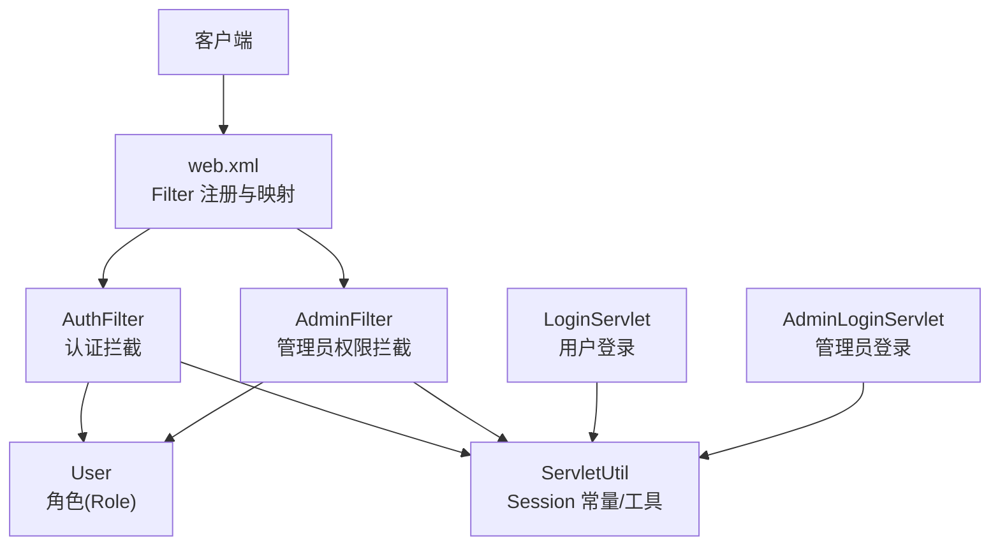
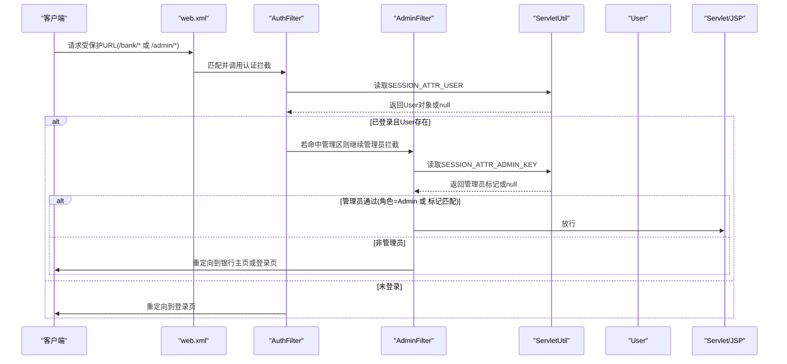
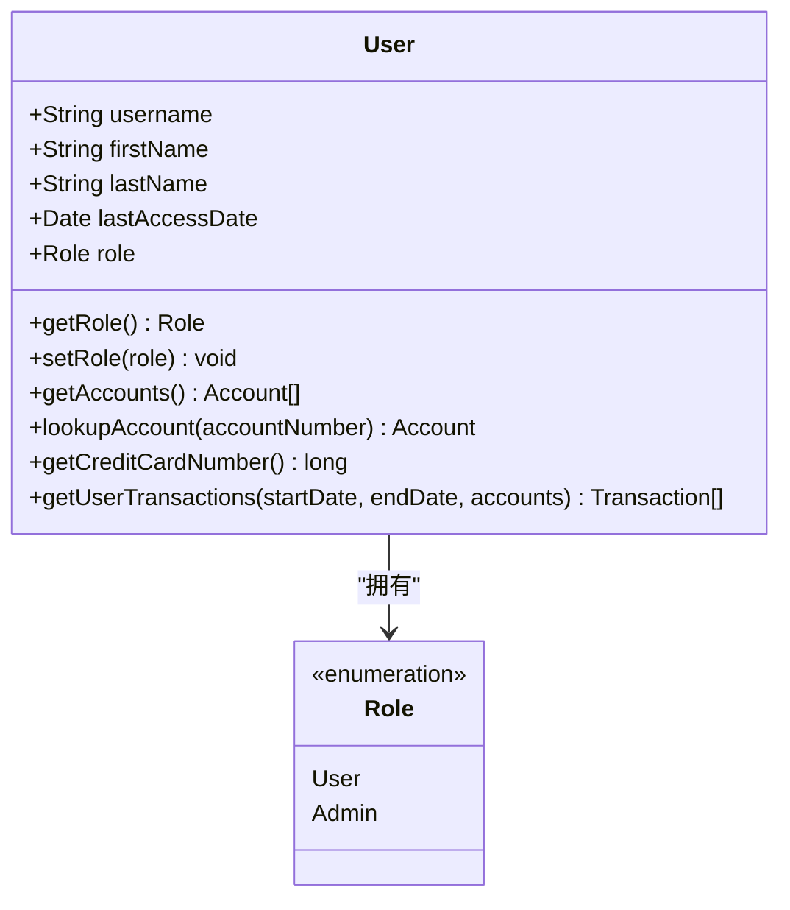
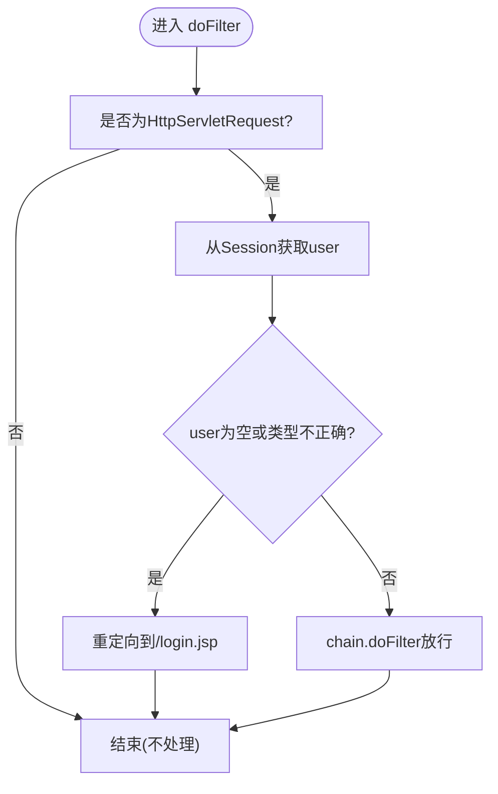
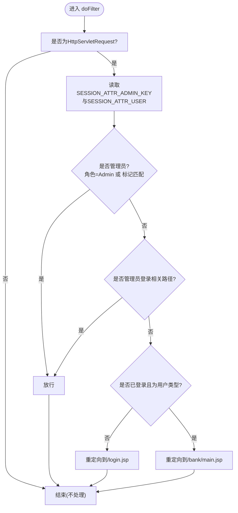
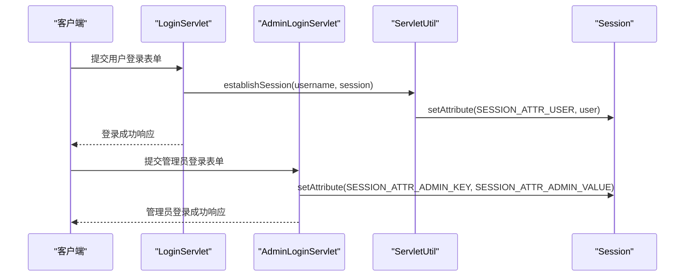
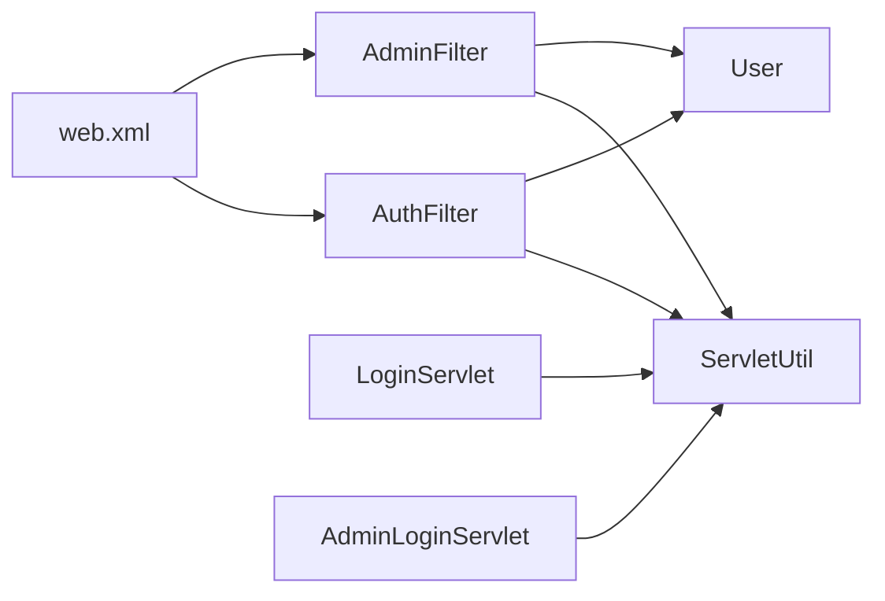

# 基于角色的访问控制

<cite>
**本文引用的文件**   
- [AuthFilter.java](file://src/com/ibm/security/appscan/altoromutual/filter/AuthFilter.java)
- [AdminFilter.java](file://src/com/ibm/security/appscan/altoromutual/filter/AdminFilter.java)
- [User.java](file://src/com/ibm/security/appscan/altoromutual/model/User.java)
- [ServletUtil.java](file://src/com/ibm/security/appscan/altoromutual/util/ServletUtil.java)
- [web.xml](file://WebContent/WEB-INF/web.xml)
- [LoginServlet.java](file://src/com/ibm/security/appscan/altoromutual/servlet/LoginServlet.java)
- [AdminLoginServlet.java](file://src/com/ibm/security/appscan/altoromutual/servlet/AdminLoginServlet.java)
</cite>

## 目录
1. [简介](#简介)
2. [项目结构](#项目结构)
3. [核心组件](#核心组件)
4. [架构总览](#架构总览)
5. [详细组件分析](#详细组件分析)
6. [依赖关系分析](#依赖关系分析)
7. [性能与可扩展性](#性能与可扩展性)
8. [故障排查指南](#故障排查指南)
9. [结论](#结论)
10. [附录：扩展指南](#附录扩展指南)

## 简介
本文件系统性梳理 AltoroJ 的基于角色的访问控制（RBAC）实现，重点覆盖以下方面：
- 用户角色定义与权限级别划分（普通用户、管理员）
- 访问控制策略与请求拦截流程
- AuthFilter 与 AdminFilter 的实现原理（请求拦截、角色验证、权限检查）
- User 模型中的角色字段与权限映射
- 角色继承、权限组合与动态权限分配机制的现状与建议
- 自定义角色与权限规则的扩展指南

## 项目结构
AltoroJ 的访问控制由 Servlet Filter 在 Web 层统一拦截，结合 Session 中存储的用户对象与角色信息完成鉴权。关键路径如下：
- 过滤器：AuthFilter、AdminFilter
- 用户模型：User（含 Role 枚举）
- 会话工具：ServletUtil（Session 属性常量与辅助方法）
- 登录处理：LoginServlet、AdminLoginServlet
- 部署配置：web.xml（Filter 注册与 URL 映射）

图表来源
- [web.xml:12-51](file://WebContent/WEB-INF/web.xml#L12-L51)
- [AuthFilter.java:40-70](file://src/com/ibm/security/appscan/altoromutual/filter/AuthFilter.java#L40-L70)
- [AdminFilter.java:40-81](file://src/com/ibm/security/appscan/altoromutual/filter/AdminFilter.java#L40-L81)
- [User.java:30-54](file://src/com/ibm/security/appscan/altoromutual/model/User.java#L30-L54)
- [ServletUtil.java:60-62](file://src/com/ibm/security/appscan/altoromutual/util/ServletUtil.java#L60-L62)

章节来源
- [web.xml:12-51](file://WebContent/WEB-INF/web.xml#L12-L51)

## 核心组件
- AuthFilter：对银行区与账户页进行认证拦截，未登录则重定向到登录页。
- AdminFilter：对管理区进行管理员权限校验，支持两种管理员标识方式（用户角色为 Admin 或会话中存在特定管理员标记）。
- User：用户实体，包含 Role 枚举（User、Admin），并提供角色读写方法。
- ServletUtil：集中定义 Session 属性键与值常量，提供建立会话、判断登录状态等工具方法。
- LoginServlet / AdminLoginServlet：分别负责普通用户与管理员的登录流程，并在会话中写入相应属性。

章节来源
- [AuthFilter.java:40-70](file://src/com/ibm/security/appscan/altoromutual/filter/AuthFilter.java#L40-L70)
- [AdminFilter.java:40-81](file://src/com/ibm/security/appscan/altoromutual/filter/AdminFilter.java#L40-L81)
- [User.java:30-54](file://src/com/ibm/security/appscan/altoromutual/model/User.java#L30-L54)
- [ServletUtil.java:60-62](file://src/com/ibm/security/appscan/altoromutual/util/ServletUtil.java#L60-L62)
- [LoginServlet.java](file://src/com/ibm/security/appscan/altoromutual/servlet/LoginServlet.java)
- [AdminLoginServlet.java](file://src/com/ibm/security/appscan/altoromutual/servlet/AdminLoginServlet.java)

## 架构总览
下图展示一次受保护资源访问的典型流程：请求经 web.xml 路由至对应 Filter，Filter 从 Session 读取用户与管理员标记，依据角色与规则放行或重定向。

图表来源
- [web.xml:28-51](file://WebContent/WEB-INF/web.xml#L28-L51)
- [AuthFilter.java:58-70](file://src/com/ibm/security/appscan/altoromutual/filter/AuthFilter.java#L58-L70)
- [AdminFilter.java:58-81](file://src/com/ibm/security/appscan/altoromutual/filter/AdminFilter.java#L58-L81)
- [ServletUtil.java:60-62](file://src/com/ibm/security/appscan/altoromutual/util/ServletUtil.java#L60-L62)

## 详细组件分析

### 用户模型与角色定义（User）
- 角色枚举：Role 包含 User 与 Admin 两个取值，默认值为 User。
- 角色读写：getRole()/setRole() 暴露角色属性，供过滤器与业务逻辑使用。
- 其他字段与方法：用户名、姓名、最近访问时间、账户与交易查询等（与 RBAC 无直接耦合）。

图表来源
- [User.java:30-54](file://src/com/ibm/security/appscan/altoromutual/model/User.java#L30-L54)

章节来源
- [User.java:30-54](file://src/com/ibm/security/appscan/altoromutual/model/User.java#L30-L54)

### 认证过滤器（AuthFilter）
职责与行为：
- 仅针对 HttpServletRequest 进行处理。
- 从 Session 中读取用户对象（键为 SESSION_ATTR_USER）。
- 若用户不存在或类型不匹配，则重定向到登录页；否则放行。

图表来源
- [AuthFilter.java:58-70](file://src/com/ibm/security/appscan/altoromutual/filter/AuthFilter.java#L58-L70)
- [ServletUtil.java:60-62](file://src/com/ibm/security/appscan/altoromutual/util/ServletUtil.java#L60-L62)

章节来源
- [AuthFilter.java:58-70](file://src/com/ibm/security/appscan/altoromutual/filter/AuthFilter.java#L58-L70)

### 管理员过滤器（AdminFilter）
职责与行为：
- 同时检查两类管理员标识：
  - 用户角色为 Admin（User.getRole() == Role.Admin）
  - 会话中存在管理员标记键（SESSION_ATTR_ADMIN_KEY）且其值等于预定义常量（SESSION_ATTR_ADMIN_VALUE）
- 允许访问的管理员入口：
  - 管理员登录页面（/admin/login.jsp）
  - 管理员登录接口（/admin/doAdminLogin）
- 未满足条件时的重定向策略：
  - 未登录：重定向到 /login.jsp
  - 已登录但非管理员：重定向到 /bank/main.jsp

图表来源
- [AdminFilter.java:58-81](file://src/com/ibm/security/appscan/altoromutual/filter/AdminFilter.java#L58-L81)
- [ServletUtil.java:60-62](file://src/com/ibm/security/appscan/altoromutual/util/ServletUtil.java#L60-L62)

章节来源
- [AdminFilter.java:58-81](file://src/com/ibm/security/appscan/altoromutual/filter/AdminFilter.java#L58-L81)

### 会话与登录流程（ServletUtil、LoginServlet、AdminLoginServlet）
- 会话属性常量：
  - SESSION_ATTR_USER：用于存放当前登录的 User 对象
  - SESSION_ATTR_ADMIN_KEY：管理员会话标记键
  - SESSION_ATTR_ADMIN_VALUE：管理员会话标记值
- 建立会话：
  - establishSession 将 User 对象写入 SESSION_ATTR_USER，并生成账户 Cookie
- 登录处理：
  - LoginServlet：用户登录后设置 SESSION_ATTR_USER
  - AdminLoginServlet：管理员登录后设置 SESSION_ATTR_ADMIN_KEY 与 SESSION_ATTR_ADMIN_VALUE

图表来源
- [ServletUtil.java:340-353](file://src/com/ibm/security/appscan/altoromutual/util/ServletUtil.java#L340-L353)
- [ServletUtil.java:60-62](file://src/com/ibm/security/appscan/altoromutual/util/ServletUtil.java#L60-L62)
- [AdminLoginServlet.java](file://src/com/ibm/security/appscan/altoromutual/servlet/AdminLoginServlet.java)
- [LoginServlet.java](file://src/com/ibm/security/appscan/altoromutual/servlet/LoginServlet.java)

章节来源
- [ServletUtil.java:340-353](file://src/com/ibm/security/appscan/altoromutual/util/ServletUtil.java#L340-L353)
- [ServletUtil.java:60-62](file://src/com/ibm/security/appscan/altoromutual/util/ServletUtil.java#L60-L62)

## 依赖关系分析
- Filter 依赖：
  - AuthFilter 依赖 ServletUtil.SESSION_ATTR_USER 与 User 类型
  - AdminFilter 依赖 ServletUtil.SESSION_ATTR_ADMIN_KEY、SESSION_ATTR_ADMIN_VALUE 与 User.Role
- 配置依赖：
  - web.xml 声明了 Filter 类与 URL 映射，决定哪些路径需要认证或管理员权限
- 登录依赖：
  - LoginServlet 与 AdminLoginServlet 负责在 Session 中写入相应的认证与授权标记

图表来源
- [web.xml:12-51](file://WebContent/WEB-INF/web.xml#L12-L51)
- [AuthFilter.java:58-70](file://src/com/ibm/security/appscan/altoromutual/filter/AuthFilter.java#L58-L70)
- [AdminFilter.java:58-81](file://src/com/ibm/security/appscan/altoromutual/filter/AdminFilter.java#L58-L81)
- [ServletUtil.java:60-62](file://src/com/ibm/security/appscan/altoromutual/util/ServletUtil.java#L60-L62)

章节来源
- [web.xml:12-51](file://WebContent/WEB-INF/web.xml#L12-L51)

## 性能与可扩展性
- 性能特性：
  - 过滤器在请求入口处执行轻量级 Session 读取与类型判断，开销极低
  - 管理员判定采用“角色+会话标记”双通道，避免额外数据库查询
- 可扩展性建议：
  - 引入细粒度权限（如按资源/动作维度）与权限集合，替代单一 Role 枚举
  - 将管理员标记与会话绑定改为更安全的令牌机制，避免硬编码字符串比较
  - 增加权限缓存与策略引擎，支持动态权限分配与组合

[本节为通用指导，不涉及具体文件分析]

## 故障排查指南
常见问题与定位要点：
- 无法访问银行区：
  - 检查 Session 中是否存在 USER 属性（SESSION_ATTR_USER）
  - 确认 AuthFilter 映射路径是否包含目标 URL
- 无法访问管理区：
  - 检查用户角色是否为 Admin，或会话中是否存在管理员标记键与值
  - 确认 AdminFilter 映射路径是否正确（注意 web.xml 中可能存在拼写差异）
- 登录失败：
  - 检查 LoginServlet 是否正确设置 SESSION_ATTR_USER
  - 检查 AdminLoginServlet 是否正确设置 SESSION_ATTR_ADMIN_KEY 与 SESSION_ATTR_ADMIN_VALUE

章节来源
- [AuthFilter.java:58-70](file://src/com/ibm/security/appscan/altoromutual/filter/AuthFilter.java#L58-L70)
- [AdminFilter.java:58-81](file://src/com/ibm/security/appscan/altoromutual/filter/AdminFilter.java#L58-L81)
- [web.xml:28-51](file://WebContent/WEB-INF/web.xml#L28-L51)
- [ServletUtil.java:60-62](file://src/com/ibm/security/appscan/altoromutual/util/ServletUtil.java#L60-L62)

## 结论
AltoroJ 的 RBAC 实现以 Servlet Filter 为核心，结合 Session 中的用户对象与管理员标记完成认证与授权。当前实现简单直观，适合演示与教学场景。对于生产环境，建议引入更细粒度的权限模型、安全令牌与策略引擎，以提升安全性与可维护性。

[本节为总结性内容，不涉及具体文件分析]

## 附录：扩展指南
- 自定义角色与权限规则
  - 扩展 Role 枚举或引入权限集合（PermissionSet），在 User 中维护多角色或多权限
  - 在 AdminFilter 中增加新的权限判定分支，或在新的 Filter 中实现细粒度访问控制
  - 在 web.xml 中新增 Filter 映射，限定受控路径
- 动态权限分配
  - 在登录流程中根据用户上下文动态赋予权限（例如从外部系统或数据库加载）
  - 使用 ServletUtil 的工具方法封装权限检查逻辑，便于复用与测试
- 最佳实践
  - 避免在 Session 中使用明文硬编码值作为管理员标记，改用加密令牌或短期凭证
  - 对所有敏感操作增加二次确认与审计日志
  - 对过滤器进行单元测试，覆盖未登录、普通用户、管理员、非法路径等场景

[本节为概念性指导，不涉及具体文件分析]