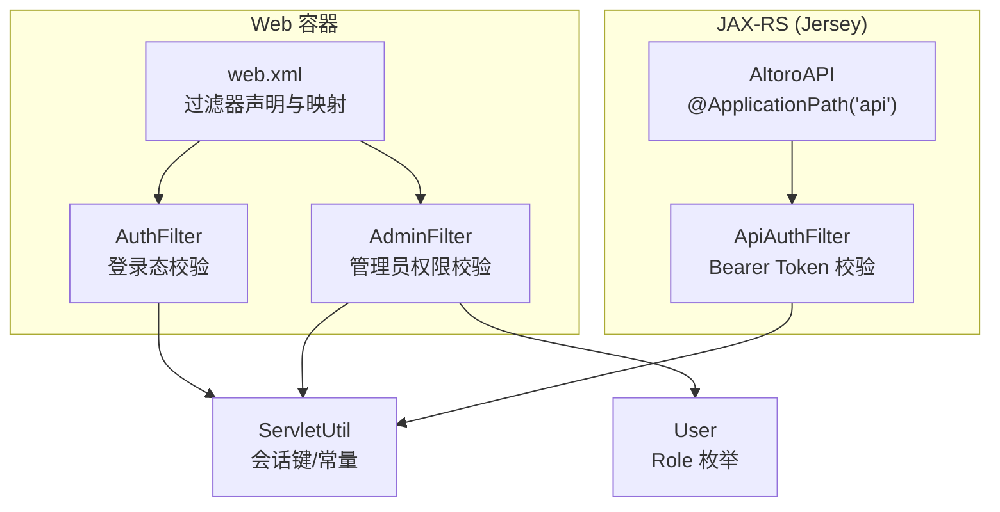
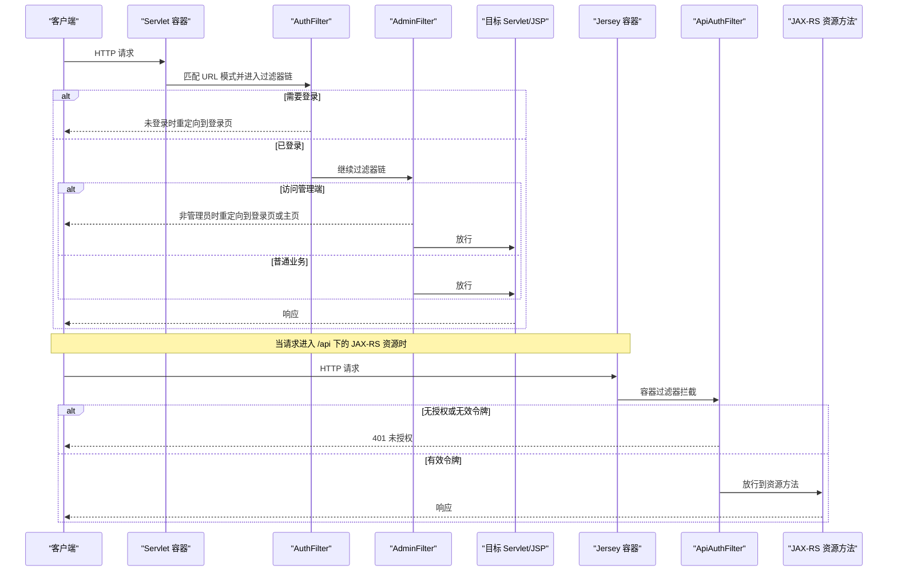
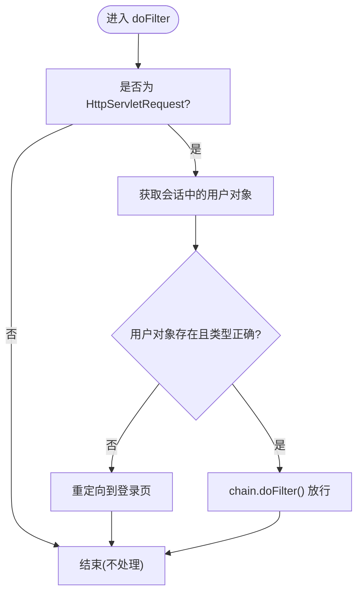
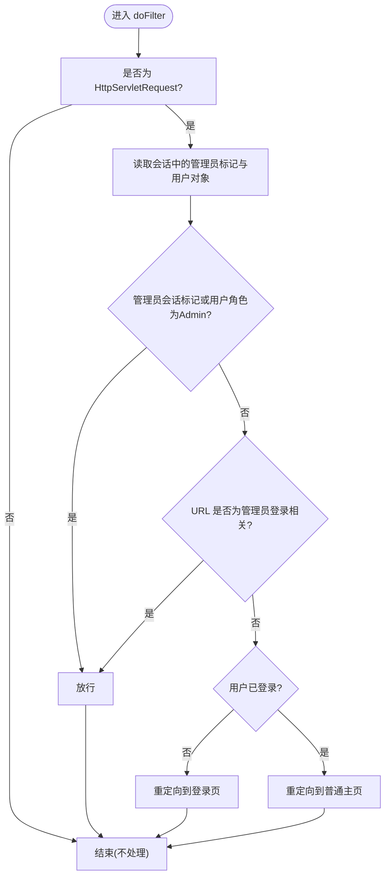
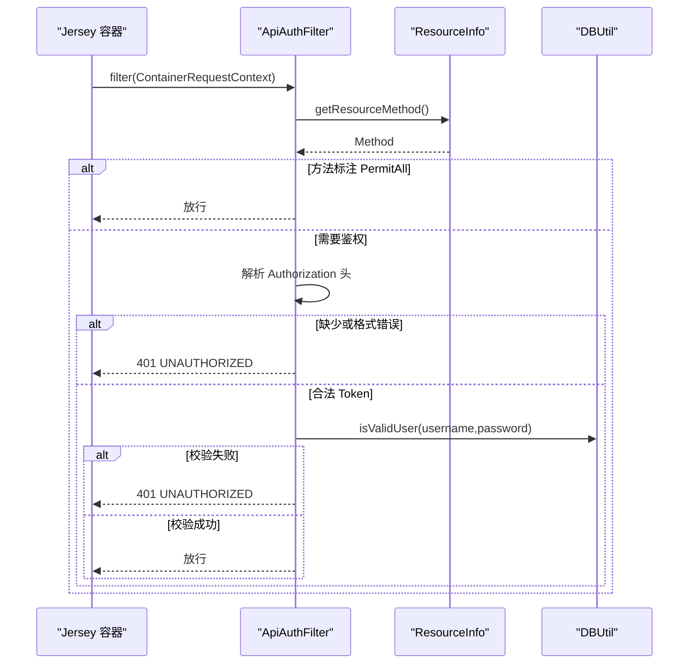
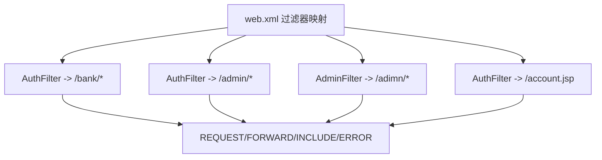
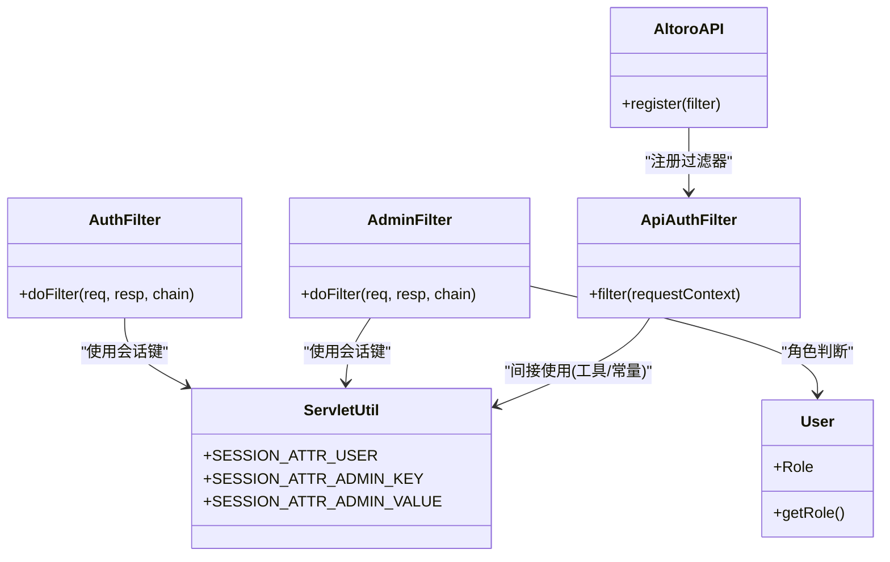

# 安全过滤器链

<cite>
**本文引用的文件**   
- [web.xml](file://WebContent/WEB-INF/web.xml)
- [AuthFilter.java](file://src/com/ibm/security/appscan/altoromutual/filter/AuthFilter.java)
- [AdminFilter.java](file://src/com/ibm/security/appscan/altoromutual/filter/AdminFilter.java)
- [ApiAuthFilter.java](file://src/com/ibm/security/appscan/altoromutual/filter/ApiAuthFilter.java)
- [ServletUtil.java](file://src/com/ibm/security/appscan/altoromutual/util/ServletUtil.java)
- [User.java](file://src/com/ibm/security/appscan/altoromutual/model/User.java)
- [AltoroAPI.java](file://src/com/ibm/security/appscan/altoromutual/api/AltoroAPI.java)
</cite>

## 目录
1. [简介](#简介)
2. [项目结构](#项目结构)
3. [核心组件](#核心组件)
4. [架构总览](#架构总览)
5. [详细组件分析](#详细组件分析)
6. [依赖关系分析](#依赖关系分析)
7. [性能与优化](#性能与优化)
8. [调试与故障排除](#调试与故障排除)
9. [结论](#结论)

## 简介
本文面向 AltoroJ 的安全过滤器链机制，系统性说明 Servlet Filter 的工作原理、执行顺序与配置方式；深入解析 AuthFilter、AdminFilter 的职责边界与协作关系；并补充 REST API 侧的 ApiAuthFilter（基于 JAX-RS ContainerRequestFilter）如何与 Web 容器过滤器协同工作。文档还包含 URL 模式匹配、请求转发拦截、扩展点设计、自定义过滤器开发指南、安全策略注入方式，以及性能优化、调试技巧与常见问题排查建议。

## 项目结构
与安全过滤器链直接相关的代码与配置分布如下：
- Web 层过滤器定义与映射：web.xml
- Servlet 过滤器实现：AuthFilter、AdminFilter
- JAX-RS 容器过滤器实现：ApiAuthFilter
- 会话与常量工具：ServletUtil
- 用户模型与角色枚举：User
- JAX-RS 应用注册与过滤器注册：AltoroAPI

图表来源
- [web.xml:12-59](file://WebContent/WEB-INF/web.xml#L12-L59)
- [AltoroAPI.java:9-14](file://src/com/ibm/security/appscan/altoromutual/api/AltoroAPI.java#L9-L14)

章节来源
- [web.xml:12-59](file://WebContent/WEB-INF/web.xml#L12-L59)
- [AltoroAPI.java:9-14](file://src/com/ibm/security/appscan/altoromutual/api/AltoroAPI.java#L9-L14)

## 核心组件
- AuthFilter：对 /bank/*、/admin/*、/account.jsp 等路径进行“已登录”校验，未登录则重定向到登录页。
- AdminFilter：对管理端路径进行“管理员角色或特定会话标记”校验，允许管理员登录页面和登录动作通过，否则根据状态重定向至登录页或普通主页。
- ApiAuthFilter：针对 JAX-RS 资源方法，若未标注 PermitAll，则要求 Authorization 头携带 Bearer Token，解码后使用用户名/密码调用 DBUtil 校验合法性。
- ServletUtil：提供会话属性键常量（如用户对象、管理员标记）、工具方法与 Swagger 初始化逻辑。
- User：用户模型，包含 Role 枚举（User/Admin）。

章节来源
- [AuthFilter.java:40-70](file://src/com/ibm/security/appscan/altoromutual/filter/AuthFilter.java#L40-L70)
- [AdminFilter.java:40-81](file://src/com/ibm/security/appscan/altoromutual/filter/AdminFilter.java#L40-L81)
- [ApiAuthFilter.java:20-75](file://src/com/ibm/security/appscan/altoromutual/filter/ApiAuthFilter.java#L20-L75)
- [ServletUtil.java:60-62](file://src/com/ibm/security/appscan/altoromutual/util/ServletUtil.java#L60-L62)
- [User.java:30-54](file://src/com/ibm/security/appscan/altoromutual/model/User.java#L30-L54)

## 架构总览
下图展示一次典型请求在 Web 容器与 JAX-RS 之间的处理流程，包括过滤器链与 API 鉴权。

图表来源
- [web.xml:28-59](file://WebContent/WEB-INF/web.xml#L28-L59)
- [AuthFilter.java:58-70](file://src/com/ibm/security/appscan/altoromutual/filter/AuthFilter.java#L58-L70)
- [AdminFilter.java:58-81](file://src/com/ibm/security/appscan/altoromutual/filter/AdminFilter.java#L58-L81)
- [ApiAuthFilter.java:29-75](file://src/com/ibm/security/appscan/altoromutual/filter/ApiAuthFilter.java#L29-L75)

## 详细组件分析

### AuthFilter（登录态校验）
职责
- 检查会话中是否存在有效的用户对象。
- 未登录时重定向到登录页；已登录则放行到后续过滤器或目标资源。

关键行为
- 从会话中读取用户对象键值。
- 类型校验与空值判断。
- 重定向到上下文路径下的登录页。

图表来源
- [AuthFilter.java:58-70](file://src/com/ibm/security/appscan/altoromutual/filter/AuthFilter.java#L58-L70)

章节来源
- [AuthFilter.java:40-70](file://src/com/ibm/security/appscan/altoromutual/filter/AuthFilter.java#L40-L70)
- [ServletUtil.java:60-62](file://src/com/ibm/security/appscan/altoromutual/util/ServletUtil.java#L60-L62)

### AdminFilter（管理员权限校验）
职责
- 校验访问管理端路径的请求是否具备管理员权限。
- 允许管理员登录页面与登录动作通过。
- 非管理员或未登录时，分别重定向到登录页或普通主页。

关键行为
- 同时检查“管理员会话标记”与“用户对象的 Role”。
- 特殊路径白名单：管理员登录页与登录动作。
- 根据条件分支决定放行或重定向。

图表来源
- [AdminFilter.java:58-81](file://src/com/ibm/security/appscan/altoromutual/filter/AdminFilter.java#L58-L81)

章节来源
- [AdminFilter.java:40-81](file://src/com/ibm/security/appscan/altoromutual/filter/AdminFilter.java#L40-L81)
- [User.java:30-54](file://src/com/ibm/security/appscan/altoromutual/model/User.java#L30-L54)
- [ServletUtil.java:60-62](file://src/com/ibm/security/appscan/altoromutual/util/ServletUtil.java#L60-L62)

### ApiAuthFilter（REST API 鉴权）
职责
- 对 JAX-RS 资源方法进行统一鉴权。
- 若方法标注 PermitAll，则跳过鉴权。
- 否则要求 Authorization 头携带 Bearer Token，解码后以用户名/密码形式调用数据库校验。

关键行为
- 通过 ResourceInfo 获取当前资源方法注解。
- 解析 Authorization 头，提取并解码 Token。
- 使用 DBUtil 验证用户有效性。
- 失败返回 401，异常返回 500。

图表来源
- [ApiAuthFilter.java:29-75](file://src/com/ibm/security/appscan/altoromutual/filter/ApiAuthFilter.java#L29-L75)

章节来源
- [ApiAuthFilter.java:20-75](file://src/com/ibm/security/appscan/altoromutual/filter/ApiAuthFilter.java#L20-L75)
- [AltoroAPI.java:9-14](file://src/com/ibm/security/appscan/altoromutual/api/AltoroAPI.java#L9-L14)

### 过滤器配置与 URL 模式匹配
- web.xml 中声明了 AuthFilter 与 AdminFilter，并通过多个 filter-mapping 将不同 URL 模式绑定到对应过滤器。
- 支持 dispatcher 类型：REQUEST、FORWARD、INCLUDE、ERROR，确保转发、包含与错误处理也能被过滤。
- 注意：AdminFilter 的映射使用了 “/adimn/*”，与常见的 “/admin/*” 拼写不一致，可能导致管理端路径未被预期拦截。

图表来源
- [web.xml:28-59](file://WebContent/WEB-INF/web.xml#L28-L59)

章节来源
- [web.xml:28-59](file://WebContent/WEB-INF/web.xml#L28-L59)

### 请求转发与拦截
- 所有过滤器映射均包含 FORWARD、INCLUDE、ERROR，意味着由 Servlet 内部转发或包含的资源也会再次经过过滤器链。
- 这保证了即使通过服务端转发到 JSP 或 Servlet，安全策略仍能被强制执行。

章节来源
- [web.xml:28-59](file://WebContent/WEB-INF/web.xml#L28-L59)

### 过滤器链的执行顺序
- 对于同一 URL 匹配的多个过滤器，执行顺序取决于它们在 web.xml 中出现的先后顺序。
- 本仓库中，AuthFilter 先于 AdminFilter 声明，因此对同时匹配两者的路径，AuthFilter 会先执行，再进入 AdminFilter。

章节来源
- [web.xml:12-59](file://WebContent/WEB-INF/web.xml#L12-L59)

### 扩展点与自定义过滤器开发
- 新增 Servlet 过滤器：
  - 在 web.xml 中新增 <filter> 与 <filter-mapping>，指定类名与 URL 模式。
  - 实现 javax.servlet.Filter 接口，并在 doFilter 中实现鉴权、审计、日志等横切逻辑。
- 新增 JAX-RS 容器过滤器：
  - 在 AltoroAPI 中 register 新的 ContainerRequestFilter 实现。
  - 使用 @PermitAll 等方法级注解控制细粒度放行。
- 安全策略注入：
  - 通过 ServletUtil 提供的常量与工具方法集中管理会话键与开关。
  - 可引入外部配置（如 app.properties）动态调整策略。

章节来源
- [web.xml:12-59](file://WebContent/WEB-INF/web.xml#L12-L59)
- [AltoroAPI.java:9-14](file://src/com/ibm/security/appscan/altoromutual/api/AltoroAPI.java#L9-L14)
- [ServletUtil.java:60-62](file://src/com/ibm/security/appscan/altoromutual/util/ServletUtil.java#L60-L62)

## 依赖关系分析
- AuthFilter 依赖 ServletUtil 的会话键常量，用于读取会话中的用户对象。
- AdminFilter 依赖 ServletUtil 的管理员会话键与值常量，以及 User.Role 枚举进行权限判断。
- ApiAuthFilter 依赖 DBUtil 进行用户名/密码校验，依赖 Base64 解码 Authorization 头。
- AltoroAPI 负责注册 ApiAuthFilter，使其作用于 /api 下的所有 JAX-RS 资源。

图表来源
- [AuthFilter.java:58-70](file://src/com/ibm/security/appscan/altoromutual/filter/AuthFilter.java#L58-L70)
- [AdminFilter.java:58-81](file://src/com/ibm/security/appscan/altoromutual/filter/AdminFilter.java#L58-L81)
- [ApiAuthFilter.java:29-75](file://src/com/ibm/security/appscan/altoromutual/filter/ApiAuthFilter.java#L29-L75)
- [ServletUtil.java:60-62](file://src/com/ibm/security/appscan/altoromutual/util/ServletUtil.java#L60-L62)
- [User.java:30-54](file://src/com/ibm/security/appscan/altoromutual/model/User.java#L30-L54)
- [AltoroAPI.java:9-14](file://src/com/ibm/security/appscan/altoromutual/api/AltoroAPI.java#L9-L14)

章节来源
- [AuthFilter.java:58-70](file://src/com/ibm/security/appscan/altoromutual/filter/AuthFilter.java#L58-L70)
- [AdminFilter.java:58-81](file://src/com/ibm/security/appscan/altoromutual/filter/AdminFilter.java#L58-L81)
- [ApiAuthFilter.java:29-75](file://src/com/ibm/security/appscan/altoromutual/filter/ApiAuthFilter.java#L29-L75)
- [ServletUtil.java:60-62](file://src/com/ibm/security/appscan/altoromutual/util/ServletUtil.java#L60-L62)
- [User.java:30-54](file://src/com/ibm/security/appscan/altoromutual/model/User.java#L30-L54)
- [AltoroAPI.java:9-14](file://src/com/ibm/security/appscan/altoromutual/api/AltoroAPI.java#L9-L14)

## 性能与优化
- 避免不必要的会话访问：在过滤器入口处尽早判断并短路，减少后续链开销。
- 缓存静态配置：如允许的 URL 白名单、策略开关，可通过 ServletUtil 或外部配置文件加载一次后复用。
- 减少字符串操作：在 AdminFilter 中对 URL 结尾的判断尽量使用更高效的比较方式。
- 数据库校验优化：ApiAuthFilter 每次请求都进行 DB 校验，建议引入短期令牌缓存或签名校验以降低数据库压力。
- 日志与监控：在过滤器入口/出口记录耗时与结果，便于定位瓶颈。

[本节为通用指导，不涉及具体文件分析]

## 调试与故障排除
常见问题与建议
- 管理端路径无法被 AdminFilter 拦截：
  - 检查 web.xml 中 AdminFilter 的 URL 模式是否为 “/adimn/*”，该拼写可能与预期不符，导致管理端路径未被匹配。
  - 修正为 “/admin/*” 并确保与业务路径一致。
- 登录后仍被重定向到登录页：
  - 确认会话中是否正确写入用户对象键值（ServletUtil.SESSION_ATTR_USER）。
  - 检查 AuthFilter 的类型判断逻辑，确保会话中的对象类型与 User 一致。
- API 请求返回 401：
  - 检查 Authorization 头是否包含正确的 Bearer Token。
  - 确认 Token 解码后的用户名/密码组合是否有效（DBUtil.isValidUser）。
- 转发资源未受保护：
  - 确认过滤器映射中包含 FORWARD 类型，确保内部转发也被拦截。
- 过滤器执行顺序不符合预期：
  - 检查 web.xml 中过滤器的声明顺序，必要时拆分映射或使用更精确的 URL 模式。

章节来源
- [web.xml:44-51](file://WebContent/WEB-INF/web.xml#L44-L51)
- [AuthFilter.java:58-70](file://src/com/ibm/security/appscan/altoromutual/filter/AuthFilter.java#L58-L70)
- [ApiAuthFilter.java:29-75](file://src/com/ibm/security/appscan/altoromutual/filter/ApiAuthFilter.java#L29-L75)

## 结论
AltoroJ 的安全过滤器链通过 Servlet 过滤器与 JAX-RS 容器过滤器分层协作，实现了 Web 端登录态校验、管理端权限控制与 API 端的令牌鉴权。AuthFilter 保障基础登录态，AdminFilter 细化管理员权限，ApiAuthFilter 保证 REST API 的安全性。建议在部署前修正 AdminFilter 的 URL 模式拼写问题，并根据业务需求引入令牌缓存与策略配置化，以提升安全性与性能。