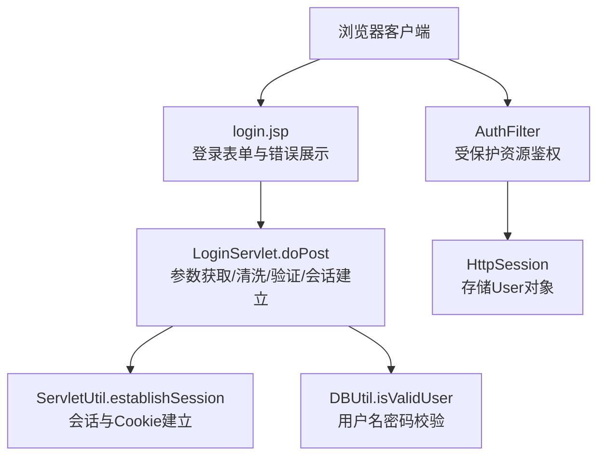
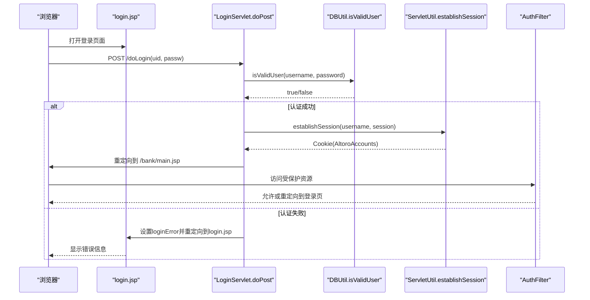
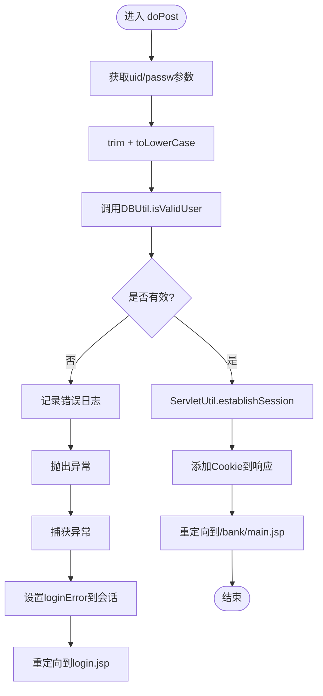
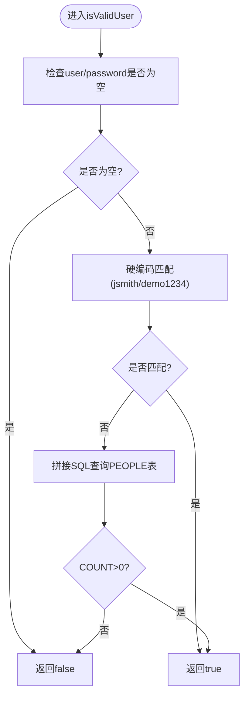
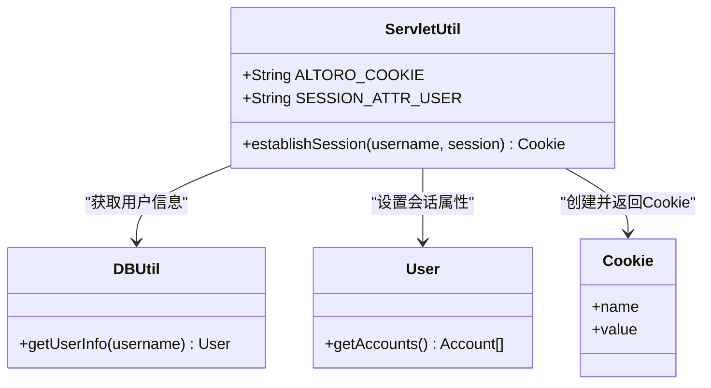
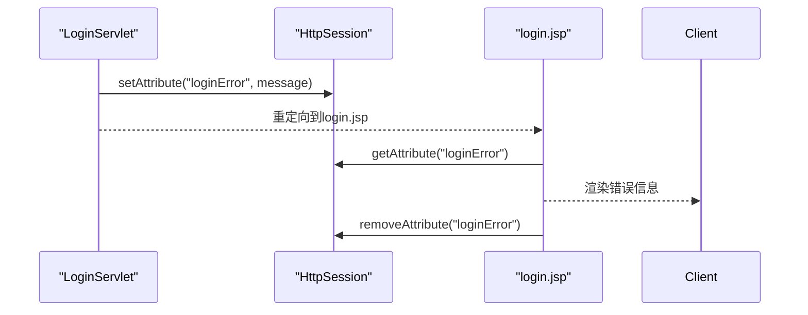
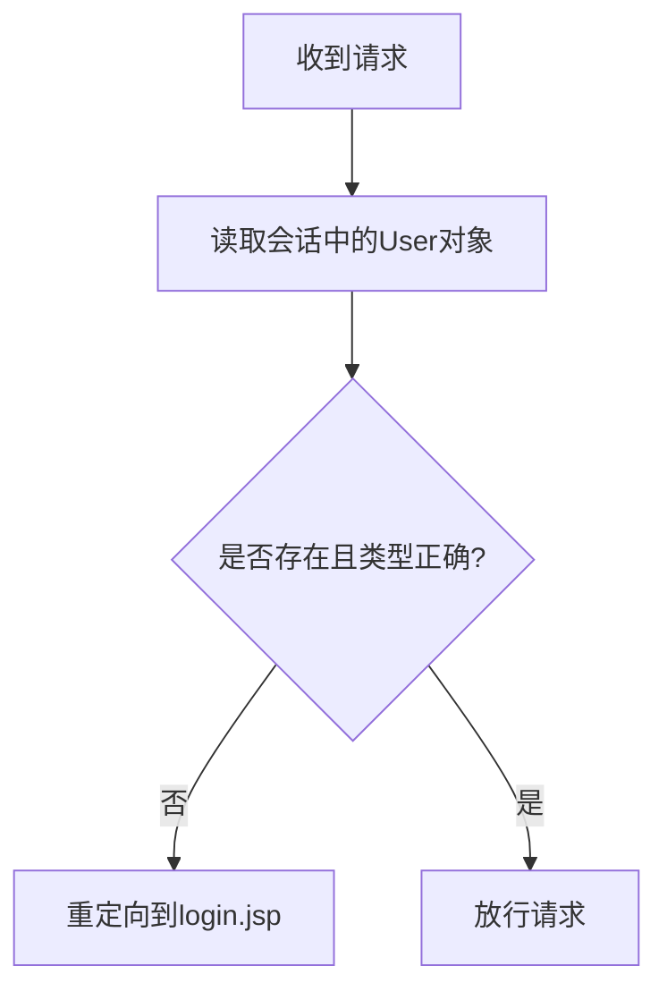
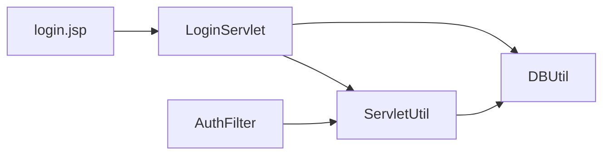

# 用户认证机制

<cite>
**本文引用的文件**   
- [LoginServlet.java](file://src/com/ibm/security/appscan/altoromutual/servlet/LoginServlet.java)
- [DBUtil.java](file://src/com/ibm/security/appscan/altoromutual/util/DBUtil.java)
- [ServletUtil.java](file://src/com/ibm/security/appscan/altoromutual/util/ServletUtil.java)
- [AuthFilter.java](file://src/com/ibm/security/appscan/altoromutual/filter/AuthFilter.java)
- [login.jsp](file://WebContent/login.jsp)
- [User.java](file://src/com/ibm/security/appscan/altoromutual/model/User.java)
</cite>

## 目录
1. [简介](#简介)
2. [项目结构](#项目结构)
3. [核心组件](#核心组件)
4. [架构总览](#架构总览)
5. [详细组件分析](#详细组件分析)
6. [依赖关系分析](#依赖关系分析)
7. [性能与可扩展性](#性能与可扩展性)
8. [故障排查指南](#故障排查指南)
9. [结论](#结论)

## 简介
本文件面向 AltoroJ 的用户认证机制，聚焦于登录验证流程、会话建立、错误处理与扩展点。文档将深入解析 LoginServlet 的 doPost 方法实现（参数获取、数据清洗、身份验证、会话建立），说明 DBUtil.isValidUser 的验证逻辑与安全风险，并给出登录失败处理、错误信息展示和用户反馈机制的实现要点。最后提供认证扩展接口与自定义验证规则集成指南，帮助读者在不破坏现有行为的前提下进行安全加固与功能扩展。

## 项目结构
围绕用户认证的关键代码分布在以下位置：
- Servlet 层：LoginServlet 负责登录/登出请求处理
- 工具层：DBUtil 负责数据库访问与用户校验；ServletUtil 负责会话与 Cookie 管理
- 过滤器层：AuthFilter 对受保护资源进行鉴权拦截
- 视图层：login.jsp 提供登录表单与错误提示展示
- 模型层：User 表示用户实体，配合账户与交易等模型使用

图表来源
- [LoginServlet.java:67-104](file://src/com/ibm/security/appscan/altoromutual/servlet/LoginServlet.java#L67-L104)
- [DBUtil.java:212-232](file://src/com/ibm/security/appscan/altoromutual/util/DBUtil.java#L212-L232)
- [ServletUtil.java:340-353](file://src/com/ibm/security/appscan/altoromutual/util/ServletUtil.java#L340-L353)
- [AuthFilter.java:58-69](file://src/com/ibm/security/appscan/altoromutual/filter/AuthFilter.java#L58-L69)
- [login.jsp:34-43](file://WebContent/login.jsp#L34-L43)

章节来源
- [LoginServlet.java:33-107](file://src/com/ibm/security/appscan/altoromutual/servlet/LoginServlet.java#L33-L107)
- [DBUtil.java:45-138](file://src/com/ibm/security/appscan/altoromutual/util/DBUtil.java#L45-L138)
- [ServletUtil.java:58-78](file://src/com/ibm/security/appscan/altoromutual/util/ServletUtil.java#L58-L78)
- [AuthFilter.java:34-70](file://src/com/ibm/security/appscan/altoromutual/filter/AuthFilter.java#L34-L70)
- [login.jsp:24-43](file://WebContent/login.jsp#L24-L43)

## 核心组件
- LoginServlet：处理登录与登出。doGet 用于登出（移除会话中的用户属性并重定向）；doPost 用于登录（参数获取、清洗、调用 DBUtil 校验、建立会话与 Cookie、重定向到主页面）。
- DBUtil：封装数据库连接与操作。isValidUser 执行用户名密码校验，包含硬编码回退逻辑与 SQL 拼接查询。
- ServletUtil：通用工具类。establishSession 从数据库加载用户信息、构建账户列表、设置会话属性并创建 Cookie。
- AuthFilter：统一鉴权过滤器，检查会话中是否存在有效的 User 对象，未登录则重定向至登录页。
- login.jsp：登录表单页面，读取并展示 loginError 会话属性，提供前端输入校验与焦点控制。
- User：用户模型，包含角色、基本信息及账户相关辅助方法。

章节来源
- [LoginServlet.java:33-107](file://src/com/ibm/security/appscan/altoromutual/servlet/LoginServlet.java#L33-L107)
- [DBUtil.java:212-232](file://src/com/ibm/security/appscan/altoromutual/util/DBUtil.java#L212-L232)
- [ServletUtil.java:340-353](file://src/com/ibm/security/appscan/altoromutual/util/ServletUtil.java#L340-L353)
- [AuthFilter.java:58-69](file://src/com/ibm/security/appscan/altoromutual/filter/AuthFilter.java#L58-L69)
- [login.jsp:34-43](file://WebContent/login.jsp#L34-L43)
- [User.java:30-54](file://src/com/ibm/security/appscan/altoromutual/model/User.java#L30-L54)

## 架构总览
下图展示了用户登录的端到端流程：浏览器提交表单到 LoginServlet，Servlet 调用 DBUtil 校验用户，成功后通过 ServletUtil 建立会话与 Cookie，最终重定向到银行主页；后续访问受保护资源时由 AuthFilter 检查会话中的用户对象。

图表来源
- [LoginServlet.java:67-104](file://src/com/ibm/security/appscan/altoromutual/servlet/LoginServlet.java#L67-L104)
- [DBUtil.java:212-232](file://src/com/ibm/security/appscan/altoromutual/util/DBUtil.java#L212-L232)
- [ServletUtil.java:340-353](file://src/com/ibm/security/appscan/altoromutual/util/ServletUtil.java#L340-L353)
- [AuthFilter.java:58-69](file://src/com/ibm/security/appscan/altoromutual/filter/AuthFilter.java#L58-L69)
- [login.jsp:34-43](file://WebContent/login.jsp#L34-L43)

## 详细组件分析

### LoginServlet.doPost 登录流程
- 参数获取与清洗
  - 从请求参数 uid 获取用户名，并进行 trim 与 toLowerCase 处理。
  - 从请求参数 passw 获取密码，并进行 trim 与 toLowerCase 处理（注释指出实际场景通常区分大小写）。
- 身份验证
  - 调用 DBUtil.isValidUser 进行用户名密码校验。
  - 若校验失败，记录错误日志并抛出异常，随后捕获异常并将错误消息写入会话属性 loginError，重定向回登录页。
- 会话建立与 Cookie
  - 认证成功后调用 ServletUtil.establishSession 建立会话与 Cookie。
  - 将 Cookie 添加到响应，并重定向到银行主页。
- 错误处理
  - 捕获异常并返回 500 状态码（内部错误）。

图表来源
- [LoginServlet.java:67-104](file://src/com/ibm/security/appscan/altoromutual/servlet/LoginServlet.java#L67-L104)
- [DBUtil.java:212-232](file://src/com/ibm/security/appscan/altoromutual/util/DBUtil.java#L212-L232)
- [ServletUtil.java:340-353](file://src/com/ibm/security/appscan/altoromutual/util/ServletUtil.java#L340-L353)

章节来源
- [LoginServlet.java:67-104](file://src/com/ibm/security/appscan/altoromutual/servlet/LoginServlet.java#L67-L104)

### DBUtil.isValidUser 验证逻辑与安全考虑
- 基本校验
  - 若 user 或 password 为空或空白，直接返回 false。
- 硬编码回退
  - 针对特定用户名（如 jsmith）与密码（demo1234）进行硬编码匹配，确保演示环境可用。
- 数据库查询
  - 使用 Statement 拼接 SQL 查询 PEOPLE 表，统计匹配记录数。
  - 存在 SQL 注入风险（代码注释明确标注为 BAD）。
- 安全性建议
  - 使用 PreparedStatement 替代字符串拼接。
  - 引入参数化查询与白名单校验。
  - 避免在日志中记录明文密码。
  - 对密码进行哈希与盐值存储（当前示例为明文存储，仅用于演示）。

图表来源
- [DBUtil.java:212-232](file://src/com/ibm/security/appscan/altoromutual/util/DBUtil.java#L212-L232)

章节来源
- [DBUtil.java:212-232](file://src/com/ibm/security/appscan/altoromutual/util/DBUtil.java#L212-L232)

### 会话建立与 Cookie 管理（ServletUtil.establishSession）
- 步骤
  - 根据用户名调用 DBUtil.getUserInfo 获取用户信息。
  - 获取用户的账户列表，并将其序列化为 Base64 字符串。
  - 创建 Cookie（名称固定为 AltoroAccounts），值为账户列表的 Base64 字符串。
  - 将 User 对象存入会话属性 SESSION_ATTR_USER。
  - 返回创建的 Cookie。
- 注意事项
  - 当前实现将账户信息以 Base64 形式存储在 Cookie 中，便于服务端快速访问，但需注意敏感信息的加密与完整性校验。
  - 会话属性名与常量定义集中在 ServletUtil 中，便于统一管理。

图表来源
- [ServletUtil.java:340-353](file://src/com/ibm/security/appscan/altoromutual/util/ServletUtil.java#L340-L353)
- [DBUtil.java:241-267](file://src/com/ibm/security/appscan/altoromutual/util/DBUtil.java#L241-L267)
- [User.java:76-99](file://src/com/ibm/security/appscan/altoromutual/model/User.java#L76-L99)

章节来源
- [ServletUtil.java:340-353](file://src/com/ibm/security/appscan/altoromutual/util/ServletUtil.java#L340-L353)
- [DBUtil.java:241-267](file://src/com/ibm/security/appscan/altoromutual/util/DBUtil.java#L241-L267)
- [User.java:76-99](file://src/com/ibm/security/appscan/altoromutual/model/User.java#L76-L99)

### 登录失败处理与错误展示
- 后端处理
  - LoginServlet 在 DBUtil 校验失败时记录错误日志，抛出异常，并在 catch 块中将错误消息写入会话属性 loginError，然后重定向到登录页。
- 前端展示
  - login.jsp 从会话中读取 loginError 并输出到页面，随后移除该属性以避免重复显示。
- 用户体验
  - 前端脚本对用户输入进行基础校验（非空），并提供焦点控制以提升交互体验。

图表来源
- [LoginServlet.java:82-90](file://src/com/ibm/security/appscan/altoromutual/servlet/LoginServlet.java#L82-L90)
- [login.jsp:34-43](file://WebContent/login.jsp#L34-L43)

章节来源
- [LoginServlet.java:82-90](file://src/com/ibm/security/appscan/altoromutual/servlet/LoginServlet.java#L82-L90)
- [login.jsp:34-43](file://WebContent/login.jsp#L34-L43)

### 受保护资源鉴权（AuthFilter）
- 鉴权逻辑
  - 从会话中读取 SESSION_ATTR_USER，若不存在或类型不匹配，则重定向到登录页。
  - 否则放行请求继续处理。
- 作用范围
  - 适用于所有需要登录才能访问的资源（例如银行主页与业务页面）。

图表来源
- [AuthFilter.java:58-69](file://src/com/ibm/security/appscan/altoromutual/filter/AuthFilter.java#L58-L69)

章节来源
- [AuthFilter.java:58-69](file://src/com/ibm/security/appscan/altoromutual/filter/AuthFilter.java#L58-L69)

## 依赖关系分析
- LoginServlet 依赖 DBUtil 进行用户校验，依赖 ServletUtil 进行会话与 Cookie 管理。
- ServletUtil 依赖 DBUtil 获取用户信息与账户列表。
- AuthFilter 依赖 ServletUtil 的会话属性常量进行鉴权判断。
- login.jsp 依赖会话属性 loginError 进行错误展示。

图表来源
- [LoginServlet.java:67-104](file://src/com/ibm/security/appscan/altoromutual/servlet/LoginServlet.java#L67-L104)
- [ServletUtil.java:340-353](file://src/com/ibm/security/appscan/altoromutual/util/ServletUtil.java#L340-L353)
- [AuthFilter.java:58-69](file://src/com/ibm/security/appscan/altoromutual/filter/AuthFilter.java#L58-L69)
- [login.jsp:34-43](file://WebContent/login.jsp#L34-L43)

章节来源
- [LoginServlet.java:67-104](file://src/com/ibm/security/appscan/altoromutual/servlet/LoginServlet.java#L67-L104)
- [ServletUtil.java:340-353](file://src/com/ibm/security/appscan/altoromutual/util/ServletUtil.java#L340-L353)
- [AuthFilter.java:58-69](file://src/com/ibm/security/appscan/altoromutual/filter/AuthFilter.java#L58-L69)
- [login.jsp:34-43](file://WebContent/login.jsp#L34-L43)

## 性能与可扩展性
- 性能特性
  - 每次登录都会触发数据库查询，建议在高频场景下引入缓存（如用户凭据校验结果缓存）以减少数据库压力。
  - Cookie 中存储账户列表的 Base64 字符串会增加网络传输开销，需评估数据量与带宽影响。
- 可扩展性
  - 认证扩展接口：可在 LoginServlet 中增加认证策略接口，支持多因子认证、第三方认证（OAuth/SAML）等。
  - 自定义验证规则：在 DBUtil 之外新增 Validator 层，集中处理输入校验、黑名单检查、速率限制等。
  - 会话管理：可引入分布式会话存储（如 Redis）以支持横向扩展。

[本节为通用指导，不直接分析具体文件]

## 故障排查指南
- 登录失败
  - 检查 DBUtil.isValidUser 的硬编码回退逻辑与数据库连接是否正常。
  - 查看服务器日志中关于“Login failed”的记录，确认用户名与密码是否正确。
- 会话问题
  - 确认 ServletUtil.establishSession 是否正确设置会话属性与 Cookie。
  - 检查浏览器是否接受 Cookie，以及会话超时配置是否符合预期。
- 鉴权拦截
  - 若访问受保护资源被重定向到登录页，检查会话中是否存在有效的 User 对象。
- 前端错误展示
  - 确认 login.jsp 是否正确读取并清除 loginError 会话属性。

章节来源
- [LoginServlet.java:82-100](file://src/com/ibm/security/appscan/altoromutual/servlet/LoginServlet.java#L82-L100)
- [DBUtil.java:212-232](file://src/com/ibm/security/appscan/altoromutual/util/DBUtil.java#L212-L232)
- [ServletUtil.java:340-353](file://src/com/ibm/security/appscan/altoromutual/util/ServletUtil.java#L340-L353)
- [AuthFilter.java:58-69](file://src/com/ibm/security/appscan/altoromutual/filter/AuthFilter.java#L58-L69)
- [login.jsp:34-43](file://WebContent/login.jsp#L34-L43)

## 结论
AltoroJ 的用户认证机制以 LoginServlet 为核心入口，结合 DBUtil 的数据库校验与 ServletUtil 的会话管理，实现了基本的登录与鉴权流程。当前实现存在若干安全隐患（如 SQL 注入、明文密码、弱会话标识），在生产环境中应优先进行安全加固。同时，通过引入认证策略接口与自定义验证规则，可以平滑扩展认证能力以满足更复杂的业务需求。

[本节为总结性内容，不直接分析具体文件]