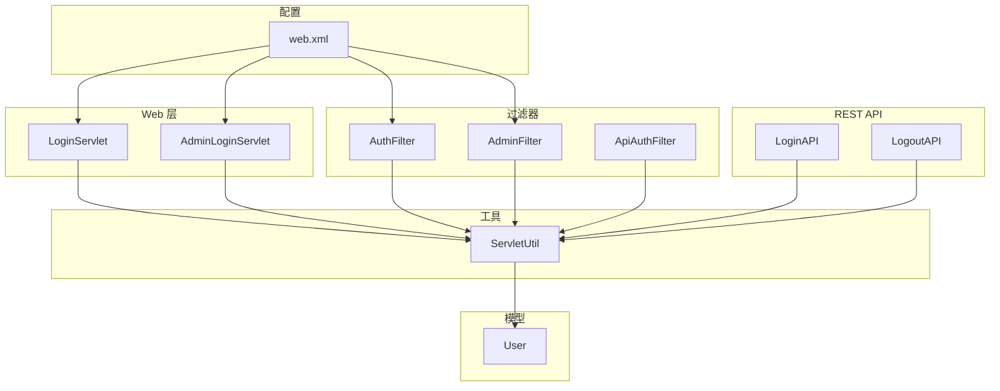
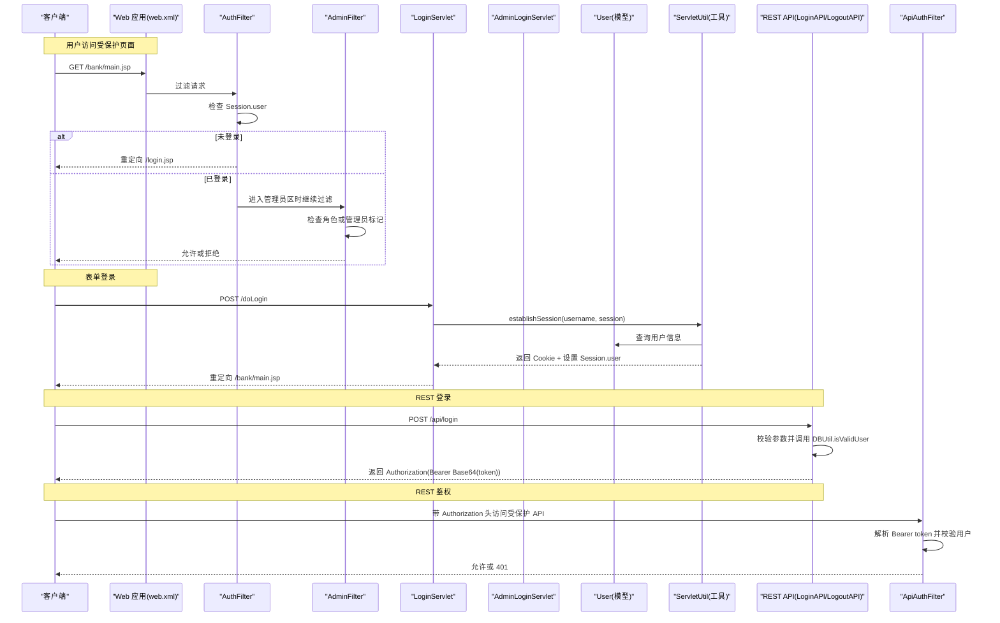
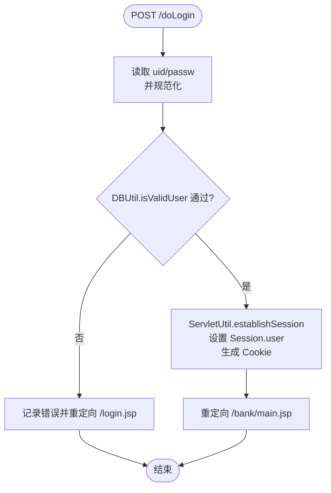
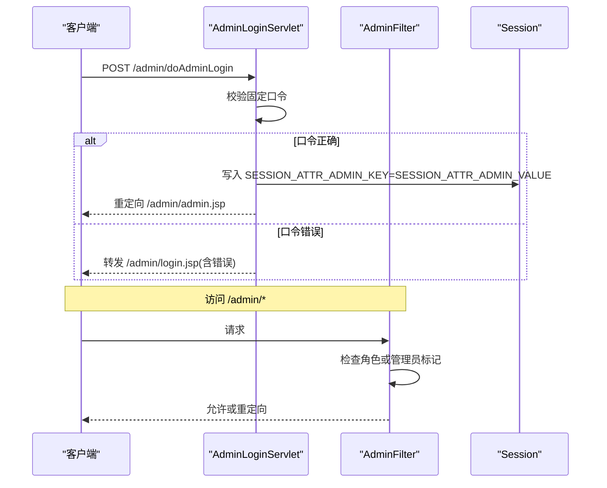
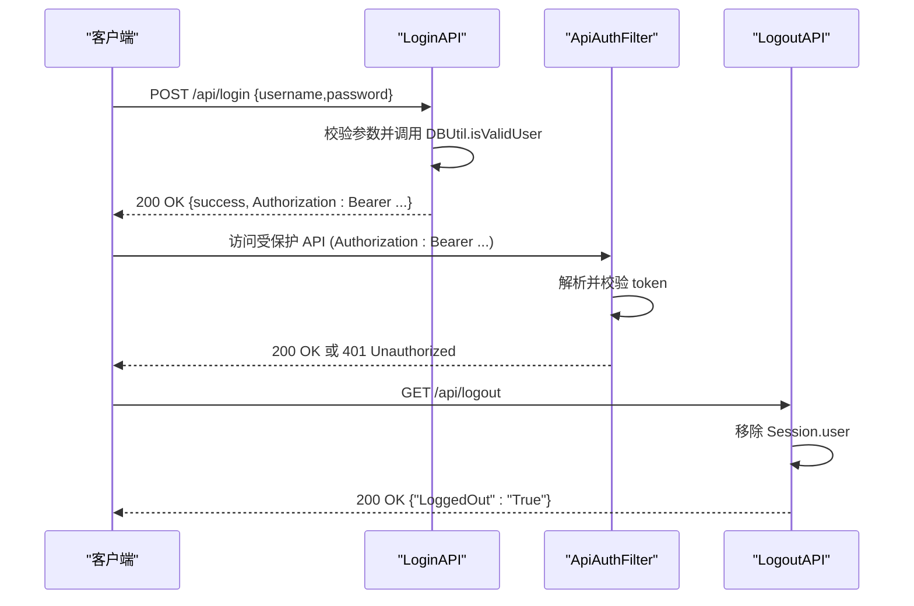
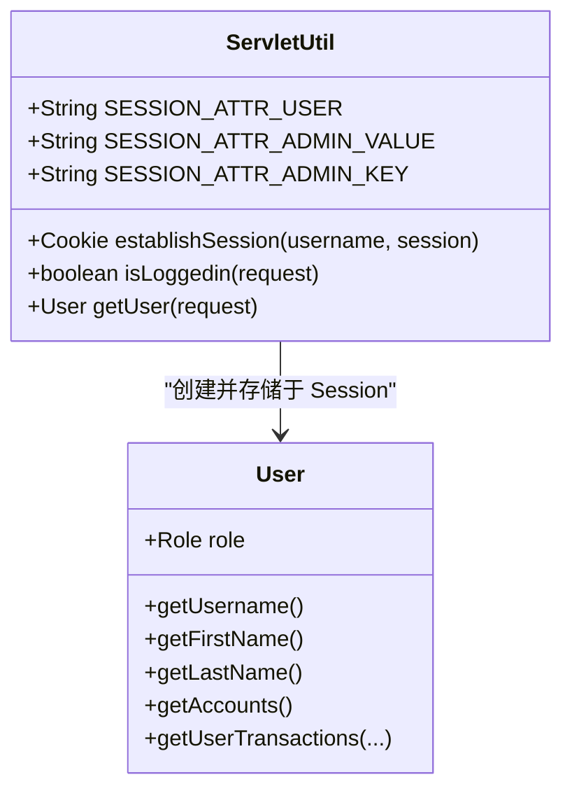
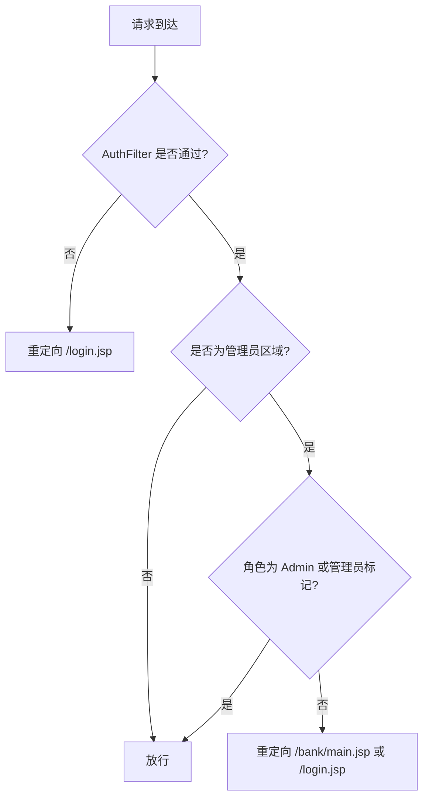
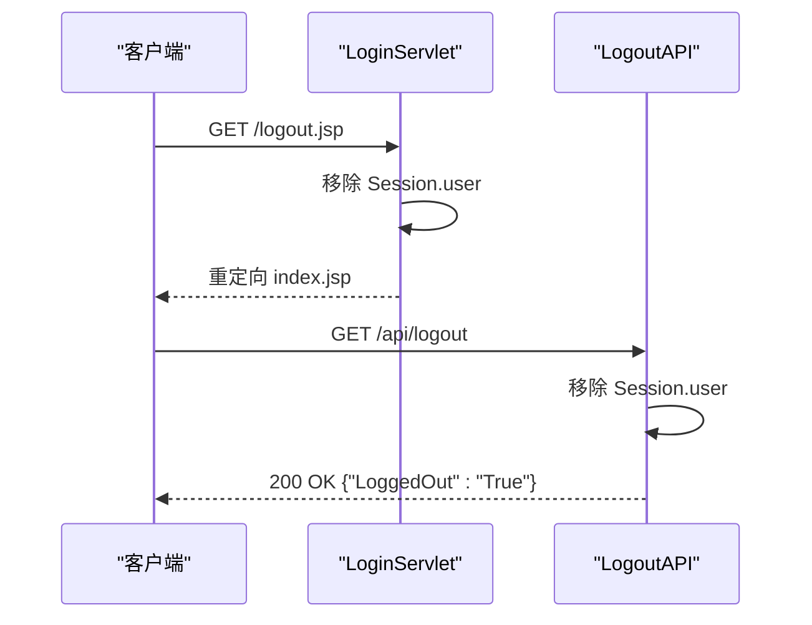
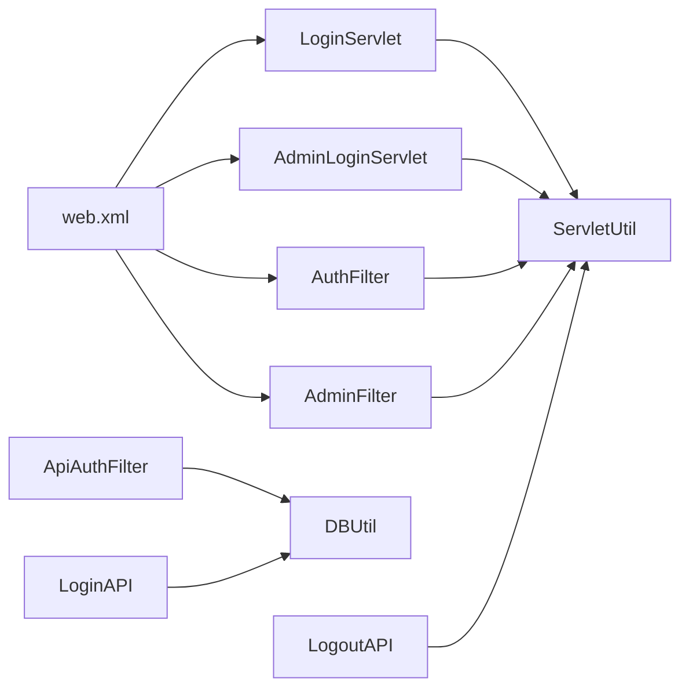

# 认证与授权

<cite>
**本文引用的文件**   
- [LoginServlet.java](file://src/com/ibm/security/appscan/altoromutual/servlet/LoginServlet.java)
- [AdminLoginServlet.java](file://src/com/ibm/security/appscan/altoromutual/servlet/AdminLoginServlet.java)
- [AuthFilter.java](file://src/com/ibm/security/appscan/altoromutual/filter/AuthFilter.java)
- [AdminFilter.java](file://src/com/ibm/security/appscan/altoromutual/filter/AdminFilter.java)
- [ApiAuthFilter.java](file://src/com/ibm/security/appscan/altoromutual/filter/ApiAuthFilter.java)
- [User.java](file://src/com/ibm/security/appscan/altoromutual/model/User.java)
- [ServletUtil.java](file://src/com/ibm/security/appscan/altoromutual/util/ServletUtil.java)
- [web.xml](file://WebContent/WEB-INF/web.xml)
- [LoginAPI.java](file://src/com/ibm/security/appscan/altoromutual/api/LoginAPI.java)
- [LogoutAPI.java](file://src/com/ibm/security/appscan/altoromutual/api/LogoutAPI.java)
</cite>

## 目录
1. [简介](#简介)
2. [项目结构](#项目结构)
3. [核心组件](#核心组件)
4. [架构总览](#架构总览)
5. [详细组件分析](#详细组件分析)
6. [依赖关系分析](#依赖关系分析)
7. [性能与安全考量](#性能与安全考量)
8. [故障排查指南](#故障排查指南)
9. [结论](#结论)
10. [附录：扩展与集成指南](#附录扩展与集成指南)

## 简介
本文件系统性梳理 AltoroJ 的认证与授权机制，覆盖以下主题：
- 用户身份验证流程（Web 表单登录、管理员登录、REST API 登录）
- 会话管理机制（Session 属性、Cookie 账户列表、并发与会话超时）
- 角色与权限控制（普通用户、管理员；URL 级访问控制）
- 安全退出机制（Web 与 REST 双通道）
- 可扩展点与自定义认证方案集成建议

## 项目结构
AltoroJ 采用传统 Java Web 分层组织：
- Servlet 层处理 HTTP 请求（登录、登出、业务操作）
- Filter 层实现统一的认证与授权拦截
- Model 层定义领域对象（如 User）
- Util 层提供工具方法（会话建立、属性常量等）
- web.xml 集中声明 Filter、Servlet 映射及路径规则
- REST API 通过 JAX-RS 暴露认证相关接口

图表来源
- [web.xml:12-59](file://WebContent/WEB-INF/web.xml#L12-L59)
- [LoginServlet.java:38-107](file://src/com/ibm/security/appscan/altoromutual/servlet/LoginServlet.java#L38-L107)
- [AdminLoginServlet.java:34-55](file://src/com/ibm/security/appscan/altoromutual/servlet/AdminLoginServlet.java#L34-L55)
- [AuthFilter.java:40-70](file://src/com/ibm/security/appscan/altoromutual/filter/AuthFilter.java#L40-L70)
- [AdminFilter.java:40-81](file://src/com/ibm/security/appscan/altoromutual/filter/AdminFilter.java#L40-L81)
- [ApiAuthFilter.java:20-74](file://src/com/ibm/security/appscan/altoromutual/filter/ApiAuthFilter.java#L20-L74)
- [User.java:30-54](file://src/com/ibm/security/appscan/altoromutual/model/User.java#L30-L54)
- [ServletUtil.java:58-68](file://src/com/ibm/security/appscan/altoromutual/util/ServletUtil.java#L58-L68)
- [LoginAPI.java:19-76](file://src/com/ibm/security/appscan/altoromutual/api/LoginAPI.java#L19-L76)
- [LogoutAPI.java:13-28](file://src/com/ibm/security/appscan/altoromutual/api/LogoutAPI.java#L13-L28)

章节来源
- [web.xml:12-59](file://WebContent/WEB-INF/web.xml#L12-L59)

## 核心组件
- 登录入口
  - Web 表单登录：LoginServlet 接收用户名/密码，校验后建立会话并设置 Cookie。
  - 管理员登录：AdminLoginServlet 使用固定口令进行简易鉴权，设置管理员会话标记。
- 认证过滤器
  - AuthFilter：对 /bank/* 和 /admin/* 等受保护路径进行“已登录”检查。
  - AdminFilter：在管理员区域额外校验管理员角色或管理员会话标记。
  - ApiAuthFilter：对 JAX-RS 资源进行 Bearer Token 校验（未标注 PermitAll 的方法）。
- 模型与工具
  - User：包含角色枚举 Role（User、Admin），以及账户、交易等聚合能力。
  - ServletUtil：定义会话键常量、建立会话、获取当前用户等工具方法。
- REST API
  - LoginAPI：提供登录接口，返回基础令牌（Base64 编码的用户名+密码+随机串）。
  - LogoutAPI：移除会话中的用户属性，完成 REST 侧登出。

章节来源
- [LoginServlet.java:67-101](file://src/com/ibm/security/appscan/altoromutual/servlet/LoginServlet.java#L67-L101)
- [AdminLoginServlet.java:40-53](file://src/com/ibm/security/appscan/altoromutual/servlet/AdminLoginServlet.java#L40-L53)
- [AuthFilter.java:58-69](file://src/com/ibm/security/appscan/altoromutual/filter/AuthFilter.java#L58-L69)
- [AdminFilter.java:58-80](file://src/com/ibm/security/appscan/altoromutual/filter/AdminFilter.java#L58-L80)
- [ApiAuthFilter.java:29-74](file://src/com/ibm/security/appscan/altoromutual/filter/ApiAuthFilter.java#L29-L74)
- [User.java:34-54](file://src/com/ibm/security/appscan/altoromutual/model/User.java#L34-L54)
- [ServletUtil.java:340-373](file://src/com/ibm/security/appscan/altoromutual/util/ServletUtil.java#L340-L373)
- [LoginAPI.java:29-76](file://src/com/ibm/security/appscan/altoromutual/api/LoginAPI.java#L29-L76)
- [LogoutAPI.java:16-28](file://src/com/ibm/security/appscan/altoromutual/api/LogoutAPI.java#L16-L28)

## 架构总览
下图展示从浏览器到后端的核心认证与授权交互路径，包括 Web 与 REST 两条通道。

图表来源
- [web.xml:28-59](file://WebContent/WEB-INF/web.xml#L28-L59)
- [AuthFilter.java:58-69](file://src/com/ibm/security/appscan/altoromutual/filter/AuthFilter.java#L58-L69)
- [AdminFilter.java:58-80](file://src/com/ibm/security/appscan/altoromutual/filter/AdminFilter.java#L58-L80)
- [LoginServlet.java:67-101](file://src/com/ibm/security/appscan/altoromutual/servlet/LoginServlet.java#L67-L101)
- [ServletUtil.java:340-347](file://src/com/ibm/security/appscan/altoromutual/util/ServletUtil.java#L340-L347)
- [LoginAPI.java:29-76](file://src/com/ibm/security/appscan/altoromutual/api/LoginAPI.java#L29-L76)
- [ApiAuthFilter.java:29-74](file://src/com/ibm/security/appscan/altoromutual/filter/ApiAuthFilter.java#L29-L74)

## 详细组件分析

### 用户身份验证流程（Web 表单登录）
- 触发点：POST /doLogin
- 处理逻辑：
  - 读取并规范化用户名/密码
  - 调用数据库校验
  - 失败：记录错误并重定向回登录页
  - 成功：建立会话、生成账户 Cookie、跳转至银行主页
- 关键数据：
  - Session 中存储 user 对象（ServletUtil.SESSION_ATTR_USER）
  - Cookie 名称为 AltoroAccounts（账户列表 Base64 编码）

图表来源
- [LoginServlet.java:67-101](file://src/com/ibm/security/appscan/altoromutual/servlet/LoginServlet.java#L67-L101)
- [ServletUtil.java:340-347](file://src/com/ibm/security/appscan/altoromutual/util/ServletUtil.java#L340-L347)

章节来源
- [LoginServlet.java:67-101](file://src/com/ibm/security/appscan/altoromutual/servlet/LoginServlet.java#L67-L101)

### 管理员身份验证流程
- 触发点：POST /admin/doAdminLogin
- 处理逻辑：
  - 校验固定口令
  - 失败：转发回管理员登录页并携带错误信息
  - 成功：在 Session 中写入管理员标记键值
- 访问控制：
  - AdminFilter 允许具备管理员角色的用户或持有管理员标记的会话访问 /admin/*

图表来源
- [AdminLoginServlet.java:40-53](file://src/com/ibm/security/appscan/altoromutual/servlet/AdminLoginServlet.java#L40-L53)
- [AdminFilter.java:58-80](file://src/com/ibm/security/appscan/altoromutual/filter/AdminFilter.java#L58-L80)

章节来源
- [AdminLoginServlet.java:40-53](file://src/com/ibm/security/appscan/altoromutual/servlet/AdminLoginServlet.java#L40-L53)
- [AdminFilter.java:58-80](file://src/com/ibm/security/appscan/altoromutual/filter/AdminFilter.java#L58-L80)

### REST API 认证与授权
- 登录接口：POST /api/login
  - 校验 JSON 参数 username/password
  - 调用 DBUtil.isValidUser 校验
  - 成功后返回 Authorization 字段（Bearer Base64(username:password:random)）
- 鉴权过滤器：ApiAuthFilter
  - 对未标注 @PermitAll 的资源强制校验 Authorization 头
  - 解析 Bearer token，解码并再次校验用户有效性
- 登出接口：GET /api/logout
  - 移除 Session.user，返回成功响应

图表来源
- [LoginAPI.java:29-76](file://src/com/ibm/security/appscan/altoromutual/api/LoginAPI.java#L29-L76)
- [ApiAuthFilter.java:29-74](file://src/com/ibm/security/appscan/altoromutual/filter/ApiAuthFilter.java#L29-L74)
- [LogoutAPI.java:16-28](file://src/com/ibm/security/appscan/altoromutual/api/LogoutAPI.java#L16-L28)

章节来源
- [LoginAPI.java:29-76](file://src/com/ibm/security/appscan/altoromutual/api/LoginAPI.java#L29-L76)
- [ApiAuthFilter.java:29-74](file://src/com/ibm/security/appscan/altoromutual/filter/ApiAuthFilter.java#L29-L74)
- [LogoutAPI.java:16-28](file://src/com/ibm/security/appscan/altoromutual/api/LogoutAPI.java#L16-L28)

### 会话管理机制
- 会话属性
  - 用户对象：SESSION_ATTR_USER（类型为 User）
  - 管理员标记：SESSION_ATTR_ADMIN_KEY = "admin"，值为 SESSION_ATTR_ADMIN_VALUE = "altoroadmin"
- 会话建立
  - ServletUtil.establishSession：查询用户信息、构建账户列表 Base64 字符串，写入 Cookie，并将 User 放入 Session
- 会话读取
  - ServletUtil.isLoggedin/getUser：从 Session 中读取当前用户
- 并发与会话超时
  - web.xml 启用 <distributable/>，支持分布式部署下的会话复制
  - 未显式配置 session-timeout，默认由容器决定
  - 建议在容器层面配置合理的超时策略，并在登出时清理所有相关属性

图表来源
- [ServletUtil.java:60-68](file://src/com/ibm/security/appscan/altoromutual/util/ServletUtil.java#L60-L68)
- [ServletUtil.java:340-373](file://src/com/ibm/security/appscan/altoromutual/util/ServletUtil.java#L340-L373)
- [User.java:34-54](file://src/com/ibm/security/appscan/altoromutual/model/User.java#L34-L54)

章节来源
- [ServletUtil.java:60-68](file://src/com/ibm/security/appscan/altoromutual/util/ServletUtil.java#L60-L68)
- [ServletUtil.java:340-373](file://src/com/ibm/security/appscan/altoromutual/util/ServletUtil.java#L340-L373)
- [web.xml:4](file://WebContent/WEB-INF/web.xml#L4)

### 角色与权限控制策略
- 角色定义
  - User.Role 枚举：User、Admin
- URL 级访问控制
  - AuthFilter：对 /bank/*、/admin/* 等路径要求已登录
  - AdminFilter：对管理员区域额外要求角色为 Admin 或存在管理员会话标记
- 权限级别
  - 普通用户：可访问银行功能（需已登录）
  - 管理员：可访问管理功能（需角色为 Admin 或管理员标记）

图表来源
- [AuthFilter.java:58-69](file://src/com/ibm/security/appscan/altoromutual/filter/AuthFilter.java#L58-L69)
- [AdminFilter.java:58-80](file://src/com/ibm/security/appscan/altoromutual/filter/AdminFilter.java#L58-L80)

章节来源
- [AuthFilter.java:58-69](file://src/com/ibm/security/appscan/altoromutual/filter/AuthFilter.java#L58-L69)
- [AdminFilter.java:58-80](file://src/com/ibm/security/appscan/altoromutual/filter/AdminFilter.java#L58-L80)
- [User.java:34-54](file://src/com/ibm/security/appscan/altoromutual/model/User.java#L34-L54)

### 安全退出机制
- Web 登出
  - 访问 /logout.jsp（映射到 LoginServlet.doGet）：移除 Session.user，重定向首页
- REST 登出
  - GET /api/logout：移除 Session.user，返回成功响应

图表来源
- [LoginServlet.java:51-60](file://src/com/ibm/security/appscan/altoromutual/servlet/LoginServlet.java#L51-L60)
- [LogoutAPI.java:16-28](file://src/com/ibm/security/appscan/altoromutual/api/LogoutAPI.java#L16-L28)

章节来源
- [LoginServlet.java:51-60](file://src/com/ibm/security/appscan/altoromutual/servlet/LoginServlet.java#L51-L60)
- [LogoutAPI.java:16-28](file://src/com/ibm/security/appscan/altoromutual/api/LogoutAPI.java#L16-L28)

## 依赖关系分析
- 组件耦合
  - LoginServlet/AdminLoginServlet 依赖 ServletUtil 进行会话建立与属性读写
  - AuthFilter/AdminFilter 依赖 ServletUtil 的会话键常量与 User 模型
  - ApiAuthFilter 依赖 DBUtil 进行用户有效性校验
  - web.xml 集中声明 Filter 与 Servlet 的映射关系
- 外部依赖
  - DBUtil：用于用户信息查询与校验（跨多个组件）
  - JAX-RS：REST API 注解驱动（@Path、@GET、@POST、@PermitAll）

图表来源
- [LoginServlet.java:67-101](file://src/com/ibm/security/appscan/altoromutual/servlet/LoginServlet.java#L67-L101)
- [AdminLoginServlet.java:40-53](file://src/com/ibm/security/appscan/altoromutual/servlet/AdminLoginServlet.java#L40-L53)
- [AuthFilter.java:58-69](file://src/com/ibm/security/appscan/altoromutual/filter/AuthFilter.java#L58-L69)
- [AdminFilter.java:58-80](file://src/com/ibm/security/appscan/altoromutual/filter/AdminFilter.java#L58-L80)
- [ApiAuthFilter.java:29-74](file://src/com/ibm/security/appscan/altoromutual/filter/ApiAuthFilter.java#L29-L74)
- [LoginAPI.java:29-76](file://src/com/ibm/security/appscan/altoromutual/api/LoginAPI.java#L29-L76)
- [LogoutAPI.java:16-28](file://src/com/ibm/security/appscan/altoromutual/api/LogoutAPI.java#L16-L28)
- [web.xml:28-59](file://WebContent/WEB-INF/web.xml#L28-L59)

章节来源
- [web.xml:28-59](file://WebContent/WEB-INF/web.xml#L28-L59)

## 性能与安全考量
- 性能
  - 会话建立时会查询用户账户列表并生成 Base64 Cookie，频繁登录可能带来额外开销
  - 建议在登录后缓存必要信息，减少重复数据库查询
- 安全
  - REST 登录返回的 Authorization 包含明文密码（经 Base64 编码），应替换为安全的短期令牌（如 JWT）
  - 管理员登录使用固定口令，存在安全风险，建议引入强口令策略与多因素认证
  - 会话超时未在应用中显式配置，应在容器层面设置合理超时并启用会话失效监听
  - Cookie 仅作为账户列表展示用途，不应承载敏感凭证

[本节为通用指导，不直接分析具体文件]

## 故障排查指南
- 无法访问受保护页面
  - 检查 Session.user 是否存在（AuthFilter 会重定向到 /login.jsp）
  - 确认 web.xml 中 Filter 映射是否正确（/bank/*、/admin/*）
- 管理员功能不可用
  - 检查 AdminFilter 是否放行（角色为 Admin 或存在管理员标记）
  - 确认 AdminLoginServlet 是否正确写入管理员会话标记
- REST API 401 未授权
  - 检查 Authorization 头格式（Bearer Base64(token)）
  - 确认 ApiAuthFilter 是否正确解析并校验用户
- 登出不生效
  - Web：确认 /logout.jsp 映射到 LoginServlet.doGet，且移除了 Session.user
  - REST：确认 /api/logout 被调用并移除 Session.user

章节来源
- [AuthFilter.java:58-69](file://src/com/ibm/security/appscan/altoromutual/filter/AuthFilter.java#L58-L69)
- [AdminFilter.java:58-80](file://src/com/ibm/security/appscan/altoromutual/filter/AdminFilter.java#L58-L80)
- [ApiAuthFilter.java:29-74](file://src/com/ibm/security/appscan/altoromutual/filter/ApiAuthFilter.java#L29-L74)
- [LoginServlet.java:51-60](file://src/com/ibm/security/appscan/altoromutual/servlet/LoginServlet.java#L51-L60)
- [LogoutAPI.java:16-28](file://src/com/ibm/security/appscan/altoromutual/api/LogoutAPI.java#L16-L28)

## 结论
AltoroJ 的认证与授权基于 Servlet Filter 与 JAX-RS 注解的组合，实现了 Web 与 REST 双通道的身份验证与访问控制。核心要点包括：
- 统一会话键与工具方法简化了认证状态管理
- URL 级过滤提供了基础的权限边界
- REST API 通过 Bearer Token 进行鉴权，但当前实现存在安全隐患（密码泄露风险）
- 管理员权限通过角色与专用会话标记双重保障
- 建议在后续版本中引入更安全的令牌机制、会话超时策略与审计日志

[本节为总结性内容，不直接分析具体文件]

## 附录：扩展与集成指南
- 自定义认证方案集成
  - 在 AuthFilter 中扩展会话校验逻辑，接入第三方认证服务（如 OAuth2/OIDC）
  - 在 ApiAuthFilter 中替换 Bearer Token 解析逻辑，对接企业单点登录或自研网关
- 会话管理增强
  - 在容器层面配置 session-timeout，并监听会话销毁事件以清理资源
  - 将敏感信息移出 Cookie，仅保留非敏感展示数据
- 权限模型扩展
  - 在 User 模型中增加更多角色与权限集合，结合 AdminFilter 实现细粒度控制
  - 引入基于资源的访问控制（RBAC/ABAC），在 Filter 中根据 URL 与资源类型动态判断

[本节为概念性指导，不直接分析具体文件]