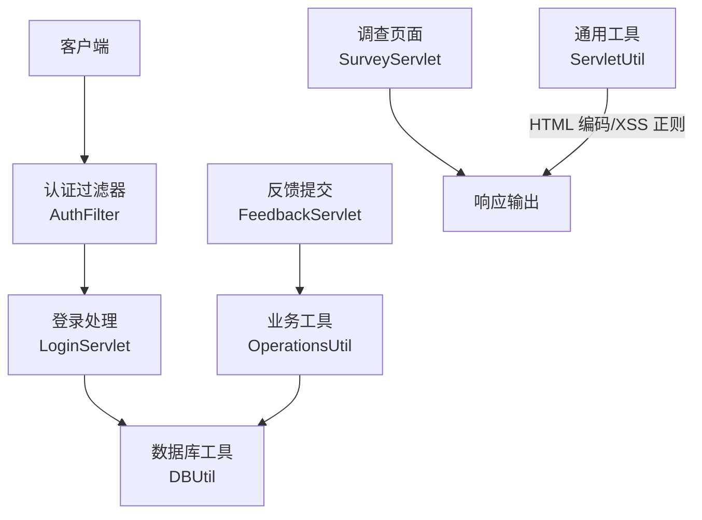
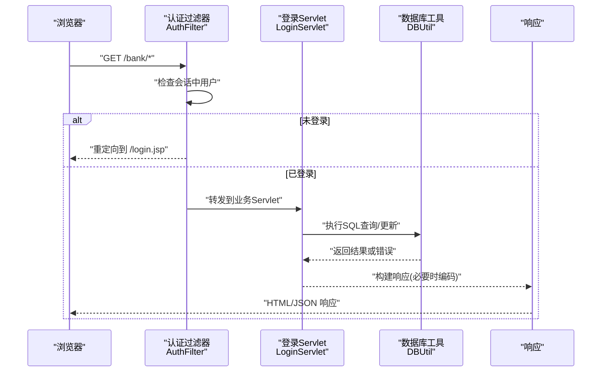
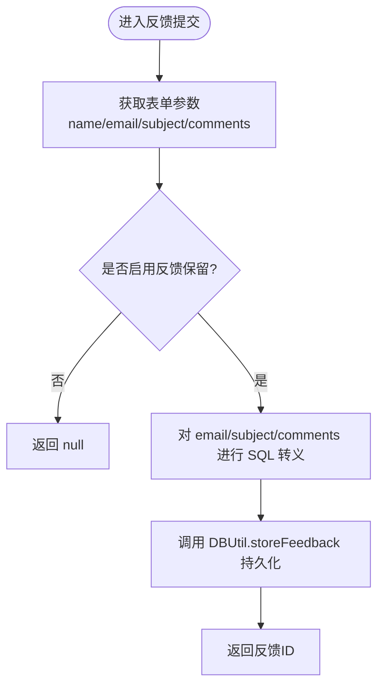
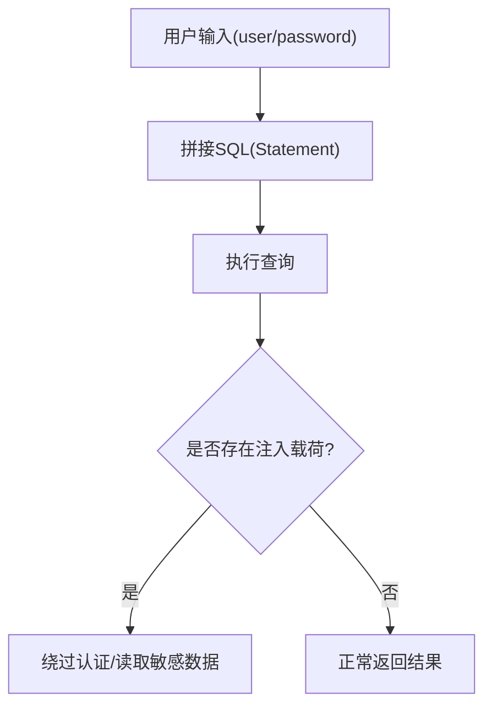
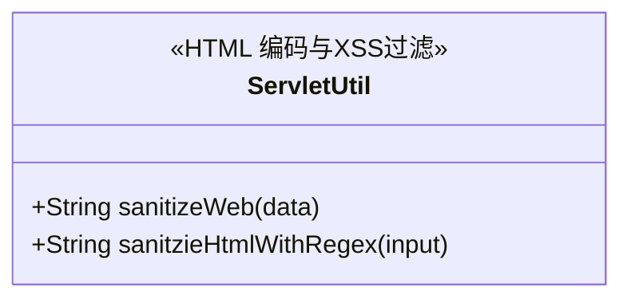
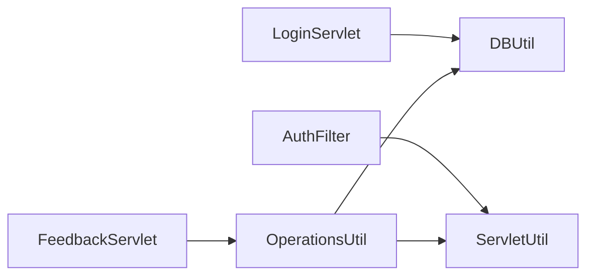

# 输入验证与输出编码

<cite>
**本文引用的文件**   
- [OperationsUtil.java](file://src/com/ibm/security/appscan/altoromutual/util/OperationsUtil.java)
- [ServletUtil.java](file://src/com/ibm/security/appscan/altoromutual/util/ServletUtil.java)
- [DBUtil.java](file://src/com/ibm/security/appscan/altoromutual/util/DBUtil.java)
- [AuthFilter.java](file://src/com/ibm/security/appscan/altoromutual/filter/AuthFilter.java)
- [LoginServlet.java](file://src/com/ibm/security/appscan/altoromutual/servlet/LoginServlet.java)
- [FeedbackServlet.java](file://src/com/ibm/security/appscan/altoromutual/servlet/FeedbackServlet.java)
- [SurveyServlet.java](file://src/com/ibm/security/appscan/altoromutual/servlet/SurveyServlet.java)
</cite>

## 目录
1. [简介](#简介)
2. [项目结构](#项目结构)
3. [核心组件](#核心组件)
4. [架构总览](#架构总览)
5. [详细组件分析](#详细组件分析)
6. [依赖关系分析](#依赖关系分析)
7. [性能考虑](#性能考虑)
8. [故障排查指南](#故障排查指南)
9. [结论](#结论)
10. [附录：最佳实践清单](#附录最佳实践清单)

## 简介
本文件聚焦 AltoroJ 的输入验证与输出编码机制，系统性梳理数据验证策略、输入清洗技术与输出编码方法。重点覆盖：
- 表单数据验证流程与边界处理
- SQL 注入防护现状与改进点
- XSS 攻击防护（HTML 实体编码、正则过滤）
- 特殊字符处理、URL 编码与 Base64 使用场景
- 常见输入攻击模式的检测与防护措施
- 工具类与编码最佳实践建议

## 项目结构
AltoroJ 采用典型的 Web 分层结构：
- Servlet 层负责请求解析、参数校验与业务编排
- Filter 层负责认证与访问控制
- Util 层提供数据库操作、通用工具与编码/转义能力
- Model 层承载领域对象

图表来源
- [AuthFilter.java:58-69](file://src/com/ibm/security/appscan/altoromutual/filter/AuthFilter.java#L58-L69)
- [LoginServlet.java:67-101](file://src/com/ibm/security/appscan/altoromutual/servlet/LoginServlet.java#L67-L101)
- [FeedbackServlet.java:42-67](file://src/com/ibm/security/appscan/altoromutual/servlet/FeedbackServlet.java#L42-L67)
- [OperationsUtil.java:119-132](file://src/com/ibm/security/appscan/altoromutual/util/OperationsUtil.java#L119-L132)
- [DBUtil.java:212-232](file://src/com/ibm/security/appscan/altoromutual/util/DBUtil.java#L212-L232)
- [ServletUtil.java:244-254](file://src/com/ibm/security/appscan/altoromutual/util/ServletUtil.java#L244-L254)

章节来源
- [AuthFilter.java:58-69](file://src/com/ibm/security/appscan/altoromutual/filter/AuthFilter.java#L58-L69)
- [LoginServlet.java:67-101](file://src/com/ibm/security/appscan/altoromutual/servlet/LoginServlet.java#L67-L101)
- [FeedbackServlet.java:42-67](file://src/com/ibm/security/appscan/altoromutual/servlet/FeedbackServlet.java#L42-L67)
- [OperationsUtil.java:119-132](file://src/com/ibm/security/appscan/altoromutual/util/OperationsUtil.java#L119-L132)
- [DBUtil.java:212-232](file://src/com/ibm/security/appscan/altoromutual/util/DBUtil.java#L212-L232)
- [ServletUtil.java:244-254](file://src/com/ibm/security/appscan/altoromutual/util/ServletUtil.java#L244-L254)

## 核心组件
- 认证过滤器 AuthFilter：在访问受保护资源前检查会话中的用户信息，未登录则重定向到登录页。
- 登录处理 LoginServlet：接收用户名与密码，调用 DBUtil 进行身份校验，成功后建立会话并设置 Cookie。
- 反馈提交 FeedbackServlet：收集表单字段，委托 OperationsUtil 存储反馈。
- 业务工具 OperationsUtil：对反馈内容进行 SQL 转义后持久化；提供随机字符串生成等辅助功能。
- 数据库工具 DBUtil：封装 JDBC 连接与查询，多处存在直接拼接用户输入的 SQL 语句（存在 SQL 注入风险）。
- 通用工具 ServletUtil：提供 HTML 输出编码、XSS 正则过滤、应用属性读取与会话工具方法。

章节来源
- [AuthFilter.java:58-69](file://src/com/ibm/security/appscan/altoromutual/filter/AuthFilter.java#L58-L69)
- [LoginServlet.java:67-101](file://src/com/ibm/security/appscan/altoromutual/servlet/LoginServlet.java#L67-L101)
- [FeedbackServlet.java:42-67](file://src/com/ibm/security/appscan/altoromutual/servlet/FeedbackServlet.java#L42-L67)
- [OperationsUtil.java:119-132](file://src/com/ibm/security/appscan/altoromutual/util/OperationsUtil.java#L119-L132)
- [DBUtil.java:212-232](file://src/com/ibm/security/appscan/altoromutual/util/DBUtil.java#L212-L232)
- [ServletUtil.java:244-254](file://src/com/ibm/security/appscan/altoromutual/util/ServletUtil.java#L244-L254)

## 架构总览
下图展示从浏览器发起请求到最终输出的关键路径，突出输入验证与输出编码的位置。

图表来源
- [AuthFilter.java:58-69](file://src/com/ibm/security/appscan/altoromutual/filter/AuthFilter.java#L58-L69)
- [LoginServlet.java:67-101](file://src/com/ibm/security/appscan/altoromutual/servlet/LoginServlet.java#L67-L101)
- [DBUtil.java:212-232](file://src/com/ibm/security/appscan/altoromutual/util/DBUtil.java#L212-L232)

## 详细组件分析

### 输入验证与清洗
- 表单字段获取与基础清理
  - 登录流程中，用户名与密码在获取后进行 trim 与小写转换，降低大小写差异带来的问题。
  - 反馈提交时，直接从请求参数获取 name、email、subject、comments，未做前端/后端双重校验。
- 反馈内容 SQL 转义
  - 在启用反馈保留功能时，email、subject、comments 通过 StringEscapeUtils.escapeSql 进行 SQL 转义后再入库。
  - 注意：该转义仅针对 SQL 上下文，不等同于完整的输入白名单校验。

图表来源
- [FeedbackServlet.java:42-67](file://src/com/ibm/security/appscan/altoromutual/servlet/FeedbackServlet.java#L42-L67)
- [OperationsUtil.java:119-132](file://src/com/ibm/security/appscan/altoromutual/util/OperationsUtil.java#L119-L132)
- [DBUtil.java:520-535](file://src/com/ibm/security/appscan/altoromutual/util/DBUtil.java#L520-L535)

章节来源
- [LoginServlet.java:72-80](file://src/com/ibm/security/appscan/altoromutual/servlet/LoginServlet.java#L72-L80)
- [FeedbackServlet.java:42-67](file://src/com/ibm/security/appscan/altoromutual/servlet/FeedbackServlet.java#L42-L67)
- [OperationsUtil.java:119-132](file://src/com/ibm/security/appscan/altoromutual/util/OperationsUtil.java#L119-L132)

### SQL 注入防护现状与改进点
- 现状
  - 多处 SQL 使用 Statement 直接拼接用户输入，例如登录校验、用户信息查询、账户查询等，均被标注为“BAD - user input should always be sanitized”。
  - 反馈存储虽对部分字段进行了 escapeSql，但其他写入路径（如 addAccount、addUser、changePassword 等）仍存在拼接风险。
- 风险点示例
  - 登录校验：将用户名与密码直接拼接到 WHERE 子句。
  - 用户信息查询：按 USER_ID 查询时直接拼接。
  - 账户查询：按 ACCOUNT_ID 查询时直接拼接。
- 改进建议
  - 全面迁移至 PreparedStatement 并使用占位符绑定参数。
  - 对数值型参数进行类型校验与范围限制。
  - 对文本型参数实施白名单校验（如字母数字、长度限制）。
  - 统一在 DAO 层集中处理参数绑定，避免散落在业务逻辑中。

图表来源
- [DBUtil.java:212-232](file://src/com/ibm/security/appscan/altoromutual/util/DBUtil.java#L212-L232)
- [DBUtil.java:241-267](file://src/com/ibm/security/appscan/altoromutual/util/DBUtil.java#L241-L267)
- [DBUtil.java:452-470](file://src/com/ibm/security/appscan/altoromutual/util/DBUtil.java#L452-L470)

章节来源
- [DBUtil.java:212-232](file://src/com/ibm/security/appscan/altoromutual/util/DBUtil.java#L212-L232)
- [DBUtil.java:241-267](file://src/com/ibm/security/appscan/altoromutual/util/DBUtil.java#L241-L267)
- [DBUtil.java:452-470](file://src/com/ibm/security/appscan/altoromutual/util/DBUtil.java#L452-L470)

### XSS 攻击防护与输出编码
- HTML 输出编码
  - 提供 sanitizeWeb 方法，基于 StringEscapeUtils.escapeHtml 对输出数据进行 HTML 实体编码，防止脚本执行。
- XSS 正则过滤
  - 定义 XSS_REGEXP 模式，匹配常见的 script、img、javascript 事件处理器等危险片段；sanitzieHtmlWithRegex 若命中则返回空字符串。
- 使用建议
  - 所有动态渲染到 HTML 的内容应统一经 sanitizeWeb 处理。
  - 对富文本场景建议使用安全的白名单库（如 OWASP Java HTML Sanitizer），而非简单正则。

图表来源
- [ServletUtil.java:244-254](file://src/com/ibm/security/appscan/altoromutual/util/ServletUtil.java#L244-L254)

章节来源
- [ServletUtil.java:74-77](file://src/com/ibm/security/appscan/altoromutual/util/ServletUtil.java#L74-L77)
- [ServletUtil.java:244-254](file://src/com/ibm/security/appscan/altoromutual/util/ServletUtil.java#L244-L254)

### URL 编码与特殊字符处理
- URL 传递参数
  - 多处通过 RequestDispatcher 将参数以查询字符串形式传递（如交易日期区间、账户列表等），应在服务端对参数进行解码后的二次校验与规范化。
- Base64 使用
  - 登录 API 与账户 Cookie 中使用 Base64 编码传输账号列表与令牌。Base64 不是加密手段，需配合安全传输（HTTPS）与服务器端校验。
- 建议
  - 对所有 URL 参数进行类型校验与长度限制。
  - 对 Base64 负载进行合法性校验与最小权限原则。

章节来源
- [OperationsUtil.java:134-143](file://src/com/ibm/security/appscan/altoromutual/util/OperationsUtil.java#L134-L143)
- [ServletUtil.java:340-353](file://src/com/ibm/security/appscan/altoromutual/util/ServletUtil.java#L340-L353)

### 常见输入攻击模式与防护要点
- SQL 注入
  - 现象：登录、查询接口直接拼接用户输入。
  - 防护：改用 PreparedStatement、参数绑定；数值型参数严格类型校验。
- XSS
  - 现象：动态输出未编码或仅用简单正则过滤。
  - 防护：统一 HTML 输出编码；富文本使用安全白名单库；避免内联脚本。
- CSRF
  - 现象：状态变更接口缺少 CSRF Token 校验（当前代码未见相关实现）。
  - 防护：引入 CSRF Token 并在服务端校验；对敏感操作增加二次确认。
- 越权访问
  - 现象：账户转账等操作依赖 Cookie 中的账户标识，存在篡改风险。
  - 防护：在服务端校验操作目标账户归属当前用户；引入不可伪造的请求签名。

章节来源
- [DBUtil.java:212-232](file://src/com/ibm/security/appscan/altoromutual/util/DBUtil.java#L212-L232)
- [ServletUtil.java:244-254](file://src/com/ibm/security/appscan/altoromutmutual/util/ServletUtil.java#L244-L254)

## 依赖关系分析
- 组件耦合
  - LoginServlet 依赖 DBUtil 进行认证；AuthFilter 依赖 ServletUtil 的会话常量。
  - FeedbackServlet 依赖 OperationsUtil 进行反馈存储；OperationsUtil 依赖 DBUtil 与 ServletUtil。
- 外部依赖
  - Apache Commons Lang 的 StringEscapeUtils 用于 SQL/HTML 转义。
  - Apache Wink JSON 与 Base64 用于 API 与 Cookie 的数据序列化。

图表来源
- [LoginServlet.java:67-101](file://src/com/ibm/security/appscan/altoromutual/servlet/LoginServlet.java#L67-L101)
- [AuthFilter.java:58-69](file://src/com/ibm/security/appscan/altoromutual/filter/AuthFilter.java#L58-L69)
- [FeedbackServlet.java:42-67](file://src/com/ibm/security/appscan/altoromutual/servlet/FeedbackServlet.java#L42-L67)
- [OperationsUtil.java:119-132](file://src/com/ibm/security/appscan/altoromutual/util/OperationsUtil.java#L119-L132)

章节来源
- [LoginServlet.java:67-101](file://src/com/ibm/security/appscan/altoromutual/servlet/LoginServlet.java#L67-L101)
- [AuthFilter.java:58-69](file://src/com/ibm/security/appscan/altoromutual/filter/AuthFilter.java#L58-L69)
- [FeedbackServlet.java:42-67](file://src/com/ibm/security/appscan/altoromutual/servlet/FeedbackServlet.java#L42-L67)
- [OperationsUtil.java:119-132](file://src/com/ibm/security/appscan/altoromutual/util/OperationsUtil.java#L119-L132)

## 性能考虑
- 数据库连接
  - DBUtil 使用单例连接与可选的外部 DataSource；在高并发下应考虑连接池配置与超时控制。
- 编码开销
  - HTML/SQL 转义在高频输出路径上可能带来 CPU 开销；建议仅在必要处调用，并对热点路径进行缓存或批量处理。
- 正则匹配
  - XSS_REGEXP 复杂且全局匹配，建议在输入入口集中使用，避免在渲染循环中重复计算。

[本节为通用指导，不直接分析具体文件]

## 故障排查指南
- 登录失败
  - 检查用户名/密码是否为空或格式异常；查看日志中记录的用户名与密码（注意脱敏）。
  - 确认 DBUtil.isValidUser 的硬编码回退逻辑是否符合预期。
- 反馈提交异常
  - 检查 enableFeedbackRetention 配置是否开启；确认 escapeSql 是否生效。
  - 查看 DBUtil.storeFeedback 的异常日志与返回值。
- XSS 告警
  - 确认输出是否经过 sanitizeWeb；检查 XSS_REGEXP 是否误杀合法内容。
- SQL 错误
  - 检查 SQL 拼接位置，优先替换为 PreparedStatement；核对数据类型与长度限制。

章节来源
- [LoginServlet.java:72-101](file://src/com/ibm/security/appscan/altoromutual/servlet/LoginServlet.java#L72-L101)
- [OperationsUtil.java:119-132](file://src/com/ibm/security/appscan/altoromutual/util/OperationsUtil.java#L119-L132)
- [DBUtil.java:520-535](file://src/com/ibm/security/appscan/altoromutual/util/DBUtil.java#L520-L535)
- [ServletUtil.java:244-254](file://src/com/ibm/security/appscan/altoromutual/util/ServletUtil.java#L244-L254)

## 结论
AltoroJ 在输出编码方面提供了基础的 HTML 实体编码与 XSS 正则过滤，但在输入验证与 SQL 注入防护方面存在明显不足：多处 SQL 直接拼接用户输入，存在高风险。建议优先完成以下加固：
- 全面迁移至 PreparedStatement 与参数绑定
- 建立统一的输入校验框架（白名单、类型、长度、范围）
- 完善 CSRF 防护与越权访问控制
- 对富文本输出采用安全白名单库替代简单正则
- 对 Base64 与 URL 参数进行严格的合法性与权限校验

[本节为总结性内容，不直接分析具体文件]

## 附录：最佳实践清单
- 输入验证
  - 对所有输入进行类型、长度、格式与范围校验；优先使用白名单。
  - 对数值型参数强制类型转换与边界检查。
  - 对邮箱、URL、日期等采用标准库校验器。
- SQL 注入防护
  - 禁止字符串拼接 SQL；统一使用 PreparedStatement。
  - 对存储过程与原生 SQL 进行审计与审批。
- XSS 防护
  - 所有动态输出统一经 HTML 编码；富文本使用安全白名单库。
  - 避免内联脚本与不安全的事件处理器。
- URL 与参数
  - 对 URL 参数进行解码后的二次校验；限制参数数量与长度。
  - Base64 仅用于编码，不用于机密保护；结合 HTTPS 与服务器端校验。
- 鉴权与授权
  - 对所有状态变更接口实施 CSRF 保护。
  - 在业务层校验资源归属，防止水平/垂直越权。

[本节为通用指导，不直接分析具体文件]