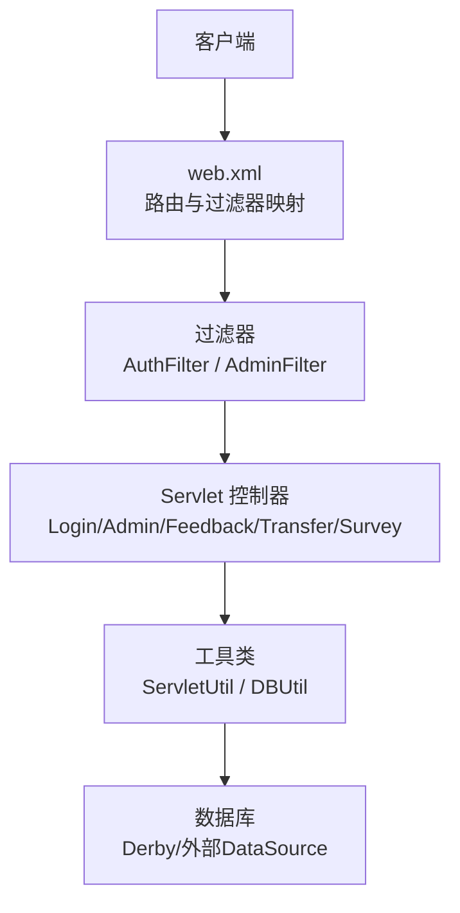
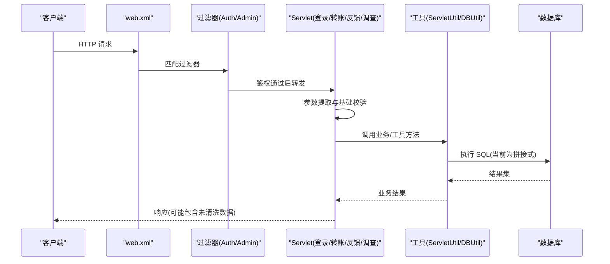
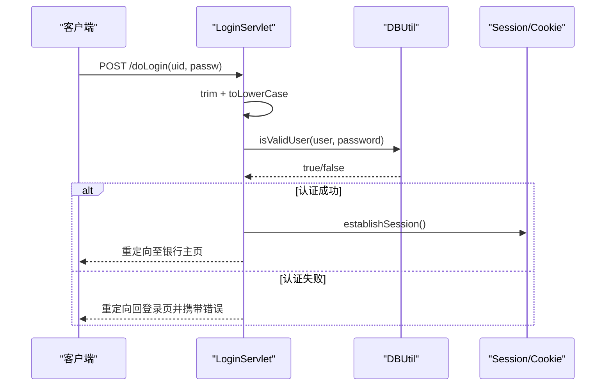
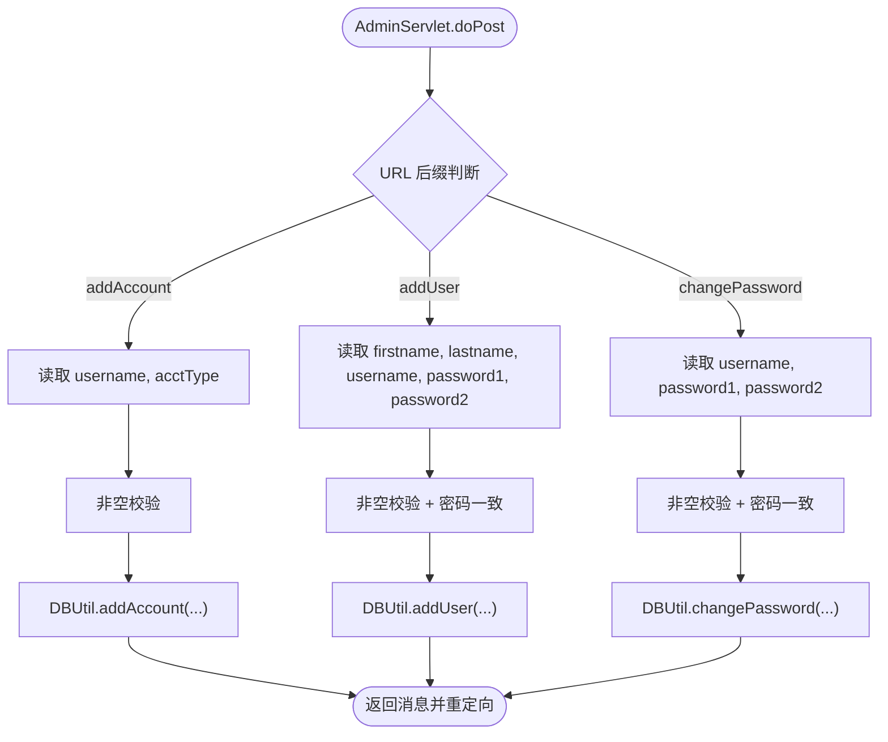
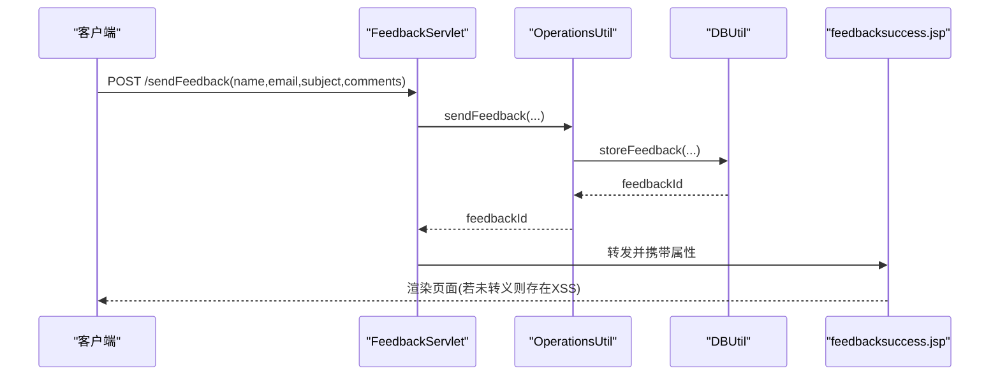
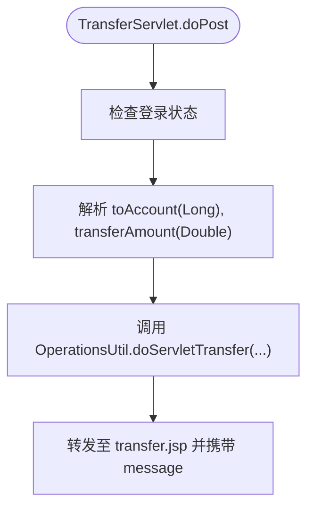
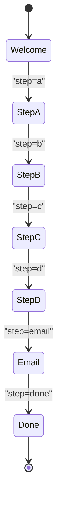
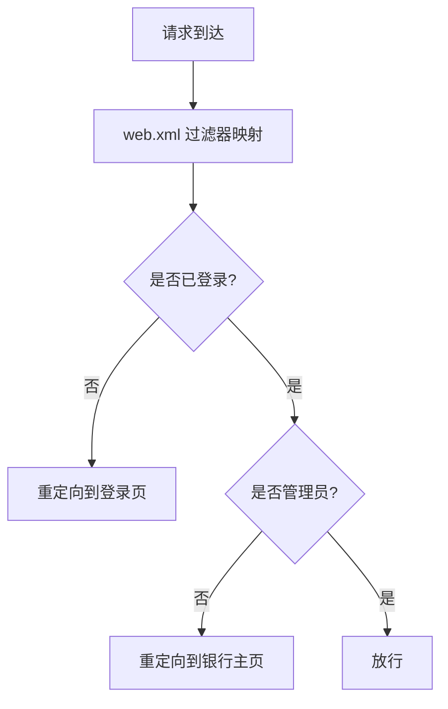
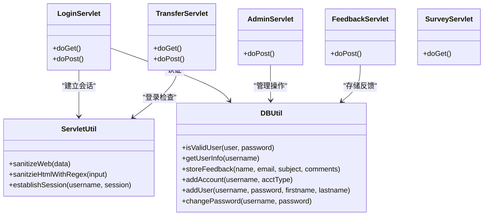

# 输入验证机制

<cite>
**本文引用的文件**   
- [README.md](file://README.md)
- [web.xml](file://WebContent/WEB-INF/web.xml)
- [DBUtil.java](file://src/com/ibm/security/appscan/altoromutual/util/DBUtil.java)
- [ServletUtil.java](file://src/com/ibm/security/appscan/altoromutual/util/ServletUtil.java)
- [LoginServlet.java](file://src/com/ibm/security/appscan/altoromutual/servlet/LoginServlet.java)
- [AdminServlet.java](file://src/com/ibm/security/appscan/altoromutual/servlet/AdminServlet.java)
- [FeedbackServlet.java](file://src/com/ibm/security/appscan/altoromutual/servlet/FeedbackServlet.java)
- [TransferServlet.java](file://src/com/ibm/security/appscan/altoromutual/servlet/TransferServlet.java)
- [SurveyServlet.java](file://src/com/ibm/security/appscan/altoromutual/servlet/SurveyServlet.java)
- [AuthFilter.java](file://src/com/ibm/security/appscan/altoromutual/filter/AuthFilter.java)
- [AdminFilter.java](file://src/com/ibm/security/appscan/altoromutual/filter/AdminFilter.java)
</cite>

## 目录
1. [简介](#简介)
2. [项目结构](#项目结构)
3. [核心组件](#核心组件)
4. [架构总览](#架构总览)
5. [详细组件分析](#详细组件分析)
6. [依赖关系分析](#依赖关系分析)
7. [性能与可扩展性](#性能与可扩展性)
8. [故障排查指南](#故障排查指南)
9. [结论](#结论)
10. [附录：安全编码最佳实践](#附录安全编码最佳实践)

## 简介
本文件聚焦 AltoroJ 的输入验证与安全处理机制，覆盖表单数据校验、参数检查、数据类型验证、输出清洗、SQL 注入防护现状与改进建议、命令注入防护策略、以及常见攻击模式（XSS、CSRF、路径遍历等）的检测与防护。文档同时给出修复方案与最佳实践，帮助读者在理解现有实现的基础上进行加固。

AltoroJ 是一个用于演示 Web 应用安全漏洞的教学示例，其设计目标并非生产级安全，因此代码中存在多处已知安全问题，包括 SQL 注入、XSS、不安全的直接对象引用、弱会话管理等。阅读本文件时，请结合“修复建议”章节进行对照改进。

**章节来源**
- [README.md:1-10](file://README.md#L1-L10)

## 项目结构
从输入验证的角度，AltoroJ 的关键位置如下：
- Servlet 层：负责接收请求参数、基础校验、业务调用与响应转发
- Filter 层：统一鉴权与访问控制
- Util 层：数据库访问、通用工具方法（包含 XSS 过滤与 HTML 转义）
- 配置：web.xml 定义过滤器映射与 Servlet 路由

**图示来源**
- [web.xml:12-51](file://WebContent/WEB-INF/web.xml#L12-L51)
- [web.xml:60-158](file://WebContent/WEB-INF/web.xml#L60-L158)
- [AuthFilter.java:58-70](file://src/com/ibm/security/appscan/altoromutual/filter/AuthFilter.java#L58-L70)
- [AdminFilter.java:58-80](file://src/com/ibm/security/appscan/altoromutual/filter/AdminFilter.java#L58-L80)

**章节来源**
- [web.xml:12-51](file://WebContent/WEB-INF/web.xml#L12-L51)
- [web.xml:60-158](file://WebContent/WEB-INF/web.xml#L60-L158)

## 核心组件
- 输入获取与基础校验：各 Servlet 通过 request.getParameter 获取参数并进行空值、类型转换、长度或格式检查
- 输出清洗：ServletUtil 提供 HTML 转义与基于正则的 XSS 检测
- 数据库访问：DBUtil 使用 Statement 拼接 SQL，存在 SQL 注入风险
- 鉴权与授权：AuthFilter 与 AdminFilter 对受保护资源进行登录态与角色检查

**章节来源**
- [LoginServlet.java:74-85](file://src/com/ibm/security/appscan/altoromutual/servlet/LoginServlet.java#L74-L85)
- [ServletUtil.java:244-254](file://src/com/ibm/security/appscan/altoromutual/util/ServletUtil.java#L244-L254)
- [DBUtil.java:212-232](file://src/com/ibm/security/appscan/altoromutual/util/DBUtil.java#L212-L232)
- [AuthFilter.java:58-70](file://src/com/ibm/security/appscan/altoromutual/filter/AuthFilter.java#L58-L70)
- [AdminFilter.java:58-80](file://src/com/ibm/security/appscan/altoromutual/filter/AdminFilter.java#L58-L80)

## 架构总览
下图展示了用户请求从进入 Web 容器到最终落库或返回响应的关键流程，并标注了输入验证与安全检查点。

**图示来源**
- [web.xml:12-51](file://WebContent/WEB-INF/web.xml#L12-L51)
- [LoginServlet.java:67-101](file://src/com/ibm/security/appscan/altoromutual/servlet/LoginServlet.java#L67-L101)
- [TransferServlet.java:51-67](file://src/com/ibm/security/appscan/altoromutual/servlet/TransferServlet.java#L51-L67)
- [DBUtil.java:212-232](file://src/com/ibm/security/appscan/altoromutual/util/DBUtil.java#L212-L232)

## 详细组件分析

### 登录流程与输入验证
- 参数提取：用户名与密码来自表单字段 uid/passw
- 基础校验：trim、小写化；调用 DBUtil.isValidUser 进行认证
- 会话建立：成功后设置 Session 与 Cookie
- 安全风险：
  - 密码被强制小写化，影响真实密码强度
  - DBUtil 中 SQL 拼接导致 SQL 注入
  - 错误信息可能泄露过多细节

**图示来源**
- [LoginServlet.java:67-101](file://src/com/ibm/security/appscan/altoromutual/servlet/LoginServlet.java#L67-L101)
- [DBUtil.java:212-232](file://src/com/ibm/security/appscan/altoromutual/util/DBUtil.java#L212-L232)

**章节来源**
- [LoginServlet.java:74-85](file://src/com/ibm/security/appscan/altoromutual/servlet/LoginServlet.java#L74-L85)
- [DBUtil.java:212-232](file://src/com/ibm/security/appscan/altoromutual/util/DBUtil.java#L212-L232)

### 管理员操作与输入验证
- 功能：添加账户、添加用户、修改密码
- 参数校验：非空检查、密码一致性检查
- 安全风险：
  - 所有参数直接传入 DBUtil 并拼接 SQL，存在 SQL 注入
  - 无 CSRF 令牌校验
  - 无输入长度/白名单限制

**图示来源**
- [AdminServlet.java:39-120](file://src/com/ibm/security/appscan/altoromutual/servlet/AdminServlet.java#L39-L120)
- [DBUtil.java:472-517](file://src/com/ibm/security/appscan/altoromutual/util/DBUtil.java#L472-L517)

**章节来源**
- [AdminServlet.java:39-120](file://src/com/ibm/security/appscan/altoromutual/servlet/AdminServlet.java#L39-L120)
- [DBUtil.java:472-517](file://src/com/ibm/security/appscan/altoromutual/util/DBUtil.java#L472-L517)

### 反馈提交与输出显示
- 参数：name、email_addr、subject、comments
- 校验：仅检查 comments 是否为空
- 存储：通过 OperationsUtil.sendFeedback 调用 DBUtil.storeFeedback
- 显示：feedbacksuccess.jsp 展示反馈内容
- 安全风险：
  - 缺少邮箱格式校验
  - 未对用户输入进行输出转义，易产生 XSS
  - DBUtil.storeFeedback 拼接 SQL，存在 SQL 注入

**图示来源**
- [FeedbackServlet.java:42-67](file://src/com/ibm/security/appscan/altoromutual/servlet/FeedbackServlet.java#L42-L67)
- [DBUtil.java:520-535](file://src/com/ibm/security/appscan/altoromutual/util/DBUtil.java#L520-L535)

**章节来源**
- [FeedbackServlet.java:42-67](file://src/com/ibm/security/appscan/altoromutual/servlet/FeedbackServlet.java#L42-L67)
- [DBUtil.java:520-535](file://src/com/ibm/security/appscan/altoromutual/util/DBUtil.java#L520-L535)

### 转账流程与数值型输入验证
- 参数：fromAccount、toAccount、transferAmount
- 校验：仅做 Long.parseDouble 与 Double.valueOf 转换，无范围/合法性校验
- 业务：调用 OperationsUtil.doServletTransfer 完成转账逻辑
- 安全风险：
  - 数值越界、负数、非法字符将抛出异常
  - fromAccount 未解析为数字，直接使用字符串参与后续逻辑
  - 缺乏 CSRF 保护与二次确认

**图示来源**
- [TransferServlet.java:51-67](file://src/com/ibm/security/appscan/altoromutual/servlet/TransferServlet.java#L51-L67)

**章节来源**
- [TransferServlet.java:51-67](file://src/com/ibm/security/appscan/altoromutual/servlet/TransferServlet.java#L51-L67)

### 调查问卷与状态机
- 参数：step、txtEmail
- 校验：通过 Referer 与 Session 中的 surveyStep 进行顺序校验
- 风险：
  - txtEmail 直接拼入响应，存在 XSS
  - Referer 可伪造，不能作为唯一 CSRF 防护手段
  - 无邮箱格式校验

**图示来源**
- [SurveyServlet.java:45-101](file://src/com/ibm/security/appscan/altoromutual/servlet/SurveyServlet.java#L45-L101)

**章节来源**
- [SurveyServlet.java:45-101](file://src/com/ibm/security/appscan/altoromutual/servlet/SurveyServlet.java#L45-L101)

### 过滤器与访问控制
- AuthFilter：对 /bank/* 与 /admin/* 等路径进行登录态检查
- AdminFilter：对管理员路径进行角色或特殊会话标记检查
- 注意：web.xml 中 admin 过滤器映射存在拼写错误（adimn），可能导致管理员路径未生效

**图示来源**
- [web.xml:28-51](file://WebContent/WEB-INF/web.xml#L28-L51)
- [AuthFilter.java:58-70](file://src/com/ibm/security/appscan/altoromutual/filter/AuthFilter.java#L58-L70)
- [AdminFilter.java:58-80](file://src/com/ibm/security/appscan/altoromutual/filter/AdminFilter.java#L58-L80)

**章节来源**
- [web.xml:28-51](file://WebContent/WEB-INF/web.xml#L28-L51)
- [AuthFilter.java:58-70](file://src/com/ibm/security/appscan/altoromutual/filter/AuthFilter.java#L58-L70)
- [AdminFilter.java:58-80](file://src/com/ibm/security/appscan/altoromutual/filter/AdminFilter.java#L58-L80)

## 依赖关系分析
- Servlet 依赖 ServletUtil 与 DBUtil
- DBUtil 直接操作 JDBC Statement，存在 SQL 注入风险
- ServletUtil 提供 XSS 相关工具方法，但未被广泛使用于所有输出点
- web.xml 定义了过滤器与 Servlet 的路由映射

**图示来源**
- [LoginServlet.java:67-101](file://src/com/ibm/security/appscan/altoromutual/servlet/LoginServlet.java#L67-L101)
- [AdminServlet.java:39-120](file://src/com/ibm/security/appscan/altoromutual/servlet/AdminServlet.java#L39-L120)
- [FeedbackServlet.java:42-67](file://src/com/ibm/security/appscan/altoromutual/servlet/FeedbackServlet.java#L42-L67)
- [TransferServlet.java:51-67](file://src/com/ibm/security/appscan/altoromutual/servlet/TransferServlet.java#L51-L67)
- [ServletUtil.java:244-254](file://src/com/ibm/security/appscan/altoromutual/util/ServletUtil.java#L244-L254)
- [DBUtil.java:212-232](file://src/com/ibm/security/appscan/altoromutual/util/DBUtil.java#L212-L232)

**章节来源**
- [web.xml:60-158](file://WebContent/WEB-INF/web.xml#L60-L158)
- [DBUtil.java:212-232](file://src/com/ibm/security/appscan/altoromutual/util/DBUtil.java#L212-L232)
- [ServletUtil.java:244-254](file://src/com/ibm/security/appscan/altoromutual/util/ServletUtil.java#L244-L254)

## 性能与可扩展性
- 当前数据库连接采用单例 DBUtil 内部维护 Connection，适合简单场景
- 使用 Statement 拼接 SQL 不利于预编译缓存与参数复用
- 建议在引入 PreparedStatement 的同时，考虑连接池与事务边界管理，以提升并发与稳定性

[本节为通用指导，不涉及具体文件分析]

## 故障排查指南
- 登录失败：检查 LoginServlet 的错误日志与 DBUtil.isValidUser 的返回值
- 数据库初始化失败：查看 README 中的 Troubleshooting 部分，确认 user.home 权限与 Derby 路径
- 管理员页面无法访问：检查 web.xml 中 AdminFilter 的 URL 映射是否存在拼写错误（adimn）
- 转账异常：检查 TransferServlet 的参数类型转换与业务层异常处理

**章节来源**
- [README.md:44-57](file://README.md#L44-L57)
- [web.xml:44-51](file://WebContent/WEB-INF/web.xml#L44-L51)
- [LoginServlet.java:82-90](file://src/com/ibm/security/appscan/altoromutual/servlet/LoginServlet.java#L82-L90)
- [TransferServlet.java:58-63](file://src/com/ibm/security/appscan/altoromutual/servlet/TransferServlet.java#L58-L63)

## 结论
AltoroJ 的输入验证机制目前以基础的非空与类型转换为主，输出清洗仅在工具类中提供但未全面使用，数据库访问仍大量使用拼接 SQL，存在显著的 SQL 注入风险。此外，XSS、CSRF、路径遍历等攻击面尚未得到系统性的防护。建议优先修复 SQL 注入与 XSS，再逐步完善 CSRF 防护、输入白名单与严格的类型/范围校验，并修正 web.xml 的配置问题。

[本节为总结性内容，不涉及具体文件分析]

## 附录：安全编码最佳实践

### 表单数据验证与参数检查
- 始终对 request.getParameter 的结果进行 null 与空白检查
- 对数值型参数使用 try-catch 捕获 NumberFormatException，并提供友好错误提示
- 对日期、金额、账号等字段实施白名单与范围校验
- 对敏感字段（如密码）禁止大小写转换，避免削弱安全性

**章节来源**
- [TransferServlet.java:58-63](file://src/com/ibm/security/appscan/altoromutual/servlet/TransferServlet.java#L58-L63)
- [LoginServlet.java:74-85](file://src/com/ibm/security/appscan/altoromutual/servlet/LoginServlet.java#L74-L85)

### 数据类型验证
- 使用强类型模型对象封装输入，并在 Setter 中进行校验
- 对枚举型参数使用合法值集合校验
- 对邮箱、手机号等使用正则表达式进行格式校验

**章节来源**
- [ServletUtil.java:70-77](file://src/com/ibm/security/appscan/altoromutual/util/ServletUtil.java#L70-L77)

### 用户输入的数据清洗
- 对所有用户可控的输出进行 HTML 转义，防止 XSS
- 对富文本输入使用安全的白名单过滤（如 Jsoup），而非简单正则替换
- 对文件上传路径进行规范化与白名单校验，防止路径遍历

**章节来源**
- [ServletUtil.java:244-254](file://src/com/ibm/security/appscan/altoromutual/util/ServletUtil.java#L244-L254)

### SQL 注入防护
- 全面替换 Statement 为 PreparedStatement，并使用占位符绑定参数
- 对动态表名/列名使用白名单映射，禁止直接拼接
- 对查询条件进行严格类型校验与范围限制

**章节来源**
- [DBUtil.java:212-232](file://src/com/ibm/security/appscan/altoromutual/util/DBUtil.java#L212-L232)
- [DBUtil.java:472-517](file://src/com/ibm/security/appscan/altoromutual/util/DBUtil.java#L472-L517)
- [DBUtil.java:520-535](file://src/com/ibm/security/appscan/altoromutual/util/DBUtil.java#L520-L535)

### 命令注入防护
- 避免直接使用 Runtime.exec 或 ProcessBuilder 执行用户输入
- 如需调用外部命令，使用固定命令与参数白名单，并对参数进行严格转义与校验
- 最小化进程权限，隔离执行环境

[本节为通用指导，不涉及具体文件分析]

### 常见攻击模式的检测与防护
- XSS：统一输出转义；对富文本使用安全解析器；前端启用 CSP
- CSRF：为所有状态变更接口添加 CSRF Token；校验 SameSite Cookie；校验 Referer/Origin（作为辅助）
- 路径遍历：对文件路径进行规范化与根目录限制；拒绝 .. 与绝对路径
- 不安全直接对象引用（IDOR）：在服务端校验资源归属，禁止直接使用客户端提供的 ID 访问资源

**章节来源**
- [SurveyServlet.java:79-82](file://src/com/ibm/security/appscan/altoromutual/servlet/SurveyServlet.java#L79-L82)
- [web.xml:44-51](file://WebContent/WEB-INF/web.xml#L44-L51)

### 修复方案与代码示例路径
- 登录认证：将 DBUtil.isValidUser 改为 PreparedStatement 参数绑定
  - 参考路径：[DBUtil.java:212-232](file://src/com/ibm/security/appscan/altoromutmal/util/DBUtil.java#L212-L232)
- 反馈存储：将 DBUtil.storeFeedback 改为 PreparedStatement 参数绑定，并对输出进行转义
  - 参考路径：[DBUtil.java:520-535](file://src/com/ibm/security/appscan/altoromutmal/util/DBUtil.java#L520-L535)
- 管理员操作：将所有 DBUtil.addUser/addAccount/changePassword 改为 PreparedStatement 参数绑定
  - 参考路径：[DBUtil.java:472-517](file://src/com/ibm/security/appscan/altoromutmal/util/DBUtil.java#L472-L517)
- 输出清洗：在所有 JSP/Servlet 输出前调用 ServletUtil.sanitizeWeb
  - 参考路径：[ServletUtil.java:244-247](file://src/com/ibm/security/appscan/altoromutmal/util/ServletUtil.java#L244-L247)