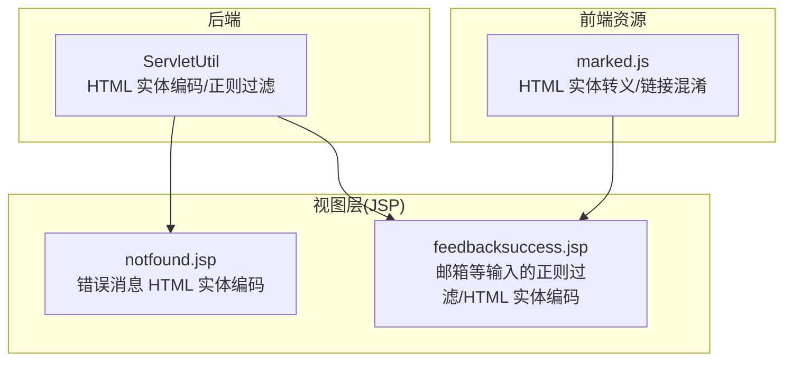
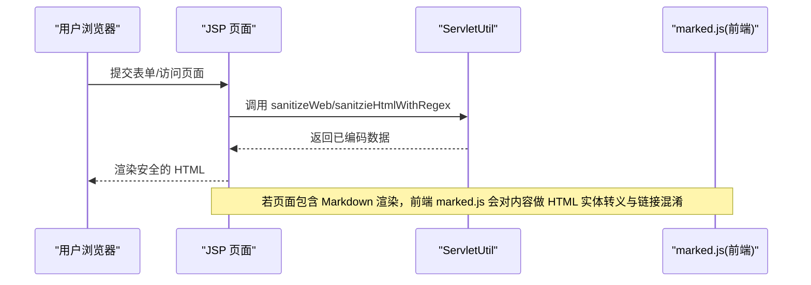
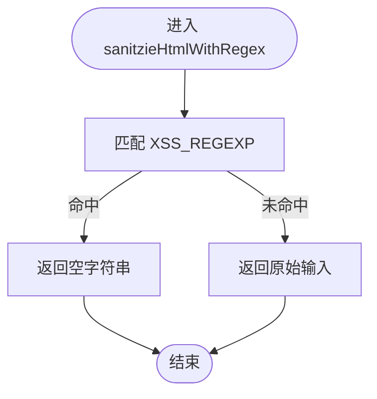
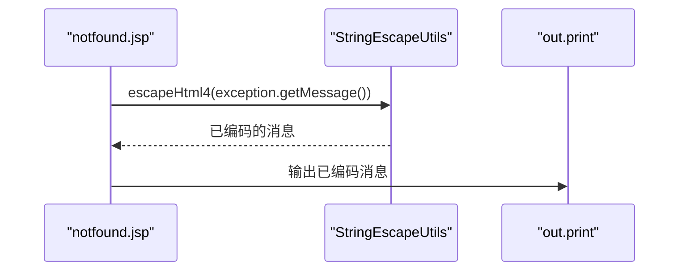
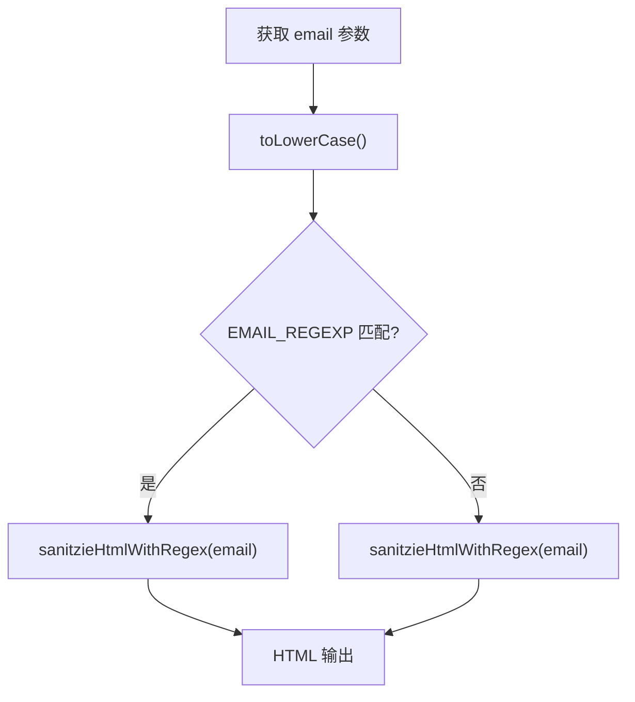
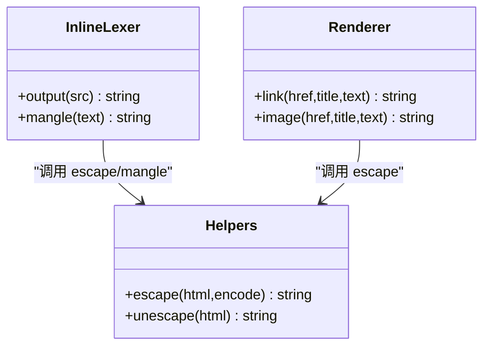
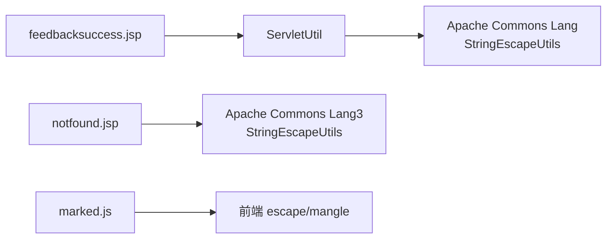

# 输出编码技术

<cite>
**本文引用的文件**   
- [ServletUtil.java](file://src/com/ibm/security/appscan/altoromutual/util/ServletUtil.java)
- [notfound.jsp](file://WebContent/notfound.jsp)
- [feedbacksuccess.jsp](file://WebContent/feedbacksuccess.jsp)
- [marked.js](file://WebContent/swagger/lib/marked.js)
</cite>

## 目录
1. [简介](#简介)
2. [项目结构](#项目结构)
3. [核心组件](#核心组件)
4. [架构总览](#架构总览)
5. [详细组件分析](#详细组件分析)
6. [依赖关系分析](#依赖关系分析)
7. [性能考虑](#性能考虑)
8. [故障排查指南](#故障排查指南)
9. [结论](#结论)
10. [附录](#附录)

## 简介
本文件聚焦 AltoroJ 在“输出编码”方面的实现与策略，覆盖 HTML 实体编码、URL 编码、JavaScript 编码的实践，并围绕防止 XSS 攻击的上下文相关编码技术进行说明。文档同时记录不同输出场景（HTML 正文、HTML 属性、JavaScript 字符串、CSS 值等）的编码要求，梳理现有工具类与最佳实践，并给出常见漏洞与修复案例。

## 项目结构
AltoroJ 是一个基于 JSP + Servlet 的传统 Java Web 应用。与输出编码直接相关的代码主要位于：
- 后端工具类：用于统一对输出进行 HTML 实体编码与简单正则过滤
- JSP 页面：在错误页与反馈成功页中对用户输入进行编码后输出
- 前端库：Markdown 解析器 marked.js 内置了 HTML 实体转义与链接混淆机制

图表来源
- [ServletUtil.java:244-254](file://src/com/ibm/security/appscan/altoromutual/util/ServletUtil.java#L244-L254)
- [notfound.jsp:34-42](file://WebContent/notfound.jsp#L34-L42)
- [feedbacksuccess.jsp:43-49](file://WebContent/feedbacksuccess.jsp#L43-L49)
- [marked.js:1076-1083](file://WebContent/swagger/lib/marked.js#L1076-L1083)

章节来源
- [ServletUtil.java:244-254](file://src/com/ibm/security/appscan/altoromutual/util/ServletUtil.java#L244-L254)
- [notfound.jsp:34-42](file://WebContent/notfound.jsp#L34-L42)
- [feedbacksuccess.jsp:43-49](file://WebContent/feedbacksuccess.jsp#L43-L49)
- [marked.js:1076-1083](file://WebContent/swagger/lib/marked.js#L1076-L1083)

## 核心组件
- ServletUtil.sanitizeWeb：封装 HTML 实体编码，作为统一的 Web 输出安全出口
- ServletUtil.sanitzieHtmlWithRegex：基于正则表达式对明显危险模式进行拦截（返回空或原值）
- notfound.jsp：使用 StringEscapeUtils.escapeHtml4 对用户可控的错误消息进行 HTML 实体编码
- feedbacksuccess.jsp：对邮箱参数进行正则校验与 HTML 实体编码后输出
- marked.js：提供 HTML 实体转义函数 escape 以及链接文本混淆 mangle

章节来源
- [ServletUtil.java:244-254](file://src/com/ibm/security/appscan/altoromutual/util/ServletUtil.java#L244-L254)
- [notfound.jsp:34-42](file://WebContent/notfound.jsp#L34-L42)
- [feedbacksuccess.jsp:43-49](file://WebContent/feedbacksuccess.jsp#L43-L49)
- [marked.js:1076-1083](file://WebContent/swagger/lib/marked.js#L1076-L1083)

## 架构总览
下图展示了从请求到输出的关键路径，以及各阶段的编码处理点。

图表来源
- [ServletUtil.java:244-254](file://src/com/ibm/security/appscan/altoromutual/util/ServletUtil.java#L244-L254)
- [marked.js:1076-1083](file://WebContent/swagger/lib/marked.js#L1076-L1083)

## 详细组件分析

### 组件一：ServletUtil 输出编码工具
- sanitizeWeb(data)
  - 功能：对任意字符串执行 HTML 实体编码，适用于在 HTML 正文中安全显示用户输入
  - 适用场景：将不可信数据插入 HTML 文本节点
  - 复杂度：O(n)，n 为输入长度
- sanitzieHtmlWithRegex(input)
  - 功能：通过预定义的正则表达式检测危险模式（如 script、javascript:、事件处理器等），命中则返回空字符串，否则返回原值
  - 适用场景：快速阻断明显的恶意注入；注意该方式不能替代正确的上下文编码
  - 复杂度：O(n)，正则匹配一次

图表来源
- [ServletUtil.java:74-77](file://src/com/ibm/security/appscan/altoromutual/util/ServletUtil.java#L74-L77)
- [ServletUtil.java:249-254](file://src/com/ibm/security/appscan/altoromutual/util/ServletUtil.java#L249-L254)

章节来源
- [ServletUtil.java:74-77](file://src/com/ibm/security/appscan/altoromutual/util/ServletUtil.java#L74-L77)
- [ServletUtil.java:244-254](file://src/com/ibm/security/appscan/altoromutual/util/ServletUtil.java#L244-L254)

### 组件二：notfound.jsp 错误消息编码
- 行为：当存在异常时，使用 StringEscapeUtils.escapeHtml4 对异常消息进行 HTML 实体编码后再输出
- 意义：确保错误信息中的特殊字符不会破坏 HTML 结构或触发脚本执行
- 建议：保持该处理方式一致化，避免在其他错误页遗漏编码

图表来源
- [notfound.jsp:34-42](file://WebContent/notfound.jsp#L34-L42)

章节来源
- [notfound.jsp:34-42](file://WebContent/notfound.jsp#L34-L42)

### 组件三：feedbacksuccess.jsp 邮箱输出编码
- 行为：
  - 使用 EMAIL_REGEXP 校验邮箱格式
  - 对邮箱进行 toLowerCase() 后，调用 sanitzieHtmlWithRegex 进行正则过滤
  - 在 HTML 中输出时，使用 ServletUtil.sanitzieHtmlWithRegex 包裹
- 风险点：
  - 仅依赖正则过滤不足以防御所有 XSS 变体
  - 建议在 HTML 上下文中统一使用 HTML 实体编码（sanitizeWeb）

图表来源
- [feedbacksuccess.jsp:43-49](file://WebContent/feedbacksuccess.jsp#L43-L49)
- [ServletUtil.java:70-77](file://src/com/ibm/security/appscan/altoromutual/util/ServletUtil.java#L70-L77)
- [ServletUtil.java:249-254](file://src/com/ibm/security/appscan/altoromutual/util/ServletUtil.java#L249-L254)

章节来源
- [feedbacksuccess.jsp:43-49](file://WebContent/feedbacksuccess.jsp#L43-L49)
- [ServletUtil.java:70-77](file://src/com/ibm/security/appscan/altoromutual/util/ServletUtil.java#L70-L77)
- [ServletUtil.java:249-254](file://src/com/ibm/security/appscan/altoromutual/util/ServletUtil.java#L249-L254)

### 组件四：marked.js 前端输出编码
- escape(html, encode)
  - 功能：对 HTML 特殊字符进行实体转义（&、<、>、"、'），支持是否对 & 进行严格转义的开关
  - 用途：在生成 HTML 片段时对内容进行安全转义
- mangle(text)
  - 功能：将文本转换为数字/十六进制实体形式，随机选择表达方式，增加解析难度
  - 用途：对链接地址等进行混淆，降低被自动抓取或脚本利用的概率

图表来源
- [marked.js:1076-1083](file://WebContent/swagger/lib/marked.js#L1076-L1083)
- [marked.js:732-747](file://WebContent/swagger/lib/marked.js#L732-L747)

章节来源
- [marked.js:1076-1083](file://WebContent/swagger/lib/marked.js#L1076-L1083)
- [marked.js:732-747](file://WebContent/swagger/lib/marked.js#L732-L747)

## 依赖关系分析
- ServletUtil 依赖 Apache Commons Lang 的 StringEscapeUtils 进行 HTML 实体编码
- notfound.jsp 依赖 Apache Commons Lang3 的 StringEscapeUtils 进行 HTML 实体编码
- feedbacksuccess.jsp 依赖 ServletUtil 提供的正则过滤与常量 EMAIL_REGEXP
- marked.js 在前端侧提供 escape 与 mangle 辅助函数

图表来源
- [ServletUtil.java:42-43](file://src/com/ibm/security/appscan/altoromutual/util/ServletUtil.java#L42-L43)
- [notfound.jsp:1](file://WebContent/notfound.jsp#L1)
- [feedbacksuccess.jsp:1-2](file://WebContent/feedbacksuccess.jsp#L1-L2)
- [marked.js:1076-1083](file://WebContent/swagger/lib/marked.js#L1076-L1083)

章节来源
- [ServletUtil.java:42-43](file://src/com/ibm/security/appscan/altoromutual/util/ServletUtil.java#L42-L43)
- [notfound.jsp:1](file://WebContent/notfound.jsp#L1)
- [feedbacksuccess.jsp:1-2](file://WebContent/feedbacksuccess.jsp#L1-L2)
- [marked.js:1076-1083](file://WebContent/swagger/lib/marked.js#L1076-L1083)

## 性能考虑
- HTML 实体编码与正则匹配均为线性时间复杂度，开销较低
- 在高并发场景下，建议：
  - 复用 ServletUtil 的工具方法，避免重复创建对象
  - 谨慎使用复杂正则，必要时缓存编译后的 Pattern
  - 对频繁输出的字段采用白名单校验+轻量编码组合

[本节为通用指导，不直接分析具体文件]

## 故障排查指南
- 现象：错误页出现脚本执行或页面布局错乱
  - 检查是否在输出前对异常消息进行了 HTML 实体编码
  - 参考：notfound.jsp 中对 exception.getMessage() 的处理
- 现象：反馈成功页显示异常字符或被注入
  - 检查邮箱参数是否经过 EMAIL_REGEXP 校验与 sanitzieHtmlWithRegex 处理
  - 建议在 HTML 上下文中统一使用 sanitizeWeb 进行实体编码
- 现象：Markdown 渲染后出现不安全链接或脚本
  - 确认前端 marked.js 的 escape 与 mangle 是否生效
  - 检查是否启用了 sanitize 选项并对链接协议进行白名单校验

章节来源
- [notfound.jsp:34-42](file://WebContent/notfound.jsp#L34-L42)
- [feedbacksuccess.jsp:43-49](file://WebContent/feedbacksuccess.jsp#L43-L49)
- [marked.js:1076-1083](file://WebContent/swagger/lib/marked.js#L1076-L1083)

## 结论
AltoroJ 的输出编码以 HTML 实体编码为核心，辅以简单的正则过滤与前端链接混淆。当前实现覆盖了错误消息与部分用户输入的 HTML 上下文输出，但仍需：
- 在所有输出点统一使用 HTML 实体编码（sanitizeWeb）
- 针对 JavaScript 与 CSS 上下文补充专用编码逻辑
- 对 URL 参数与属性值进行严格的白名单校验与编码
- 引入更完善的上下文感知编码器，减少正则误判与绕过风险

[本节为总结性内容，不直接分析具体文件]

## 附录

### 上下文相关编码策略与最佳实践
- HTML 正文
  - 对所有不可信数据进行 HTML 实体编码
  - 优先使用框架或模板引擎的自动转义能力
- HTML 属性
  - 对属性值进行 HTML 实体编码，并确保引号闭合正确
  - 对 href/src 等属性值进行 URL 编码与协议白名单校验
- JavaScript 字符串
  - 使用 JS 字符串编码（转义引号、反斜杠、换行等），避免直接拼接
  - 避免将用户输入直接写入 eval、setTimeout、setInterval 等动态执行入口
- CSS 值
  - 对 CSS 值进行白名单校验与编码，避免注入样式或表达式
- URL
  - 对用户提供的 URL 进行规范化与协议白名单校验
  - 对查询参数进行 URL 编码，避免参数注入

[本节为通用指导，不直接分析具体文件]

### 常见输出编码漏洞与修复案例
- 漏洞：错误消息未编码导致 XSS
  - 修复：在 notfound.jsp 中使用 HTML 实体编码输出异常消息
- 漏洞：邮箱等用户输入仅依赖正则过滤
  - 修复：在 HTML 上下文中统一使用 HTML 实体编码，并结合白名单校验
- 漏洞：前端 Markdown 渲染未充分转义
  - 修复：启用 marked.js 的 escape 与 mangle，并对链接协议进行白名单校验

章节来源
- [notfound.jsp:34-42](file://WebContent/notfound.jsp#L34-L42)
- [feedbacksuccess.jsp:43-49](file://WebContent/feedbacksuccess.jsp#L43-L49)
- [marked.js:1076-1083](file://WebContent/swagger/lib/marked.js#L1076-L1083)