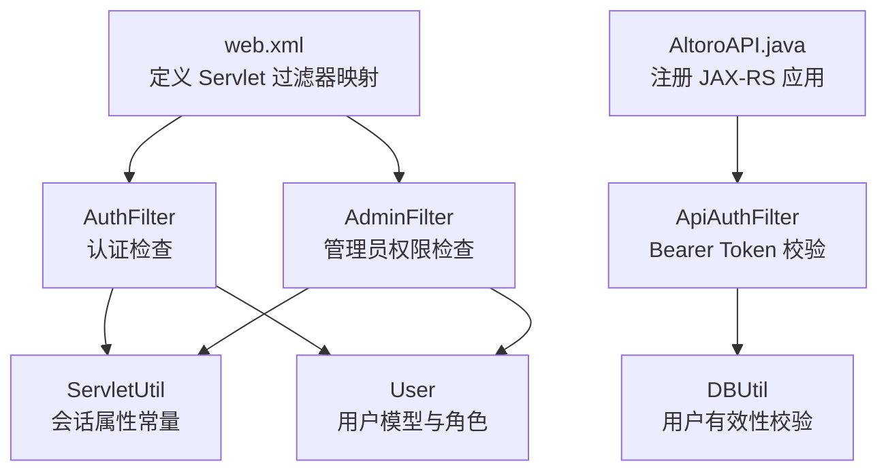
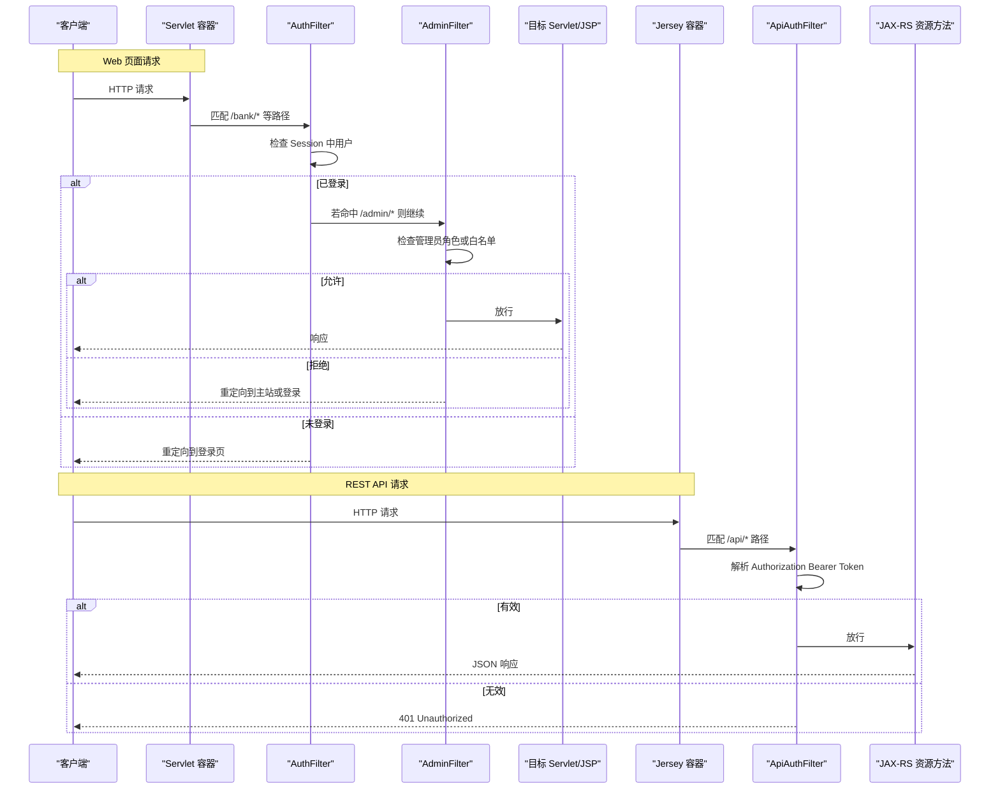
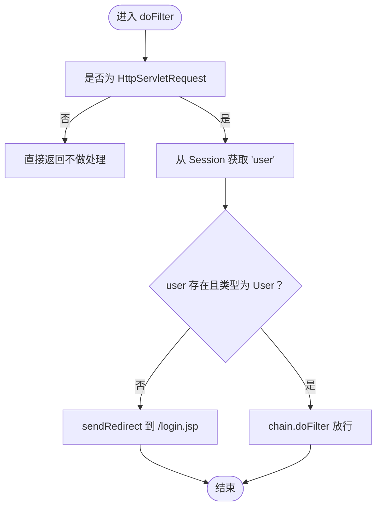
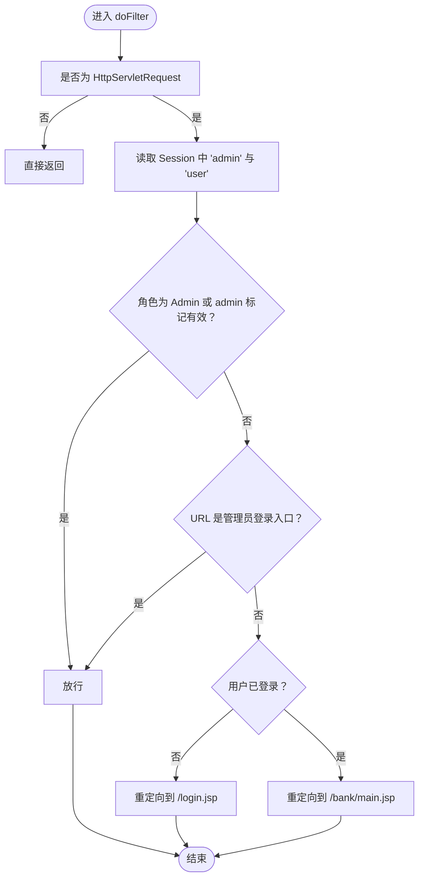
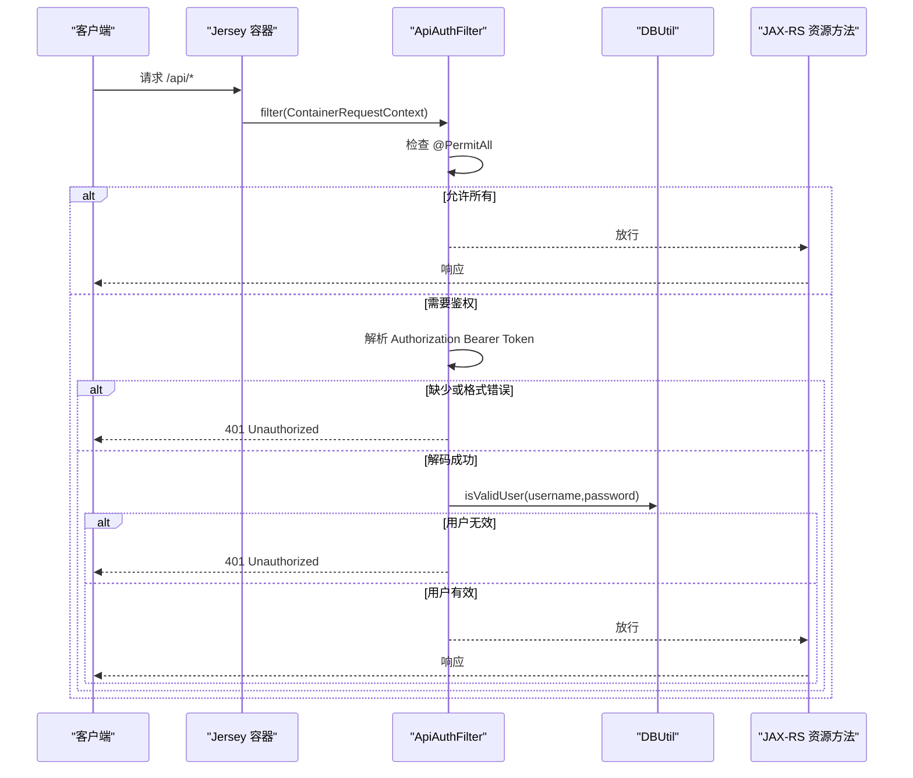
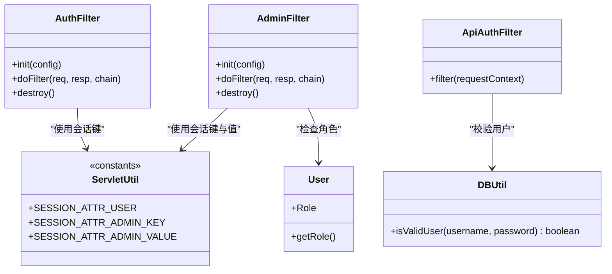

# 过滤器架构

<cite>
**本文引用的文件**   
- [web.xml](file://WebContent/WEB-INF/web.xml)
- [AuthFilter.java](file://src/com/ibm/security/appscan/altoromutual/filter/AuthFilter.java)
- [AdminFilter.java](file://src/com/ibm/security/appscan/altoromutual/filter/AdminFilter.java)
- [ApiAuthFilter.java](file://src/com/ibm/security/appscan/altoromutual/filter/ApiAuthFilter.java)
- [ServletUtil.java](file://src/com/ibm/security/appscan/altoromutual/util/ServletUtil.java)
- [User.java](file://src/com/ibm/security/appscan/altoromutual/model/User.java)
- [AltoroAPI.java](file://src/com/ibm/security/appscan/altoromutual/api/AltoroAPI.java)
</cite>

## 目录
1. [简介](#简介)
2. [项目结构](#项目结构)
3. [核心组件](#核心组件)
4. [架构总览](#架构总览)
5. [详细组件分析](#详细组件分析)
6. [依赖关系分析](#依赖关系分析)
7. [性能与可扩展性](#性能与可扩展性)
8. [故障排查指南](#故障排查指南)
9. [结论](#结论)
10. [附录：自定义过滤器开发指南](#附录自定义过滤器开发指南)

## 简介
本文件系统性梳理 AltoroJ 的过滤器架构，重点解释 Servlet Filter 的工作原理与生命周期，深入解析 AuthFilter、AdminFilter、ApiAuthFilter 三个核心过滤器的实现机制。文档涵盖过滤器在 web.xml 中的配置方式、执行顺序与链式调用机制，并详细说明请求拦截流程、条件判断逻辑与重定向策略。最后提供自定义过滤器开发指南与最佳实践，帮助读者安全、可维护地扩展访问控制能力。

## 项目结构
与过滤器相关的代码与配置分布如下：
- Web 层配置：WebContent/WEB-INF/web.xml
- Servlet 过滤器（传统）：src/.../filter/AuthFilter.java、AdminFilter.java
- JAX-RS 容器过滤器：src/.../filter/ApiAuthFilter.java
- 会话与常量工具：src/.../util/ServletUtil.java
- 用户模型与角色：src/.../model/User.java
- JAX-RS 应用注册：src/.../api/AltoroAPI.java

图表来源
- [web.xml:12-59](file://WebContent/WEB-INF/web.xml#L12-L59)
- [AuthFilter.java:40-70](file://src/com/ibm/security/appscan/altoromutual/filter/AuthFilter.java#L40-L70)
- [AdminFilter.java:40-81](file://src/com/ibm/security/appscan/altoromutual/filter/AdminFilter.java#L40-L81)
- [ApiAuthFilter.java:20-74](file://src/com/ibm/security/appscan/altoromutual/filter/ApiAuthFilter.java#L20-L74)
- [AltoroAPI.java:9-14](file://src/com/ibm/security/appscan/altoromutual/api/AltoroAPI.java#L9-L14)
- [ServletUtil.java:60-62](file://src/com/ibm/security/appscan/altoromutual/util/ServletUtil.java#L60-L62)
- [User.java:34-54](file://src/com/ibm/security/appscan/altoromutual/model/User.java#L34-L54)

章节来源
- [web.xml:12-59](file://WebContent/WEB-INF/web.xml#L12-L59)
- [AltoroAPI.java:9-14](file://src/com/ibm/security/appscan/altoromutual/api/AltoroAPI.java#L9-L14)

## 核心组件
- AuthFilter：对受保护的 Web 资源进行登录态校验，未登录则重定向到登录页。
- AdminFilter：对管理端资源进行管理员权限校验，支持管理员登录入口白名单，非管理员或无权限时重定向至相应页面。
- ApiAuthFilter：针对 JAX-RS API 的鉴权过滤器，基于 Authorization 头中的 Bearer Token 进行 Base64 解码与用户有效性校验，未通过则返回 401。

章节来源
- [AuthFilter.java:40-70](file://src/com/ibm/security/appscan/altoromutual/filter/AuthFilter.java#L40-L70)
- [AdminFilter.java:40-81](file://src/com/ibm/security/appscan/altoromutual/filter/AdminFilter.java#L40-L81)
- [ApiAuthFilter.java:20-74](file://src/com/ibm/security/appscan/altoromutual/filter/ApiAuthFilter.java#L20-L74)

## 架构总览
AltoroJ 同时使用两类过滤器：
- Servlet Filter（AuthFilter、AdminFilter）：由容器在请求进入 Servlet/JSP 前拦截，适用于传统 MVC 页面与表单提交。
- JAX-RS ContainerRequestFilter（ApiAuthFilter）：由 Jersey 容器在资源方法前拦截，适用于 REST API。

图表来源
- [web.xml:28-59](file://WebContent/WEB-INF/web.xml#L28-L59)
- [AuthFilter.java:58-70](file://src/com/ibm/security/appscan/altoromutual/filter/AuthFilter.java#L58-L70)
- [AdminFilter.java:58-81](file://src/com/ibm/security/appscan/altoromutual/filter/AdminFilter.java#L58-L81)
- [ApiAuthFilter.java:29-74](file://src/com/ibm/security/appscan/altoromutual/filter/ApiAuthFilter.java#L29-L74)
- [AltoroAPI.java:9-14](file://src/com/ibm/security/appscan/altoromutual/api/AltoroAPI.java#L9-L14)

## 详细组件分析

### AuthFilter（Web 认证过滤器）
职责
- 检查当前会话是否包含有效的 User 对象。
- 未登录时重定向到登录页；已登录则放行到后续过滤器或目标资源。

关键行为
- 从 HttpServletRequest 获取 HttpSession，读取会话属性“user”。
- 若 user 为 null 或类型不匹配，则 sendRedirect 到上下文路径下的登录页。
- 否则调用 FilterChain.doFilter 放行。

配置与匹配
- web.xml 中映射到 /bank/*、/admin/*、/account.jsp，且覆盖 REQUEST/FORWARD/INCLUDE/ERROR 分发器类型。

图表来源
- [AuthFilter.java:58-70](file://src/com/ibm/security/appscan/altoromutual/filter/AuthFilter.java#L58-L70)
- [web.xml:28-59](file://WebContent/WEB-INF/web.xml#L28-L59)

章节来源
- [AuthFilter.java:40-70](file://src/com/ibm/security/appscan/altoromutual/filter/AuthFilter.java#L40-L70)
- [web.xml:28-59](file://WebContent/WEB-INF/web.xml#L28-L59)

### AdminFilter（管理员权限过滤器）
职责
- 确保访问管理端资源的用户具备管理员权限。
- 支持管理员登录接口白名单（如 /admin/login.jsp、/admin/doAdminLogin）。
- 根据用户角色或会话中的管理员标记决定是否放行。

关键行为
- 从 Session 读取“admin”和“user”两个属性。
- 若 user 角色为 Admin，或 admin 属性等于特定值，则放行。
- 若请求 URL 以管理员登录相关结尾，则放行。
- 若未登录，重定向到登录页；否则重定向到银行主页。

配置与匹配
- web.xml 中映射到 /adimn/*（注意此处为拼写错误），覆盖 REQUEST/FORWARD/INCLUDE/ERROR。

图表来源
- [AdminFilter.java:58-81](file://src/com/ibm/security/appscan/altoromutual/filter/AdminFilter.java#L58-L81)
- [web.xml:44-51](file://WebContent/WEB-INF/web.xml#L44-L51)

章节来源
- [AdminFilter.java:40-81](file://src/com/ibm/security/appscan/altoromutual/filter/AdminFilter.java#L40-L81)
- [web.xml:44-51](file://WebContent/WEB-INF/web.xml#L44-L51)

### ApiAuthFilter（JAX-RS API 鉴权过滤器）
职责
- 对 JAX-RS 资源方法进行鉴权，默认要求携带 Authorization: Bearer <token>。
- 若资源方法标注 PermitAll，则跳过鉴权。
- 解析 token，Base64 解码后验证用户名/密码有效性。

关键行为
- 通过 ResourceInfo 获取当前资源方法，检查 @PermitAll。
- 从请求头提取 Authorization，若无或格式不正确，返回 401。
- 将 token 按冒号分割，分别 Base64 解码 username/password。
- 调用 DBUtil.isValidUser 校验用户有效性，失败返回 401；数据库异常返回 500。

配置与匹配
- 在 AltoroAPI 中 register(ApiAuthFilter.class)，并通过 @ApplicationPath("api") 生效于 /api/*。

图表来源
- [ApiAuthFilter.java:29-74](file://src/com/ibm/security/appscan/altoromutual/filter/ApiAuthFilter.java#L29-L74)
- [AltoroAPI.java:9-14](file://src/com/ibm/security/appscan/altoromutual/api/AltoroAPI.java#L9-L14)

章节来源
- [ApiAuthFilter.java:20-74](file://src/com/ibm/security/appscan/altoromutual/filter/ApiAuthFilter.java#L20-L74)
- [AltoroAPI.java:9-14](file://src/com/ibm/security/appscan/altoromutual/api/AltoroAPI.java#L9-L14)

## 依赖关系分析
- AuthFilter 依赖：
  - javax.servlet.*（Filter、FilterChain、HttpServletRequest、HttpServletResponse）
  - ServletUtil.SESSION_ATTR_USER（会话属性键）
  - User 模型（用于类型判断）
- AdminFilter 依赖：
  - javax.servlet.*
  - ServletUtil.SESSION_ATTR_ADMIN_KEY、SESSION_ATTR_ADMIN_VALUE（管理员会话键与值）
  - User.Role（枚举）
- ApiAuthFilter 依赖：
  - JAX-RS 容器接口（ContainerRequestFilter、ResourceInfo、Response）
  - Base64 编解码
  - DBUtil.isValidUser（用户有效性校验）

图表来源
- [AuthFilter.java:40-70](file://src/com/ibm/security/appscan/altoromutual/filter/AuthFilter.java#L40-L70)
- [AdminFilter.java:40-81](file://src/com/ibm/security/appscan/altoromutual/filter/AdminFilter.java#L40-L81)
- [ApiAuthFilter.java:20-74](file://src/com/ibm/security/appscan/altoromutual/filter/ApiAuthFilter.java#L20-L74)
- [ServletUtil.java:60-62](file://src/com/ibm/security/appscan/altoromutual/util/ServletUtil.java#L60-L62)
- [User.java:34-54](file://src/com/ibm/security/appscan/altoromutual/model/User.java#L34-L54)

章节来源
- [ServletUtil.java:60-62](file://src/com/ibm/security/appscan/altoromutual/util/ServletUtil.java#L60-L62)
- [User.java:34-54](file://src/com/ibm/security/appscan/altoromutual/model/User.java#L34-L54)

## 性能与可扩展性
- 过滤器链开销：每个匹配的过滤器都会增加一次拦截与判断成本。建议仅对必要路径启用过滤器，避免过度匹配。
- 会话读取：AuthFilter 与 AdminFilter 均读取 Session 属性，频繁访问可能带来额外开销。可考虑缓存用户信息或使用更轻量的令牌机制。
- API 鉴权：ApiAuthFilter 每次请求都进行 Base64 解码与数据库校验，建议在业务层引入短期令牌缓存或签名校验以降低数据库压力。
- 可扩展点：
  - 新增 Web 资源保护：在 web.xml 中添加新的 filter-mapping，并在对应过滤器中补充白名单或权限判断。
  - 新增 API 资源保护：在资源方法上添加 @PermitAll 或保持默认鉴权，必要时扩展 ApiAuthFilter 的 token 解析逻辑。

[本节为通用指导，不涉及具体文件分析]

## 故障排查指南
常见问题与定位要点：
- 无法访问受保护页面
  - 检查是否已登录（Session 中是否存在 user）。
  - 确认 web.xml 中 filter-mapping 的 url-pattern 是否正确（例如 /bank/*、/admin/*、/account.jsp）。
- 管理员功能不可用
  - 检查 Session 中 admin 标记与 user 角色是否为 Admin。
  - 确认管理员登录入口是否在白名单内（/admin/login.jsp、/admin/doAdminLogin）。
  - 注意 web.xml 中 AdminFilter 的 url-pattern 为 /adimn/*（拼写错误），可能导致预期外的匹配结果。
- API 返回 401
  - 检查 Authorization 头是否包含正确的 Bearer Token。
  - 确认 token 格式为 Base64(username:password)。
  - 检查 DBUtil.isValidUser 是否能正确校验用户。

章节来源
- [web.xml:28-59](file://WebContent/WEB-INF/web.xml#L28-L59)
- [AdminFilter.java:58-81](file://src/com/ibm/security/appscan/altoromutual/filter/AdminFilter.java#L58-L81)
- [ApiAuthFilter.java:29-74](file://src/com/ibm/security/appscan/altoromutual/filter/ApiAuthFilter.java#L29-L74)

## 结论
AltoroJ 通过 Servlet Filter 与 JAX-RS ContainerRequestFilter 的组合，实现了分层访问控制：
- AuthFilter 保障 Web 页面的基础认证。
- AdminFilter 强化管理端的权限控制，并提供登录入口白名单。
- ApiAuthFilter 为 REST API 提供统一的鉴权入口，支持注解驱动的免鉴权。

建议在生产环境中修复已知问题（如 AdminFilter 的 url-pattern 拼写错误），并对 API 鉴权引入缓存或更高效的令牌机制以提升性能与安全性。

[本节为总结性内容，不涉及具体文件分析]

## 附录：自定义过滤器开发指南

### Servlet Filter 开发步骤
- 实现 javax.servlet.Filter 接口，重写 init、doFilter、destroy。
- 在 doFilter 中进行条件判断：
  - 从 HttpServletRequest 获取 Session 与请求信息。
  - 根据业务规则决定放行或重定向。
- 在 web.xml 中声明 filter 与 filter-mapping：
  - 指定 filter-name、filter-class。
  - 配置 url-pattern 与 dispatcher 类型（REQUEST/FORWARD/INCLUDE/ERROR）。

最佳实践
- 尽量细化 url-pattern，避免全局拦截带来的性能损耗。
- 统一错误处理与日志记录，便于问题追踪。
- 将敏感常量（如会话键、跳转路径）集中管理（参考 ServletUtil）。

章节来源
- [web.xml:12-59](file://WebContent/WEB-INF/web.xml#L12-L59)
- [ServletUtil.java:60-62](file://src/com/ibm/security/appscan/altoromutual/util/ServletUtil.java#L60-L62)

### JAX-RS ContainerRequestFilter 开发步骤
- 实现 javax.ws.rs.container.ContainerRequestFilter 接口，重写 filter。
- 使用 @Context ResourceInfo 获取当前资源方法，结合注解（如 @PermitAll）控制鉴权。
- 在 AltoroAPI 中 register 自定义过滤器类。

最佳实践
- 对高频 API 引入令牌缓存或签名校验，减少数据库访问。
- 明确区分公开接口与受限接口，合理使用 @PermitAll。
- 统一错误响应格式，便于前端处理。

章节来源
- [ApiAuthFilter.java:20-74](file://src/com/ibm/security/appscan/altoromutual/filter/ApiAuthFilter.java#L20-L74)
- [AltoroAPI.java:9-14](file://src/com/ibm/security/appscan/altoromutual/api/AltoroAPI.java#L9-L14)