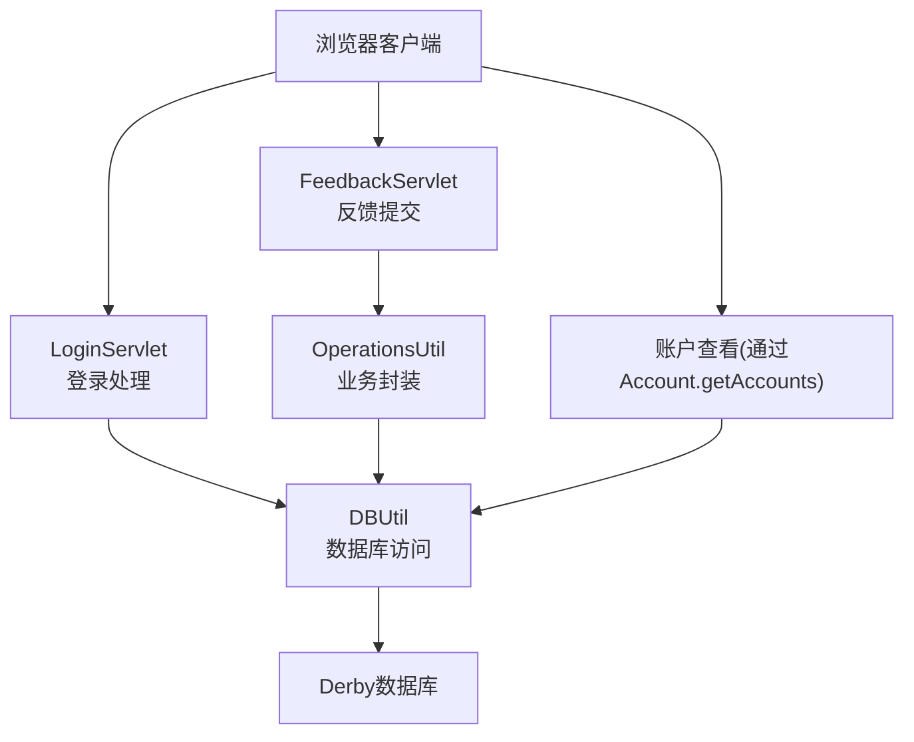
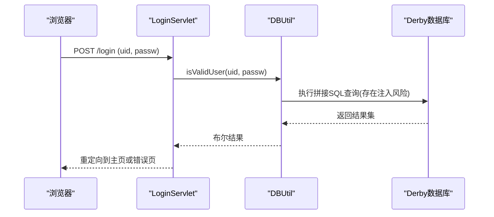
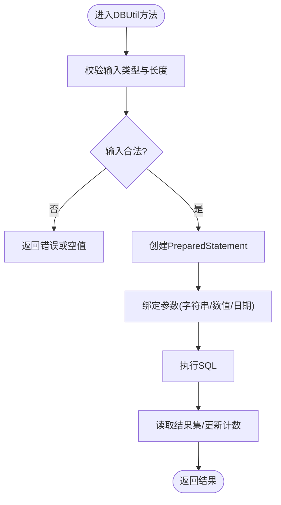
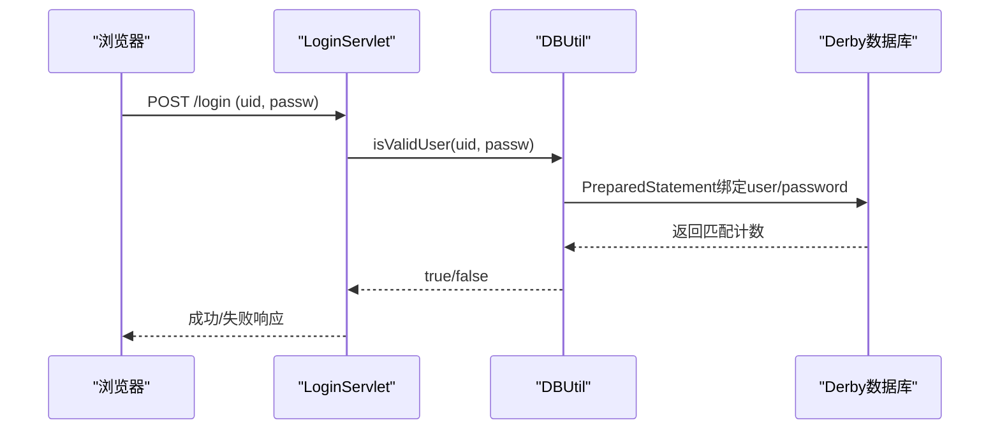
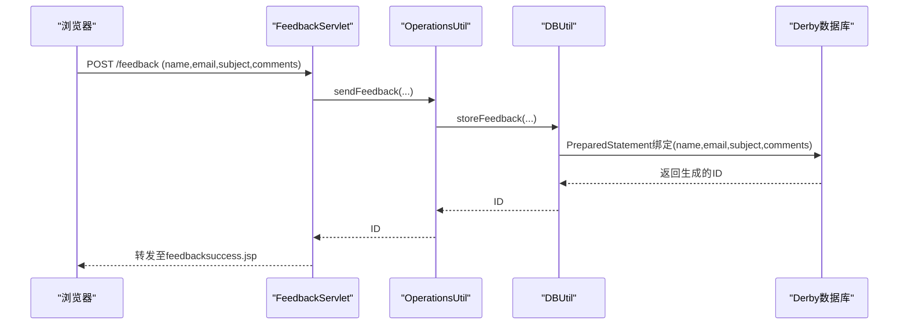
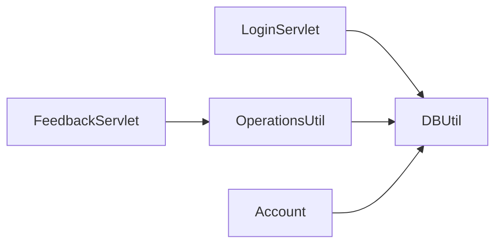

# SQL注入漏洞修复

<cite>
**本文引用的文件**   
- [DBUtil.java](file://src/com/ibm/security/appscan/altoromutual/util/DBUtil.java)
- [LoginServlet.java](file://src/com/ibm/security/appscan/altoromutual/servlet/LoginServlet.java)
- [OperationsUtil.java](file://src/com/ibm/security/appscan/altoromutual/util/OperationsUtil.java)
- [FeedbackServlet.java](file://src/com/ibm/security/appscan/altoromutual/servlet/FeedbackServlet.java)
- [Account.java](file://src/com/ibm/security/appscan/altoromutual/model/Account.java)
- [feedbacksuccess.jsp](file://WebContent/feedbacksuccess.jsp)
</cite>

## 目录
1. [简介](#简介)
2. [项目结构](#项目结构)
3. [核心组件](#核心组件)
4. [架构总览](#架构总览)
5. [详细组件分析](#详细组件分析)
6. [依赖关系分析](#依赖关系分析)
7. [性能与可维护性考虑](#性能与可维护性考虑)
8. [故障排查指南](#故障排查指南)
9. [结论](#结论)
10. [附录：修复清单与安全测试用例](#附录修复清单与安全测试用例)

## 简介
本指南面向AltoroJ应用中的SQL注入漏洞修复，目标包括：
- 识别所有拼接用户输入构造SQL的位置
- 使用PreparedStatement参数化查询替代字符串拼接
- 提供修复前后对比（以代码片段路径引用代替直接粘贴代码）
- 补充输入验证、输出编码等防护措施
- 给出安全测试用例与验证步骤，确保修复有效

## 项目结构
本项目为Java Web应用，关键目录与职责如下：
- src/com/.../servlet：处理HTTP请求的控制器
- src/com/.../util：工具类，包含数据库访问与通用操作
- src/com/.../model：数据模型
- WebContent：JSP页面与静态资源

图表来源
- [LoginServlet.java:67-104](file://src/com/ibm/security/appscan/altoromutual/servlet/LoginServlet.java#L67-L104)
- [FeedbackServlet.java:42-67](file://src/com/ibm/security/appscan/altoromutual/servlet/FeedbackServlet.java#L42-L67)
- [OperationsUtil.java:119-132](file://src/com/ibm/security/appscan/altoromutual/util/OperationsUtil.java#L119-L132)
- [DBUtil.java:99-138](file://src/com/ibm/security/appscan/altoromutual/util/DBUtil.java#L99-L138)

章节来源
- [LoginServlet.java:1-108](file://src/com/ibm/security/appscan/altoromutual/servlet/LoginServlet.java#L1-L108)
- [FeedbackServlet.java:1-70](file://src/com/ibm/security/appscan/altoromutual/servlet/FeedbackServlet.java#L1-L70)
- [OperationsUtil.java:1-155](file://src/com/ibm/security/appscan/altoromutual/util/OperationsUtil.java#L1-L155)
- [DBUtil.java:1-536](file://src/com/ibm/security/appscan/altoromutual/util/DBUtil.java#L1-L536)

## 核心组件
- DBUtil：数据库连接与SQL执行的核心工具类，存在多处SQL注入点
- LoginServlet：登录逻辑入口，调用DBUtil进行认证
- OperationsUtil：业务封装层，负责反馈存储等
- FeedbackServlet：反馈提交入口，调用OperationsUtil
- Account：账户模型，对外暴露getAccount方法

章节来源
- [DBUtil.java:45-536](file://src/com/ibm/security/appscan/altoromutual/util/DBUtil.java#L45-L536)
- [LoginServlet.java:38-108](file://src/com/ibm/security/appscan/altoromutual/servlet/LoginServlet.java#L38-L108)
- [OperationsUtil.java:16-155](file://src/com/ibm/security/appscan/altoromutual/util/OperationsUtil.java#L16-L155)
- [FeedbackServlet.java:35-70](file://src/com/ibm/security/appscan/altoromutual/servlet/FeedbackServlet.java#L35-L70)
- [Account.java:32-122](file://src/com/ibm/security/appscan/altoromutual/model/Account.java#L32-L122)

## 架构总览
以下序列图展示登录流程中SQL注入风险点及修复方向。

图表来源
- [LoginServlet.java:67-104](file://src/com/ibm/security/appscan/altoromutual/servlet/LoginServlet.java#L67-L104)
- [DBUtil.java:212-232](file://src/com/ibm/security/appscan/altoromutual/util/DBUtil.java#L212-L232)

## 详细组件分析

### DBUtil：SQL注入点识别与修复方案
DBUtil中存在多处将用户输入直接拼接到SQL语句中的位置，主要问题包括：
- 认证查询拼接用户名和密码
- 获取用户信息、账户列表、账户详情时拼接用户名或账号ID
- 转账、新增账户、新增用户、修改密码、存储反馈等写入操作拼接字符串
- 交易查询动态拼接账户ID列表和日期范围

修复原则：
- 所有涉及用户输入的SQL必须使用PreparedStatement参数化
- 对数值型参数先做类型校验再绑定
- 对日期参数使用java.sql.Date/Timestamp并严格格式校验
- 对动态IN条件使用白名单+预编译占位符生成
- 避免在SQL中使用字符串拼接；如需拼接表名/列名，需使用严格的白名单映射

#### 修复前/后对照（以路径引用代替代码内容）
- 认证查询
  - 修复前：[DBUtil.java:221-224](file://src/com/ibm/security/appscan/altoromutual/util/DBUtil.java#L221-L224)
  - 修复后：使用PreparedStatement绑定user与password参数
- 获取用户信息
  - 修复前：[DBUtil.java:245-247](file://src/com/ibm/security/appscan/altoromutual/util/DBUtil.java#L245-L247)
  - 修复后：使用PreparedStatement绑定username
- 获取用户账户列表
  - 修复前：[DBUtil.java:279-281](file://src/com/ibm/security/appscan/altoromutual/util/DBUtil.java#L279-L281)
  - 修复后：使用PreparedStatement绑定username
- 获取账户详情
  - 修复前：[DBUtil.java:454-456](file://src/com/ibm/security/appscan/altoromutual/util/DBUtil.java#L454-L456)
  - 修复后：使用PreparedStatement绑定accountNo
- 转账写入
  - 修复前：[DBUtil.java:339-357](file://src/com/ibm/security/appscan/altoromutual/util/DBUtil.java#L339-L357)
  - 修复后：使用PreparedStatement绑定账户ID、金额、日期、类型
- 交易查询动态条件
  - 修复前：[DBUtil.java:388-404](file://src/com/ibm/security/appscan/altoromutual/util/DBUtil.java#L388-L404)
  - 修复后：基于白名单账户ID构建占位符列表，使用PreparedStatement批量绑定
- 新增账户/用户/修改密码/存储反馈
  - 修复前：[DBUtil.java:472-535](file://src/com/ibm/security/appscan/altoromutual/util/DBUtil.java#L472-L535)
  - 修复后：全部改为PreparedStatement参数化

图表来源
- [DBUtil.java:212-232](file://src/com/ibm/security/appscan/altoromutual/util/DBUtil.java#L212-L232)
- [DBUtil.java:375-427](file://src/com/ibm/security/appscan/altoromutual/util/DBUtil.java#L375-L427)

章节来源
- [DBUtil.java:169-202](file://src/com/ibm/security/appscan/altoromutual/util/DBUtil.java#L169-L202)
- [DBUtil.java:212-232](file://src/com/ibm/security/appscan/altoromutual/util/DBUtil.java#L212-L232)
- [DBUtil.java:241-267](file://src/com/ibm/security/appscan/altoromutual/util/DBUtil.java#L241-L267)
- [DBUtil.java:275-293](file://src/com/ibm/security/appscan/altoromutual/util/DBUtil.java#L275-L293)
- [DBUtil.java:303-364](file://src/com/ibm/security/appscan/altoromutual/util/DBUtil.java#L303-L364)
- [DBUtil.java:375-427](file://src/com/ibm/security/appscan/altoromutual/util/DBUtil.java#L375-L427)
- [DBUtil.java:452-470](file://src/com/ibm/security/appscan/altoromutual/util/DBUtil.java#L452-L470)
- [DBUtil.java:472-535](file://src/com/ibm/security/appscan/altoromutual/util/DBUtil.java#L472-L535)

### LoginServlet：认证流程与修复要点
- 当前从请求参数获取用户名与密码，调用DBUtil.isValidUser进行认证
- 修复重点：确保DBUtil内部使用参数化查询，避免拼接用户输入

图表来源
- [LoginServlet.java:67-104](file://src/com/ibm/security/appscan/altoromutual/servlet/LoginServlet.java#L67-L104)
- [DBUtil.java:212-232](file://src/com/ibm/security/appscan/altoromutual/util/DBUtil.java#L212-L232)

章节来源
- [LoginServlet.java:67-104](file://src/com/ibm/security/appscan/altoromutual/servlet/LoginServlet.java#L67-L104)

### OperationsUtil与FeedbackServlet：反馈存储修复
- FeedbackServlet接收name/email/subject/comments，调用OperationsUtil.sendFeedback
- OperationsUtil在启用反馈保留时，对email/subject/comments做了escapeSql处理，但仍调用DBUtil.storeFeedback拼接SQL
- 修复重点：
  - 移除escapeSql作为唯一防护
  - 在DBUtil.storeFeedback中使用PreparedStatement参数化
  - 前端输出时对敏感字段进行HTML转义（XSS防护），见feedbacksuccess.jsp

图表来源
- [FeedbackServlet.java:42-67](file://src/com/ibm/security/appscan/altoromutual/servlet/FeedbackServlet.java#L42-L67)
- [OperationsUtil.java:119-132](file://src/com/ibm/security/appscan/altoromutual/util/OperationsUtil.java#L119-L132)
- [DBUtil.java:520-535](file://src/com/ibm/security/appscan/altoromutual/util/DBUtil.java#L520-L535)
- [feedbacksuccess.jsp:51-89](file://WebContent/feedbacksuccess.jsp#L51-L89)

章节来源
- [FeedbackServlet.java:42-67](file://src/com/ibm/security/appscan/altoromutual/servlet/FeedbackServlet.java#L42-L67)
- [OperationsUtil.java:119-132](file://src/com/ibm/security/appscan/altoromutual/util/OperationsUtil.java#L119-L132)
- [DBUtil.java:520-535](file://src/com/ibm/security/appscan/altoromutual/util/DBUtil.java#L520-L535)
- [feedbacksuccess.jsp:1-96](file://WebContent/feedbacksuccess.jsp#L1-L96)

### Account：账户查询修复
- Account.getAccount(String)会解析为long后调用DBUtil.getAccount(long)
- DBUtil.getAccount拼接accountNo，存在注入风险
- 修复重点：使用PreparedStatement绑定accountNo

章节来源
- [Account.java:37-48](file://src/com/ibm/security/appscan/altoromutual/model/Account.java#L37-L48)
- [DBUtil.java:452-470](file://src/com/ibm/security/appscan/altoromutual/util/DBUtil.java#L452-L470)

## 依赖关系分析
- LoginServlet依赖DBUtil进行认证
- FeedbackServlet依赖OperationsUtil，后者依赖DBUtil进行数据存储
- Account依赖DBUtil进行账户查询
- DBUtil直接操作数据库

图表来源
- [LoginServlet.java:67-104](file://src/com/ibm/security/appscan/altoromutual/servlet/LoginServlet.java#L67-L104)
- [FeedbackServlet.java:42-67](file://src/com/ibm/security/appscan/altoromutual/servlet/FeedbackServlet.java#L42-L67)
- [OperationsUtil.java:119-132](file://src/com/ibm/security/appscan/altoromutual/util/OperationsUtil.java#L119-L132)
- [Account.java:37-48](file://src/com/ibm/security/appscan/altoromutual/model/Account.java#L37-L48)
- [DBUtil.java:99-138](file://src/com/ibm/security/appscan/altoromutual/util/DBUtil.java#L99-L138)

章节来源
- [LoginServlet.java:67-104](file://src/com/ibm/security/appscan/altoromutual/servlet/LoginServlet.java#L67-L104)
- [FeedbackServlet.java:42-67](file://src/com/ibm/security/appscan/altoromutual/servlet/FeedbackServlet.java#L42-L67)
- [OperationsUtil.java:119-132](file://src/com/ibm/security/appscan/altoromutual/util/OperationsUtil.java#L119-L132)
- [Account.java:37-48](file://src/com/ibm/security/appscan/altoromutual/model/Account.java#L37-L48)
- [DBUtil.java:99-138](file://src/com/ibm/security/appscan/altoromutual/util/DBUtil.java#L99-L138)

## 性能与可维护性考虑
- 使用PreparedStatement可减少SQL解析开销，提升重复查询性能
- 参数化查询有助于统一错误处理与日志记录
- 建议引入DAO层或ORM框架进一步解耦数据库访问逻辑
- 对高频查询增加缓存策略（如本地缓存或分布式缓存）

## 故障排查指南
- 若修复后出现SQL语法错误，检查PreparedStatement参数绑定顺序与类型是否匹配
- 若交易查询报错“日期时间格式不正确”，确认传入日期符合yyyy-MM-dd HH:mm:ss格式
- 若反馈存储失败，检查enableFeedbackRetention配置与数据库权限
- 若转账失败，核对账户ID有效性、金额合法性与事务原子性

章节来源
- [DBUtil.java:407-415](file://src/com/ibm/security/appscan/altoromutual/util/DBUtil.java#L407-L415)
- [DBUtil.java:361-363](file://src/com/ibm/security/appscan/altoromutual/util/DBUtil.java#L361-L363)
- [DBUtil.java:531-534](file://src/com/ibm/security/appscan/altoromutual/util/DBUtil.java#L531-L534)

## 结论
通过对DBUtil中所有SQL拼接点的全面替换为PreparedStatement参数化查询，并结合输入校验与输出编码，可有效消除SQL注入风险。同时建议在后续演进中引入更高层的数据访问抽象，统一安全策略与监控告警。

## 附录：修复清单与安全测试用例

### 修复清单
- 认证查询：使用PreparedStatement绑定user与password
  - 参考路径：[DBUtil.java:212-232](file://src/com/ibm/security/appscan/altoromutual/util/DBUtil.java#L212-L232)
- 用户信息查询：使用PreparedStatement绑定username
  - 参考路径：[DBUtil.java:241-267](file://src/com/ibm/security/appscan/altoromutual/util/DBUtil.java#L241-L267)
- 用户账户列表查询：使用PreparedStatement绑定username
  - 参考路径：[DBUtil.java:275-293](file://src/com/ibm/security/appscan/altoromutual/util/DBUtil.java#L275-L293)
- 账户详情查询：使用PreparedStatement绑定accountNo
  - 参考路径：[DBUtil.java:452-470](file://src/com/ibm/security/appscan/altoromutual/util/DBUtil.java#L452-L470)
- 转账写入：使用PreparedStatement绑定账户ID、金额、日期、类型
  - 参考路径：[DBUtil.java:339-357](file://src/com/ibm/security/appscan/altoromutual/util/DBUtil.java#L339-L357)
- 交易查询动态条件：基于白名单账户ID构建占位符列表，使用PreparedStatement批量绑定
  - 参考路径：[DBUtil.java:388-404](file://src/com/ibm/security/appscan/altoromutual/util/DBUtil.java#L388-L404)
- 新增账户/用户/修改密码/存储反馈：全部改为PreparedStatement参数化
  - 参考路径：[DBUtil.java:472-535](file://src/com/ibm/security/appscan/altoromutual/util/DBUtil.java#L472-L535)

### 安全测试用例与验证步骤
- 认证绕过测试
  - 输入payload尝试闭合单引号并追加恒真条件，预期被拒绝
  - 验证接口：POST /login
  - 参考路径：[LoginServlet.java:67-104](file://src/com/ibm/security/appscan/altoromutual/servlet/LoginServlet.java#L67-L104), [DBUtil.java:212-232](file://src/com/ibm/security/appscan/altoromutual/util/DBUtil.java#L212-L232)
- 用户信息查询注入
  - 尝试在username字段注入UNION查询，预期无额外数据泄露
  - 参考路径：[DBUtil.java:241-267](file://src/com/ibm/security/appscan/altoromutual/util/DBUtil.java#L241-L267)
- 账户列表注入
  - 尝试在username字段注入DROP TABLE等破坏性语句，预期被阻止
  - 参考路径：[DBUtil.java:275-293](file://src/com/ibm/security/appscan/altoromutual/util/DBUtil.java#L275-L293)
- 账户详情注入
  - 尝试在accountNo字段注入，预期仅返回指定账户或空结果
  - 参考路径：[DBUtil.java:452-470](file://src/com/ibm/security/appscan/altoromutual/util/DBUtil.java#L452-L470)
- 转账注入
  - 尝试在金额或账户ID字段注入，预期被拒绝或仅按参数化执行
  - 参考路径：[DBUtil.java:339-357](file://src/com/ibm/security/appscan/altoromutual/util/DBUtil.java#L339-L357)
- 交易查询注入
  - 尝试在日期范围或账户ID列表注入，预期仅按白名单与参数化执行
  - 参考路径：[DBUtil.java:388-404](file://src/com/ibm/security/appscan/altoromutual/util/DBUtil.java#L388-L404)
- 反馈存储注入
  - 尝试在email/subject/comments注入，预期被参数化存储且前端输出已转义
  - 参考路径：[OperationsUtil.java:119-132](file://src/com/ibm/security/appscan/altoromutual/util/OperationsUtil.java#L119-L132), [DBUtil.java:520-535](file://src/com/ibm/security/appscan/altoromutual/util/DBUtil.java#L520-L535), [feedbacksuccess.jsp:51-89](file://WebContent/feedbacksuccess.jsp#L51-L89)