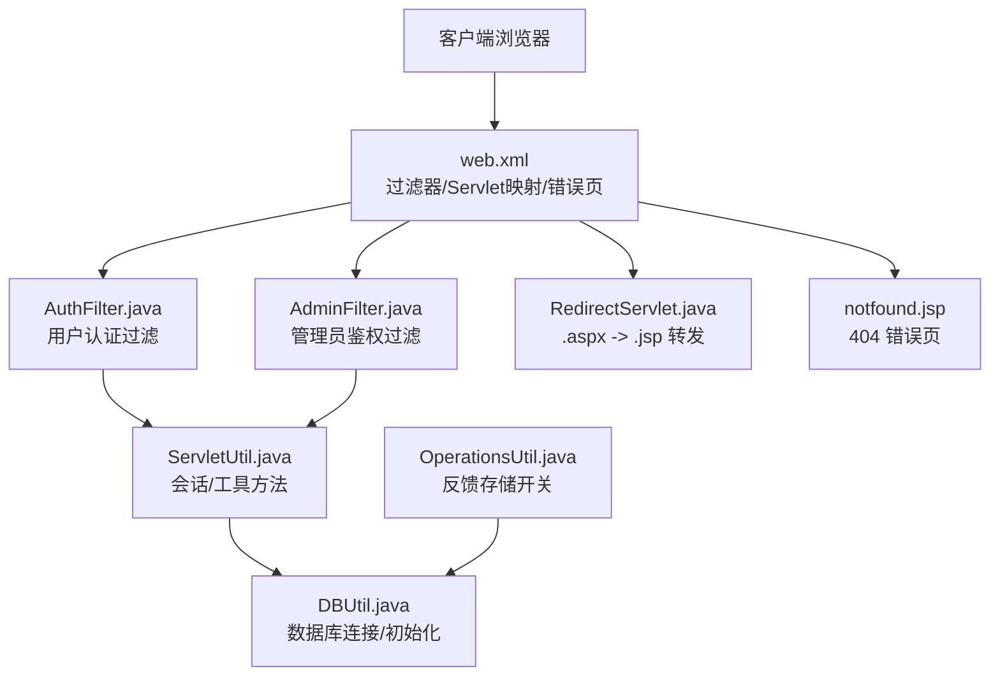
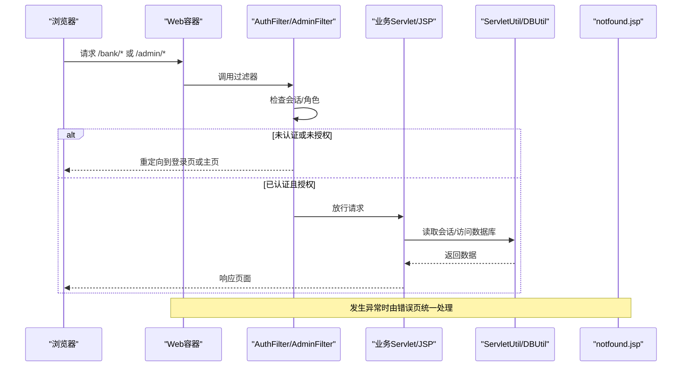
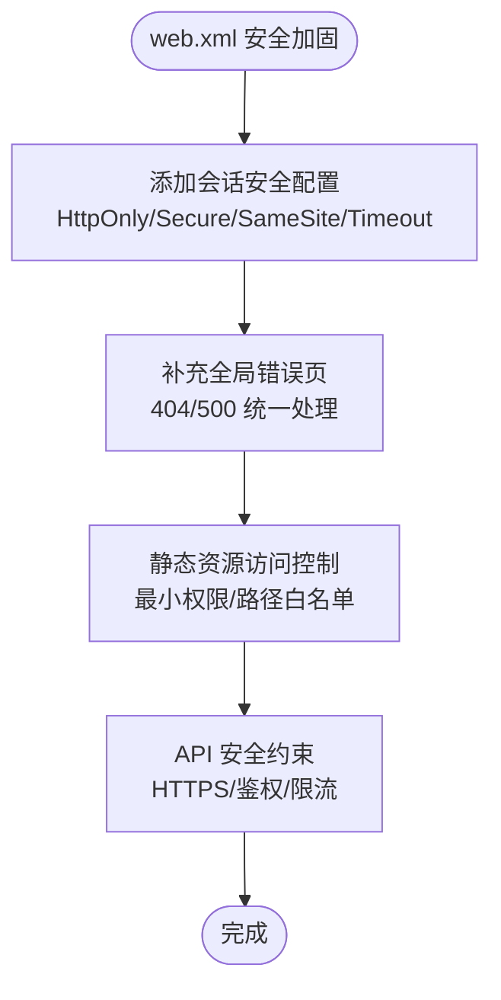
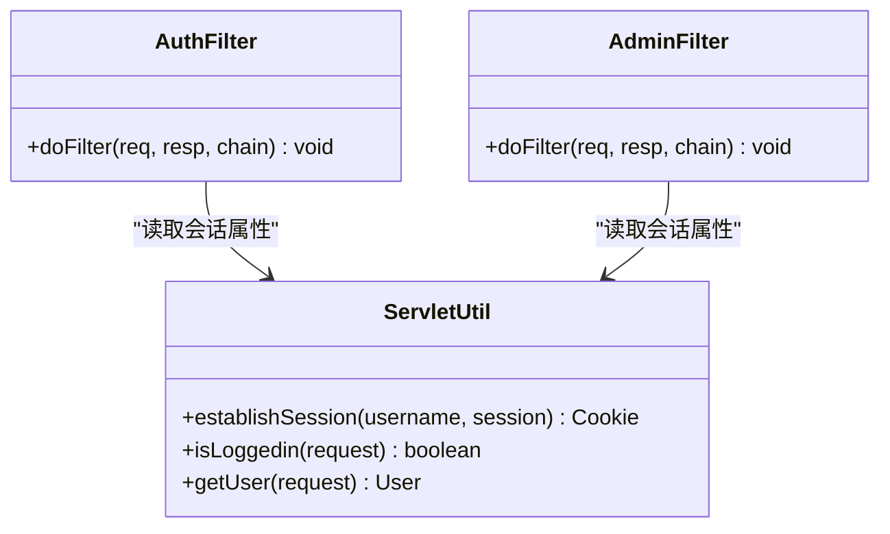
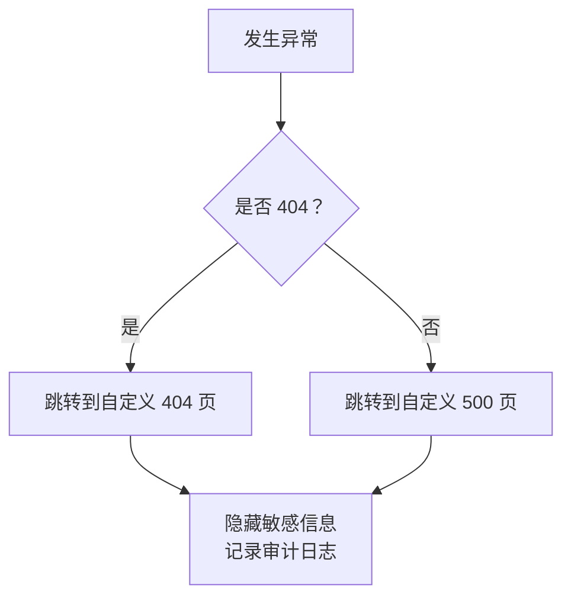
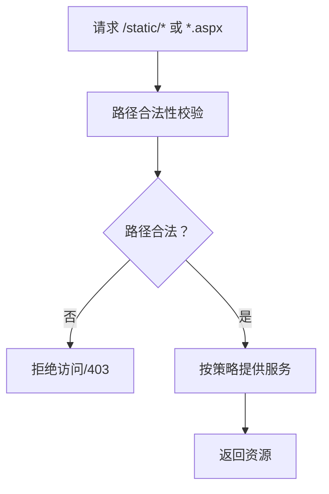
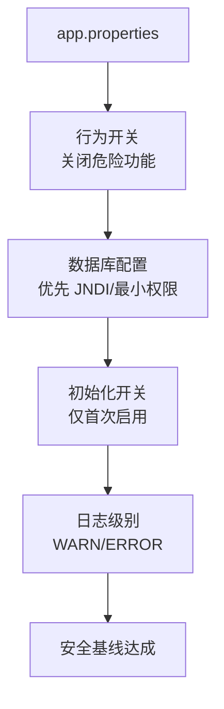
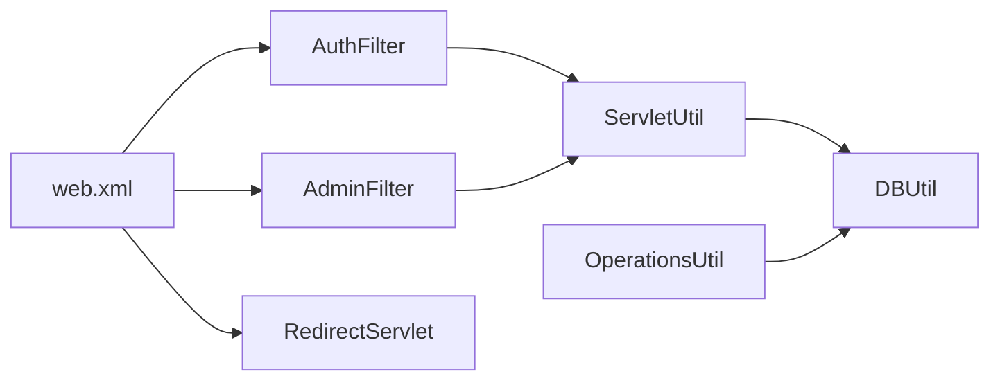

# 不安全配置修复

<cite>
**本文引用的文件**   
- [web.xml](file://WebContent/WEB-INF/web.xml)
- [app.properties](file://WebContent/WEB-INF/app.properties)
- [AuthFilter.java](file://src/com/ibm/security/appscan/altoromutual/filter/AuthFilter.java)
- [AdminFilter.java](file://src/com/ibm/security/appscan/altoromutual/filter/AdminFilter.java)
- [DBUtil.java](file://src/com/ibm/security/appscan/altoromutual/util/DBUtil.java)
- [ServletUtil.java](file://src/com/ibm/security/appscan/altoromutual/util/ServletUtil.java)
- [OperationsUtil.java](file://src/com/ibm/security/appscan/altoromutual/util/OperationsUtil.java)
- [RedirectServlet.java](file://src/com/ibm/security/appscan/altoromutual/servlet/RedirectServlet.java)
- [notfound.jsp](file://WebContent/notfound.jsp)
</cite>

## 目录
1. [引言](#引言)
2. [项目结构](#项目结构)
3. [核心组件](#核心组件)
4. [架构总览](#架构总览)
5. [详细组件分析](#详细组件分析)
6. [依赖关系分析](#依赖关系分析)
7. [性能与安全权衡](#性能与安全权衡)
8. [故障排查指南](#故障排查指南)
9. [结论](#结论)
10. [附录：生产环境安全配置模板与检查清单](#附录生产环境安全配置模板与检查清单)

## 引言
本指南聚焦 AltoroJ 中的“不安全配置”问题，提供从 web.xml、应用属性到部署层面的系统性修复建议。重点覆盖：
- 会话安全设置（HttpOnly、Secure、超时、Cookie 作用域）
- 错误页面配置（统一错误处理、敏感信息泄露防护）
- 静态资源访问控制（最小权限、路径规范化、禁止遍历）
- 应用属性安全（数据库连接池、日志级别、危险功能开关）
- 生产环境安全配置模板与部署安全检查清单

## 项目结构
AltoroJ 是一个基于 Servlet/JSP 的示例银行应用，关键安全相关位置如下：
- Web 层配置：WebContent/WEB-INF/web.xml
- 应用属性：WebContent/WEB-INF/app.properties
- 认证/鉴权过滤器：filter/AuthFilter.java、filter/AdminFilter.java
- 数据访问：util/DBUtil.java
- 会话与工具：util/ServletUtil.java
- 反馈存储逻辑：util/OperationsUtil.java
- 静态页转发：servlet/RedirectServlet.java
- 错误页面：WebContent/notfound.jsp

图表来源
- [web.xml:1-118](file://WebContent/WEB-INF/web.xml#L1-L118)
- [AuthFilter.java:40-70](file://src/com/ibm/security/appscan/altoromutual/filter/AuthFilter.java#L40-L70)
- [AdminFilter.java:40-80](file://src/com/ibm/security/appscan/altoromutual/filter/AdminFilter.java#L40-L80)
- [RedirectServlet.java:49-56](file://src/com/ibm/security/appscan/altoromutual/servlet/RedirectServlet.java#L49-L56)
- [notfound.jsp:30-42](file://WebContent/notfound.jsp#L30-L42)
- [DBUtil.java:99-138](file://src/com/ibm/security/appscan/altoromutual/util/DBUtil.java#L99-L138)
- [ServletUtil.java:340-378](file://src/com/ibm/security/appscan/altoromutual/util/ServletUtil.java#L340-L378)
- [OperationsUtil.java:119-132](file://src/com/ibm/security/appscan/altoromutual/util/OperationsUtil.java#L119-L132)

章节来源
- [web.xml:1-227](file://WebContent/WEB-INF/web.xml#L1-L227)
- [app.properties:1-74](file://WebContent/WEB-INF/app.properties#L1-L74)

## 核心组件
- 认证过滤器（AuthFilter）：对 /bank/*、/admin/*、/account.jsp 等路径进行登录态校验，未登录则重定向至登录页。
- 管理员过滤器（AdminFilter）：对 /admin/* 路径进行管理员角色或特定会话标记校验，非管理员重定向至主界面或登录页。
- 数据访问（DBUtil）：支持外部 JNDI 数据源或内置 Derby；根据 app.properties 决定是否启动时重建数据库。
- 会话工具（ServletUtil）：建立会话、获取用户对象、判断登录状态等。
- 反馈存储（OperationsUtil）：在开启 enableFeedbackRetention 时持久化反馈内容。
- 静态页转发（RedirectServlet）：将 .aspx 请求转发为同名 .jsp，用于兼容旧版静态页面。
- 错误页（notfound.jsp）：捕获异常消息并输出，存在潜在敏感信息泄露风险。

章节来源
- [AuthFilter.java:40-70](file://src/com/ibm/security/appscan/altoromutual/filter/AuthFilter.java#L40-L70)
- [AdminFilter.java:40-80](file://src/com/ibm/security/appscan/altoromutual/filter/AdminFilter.java#L40-L80)
- [DBUtil.java:99-138](file://src/com/ibm/security/appscan/altoromutual/util/DBUtil.java#L99-L138)
- [ServletUtil.java:340-378](file://src/com/ibm/security/appscan/altoromutual/util/ServletUtil.java#L340-L378)
- [OperationsUtil.java:119-132](file://src/com/ibm/security/appscan/altoromutual/util/OperationsUtil.java#L119-L132)
- [RedirectServlet.java:49-56](file://src/com/ibm/security/appscan/altoromutual/servlet/RedirectServlet.java#L49-L56)
- [notfound.jsp:30-42](file://WebContent/notfound.jsp#L30-L42)

## 架构总览
下图展示请求进入后的安全控制流程：过滤器拦截、认证/鉴权、错误页处理以及数据访问路径。

图表来源
- [web.xml:28-59](file://WebContent/WEB-INF/web.xml#L28-L59)
- [AuthFilter.java:58-70](file://src/com/ibm/security/appscan/altoromutual/filter/AuthFilter.java#L58-L70)
- [AdminFilter.java:58-80](file://src/com/ibm/security/appscan/altoromutual/filter/AdminFilter.java#L58-L80)
- [notfound.jsp:30-42](file://WebContent/notfound.jsp#L30-L42)

## 详细组件分析

### web.xml 安全配置优化
当前 web.xml 定义了过滤器、Servlet 映射和 404 错误页，但缺少以下关键安全配置：
- 会话安全：未设置 HttpOnly、Secure、SameSite、超时时间
- 全局错误处理：仅定义 404，缺少 500 等通用错误页
- 静态资源访问控制：未限制对静态资源的访问策略
- API 安全：Jersey 容器未显式启用安全约束

修复建议：
- 添加 session-config 与 cookie-config，启用 HttpOnly、Secure、SameSite，并设置合理的 session-timeout
- 增加全局错误页（如 500），避免敏感堆栈信息泄露
- 对静态资源路径（/static/*、/images/*、/swagger/*）实施访问控制或白名单
- 对 REST API（/api/*）启用 HTTPS 强制与最小权限访问

图表来源
- [web.xml:1-118](file://WebContent/WEB-INF/web.xml#L1-L118)
- [notfound.jsp:30-42](file://WebContent/notfound.jsp#L30-L42)

章节来源
- [web.xml:1-227](file://WebContent/WEB-INF/web.xml#L1-L227)

### 会话安全设置
现状：
- 会话通过 ServletUtil 建立，但未在 web.xml 中设置 Cookie 安全标志与会话超时
- 过滤器直接读取会话属性，未做跨站脚本防护

修复建议：
- 在 web.xml 中配置 session-config 与 cookie-config，启用 HttpOnly、Secure、SameSite=Strict/Lax
- 设置合理的 session-timeout（例如 15-30 分钟）
- 在登录成功后生成新的会话 ID，防止会话固定攻击
- 在过滤器中校验 Referer/Origin（可选）以缓解 CSRF

图表来源
- [ServletUtil.java:340-378](file://src/com/ibm/security/appscan/altoromutual/util/ServletUtil.java#L340-L378)
- [AuthFilter.java:58-70](file://src/com/ibm/security/appscan/altoromutual/filter/AuthFilter.java#L58-L70)
- [AdminFilter.java:58-80](file://src/com/ibm/security/appscan/altoromutual/filter/AdminFilter.java#L58-L80)

章节来源
- [ServletUtil.java:340-378](file://src/com/ibm/security/appscan/altoromutual/util/ServletUtil.java#L340-L378)
- [AuthFilter.java:58-70](file://src/com/ibm/security/appscan/altoromutual/filter/AuthFilter.java#L58-L70)
- [AdminFilter.java:58-80](file://src/com/ibm/security/appscan/altoromutual/filter/AdminFilter.java#L58-L80)

### 错误页面配置
现状：
- 仅配置 404 错误页，未配置 500 等通用错误页
- notfound.jsp 会输出异常消息，可能泄露敏感信息

修复建议：
- 在 web.xml 中添加 500 错误页，指向统一的错误处理页面
- 修改错误页逻辑，仅显示友好提示，不输出堆栈或内部路径
- 对异常信息进行脱敏与审计记录

图表来源
- [web.xml:5-8](file://WebContent/WEB-INF/web.xml#L5-L8)
- [notfound.jsp:30-42](file://WebContent/notfound.jsp#L30-L42)

章节来源
- [web.xml:5-8](file://WebContent/WEB-INF/web.xml#L5-L8)
- [notfound.jsp:30-42](file://WebContent/notfound.jsp#L30-L42)

### 静态资源访问控制
现状：
- 存在 /static/*、/images/*、/swagger/* 等静态资源目录
- RedirectServlet 将 .aspx 请求转发为 .jsp，可能存在路径遍历风险

修复建议：
- 对静态资源目录实施最小权限访问，仅允许公开资源
- 对 /swagger/* 在生产环境禁用或限制 IP 白名单
- 对 RedirectServlet 的路径解析进行严格校验，禁止 .. 与绝对路径
- 使用白名单机制限定可转发的目标路径

图表来源
- [RedirectServlet.java:49-56](file://src/com/ibm/security/appscan/altoromutual/servlet/RedirectServlet.java#L49-L56)

章节来源
- [RedirectServlet.java:49-56](file://src/com/ibm/security/appscan/altoromutual/servlet/RedirectServlet.java#L49-L56)

### 应用属性文件的安全配置建议
现状：
- app.properties 包含行为开关与数据库设置，默认均为注释状态
- 存在危险功能开关（enableAdminFunctions、advancedStaticPageProcessing、enableFeedbackRetention）

修复建议：
- 明确关闭危险功能开关（除非确需演示）
- 数据库连接优先使用外部 JNDI 数据源，避免硬编码凭据
- 仅在首次初始化时启用 database.reinitializeOnStart，生产环境保持关闭
- 日志级别设置为 WARN/ERROR，避免 DEBUG 泄露敏感信息

图表来源
- [app.properties:25-74](file://WebContent/WEB-INF/app.properties#L25-L74)
- [DBUtil.java:99-138](file://src/com/ibm/security/appscan/altoromutual/util/DBUtil.java#L99-L138)
- [OperationsUtil.java:119-132](file://src/com/ibm/security/appscan/altoromutual/util/OperationsUtil.java#L119-L132)

章节来源
- [app.properties:25-74](file://WebContent/WEB-INF/app.properties#L25-L74)
- [DBUtil.java:99-138](file://src/com/ibm/security/appscan/altoromutual/util/DBUtil.java#L99-L138)
- [OperationsUtil.java:119-132](file://src/com/ibm/security/appscan/altoromutual/util/OperationsUtil.java#L119-L132)

## 依赖关系分析
- web.xml 作为入口，注册过滤器与 Servlet，决定请求路由与错误处理
- AuthFilter 与 AdminFilter 依赖 ServletUtil 提供的会话与工具方法
- DBUtil 根据 app.properties 选择数据源与初始化策略
- OperationsUtil 在开启反馈存储时写入数据库
- RedirectServlet 负责静态页转发，需配合访问控制策略

图表来源
- [web.xml:1-118](file://WebContent/WEB-INF/web.xml#L1-L118)
- [AuthFilter.java:58-70](file://src/com/ibm/security/appscan/altoromutual/filter/AuthFilter.java#L58-L70)
- [AdminFilter.java:58-80](file://src/com/ibm/security/appscan/altoromutual/filter/AdminFilter.java#L58-L80)
- [ServletUtil.java:340-378](file://src/com/ibm/security/appscan/altoromutual/util/ServletUtil.java#L340-L378)
- [DBUtil.java:99-138](file://src/com/ibm/security/appscan/altoromutual/util/DBUtil.java#L99-L138)
- [OperationsUtil.java:119-132](file://src/com/ibm/security/appscan/altoromutual/util/OperationsUtil.java#L119-L132)
- [RedirectServlet.java:49-56](file://src/com/ibm/security/appscan/altoromutual/servlet/RedirectServlet.java#L49-L56)

章节来源
- [web.xml:1-227](file://WebContent/WEB-INF/web.xml#L1-L227)
- [AuthFilter.java:58-70](file://src/com/ibm/security/appscan/altoromutual/filter/AuthFilter.java#L58-L70)
- [AdminFilter.java:58-80](file://src/com/ibm/security/appscan/altoromutual/filter/AdminFilter.java#L58-L80)
- [ServletUtil.java:340-378](file://src/com/ibm/security/appscan/altoromutual/util/ServletUtil.java#L340-L378)
- [DBUtil.java:99-138](file://src/com/ibm/security/appscan/altoromutual/util/DBUtil.java#L99-L138)
- [OperationsUtil.java:119-132](file://src/com/ibm/security/appscan/altoromutual/util/OperationsUtil.java#L119-L132)
- [RedirectServlet.java:49-56](file://src/com/ibm/security/appscan/altoromutual/servlet/RedirectServlet.java#L49-L56)

## 性能与安全权衡
- 会话超时越短越安全，但可能影响用户体验；建议结合单点登录与令牌刷新机制平衡
- 静态资源访问控制会增加校验开销；可通过 CDN 与边缘安全策略分担
- 全局错误页与审计日志会带来少量 I/O 开销；建议异步写入与采样策略
- 数据库连接池应合理配置最大连接数与空闲超时，避免连接泄漏与资源耗尽

[本节为通用指导，不涉及具体文件分析]

## 故障排查指南
常见问题与定位要点：
- 登录后仍被重定向：检查会话属性是否正确设置、过滤器映射是否覆盖目标路径
- 管理员无法访问：确认角色或会话标记是否符合 AdminFilter 条件
- 数据库初始化失败：检查 app.properties 中 reinitializeOnStart 与数据源配置
- 错误页泄露敏感信息：检查 notfound.jsp 的输出逻辑，确保脱敏
- 静态资源访问被拒：检查路径白名单与 RedirectServlet 的转发规则

章节来源
- [AuthFilter.java:58-70](file://src/com/ibm/security/appscan/altoromutual/filter/AuthFilter.java#L58-L70)
- [AdminFilter.java:58-80](file://src/com/ibm/security/appscan/altoromutual/filter/AdminFilter.java#L58-L80)
- [DBUtil.java:99-138](file://src/com/ibm/security/appscan/altoromutual/util/DBUtil.java#L99-L138)
- [notfound.jsp:30-42](file://WebContent/notfound.jsp#L30-L42)
- [RedirectServlet.java:49-56](file://src/com/ibm/security/appscan/altoromutual/servlet/RedirectServlet.java#L49-L56)

## 结论
通过对 web.xml、应用属性与关键组件的系统性加固，可显著降低 AltoroJ 的不安全配置风险。建议在生产环境中严格执行会话安全、错误页统一、静态资源最小权限与日志脱敏策略，并结合部署检查清单逐项验证。

[本节为总结性内容，不涉及具体文件分析]

## 附录：生产环境安全配置模板与检查清单

### web.xml 安全配置模板（要点）
- 会话安全
  - 启用 HttpOnly、Secure、SameSite
  - 设置 session-timeout（建议 15-30 分钟）
- 错误处理
  - 定义 404 与 500 错误页，统一输出友好提示
- 静态资源
  - 对 /static/*、/images/*、/swagger/* 实施访问控制或白名单
- API 安全
  - 对 /api/* 启用 HTTPS 强制与鉴权
  - 限制 CORS 与请求方法

章节来源
- [web.xml:1-118](file://WebContent/WEB-INF/web.xml#L1-L118)
- [notfound.jsp:30-42](file://WebContent/notfound.jsp#L30-L42)

### app.properties 安全配置模板（要点）
- 行为开关
  - 关闭 enableAdminFunctions、advancedStaticPageProcessing、enableFeedbackRetention（除非确需）
- 数据库配置
  - 优先使用外部 JNDI 数据源（database.alternateDataSource）
  - 仅在首次初始化时启用 database.reinitializeOnStart
- 日志级别
  - 设置为 WARN/ERROR，避免 DEBUG 泄露敏感信息

章节来源
- [app.properties:25-74](file://WebContent/WEB-INF/app.properties#L25-L74)
- [DBUtil.java:99-138](file://src/com/ibm/security/appscan/altoromutual/util/DBUtil.java#L99-L138)

### 部署安全检查清单
- 会话安全
  - [ ] HttpOnly、Secure、SameSite 已启用
  - [ ] 会话超时合理
  - [ ] 登录后会话 ID 已轮换
- 错误处理
  - [ ] 404/500 错误页已配置
  - [ ] 错误页不输出敏感信息
- 静态资源
  - [ ] 静态资源访问受控
  - [ ] RedirectServlet 路径校验严格
- 数据库
  - [ ] 使用外部数据源
  - [ ] 初始化开关在生产环境关闭
- 日志与审计
  - [ ] 日志级别为 WARN/ERROR
  - [ ] 敏感信息已脱敏
- API 安全
  - [ ] HTTPS 强制
  - [ ] 鉴权与最小权限
  - [ ] CORS 与请求方法受限

[本节为通用检查清单，不涉及具体文件分析]