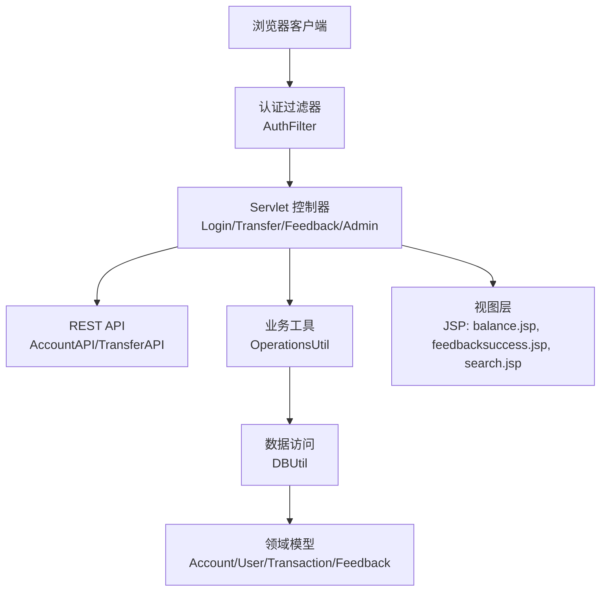
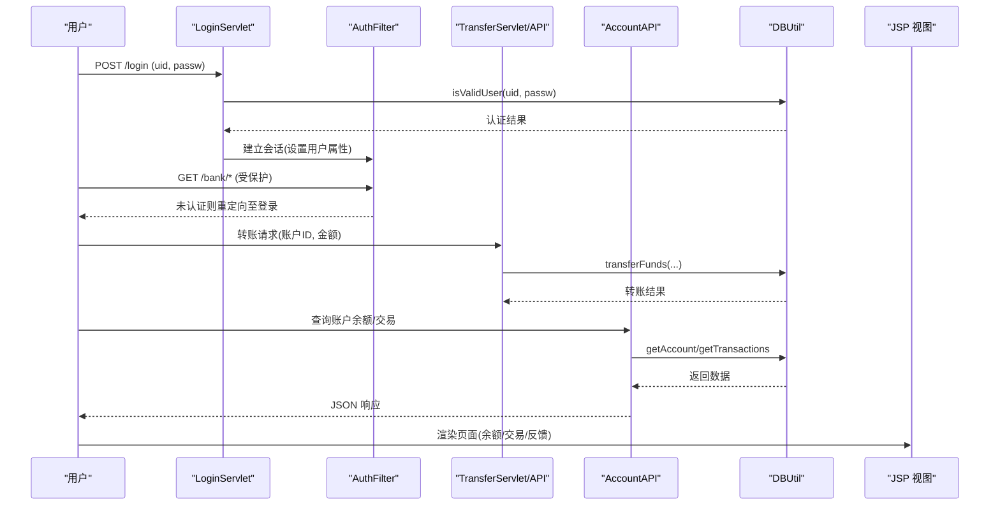
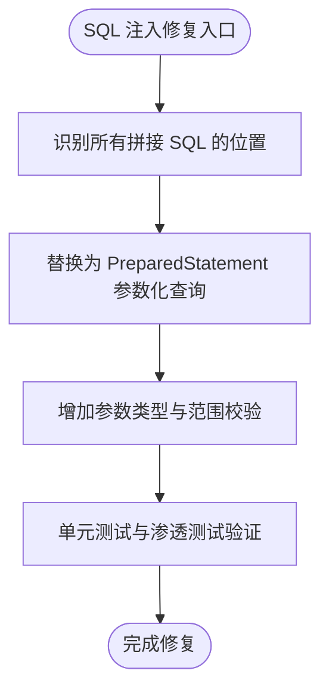
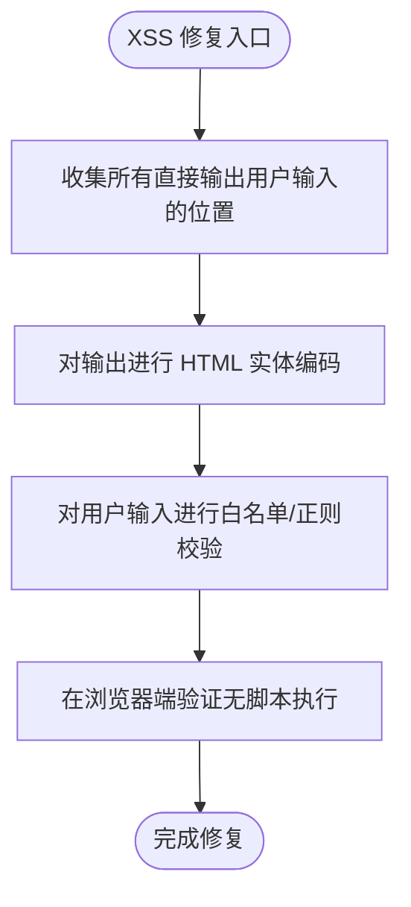
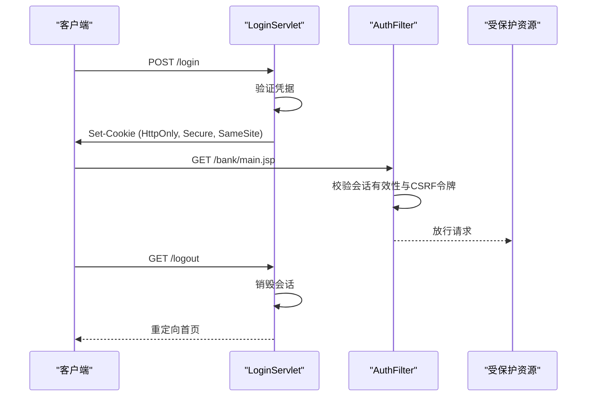
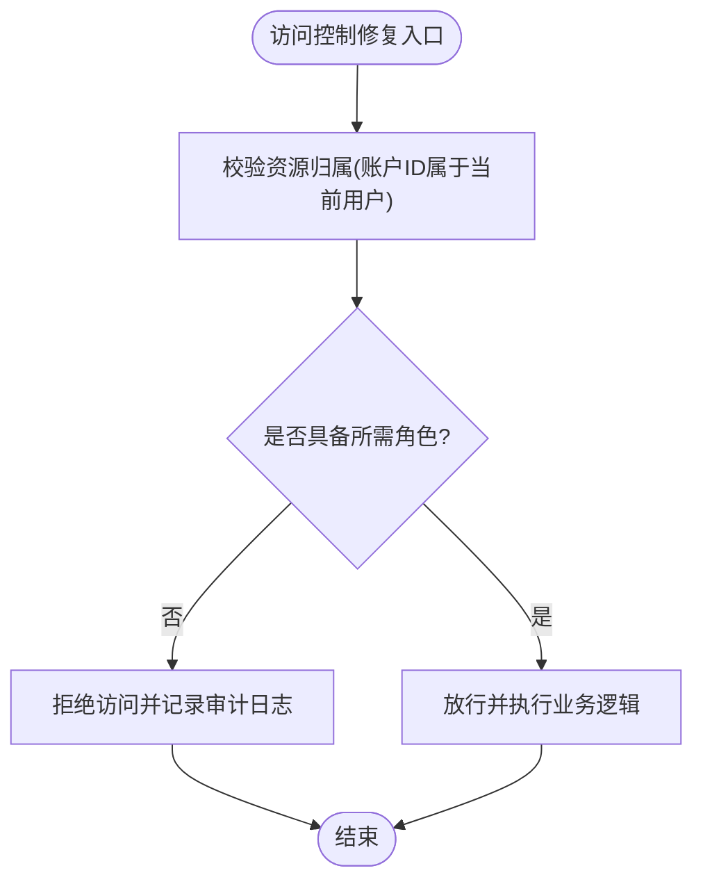
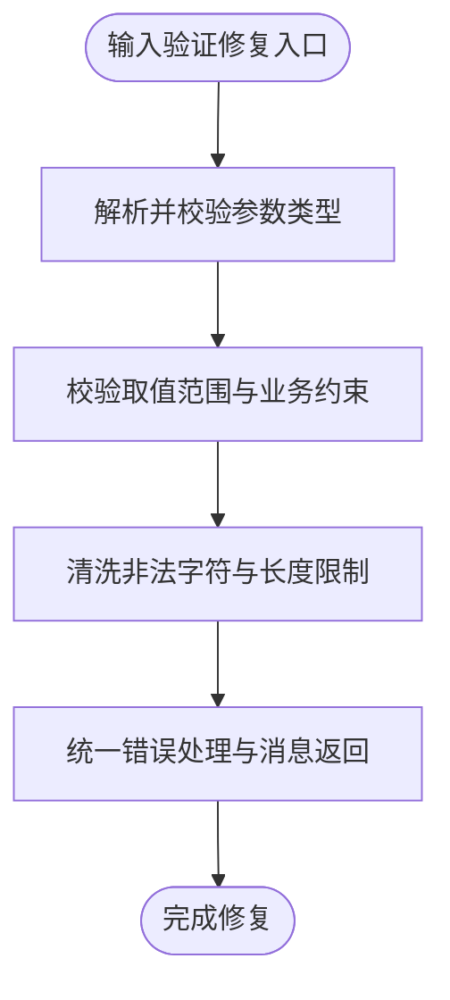
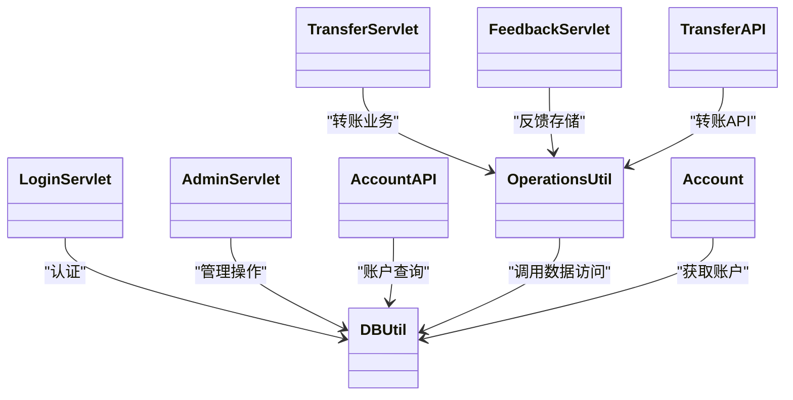

# 修复指南

<cite>
**本文引用的文件**   
- [README.md](file://README.md)
- [DBUtil.java](file://src/com/ibm/security/appscan/altoromutual/util/DBUtil.java)
- [LoginServlet.java](file://src/com/ibm/security/appscan/altoromutual/servlet/LoginServlet.java)
- [AuthFilter.java](file://src/com/ibm/security/appscan/altoromutual/filter/AuthFilter.java)
- [OperationsUtil.java](file://src/com/ibm/security/appscan/altoromutual/util/OperationsUtil.java)
- [TransferServlet.java](file://src/com/ibm/security/appscan/altoromutual/servlet/TransferServlet.java)
- [AccountAPI.java](file://src/com/ibm/security/appscan/altoromutual/api/AccountAPI.java)
- [TransferAPI.java](file://src/com/ibm/security/appscan/altoromutual/api/TransferAPI.java)
- [FeedbackServlet.java](file://src/com/ibm/security/appscan/altoromutual/servlet/FeedbackServlet.java)
- [feedbacksuccess.jsp](file://WebContent/feedbacksuccess.jsp)
- [balance.jsp](file://WebContent/bank/balance.jsp)
- [search.jsp](file://WebContent/search.jsp)
- [AdminServlet.java](file://src/com/ibm/security/appscan/altoromutual/servlet/AdminServlet.java)
- [Account.java](file://src/com/ibm/security/appscan/altoromutual/model/Account.java)
</cite>

## 目录
1. [引言](#引言)
2. [项目结构](#项目结构)
3. [核心组件](#核心组件)
4. [架构总览](#架构总览)
5. [详细组件分析与修复方案](#详细组件分析与修复方案)
6. [依赖关系分析](#依赖关系分析)
7. [性能与可维护性考虑](#性能与可维护性考虑)
8. [故障排查与安全测试](#故障排查与安全测试)
9. [结论](#结论)

## 引言
本修复指南面向 AltoroJ 已知安全漏洞，提供从代码级修复、配置加固到架构改进的系统化方案。重点覆盖：参数化查询、输入验证、输出编码、会话安全、访问控制等安全编码规范；并给出修复前后对照与可执行的安全测试方法。AltoroJ 是一个用于演示常见 Web 应用漏洞的示例银行系统，其设计目标并非生产安全，因此必须按本指南逐项修复后方可进入受控环境或生产使用。

## 项目结构
AltoroJ 采用传统 J2EE 分层组织：
- 表现层：JSP 页面（如 feedbacksuccess.jsp、balance.jsp、search.jsp）
- 控制器层：Servlet（如 LoginServlet、TransferServlet、FeedbackServlet、AdminServlet）
- API 层：REST 接口（AccountAPI、TransferAPI）
- 业务工具：OperationsUtil
- 数据访问：DBUtil
- 模型：Account、User、Transaction、Feedback
- 过滤器：AuthFilter（认证拦截）

图表来源
- [AuthFilter.java:58-69](file://src/com/ibm/security/appscan/altoromutual/filter/AuthFilter.java#L58-L69)
- [LoginServlet.java:67-105](file://src/com/ibm/security/appscan/altoromutual/servlet/LoginServlet.java#L67-L105)
- [TransferServlet.java:51-68](file://src/com/ibm/security/appscan/altoromutual/servlet/TransferServlet.java#L51-L68)
- [FeedbackServlet.java:42-68](file://src/com/ibm/security/appscan/altoromutual/servlet/FeedbackServlet.java#L42-L68)
- [AccountAPI.java:59-92](file://src/com/ibm/security/appscan/altoromutual/api/AccountAPI.java#L59-L92)
- [TransferAPI.java:17-43](file://src/com/ibm/security/appscan/altoromutual/api/TransferAPI.java#L17-L43)
- [OperationsUtil.java:18-36](file://src/com/ibm/security/appscan/altoromutual/util/OperationsUtil.java#L18-L36)
- [DBUtil.java:212-232](file://src/com/ibm/security/appscan/altoromutual/util/DBUtil.java#L212-L232)

章节来源
- [README.md:1-10](file://README.md#L1-L10)

## 核心组件
- 认证与会话：LoginServlet 负责登录流程，AuthFilter 对受保护资源进行统一鉴权，ServletUtil 管理会话属性与 Cookie。
- 转账与账户：TransferServlet/TransferAPI 处理转账请求；AccountAPI 暴露账户余额与交易查询；DBUtil 封装数据库操作。
- 反馈与搜索：FeedbackServlet 接收用户反馈；feedbacksuccess.jsp 展示结果；search.jsp 提供站点搜索。
- 管理功能：AdminServlet 提供管理员操作入口。

章节来源
- [LoginServlet.java:67-105](file://src/com/ibm/security/appscan/altoromutual/servlet/LoginServlet.java#L67-L105)
- [AuthFilter.java:58-69](file://src/com/ibm/security/appscan/altoromutual/filter/AuthFilter.java#L58-L69)
- [TransferServlet.java:51-68](file://src/com/ibm/security/appscan/altoromutual/servlet/TransferServlet.java#L51-L68)
- [AccountAPI.java:59-92](file://src/com/ibm/security/appscan/altoromutual/api/AccountAPI.java#L59-L92)
- [FeedbackServlet.java:42-68](file://src/com/ibm/security/appscan/altoromutual/servlet/FeedbackServlet.java#L42-L68)
- [search.jsp:31-45](file://WebContent/search.jsp#L31-L45)
- [AdminServlet.java:39-120](file://src/com/ibm/security/appscan/altoromutual/servlet/AdminServlet.java#L39-L120)

## 架构总览
下图展示了关键安全路径：登录认证、受保护资源访问、转账与账户查询、反馈提交与展示、搜索输出。

图表来源
- [LoginServlet.java:67-105](file://src/com/ibm/security/appscan/altoromutual/servlet/LoginServlet.java#L67-L105)
- [AuthFilter.java:58-69](file://src/com/ibm/security/appscan/altoromutual/filter/AuthFilter.java#L58-L69)
- [TransferServlet.java:51-68](file://src/com/ibm/security/appscan/altoromutual/servlet/TransferServlet.java#L51-L68)
- [AccountAPI.java:59-92](file://src/com/ibm/security/appscan/altoromutual/api/AccountAPI.java#L59-L92)
- [DBUtil.java:303-364](file://src/com/ibm/security/appscan/altoromutual/util/DBUtil.java#L303-L364)

## 详细组件分析与修复方案

### 1. SQL 注入修复（登录、用户信息、账户、转账、反馈存储）
问题概述
- DBUtil 多处使用字符串拼接构造 SQL，存在 SQL 注入风险。
- 受影响方法包括：isValidUser、getUserInfo、getAccounts、transferFunds、getAccount、addAccount/addUser/changePassword/storeFeedback 等。

修复要点
- 全面替换为 PreparedStatement 参数化查询。
- 对数值型参数进行严格类型校验与范围检查。
- 将业务逻辑与 SQL 构建解耦，避免在业务层拼接 SQL。

修复前（示意）
- 登录认证：直接拼接用户名和密码到 SQL。
- 转账：动态拼接账户 ID、日期、类型、金额到 SQL。
- 反馈存储：直接拼接 name/email/subject/comments。

修复后（实现建议）
- 所有查询使用占位符和 setXxx 绑定参数。
- 对账户 ID 使用 Long.parseLong 并校验正数范围。
- 对金额使用 BigDecimal 或 double 校验非负且不超过上限。
- 对日期使用标准格式校验（yyyy-MM-dd HH:mm:ss）。

图表来源
- [DBUtil.java:212-232](file://src/com/ibm/security/appscan/altoromutual/util/DBUtil.java#L212-L232)
- [DBUtil.java:303-364](file://src/com/ibm/security/appscan/altoromutual/util/DBUtil.java#L303-L364)
- [DBUtil.java:452-470](file://src/com/ibm/security/appscan/altoromutual/util/DBUtil.java#L452-L470)
- [DBUtil.java:472-535](file://src/com/ibm/security/appscan/altoromutual/util/DBUtil.java#L472-L535)

章节来源
- [DBUtil.java:212-232](file://src/com/ibm/security/appscan/altoromutual/util/DBUtil.java#L212-L232)
- [DBUtil.java:303-364](file://src/com/ibm/security/appscan/altoromutual/util/DBUtil.java#L303-L364)
- [DBUtil.java:452-470](file://src/com/ibm/security/appscan/altoromutual/util/DBUtil.java#L452-L470)
- [DBUtil.java:472-535](file://src/com/ibm/security/appscan/altoromutual/util/DBUtil.java#L472-L535)

### 2. 跨站脚本（XSS）修复（反馈展示、搜索输出、余额页）
问题概述
- feedbacksuccess.jsp 直接输出用户提供的 name/email/subject/message，存在反射型 XSS。
- search.jsp 直接输出 query 参数，存在反射型 XSS。
- balance.jsp 中部分值来自用户可控参数（如 acctId），需确保输出编码。

修复要点
- 对所有用户输入在输出到 HTML 时进行上下文感知的编码（HTML 实体编码）。
- 对 email 字段进行严格的正则校验与白名单过滤。
- 对查询参数进行长度限制与字符集限制。

修复前（示意）
- feedbacksuccess.jsp 直接输出 request.getAttribute("message_feedback") 与 email。
- search.jsp 直接输出 <%= query %>。
- balance.jsp 直接使用 paramName 作为账户标识并参与显示。

修复后（实现建议）
- 使用统一的输出编码工具类（例如 Apache Commons Text StringEscapeUtils.escapeHtml4 或框架内置编码器）。
- 对 email 使用 EMAIL_REGEXP 校验后再输出。
- 对 query 参数进行长度与字符集限制，并在输出前编码。

图表来源
- [feedbacksuccess.jsp:42-49](file://WebContent/feedbacksuccess.jsp#L42-L49)
- [feedbacksuccess.jsp:70-88](file://WebContent/feedbacksuccess.jsp#L70-L88)
- [search.jsp:31-45](file://WebContent/search.jsp#L31-L45)
- [balance.jsp:37-52](file://WebContent/bank/balance.jsp#L37-L52)

章节来源
- [feedbacksuccess.jsp:42-49](file://WebContent/feedbacksuccess.jsp#L42-L49)
- [feedbacksuccess.jsp:70-88](file://WebContent/feedbacksuccess.jsp#L70-L88)
- [search.jsp:31-45](file://WebContent/search.jsp#L31-L45)
- [balance.jsp:37-52](file://WebContent/bank/balance.jsp#L37-L52)

### 3. 会话与认证安全修复
问题概述
- LoginServlet 创建会话并设置用户属性，但未设置 Cookie 的 HttpOnly/Secure/SameSite 标志。
- AuthFilter 仅检查 session 属性，未校验会话固定、超时与并发登录策略。
- 注销流程未销毁会话，仅移除属性。

修复要点
- 登录成功后生成新会话 ID，防止会话固定攻击。
- 设置 Cookie 标志：HttpOnly、Secure（HTTPS）、SameSite=Strict/Lax。
- 会话超时配置与空闲过期策略。
- 注销时调用 invalidateSession 并清理相关属性。
- 在过滤器中增加 CSRF 防护与请求来源校验。

图表来源
- [LoginServlet.java:67-105](file://src/com/ibm/security/appscan/altoromutual/servlet/LoginServlet.java#L67-L105)
- [AuthFilter.java:58-69](file://src/com/ibm/security/appscan/altoromutual/filter/AuthFilter.java#L58-L69)

章节来源
- [LoginServlet.java:67-105](file://src/com/ibm/security/appscan/altoromutual/servlet/LoginServlet.java#L67-L105)
- [AuthFilter.java:58-69](file://src/com/ibm/security/appscan/altoromutual/filter/AuthFilter.java#L58-L69)

### 4. 访问控制与越权修复（转账、账户查看、管理功能）
问题概述
- TransferServlet/TransferAPI 允许任意账户 ID 作为转账目标，缺少所有权校验。
- AccountAPI 获取账户余额时未校验当前用户是否拥有该账户权限。
- AdminServlet 未做角色校验，任何已登录用户均可执行管理员操作。

修复要点
- 在转账与账户查询前，校验当前会话用户是否为资源所有者。
- 引入基于角色的访问控制（RBAC），对管理接口强制 admin 角色。
- 对敏感操作增加二次确认与审计日志。

图表来源
- [TransferServlet.java:51-68](file://src/com/ibm/security/appscan/altoromutual/servlet/TransferServlet.java#L51-L68)
- [TransferAPI.java:17-43](file://src/com/ibm/security/appscan/altoromutual/api/TransferAPI.java#L17-L43)
- [AccountAPI.java:59-92](file://src/com/ibm/security/appscan/altoromutual/api/AccountAPI.java#L59-L92)
- [AdminServlet.java:39-120](file://src/com/ibm/security/appscan/altoromutual/servlet/AdminServlet.java#L39-L120)

章节来源
- [TransferServlet.java:51-68](file://src/com/ibm/security/appscan/altoromutual/servlet/TransferServlet.java#L51-L68)
- [TransferAPI.java:17-43](file://src/com/ibm/security/appscan/altoromutual/api/TransferAPI.java#L17-L43)
- [AccountAPI.java:59-92](file://src/com/ibm/security/appscan/altoromutual/api/AccountAPI.java#L59-L92)
- [AdminServlet.java:39-120](file://src/com/ibm/security/appscan/altoromutual/servlet/AdminServlet.java#L39-L120)

### 5. 输入验证与健壮性修复
问题概述
- 转账金额与账户 ID 解析可能抛出异常，未捕获并返回友好错误。
- FeedbackServlet 未对 name/email/subject/comments 进行长度与格式校验。
- search.jsp 未对 query 进行长度与字符集限制。

修复要点
- 对所有外部输入进行白名单校验（类型、长度、格式、范围）。
- 对数字类型使用 try-catch 包裹解析，失败时返回明确错误码。
- 对文本输入进行长度限制与非法字符过滤。

图表来源
- [TransferServlet.java:51-68](file://src/com/ibm/security/appscan/altoromutual/servlet/TransferServlet.java#L51-L68)
- [FeedbackServlet.java:42-68](file://src/com/ibm/security/appscan/altoromutual/servlet/FeedbackServlet.java#L42-L68)
- [search.jsp:31-45](file://WebContent/search.jsp#L31-L45)

章节来源
- [TransferServlet.java:51-68](file://src/com/ibm/security/appscan/altoromutual/servlet/TransferServlet.java#L51-L68)
- [FeedbackServlet.java:42-68](file://src/com/ibm/security/appscan/altoromutual/servlet/FeedbackServlet.java#L42-L68)
- [search.jsp:31-45](file://WebContent/search.jsp#L31-L45)

### 6. 输出编码与内容类型安全
问题概述
- JSP 直接输出用户输入，可能导致 XSS。
- REST API 返回 JSON 时未设置正确的 Content-Type，可能被浏览器误解析。

修复要点
- 在所有 JSP 中使用统一输出编码工具。
- 在 REST API 中显式设置 response.setContentType("application/json; charset=UTF-8")。
- 对富文本输出启用 CSP（内容安全策略）头。

章节来源
- [feedbacksuccess.jsp:42-49](file://WebContent/feedbacksuccess.jsp#L42-L49)
- [feedbacksuccess.jsp:70-88](file://WebContent/feedbacksuccess.jsp#L70-L88)
- [search.jsp:31-45](file://WebContent/search.jsp#L31-L45)
- [TransferAPI.java:17-43](file://src/com/ibm/security/appscan/altoromutual/api/TransferAPI.java#L17-L43)

### 7. 配置与部署加固
建议
- 禁用不必要的调试与开发特性（如 Swagger UI 在生产环境）。
- 启用 HTTPS 与 HSTS，配置强密码策略与最小权限原则。
- 配置会话超时、Cookie 安全标志与 CSRF 防护。
- 关闭自动数据库初始化开关（database.reinitializeOnStart=false）。

章节来源
- [README.md:33-37](file://README.md#L33-L37)

## 依赖关系分析
- Servlet 与工具类耦合度高：TransferServlet、FeedbackServlet、AdminServlet 均依赖 OperationsUtil 与 DBUtil。
- DBUtil 承担过多职责：包含连接管理、数据初始化、CRUD 操作，建议拆分为 DAO 层。
- 模型与数据访问分离不足：Account.getAccount 直接调用 DBUtil，建议通过 Repository 抽象。

图表来源
- [LoginServlet.java:67-105](file://src/com/ibm/security/appscan/altoromutual/servlet/LoginServlet.java#L67-L105)
- [TransferServlet.java:51-68](file://src/com/ibm/security/appscan/altoromutual/servlet/TransferServlet.java#L51-L68)
- [FeedbackServlet.java:42-68](file://src/com/ibm/security/appscan/altoromutual/servlet/FeedbackServlet.java#L42-L68)
- [AdminServlet.java:39-120](file://src/com/ibm/security/appscan/altoromutual/servlet/AdminServlet.java#L39-L120)
- [AccountAPI.java:59-92](file://src/com/ibm/security/appscan/altoromutual/api/AccountAPI.java#L59-L92)
- [TransferAPI.java:17-43](file://src/com/ibm/security/appscan/altoromutual/api/TransferAPI.java#L17-L43)
- [OperationsUtil.java:18-36](file://src/com/ibm/security/appscan/altoromutual/util/OperationsUtil.java#L18-L36)
- [DBUtil.java:212-232](file://src/com/ibm/security/appscan/altoromutual/util/DBUtil.java#L212-L232)
- [Account.java:37-48](file://src/com/ibm/security/appscan/altoromutual/model/Account.java#L37-L48)

章节来源
- [OperationsUtil.java:18-36](file://src/com/ibm/security/appscan/altoromutual/util/OperationsUtil.java#L18-L36)
- [DBUtil.java:212-232](file://src/com/ibm/security/appscan/altoromutual/util/DBUtil.java#L212-L232)
- [Account.java:37-48](file://src/com/ibm/security/appscan/altoromutual/model/Account.java#L37-L48)

## 性能与可维护性考虑
- 连接池：建议使用容器提供的 DataSource 与连接池，避免每次新建连接。
- 分页与限流：对交易列表与反馈列表实施分页与速率限制。
- 缓存：对静态内容与只读账户信息使用缓存（如 Redis）。
- 日志与审计：对敏感操作（登录、转账、管理）记录审计日志，便于追踪与分析。

[本节为通用指导，不直接分析具体文件]

## 故障排查与安全测试
常见问题
- 数据库初始化失败：检查 user.home 目录权限与 derby.system.home 配置。
- 编译错误：运行 Gradle 构建以下载依赖。

安全测试方法
- SQL 注入：尝试在登录表单与转账参数中注入单引号、注释符与布尔表达式，验证是否被参数化查询阻止。
- XSS：在反馈名称、邮箱、主题与评论中插入 ，验证是否被编码或过滤。
- 越权访问：使用普通用户账号尝试访问其他用户的账户余额与转账接口，验证是否被拒绝。
- 会话劫持：尝试复用旧会话 Cookie，验证是否被刷新与失效。
- CSRF：对转账接口发起跨站请求，验证是否被 CSRF 令牌或 SameSite 防护阻止。

章节来源
- [README.md:44-57](file://README.md#L44-L57)

## 结论
通过对 AltoroJ 的代码级修复与架构改进，可以显著降低 SQL 注入、XSS、会话劫持、越权访问等安全风险。建议在修复完成后进行全面的自动化扫描与人工渗透测试，并将安全实践纳入持续集成流程，确保后续变更不会引入新的漏洞。