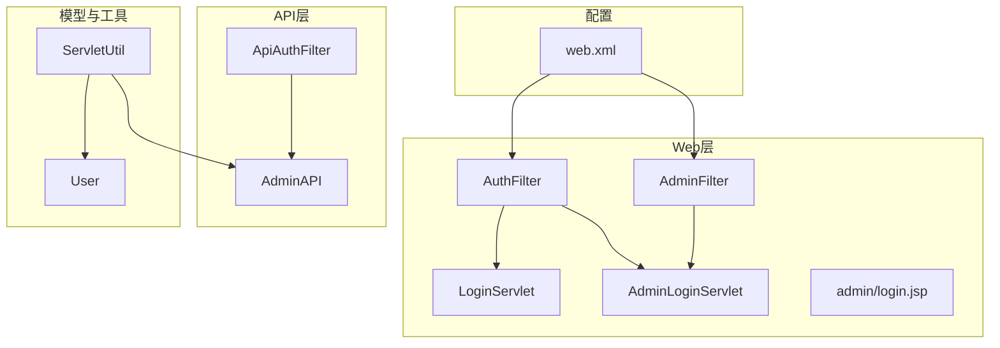
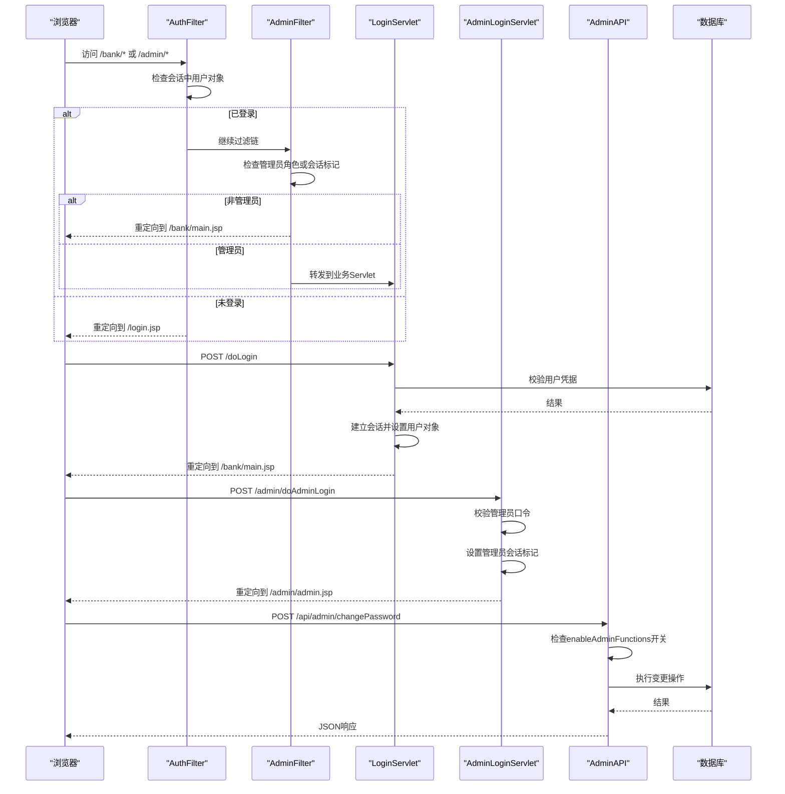
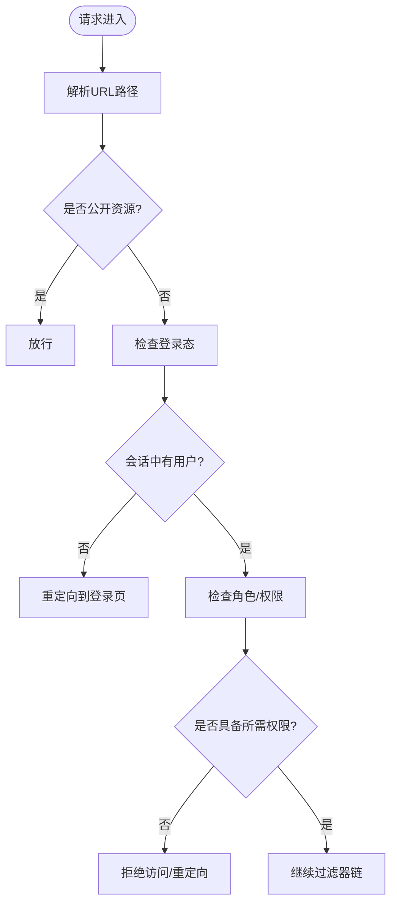
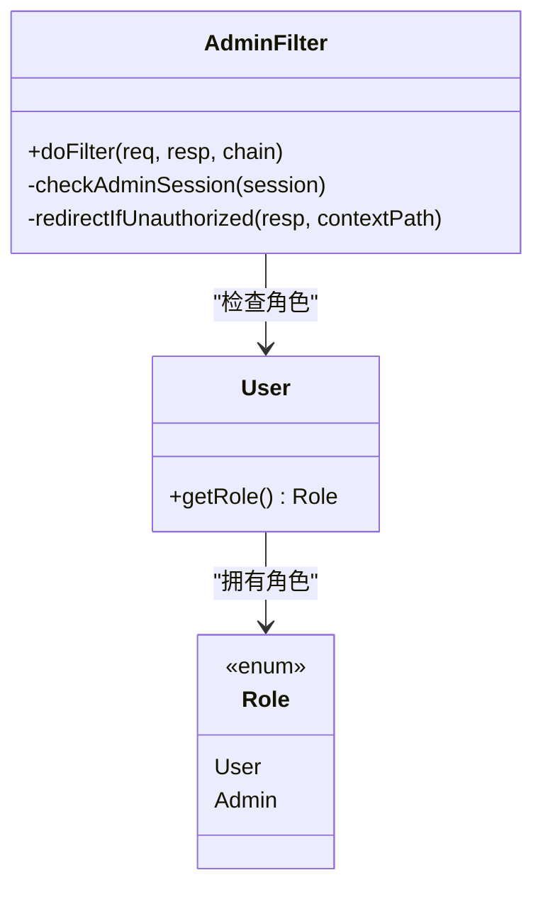
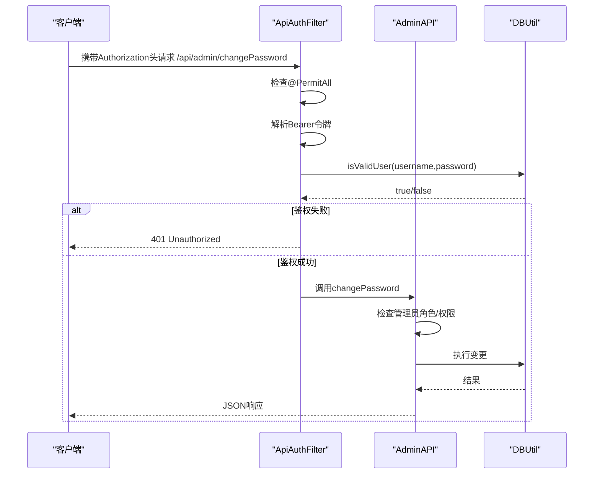
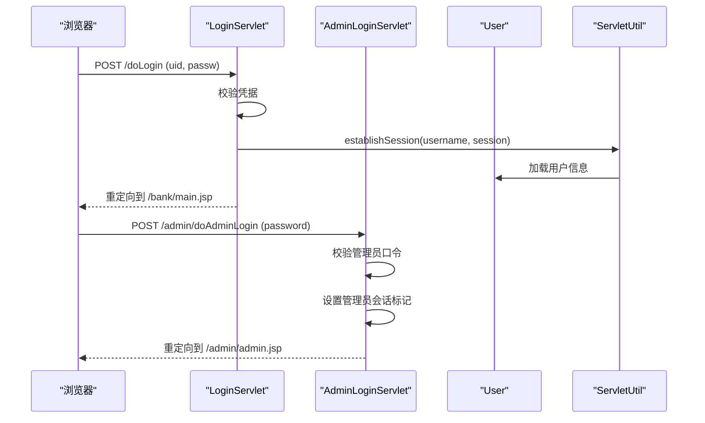
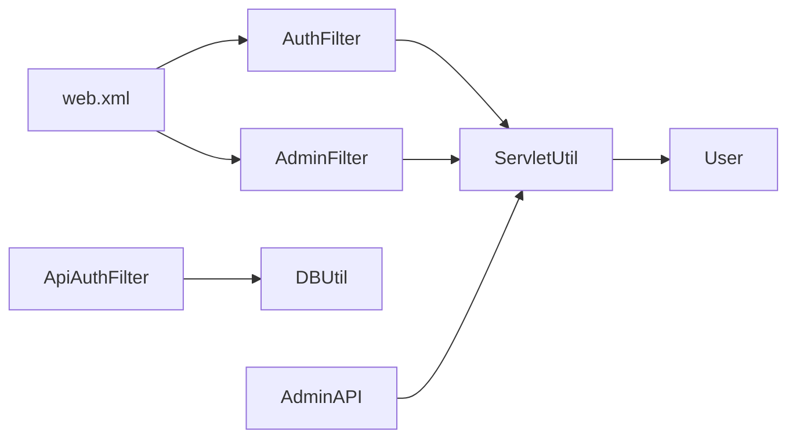

# 授权绕过漏洞修复

<cite>
**本文引用的文件**   
- [README.md](file://README.md)
- [web.xml](file://WebContent/WEB-INF/web.xml)
- [AuthFilter.java](file://src/com/ibm/security/appscan/altoromutual/filter/AuthFilter.java)
- [AdminFilter.java](file://src/com/ibm/security/appscan/altoromutual/filter/AdminFilter.java)
- [ApiAuthFilter.java](file://src/com/ibm/security/appscan/altoromutual/filter/ApiAuthFilter.java)
- [User.java](file://src/com/ibm/security/appscan/altoromutual/model/User.java)
- [ServletUtil.java](file://src/com/ibm/security/appscan/altoromutual/util/ServletUtil.java)
- [LoginServlet.java](file://src/com/ibm/security/appscan/altoromutual/servlet/LoginServlet.java)
- [AdminLoginServlet.java](file://src/com/ibm/security/appscan/altoromutual/servlet/AdminLoginServlet.java)
- [AdminAPI.java](file://src/com/ibm/security/appscan/altoromutual/api/AdminAPI.java)
- [login.jsp（管理员）](file://WebContent/admin/login.jsp)
</cite>

## 目录
1. [引言](#引言)
2. [项目结构](#项目结构)
3. [核心组件](#核心组件)
4. [架构总览](#架构总览)
5. [详细组件分析](#详细组件分析)
6. [依赖关系分析](#依赖关系分析)
7. [性能与可扩展性](#性能与可扩展性)
8. [故障排查指南](#故障排查指南)
9. [结论](#结论)
10. [附录：修复清单与测试用例](#附录修复清单与测试用例)

## 引言
本指南面向AltoroJ中的“授权绕过”漏洞，提供基于角色的访问控制（RBAC）的修复方案。重点包括：
- 管理员权限验证与资源访问控制策略
- Servlet过滤器链的安全配置与URL级权限控制
- REST API鉴权与细粒度权限控制
- 具体的权限检查实现思路与配置文件修改建议
- 安全测试策略与回归验证方法

AltoroJ是一个用于演示常见Web应用安全问题的示例银行系统，其设计目标并非生产环境使用，因此存在多处已知安全问题。请在隔离环境中运行并遵循仓库说明进行风险评估与修复。

**章节来源**
- [README.md:1-10](file://README.md#L1-L10)

## 项目结构
本项目采用传统Java Web结构：
- Web层：JSP页面、Servlet控制器、过滤器
- API层：基于Jersey的REST接口
- 模型层：用户、账户、交易等实体
- 工具层：数据库连接、会话与属性工具类

**图表来源**
- [web.xml:12-59](file://WebContent/WEB-INF/web.xml#L12-L59)
- [AuthFilter.java:40-70](file://src/com/ibm/security/appscan/altoromutual/filter/AuthFilter.java#L40-L70)
- [AdminFilter.java:40-81](file://src/com/ibm/security/appscan/altoromutual/filter/AdminFilter.java#L40-L81)
- [ApiAuthFilter.java:20-74](file://src/com/ibm/security/appscan/altoromutual/filter/ApiAuthFilter.java#L20-L74)
- [AdminAPI.java:17-63](file://src/com/ibm/security/appscan/altoromutual/api/AdminAPI.java#L17-L63)
- [User.java:30-54](file://src/com/ibm/security/appscan/altoromutual/model/User.java#L30-L54)
- [ServletUtil.java:58-63](file://src/com/ibm/security/appscan/altoromutual/util/ServletUtil.java#L58-L63)

**章节来源**
- [web.xml:12-59](file://WebContent/WEB-INF/web.xml#L12-L59)

## 核心组件
- AuthFilter：对银行相关路径进行登录态校验，未登录则重定向到登录页
- AdminFilter：对管理端路径进行管理员权限校验，支持角色或会话标记判断
- ApiAuthFilter：对REST API进行Bearer令牌鉴权，结合DB校验用户名密码
- User：用户模型，包含角色枚举Role（User/Admin）
- ServletUtil：会话键常量、属性读取、用户会话建立与查询
- LoginServlet / AdminLoginServlet：处理用户与管理员登录逻辑
- AdminAPI：暴露管理员相关的REST接口（如改密、新增用户），当前缺少严格的权限校验

**章节来源**
- [AuthFilter.java:40-70](file://src/com/ibm/security/appscan/altoromutual/filter/AuthFilter.java#L40-L70)
- [AdminFilter.java:40-81](file://src/com/ibm/security/appscan/altoromutual/filter/AdminFilter.java#L40-L81)
- [ApiAuthFilter.java:20-74](file://src/com/ibm/security/appscan/altoromutual/filter/ApiAuthFilter.java#L20-L74)
- [User.java:30-54](file://src/com/ibm/security/appscan/altoromutual/model/User.java#L30-L54)
- [ServletUtil.java:58-63](file://src/com/ibm/security/appscan/altoromutual/util/ServletUtil.java#L58-L63)
- [LoginServlet.java:67-101](file://src/com/ibm/security/appscan/altoromutual/servlet/LoginServlet.java#L67-L101)
- [AdminLoginServlet.java:40-54](file://src/com/ibm/security/appscan/altoromutual/servlet/AdminLoginServlet.java#L40-L54)
- [AdminAPI.java:17-63](file://src/com/ibm/security/appscan/altoromutual/api/AdminAPI.java#L17-L63)

## 架构总览
下图展示请求从浏览器进入，经过过滤器链、Servlet/API处理，再到数据层的流程，以及权限校验的关键点。

**图表来源**
- [web.xml:12-59](file://WebContent/WEB-INF/web.xml#L12-L59)
- [AuthFilter.java:58-69](file://src/com/ibm/security/appscan/altoromutual/filter/AuthFilter.java#L58-L69)
- [AdminFilter.java:58-81](file://src/com/ibm/security/appscan/altoromutual/filter/AdminFilter.java#L58-L81)
- [LoginServlet.java:67-101](file://src/com/ibm/security/appscan/altoromutual/servlet/LoginServlet.java#L67-L101)
- [AdminLoginServlet.java:40-54](file://src/com/ibm/security/appscan/altoromutual/servlet/AdminLoginServlet.java#L40-L54)
- [AdminAPI.java:20-63](file://src/com/ibm/security/appscan/altoromutual/api/AdminAPI.java#L20-L63)

## 详细组件分析

### 过滤器链与URL级权限控制
- web.xml中定义了AuthFilter和AdminFilter及其映射规则：
  - /bank/* 由AuthFilter保护
  - /admin/* 由AuthFilter保护，同时AdminFilter应保护管理端（但存在URL拼写错误导致未生效）
  - /account.jsp 由AuthFilter保护
- 关键问题：
  - AdminFilter映射为/adimn/*（拼写错误），导致/admin/*未被正确拦截
  - 仅依赖会话中的用户对象与角色判断，缺乏统一的权限策略中心

修复要点：
- 修正AdminFilter映射为/admin/*
- 统一在过滤器中集中进行URL到权限的匹配，避免分散逻辑
- 引入白名单机制，允许公开资源（如登录页、静态资源）跳过鉴权

**图表来源**
- [web.xml:12-59](file://WebContent/WEB-INF/web.xml#L12-L59)
- [AuthFilter.java:58-69](file://src/com/ibm/security/appscan/altoromutual/filter/AuthFilter.java#L58-L69)
- [AdminFilter.java:58-81](file://src/com/ibm/security/appscan/altoromutual/filter/AdminFilter.java#L58-L81)

**章节来源**
- [web.xml:12-59](file://WebContent/WEB-INF/web.xml#L12-L59)
- [AuthFilter.java:58-69](file://src/com/ibm/security/appscan/altoromutual/filter/AuthFilter.java#L58-L69)
- [AdminFilter.java:58-81](file://src/com/ibm/security/appscan/altoromutual/filter/AdminFilter.java#L58-L81)

### 管理员权限验证与角色控制
- AdminFilter通过以下逻辑判断管理员：
  - 会话中存在User且角色为Admin
  - 或会话中存在特定管理员标记键值
- 若未满足条件：
  - 如果是管理员登录页或登录动作，放行
  - 否则重定向到登录页或银行主页

修复要点：
- 移除硬编码的管理员会话标记，改为基于数据库的角色认证
- 将角色判断集中在一个可配置的权限服务中，便于扩展细粒度权限
- 确保所有管理端URL均被AdminFilter拦截

**图表来源**
- [AdminFilter.java:58-81](file://src/com/ibm/security/appscan/altoromutual/filter/AdminFilter.java#L58-L81)
- [User.java:30-54](file://src/com/ibm/security/appscan/altoromutual/model/User.java#L30-L54)

**章节来源**
- [AdminFilter.java:58-81](file://src/com/ibm/security/appscan/altoromutual/filter/AdminFilter.java#L58-L81)
- [User.java:30-54](file://src/com/ibm/security/appscan/altoromutual/model/User.java#L30-L54)

### REST API鉴权与细粒度权限控制
- ApiAuthFilter对REST API进行鉴权：
  - 支持@PermitAll注解的方法跳过鉴权
  - 解析Authorization头中的Bearer令牌
  - 解码后校验用户名密码，调用DBUtil.isValidUser
- AdminAPI暴露管理员功能：
  - changePassword/addUser等方法受enableAdminFunctions开关控制
  - 当前未对调用者进行管理员角色校验，存在越权风险

修复要点：
- 在ApiAuthFilter中增加角色校验，要求管理员角色才能访问/admin/*下的API
- 在AdminAPI中增加服务端权限校验，不依赖前端或配置开关
- 引入细粒度权限（如“可改密”、“可新增用户”），通过注解或策略表控制

**图表来源**
- [ApiAuthFilter.java:29-74](file://src/com/ibm/security/appscan/altoromutual/filter/ApiAuthFilter.java#L29-L74)
- [AdminAPI.java:20-63](file://src/com/ibm/security/appscan/altoromutual/api/AdminAPI.java#L20-L63)

**章节来源**
- [ApiAuthFilter.java:29-74](file://src/com/ibm/security/appscan/altoromutual/filter/ApiAuthFilter.java#L29-L74)
- [AdminAPI.java:20-63](file://src/com/ibm/security/appscan/altoromutual/api/AdminAPI.java#L20-L63)

### 登录与会话建立
- LoginServlet处理用户登录：
  - 校验用户名密码
  - 通过ServletUtil.establishSession建立会话，设置用户对象
  - 重定向到银行主页
- AdminLoginServlet处理管理员登录：
  - 校验管理员口令
  - 设置管理员会话标记（存在安全风险）
  - 重定向到管理后台

修复要点：
- 管理员登录也应基于数据库角色认证，而非硬编码口令
- 移除管理员会话标记，统一使用User对象与Role进行权限判断
- 增强口令强度与防暴力破解策略

**图表来源**
- [LoginServlet.java:67-101](file://src/com/ibm/security/appscan/altoromutual/servlet/LoginServlet.java#L67-L101)
- [AdminLoginServlet.java:40-54](file://src/com/ibm/security/appscan/altoromutual/servlet/AdminLoginServlet.java#L40-L54)
- [ServletUtil.java:340-353](file://src/com/ibm/security/appscan/altoromutual/util/ServletUtil.java#L340-L353)

**章节来源**
- [LoginServlet.java:67-101](file://src/com/ibm/security/appscan/altoromutual/servlet/LoginServlet.java#L67-L101)
- [AdminLoginServlet.java:40-54](file://src/com/ibm/security/appscan/altoromutual/servlet/AdminLoginServlet.java#L40-L54)
- [ServletUtil.java:340-353](file://src/com/ibm/security/appscan/altoromutual/util/ServletUtil.java#L340-L353)

## 依赖关系分析
- 过滤器依赖User与ServletUtil以获取会话与属性
- API层依赖DbUtil进行用户校验
- 配置层web.xml定义过滤器映射与Servlet路由
- 模型层User提供角色能力

**图表来源**
- [web.xml:12-59](file://WebContent/WEB-INF/web.xml#L12-L59)
- [AuthFilter.java:58-69](file://src/com/ibm/security/appscan/altoromutual/filter/AuthFilter.java#L58-L69)
- [AdminFilter.java:58-81](file://src/com/ibm/security/appscan/altoromutual/filter/AdminFilter.java#L58-L81)
- [ApiAuthFilter.java:29-74](file://src/com/ibm/security/appscan/altoromutual/filter/ApiAuthFilter.java#L29-L74)
- [AdminAPI.java:20-63](file://src/com/ibm/security/appscan/altoromutual/api/AdminAPI.java#L20-L63)
- [ServletUtil.java:58-63](file://src/com/ibm/security/appscan/altoromutual/util/ServletUtil.java#L58-L63)
- [User.java:30-54](file://src/com/ibm/security/appscan/altoromutual/model/User.java#L30-L54)

**章节来源**
- [web.xml:12-59](file://WebContent/WEB-INF/web.xml#L12-L59)

## 性能与可扩展性
- 过滤器链应在早期阶段完成鉴权，减少后续处理开销
- 角色与权限建议集中化管理，避免在每个Servlet/API中重复判断
- 对于高频API，考虑缓存用户角色与权限，降低数据库压力
- 引入权限策略表与注解驱动的方式，提升扩展性与可维护性

[本节为通用指导，不涉及具体文件分析]

## 故障排查指南
常见问题与定位步骤：
- 管理端无法访问：
  - 检查web.xml中AdminFilter映射是否为/admin/*（原代码为/adimn/*）
  - 确认AdminFilter是否正确拦截请求
- 登录后仍被重定向：
  - 检查AuthFilter是否检测到会话中的User对象
  - 确认LoginServlet是否正确设置会话
- API鉴权失败：
  - 检查Authorization头格式与Bearer令牌内容
  - 确认DBUtil.isValidUser返回结果
- 管理员功能不可用：
  - 检查enableAdminFunctions配置项
  - 确认AdminAPI中权限校验逻辑

**章节来源**
- [web.xml:44-51](file://WebContent/WEB-INF/web.xml#L44-L51)
- [AuthFilter.java:58-69](file://src/com/ibm/security/appscan/altoromutual/filter/AuthFilter.java#L58-L69)
- [LoginServlet.java:67-101](file://src/com/ibm/security/appscan/altoromutual/servlet/LoginServlet.java#L67-L101)
- [ApiAuthFilter.java:29-74](file://src/com/ibm/security/appscan/altoromutual/filter/ApiAuthFilter.java#L29-L74)
- [AdminAPI.java:53-63](file://src/com/ibm/security/appscan/altoromutual/api/AdminAPI.java#L53-L63)

## 结论
通过对过滤器链、登录流程、API鉴权与管理员权限的全面修复，可以显著降低授权绕过风险。建议：
- 修正web.xml中的过滤器映射错误
- 统一基于User.Role进行权限判断，移除硬编码会话标记
- 在API层增加管理员角色与细粒度权限校验
- 引入集中化的权限策略与配置管理
- 完善安全测试与回归验证

[本节为总结性内容，不涉及具体文件分析]

## 附录：修复清单与测试用例

### 修复清单
- 修正web.xml中AdminFilter映射为/admin/*
- 在AuthFilter与AdminFilter中统一鉴权逻辑，支持白名单与角色校验
- 移除AdminLoginServlet中的硬编码管理员口令，改用数据库角色认证
- 在ApiAuthFilter中增加管理员角色校验
- 在AdminAPI中增加服务端权限校验，不依赖enableAdminFunctions开关
- 引入细粒度权限控制（如“可改密”、“可新增用户”）

**章节来源**
- [web.xml:44-51](file://WebContent/WEB-INF/web.xml#L44-L51)
- [AdminLoginServlet.java:40-54](file://src/com/ibm/security/appscan/altoromutual/servlet/AdminLoginServlet.java#L40-L54)
- [ApiAuthFilter.java:29-74](file://src/com/ibm/security/appscan/altoromutual/filter/ApiAuthFilter.java#L29-L74)
- [AdminAPI.java:53-63](file://src/com/ibm/security/appscan/altoromutual/api/AdminAPI.java#L53-L63)

### 安全测试策略
- URL级权限测试：
  - 未登录访问/bank/*与/admin/*，应被重定向到登录页
  - 普通用户访问/admin/*，应被拒绝
- 管理员权限测试：
  - 管理员访问/admin/*，应成功
  - 管理员调用/api/admin/changePassword与/api/admin/addUser，应具备相应权限
- API鉴权测试：
  - 不带Authorization头的请求应返回401
  - 非法Bearer令牌应返回401
  - 合法令牌但非管理员角色访问/admin/* API应返回403
- 会话与角色一致性测试：
  - 登录后User对象与Role应一致
  - 会话失效后访问受保护资源应被重定向

**章节来源**
- [AuthFilter.java:58-69](file://src/com/ibm/security/appscan/altoromutual/filter/AuthFilter.java#L58-L69)
- [AdminFilter.java:58-81](file://src/com/ibm/security/appscan/altoromutual/filter/AdminFilter.java#L58-L81)
- [ApiAuthFilter.java:29-74](file://src/com/ibm/security/appscan/altoromutual/filter/ApiAuthFilter.java#L29-L74)
- [AdminAPI.java:20-63](file://src/com/ibm/security/appscan/altoromutual/api/AdminAPI.java#L20-L63)