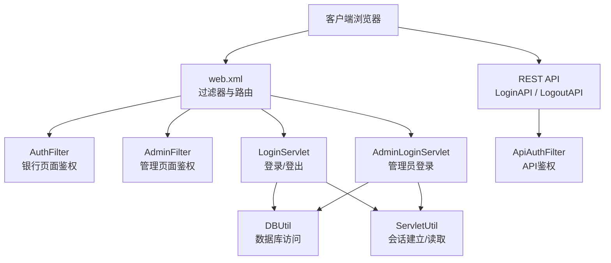
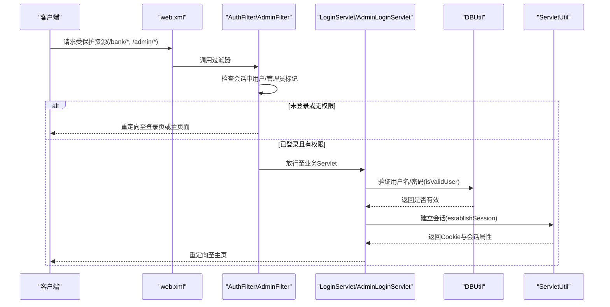
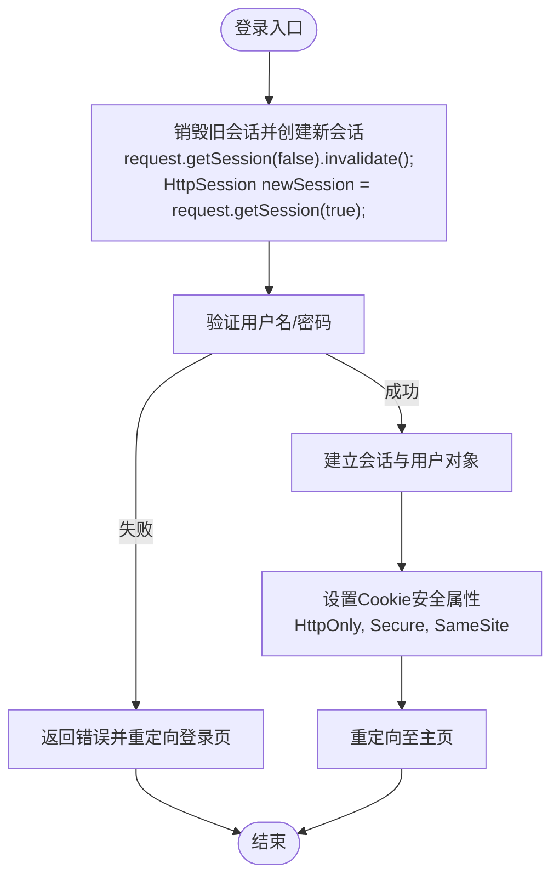
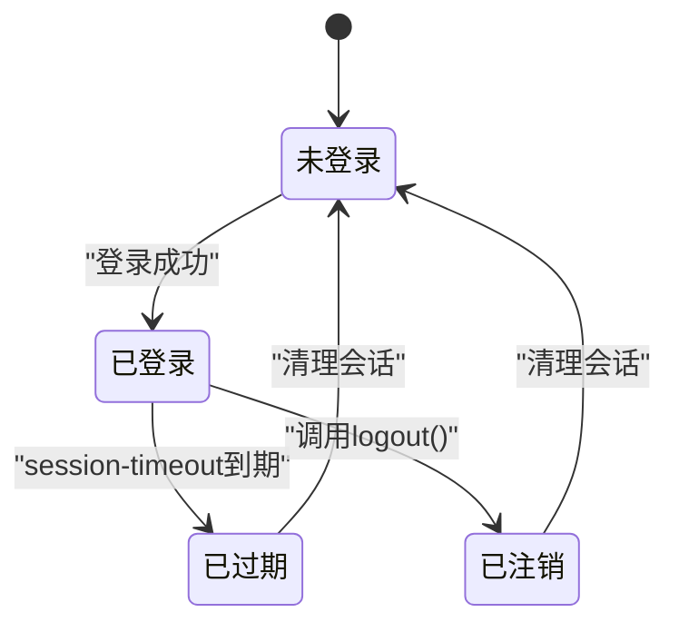
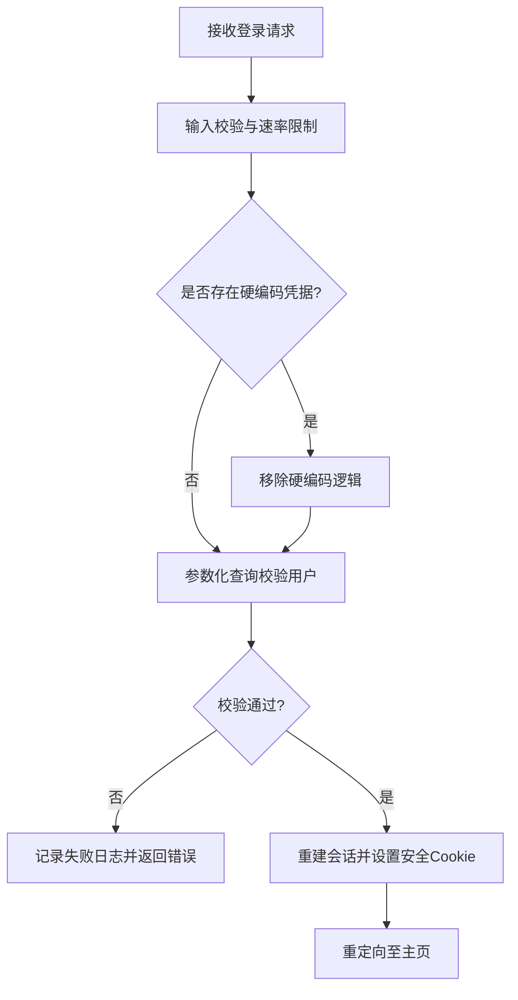
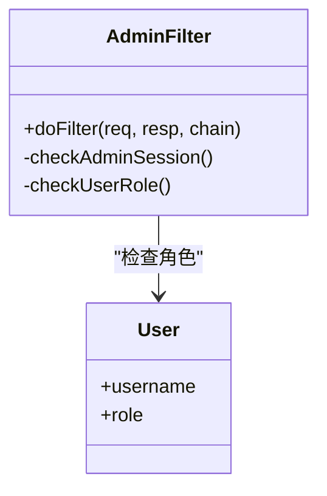
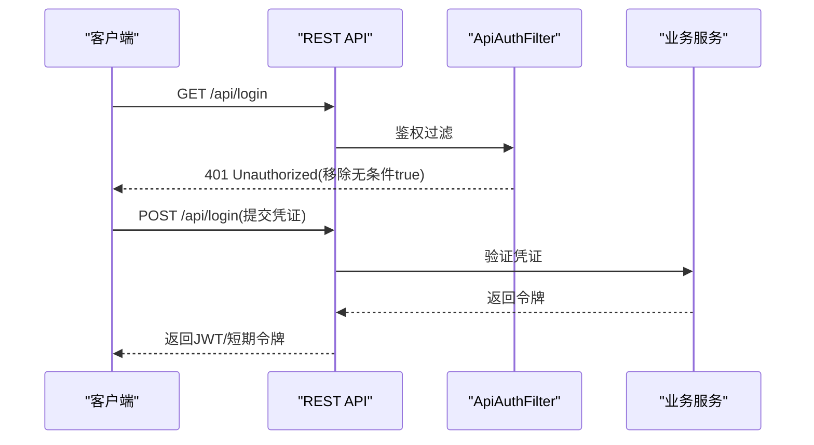
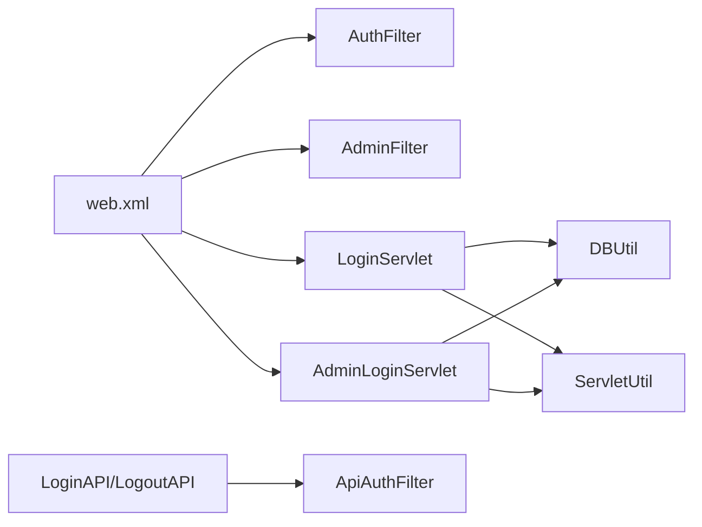

# 认证绕过漏洞修复

<cite>
**本文引用的文件**   
- [web.xml](file://WebContent/WEB-INF/web.xml)
- [app.properties](file://WebContent/WEB-INF/app.properties)
- [LoginServlet.java](file://src/com/ibm/security/appscan/altoromutual/servlet/LoginServlet.java)
- [AdminLoginServlet.java](file://src/com/ibm/security/appscan/altoromutual/servlet/AdminLoginServlet.java)
- [AuthFilter.java](file://src/com/ibm/security/appscan/altoromutual/filter/AuthFilter.java)
- [AdminFilter.java](file://src/com/ibm/security/appscan/altoromutual/filter/AdminFilter.java)
- [DBUtil.java](file://src/com/ibm/security/appscan/altoromutual/util/DBUtil.java)
- [ServletUtil.java](file://src/com/ibm/security/appscan/altoromutual/util/ServletUtil.java)
- [LoginAPI.java](file://src/com/ibm/security/appscan/altoromutual/api/LoginAPI.java)
- [LogoutAPI.java](file://src/com/ibm/security/appscan/altoromutual/api/LogoutAPI.java)
- [ApiAuthFilter.java](file://src/com/ibm/security/appscan/altoromutual/filter/ApiAuthFilter.java)
</cite>

## 目录
1. [引言](#引言)
2. [项目结构](#项目结构)
3. [核心组件](#核心组件)
4. [架构总览](#架构总览)
5. [详细组件分析](#详细组件分析)
6. [依赖关系分析](#依赖关系分析)
7. [性能与可用性考虑](#性能与可用性考虑)
8. [故障排查指南](#故障排查指南)
9. [结论](#结论)
10. [附录：修复清单与测试用例](#附录修复清单与测试用例)

## 引言
本指南面向 AltoroJ 中的“认证绕过”问题，提供从会话管理、认证流程到权限校验的完整修复方案。重点包括：
- 会话固定攻击防护
- 会话超时与失效策略
- 安全的会话存储与 Cookie 安全属性
- 密码验证的安全实现（防注入、禁用硬编码凭据）
- 用户权限检查机制（普通用户与管理员）
- REST API 鉴权加固
- 可执行的修复步骤与安全配置修改建议
- 测试验证方法与最佳实践

## 项目结构
AltoroJ 是一个基于 Servlet/JSP 的传统 Java Web 应用，认证相关逻辑分布在以下位置：
- 过滤器：AuthFilter、AdminFilter、ApiAuthFilter
- Servlet：LoginServlet、AdminLoginServlet
- 工具类：DBUtil、ServletUtil
- 配置：web.xml、app.properties
- REST API：LoginAPI、LogoutAPI

图表来源
- [web.xml:12-68](file://WebContent/WEB-INF/web.xml#L12-L68)
- [AuthFilter.java:40-70](file://src/com/ibm/security/appscan/altoromutual/filter/AuthFilter.java#L40-L70)
- [AdminFilter.java:40-81](file://src/com/ibm/security/appscan/altoromutual/filter/AdminFilter.java#L40-L81)
- [LoginServlet.java:38-107](file://src/com/ibm/security/appscan/altoromutual/servlet/LoginServlet.java#L38-L107)
- [AdminLoginServlet.java:37-55](file://src/com/ibm/security/appscan/altoromutual/servlet/AdminLoginServlet.java#L37-L55)
- [DBUtil.java:212-232](file://src/com/ibm/security/appscan/altoromutual/util/DBUtil.java#L212-L232)
- [ServletUtil.java:340-353](file://src/com/ibm/security/appscan/altoromutual/util/ServletUtil.java#L340-L353)
- [LoginAPI.java:19-41](file://src/com/ibm/security/appscan/altoromutual/api/LoginAPI.java#L19-L41)
- [LogoutAPI.java:13-29](file://src/com/ibm/security/appscan/altoromutual/api/LogoutAPI.java#L13-L29)
- [ApiAuthFilter.java:22-75](file://src/com/ibm/security/appscan/altoromutual/filter/ApiAuthFilter.java#L22-L75)

章节来源
- [web.xml:12-68](file://WebContent/WEB-INF/web.xml#L12-L68)
- [web.xml:159-227](file://WebContent/WEB-INF/web.xml#L159-L227)

## 核心组件
- 认证过滤器
  - AuthFilter：对 /bank/* 和 /admin/* 等路径进行登录态检查
  - AdminFilter：对管理端路径进行管理员角色或临时管理员标记校验
  - ApiAuthFilter：对 REST API 进行 Bearer Token 校验与基础鉴权
- 登录处理
  - LoginServlet：处理用户登录与登出，建立会话并设置 Cookie
  - AdminLoginServlet：处理管理员登录，设置管理员会话标记
- 数据访问
  - DBUtil：包含 isValidUser 等认证相关方法，存在 SQL 注入风险与硬编码凭据
- 会话工具
  - ServletUtil：封装会话建立、读取、Cookie 操作

章节来源
- [AuthFilter.java:40-70](file://src/com/ibm/security/appscan/altoromutual/filter/AuthFilter.java#L40-L70)
- [AdminFilter.java:40-81](file://src/com/ibm/security/appscan/altoromutual/filter/AdminFilter.java#L40-L81)
- [ApiAuthFilter.java:22-75](file://src/com/ibm/security/appscan/altoromutual/filter/ApiAuthFilter.java#L22-L75)
- [LoginServlet.java:38-107](file://src/com/ibm/security/appscan/altoromutual/servlet/LoginServlet.java#L38-L107)
- [AdminLoginServlet.java:37-55](file://src/com/ibm/security/appscan/altoromutual/servlet/AdminLoginServlet.java#L37-L55)
- [DBUtil.java:212-232](file://src/com/ibm/security/appscan/altoromutual/util/DBUtil.java#L212-L232)
- [ServletUtil.java:340-353](file://src/com/ibm/security/appscan/altoromutual/util/ServletUtil.java#L340-L353)

## 架构总览
下图展示请求进入后的认证与授权流程，以及当前存在的风险点。

图表来源
- [web.xml:28-59](file://WebContent/WEB-INF/web.xml#L28-L59)
- [AuthFilter.java:58-70](file://src/com/ibm/security/appscan/altoromutual/filter/AuthFilter.java#L58-L70)
- [AdminFilter.java:58-81](file://src/com/ibm/security/appscan/altoromutual/filter/AdminFilter.java#L58-L81)
- [LoginServlet.java:67-107](file://src/com/ibm/security/appscan/altoromutual/servlet/LoginServlet.java#L67-L107)
- [DBUtil.java:212-232](file://src/com/ibm/security/appscan/altoromutual/util/DBUtil.java#L212-L232)
- [ServletUtil.java:340-353](file://src/com/ibm/security/appscan/altoromutual/util/ServletUtil.java#L340-L353)

## 详细组件分析

### 会话管理与固定攻击防护
当前问题：
- 登录时直接使用 request.getSession(true)，可能复用已有会话 ID，导致会话固定攻击
- 未设置 Cookie 的 HttpOnly、Secure、SameSite 等安全属性
- 未启用会话固定防护（登录后重建会话）
- 未配置会话超时与失效策略

修复要点：
- 登录后立即销毁旧会话并创建新会话，防止会话固定
- 为会话 Cookie 设置 HttpOnly、Secure、SameSite=Strict/Lax
- 在 web.xml 中配置 session-timeout 与 cookie 安全属性
- 使用服务器端会话存储，避免敏感信息写入 Cookie

图表来源
- [LoginServlet.java:67-107](file://src/com/ibm/security/appscan/altoromutual/servlet/LoginServlet.java#L67-L107)
- [ServletUtil.java:340-353](file://src/com/ibm/security/appscan/altoromutual/util/ServletUtil.java#L340-L353)

章节来源
- [LoginServlet.java:67-107](file://src/com/ibm/security/appscan/altoromutual/servlet/LoginServlet.java#L67-L107)
- [ServletUtil.java:340-353](file://src/com/ibm/security/appscan/altoromutual/util/ServletUtil.java#L340-L353)

### 会话超时与失效策略
当前问题：
- 未在 web.xml 中显式配置 session-timeout
- 未实现主动失效与并发会话控制
- 登出仅移除用户属性，未销毁会话

修复要点：
- 在 web.xml 中设置合理的 session-timeout（如 15-30 分钟）
- 登出时调用 invalidate() 彻底销毁会话
- 可选：实现并发会话限制与空闲检测

图表来源
- [web.xml:1-10](file://WebContent/WEB-INF/web.xml#L1-L10)
- [LogoutAPI.java:13-29](file://src/com/ibm/security/appscan/altoromutual/api/LogoutAPI.java#L13-L29)

章节来源
- [web.xml:1-10](file://WebContent/WEB-INF/web.xml#L1-L10)
- [LogoutAPI.java:13-29](file://src/com/ibm/security/appscan/altoromutual/api/LogoutAPI.java#L13-L29)

### 安全的会话存储策略
当前问题：
- 将账户列表以 Base64 形式存储在 Cookie 中，存在敏感信息泄露风险
- 未对 Cookie 内容做最小化与加密

修复要点：
- 不在 Cookie 中存储敏感数据；仅保留会话标识
- 使用服务器端会话存储用户对象与账户摘要
- 如需跨节点共享，使用分布式会话存储（如 Redis），并确保加密传输与存储

章节来源
- [ServletUtil.java:340-353](file://src/com/ibm/security/appscan/altoromutual/util/ServletUtil.java#L340-L353)

### 认证流程重构与密码验证安全实现
当前问题：
- DBUtil.isValidUser 存在 SQL 注入风险
- 存在硬编码凭据（jsmith/demo1234）
- 登录成功后直接跳转，未进行 CSRF 防护与速率限制

修复要点：
- 使用参数化查询或 ORM 替代字符串拼接
- 删除硬编码凭据，统一从数据库校验
- 引入密码哈希与加盐（若支持迁移）
- 增加登录失败次数限制与验证码
- 实施 CSRF Token 校验

图表来源
- [DBUtil.java:212-232](file://src/com/ibm/security/appscan/altoromutual/util/DBUtil.java#L212-L232)
- [LoginServlet.java:67-107](file://src/com/ibm/security/appscan/altoromutual/servlet/LoginServlet.java#L67-L107)

章节来源
- [DBUtil.java:212-232](file://src/com/ibm/security/appscan/altoromutual/util/DBUtil.java#L212-L232)
- [LoginServlet.java:67-107](file://src/com/ibm/security/appscan/altoromutual/servlet/LoginServlet.java#L67-L107)

### 用户权限检查机制
当前问题：
- AdminFilter 允许通过会话中的特定键值绕过管理员校验
- 管理员登录使用硬编码口令比较

修复要点：
- 移除 AdminFilter 中的弱校验逻辑
- 管理员登录应基于数据库角色与强口令策略
- 使用统一的权限注解或拦截器进行细粒度授权

图表来源
- [AdminFilter.java:58-81](file://src/com/ibm/security/appscan/altoromutual/filter/AdminFilter.java#L58-L81)
- [AdminLoginServlet.java:37-55](file://src/com/ibm/security/appscan/altoromutual/servlet/AdminLoginServlet.java#L37-L55)

章节来源
- [AdminFilter.java:58-81](file://src/com/ibm/security/appscan/altoromutual/filter/AdminFilter.java#L58-L81)
- [AdminLoginServlet.java:37-55](file://src/com/ibm/security/appscan/altoromutual/servlet/AdminLoginServlet.java#L37-L55)

### REST API 鉴权加固
当前问题：
- LoginAPI.checkLogin 无条件返回 loggedin=true
- ApiAuthFilter 使用 Base64 明文令牌，且校验逻辑较弱

修复要点：
- 移除 checkLogin 的无条件通过
- 使用标准 JWT/OIDC 或短期一次性令牌
- 在 ApiAuthFilter 中校验令牌签名、有效期与受众
- 对所有敏感接口强制鉴权

图表来源
- [LoginAPI.java:19-41](file://src/com/ibm/security/appscan/altoromutual/api/LoginAPI.java#L19-L41)
- [ApiAuthFilter.java:22-75](file://src/com/ibm/security/appscan/altoromutual/filter/ApiAuthFilter.java#L22-L75)

章节来源
- [LoginAPI.java:19-41](file://src/com/ibm/security/appscan/altoromutual/api/LoginAPI.java#L19-L41)
- [ApiAuthFilter.java:22-75](file://src/com/ibm/security/appscan/altoromutual/filter/ApiAuthFilter.java#L22-L75)

## 依赖关系分析
- web.xml 定义过滤器映射与 Servlet 路由，决定请求进入 AuthFilter/AdminFilter 的时机
- LoginServlet/AdminLoginServlet 依赖 DBUtil 进行认证，依赖 ServletUtil 进行会话管理
- AuthFilter/AdminFilter 依赖 ServletUtil 获取会话中的用户与管理员标记
- REST API 由 ApiAuthFilter 前置鉴权，LoginAPI/LogoutAPI 负责登录与登出

图表来源
- [web.xml:12-68](file://WebContent/WEB-INF/web.xml#L12-L68)
- [web.xml:159-227](file://WebContent/WEB-INF/web.xml#L159-L227)
- [LoginServlet.java:38-107](file://src/com/ibm/security/appscan/altoromutual/servlet/LoginServlet.java#L38-L107)
- [AdminLoginServlet.java:37-55](file://src/com/ibm/security/appscan/altoromutual/servlet/AdminLoginServlet.java#L37-L55)
- [ApiAuthFilter.java:22-75](file://src/com/ibm/security/appscan/altoromutual/filter/ApiAuthFilter.java#L22-L75)

章节来源
- [web.xml:12-68](file://WebContent/WEB-INF/web.xml#L12-L68)
- [web.xml:159-227](file://WebContent/WEB-INF/web.xml#L159-L227)

## 性能与可用性考虑
- 会话重建与 Cookie 设置开销较小，但应避免频繁无效化
- 参数化查询减少 SQL 注入风险的同时提升稳定性
- 合理设置 session-timeout 平衡安全性与用户体验
- 分布式会话存储需考虑序列化与网络延迟

[本节为通用指导，不直接分析具体文件]

## 故障排查指南
常见问题与定位：
- 登录后仍被重定向到登录页：检查会话是否重建、过滤器是否正确匹配、Cookie 是否被浏览器拒绝
- 管理员功能仍可绕过：检查 AdminFilter 的弱校验逻辑是否仍存在
- API 鉴权失败：检查令牌格式、签名与有效期
- 数据库连接异常：检查 app.properties 与 Tomcat JNDI 配置

章节来源
- [AdminFilter.java:58-81](file://src/com/ibm/security/appscan/altoromutual/filter/AdminFilter.java#L58-L81)
- [ApiAuthFilter.java:22-75](file://src/com/ibm/security/appscan/altoromutual/filter/ApiAuthFilter.java#L22-L75)
- [app.properties:57-74](file://WebContent/WEB-INF/app.properties#L57-L74)

## 结论
通过对会话管理、认证流程与权限校验的全面加固，可有效修复 AltoroJ 的认证绕过漏洞。关键措施包括：
- 登录后重建会话并设置安全 Cookie
- 配置会话超时与失效策略
- 移除硬编码凭据与弱校验逻辑
- 使用参数化查询与令牌机制
- 强化 REST API 鉴权与权限控制

[本节为总结性内容，不直接分析具体文件]

## 附录：修复清单与测试用例

### 修复清单
- 会话固定防护
  - 登录成功后销毁旧会话并创建新会话
  - 设置 Cookie 的 HttpOnly、Secure、SameSite
- 会话超时与失效
  - 在 web.xml 中配置 session-timeout
  - 登出时调用 invalidate()
- 安全存储
  - 不在 Cookie 中存储敏感数据
  - 使用服务器端会话存储
- 密码验证
  - 移除硬编码凭据
  - 使用参数化查询
- 权限校验
  - 移除 AdminFilter 的弱校验
  - 管理员登录基于数据库角色
- REST API
  - 移除无条件 true 的登录检查
  - 使用标准令牌机制

章节来源
- [LoginServlet.java:67-107](file://src/com/ibm/security/appscan/altoromutual/servlet/LoginServlet.java#L67-L107)
- [AdminFilter.java:58-81](file://src/com/ibm/security/appscan/altoromutual/filter/AdminFilter.java#L58-L81)
- [DBUtil.java:212-232](file://src/com/ibm/security/appscan/altoromutual/util/DBUtil.java#L212-L232)
- [LoginAPI.java:19-41](file://src/com/ibm/security/appscan/altoromutual/api/LoginAPI.java#L19-L41)

### 测试验证方法
- 会话固定攻击测试
  - 预置会话 ID 后尝试登录，验证是否被拒绝或会话重建
- 会话超时测试
  - 等待 session-timeout 后访问受保护资源，验证是否被重定向
- 登出有效性测试
  - 调用登出接口后再次访问受保护资源，验证是否被拒绝
- 密码注入测试
  - 使用常见注入载荷尝试登录，验证是否被拒绝
- 管理员绕过测试
  - 构造会话标记尝试访问管理端，验证是否被拒绝
- API 鉴权测试
  - 发送无效/过期令牌，验证是否返回 401

[本节为通用测试指导，不直接分析具体文件]