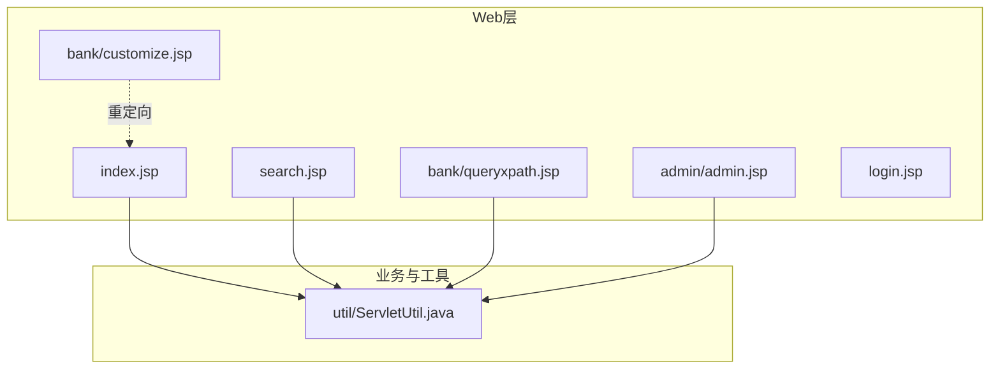
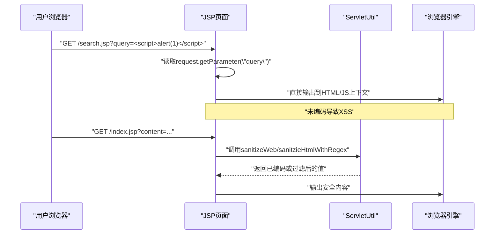
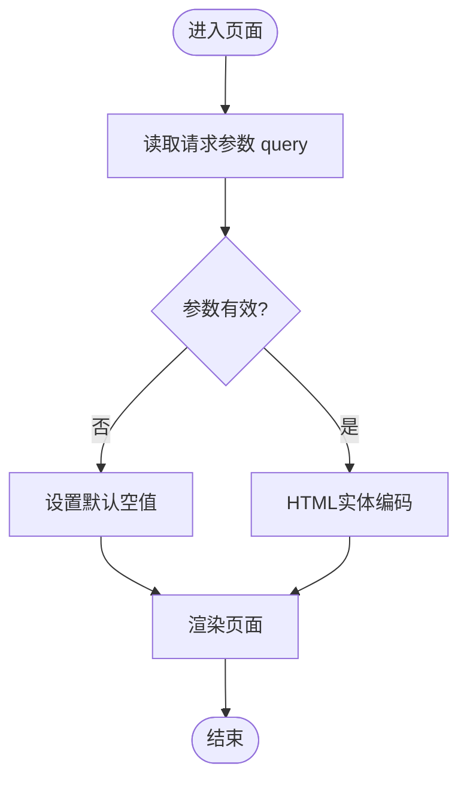
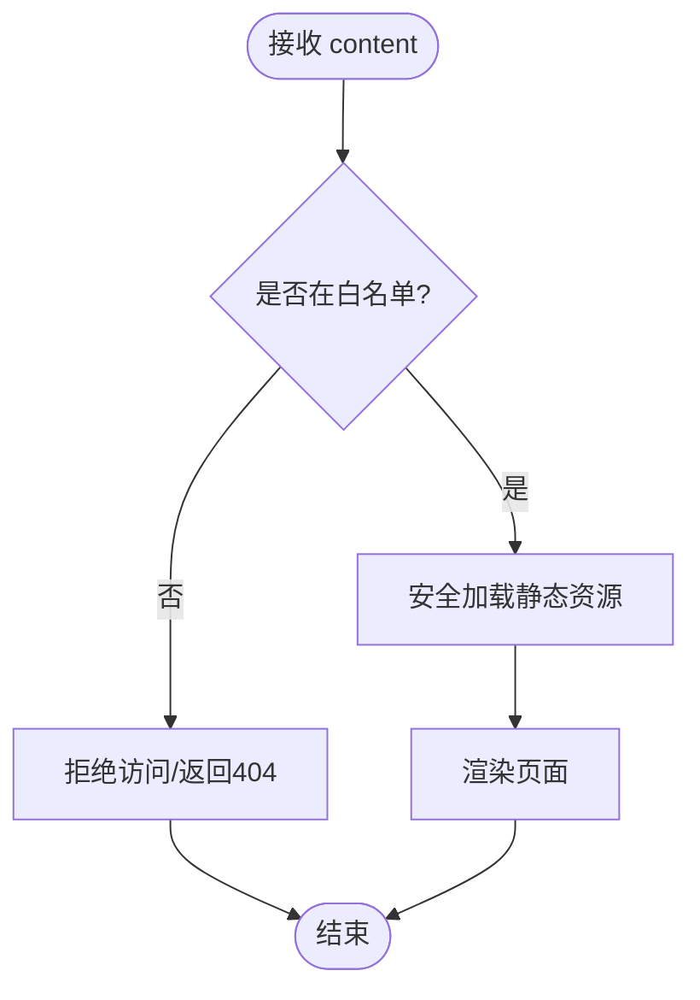
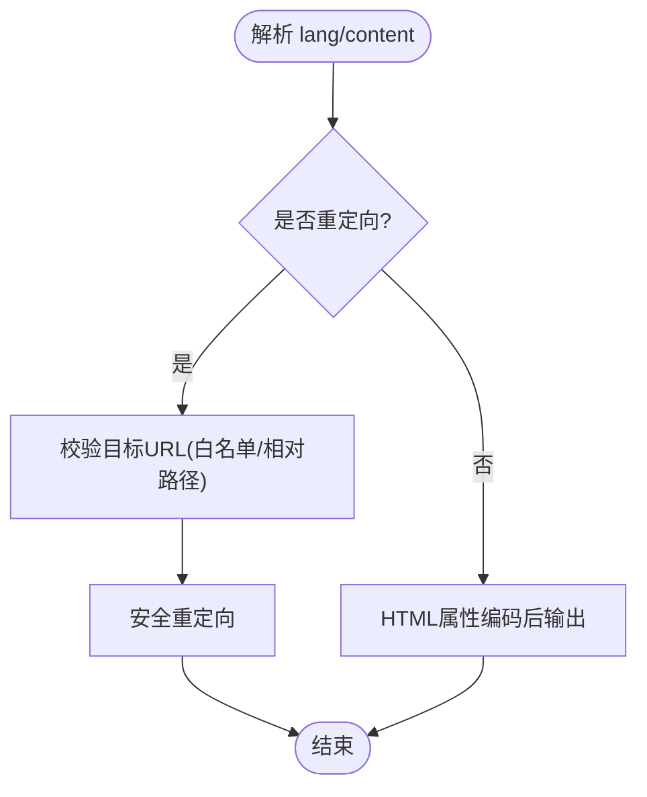
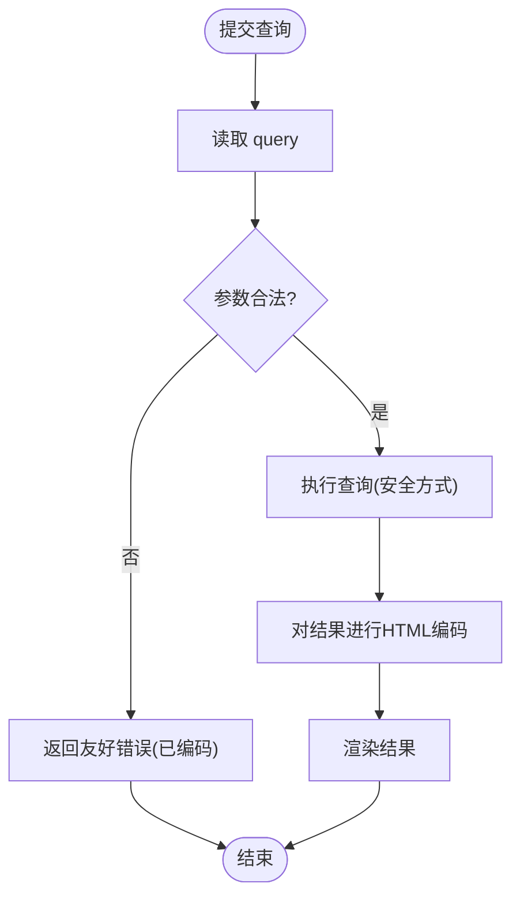
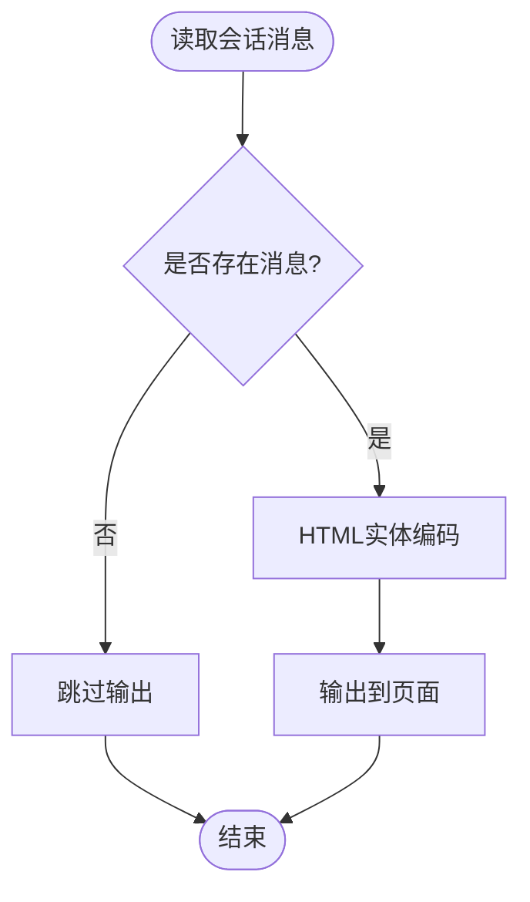
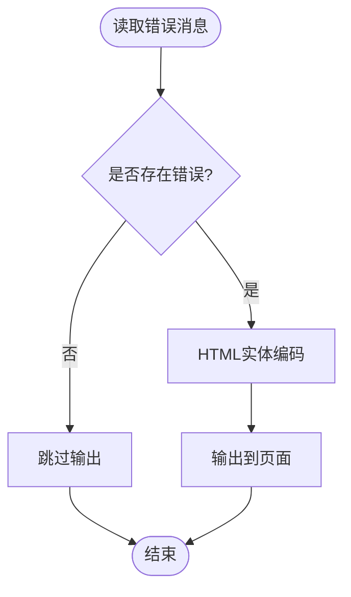
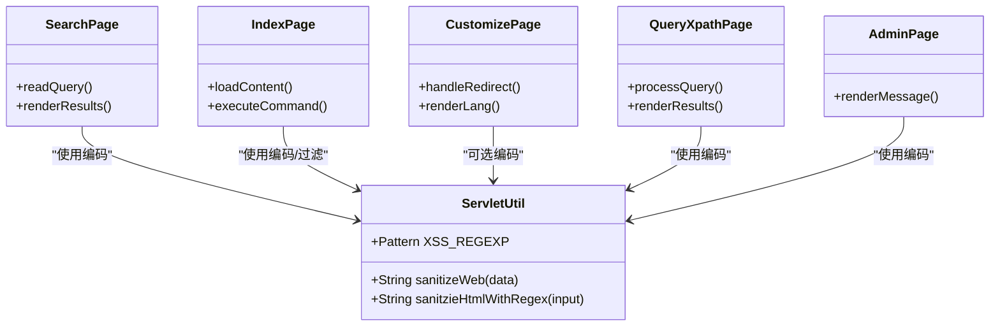

# 跨站脚本(XSS)漏洞修复

<cite>
**本文引用的文件**   
- [index.jsp](file://WebContent/index.jsp)
- [search.jsp](file://WebContent/search.jsp)
- [customize.jsp](file://WebContent/bank/customize.jsp)
- [queryxpath.jsp](file://WebContent/bank/queryxpath.jsp)
- [admin.jsp](file://WebContent/admin/admin.jsp)
- [login.jsp](file://WebContent/login.jsp)
- [ServletUtil.java](file://src/com/ibm/security/appscan/altoromutual/util/ServletUtil.java)
</cite>

## 目录
1. [简介](#简介)
2. [项目结构](#项目结构)
3. [核心组件](#核心组件)
4. [架构总览](#架构总览)
5. [详细组件分析](#详细组件分析)
6. [依赖关系分析](#依赖关系分析)
7. [性能与可维护性](#性能与可维护性)
8. [故障排查指南](#故障排查指南)
9. [结论](#结论)
10. [附录：修复清单与最佳实践](#附录修复清单与最佳实践)

## 简介
本指南面向AltoroJ中的跨站脚本（XSS）漏洞修复，聚焦以下方面：
- 输入验证：对请求参数进行白名单校验、类型与长度限制。
- 输出编码：在JSP中按上下文进行HTML实体编码、JavaScript转义、URL编码等。
- 内容安全策略（CSP）：通过响应头限制脚本来源、内联脚本执行等。
- JSP页面安全编码最佳实践：避免直接拼接用户输入到HTML/JS/URL中。
- 检测与防御：静态扫描、动态测试、运行时防护与监控。

## 项目结构
本项目为传统J2EE Web应用，主要包含：
- WebContent：JSP页面与静态资源
- src：Java Servlet、Filter、工具类与模型
- WEB-INF：部署描述符与配置

图表来源
- [index.jsp:30-105](file://WebContent/index.jsp#L30-L105)
- [search.jsp:31-46](file://WebContent/search.jsp#L31-L46)
- [customize.jsp:31-44](file://WebContent/bank/customize.jsp#L31-L44)
- [queryxpath.jsp:32-47](file://WebContent/bank/queryxpath.jsp#L32-L47)
- [admin.jsp:57-63](file://WebContent/admin/admin.jsp#L57-L63)
- [ServletUtil.java:244-254](file://src/com/ibm/security/appscan/altoromutual/util/ServletUtil.java#L244-L254)

章节来源
- [index.jsp:30-105](file://WebContent/index.jsp#L30-L105)
- [search.jsp:31-46](file://WebContent/search.jsp#L31-L46)
- [customize.jsp:31-44](file://WebContent/bank/customize.jsp#L31-L44)
- [queryxpath.jsp:32-47](file://WebContent/bank/queryxpath.jsp#L32-L47)
- [admin.jsp:57-63](file://WebContent/admin/admin.jsp#L57-L63)
- [ServletUtil.java:244-254](file://src/com/ibm/security/appscan/altoromutual/util/ServletUtil.java#L244-L254)

## 核心组件
- 工具类 ServletUtil
  - 提供HTML转义方法 sanitizeWeb，基于第三方库实现。
  - 提供正则过滤方法 sanitzieHtmlWithRegex，用于简单黑名单过滤。
  - 定义XSS_REGEXP模式，用于匹配常见XSS载荷。
- JSP页面
  - 多处直接从 request.getParameter 获取用户输入并输出到HTML或JS上下文中，未做充分编码。
  - 部分页面存在不安全重定向与命令执行风险（与XSS相关但更严重）。

章节来源
- [ServletUtil.java:74-77](file://src/com/ibm/security/appscan/altoromutual/util/ServletUtil.java#L74-L77)
- [ServletUtil.java:244-254](file://src/com/ibm/security/appscan/altoromutual/util/ServletUtil.java#L244-L254)
- [index.jsp:34-38](file://WebContent/index.jsp#L34-L38)
- [search.jsp:32-44](file://WebContent/search.jsp#L32-L44)
- [customize.jsp:32-44](file://WebContent/bank/customize.jsp#L32-L44)
- [queryxpath.jsp:36-47](file://WebContent/bank/queryxpath.jsp#L36-L47)
- [admin.jsp:57-63](file://WebContent/admin/admin.jsp#L57-L63)

## 架构总览
下图展示典型XSS攻击路径：用户输入经JSP直接输出到浏览器，若未正确编码，将导致脚本执行。

图表来源
- [search.jsp:32-44](file://WebContent/search.jsp#L32-L44)
- [index.jsp:34-38](file://WebContent/index.jsp#L34-L38)
- [ServletUtil.java:244-254](file://src/com/ibm/security/appscan/altoromutual/util/ServletUtil.java#L244-L254)

## 详细组件分析

### 组件A：搜索页面 search.jsp
- 问题
  - 直接将用户输入的 query 输出到HTML文本节点，未进行HTML实体编码。
  - 可能导致反射型XSS。
- 修复要点
  - 对所有用户输入使用 HTML 实体编码后再输出。
  - 建议统一封装输出方法，避免遗漏。
- 推荐流程

图表来源
- [search.jsp:32-44](file://WebContent/search.jsp#L32-L44)
- [ServletUtil.java:244-247](file://src/com/ibm/security/appscan/altoromutual/util/ServletUtil.java#L244-L247)

章节来源
- [search.jsp:32-44](file://WebContent/search.jsp#L32-L44)
- [ServletUtil.java:244-247](file://src/com/ibm/security/appscan/altoromutual/util/ServletUtil.java#L244-L247)

### 组件B：首页 index.jsp（含动态包含与命令执行）
- 问题
  - 直接使用 content 参数作为 include 目标，存在路径遍历与任意文件包含风险。
  - 当启用高级静态页处理时，拼接系统命令并执行，存在远程代码执行风险。
  - 错误信息直接输出到页面，可能泄露敏感信息。
- 修复要点
  - 禁止将用户输入直接用于文件包含或命令构造。
  - 仅允许白名单内的静态页面名；必要时映射到内部资源ID。
  - 移除命令执行分支，改用安全的资源加载机制。
  - 对错误信息进行脱敏与HTML编码后输出。
- 推荐流程

图表来源
- [index.jsp:34-38](file://WebContent/index.jsp#L34-L38)
- [index.jsp:40-94](file://WebContent/index.jsp#L40-L94)
- [index.jsp:96-104](file://WebContent/index.jsp#L96-L104)

章节来源
- [index.jsp:34-38](file://WebContent/index.jsp#L34-L38)
- [index.jsp:40-94](file://WebContent/index.jsp#L40-L94)
- [index.jsp:96-104](file://WebContent/index.jsp#L96-L104)

### 组件C：语言定制 customize.jsp（开放重定向）
- 问题
  - 根据 lang/content 参数进行重定向，若未严格校验目标URL，可能被利用进行开放重定向。
  - 直接将 lang 参数输出到HTML属性中，未编码。
- 修复要点
  - 对重定向目标进行白名单校验或相对路径规范化。
  - 对用户输入进行HTML属性编码。
- 推荐流程

图表来源
- [customize.jsp:32-44](file://WebContent/bank/customize.jsp#L32-L44)

章节来源
- [customize.jsp:32-44](file://WebContent/bank/customize.jsp#L32-L44)

### 组件D：新闻查询 queryxpath.jsp（DOM/XPath注入与输出）
- 问题
  - 表单字段 value 直接回显用户输入，未编码。
  - 搜索结果直接 out.println 输出，未编码。
- 修复要点
  - 所有回显与结果输出均进行HTML实体编码。
  - 对XPath查询参数进行白名单或参数化查询（如适用），避免注入。
- 推荐流程

图表来源
- [queryxpath.jsp:36-47](file://WebContent/bank/queryxpath.jsp#L36-L47)

章节来源
- [queryxpath.jsp:36-47](file://WebContent/bank/queryxpath.jsp#L36-L47)

### 组件E：管理页面 admin.jsp（会话消息输出）
- 问题
  - 从会话中取出的 message 直接 out.print 输出，未编码。
- 修复要点
  - 对会话中的任何用户可控数据进行HTML实体编码后再输出。
- 推荐流程

图表来源
- [admin.jsp:57-63](file://WebContent/admin/admin.jsp#L57-L63)

章节来源
- [admin.jsp:57-63](file://WebContent/admin/admin.jsp#L57-L63)

### 组件F：登录页面 login.jsp（前端JS与错误输出）
- 问题
  - 错误消息从会话取出后直接输出，未编码。
  - 前端JS逻辑未对用户输入进行转义（虽然此处主要是表单校验，但仍需确保后续服务端输出安全）。
- 修复要点
  - 对错误消息进行HTML实体编码。
  - 如需在前端JS中使用后端数据，应进行JSON序列化与JS字符串转义。
- 推荐流程

图表来源
- [login.jsp:35-43](file://WebContent/login.jsp#L35-L43)

章节来源
- [login.jsp:35-43](file://WebContent/login.jsp#L35-L43)

## 依赖关系分析
- JSP页面依赖 ServletUtil 提供的编码与过滤能力。
- 当前编码实现依赖第三方库 StringEscapeUtils.escapeHtml。
- XSS_REGEXP 提供简单的黑名单过滤，但不建议作为唯一防护手段。

图表来源
- [ServletUtil.java:74-77](file://src/com/ibm/security/appscan/altoromutual/util/ServletUtil.java#L74-L77)
- [ServletUtil.java:244-254](file://src/com/ibm/security/appscan/altoromutual/util/ServletUtil.java#L244-L254)
- [search.jsp:32-44](file://WebContent/search.jsp#L32-L44)
- [index.jsp:34-38](file://WebContent/index.jsp#L34-L38)
- [customize.jsp:32-44](file://WebContent/bank/customize.jsp#L32-L44)
- [queryxpath.jsp:36-47](file://WebContent/bank/queryxpath.jsp#L36-L47)
- [admin.jsp:57-63](file://WebContent/admin/admin.jsp#L57-L63)

章节来源
- [ServletUtil.java:74-77](file://src/com/ibm/security/appscan/altoromutual/util/ServletUtil.java#L74-L77)
- [ServletUtil.java:244-254](file://src/com/ibm/security/appscan/altoromutual/util/ServletUtil.java#L244-L254)

## 性能与可维护性
- 编码开销
  - HTML实体编码与JS转义的CPU开销较低，建议在关键输出点集中调用，避免重复计算。
- 缓存策略
  - 对频繁使用的静态资源采用服务器端缓存，减少I/O压力。
- 可维护性
  - 统一封装编码方法，集中管理CSP策略与响应头设置。
  - 引入模板引擎或标签库，自动处理上下文编码，降低人为遗漏风险。

[本节为通用指导，不直接分析具体文件]

## 故障排查指南
- 常见问题
  - 页面出现XSS告警：检查对应JSP是否对用户输入进行了HTML实体编码。
  - CSP拦截脚本：确认是否设置了严格的CSP策略，且未在内联脚本中执行恶意代码。
  - 重定向异常：检查自定义重定向逻辑是否对目标URL进行了白名单校验。
- 定位步骤
  - 使用浏览器开发者工具查看网络响应头，确认是否包含 Content-Security-Policy。
  - 使用静态扫描工具（如OWASP ZAP、SonarQube）扫描JSP输出点。
  - 在ServletUtil中添加日志记录，追踪编码前后的数据变化。

章节来源
- [ServletUtil.java:244-254](file://src/com/ibm/security/appscan/altoromutual/util/ServletUtil.java#L244-L254)

## 结论
通过对AltoroJ的JSP页面进行系统性修复，包括：
- 输入白名单校验与类型约束
- 输出HTML实体编码与JS转义
- 实施内容安全策略（CSP）
- 消除不安全重定向与命令执行
可有效降低XSS风险，提升应用安全性与可维护性。

[本节为总结性内容，不直接分析具体文件]

## 附录：修复清单与最佳实践

### 输入验证
- 对请求参数进行白名单校验（如仅允许字母数字、特定字符集）。
- 限制参数长度与格式（如邮箱、日期、数值范围）。
- 对文件包含与重定向目标进行严格白名单控制。

章节来源
- [index.jsp:34-38](file://WebContent/index.jsp#L34-L38)
- [customize.jsp:32-44](file://WebContent/bank/customize.jsp#L32-L44)

### 输出编码
- HTML文本节点：使用 HTML 实体编码。
- HTML属性：使用 HTML 属性编码。
- JavaScript上下文：使用 JS 字符串转义或JSON序列化。
- URL参数：使用 URL 编码。

章节来源
- [search.jsp:32-44](file://WebContent/search.jsp#L32-L44)
- [queryxpath.jsp:36-47](file://WebContent/bank/queryxpath.jsp#L36-L47)
- [admin.jsp:57-63](file://WebContent/admin/admin.jsp#L57-L63)
- [login.jsp:35-43](file://WebContent/login.jsp#L35-L43)

### 内容安全策略（CSP）
- 在响应头中设置 Content-Security-Policy，限制脚本来源。
- 禁用内联脚本与 eval，仅允许受信任的脚本源。
- 对图片、样式、字体等资源来源进行白名单控制。

[本节为通用指导，不直接分析具体文件]

### JSP安全编码最佳实践
- 避免直接使用 out.print/out.println 输出用户输入。
- 统一封装编码方法，并在所有输出点调用。
- 避免在JSP中编写复杂业务逻辑，尽量下沉至Servlet或服务层。

章节来源
- [ServletUtil.java:244-254](file://src/com/ibm/security/appscan/altoromutual/util/ServletUtil.java#L244-L254)

### XSS检测与防御
- 静态扫描：集成SonarQube、Checkmarx等工具，扫描JSP输出点。
- 动态测试：使用OWASP ZAP、Burp Suite进行渗透测试。
- 运行时防护：部署WAF，结合CSP与输入验证策略。

[本节为通用指导，不直接分析具体文件]