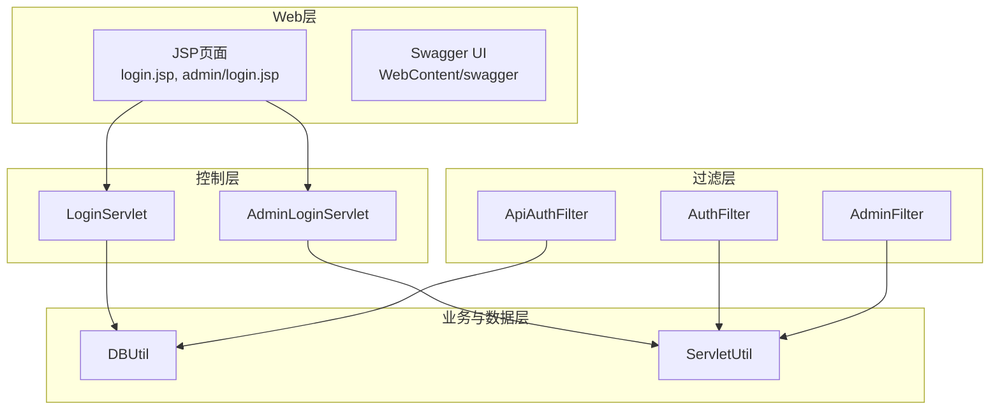
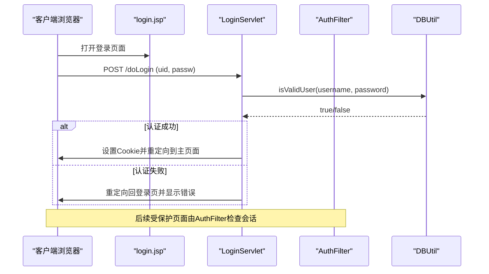
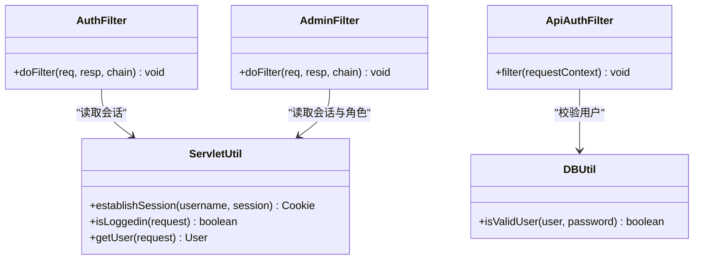
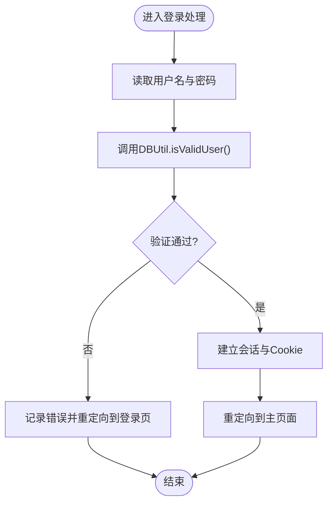
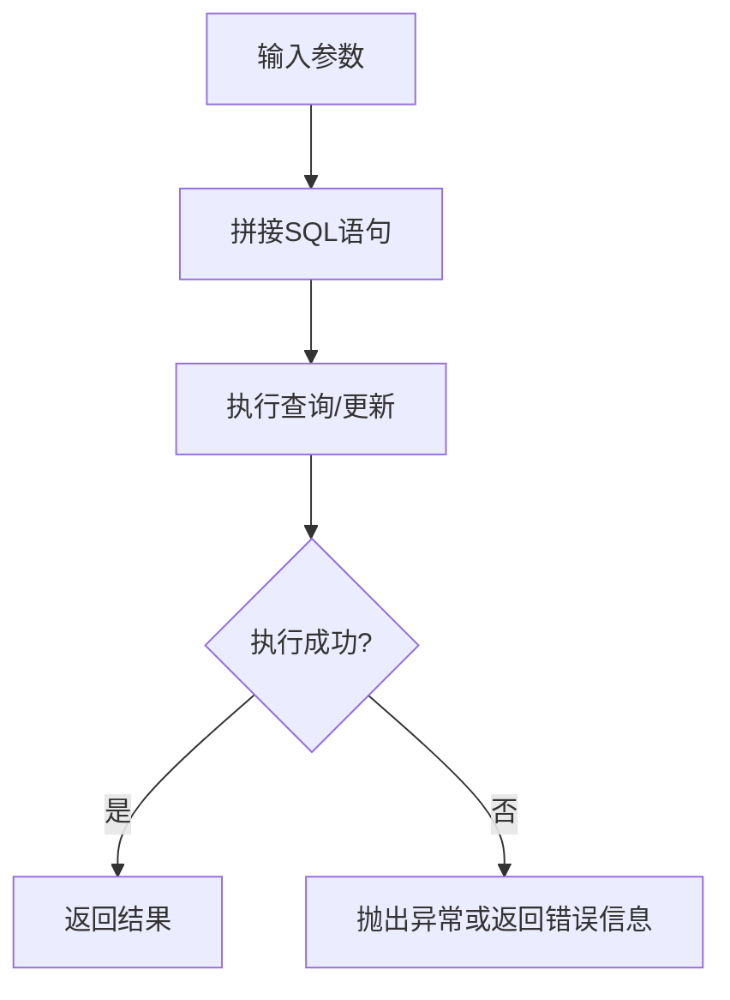
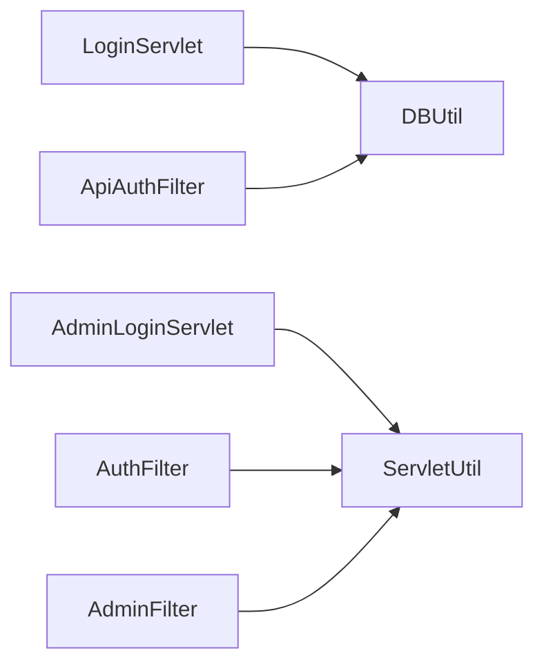

# 安全测试指南

<cite>
**本文引用的文件**   
- [README.md](file://README.md)
- [AuthFilter.java](file://src/com/ibm/security/appscan/altoromutual/filter/AuthFilter.java)
- [AdminFilter.java](file://src/com/ibm/security/appscan/altoromutual/filter/AdminFilter.java)
- [ApiAuthFilter.java](file://src/com/ibm/security/appscan/altoromutual/filter/ApiAuthFilter.java)
- [DBUtil.java](file://src/com/ibm/security/appscan/altoromutual/util/DBUtil.java)
- [ServletUtil.java](file://src/com/ibm/security/appscan/altoromutual/util/ServletUtil.java)
- [LoginServlet.java](file://src/com/ibm/security/appscan/altoromutual/servlet/LoginServlet.java)
- [AdminLoginServlet.java](file://src/com/ibm/security/appscan/altoromutual/servlet/AdminLoginServlet.java)
- [login.jsp](file://WebContent/login.jsp)
- [admin/login.jsp](file://WebContent/admin/login.jsp)
</cite>

## 目录
1. [引言](#引言)
2. [项目结构](#项目结构)
3. [核心组件](#核心组件)
4. [架构总览](#架构总览)
5. [详细组件分析](#详细组件分析)
6. [依赖关系分析](#依赖关系分析)
7. [性能与可扩展性考虑](#性能与可扩展性考虑)
8. [安全测试计划与方法论](#安全测试计划与方法论)
9. [自动化安全测试与持续监控](#自动化安全测试与持续监控)
10. [漏洞识别与验证方法](#漏洞识别与验证方法)
11. [故障排查指南](#故障排查指南)
12. [结论](#结论)

## 引言
本指南面向对 AltoroJ 进行安全测试的工程师与安全研究人员，提供从渗透测试方法论、工具使用（Burp Suite、OWASP ZAP）到手动测试技巧的系统化说明。文档同时覆盖安全测试计划制定、用例设计、结果评估、自动化集成与持续监控策略，并给出在 AltoroJ 中识别与验证常见漏洞（如 SQL 注入、XSS、越权访问、硬编码凭据等）的具体路径与步骤。AltoroJ 是一个故意包含已知安全缺陷的示例银行应用，适合用于学习与演练安全测试流程。

## 项目结构
AltoroJ 采用传统 J2EE Web 应用结构：
- WebContent：JSP 页面、静态资源、Swagger UI 等前端入口
- src：Java 源码，包含 Servlet、Filter、API、模型与工具类
- 构建与运行：Gradle 构建，Tomcat 部署，Derby 内嵌数据库

图表来源
- [login.jsp:45-72](file://WebContent/login.jsp#L45-L72)
- [admin/login.jsp:33-51](file://WebContent/admin/login.jsp#L33-L51)
- [LoginServlet.java:67-105](file://src/com/ibm/security/appscan/altoromutual/servlet/LoginServlet.java#L67-L105)
- [AdminLoginServlet.java:40-54](file://src/com/ibm/security/appscan/altoromutual/servlet/AdminLoginServlet.java#L40-L54)
- [AuthFilter.java:58-70](file://src/com/ibm/security/appscan/altoromutual/filter/AuthFilter.java#L58-L70)
- [AdminFilter.java:58-80](file://src/com/ibm/security/appscan/altoromutual/filter/AdminFilter.java#L58-L80)
- [ApiAuthFilter.java:30-74](file://src/com/ibm/security/appscan/altoromutual/filter/ApiAuthFilter.java#L30-L74)
- [DBUtil.java:212-232](file://src/com/ibm/security/appscan/altoromutual/util/DBUtil.java#L212-L232)
- [ServletUtil.java:244-254](file://src/com/ibm/security/appscan/altoromutual/util/ServletUtil.java#L244-L254)

章节来源
- [README.md:1-10](file://README.md#L1-L10)

## 核心组件
- 认证与授权过滤器
  - AuthFilter：拦截用户会话，未登录时重定向至登录页
  - AdminFilter：限制管理员访问，校验角色或特定会话键
  - ApiAuthFilter：REST API 鉴权，解析 Authorization 头中的令牌并调用 DBUtil 校验
- 登录处理
  - LoginServlet：处理普通用户登录，调用 DBUtil.isValidUser 验证，成功后建立会话与 Cookie
  - AdminLoginServlet：处理管理员登录，硬编码密码校验，设置管理员会话键
- 数据访问
  - DBUtil：数据库连接、初始化、查询与写入；多处存在拼接 SQL 的安全风险点
- 通用工具
  - ServletUtil：会话管理、输出清洗、属性初始化等

章节来源
- [AuthFilter.java:34-70](file://src/com/ibm/security/appscan/altoromutual/filter/AuthFilter.java#L34-L70)
- [AdminFilter.java:35-80](file://src/com/ibm/security/appscan/altoromutual/filter/AdminFilter.java#L35-L80)
- [ApiAuthFilter.java:29-74](file://src/com/ibm/security/appscan/altoromutual/filter/ApiAuthFilter.java#L29-L74)
- [LoginServlet.java:67-105](file://src/com/ibm/security/appscan/altoromutual/servlet/LoginServlet.java#L67-L105)
- [AdminLoginServlet.java:40-54](file://src/com/ibm/security/appscan/altoromutual/servlet/AdminLoginServlet.java#L40-L54)
- [DBUtil.java:212-232](file://src/com/ibm/security/appscan/altoromutual/util/DBUtil.java#L212-L232)
- [ServletUtil.java:244-254](file://src/com/ibm/security/appscan/altoromutual/util/ServletUtil.java#L244-L254)

## 架构总览
下图展示典型登录请求在 AltoroJ 中的处理流程，包括前端表单、Servlet、过滤器与数据库交互。

图表来源
- [login.jsp:45-72](file://WebContent/login.jsp#L45-L72)
- [LoginServlet.java:67-105](file://src/com/ibm/security/appscan/altoromutual/servlet/LoginServlet.java#L67-L105)
- [DBUtil.java:212-232](file://src/com/ibm/security/appscan/altoromutual/util/DBUtil.java#L212-L232)
- [AuthFilter.java:58-70](file://src/com/ibm/security/appscan/altoromutual/filter/AuthFilter.java#L58-L70)

## 详细组件分析

### 认证与授权过滤器
- AuthFilter
  - 作用：确保访问受保护资源前已登录；未登录则重定向到登录页
  - 关键点：基于会话中的用户对象判断是否通过
- AdminFilter
  - 作用：限制管理员区域访问；支持角色为 Admin 或特定会话键
  - 关键点：对非管理员或未登录的请求进行重定向
- ApiAuthFilter
  - 作用：REST API 鉴权；解析 Authorization 头中的 Bearer 令牌，解码后调用 DBUtil 校验
  - 关键点：若缺少授权头或令牌格式不正确，直接拒绝

图表来源
- [AuthFilter.java:58-70](file://src/com/ibm/security/appscan/altoromutual/filter/AuthFilter.java#L58-L70)
- [AdminFilter.java:58-80](file://src/com/ibm/security/appscan/altoromutual/filter/AdminFilter.java#L58-L80)
- [ApiAuthFilter.java:30-74](file://src/com/ibm/security/appscan/altoromutual/filter/ApiAuthFilter.java#L30-L74)
- [ServletUtil.java:340-373](file://src/com/ibm/security/appscan/altoromutual/util/ServletUtil.java#L340-L373)
- [DBUtil.java:212-232](file://src/com/ibm/security/appscan/altoromutual/util/DBUtil.java#L212-L232)

章节来源
- [AuthFilter.java:34-70](file://src/com/ibm/security/appscan/altoromutual/filter/AuthFilter.java#L34-L70)
- [AdminFilter.java:35-80](file://src/com/ibm/security/appscan/altoromutual/filter/AdminFilter.java#L35-L80)
- [ApiAuthFilter.java:29-74](file://src/com/ibm/security/appscan/altoromutual/filter/ApiAuthFilter.java#L29-L74)

### 登录处理逻辑
- LoginServlet
  - 接收 uid/passw，调用 DBUtil.isValidUser 进行认证
  - 成功：建立会话与账户 Cookie，重定向到主页面
  - 失败：记录日志并返回登录页
- AdminLoginServlet
  - 接收管理员密码，硬编码比对
  - 成功：设置管理员会话键，重定向到管理页面
  - 失败：返回登录页并显示错误

图表来源
- [LoginServlet.java:67-105](file://src/com/ibm/security/appscan/altoromutual/servlet/LoginServlet.java#L67-L105)
- [DBUtil.java:212-232](file://src/com/ibm/security/appscan/altoromutual/util/DBUtil.java#L212-L232)
- [AdminLoginServlet.java:40-54](file://src/com/ibm/security/appscan/altoromutual/servlet/AdminLoginServlet.java#L40-L54)

章节来源
- [LoginServlet.java:67-105](file://src/com/ibm/security/appscan/altoromutual/servlet/LoginServlet.java#L67-L105)
- [AdminLoginServlet.java:40-54](file://src/com/ibm/security/appscan/altoromutual/servlet/AdminLoginServlet.java#L40-L54)

### 数据访问与SQL注入风险点
- DBUtil 多处使用字符串拼接构造 SQL，例如：
  - 用户认证查询
  - 用户信息查询
  - 账户余额查询
  - 转账操作插入与更新
- 这些位置均可能被注入攻击利用，需重点测试与修复

图表来源
- [DBUtil.java:212-232](file://src/com/ibm/security/appscan/altoromutual/util/DBUtil.java#L212-L232)
- [DBUtil.java:241-267](file://src/com/ibm/security/appscan/altoromutual/util/DBUtil.java#L241-L267)
- [DBUtil.java:275-293](file://src/com/ibm/security/appscan/altoromutual/util/DBUtil.java#L275-L293)
- [DBUtil.java:303-364](file://src/com/ibm/security/appscan/altoromutual/util/DBUtil.java#L303-L364)

章节来源
- [DBUtil.java:212-232](file://src/com/ibm/security/appscan/altoromutual/util/DBUtil.java#L212-L232)
- [DBUtil.java:241-267](file://src/com/ibm/security/appscan/altoromutual/util/DBUtil.java#L241-L267)
- [DBUtil.java:275-293](file://src/com/ibm/security/appscan/altoromutual/util/DBUtil.java#L275-L293)
- [DBUtil.java:303-364](file://src/com/ibm/security/appscan/altoromutual/util/DBUtil.java#L303-L364)

### XSS与输出安全
- ServletUtil 提供输出清洗方法 sanitizeWeb，使用 HTML 转义
- 但部分 JSP 页面直接使用 request.getParameter 输出到页面，可能绕过清洗导致反射型 XSS
- 建议对所有用户输入进行统一清洗后再输出

章节来源
- [ServletUtil.java:244-254](file://src/com/ibm/security/appscan/altoromutual/util/ServletUtil.java#L244-L254)
- [login.jsp:35-43](file://WebContent/login.jsp#L35-L43)
- [admin/login.jsp:41-50](file://WebContent/admin/login.jsp#L41-L50)

## 依赖关系分析
- 组件耦合
  - Servlet 依赖 DBUtil 进行数据访问
  - Filter 依赖 ServletUtil 进行会话与权限判断
  - REST API 通过 ApiAuthFilter 与 DBUtil 协作完成鉴权
- 外部依赖
  - Derby 内嵌数据库
  - Tomcat 作为 Web 容器
  - Gradle 构建系统

图表来源
- [LoginServlet.java:67-105](file://src/com/ibm/security/appscan/altoromutual/servlet/LoginServlet.java#L67-L105)
- [AdminLoginServlet.java:40-54](file://src/com/ibm/security/appscan/altoromutual/servlet/AdminLoginServlet.java#L40-L54)
- [AuthFilter.java:58-70](file://src/com/ibm/security/appscan/altoromutual/filter/AuthFilter.java#L58-L70)
- [AdminFilter.java:58-80](file://src/com/ibm/security/appscan/altoromutual/filter/AdminFilter.java#L58-L80)
- [ApiAuthFilter.java:30-74](file://src/com/ibm/security/appscan/altoromutual/filter/ApiAuthFilter.java#L30-L74)

章节来源
- [README.md:16-25](file://README.md#L16-L25)

## 性能与可扩展性考虑
- 数据库连接
  - DBUtil 使用单例模式维护连接，避免频繁创建连接带来的开销
  - 支持外部 DataSource 配置，便于扩展到其他数据库
- 会话管理
  - ServletUtil 封装会话建立与获取，减少重复代码
- 可优化点
  - 将 SQL 拼接改为预编译语句，提升安全性与性能
  - 引入连接池与事务管理，提高并发处理能力

[本节为一般性指导，不直接分析具体文件]

## 安全测试计划与方法论
- 目标范围
  - 认证与授权：登录、管理员登录、会话管理、API 鉴权
  - 输入验证与输出编码：表单输入、URL 参数、响应内容
  - 数据安全：SQL 注入、敏感信息泄露
  - 功能安全：转账、账户管理、反馈提交
- 测试环境
  - 使用隔离的虚拟机或容器，避免影响生产环境
  - 启用高级选项以暴露更多可测试的攻击面（参考 README 的高级选项说明）
- 测试工具
  - Burp Suite：代理抓包、篡改请求、扫描器、Intruder 爆破
  - OWASP ZAP：自动扫描、主动扫描、脚本扩展
  - 手动测试：结合浏览器开发者工具与命令行工具（curl、Postman）
- 测试阶段
  - 信息收集：枚举页面、接口、参数、会话机制
  - 威胁建模：识别关键资产与潜在攻击向量
  - 漏洞发现：自动化扫描与手工验证结合
  - 漏洞验证：最小化影响、确认可利用性与业务影响
  - 报告与修复建议：按严重等级分类，提供修复方案

章节来源
- [README.md:1-10](file://README.md#L1-L10)
- [README.md:33-37](file://README.md#L33-L37)

## 自动化安全测试与持续监控
- CI/CD 集成
  - 在构建流水线中集成 OWASP ZAP 或 Burp Suite Professional 的扫描任务
  - 将扫描结果作为质量门禁，阻断高风险漏洞合并
- 持续监控
  - 定期执行被动扫描与主动扫描，跟踪漏洞趋势
  - 对新增接口与页面进行增量扫描
- 告警与修复
  - 建立漏洞工单流程，分配责任人并跟踪修复进度
  - 对高危漏洞实施紧急修复与回归测试

[本节为一般性指导，不直接分析具体文件]

## 漏洞识别与验证方法
- SQL 注入
  - 在登录、查询、转账等接口尝试注入字符（如 ' OR '1'='1），观察行为变化
  - 使用 Burp Intruder 或 ZAP 的 Fuzzer 进行批量测试
  - 验证数据库结构与数据是否被读取或修改
- 跨站脚本（XSS）
  - 在表单字段与 URL 参数中注入脚本标签，检查是否被执行
  - 注意输出是否经过 sanitizeWeb 或其他清洗
- 越权访问
  - 尝试访问管理员页面或 API，绕过会话或权限校验
  - 修改会话中的角色或管理员键值，观察是否获得更高权限
- 硬编码凭据
  - 检查管理员登录逻辑是否存在硬编码密码
  - 尝试默认账号与密码组合

章节来源
- [DBUtil.java:212-232](file://src/com/ibm/security/appscan/altoromutual/util/DBUtil.java#L212-L232)
- [AdminLoginServlet.java:40-54](file://src/com/ibm/security/appscan/altoromutual/servlet/AdminLoginServlet.java#L40-L54)
- [ServletUtil.java:244-254](file://src/com/ibm/security/appscan/altoromutual/util/ServletUtil.java#L244-L254)

## 故障排查指南
- 数据库初始化失败
  - 现象：登录时报错无法创建数据库
  - 原因：权限不足或 user.home 路径不可写
  - 解决：赋予 Tomcat 用户对 user.home 的读写权限，或调整 JVM 参数指定新的数据库路径
- 编译错误
  - 现象：部署到 Tomcat 时报编译错误
  - 原因：依赖库缺失或构建路径不正确
  - 解决：使用 Gradle 构建下载依赖并重新编译

章节来源
- [README.md:44-57](file://README.md#L44-L57)

## 结论
通过对 AltoroJ 的代码结构与关键组件进行分析，我们明确了其认证、授权、数据访问与输出安全的核心实现与潜在风险点。结合渗透测试方法论与自动化工具，可以系统化地识别与验证漏洞，并在持续集成环境中建立安全门禁与监控机制。建议在修复过程中优先处理 SQL 注入、硬编码凭据与未清洗的输出，以提升整体安全性与健壮性。