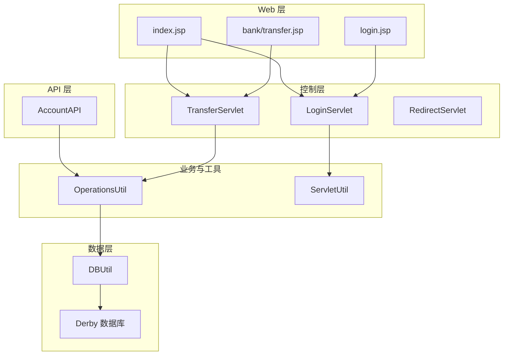
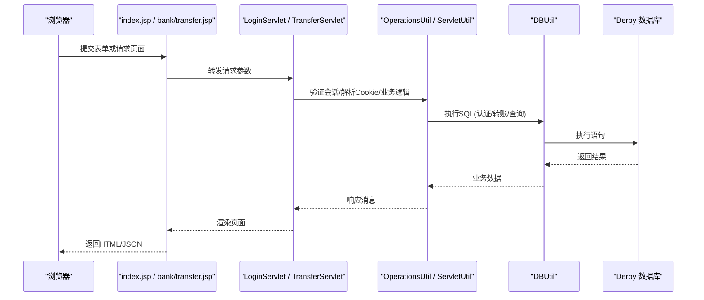
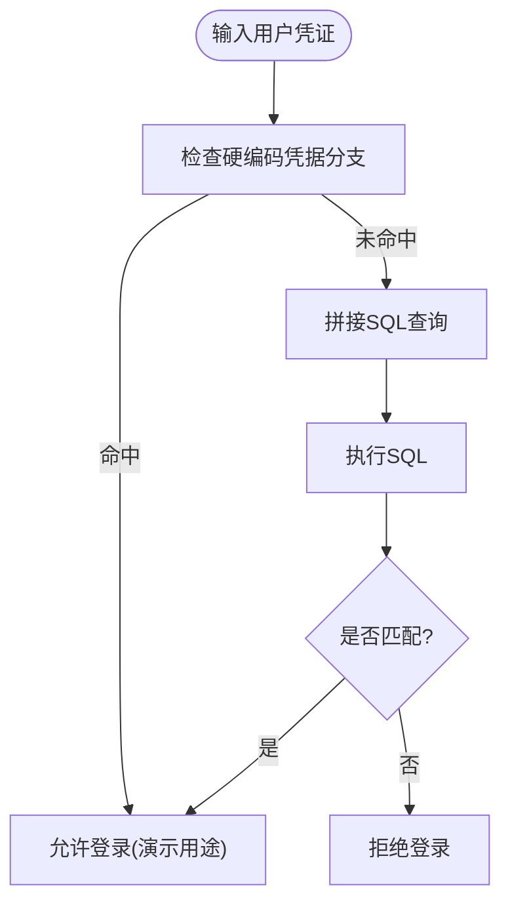
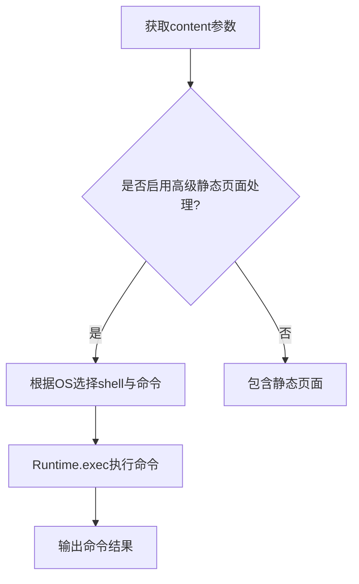
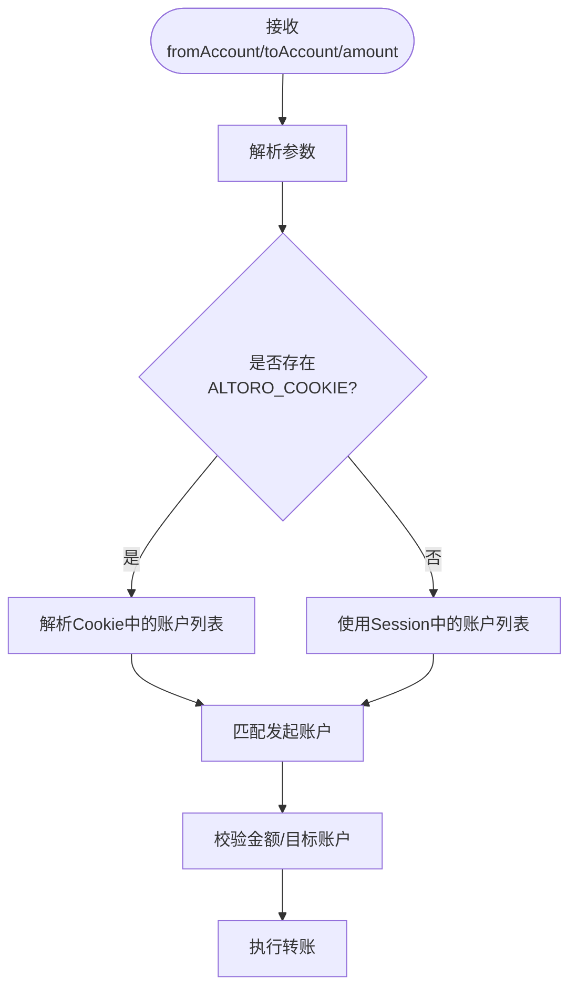
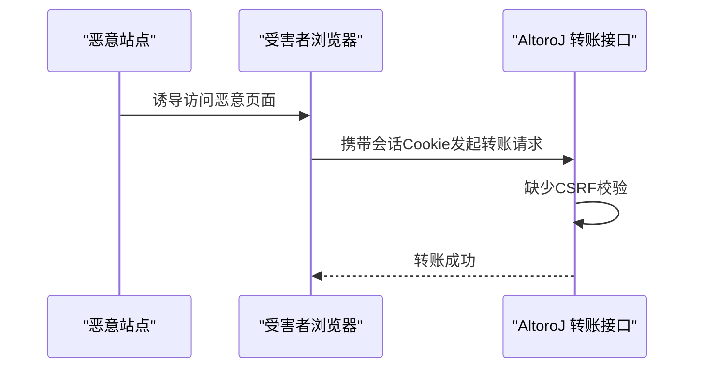
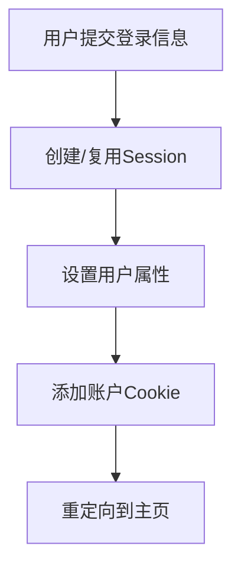
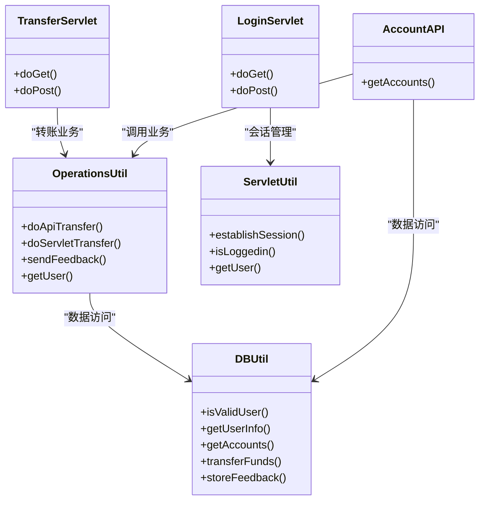

# 安全漏洞分析

<cite>
**本文引用的文件**   
- [README.md](file://README.md)
- [DBUtil.java](file://src/com/ibm/security/appscan/altoromutual/util/DBUtil.java)
- [index.jsp](file://WebContent/index.jsp)
- [LoginServlet.java](file://src/com/ibm/security/appscan/altoromutual/servlet/LoginServlet.java)
- [TransferServlet.java](file://src/com/ibm/security/appscan/altoromutual/servlet/TransferServlet.java)
- [OperationsUtil.java](file://src/com/ibm/security/appscan/altoromutual/util/OperationsUtil.java)
- [transfer.jsp](file://WebContent/bank/transfer.jsp)
- [AccountAPI.java](file://src/com/ibm/security/appscan/altoromutual/api/AccountAPI.java)
- [web.xml](file://WebContent/WEB-INF/web.xml)
</cite>

## 目录
1. [简介](#简介)
2. [项目结构](#项目结构)
3. [核心组件](#核心组件)
4. [架构总览](#架构总览)
5. [详细组件分析](#详细组件分析)
6. [依赖关系分析](#依赖关系分析)
7. [性能与可扩展性考虑](#性能与可扩展性考虑)
8. [渗透测试指南](#渗透测试指南)
9. [安全扫描工具使用](#安全扫描工具使用)
10. [漏洞评估方法](#漏洞评估方法)
11. [安全开发生命周期集成](#安全开发生命周期集成)
12. [安全编码最佳实践](#安全编码最佳实践)
13. [故障排查指南](#故障排查指南)
14. [结论](#结论)

## 简介
本文件针对 AltoroJ 应用进行系统化的安全漏洞分析与修复建议，覆盖 SQL 注入、跨站脚本（XSS）、命令执行、不安全的直接对象引用（IDOR）、跨站请求伪造（CSRF）、会话固定等常见 Web 安全问题。文档同时提供渗透测试流程、安全扫描工具使用方法和 SDLC 集成建议，帮助团队在开发与运维中持续降低安全风险。

AltoroJ 是一个用于演示和教学的安全脆弱示例应用，默认包含已知漏洞，请在隔离环境中运行并仅用于学习与测试目的。

**章节来源**
- [README.md:1-10](file://README.md#L1-L10)

## 项目结构
AltoroJ 采用传统 J2EE 结构：
- Web 层：JSP 页面与 Servlet 控制器
- API 层：基于 JAX-RS 的 REST API
- 业务逻辑：Servlet/Service 调用工具类
- 数据访问：DBUtil 封装数据库操作
- 模型：User、Account、Transaction、Feedback

**图表来源**
- [index.jsp:33-105](file://WebContent/index.jsp#L33-L105)
- [LoginServlet.java:67-104](file://src/com/ibm/security/appscan/altoromutual/servlet/LoginServlet.java#L67-L104)
- [TransferServlet.java:51-67](file://src/com/ibm/security/appscan/altoromutual/servlet/TransferServlet.java#L51-L67)
- [OperationsUtil.java:18-117](file://src/com/ibm/security/appscan/altoromutual/util/OperationsUtil.java#L18-L117)
- [DBUtil.java:212-364](file://src/com/ibm/security/appscan/altoromutual/util/DBUtil.java#L212-L364)

**章节来源**
- [index.jsp:33-105](file://WebContent/index.jsp#L33-L105)
- [LoginServlet.java:67-104](file://src/com/ibm/security/appscan/altoromutual/servlet/LoginServlet.java#L67-L104)
- [TransferServlet.java:51-67](file://src/com/ibm/security/appscan/altoromutual/servlet/TransferServlet.java#L51-L67)
- [OperationsUtil.java:18-117](file://src/com/ibm/security/appscan/altoromutual/util/OperationsUtil.java#L18-L117)
- [DBUtil.java:212-364](file://src/com/ibm/security/appscan/altoromutual/util/DBUtil.java#L212-L364)

## 核心组件
- DBUtil：数据库连接、初始化、用户认证、账户查询、转账、反馈存储等。多处存在字符串拼接 SQL 的问题。
- LoginServlet：处理登录/登出，建立会话与 Cookie。
- TransferServlet：资金转账入口，参数校验不足且无 CSRF 保护。
- OperationsUtil：转账业务逻辑，Cookie 解析与账户选择逻辑存在绕过风险。
- AccountAPI：REST API 账户接口，依赖 OperationsUtil 与 DBUtil。
- index.jsp：静态页面加载与可选的命令执行路径。

**章节来源**
- [DBUtil.java:212-364](file://src/com/ibm/security/appscan/altoromutual/util/DBUtil.java#L212-L364)
- [LoginServlet.java:67-104](file://src/com/ibm/security/appscan/altoromutual/servlet/LoginServlet.java#L67-L104)
- [TransferServlet.java:51-67](file://src/com/ibm/security/appscan/altoromutual/servlet/TransferServlet.java#L51-L67)
- [OperationsUtil.java:18-117](file://src/com/ibm/security/appscan/altoromutual/util/OperationsUtil.java#L18-L117)
- [AccountAPI.java:23-28](file://src/com/ibm/security/appscan/altoromutual/api/AccountAPI.java#L23-L28)
- [index.jsp:33-105](file://WebContent/index.jsp#L33-L105)

## 架构总览
下图展示从浏览器到数据库的关键交互路径，突出潜在攻击面与防护点。

**图表来源**
- [index.jsp:33-105](file://WebContent/index.jsp#L33-L105)
- [transfer.jsp:58-105](file://WebContent/bank/transfer.jsp#L58-L105)
- [LoginServlet.java:67-104](file://src/com/ibm/security/appscan/altoromutual/servlet/LoginServlet.java#L67-L104)
- [TransferServlet.java:51-67](file://src/com/ibm/security/appscan/altoromutual/servlet/TransferServlet.java#L51-L67)
- [OperationsUtil.java:18-117](file://src/com/ibm/security/appscan/altoromutual/util/OperationsUtil.java#L18-L117)
- [DBUtil.java:212-364](file://src/com/ibm/security/appscan/altoromutual/util/DBUtil.java#L212-L364)

## 详细组件分析

### SQL 注入（严重）
- 影响范围：用户认证、用户信息查询、账户查询、转账、反馈存储等所有通过 DBUtil 执行的 SQL。
- 攻击方式：在用户名、密码、账户号、日期等输入中注入恶意 SQL 片段，绕过认证、读取/修改任意数据、执行任意 SQL。
- 关键代码位置：
  - 认证查询拼接：[DBUtil.java:221-224](file://src/com/ibm/security/appscan/altoromutual/util/DBUtil.java#L221-L224)
  - 用户信息查询拼接：[DBUtil.java:245-247](file://src/com/ibm/security/appscan/altoromutual/util/DBUtil.java#L245-L247)
  - 账户查询拼接：[DBUtil.java:279-281](file://src/com/ibm/security/appscan/altoromutual/util/DBUtil.java#L279-L281)
  - 转账插入/更新拼接：[DBUtil.java:340-357](file://src/com/ibm/security/appscan/altoromutual/util/DBUtil.java#L340-L357)
  - 反馈存储拼接：[DBUtil.java:520-524](file://src/com/ibm/security/appscan/altoromutual/util/DBUtil.java#L520-L524)
- 修复建议：
  - 全面替换为 PreparedStatement 并使用参数绑定。
  - 对输入进行严格类型校验与白名单过滤。
  - 最小权限原则配置数据库账号。
  - 引入审计日志与异常统一处理。

**图表来源**
- [DBUtil.java:212-232](file://src/com/ibm/security/appscan/altoromutual/util/DBUtil.java#L212-L232)

**章节来源**
- [DBUtil.java:212-364](file://src/com/ibm/security/appscan/altoromutual/util/DBUtil.java#L212-L364)
- [DBUtil.java:520-524](file://src/com/ibm/security/appscan/altoromutual/util/DBUtil.java#L520-L524)

### 远程命令执行（严重）
- 影响范围：当启用高级静态页面处理时，index.jsp 会根据 content 参数构造系统命令并执行。
- 攻击方式：通过 content 参数传入恶意命令，导致服务器被完全控制。
- 关键代码位置：
  - 动态命令构建与执行：[index.jsp:40-65](file://WebContent/index.jsp#L40-L65)
- 修复建议：
  - 禁用 advancedStaticPageProcessing 或移除命令执行逻辑。
  - 如需读取静态文件，使用受控的文件读取 API，并对文件名进行白名单校验。
  - 避免将用户输入直接拼接到系统命令。

**图表来源**
- [index.jsp:40-65](file://WebContent/index.jsp#L40-L65)

**章节来源**
- [index.jsp:40-65](file://WebContent/index.jsp#L40-L65)

### 不安全的直接对象引用（IDOR）（高）
- 影响范围：转账功能中 fromAccount 可被篡改，结合 Cookie 中的账户列表可绕过服务端校验。
- 攻击方式：
  - 修改 fromAccount 为其他账户 ID 或名称，实现向任意账户转账。
  - 利用 Cookie 中 Base64 编码的账户列表进行账户枚举与越权操作。
- 关键代码位置：
  - 转账参数接收与校验不足：[TransferServlet.java:58-63](file://src/com/ibm/security/appscan/altoromutual/servlet/TransferServlet.java#L58-L63)
  - Cookie 账户解析与选择逻辑：[OperationsUtil.java:49-88](file://src/com/ibm/security/appscan/altoromutual/util/OperationsUtil.java#L49-L88)
- 修复建议：
  - 服务端强制校验发起账户归属当前登录用户。
  - 禁止使用客户端提供的账户标识作为权威来源。
  - 对 Cookie 中的敏感数据进行签名与加密，防止篡改。
  - 增加转账二次确认与风控策略。

**图表来源**
- [TransferServlet.java:58-63](file://src/com/ibm/security/appscan/altoromutual/servlet/TransferServlet.java#L58-L63)
- [OperationsUtil.java:49-88](file://src/com/ibm/security/appscan/altoromutual/util/OperationsUtil.java#L49-L88)

**章节来源**
- [TransferServlet.java:58-63](file://src/com/ibm/security/appscan/altoromutual/servlet/TransferServlet.java#L58-L63)
- [OperationsUtil.java:49-88](file://src/com/ibm/security/appscan/altoromutual/util/OperationsUtil.java#L49-L88)

### 跨站请求伪造（CSRF）（高）
- 影响范围：转账接口（POST /doTransfer）无 CSRF Token 或 SameSite/CsrfFilter 保护。
- 攻击方式：诱导已登录用户访问恶意页面，自动发起转账请求。
- 关键代码位置：
  - 转账表单与处理：[transfer.jsp:58-105](file://WebContent/bank/transfer.jsp#L58-L105), [TransferServlet.java:51-67](file://src/com/ibm/security/appscan/altoromutual/servlet/TransferServlet.java#L51-L67)
- 修复建议：
  - 引入 CSRF Token 并在服务端校验。
  - 设置 Cookie SameSite=Strict/Lax。
  - 对敏感状态变更接口要求 Referer/Origin 校验。
  - 对转账金额与账户进行二次确认。

**图表来源**
- [transfer.jsp:58-105](file://WebContent/bank/transfer.jsp#L58-L105)
- [TransferServlet.java:51-67](file://src/com/ibm/security/appscan/altoromutual/servlet/TransferServlet.java#L51-L67)

**章节来源**
- [transfer.jsp:58-105](file://WebContent/bank/transfer.jsp#L58-L105)
- [TransferServlet.java:51-67](file://src/com/ibm/security/appscan/altoromutmal/servlet/TransferServlet.java#L51-L67)

### 会话固定（中高）
- 影响范围：登录后未重新生成 Session ID，可能导致会话固定攻击。
- 攻击方式：攻击者预先设置会话标识，诱使受害者使用该会话完成登录，从而接管会话。
- 关键代码位置：
  - 登录创建会话与属性设置：[LoginServlet.java:67-96](file://src/com/ibm/security/appscan/altoromutmal/servlet/LoginServlet.java#L67-L96)
  - 会话建立与Cookie设置：[ServletUtil.java:340-347](file://src/com/ibm/security/appscan/altoromutmal/util/ServletUtil.java#L340-L347)
- 修复建议：
  - 登录后立即 invalidate 旧会话并创建新会话。
  - 设置 Cookie HttpOnly、Secure、SameSite。
  - 会话超时与并发限制。

**图表来源**
- [LoginServlet.java:67-96](file://src/com/ibm/security/appscan/altoromutmal/servlet/LoginServlet.java#L67-L96)
- [ServletUtil.java:340-347](file://src/com/ibm/security/appscan/altoromutmal/util/ServletUtil.java#L340-L347)

**章节来源**
- [LoginServlet.java:67-96](file://src/com/ibm/security/appscan/altoromutmal/servlet/LoginServlet.java#L67-L96)
- [ServletUtil.java:340-347](file://src/com/ibm/security/appscan/altoromutmal/util/ServletUtil.java#L340-L347)

### 跨站脚本（XSS）（中高）
- 影响范围：部分页面可能回显用户输入；反馈存储与显示若未正确转义，可导致 XSS。
- 攻击方式：在反馈内容、用户名等字段注入脚本，窃取会话或劫持用户操作。
- 关键代码位置：
  - 反馈存储（带条件转义）：[OperationsUtil.java:119-131](file://src/com/ibm/security/appscan/altoromutmal/util/OperationsUtil.java#L119-L131)
  - 错误信息输出（正则清洗）：[index.jsp:92-103](file://WebContent/index.jsp#L92-L103)
- 修复建议：
  - 对所有用户输入进行上下文相关的输出编码（HTML/JS/CSS/URL）。
  - 使用安全的模板引擎或框架内置转义机制。
  - 设置 Content-Security-Policy 与 X-Content-Type-Options。

**章节来源**
- [OperationsUtil.java:119-131](file://src/com/ibm/security/appscan/altoromutmal/util/OperationsUtil.java#L119-L131)
- [index.jsp:92-103](file://WebContent/index.jsp#L92-L103)

### 其他问题
- 硬编码凭据：演示用途的硬编码用户验证逻辑，应避免在生产环境启用。
  - 参考：[DBUtil.java:216-219](file://src/com/ibm/security/appscan/altoromutmal/util/DBUtil.java#L216-L219)
- 敏感数据传输：Cookie 中账户信息以 Base64 编码，易被解码与篡改。
  - 参考：[ServletUtil.java:340-347](file://src/com/ibm/security/appscan/altoromutmal/util/ServletUtil.java#L340-L347), [OperationsUtil.java:49-88](file://src/com/ibm/security/appscan/altoromutmal/util/OperationsUtil.java#L49-L88)

**章节来源**
- [DBUtil.java:216-219](file://src/com/ibm/security/appscan/altoromutmal/util/DBUtil.java#L216-L219)
- [ServletUtil.java:340-347](file://src/com/ibm/security/appscan/altoromutmal/util/ServletUtil.java#L340-L347)
- [OperationsUtil.java:49-88](file://src/com/ibm/security/appscan/altoromutmal/util/OperationsUtil.java#L49-L88)

## 依赖关系分析
- 控制层依赖工具类：LoginServlet/TransferServlet 依赖 ServletUtil/OperationsUtil。
- 业务层依赖数据层：OperationsUtil/DBUtil 负责业务与数据访问。
- API 层复用业务逻辑：AccountAPI 调用 OperationsUtil 与 DBUtil。
- 配置文件：web.xml 定义 Servlet 映射与过滤器（需结合实际部署检查）。

**图表来源**
- [LoginServlet.java:67-104](file://src/com/ibm/security/appscan/altoromutmal/servlet/LoginServlet.java#L67-L104)
- [TransferServlet.java:51-67](file://src/com/ibm/security/appscan/altoromutmal/servlet/TransferServlet.java#L51-L67)
- [OperationsUtil.java:18-117](file://src/com/ibm/security/appscan/altoromutmal/util/OperationsUtil.java#L18-L117)
- [ServletUtil.java:340-378](file://src/com/ibm/security/appscan/altoromutmal/util/ServletUtil.java#L340-L378)
- [DBUtil.java:212-364](file://src/com/ibm/security/appscan/altoromutmal/util/DBUtil.java#L212-L364)
- [AccountAPI.java:23-28](file://src/com/ibm/security/appscan/altoromutmal/api/AccountAPI.java#L23-L28)

**章节来源**
- [LoginServlet.java:67-104](file://src/com/ibm/security/appscan/altoromutmal/servlet/LoginServlet.java#L67-L104)
- [TransferServlet.java:51-67](file://src/com/ibm/security/appscan/altoromutmal/servlet/TransferServlet.java#L51-L67)
- [OperationsUtil.java:18-117](file://src/com/ibm/security/appscan/altoromutmal/util/OperationsUtil.java#L18-L117)
- [ServletUtil.java:340-378](file://src/com/ibm/security/appscan/altoromutmal/util/ServletUtil.java#L340-L378)
- [DBUtil.java:212-364](file://src/com/ibm/security/appscan/altoromutmal/util/DBUtil.java#L212-L364)
- [AccountAPI.java:23-28](file://src/com/ibm/security/appscan/altoromutmal/api/AccountAPI.java#L23-L28)

## 性能与可扩展性考虑
- 数据库连接：DBUtil 使用单例连接与 Derby 内嵌数据库，生产环境建议使用连接池与外部数据库。
- 事务与原子性：转账涉及多表更新，应确保事务一致性。
- 缓存与会话：避免在 Cookie 中存放过多敏感数据，考虑服务端会话存储。
- 日志与监控：完善审计日志与异常上报，便于问题定位与性能优化。

[本节为通用指导，不直接分析具体文件]

## 渗透测试指南
- 准备环境：
  - 在虚拟机或隔离网络中部署 AltoroJ。
  - 关闭不必要的功能（如 advancedStaticPageProcessing）。
- 测试范围：
  - 认证与会话：登录绕过、会话固定、Cookie 篡改。
  - 数据访问：SQL 注入、IDOR、越权访问。
  - 输入处理：XSS、命令执行、文件包含。
  - 业务逻辑：转账金额与账户篡改、重复转账。
- 常用工具：
  - Burp Suite：拦截与重放请求、自动化扫描。
  - OWASP ZAP：开源扫描器与代理。
  - sqlmap：SQL 注入自动化检测。
  - Nmap/Netcat：端口与服务探测。
- 步骤建议：
  - 信息收集：站点地图、API 文档（Swagger）。
  - 手动测试：重点功能逐点验证。
  - 自动化扫描：结合 SAST/DAST 工具。
  - 复现与报告：记录 PoC、影响范围与修复建议。

[本节为通用指导，不直接分析具体文件]

## 安全扫描工具使用
- DAST（动态应用安全测试）：
  - Burp Suite Professional：主动扫描、Intruder 暴力破解、Repeater 手工测试。
  - OWASP ZAP：快速扫描、API 扫描、CI/CD 集成。
- SAST（静态应用安全测试）：
  - SonarQube：代码质量与安全规则。
  - Checkmarx/Fortify：企业级静态分析。
- 依赖与容器扫描：
  - Trivy/Snyk：依赖漏洞扫描。
  - Clair/Grype：容器镜像扫描。
- 集成建议：
  - 在 CI/CD 流水线中嵌入扫描任务。
  - 设定阈值与告警，阻断高风险漏洞合并。

[本节为通用指导，不直接分析具体文件]

## 漏洞评估方法
- 风险评级：
  - 严重：远程命令执行、SQL 注入导致数据泄露/篡改。
  - 高：CSRF、IDOR、会话固定。
  - 中：XSS、敏感信息暴露。
- 评估维度：
  - 可利用性：是否需要认证、是否可自动化。
  - 影响范围：数据泄露、资金损失、系统控制。
  - 修复难度：代码改动量、回归测试成本。
- 产出物：
  - 漏洞清单、PoC、修复优先级、回归验证报告。

[本节为通用指导，不直接分析具体文件]

## 安全开发生命周期集成
- 需求阶段：明确安全需求与合规要求（如支付安全、隐私保护）。
- 设计阶段：威胁建模、安全架构评审、输入输出规范。
- 开发阶段：安全编码规范、代码审查、单元测试覆盖。
- 测试阶段：SAST/DAST、渗透测试、依赖扫描。
- 发布阶段：安全基线检查、灰度发布、监控告警。
- 运维阶段：事件响应、补丁管理、持续改进。

[本节为通用指导，不直接分析具体文件]

## 安全编码最佳实践
- 输入验证：白名单优先，严格类型与长度校验。
- 输出编码：按上下文进行 HTML/JS/CSS/URL 编码。
- 参数化查询：全部使用 PreparedStatement，禁止字符串拼接 SQL。
- 会话安全：登录后重建会话，设置 HttpOnly/Secure/SameSite。
- CSRF 防护：Token 校验、Referer/Origin 校验。
- 权限控制：服务端强校验资源归属，禁止信任客户端标识。
- 日志与审计：记录关键操作与异常，脱敏敏感信息。
- 错误处理：统一错误响应，避免泄露内部细节。

[本节为通用指导，不直接分析具体文件]

## 故障排查指南
- 数据库初始化失败：
  - 检查 user.home 目录权限与 Derby 配置。
  - 参考 README 中的故障排查说明。
- 编译错误：
  - 使用 Gradle 构建下载依赖并编译。
- 登录失败：
  - 检查 DBUtil 认证逻辑与数据库数据。
- 转账异常：
  - 检查参数校验、Cookie 解析与事务一致性。

**章节来源**
- [README.md:44-56](file://README.md#L44-L56)
- [DBUtil.java:110-133](file://src/com/ibm/security/appscan/altoromutmal/util/DBUtil.java#L110-L133)
- [DBUtil.java:212-232](file://src/com/ibm/security/appscan/altoromutmal/util/DBUtil.java#L212-L232)
- [TransferServlet.java:51-67](file://src/com/ibm/security/appscan/altoromutmal/servlet/TransferServlet.java#L51-L67)

## 结论
AltoroJ 作为教学示例，集中展示了多种典型 Web 安全漏洞。通过本文档的分析与修复建议，团队可在实际项目中落实安全编码规范、强化输入输出处理、完善会话与 CSRF 防护，并将安全活动融入 SDLC，持续提升应用安全性与韧性。

[本节为总结性内容，不直接分析具体文件]