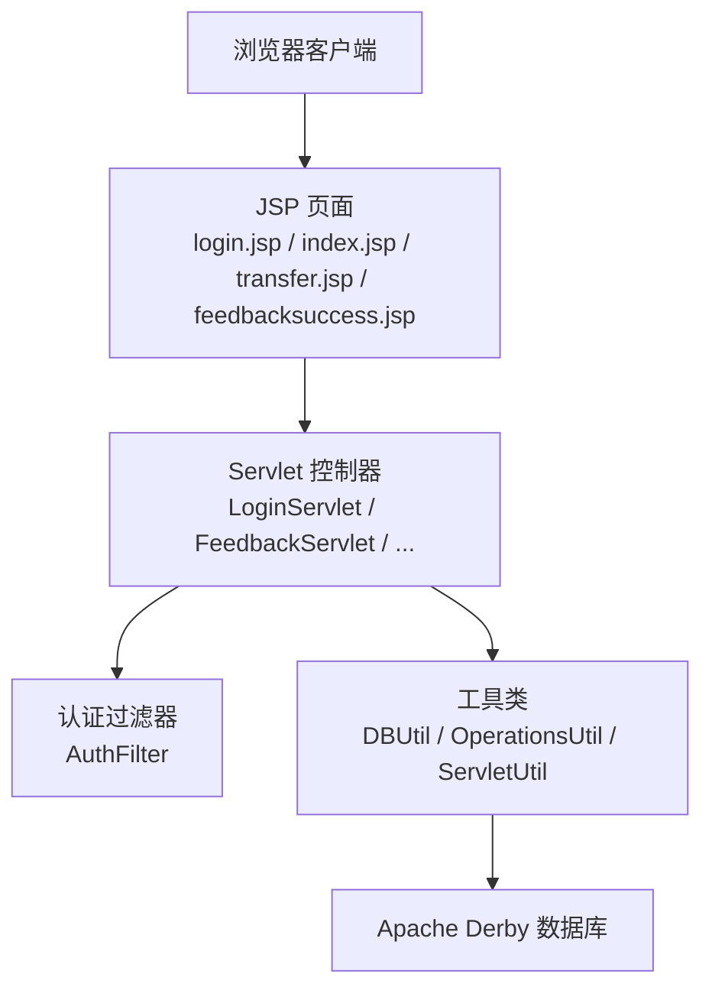
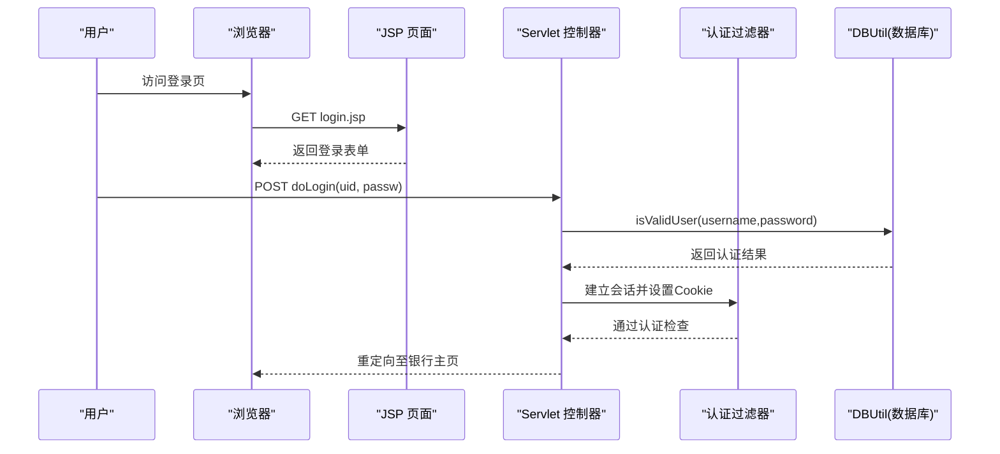
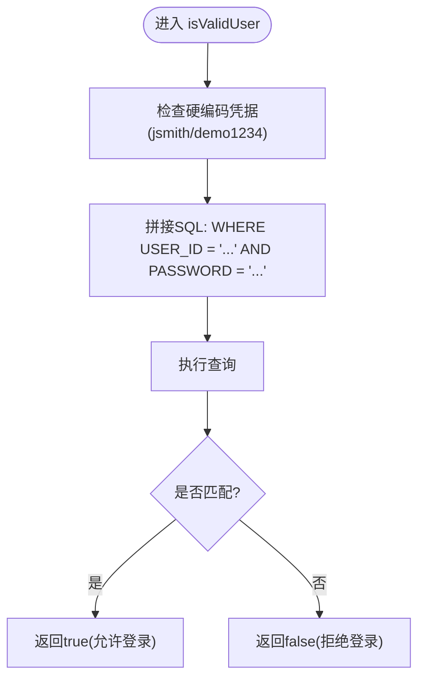
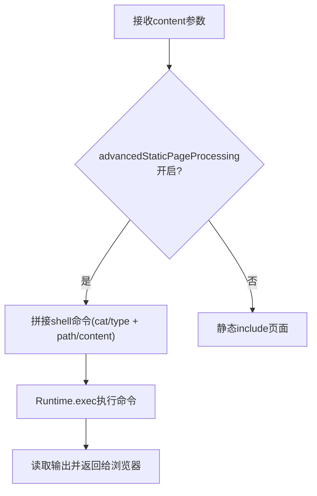
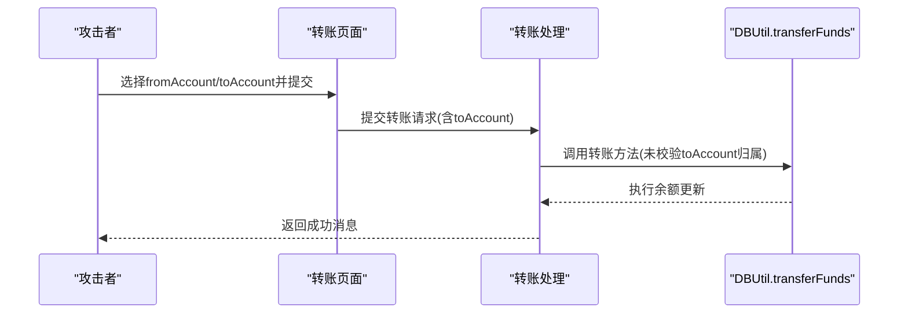
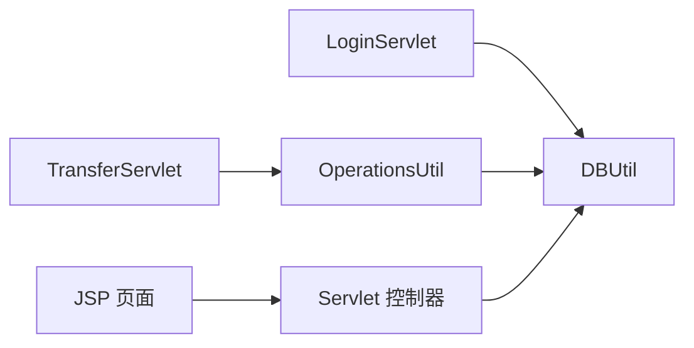

# 已知漏洞列表

<cite>
**本文引用的文件**   
- [README.md](file://README.md)
- [DBUtil.java](file://src/com/ibm/security/appscan/altoromutual/util/DBUtil.java)
- [LoginServlet.java](file://src/com/ibm/security/appscan/altoromutual/servlet/LoginServlet.java)
- [AdminLoginServlet.java](file://src/com/ibm/security/appscan/altoromutual/servlet/AdminLoginServlet.java)
- [index.jsp](file://WebContent/index.jsp)
- [transfer.jsp](file://WebContent/bank/transfer.jsp)
- [feedbacksuccess.jsp](file://WebContent/feedbacksuccess.jsp)
- [FeedbackServlet.java](file://src/com/ibm/security/appscan/altoromutual/servlet/FeedbackServlet.java)
- [OperationsUtil.java](file://src/com/ibm/security/appscan/altoromutual/util/OperationsUtil.java)
- [web.xml](file://WebContent/WEB-INF/web.xml)
</cite>

## 目录
1. [简介](#简介)
2. [项目结构](#项目结构)
3. [核心组件](#核心组件)
4. [架构总览](#架构总览)
5. [详细组件分析](#详细组件分析)
6. [依赖关系分析](#依赖关系分析)
7. [性能与可维护性考虑](#性能与可维护性考虑)
8. [故障排查指南](#故障排查指南)
9. [结论](#结论)
10. [附录：OWASP Top 10 映射与修复建议](#附录owasp-top-10-映射与修复建议)

## 简介
AltoroJ 是一个用于演示和教学的应用安全示例银行系统，内置多种常见 Web 应用漏洞，便于学习、演练与安全测试工具验证。该项目明确声明包含已知安全缺陷，仅应在隔离环境中运行。本文基于仓库源码，梳理并分类所有已识别的漏洞，给出严重性评估、影响范围、历史背景与教学价值，并提供 OWASP Top 10 对应关系与修复方向。

## 项目结构
- Web 层：JSP 页面负责渲染与用户交互，如登录页、转账页、反馈提交与结果页等。
- Servlet 层：处理表单提交、会话建立、业务路由（登录、转账、反馈等）。
- 过滤器层：对访问进行认证检查（例如账户区访问控制）。
- 数据访问层：统一数据库操作封装，存在多处 SQL 拼接问题。
- 配置：web.xml 注册 Servlet；app.properties 提供高级开关（如命令执行模式）。

**图示来源**
- [web.xml:71-118](file://WebContent/WEB-INF/web.xml#L71-L118)
- [LoginServlet.java:67-101](file://src/com/ibm/security/appscan/altoromutual/servlet/LoginServlet.java#L67-L101)
- [DBUtil.java:212-231](file://src/com/ibm/security/appscan/altoromutual/util/DBUtil.java#L212-L231)

**章节来源**
- [README.md:1-10](file://README.md#L1-L10)
- [web.xml:71-118](file://WebContent/WEB-INF/web.xml#L71-L118)

## 核心组件
- 登录与会话：LoginServlet 负责用户登录、会话建立与 Cookie 设置；AuthFilter 校验会话以保护受保护资源。
- 数据访问：DBUtil 集中处理 SQL 查询与更新，但多处使用字符串拼接，易被注入。
- 业务操作：OperationsUtil 封装转账等业务流程，调用 DBUtil 完成持久化。
- 页面渲染：JSP 页面直接输出用户输入或错误信息，部分未充分转义，存在 XSS 风险。

**章节来源**
- [LoginServlet.java:67-101](file://src/com/ibm/security/appscan/altoromutual/servlet/LoginServlet.java#L67-L101)
- [DBUtil.java:212-231](file://src/com/ibm/security/appscan/altoromutual/util/DBUtil.java#L212-L231)
- [OperationsUtil.java:18-35](file://src/com/ibm/security/appscan/altoromutual/util/OperationsUtil.java#L18-L35)

## 架构总览
下图展示从请求到响应的关键路径，以及主要的安全薄弱点位置。

**图示来源**
- [LoginServlet.java:67-101](file://src/com/ibm/security/appscan/altoromutual/servlet/LoginServlet.java#L67-L101)
- [DBUtil.java:212-231](file://src/com/ibm/security/appscan/altoromutual/util/DBUtil.java#L212-L231)

## 详细组件分析

### 1. SQL 注入（高危）
- 描述：DBUtil 中多处将用户输入直接拼接到 SQL 语句中，未使用参数化查询或预编译语句，攻击者可构造恶意输入绕过认证或读取/篡改数据。
- 受影响接口与方法：
  - 用户认证：isValidUser
  - 用户信息查询：getUserInfo
  - 账户查询：getAccounts、getAccount
  - 资金转账：transferFunds
  - 反馈存储：storeFeedback
- 严重性：高危。可导致任意数据读取、修改、删除，甚至通过数据库扩展实现远程代码执行（取决于数据库与驱动能力）。
- 影响范围：所有涉及用户输入参与 SQL 构建的路径。
- 历史背景与教学价值：作为经典的“拼接 SQL”反模式，适合演示参数化查询与 ORM 的使用。
- OWASP 映射：A03:2021 注入。

**图示来源**
- [DBUtil.java:212-231](file://src/com/ibm/security/appscan/altoromutual/util/DBUtil.java#L212-L231)

**章节来源**
- [DBUtil.java:212-231](file://src/com/ibm/security/appscan/altoromutual/util/DBUtil.java#L212-L231)
- [DBUtil.java:241-267](file://src/com/ibm/security/appscan/altoromutual/util/DBUtil.java#L241-L267)
- [DBUtil.java:275-293](file://src/com/ibm/security/appscan/altoromutual/util/DBUtil.java#L275-L293)
- [DBUtil.java:303-364](file://src/com/ibm/security/appscan/altoromutual/util/DBUtil.java#L303-L364)
- [DBUtil.java:452-470](file://src/com/ibm/security/appscan/altoromutual/util/DBUtil.java#L452-L470)
- [DBUtil.java:520-535](file://src/com/ibm/security/appscan/altoromutual/util/DBUtil.java#L520-L535)

### 2. 命令注入（高危）
- 描述：在启用高级选项时，index.jsp 根据 content 参数动态构造系统命令并通过 Runtime.exec 执行，导致远程命令执行。
- 触发条件：advancedStaticPageProcessing 为真且 content 参数可控。
- 严重性：高危。可直接在服务器端执行任意命令，完全接管系统。
- 影响范围：首页内容加载逻辑。
- 历史背景与教学价值：演示“动态命令构建”的危险性与白名单校验的重要性。
- OWASP 映射：A03:2021 注入。

**图示来源**
- [index.jsp:40-94](file://WebContent/index.jsp#L40-L94)

**章节来源**
- [index.jsp:40-94](file://WebContent/index.jsp#L40-L94)

### 3. 跨站脚本（XSS）（中危）
- 描述：多个 JSP 页面直接将用户输入或错误消息输出到响应中，未进行充分的 HTML 转义，可能导致反射型 XSS。
- 受影响页面：
  - feedbacksuccess.jsp：回显 email、姓名、主题、评论等。
  - index.jsp：异常消息输出。
- 严重性：中危。可导致会话劫持、钓鱼、恶意行为模拟等。
- 影响范围：所有未转义的用户输入输出点。
- 历史背景与教学价值：演示输出编码与内容类型约束的最佳实践。
- OWASP 映射：A03:2021 注入（XSS 属于注入的一种）。

**章节来源**
- [feedbacksuccess.jsp:42-49](file://WebContent/feedbacksuccess.jsp#L42-L49)
- [feedbacksuccess.jsp:74-87](file://WebContent/feedbacksuccess.jsp#L74-L87)
- [index.jsp:92-104](file://WebContent/index.jsp#L92-L104)

### 4. 不安全的直接对象引用（IDOR）（中危）
- 描述：转账功能通过前端下拉框传递账户 ID，后端未严格校验目标账户归属当前用户，攻击者可能篡改 toAccount 访问他人账户。
- 受影响流程：转账页面与转账处理逻辑。
- 严重性：中危。可导致越权转账、资金损失。
- 影响范围：转账相关接口与页面。
- 历史背景与教学价值：演示服务端必须校验资源所有权，不能信任前端选择。
- OWASP 映射：A01:2021 失效的访问控制。

**图示来源**
- [transfer.jsp:58-85](file://WebContent/bank/transfer.jsp#L58-L85)
- [OperationsUtil.java:18-35](file://src/com/ibm/security/appscan/altoromutual/util/OperationsUtil.java#L18-L35)
- [DBUtil.java:303-364](file://src/com/ibm/security/appscan/altoromutual/util/DBUtil.java#L303-L364)

**章节来源**
- [transfer.jsp:58-85](file://WebContent/bank/transfer.jsp#L58-L85)
- [OperationsUtil.java:18-35](file://src/com/ibm/security/appscan/altoromutual/util/OperationsUtil.java#L18-L35)
- [DBUtil.java:303-364](file://src/com/ibm/security/appscan/altoromutual/util/DBUtil.java#L303-L364)

### 5. 身份认证绕过（中危）
- 描述：管理员登录使用硬编码密码校验，且未结合强认证机制；同时 LoginServlet 中存在对 jsmith 的硬编码凭据旁路，可能被利用绕过认证。
- 受影响入口：
  - AdminLoginServlet：硬编码密码比较。
  - LoginServlet/DBUtil：jsmith 的硬编码凭据旁路。
- 严重性：中危。可导致未授权访问管理功能或特定账户。
- 影响范围：管理员后台与普通用户登录流程。
- 历史背景与教学价值：演示硬编码凭据的危害与多因素认证的必要性。
- OWASP 映射：A07:2021 身份认证失败。

**章节来源**
- [AdminLoginServlet.java:40-53](file://src/com/ibm/security/appscan/altoromutual/servlet/AdminLoginServlet.java#L40-L53)
- [DBUtil.java:216-219](file://src/com/ibm/security/appscan/altoromutual/util/DBUtil.java#L216-L219)

### 6. 会话固定（中危）
- 描述：登录成功后未重新生成会话标识，攻击者若预先获取会话 ID，可能在用户登录后劫持其会话。
- 受影响流程：登录成功后建立会话与 Cookie 设置。
- 严重性：中危。可导致会话劫持与权限提升。
- 影响范围：登录与后续受保护资源的访问。
- 历史背景与教学价值：演示登录后刷新会话 ID 的重要性。
- OWASP 映射：A07:2021 身份认证失败。

**章节来源**
- [LoginServlet.java:67-101](file://src/com/ibm/security/appscan/altoromutual/servlet/LoginServlet.java#L67-L101)

### 7. 跨站请求伪造（CSRF）（中危）
- 描述：转账等状态变更操作未包含 CSRF Token 校验，攻击者可诱导已登录用户发起非预期转账。
- 受影响流程：转账表单与处理逻辑。
- 严重性：中危。可导致未经授权的状态变更与资金损失。
- 影响范围：所有无 CSRF 保护的写操作。
- 历史背景与教学价值：演示 SameSite Cookie、CSRF Token 与双重提交校验的实践。
- OWASP 映射：A01:2021 失效的访问控制（与 CSRF 相关）。

**章节来源**
- [transfer.jsp:58-95](file://WebContent/bank/transfer.jsp#L58-L95)

### 8. 敏感信息泄露（中危）
- 描述：登录失败日志记录用户名与密码明文，增加凭证泄露风险；错误消息可能暴露内部细节。
- 受影响位置：登录失败日志与异常消息输出。
- 严重性：中危。可导致凭证泄露与服务信息泄露。
- 影响范围：认证流程与错误处理。
- 历史背景与教学价值：演示最小化日志与脱敏输出的重要性。
- OWASP 映射：A02:2021 敏感数据泄露。

**章节来源**
- [LoginServlet.java:82-85](file://src/com/ibm/security/appscan/altoromutual/servlet/LoginServlet.java#L82-L85)
- [index.jsp:92-104](file://WebContent/index.jsp#L92-L104)

### 9. 不安全的数据传输（低危）
- 描述：未强制 HTTPS，凭据与敏感数据可能在网络中被窃听。
- 影响范围：所有 HTTP 通信。
- 严重性：低危（视部署环境而定）。
- 历史背景与教学价值：演示传输加密与 HSTS 的必要性。
- OWASP 映射：A02:2021 敏感数据泄露。

[本节为通用指导，无需具体文件分析]

## 依赖关系分析
- 登录流程依赖 DBUtil.isValidUser 进行认证，该方法的 SQL 拼接是注入的关键入口。
- 转账流程依赖 OperationsUtil.doApiTransfer/ServletTransfer 与 DBUtil.transferFunds，后者同样存在 SQL 拼接与 IDOR 风险。
- 页面渲染依赖 JSP 直接输出用户输入，需加强输出编码。

**图示来源**
- [LoginServlet.java:67-101](file://src/com/ibm/security/appscan/altoromutual/servlet/LoginServlet.java#L67-L101)
- [OperationsUtil.java:18-35](file://src/com/ibm/security/appscan/altoromutual/util/OperationsUtil.java#L18-L35)
- [DBUtil.java:303-364](file://src/com/ibm/security/appscan/altoromutual/util/DBUtil.java#L303-L364)

**章节来源**
- [LoginServlet.java:67-101](file://src/com/ibm/security/appscan/altoromutual/servlet/LoginServlet.java#L67-L101)
- [OperationsUtil.java:18-35](file://src/com/ibm/security/appscan/altoromutual/util/OperationsUtil.java#L18-L35)
- [DBUtil.java:303-364](file://src/com/ibm/security/appscan/altoromutual/util/DBUtil.java#L303-L364)

## 性能与可维护性考虑
- 避免在 JSP 中执行系统命令，应迁移至后端服务并采用白名单校验。
- 统一使用参数化查询或 ORM，减少 SQL 拼接带来的维护成本与安全风险。
- 引入统一的输出编码库，避免分散的转义逻辑。
- 对敏感日志进行脱敏，避免记录明文凭据。

[本节为通用指导，无需具体文件分析]

## 故障排查指南
- 登录失败日志包含明文凭据，排查时应注意脱敏与最小化日志策略。
- 转账失败或余额异常时，优先检查是否存在 IDOR 与 SQL 注入导致的非法更新。
- 启用高级选项后出现命令执行相关问题，应立即关闭 advancedStaticPageProcessing 并审计系统命令调用。

**章节来源**
- [LoginServlet.java:82-85](file://src/com/ibm/security/appscan/altoromutual/servlet/LoginServlet.java#L82-L85)
- [index.jsp:40-94](file://WebContent/index.jsp#L40-L94)

## 结论
AltoroJ 作为教学示例，集中展示了 SQL 注入、命令注入、XSS、IDOR、认证绕过、会话固定、CSRF 等典型漏洞。修复这些问题的关键在于：参数化查询、严格的输入校验与白名单、输出编码、强化认证与会话管理、实施 CSRF 防护、最小化日志与敏感信息保护。建议在隔离环境中进行演练，并在生产环境中彻底消除上述风险。

[本节为总结性内容，无需具体文件分析]

## 附录：OWASP Top 10 映射与修复建议
- A01:2021 失效的访问控制
  - 对应漏洞：IDOR、CSRF
  - 修复建议：服务端资源所有权校验、CSRF Token/SameSite Cookie
- A02:2021 敏感数据泄露
  - 对应漏洞：明文日志、未强制 HTTPS
  - 修复建议：脱敏日志、强制 TLS/HSTS
- A03:2021 注入
  - 对应漏洞：SQL 注入、命令注入、XSS
  - 修复建议：参数化查询、ORM、白名单命令、输出编码
- A07:2021 身份认证失败
  - 对应漏洞：硬编码凭据、会话固定
  - 修复建议：移除硬编码、MFA、登录后刷新会话 ID

[本节为概念性映射，无需具体文件分析]