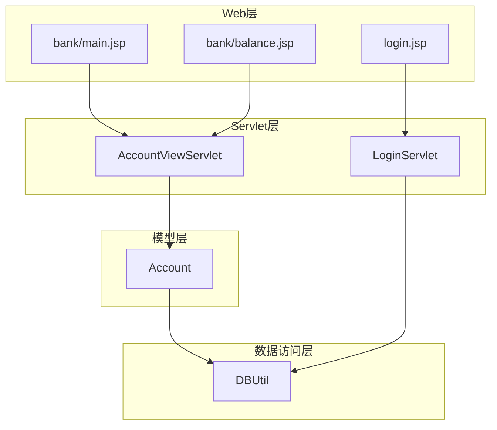
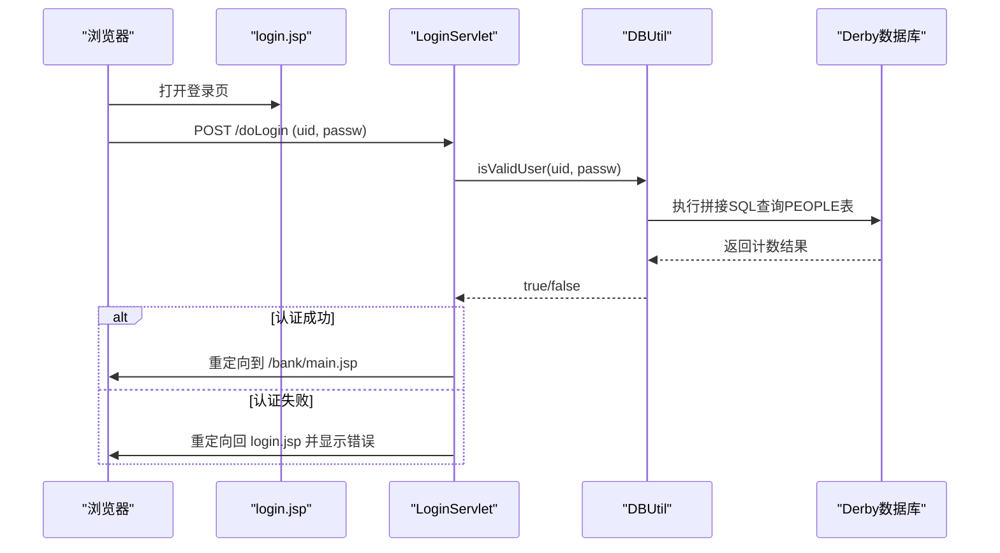
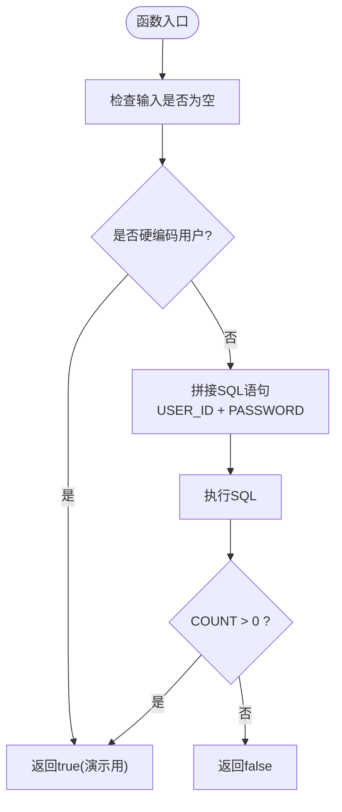
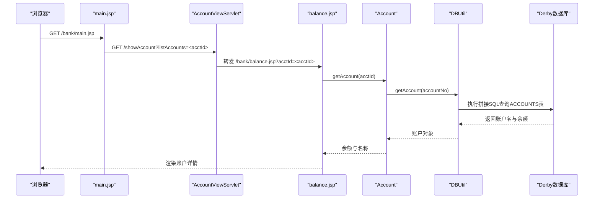
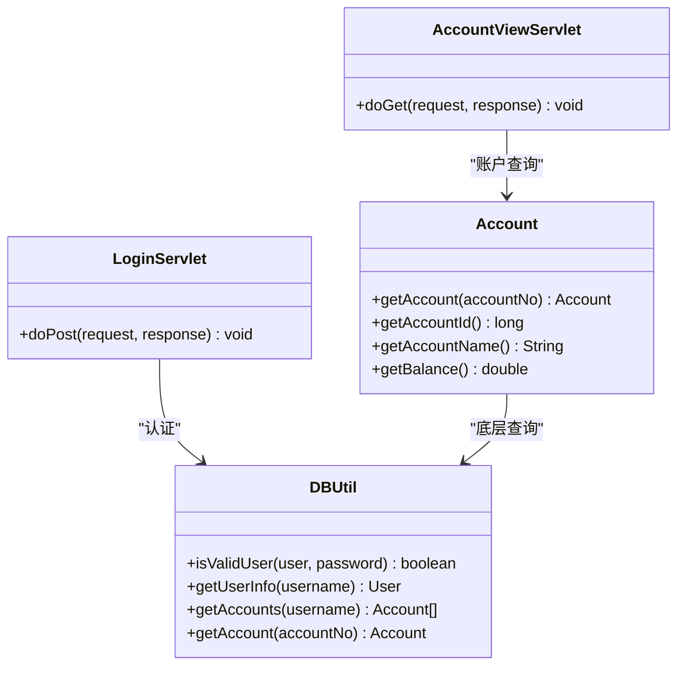
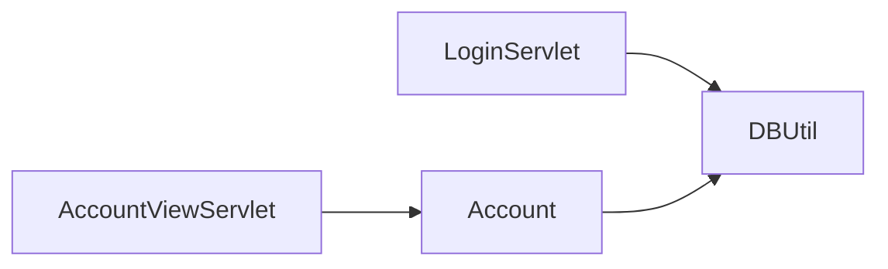

# SQL注入攻击演示

<cite>
**本文引用的文件**   
- [DBUtil.java](file://src/com/ibm/security/appscan/altoromutual/util/DBUtil.java)
- [LoginServlet.java](file://src/com/ibm/security/appscan/altoromutual/servlet/LoginServlet.java)
- [login.jsp](file://WebContent/login.jsp)
- [AccountViewServlet.java](file://src/com/ibm/security/appscan/altoromutual/servlet/AccountViewServlet.java)
- [balance.jsp](file://WebContent/bank/balance.jsp)
- [main.jsp](file://WebContent/bank/main.jsp)
- [Account.java](file://src/com/ibm/security/appscan/altoromutual/model/Account.java)
- [README.md](file://README.md)
</cite>

## 目录
1. [简介](#简介)
2. [项目结构](#项目结构)
3. [核心组件](#核心组件)
4. [架构总览](#架构总览)
5. [详细组件分析](#详细组件分析)
6. [依赖关系分析](#依赖关系分析)
7. [性能与可观测性](#性能与可观测性)
8. [故障排查指南](#故障排查指南)
9. [结论](#结论)
10. [附录：修复建议与最佳实践](#附录修复建议与最佳实践)

## 简介
本演示文档聚焦于 AltoroJ 中的 SQL 注入漏洞，围绕登录表单、账户查询等入口，说明攻击原理、构造攻击载荷、绕过身份认证、获取敏感数据的方法，并提供完整的 HTTP 请求示例与响应结果分析。同时指出存在漏洞的代码位置，并给出修复建议。

AltoroJ 是一个用于演示 Web 应用安全问题的示例银行系统，默认使用 Apache Derby 数据库，首次通过 Web 界面登录后自动初始化。仓库 README 明确提示该应用包含已知安全漏洞，仅应在隔离环境中运行。

**章节来源**
- [README.md:1-10](file://README.md#L1-L10)

## 项目结构
与 SQL 注入相关的代码主要分布在以下位置：
- 用户登录流程：Web 层 login.jsp → Servlet LoginServlet → 业务逻辑 DBUtil.isValidUser
- 账户查询流程：Web 层 main.jsp/balance.jsp → Servlet AccountViewServlet → 模型 Account.getAccount → DBUtil.getAccount
- 数据库访问工具类：DBUtil（多处直接拼接用户输入到 SQL）

**图表来源**
- [login.jsp:45-72](file://WebContent/login.jsp#L45-L72)
- [LoginServlet.java:67-101](file://src/com/ibm/security/appscan/altoromutual/servlet/LoginServlet.java#L67-L101)
- [main.jsp:43-56](file://WebContent/bank/main.jsp#L43-L56)
- [balance.jsp:40-77](file://WebContent/bank/balance.jsp#L40-L77)
- [AccountViewServlet.java:48-59](file://src/com/ibm/security/appscan/altoromutual/servlet/AccountViewServlet.java#L48-L59)
- [Account.java:37-48](file://src/com/ibm/security/appscan/altoromutual/model/Account.java#L37-L48)
- [DBUtil.java:212-232](file://src/com/ibm/security/appscan/altoromutual/util/DBUtil.java#L212-L232)
- [DBUtil.java:452-470](file://src/com/ibm/security/appscan/altoromutual/util/DBUtil.java#L452-L470)

**章节来源**
- [login.jsp:45-72](file://WebContent/login.jsp#L45-L72)
- [LoginServlet.java:67-101](file://src/com/ibm/security/appscan/altoromutual/servlet/LoginServlet.java#L67-L101)
- [main.jsp:43-56](file://WebContent/bank/main.jsp#L43-L56)
- [balance.jsp:40-77](file://WebContent/bank/balance.jsp#L40-L77)
- [AccountViewServlet.java:48-59](file://src/com/ibm/security/appscan/altoromutual/servlet/AccountViewServlet.java#L48-L59)
- [Account.java:37-48](file://src/com/ibm/security/appscan/altoromutual/model/Account.java#L37-L48)
- [DBUtil.java:212-232](file://src/com/ibm/security/appscan/altoromutual/util/DBUtil.java#L212-L232)
- [DBUtil.java:452-470](file://src/com/ibm/security/appscan/altoromutual/util/DBUtil.java#L452-L470)

## 核心组件
- DBUtil：数据库访问工具类，集中了所有 SQL 执行逻辑。多处方法直接使用 Statement 拼接用户输入，导致 SQL 注入。
- LoginServlet：处理登录请求，调用 DBUtil.isValidUser 进行认证。
- AccountViewServlet：处理账户查看请求，转发到 balance.jsp，并在 JSP 中调用 Account.getAccount 和 DBUtil.getTransactions。
- Account：账户模型，对外暴露 getAccount 静态方法，内部委托给 DBUtil.getAccount。
- login.jsp：登录页面，提交用户名和密码到 LoginServlet。
- main.jsp/balance.jsp：账户列表与余额展示页面，接收账户 ID 参数并调用后端接口。

关键风险点：
- 登录认证未对用户输入进行参数化，可直接拼接进 SQL。
- 账户查询与交易查询同样拼接用户输入，可用于读取任意账户信息或进一步利用。

**章节来源**
- [DBUtil.java:212-232](file://src/com/ibm/security/appscan/altoromutual/util/DBUtil.java#L212-L232)
- [DBUtil.java:241-267](file://src/com/ibm/security/appscan/altoromutual/util/DBUtil.java#L241-L267)
- [DBUtil.java:275-293](file://src/com/ibm/security/appscan/altoromutual/util/DBUtil.java#L275-L293)
- [DBUtil.java:452-470](file://src/com/ibm/security/appscan/altoromutual/util/DBUtil.java#L452-L470)
- [LoginServlet.java:67-101](file://src/com/ibm/security/appscan/altoromutual/servlet/LoginServlet.java#L67-L101)
- [AccountViewServlet.java:48-59](file://src/com/ibm/security/appscan/altoromutual/servlet/AccountViewServlet.java#L48-L59)
- [Account.java:37-48](file://src/com/ibm/security/appscan/altoromutual/model/Account.java#L37-L48)

## 架构总览
下图展示了从浏览器发起登录请求到数据库验证的完整调用链，以及账户查询的数据流。

**图表来源**
- [login.jsp:45-72](file://WebContent/login.jsp#L45-L72)
- [LoginServlet.java:67-101](file://src/com/ibm/security/appscan/altoromutual/servlet/LoginServlet.java#L67-L101)
- [DBUtil.java:212-232](file://src/com/ibm/security/appscan/altoromutual/util/DBUtil.java#L212-L232)

## 详细组件分析

### 登录表单 SQL 注入
- 漏洞位置：DBUtil.isValidUser 使用 Statement 拼接用户输入到 SQL 语句。
- 影响：攻击者可通过构造特殊用户名/密码绕过认证，无需真实凭据即可登录。
- 常见载荷思路：
  - 在用户名处闭合字符串并添加恒真条件，例如：' OR '1'='1'--
  - 在密码处配合注释符忽略密码校验，例如：' OR '1'='1'--
- 绕过原理：最终执行的 SQL 变为类似“SELECT COUNT(*) FROM PEOPLE WHERE USER_ID = '' OR '1'='1'--' AND PASSWORD='...'”，由于恒真条件成立且后续被注释掉，认证通过。

**图表来源**
- [DBUtil.java:212-232](file://src/com/ibm/security/appscan/altoromutual/util/DBUtil.java#L212-L232)

**章节来源**
- [DBUtil.java:212-232](file://src/com/ibm/security/appscan/altoromutual/util/DBUtil.java#L212-L232)
- [LoginServlet.java:67-101](file://src/com/ibm/security/appscan/altoromutual/servlet/LoginServlet.java#L67-L101)
- [login.jsp:45-72](file://WebContent/login.jsp#L45-L72)

### 账户查询 SQL 注入
- 漏洞位置：DBUtil.getAccount 使用 Statement 拼接账户编号；Account.getAccount 将字符串转为 long 后调用 DBUtil.getAccount。
- 影响：攻击者可读取任意账户名称与余额，甚至结合其他功能扩展为更严重的后果。
- 常见载荷思路：
  - 在账户编号处使用数值型注入，例如：1 OR 1=1--
  - 若前端强制数字类型，可利用时间盲注或报错注入技巧（视数据库方言而定）。

**图表来源**
- [main.jsp:43-56](file://WebContent/bank/main.jsp#L43-L56)
- [AccountViewServlet.java:48-59](file://src/com/ibm/security/appscan/altoromutual/servlet/AccountViewServlet.java#L48-L59)
- [balance.jsp:40-77](file://WebContent/bank/balance.jsp#L40-L77)
- [Account.java:37-48](file://src/com/ibm/security/appscan/altoromutual/model/Account.java#L37-L48)
- [DBUtil.java:452-470](file://src/com/ibm/security/appscan/altoromutual/util/DBUtil.java#L452-L470)

**章节来源**
- [AccountViewServlet.java:48-59](file://src/com/ibm/security/appscan/altoromutual/servlet/AccountViewServlet.java#L48-L59)
- [balance.jsp:40-77](file://WebContent/bank/balance.jsp#L40-L77)
- [Account.java:37-48](file://src/com/ibm/security/appscan/altoromutual/model/Account.java#L37-L48)
- [DBUtil.java:452-470](file://src/com/ibm/security/appscan/altoromutual/util/DBUtil.java#L452-L470)

### 用户信息查询与角色提升
- 漏洞位置：DBUtil.getUserInfo 拼接用户名查询 PEOPLES 表，返回角色字段。
- 影响：若该接口被外部 API 或管理功能调用，可能泄露用户角色信息，辅助权限提升。

**图表来源**
- [DBUtil.java:241-267](file://src/com/ibm/security/appscan/altoromutual/util/DBUtil.java#L241-L267)
- [DBUtil.java:275-293](file://src/com/ibm/security/appscan/altoromutual/util/DBUtil.java#L275-L293)
- [DBUtil.java:452-470](file://src/com/ibm/security/appscan/altoromutual/util/DBUtil.java#L452-L470)
- [LoginServlet.java:67-101](file://src/com/ibm/security/appscan/altoromutual/servlet/LoginServlet.java#L67-L101)
- [AccountViewServlet.java:48-59](file://src/com/ibm/security/appscan/altoromutual/servlet/AccountViewServlet.java#L48-L59)
- [Account.java:37-48](file://src/com/ibm/security/appscan/altoromutual/model/Account.java#L37-L48)

**章节来源**
- [DBUtil.java:241-267](file://src/com/ibm/security/appscan/altoromutual/util/DBUtil.java#L241-L267)
- [DBUtil.java:275-293](file://src/com/ibm/security/appscan/altoromutual/util/DBUtil.java#L275-L293)
- [DBUtil.java:452-470](file://src/com/ibm/security/appscan/altoromutful/util/DBUtil.java#L452-L470)

## 依赖关系分析
- LoginServlet 依赖 DBUtil 进行认证。
- AccountViewServlet 依赖 Account 与 DBUtil 进行账户查询。
- Account 作为模型层封装对 DBUtil 的调用。
- 所有 SQL 构建均集中在 DBUtil，耦合度高，便于统一修复。

**图表来源**
- [LoginServlet.java:67-101](file://src/com/ibm/security/appscan/altoromutual/servlet/LoginServlet.java#L67-L101)
- [AccountViewServlet.java:48-59](file://src/com/ibm/security/appscan/altoromutual/servlet/AccountViewServlet.java#L48-L59)
- [Account.java:37-48](file://src/com/ibm/security/appscan/altoromutual/model/Account.java#L37-L48)
- [DBUtil.java:212-232](file://src/com/ibm/security/appscan/altoromutual/util/DBUtil.java#L212-L232)

**章节来源**
- [LoginServlet.java:67-101](file://src/com/ibm/security/appscan/altoromutual/servlet/LoginServlet.java#L67-L101)
- [AccountViewServlet.java:48-59](file://src/com/ibm/security/appscan/altoromutual/servlet/AccountViewServlet.java#L48-L59)
- [Account.java:37-48](file://src/com/ibm/security/appscan/altoromutual/model/Account.java#L37-L48)
- [DBUtil.java:212-232](file://src/com/ibm/security/appscan/altoromutual/util/DBUtil.java#L212-L232)

## 性能与可观测性
- 当前实现使用 Statement 拼接 SQL，无法利用预编译缓存优化，存在潜在性能问题。
- 日志记录方面，LoginServlet 会记录登录失败信息，但 SQL 注入相关细节未单独记录，不利于审计与取证。
- 建议在修复后增加结构化日志，记录参数化查询的执行上下文与异常堆栈。

[本节为通用指导，不直接分析具体文件]

## 故障排查指南
- 登录失败：检查 LoginServlet 的错误属性设置与重定向逻辑。
- 数据库初始化失败：参考 README 中的“Failed to create database”解决方案，确认 user.home 路径权限与 Derby 配置。
- 账户查询异常：检查 AccountViewServlet 的参数传递与 balance.jsp 的 acctId 处理。

**章节来源**
- [LoginServlet.java:82-90](file://src/com/ibm/security/appscan/altoromutual/servlet/LoginServlet.java#L82-L90)
- [AccountViewServlet.java:48-59](file://src/com/ibm/security/appscan/altoromutual/servlet/AccountViewServlet.java#L48-L59)
- [README.md:44-56](file://README.md#L44-L56)

## 结论
AltoroJ 在登录认证与账户查询等关键路径上存在明显的 SQL 注入漏洞，根源在于 DBUtil 中多处使用 Statement 拼接用户输入。攻击者可通过构造特定载荷绕过认证、读取敏感数据，甚至进一步利用其他功能扩大影响面。修复方案应全面采用参数化查询（PreparedStatement），并对输入进行严格校验与白名单过滤，同时完善日志与监控。

[本节为总结性内容，不直接分析具体文件]

## 附录：修复建议与最佳实践
- 使用 PreparedStatement 替代 Statement，对所有用户输入进行参数绑定，避免字符串拼接。
- 对输入进行严格的类型与格式校验，尤其是数值型字段（如账户编号）应做范围与长度限制。
- 最小权限原则：数据库连接账号仅授予必要权限，禁止 DDL/DML 滥用。
- 统一抽象数据访问层，集中处理 SQL 构建与参数绑定，减少重复与遗漏。
- 增强日志与告警：记录可疑输入、SQL 执行异常与审计事件，便于快速定位与响应。
- 定期安全扫描与渗透测试，覆盖登录、查询、转账、管理等高风险功能。

[本节为通用指导，不直接分析具体文件]