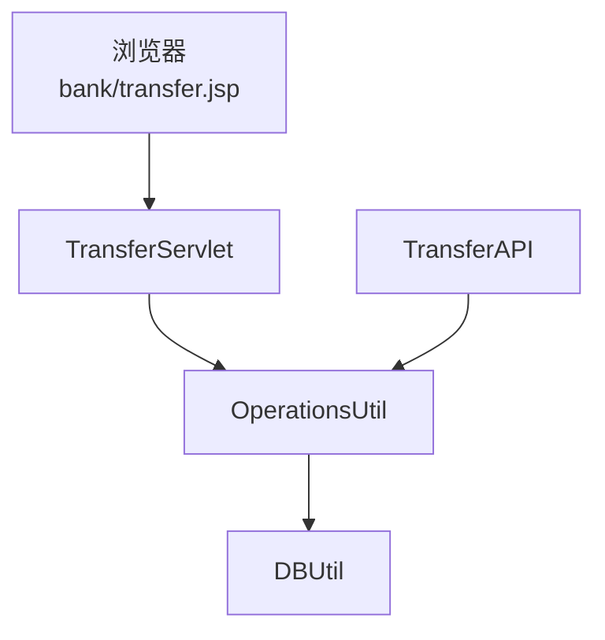
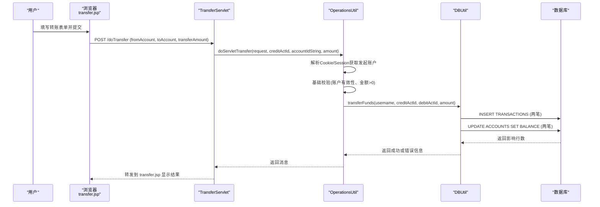
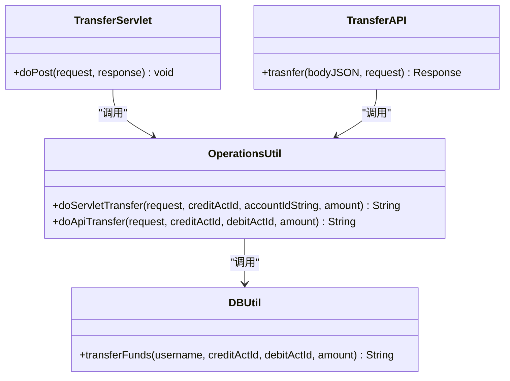

# 业务逻辑攻击演示

<cite>
**本文引用的文件**   
- [README.md](file://README.md)
- [TransferServlet.java](file://src/com/ibm/security/appscan/altoromutual/servlet/TransferServlet.java)
- [OperationsUtil.java](file://src/com/ibm/security/appscan/altoromutual/util/OperationsUtil.java)
- [DBUtil.java](file://src/com/ibm/security/appscan/altoromutual/util/DBUtil.java)
- [TransferAPI.java](file://src/com/ibm/security/appscan/altoromutual/api/TransferAPI.java)
- [transfer.jsp](file://WebContent/bank/transfer.jsp)
</cite>

## 目录
1. [简介](#简介)
2. [项目结构](#项目结构)
3. [核心组件](#核心组件)
4. [架构总览](#架构总览)
5. [详细组件分析](#详细组件分析)
6. [依赖关系分析](#依赖关系分析)
7. [性能与并发特性](#性能与并发特性)
8. [故障排查指南](#故障排查指南)
9. [结论](#结论)
10. [附录：攻击演练与测试方法](#附录攻击演练与测试方法)

## 简介
本演示文档聚焦于 AltoroJ 的业务逻辑缺陷，围绕转账流程中的验证缺失、原子性不足、余额校验缺失等关键点，系统性地说明如何利用这些缺陷进行负数转账、重复转账、金额篡改等攻击，并给出预期结果。同时提供业务逻辑安全设计最佳实践与测试方法，帮助读者理解常见业务逻辑漏洞的模式与检测方法。

## 项目结构
AltoroJ 是一个基于 J2EE 的示例银行应用，包含 Web 页面、Servlet、REST API、工具类与数据访问层。转账功能涉及以下关键路径：
- Web 表单提交：bank/transfer.jsp
- Servlet 处理：TransferServlet
- 业务编排：OperationsUtil
- 数据访问与事务：DBUtil
- REST API：TransferAPI

图表来源
- [transfer.jsp:31-104](file://WebContent/bank/transfer.jsp#L31-L104)
- [TransferServlet.java:51-67](file://src/com/ibm/security/appscan/altoromutual/servlet/TransferServlet.java#L51-L67)
- [OperationsUtil.java:39-117](file://src/com/ibm/security/appscan/altoromutual/util/OperationsUtil.java#L39-L117)
- [DBUtil.java:303-364](file://src/com/ibm/security/appscan/altoromutual/util/DBUtil.java#L303-L364)
- [TransferAPI.java:17-43](file://src/com/ibm/security/appscan/altoromutual/api/TransferAPI.java#L17-L43)

章节来源
- [README.md:1-10](file://README.md#L1-L10)

## 核心组件
- TransferServlet：接收 HTTP 请求，校验登录状态，解析参数并调用 OperationsUtil。
- OperationsUtil：封装转账业务编排，负责从 Cookie/Session 中解析发起账户，执行基础校验（如金额正负），然后调用 DBUtil 完成资金变动。
- DBUtil：直接操作数据库，创建交易记录并更新账户余额；存在多处 SQL 拼接与并发风险。
- TransferAPI：REST 接口，同样调用 OperationsUtil 完成转账。
- transfer.jsp：前端表单，含客户端校验（可被绕过）。

章节来源
- [TransferServlet.java:38-67](file://src/com/ibm/security/appscan/altoromutual/servlet/TransferServlet.java#L38-L67)
- [OperationsUtil.java:18-117](file://src/com/ibm/security/appscan/altoromutual/util/OperationsUtil.java#L18-L117)
- [DBUtil.java:303-364](file://src/com/ibm/security/appscan/altoromutual/util/DBUtil.java#L303-L364)
- [TransferAPI.java:14-43](file://src/com/ibm/security/appscan/altoromutual/api/TransferAPI.java#L14-L43)
- [transfer.jsp:35-52](file://WebContent/bank/transfer.jsp#L35-L52)

## 架构总览
转账流程的关键交互如下：

图表来源
- [transfer.jsp:58-95](file://WebContent/bank/transfer.jsp#L58-L95)
- [TransferServlet.java:51-67](file://src/com/ibm/security/appscan/altoromutual/servlet/TransferServlet.java#L51-L67)
- [OperationsUtil.java:39-117](file://src/com/ibm/security/appscan/altoromutual/util/OperationsUtil.java#L39-L117)
- [DBUtil.java:303-364](file://src/com/ibm/security/appscan/altoromutual/util/DBUtil.java#L303-L364)

## 详细组件分析

### 转账入口与参数解析（TransferServlet）
- 仅做登录检查，未对 fromAccount/toAccount/transferAmount 做服务端强校验。
- 直接将参数传递给 OperationsUtil，允许恶意构造的请求进入业务层。

潜在问题
- 缺少服务端输入校验与类型约束。
- 未限制转账方向与账户归属校验（例如是否属于当前用户）。

章节来源
- [TransferServlet.java:51-67](file://src/com/ibm/security/appscan/altoromutual/servlet/TransferServlet.java#L51-L67)

### 业务编排（OperationsUtil）
- doServletTransfer：
  - 从 Cookie 或 Session 中解析用户账户列表，尝试匹配 fromAccount（支持按 ID 或名称）。
  - 基础校验：目标账户必须为正、发起账户必须已解析、金额必须大于 0。
  - 注释明确“未检查可用余额”，随后直接调用 DBUtil.transferFunds。
- doApiTransfer：
  - 通过 Authorization 头解析用户，直接调用 DBUtil.transferFunds，无额外业务校验。

潜在问题
- 余额校验缺失，导致透支转账可能成功。
- 对 fromAccount 的解析依赖 Cookie 内容，若 Cookie 被篡改或伪造，可能导致发起账户越权。
- 未实现幂等控制，同一请求可能被重复提交导致重复转账。

章节来源
- [OperationsUtil.java:39-117](file://src/com/ibm/security/appscan/altoromutual/util/OperationsUtil.java#L39-L117)
- [OperationsUtil.java:18-36](file://src/com/ibm/security/appscan/altoromutual/util/OperationsUtil.java#L18-L36)

### 数据访问与转账实现（DBUtil）
- transferFunds：
  - 查询发起账户与目标账户对象。
  - 根据是否为信用卡账户调整 debitAmount/creditAmount 符号。
  - 插入两条交易记录（借方与贷方）。
  - 更新两个账户的余额（非原子操作，两次 UPDATE 语句）。
  - 使用字符串拼接 SQL，存在注入风险（与本演示主题相关但非重点）。

潜在问题
- 并发不安全：两次 UPDATE 之间无锁或事务隔离，易产生竞态条件。
- 余额读取后计算再写入，未采用“读-锁-写”模式，易出现覆盖更新。
- 未对透支进行业务规则拦截（余额为负仍可能成功）。

章节来源
- [DBUtil.java:303-364](file://src/com/ibm/security/appscan/altoromutual/util/DBUtil.java#L303-L364)

### REST 接口（TransferAPI）
- 接收 JSON body，解析 toAccount/fromAccount/transferAmount，调用 OperationsUtil.doApiTransfer。
- 未对金额范围、账户合法性、幂等进行校验。

潜在问题
- 与 Servlet 路径相同的安全缺陷：无业务规则校验、无幂等控制。

章节来源
- [TransferAPI.java:17-43](file://src/com/ibm/security/appscan/altoromutual/api/TransferAPI.java#L17-L43)

### 前端表单（transfer.jsp）
- 客户端校验：禁止同账户互转、要求金额大于 0。
- 可通过禁用 JS 或抓包修改绕过。

章节来源
- [transfer.jsp:35-52](file://WebContent/bank/transfer.jsp#L35-L52)
- [transfer.jsp:58-95](file://WebContent/bank/transfer.jsp#L58-L95)

## 依赖关系分析
- TransferServlet 依赖 OperationsUtil 与 ServletUtil（登录与用户解析）。
- OperationsUtil 依赖 DBUtil 与 Account/User 模型。
- DBUtil 直接操作数据库，耦合度高且缺乏事务边界。
- TransferAPI 复用 OperationsUtil，共享相同的业务逻辑缺陷。

图表来源
- [TransferServlet.java:51-67](file://src/com/ibm/security/appscan/altoromutual/servlet/TransferServlet.java#L51-L67)
- [OperationsUtil.java:39-117](file://src/com/ibm/security/appscan/altoromutual/util/OperationsUtil.java#L39-L117)
- [DBUtil.java:303-364](file://src/com/ibm/security/appscan/altoromutual/util/DBUtil.java#L303-L364)
- [TransferAPI.java:17-43](file://src/com/ibm/security/appscan/altoromutual/api/TransferAPI.java#L17-L43)

## 性能与并发特性
- 转账在 DBUtil 中使用多条独立 SQL 语句，未声明事务边界，无法保证一致性。
- 并发场景下可能出现“丢失更新”和“重复入账”现象，导致余额不一致。
- 建议引入数据库事务与行级锁，确保“读-校验-写”的原子性。

[本节为通用指导，不直接分析具体文件]

## 故障排查指南
- 转账失败提示：“Transaction failed. Please try again later.”
  - 通常由 SQL 异常引起，需检查数据库连接与权限。
- 账户无效提示：
  - “Originating account is invalid”：发起账户不存在或未正确解析。
  - “Destination account is invalid”：目标账户不存在或非法。
- 金额无效提示：
  - “Transfer amount is invalid”：金额为负数或零。

章节来源
- [DBUtil.java:315-320](file://src/com/ibm/security/appscan/altoromutual/util/DBUtil.java#L315-L320)
- [DBUtil.java:361-363](file://src/com/ibm/security/appscan/altoromutual/util/DBUtil.java#L361-L363)
- [OperationsUtil.java:96-102](file://src/com/ibm/security/appscan/altoromutual/util/OperationsUtil.java#L96-L102)

## 结论
AltoroJ 的转账流程存在典型的业务逻辑缺陷：
- 前端校验可绕过，服务端未充分校验参数合法性与业务规则。
- 余额校验缺失，允许透支转账。
- 转账非原子操作，并发条件下易出现重复入账与覆盖更新。
- Cookie 驱动的发起账户解析存在越权风险。
修复建议包括：统一服务端校验、引入事务与行级锁、实施幂等控制、强化账户归属校验与审计日志。

[本节为总结性内容，不直接分析具体文件]

## 附录：攻击演练与测试方法

### 攻击模式一：负数转账
- 原理：前端要求金额 > 0，但服务端仅做基础校验；若绕过前端或直接调用 API，传入负数金额，可能在某些分支下触发异常或产生非预期记账。
- 步骤：
  1. 登录系统，打开转账页面。
  2. 使用浏览器开发者工具或代理工具将 transferAmount 改为负数。
  3. 提交转账请求。
- 预期结果：
  - 若服务端拒绝，应返回“Transfer amount is invalid”。
  - 若因并发或分支处理不当，可能出现记账异常或余额异常。

章节来源
- [transfer.jsp:46-49](file://WebContent/bank/transfer.jsp#L46-L49)
- [OperationsUtil.java:100-102](file://src/com/ibm/security/appscan/altoromutual/util/OperationsUtil.java#L100-L102)

### 攻击模式二：重复转账（幂等缺失）
- 原理：未实现幂等控制，同一转账请求可被重复提交，导致重复入账。
- 步骤：
  1. 准备一笔正常转账（fromAccount、toAccount、amount）。
  2. 使用脚本或代理工具在短时间内多次重放该请求。
  3. 观察账户余额与交易记录。
- 预期结果：
  - 可能出现多笔相同金额的入账，余额异常增加。

章节来源
- [OperationsUtil.java:105-108](file://src/com/ibm/security/appscan/altoromutual/util/OperationsUtil.java#L105-L108)
- [DBUtil.java:339-357](file://src/com/ibm/security/appscan/altoromutual/util/DBUtil.java#L339-L357)

### 攻击模式三：金额篡改（绕过前端校验）
- 原理：前端校验可被绕过，服务端未对金额范围做强校验（除负数外），可能利用其他数值边界或业务分支造成异常。
- 步骤：
  1. 禁用浏览器 JavaScript 或使用代理工具修改 transferAmount。
  2. 提交超大金额或特殊值（如 NaN、Infinity，视语言解析行为而定）。
  3. 观察响应与数据库状态。
- 预期结果：
  - 若服务端未严格校验，可能出现记账错误或余额异常。

章节来源
- [transfer.jsp:46-49](file://WebContent/bank/transfer.jsp#L46-L49)
- [OperationsUtil.java:100-108](file://src/com/ibm/security/appscan/altoromutual/util/OperationsUtil.java#L100-L108)

### 攻击模式四：跨账户转账（Cookie 驱动发起账户）
- 原理：OperationsUtil 从 Cookie 中解析用户账户列表，若 Cookie 被篡改或伪造，可能使发起账户不属于当前用户。
- 步骤：
  1. 登录后抓取 Cookie。
  2. 修改 Cookie 中的账户列表，加入目标账户或他人账户。
  3. 发起转账至自己账户。
- 预期结果：
  - 若校验不严，可能实现跨账户转账。

章节来源
- [OperationsUtil.java:47-64](file://src/com/ibm/security/appscan/altoromutual/util/OperationsUtil.java#L47-L64)

### 攻击模式五：并发竞态（覆盖更新）
- 原理：DBUtil 的两条 UPDATE 语句非原子，并发下可能出现先读后写的覆盖更新，导致余额不一致。
- 步骤：
  1. 启动多个线程同时对同一账户发起转账。
  2. 观察最终余额与交易记录。
- 预期结果：
  - 可能出现余额丢失或重复入账。

章节来源
- [DBUtil.java:339-357](file://src/com/ibm/security/appscan/altoromutual/util/DBUtil.java#L339-L357)

### 业务逻辑安全设计最佳实践
- 统一服务端校验：对所有输入进行白名单校验与类型约束，禁止依赖前端校验。
- 业务规则集中化：在业务层统一实现金额范围、账户归属、额度限制等规则。
- 幂等控制：为转账请求生成唯一标识（如请求ID），在服务端去重。
- 事务与锁：使用数据库事务与行级锁，确保“读-校验-写”的原子性。
- 审计与监控：记录关键操作日志，设置告警阈值与异常检测。
- 最小权限原则：接口与资源访问遵循最小权限，避免越权。

[本节为通用指导，不直接分析具体文件]

### 测试方法
- 单元测试：针对 OperationsUtil 与 DBUtil 的转账逻辑编写用例，覆盖正常、异常、边界值。
- 集成测试：模拟真实 HTTP 请求，覆盖 Servlet 与 API 路径。
- 并发测试：使用压测工具模拟高并发转账，验证一致性与幂等性。
- 安全测试：使用代理工具篡改参数、重放请求、伪造 Cookie，验证防护机制。
- 回归测试：修复后复测所有攻击场景，确保不再可被利用。

[本节为通用指导，不直接分析具体文件]