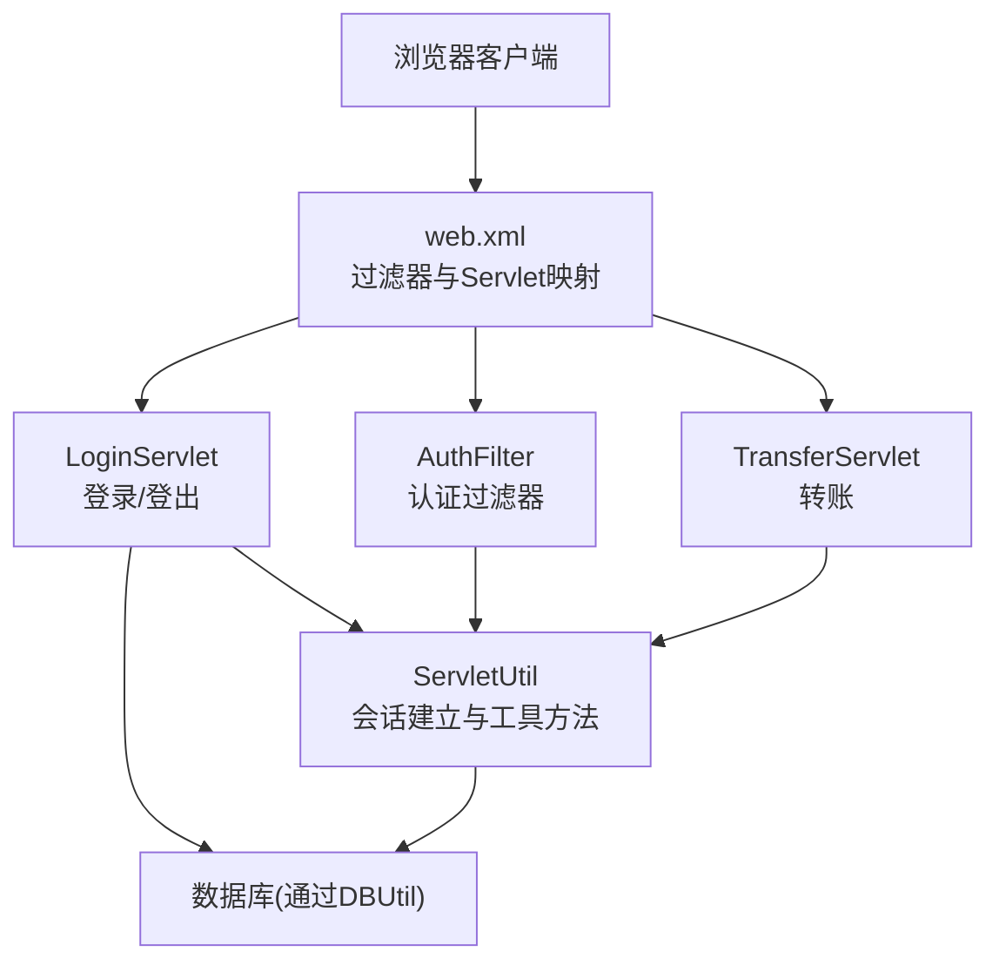
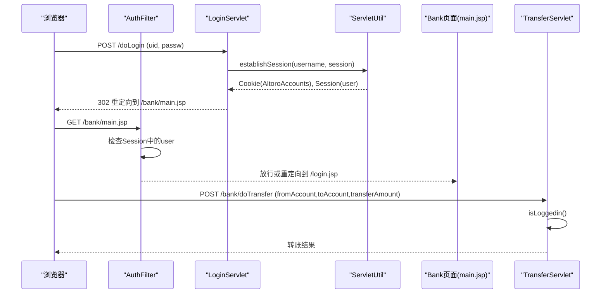
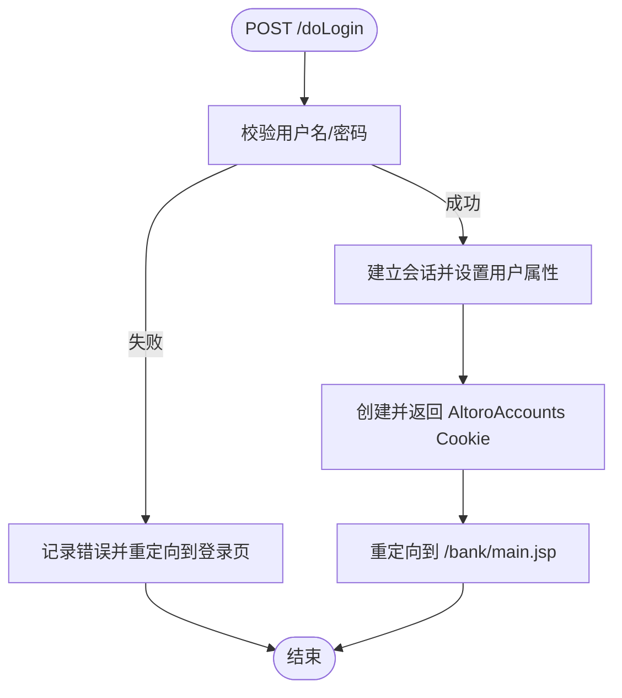
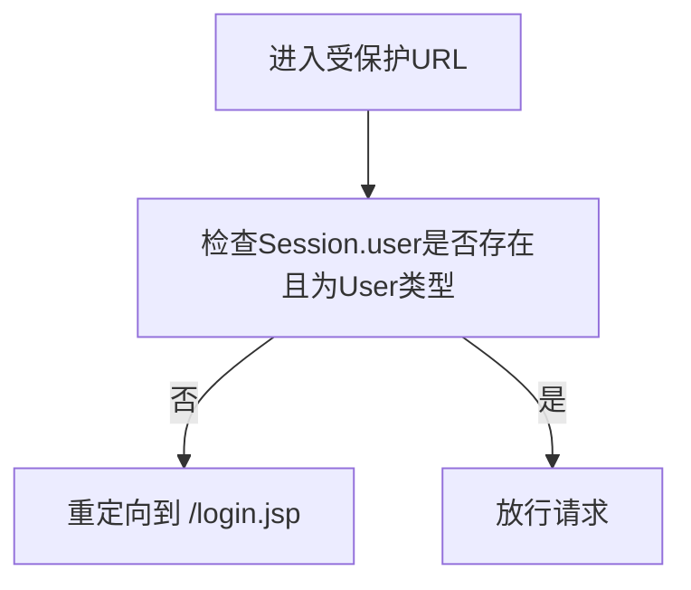
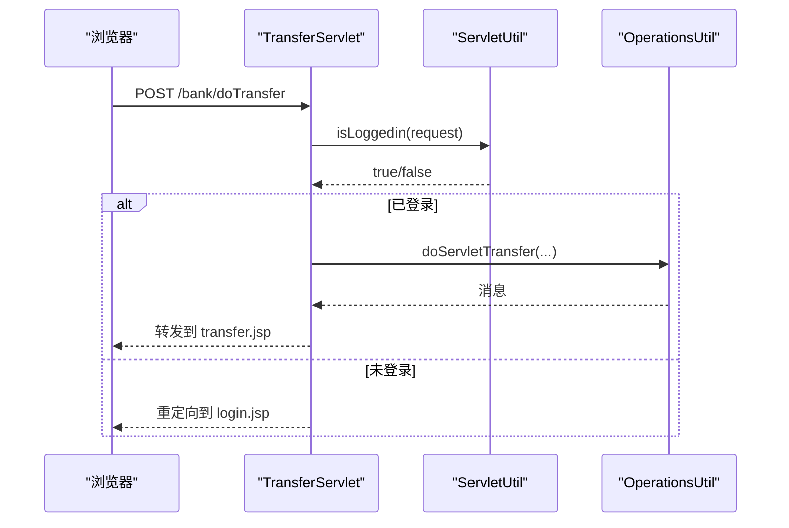
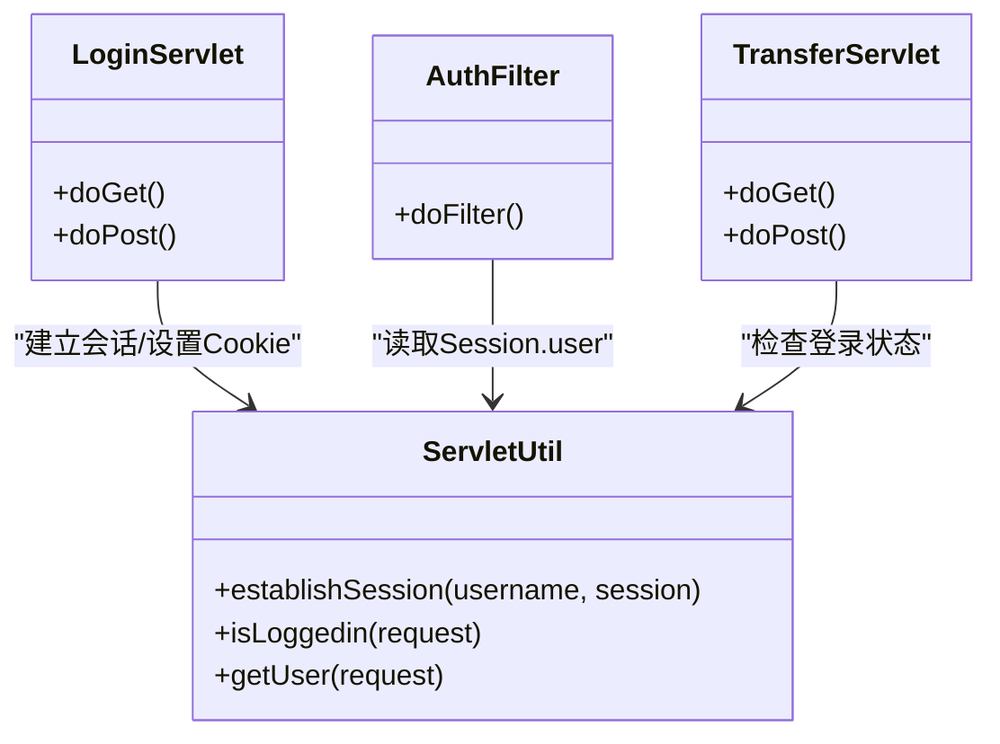

# 会话劫持攻击演示

<cite>
**本文引用的文件**   
- [README.md](file://README.md)
- [web.xml](file://WebContent/WEB-INF/web.xml)
- [LoginServlet.java](file://src/com/ibm/security/appscan/altoromutual/servlet/LoginServlet.java)
- [AuthFilter.java](file://src/com/ibm/security/appscan/altoromutual/filter/AuthFilter.java)
- [ServletUtil.java](file://src/com/ibm/security/appscan/altoromutual/util/ServletUtil.java)
- [login.jsp](file://WebContent/login.jsp)
- [main.jsp](file://WebContent/bank/main.jsp)
- [TransferServlet.java](file://src/com/ibm/security/appscan/altoromutual/servlet/TransferServlet.java)
</cite>

## 目录
1. [引言](#引言)
2. [项目结构](#项目结构)
3. [核心组件](#核心组件)
4. [架构总览](#架构总览)
5. [详细组件分析](#详细组件分析)
6. [依赖关系分析](#依赖关系分析)
7. [性能与安全性考量](#性能与安全性考量)
8. [故障排查指南](#故障排查指南)
9. [结论](#结论)
10. [附录：攻击演示步骤与安全加固清单](#附录攻击演示步骤与安全加固清单)

## 引言
本演示文档面向AltoroJ应用，聚焦“会话劫持”相关的安全问题。我们将基于代码实现，解释该应用如何处理登录、会话与Cookie，并据此说明如何窃取和滥用其他用户的会话ID以冒充合法用户；同时覆盖Cookie劫持、会话固定等具体攻击技术，展示拦截与重放HTTP请求访问受保护资源的方法，并提供会话管理的安全最佳实践与防护措施。

AltoroJ是一个用于教学与演示的示例银行系统，明确包含已知安全漏洞，适合在隔离环境中进行安全测试与学习。

**章节来源**
- [README.md:1-10](file://README.md#L1-L10)

## 项目结构
AltoroJ采用传统Java Web（Servlet + JSP）架构，关键路径如下：
- 配置入口：WebContent/WEB-INF/web.xml
- 认证与会话：LoginServlet、AuthFilter、ServletUtil
- 页面：login.jsp、bank/main.jsp
- 敏感操作：TransferServlet（转账）

**图表来源**
- [web.xml:12-68](file://WebContent/WEB-INF/web.xml#L12-L68)
- [LoginServlet.java:67-101](file://src/com/ibm/security/appscan/altoromutual/servlet/LoginServlet.java#L67-L101)
- [AuthFilter.java:58-69](file://src/com/ibm/security/appscan/altoromutual/filter/AuthFilter.java#L58-L69)
- [ServletUtil.java:340-373](file://src/com/ibm/security/appscan/altoromutual/util/ServletUtil.java#L340-L373)
- [TransferServlet.java:51-67](file://src/com/ibm/security/appscan/altoromutual/servlet/TransferServlet.java#L51-L67)

**章节来源**
- [web.xml:12-68](file://WebContent/WEB-INF/web.xml#L12-L68)

## 核心组件
- 登录流程（LoginServlet）
  - 接收用户名与密码参数，校验成功后建立会话，设置用户属性到Session，并返回一个包含账户信息的Cookie。
- 认证过滤器（AuthFilter）
  - 对受保护URL（如 /bank/*、/admin/*）进行检查，若Session中不存在有效用户对象则重定向至登录页。
- 会话工具（ServletUtil）
  - 提供establishSession、isLoggedin、getUser等方法，封装了会话属性存取与Cookie创建逻辑。
- 转账接口（TransferServlet）
  - 检查是否已登录，读取转账参数后调用业务逻辑执行转账。

**章节来源**
- [LoginServlet.java:67-101](file://src/com/ibm/security/appscan/altoromutual/servlet/LoginServlet.java#L67-L101)
- [AuthFilter.java:58-69](file://src/com/ibm/security/appscan/altoromutual/filter/AuthFilter.java#L58-L69)
- [ServletUtil.java:340-373](file://src/com/ibm/security/appscan/altoromutual/util/ServletUtil.java#L340-L373)
- [TransferServlet.java:51-67](file://src/com/ibm/security/appscan/altoromutual/servlet/TransferServlet.java#L51-L67)

## 架构总览
下图展示了从登录到访问受保护资源的完整流程，以及会话与Cookie的作用点。

**图表来源**
- [LoginServlet.java:67-101](file://src/com/ibm/security/appscan/altoromutual/servlet/LoginServlet.java#L67-L101)
- [ServletUtil.java:340-373](file://src/com/ibm/security/appscan/altoromutual/util/ServletUtil.java#L340-L373)
- [AuthFilter.java:58-69](file://src/com/ibm/security/appscan/altoromutual/filter/AuthFilter.java#L58-L69)
- [TransferServlet.java:51-67](file://src/com/ibm/security/appscan/altoromutual/servlet/TransferServlet.java#L51-L67)

## 详细组件分析

### 登录与会话建立（LoginServlet + ServletUtil）
- 登录成功后的行为
  - 使用ServletUtil.establishSession将用户信息写入Session，并创建一个名为AltoroAccounts的Cookie，其中包含Base64编码的账户列表。
  - 随后重定向到银行主页。
- 登出行为
  - 移除Session中的用户属性并重定向到首页。

**图表来源**
- [LoginServlet.java:67-101](file://src/com/ibm/security/appscan/altoromutual/servlet/LoginServlet.java#L67-L101)
- [ServletUtil.java:340-353](file://src/com/ibm/security/appscan/altoromutual/util/ServletUtil.java#L340-L353)

**章节来源**
- [LoginServlet.java:67-101](file://src/com/ibm/security/appscan/altoromutual/servlet/LoginServlet.java#L67-L101)
- [ServletUtil.java:340-353](file://src/com/ibm/security/appscan/altoromutual/util/ServletUtil.java#L340-L353)

### 认证过滤器（AuthFilter）
- 作用范围
  - 对 /bank/* 与 /admin/* 的请求进行认证检查。
- 认证逻辑
  - 从Session中获取用户对象，若为空或非User类型，则重定向到登录页；否则放行。

**图表来源**
- [AuthFilter.java:58-69](file://src/com/ibm/security/appscan/altoromutual/filter/AuthFilter.java#L58-L69)

**章节来源**
- [AuthFilter.java:58-69](file://src/com/ibm/security/appscan/altoromutual/filter/AuthFilter.java#L58-L69)

### 转账接口（TransferServlet）
- 登录检查
  - 使用ServletUtil.isLoggedin判断是否已登录，未登录则重定向到登录页。
- 参数处理
  - 读取fromAccount、toAccount、transferAmount，调用OperationsUtil执行业务逻辑。

**图表来源**
- [TransferServlet.java:51-67](file://src/com/ibm/security/appscan/altoromutual/servlet/TransferServlet.java#L51-L67)
- [ServletUtil.java:355-368](file://src/com/ibm/security/appscan/altoromutual/util/ServletUtil.java#L355-L368)

**章节来源**
- [TransferServlet.java:51-67](file://src/com/ibm/security/appscan/altoromutual/servlet/TransferServlet.java#L51-L67)

### 页面与数据流（login.jsp、main.jsp）
- login.jsp
  - 表单提交到 /doLogin，携带uid与passw字段。
- main.jsp
  - 从Session中读取用户对象并显示欢迎信息与账户列表。

**章节来源**
- [login.jsp:45-72](file://WebContent/login.jsp#L45-L72)
- [main.jsp:32-53](file://WebContent/bank/main.jsp#L32-L53)

## 依赖关系分析
- web.xml定义了过滤器与Servlet的映射关系，控制请求路由与认证拦截。
- LoginServlet依赖ServletUtil进行会话建立与Cookie设置。
- AuthFilter依赖ServletUtil读取Session中的用户属性。
- TransferServlet依赖ServletUtil进行登录状态检查。

**图表来源**
- [web.xml:12-68](file://WebContent/WEB-INF/web.xml#L12-L68)
- [LoginServlet.java:67-101](file://src/com/ibm/security/appscan/altoromutual/servlet/LoginServlet.java#L67-L101)
- [AuthFilter.java:58-69](file://src/com/ibm/security/appscan/altoromutual/filter/AuthFilter.java#L58-L69)
- [ServletUtil.java:340-373](file://src/com/ibm/security/appscan/altoromutual/util/ServletUtil.java#L340-L373)
- [TransferServlet.java:51-67](file://src/com/ibm/security/appscan/altoromutual/servlet/TransferServlet.java#L51-L67)

**章节来源**
- [web.xml:12-68](file://WebContent/WEB-INF/web.xml#L12-L68)

## 性能与安全性考量
- 性能
  - 过滤器链在每次请求时都会进行Session检查，可能带来一定开销；可通过最小化过滤范围与缓存策略优化。
- 安全性
  - 当前实现存在多个会话安全问题：
    - Cookie中携带账户信息（Base64），可被截获与重用。
    - 登录成功后未销毁旧Session或轮换Session ID，易受会话固定攻击。
    - 未设置Cookie的HttpOnly、Secure、SameSite等安全属性。
    - 登录凭据大小写归一化可能降低口令强度。
  - 建议：
    - 登录后立即invalidate旧Session并生成新Session ID。
    - 不在Cookie中存储敏感数据；如需持久标识，应使用不可预测的令牌并仅作为Session引用。
    - 设置Cookie安全属性（HttpOnly、Secure、SameSite=Strict/Lax）。
    - 强制HTTPS传输，避免中间人窃听。
    - 实施CSRF防护（如双重提交Cookie或同源策略）。
    - 加强日志脱敏与错误信息最小化。

[本节为通用指导，不直接分析具体文件]

## 故障排查指南
- 登录失败
  - 检查用户名/密码是否正确；查看登录失败的日志输出。
- 无法访问受保护页面
  - 确认Session中存在用户对象；检查AuthFilter是否正确映射到目标URL。
- 转账失败
  - 检查参数完整性与类型转换；确认用户已登录且具备相应权限。

**章节来源**
- [LoginServlet.java:82-90](file://src/com/ibm/security/appscan/altoromutual/servlet/LoginServlet.java#L82-L90)
- [AuthFilter.java:58-69](file://src/com/ibm/security/appscan/altoromutual/filter/AuthFilter.java#L58-L69)
- [TransferServlet.java:51-67](file://src/com/ibm/security/appscan/altoromutual/servlet/TransferServlet.java#L51-L67)

## 结论
AltoroJ的会话机制围绕Session与Cookie展开，但实现上存在明显的安全缺陷：Cookie泄露敏感数据、未轮换Session ID、缺少Cookie安全属性等。这些缺陷使得会话劫持、Cookie劫持与会话固定攻击成为可能。通过理解其代码实现，我们可以清晰地演示如何窃取与重放会话以冒充用户，并据此提出针对性的加固措施。

[本节为总结性内容，不直接分析具体文件]

## 附录：攻击演示步骤与安全加固清单

### 攻击演示步骤（教学用途，请在隔离环境执行）
- 准备
  - 在隔离虚拟机中部署AltoroJ，确保网络隔离与快照备份。
- 窃取会话ID
  - 使用浏览器开发者工具或抓包工具（如Burp Suite）捕获登录响应中的Set-Cookie头，提取AltoroAccounts的值。
- 会话固定
  - 在受害者登录前，尝试注入或预置一个可控的Session ID（例如通过URL或Cookie），然后诱使受害者登录，从而获得该Session的控制权。
- 重放请求
  - 使用抓包工具重放已捕获的受保护请求（如访问 /bank/main.jsp 或 /bank/doTransfer），附带窃取的Cookie，以冒充合法用户。
- 验证影响
  - 观察是否能访问他人账户信息或执行转账操作。

注意：以上步骤仅用于教育与演示，严禁在生产环境或未授权系统中使用。

### 安全加固清单
- 会话生命周期管理
  - 登录后立即invalidate旧Session并生成新Session ID。
  - 设置合理的Session超时时间。
- Cookie安全
  - 不在Cookie中存储敏感数据；仅保留非敏感标识。
  - 设置HttpOnly、Secure、SameSite属性。
- 传输安全
  - 全站启用HTTPS，防止中间人窃听。
- CSRF防护
  - 实施CSRF令牌或同源策略。
- 输入校验与最小权限
  - 对所有输入进行严格校验与白名单过滤。
  - 遵循最小权限原则，限制敏感操作的访问范围。
- 日志与监控
  - 脱敏敏感信息，记录异常登录与越权访问事件。

[本节为通用指导，不直接分析具体文件]