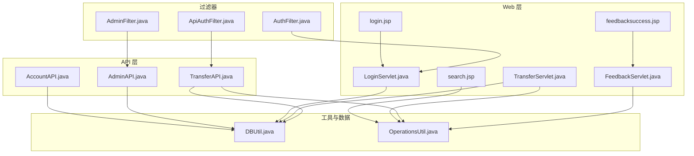
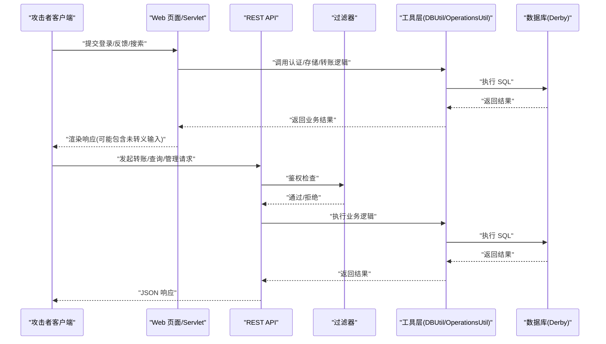
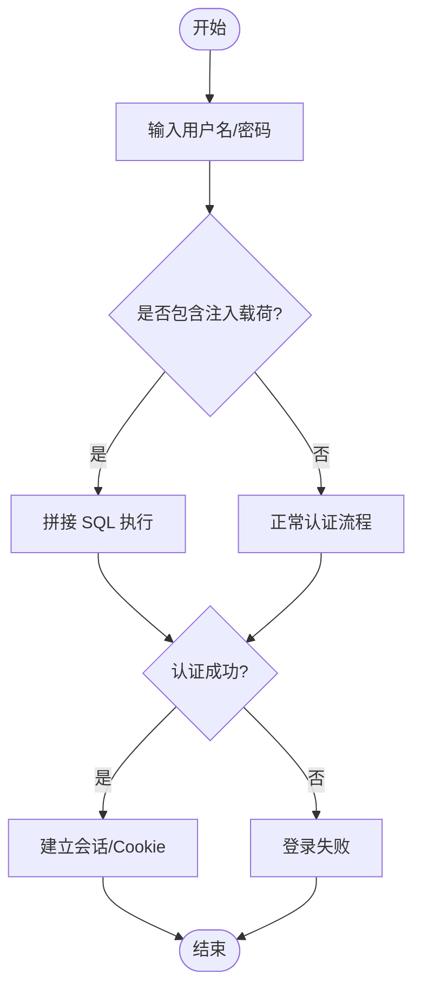
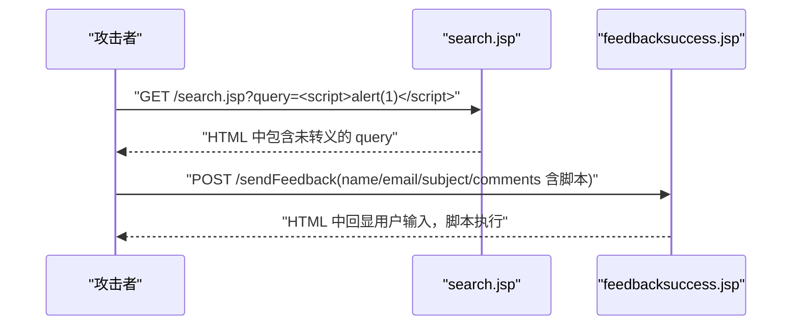
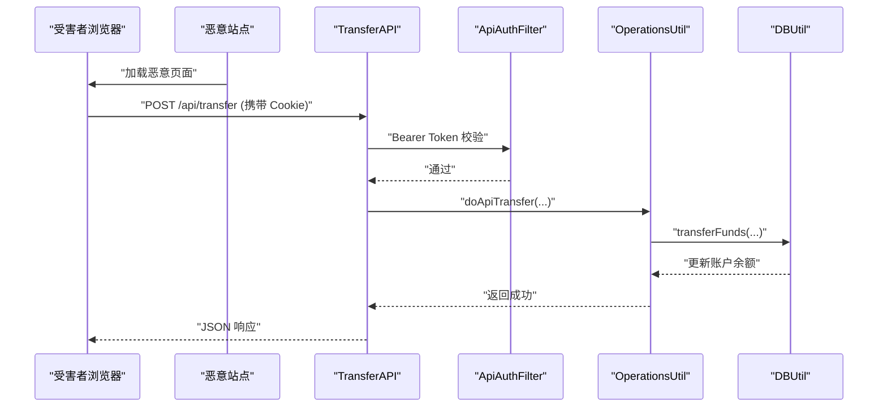
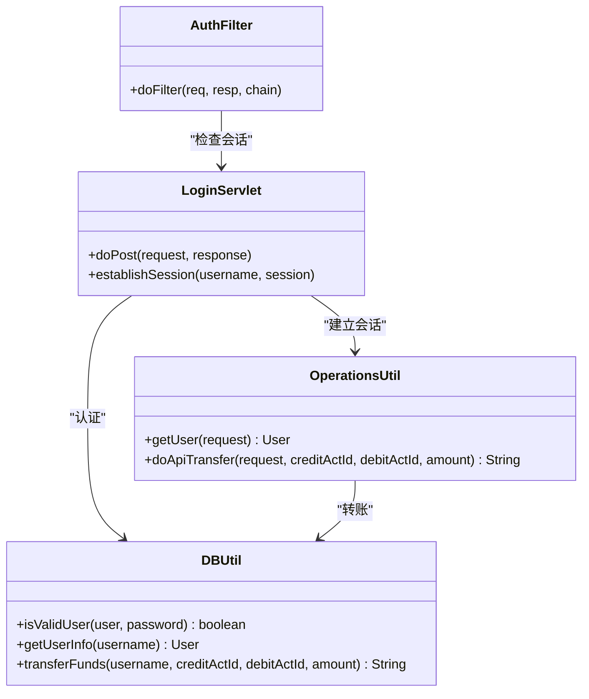
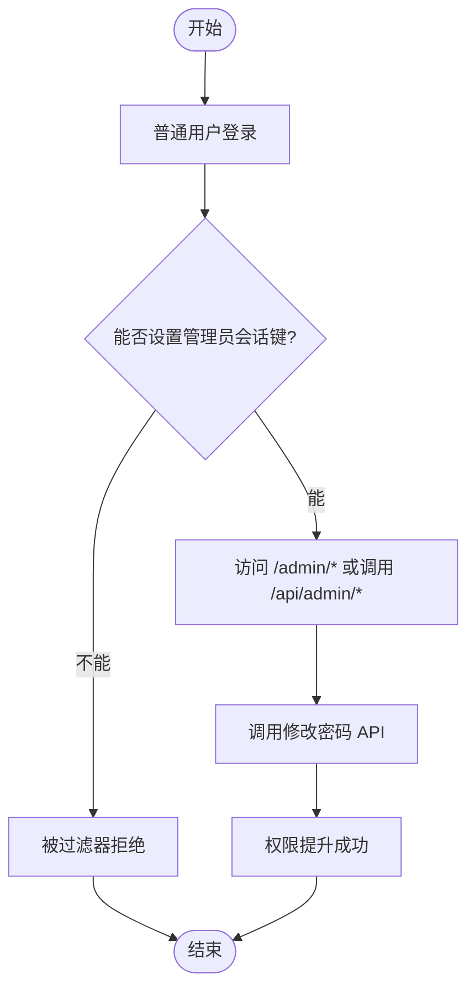
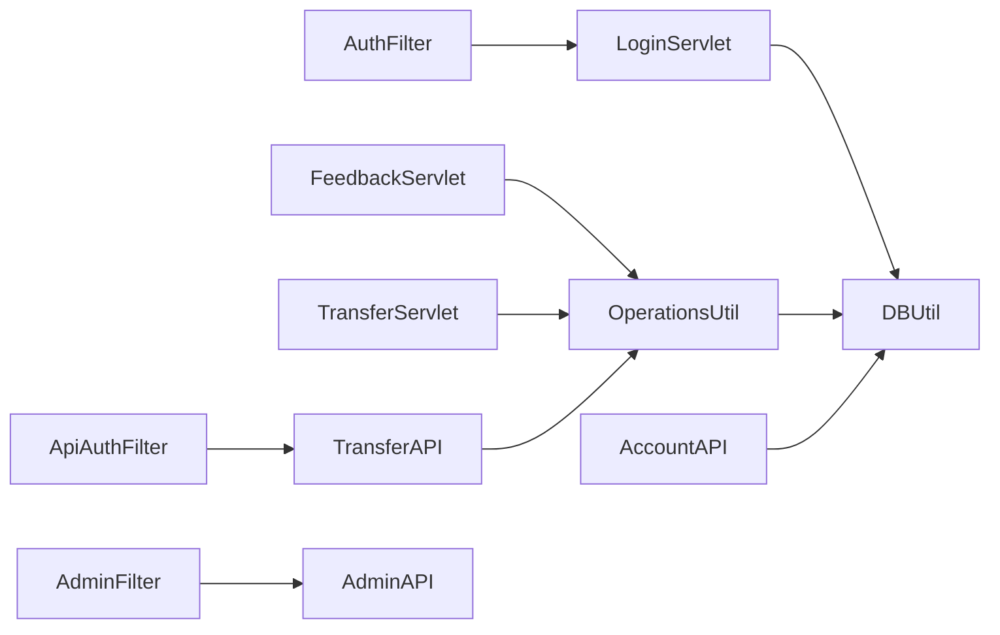

# 攻击方式演示

<cite>
**本文引用的文件**   
- [README.md](file://README.md)
- [DBUtil.java](file://src/com/ibm/security/appscan/altoromutual/util/DBUtil.java)
- [LoginServlet.java](file://src/com/ibm/security/appscan/altoromutual/servlet/LoginServlet.java)
- [login.jsp](file://WebContent/login.jsp)
- [search.jsp](file://WebContent/search.jsp)
- [feedbacksuccess.jsp](file://WebContent/feedbacksuccess.jsp)
- [FeedbackServlet.java](file://src/com/ibm/security/appscan/altoromutual/servlet/FeedbackServlet.java)
- [OperationsUtil.java](file://src/com/ibm/security/appscan/altoromutual/util/OperationsUtil.java)
- [TransferAPI.java](file://src/com/ibm/security/appscan/altoromutual/api/TransferAPI.java)
- [TransferServlet.java](file://src/com/ibm/security/appscan/altoromutual/servlet/TransferServlet.java)
- [AccountAPI.java](file://src/com/ibm/security/appscan/altoromutual/api/AccountAPI.java)
- [AdminAPI.java](file://src/com/ibm/security/appscan/altoromutual/api/AdminAPI.java)
- [AuthFilter.java](file://src/com/ibm/security/appscan/altoromutual/filter/AuthFilter.java)
- [ApiAuthFilter.java](file://src/com/ibm/security/appscan/altoromutual/filter/ApiAuthFilter.java)
- [AdminFilter.java](file://src/com/ibm/security/appscan/altoromutual/filter/AdminFilter.java)
</cite>

## 目录
1. [简介](#简介)
2. [项目结构](#项目结构)
3. [核心组件](#核心组件)
4. [架构总览](#架构总览)
5. [详细组件分析](#详细组件分析)
6. [依赖关系分析](#依赖关系分析)
7. [性能与可观测性](#性能与可观测性)
8. [故障排查指南](#故障排查指南)
9. [结论](#结论)
10. [附录：攻击载荷与请求示例索引](#附录攻击载荷与请求示例索引)

## 简介
本文件为 AltoroJ 的攻击方式演示文档，聚焦于以下安全漏洞的完整演示路径：SQL 注入、跨站脚本（XSS）、跨站请求伪造（CSRF）、会话劫持、权限提升。文档从代码级实现出发，解释漏洞原理、攻击步骤、预期结果，并给出可直接复现的请求示例与定位到源码的具体行号，帮助学习者理解漏洞利用过程。

AltoroJ 是一个故意包含已知安全漏洞的示例银行 Web 应用，用于演示和教学。请仅在隔离环境中运行，避免在生产环境部署。

**章节来源**
- [README.md:1-10](file://README.md#L1-L10)

## 项目结构
AltoroJ 采用传统 J2EE 分层结构：
- Web 层：JSP 页面与 Servlet 控制器
- API 层：基于 JAX-RS 的 REST API
- 过滤器：认证与授权拦截
- 工具层：数据库操作、业务辅助方法
- 模型层：用户、账户、交易等实体

**图表来源**
- [login.jsp:45-71](file://WebContent/login.jsp#L45-L71)
- [search.jsp:31-46](file://WebContent/search.jsp#L31-L46)
- [feedbacksuccess.jsp:42-89](file://WebContent/feedbacksuccess.jsp#L42-L89)
- [TransferServlet.java:51-67](file://src/com/ibm/security/appscan/altoromutual/servlet/TransferServlet.java#L51-L67)
- [LoginServlet.java:67-101](file://src/com/ibm/security/appscan/altoromutual/servlet/LoginServlet.java#L67-L101)
- [FeedbackServlet.java:42-67](file://src/com/ibm/security/appscan/altoromutual/servlet/FeedbackServlet.java#L42-L67)
- [TransferAPI.java:17-43](file://src/com/ibm/security/appscan/altoromutual/api/TransferAPI.java#L17-L43)
- [AccountAPI.java:59-100](file://src/com/ibm/security/appscan/altoromutual/api/AccountAPI.java#L59-L100)
- [AdminAPI.java:20-59](file://src/com/ibm/security/appscan/altoromutual/api/AdminAPI.java#L20-L59)
- [AuthFilter.java:58-69](file://src/com/ibm/security/appscan/altoromutual/filter/AuthFilter.java#L58-L69)
- [ApiAuthFilter.java:56-74](file://src/com/ibm/security/appscan/altoromutual/filter/ApiAuthFilter.java#L56-L74)
- [AdminFilter.java:58-79](file://src/com/ibm/security/appscan/altoromutual/filter/AdminFilter.java#L58-L79)
- [DBUtil.java:212-232](file://src/com/ibm/security/appscan/altoromutual/util/DBUtil.java#L212-L232)
- [OperationsUtil.java:18-35](file://src/com/ibm/security/appscan/altoromutual/util/OperationsUtil.java#L18-L35)

**章节来源**
- [README.md:16-25](file://README.md#L16-L25)

## 核心组件
- 登录流程：LoginServlet 接收表单，调用 DBUtil.isValidUser 进行认证，成功后建立会话并设置 Cookie。
- 反馈提交：FeedbackServlet 处理反馈表单，可选持久化至数据库；feedbacksuccess.jsp 回显用户输入。
- 转账功能：TransferServlet 与 TransferAPI 分别提供表单与 REST 转账接口，最终调用 DBUtil.transferFunds。
- 账户查询：AccountAPI 暴露账户余额与交易记录接口。
- 管理员功能：AdminAPI 提供修改密码等管理接口，受 AdminFilter 保护。
- 过滤与鉴权：AuthFilter 对银行模块进行登录检查；ApiAuthFilter 对 REST API 进行 Bearer Token 校验；AdminFilter 对管理页面进行角色或会话标记校验。

**章节来源**
- [LoginServlet.java:67-101](file://src/com/ibm/security/appscan/altoromutual/servlet/LoginServlet.java#L67-L101)
- [DBUtil.java:212-232](file://src/com/ibm/security/appscan/altoromutual/util/DBUtil.java#L212-L232)
- [FeedbackServlet.java:42-67](file://src/com/ibm/security/appscan/altoromutual/servlet/FeedbackServlet.java#L42-L67)
- [feedbacksuccess.jsp:42-89](file://WebContent/feedbacksuccess.jsp#L42-L89)
- [TransferServlet.java:51-67](file://src/com/ibm/security/appscan/altoromutual/servlet/TransferServlet.java#L51-L67)
- [TransferAPI.java:17-43](file://src/com/ibm/security/appscan/altoromutual/api/TransferAPI.java#L17-L43)
- [AccountAPI.java:59-100](file://src/com/ibm/security/appscan/altoromutual/api/AccountAPI.java#L59-L100)
- [AdminAPI.java:20-59](file://src/com/ibm/security/appscan/altoromutual/api/AdminAPI.java#L20-L59)
- [AuthFilter.java:58-69](file://src/com/ibm/security/appscan/altoromutual/filter/AuthFilter.java#L58-L69)
- [ApiAuthFilter.java:56-74](file://src/com/ibm/security/appscan/altoromutual/filter/ApiAuthFilter.java#L56-L74)
- [AdminFilter.java:58-79](file://src/com/ibm/security/appscan/altoromutual/filter/AdminFilter.java#L58-L79)

## 架构总览
下图展示了典型攻击路径在系统中的流转：前端页面/REST 客户端 → Servlet/API → 过滤器 → 工具层 → 数据库。

**图表来源**
- [LoginServlet.java:67-101](file://src/com/ibm/security/appscan/altoromutual/servlet/LoginServlet.java#L67-L101)
- [DBUtil.java:212-232](file://src/com/ibm/security/appscan/altoromutual/util/DBUtil.java#L212-L232)
- [FeedbackServlet.java:42-67](file://src/com/ibm/security/appscan/altoromutual/servlet/FeedbackServlet.java#L42-L67)
- [TransferAPI.java:17-43](file://src/com/ibm/security/appscan/altoromutual/api/TransferAPI.java#L17-L43)
- [ApiAuthFilter.java:56-74](file://src/com/ibm/security/appscan/altoromutual/filter/ApiAuthFilter.java#L56-L74)

## 详细组件分析

### SQL 注入攻击（登录与用户信息查询）
- 漏洞位置：DBUtil.isValidUser 与 getUserInfo 使用字符串拼接构造 SQL。
- 攻击原理：将恶意 SQL 片段注入用户名或密码参数，绕过认证或获取敏感信息。
- 关键实现：
  - 登录认证拼接 SQL：[DBUtil.java:221-224](file://src/com/ibm/security/appscan/altoromutual/util/DBUtil.java#L221-L224)
  - 用户信息查询拼接 SQL：[DBUtil.java:245-247](file://src/com/ibm/security/appscan/altoromutual/util/DBUtil.java#L245-L247)
- 攻击步骤：
  1. 访问登录页：[login.jsp:45-71](file://WebContent/login.jsp#L45-L71)
  2. 向 LoginServlet 提交 uid/passw，其中 uid 包含 SQL 注入载荷以绕过认证。
  3. 成功登录后，会话建立并设置 Cookie：[LoginServlet.java:92-101](file://src/com/ibm/security/appscan/altoromutual/servlet/LoginServlet.java#L92-L101)
- 预期结果：
  - 绕过认证进入银行主页。
  - 或通过查询接口获取其他用户信息（如角色）。
- 修复建议：
  - 使用预编译语句（PreparedStatement）与参数绑定。
  - 对所有用户输入进行严格白名单校验。

**图表来源**
- [DBUtil.java:212-232](file://src/com/ibm/security/appscan/altoromutual/util/DBUtil.java#L212-L232)
- [LoginServlet.java:67-101](file://src/com/ibm/security/appscan/altoromutual/servlet/LoginServlet.java#L67-L101)

**章节来源**
- [DBUtil.java:212-232](file://src/com/ibm/security/appscan/altoromutual/util/DBUtil.java#L212-L232)
- [DBUtil.java:241-267](file://src/com/ibm/security/appscan/altoromutual/util/DBUtil.java#L241-L267)
- [LoginServlet.java:67-101](file://src/com/ibm/security/appscan/altoromutual/servlet/LoginServlet.java#L67-L101)
- [login.jsp:45-71](file://WebContent/login.jsp#L45-L71)

### XSS 攻击（搜索与反馈回显）
- 漏洞位置：
  - 搜索页直接输出用户查询参数：[search.jsp:31-46](file://WebContent/search.jsp#L31-L46)
  - 反馈成功页回显用户输入（名称、邮箱、主题、评论）：[feedbacksuccess.jsp:42-89](file://WebContent/feedbacksuccess.jsp#L42-L89)
- 攻击原理：将恶意脚本注入输入字段，当页面回显时执行，窃取会话或执行任意操作。
- 攻击步骤：
  1. 访问搜索页并提交包含脚本的 query 参数。
  2. 访问反馈提交页，提交包含脚本的 name/email/subject/comments。
  3. 查看反馈成功页，脚本被执行。
- 预期结果：
  - 浏览器执行注入脚本，弹出对话框或发起网络请求。
- 修复建议：
  - 对所有输出到页面的用户数据进行 HTML 编码。
  - 使用内容安全策略（CSP）限制脚本执行。

**图表来源**
- [search.jsp:31-46](file://WebContent/search.jsp#L31-L46)
- [feedbacksuccess.jsp:42-89](file://WebContent/feedbacksuccess.jsp#L42-L89)

**章节来源**
- [search.jsp:31-46](file://WebContent/search.jsp#L31-L46)
- [feedbacksuccess.jsp:42-89](file://WebContent/feedbacksuccess.jsp#L42-L89)

### CSRF 攻击（转账接口）
- 漏洞位置：
  - REST 转账接口未校验请求来源与 CSRF Token：[TransferAPI.java:17-43](file://src/com/ibm/security/appscan/altoromutual/api/TransferAPI.java#L17-L43)
  - 表单转账接口同样缺少 CSRF 校验：[TransferServlet.java:51-67](file://src/com/ibm/security/appscan/altoromutual/servlet/TransferServlet.java#L51-L67)
- 攻击原理：诱导已登录用户在浏览器中发起非预期的转账请求，利用其会话完成资金转移。
- 攻击步骤：
  1. 诱骗受害者访问恶意页面。
  2. 恶意页面自动向转账接口发送 POST 请求（携带受害者 Cookie）。
  3. 服务器验证会话但未校验 CSRF，转账成功。
- 预期结果：
  - 受害者账户发生未经授权的转账。
- 修复建议：
  - 引入 CSRF Token 并在服务端校验。
  - 对敏感操作启用 SameSite Cookie 与双重提交模式。

**图表来源**
- [TransferAPI.java:17-43](file://src/com/ibm/security/appscan/altoromutual/api/TransferAPI.java#L17-L43)
- [ApiAuthFilter.java:56-74](file://src/com/ibm/security/appscan/altoromutual/filter/ApiAuthFilter.java#L56-L74)
- [OperationsUtil.java:18-35](file://src/com/ibm/security/appscan/altoromutual/util/OperationsUtil.java#L18-L35)
- [DBUtil.java:303-363](file://src/com/ibm/security/appscan/altoromutual/util/DBUtil.java#L303-L363)

**章节来源**
- [TransferAPI.java:17-43](file://src/com/ibm/security/appscan/altoromutual/api/TransferAPI.java#L17-L43)
- [TransferServlet.java:51-67](file://src/com/ibm/security/appscan/altoromutual/servlet/TransferServlet.java#L51-L67)

### 会话劫持（Cookie 与会话属性）
- 漏洞位置：
  - 登录后设置会话与 Cookie：[LoginServlet.java:92-101](file://src/com/ibm/security/appscan/altoromutual/servlet/LoginServlet.java#L92-L101)
  - 会话属性读取与判断：[AuthFilter.java:58-69](file://src/com/ibm/security/appscan/altoromutual/filter/AuthFilter.java#L58-L69)
  - 账户列表序列化到 Cookie：[OperationsUtil.java:44-64](file://src/com/ibm/security/appscan/altoromutual/util/OperationsUtil.java#L44-L64)
- 攻击原理：窃取或伪造 Cookie/会话标识，冒充合法用户访问资源。
- 攻击步骤：
  1. 通过 XSS 或中间人攻击窃取 Cookie。
  2. 在攻击者浏览器中设置该 Cookie。
  3. 访问需要登录的资源，过滤器放行。
- 预期结果：
  - 攻击者获得受害者账户访问权限。
- 修复建议：
  - 设置 HttpOnly、Secure、SameSite 属性。
  - 使用短生命周期令牌与刷新机制。
  - 对敏感操作要求二次确认。

**图表来源**
- [LoginServlet.java:92-101](file://src/com/ibm/security/appscan/altoromutual/servlet/LoginServlet.java#L92-L101)
- [AuthFilter.java:58-69](file://src/com/ibm/security/appscan/altoromutual/filter/AuthFilter.java#L58-L69)
- [OperationsUtil.java:44-64](file://src/com/ibm/security/appscan/altoromutual/util/OperationsUtil.java#L44-L64)
- [DBUtil.java:212-232](file://src/com/ibm/security/appscan/altoromutual/util/DBUtil.java#L212-L232)

**章节来源**
- [LoginServlet.java:92-101](file://src/com/ibm/security/appscan/altoromutual/servlet/LoginServlet.java#L92-L101)
- [AuthFilter.java:58-69](file://src/com/ibm/security/appscan/altoromutual/filter/AuthFilter.java#L58-L69)
- [OperationsUtil.java:44-64](file://src/com/ibm/security/appscan/altoromutual/util/OperationsUtil.java#L44-L64)

### 权限提升（管理员功能）
- 漏洞位置：
  - 管理员过滤器允许特定会话键值绕过角色检查：[AdminFilter.java:58-79](file://src/com/ibm/security/appscan/altoromutual/filter/AdminFilter.java#L58-L79)
  - 管理员 API 修改密码未强制管理员角色：[AdminAPI.java:20-59](file://src/com/ibm/security/appscan/altoromutual/api/AdminAPI.java#L20-L59)
- 攻击原理：通过设置特定会话键值或调用未受保护的 API，获得管理员权限。
- 攻击步骤：
  1. 登录普通用户。
  2. 在会话中设置管理员标记（若可利用）。
  3. 访问管理员页面或调用管理员 API 修改任意用户密码。
- 预期结果：
  - 获得管理员能力，修改他人密码或执行管理操作。
- 修复建议：
  - 严格基于角色与服务端状态进行权限校验。
  - 移除可被客户端伪造的会话标记。
  - 对敏感管理操作增加二次认证。

**图表来源**
- [AdminFilter.java:58-79](file://src/com/ibm/security/appscan/altoromutual/filter/AdminFilter.java#L58-L79)
- [AdminAPI.java:20-59](file://src/com/ibm/security/appscan/altoromutual/api/AdminAPI.java#L20-L59)

**章节来源**
- [AdminFilter.java:58-79](file://src/com/ibm/security/appscan/altoromutual/filter/AdminFilter.java#L58-L79)
- [AdminAPI.java:20-59](file://src/com/ibm/security/appscan/altoromutual/api/AdminAPI.java#L20-L59)

## 依赖关系分析
- 登录链路：LoginServlet → DBUtil.isValidUser → Derby 数据库。
- 反馈链路：FeedbackServlet → OperationsUtil.sendFeedback → DBUtil.storeFeedback。
- 转账链路：TransferServlet/TransferAPI → OperationsUtil.doServletTransfer/doApiTransfer → DBUtil.transferFunds。
- 账户查询：AccountAPI → DBUtil.getAccount/getTransactions。
- 鉴权链路：AuthFilter/ApiAuthFilter/AdminFilter → 会话/Token 校验 → 业务接口。

**图表来源**
- [LoginServlet.java:67-101](file://src/com/ibm/security/appscan/altoromutual/servlet/LoginServlet.java#L67-L101)
- [FeedbackServlet.java:42-67](file://src/com/ibm/security/appscan/altoromutual/servlet/FeedbackServlet.java#L42-L67)
- [OperationsUtil.java:18-35](file://src/com/ibm/security/appscan/altoromutual/util/OperationsUtil.java#L18-L35)
- [TransferServlet.java:51-67](file://src/com/ibm/security/appscan/altoromutual/servlet/TransferServlet.java#L51-L67)
- [TransferAPI.java:17-43](file://src/com/ibm/security/appscan/altoromutual/api/TransferAPI.java#L17-L43)
- [AccountAPI.java:59-100](file://src/com/ibm/security/appscan/altoromutual/api/AccountAPI.java#L59-L100)
- [AuthFilter.java:58-69](file://src/com/ibm/security/appscan/altoromutual/filter/AuthFilter.java#L58-L69)
- [ApiAuthFilter.java:56-74](file://src/com/ibm/security/appscan/altoromutual/filter/ApiAuthFilter.java#L56-L74)
- [AdminFilter.java:58-79](file://src/com/ibm/security/appscan/altoromutual/filter/AdminFilter.java#L58-L79)

**章节来源**
- [DBUtil.java:212-232](file://src/com/ibm/security/appscan/altoromutual/util/DBUtil.java#L212-L232)
- [OperationsUtil.java:18-35](file://src/com/ibm/security/appscan/altoromutual/util/OperationsUtil.java#L18-L35)

## 性能与可观测性
- 日志记录：DBUtil 与 LoginServlet 使用 Log4AltoroJ 记录错误与事务日志，便于审计与排障。
- 数据库初始化：首次登录自动创建 Derby 数据库，支持配置项控制是否每次启动重新初始化。
- 建议：
  - 在生产环境关闭自动初始化与调试日志。
  - 使用连接池与监控指标（QPS、延迟、错误率）。

**章节来源**
- [DBUtil.java:143-167](file://src/com/ibm/security/appscan/altoromutual/util/DBUtil.java#L143-L167)
- [LoginServlet.java:82-85](file://src/com/ibm/security/appscan/altoromutual/servlet/LoginServlet.java#L82-L85)

## 故障排查指南
- 数据库创建失败：检查 user.home 目录权限与 Derby 配置。
- 编译错误：确保 Gradle 构建下载依赖并正确编译。
- 登录失败：检查 DBUtil.isValidUser 与数据库表结构。
- 转账异常：检查 TransferServlet/TransferAPI 参数与 DBUtil.transferFunds 返回值。

**章节来源**
- [README.md:44-57](file://README.md#L44-L57)
- [DBUtil.java:117-133](file://src/com/ibm/security/appscan/altoromutual/util/DBUtil.java#L117-L133)
- [DBUtil.java:303-363](file://src/com/ibm/security/appscan/altoromutual/util/DBUtil.java#L303-L363)

## 结论
AltoroJ 作为教学示例，集中展示了多种常见 Web 安全漏洞的实现与利用路径。通过本文档的代码级分析与图示，学习者可以清晰理解 SQL 注入、XSS、CSRF、会话劫持与权限提升的原理与修复方向。建议在隔离环境中实践，并结合修复建议逐步加固应用。

## 附录：攻击载荷与请求示例索引
- SQL 注入（登录绕过）
  - 目标：LoginServlet 提交 uid/passw，uid 包含注入载荷。
  - 参考：[LoginServlet.java:67-101](file://src/com/ibm/security/appscan/altoromutual/servlet/LoginServlet.java#L67-L101), [DBUtil.java:212-232](file://src/com/ibm/security/appscan/altoromutual/util/DBUtil.java#L212-L232)
- XSS（搜索与反馈回显）
  - 目标：search.jsp 与 feedbacksuccess.jsp 输出未转义用户输入。
  - 参考：[search.jsp:31-46](file://WebContent/search.jsp#L31-L46), [feedbacksuccess.jsp:42-89](file://WebContent/feedbacksuccess.jsp#L42-L89)
- CSRF（转账接口）
  - 目标：TransferAPI/TransferServlet 未校验 CSRF。
  - 参考：[TransferAPI.java:17-43](file://src/com/ibm/security/appscan/altoromutual/api/TransferAPI.java#L17-L43), [TransferServlet.java:51-67](file://src/com/ibm/security/appscan/altoromutual/servlet/TransferServlet.java#L51-L67)
- 会话劫持（Cookie/会话）
  - 目标：LoginServlet 设置会话与 Cookie，AuthFilter 校验会话。
  - 参考：[LoginServlet.java:92-101](file://src/com/ibm/security/appscan/altoromutual/servlet/LoginServlet.java#L92-L101), [AuthFilter.java:58-69](file://src/com/ibm/security/appscan/altoromutual/filter/AuthFilter.java#L58-L69)
- 权限提升（管理员功能）
  - 目标：AdminFilter 与 AdminAPI 的管理权限绕过。
  - 参考：[AdminFilter.java:58-79](file://src/com/ibm/security/appscan/altoromutual/filter/AdminFilter.java#L58-L79), [AdminAPI.java:20-59](file://src/com/ibm/security/appscan/altoromutual/api/AdminAPI.java#L20-L59)