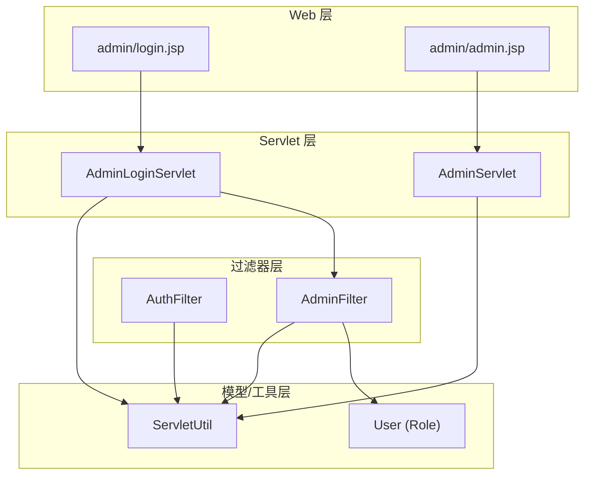
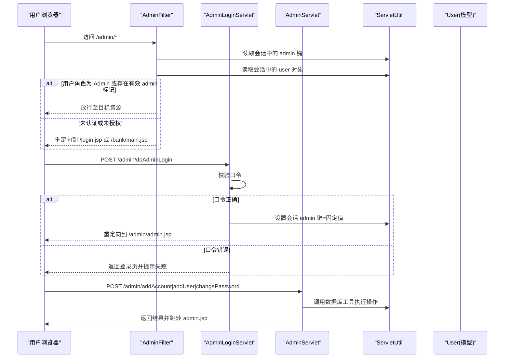
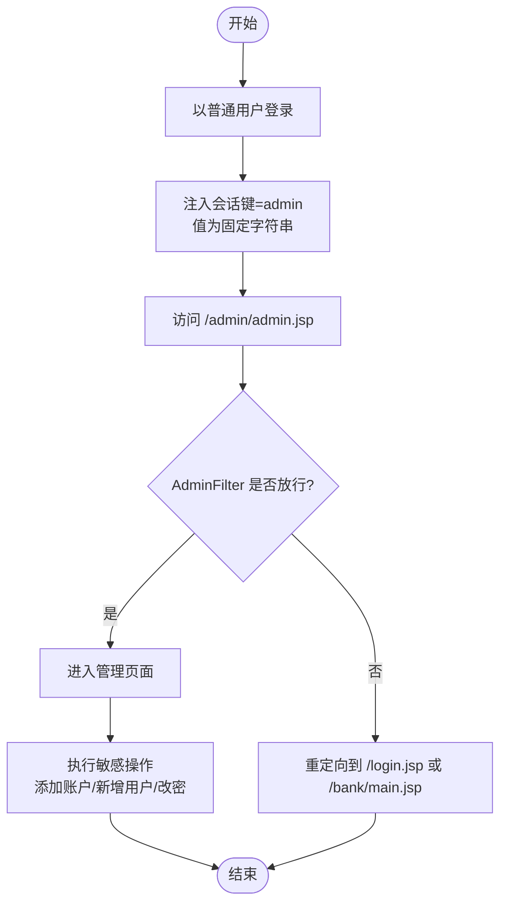
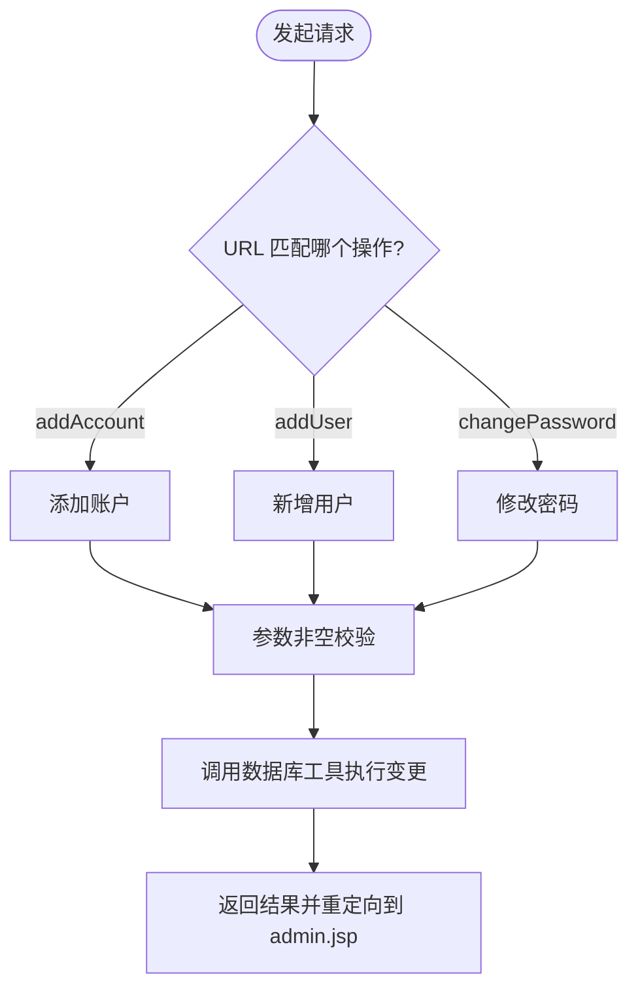
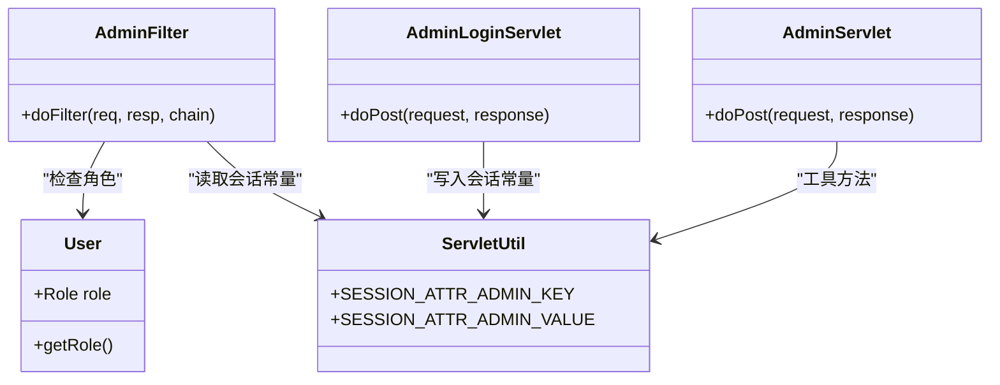

# 权限提升攻击演示

<cite>
**本文引用的文件**   
- [AdminFilter.java](file://src/com/ibm/security/appscan/altoromutual/filter/AdminFilter.java)
- [AuthFilter.java](file://src/com/ibm/security/appscan/altoromutual/filter/AuthFilter.java)
- [AdminLoginServlet.java](file://src/com/ibm/security/appscan/altoromutual/servlet/AdminLoginServlet.java)
- [AdminServlet.java](file://src/com/ibm/security/appscan/altoromutual/servlet/AdminServlet.java)
- [User.java](file://src/com/ibm/security/appscan/altoromutual/model/User.java)
- [ServletUtil.java](file://src/com/ibm/security/appscan/altoromutual/util/ServletUtil.java)
- [admin.jsp](file://WebContent/admin/admin.jsp)
- [login.jsp](file://WebContent/admin/login.jsp)
</cite>

## 目录
1. [简介](#简介)
2. [项目结构](#项目结构)
3. [核心组件](#核心组件)
4. [架构总览](#架构总览)
5. [详细组件分析](#详细组件分析)
6. [依赖关系分析](#依赖关系分析)
7. [性能与可扩展性考虑](#性能与可扩展性考虑)
8. [故障排查指南](#故障排查指南)
9. [结论](#结论)
10. [附录：修复清单与最佳实践](#附录修复清单与最佳实践)

## 简介
本演示文档聚焦于 AltoroJ 的权限提升攻击路径，说明普通用户如何通过参数篡改、角色欺骗等手段绕过权限检查，获取管理员权限并访问敏感管理功能。文档同时给出基于角色的访问控制（RBAC）的实现要点、缺陷分析与修复方案，帮助读者理解漏洞成因与加固策略。

## 项目结构
AltoroJ 使用 Servlet/JSP 架构，关键权限控制点集中在过滤器（Filter）、登录处理 Servlet 与管理页面 JSP：
- 过滤器层：AuthFilter（认证）、AdminFilter（管理员授权）
- 登录处理：AdminLoginServlet（管理员登录）、LoginServlet（普通用户登录）
- 模型层：User（含角色枚举 Role）
- 工具层：ServletUtil（会话属性常量、工具方法）
- 管理界面：admin.jsp（管理操作表单）、admin/login.jsp（管理员登录页）

图表来源
- [AdminFilter.java:58-80](file://src/com/ibm/security/appscan/altoromutual/filter/AdminFilter.java#L58-L80)
- [AuthFilter.java:58-69](file://src/com/ibm/security/appscan/altoromutual/filter/AuthFilter.java#L58-L69)
- [AdminLoginServlet.java:40-53](file://src/com/ibm/security/appscan/altoromutual/servlet/AdminLoginServlet.java#L40-L53)
- [AdminServlet.java:39-120](file://src/com/ibm/security/appscan/altoromutual/servlet/AdminServlet.java#L39-L120)
- [User.java:30-54](file://src/com/ibm/security/appscan/altoromutual/model/User.java#L30-L54)
- [ServletUtil.java:60-62](file://src/com/ibm/security/appscan/altoromutual/util/ServletUtil.java#L60-L62)

章节来源
- [AdminFilter.java:58-80](file://src/com/ibm/security/appscan/altoromutual/filter/AdminFilter.java#L58-L80)
- [AuthFilter.java:58-69](file://src/com/ibm/security/appscan/altoromutual/filter/AuthFilter.java#L58-L69)
- [AdminLoginServlet.java:40-53](file://src/com/ibm/security/appscan/altoromutual/servlet/AdminLoginServlet.java#L40-L53)
- [AdminServlet.java:39-120](file://src/com/ibm/security/appscan/altoromutual/servlet/AdminServlet.java#L39-L120)
- [User.java:30-54](file://src/com/ibm/security/appscan/altoromutual/model/User.java#L30-L54)
- [ServletUtil.java:60-62](file://src/com/ibm/security/appscan/altoromutual/util/ServletUtil.java#L60-L62)

## 核心组件
- AdminFilter：对 /admin/* 进行授权校验，允许通过“用户角色为 Admin”或“会话中存在特定管理员标记键值”两种途径放行。
- AuthFilter：对银行相关页面进行基础认证校验，要求会话中存在有效的 User 对象。
- AdminLoginServlet：管理员登录入口，校验固定口令后在会话中写入管理员标记。
- AdminServlet：管理功能后端处理器，提供添加账户、新增用户、修改密码等操作。
- User：用户模型，包含 Role 枚举（User/Admin）。
- ServletUtil：定义会话属性常量（如 SESSION_ATTR_ADMIN_KEY、SESSION_ATTR_ADMIN_VALUE），并提供工具方法。

章节来源
- [AdminFilter.java:58-80](file://src/com/ibm/security/appscan/altoromutual/filter/AdminFilter.java#L58-L80)
- [AuthFilter.java:58-69](file://src/com/ibm/security/appscan/altoromutual/filter/AuthFilter.java#L58-L69)
- [AdminLoginServlet.java:40-53](file://src/com/ibm/security/appscan/altoromutual/servlet/AdminLoginServlet.java#L40-L53)
- [AdminServlet.java:39-120](file://src/com/ibm/security/appscan/altoromutual/servlet/AdminServlet.java#L39-L120)
- [User.java:30-54](file://src/com/ibm/security/appscan/altoromutual/model/User.java#L30-L54)
- [ServletUtil.java:60-62](file://src/com/ibm/security/appscan/altoromutual/util/ServletUtil.java#L60-L62)

## 架构总览
下图展示从浏览器到服务器端的请求流程，以及权限判断的关键分支。

图表来源
- [AdminFilter.java:58-80](file://src/com/ibm/security/appscan/altoromutual/filter/AdminFilter.java#L58-L80)
- [AdminLoginServlet.java:40-53](file://src/com/ibm/security/appscan/altoromutual/servlet/AdminLoginServlet.java#L40-L53)
- [AdminServlet.java:39-120](file://src/com/ibm/security/appscan/altoromutual/servlet/AdminServlet.java#L39-L120)
- [ServletUtil.java:60-62](file://src/com/ibm/security/appscan/altoromutual/util/ServletUtil.java#L60-L62)

## 详细组件分析

### 权限提升攻击手法一：会话注入（角色欺骗）
- 原理：AdminFilter 允许通过“会话中存在管理员标记键且值为固定字符串”来放行。该标记由 AdminLoginServlet 在成功登录后写入。若攻击者能直接构造或注入该会话属性，即可绕过口令校验。
- 攻击步骤：
  1. 以普通用户身份登录系统，获得合法会话。
  2. 在会话中注入管理员标记键，并将其值设置为固定字符串。
  3. 访问 /admin/admin.jsp 等受保护的管理页面，AdminFilter 判定通过。
  4. 通过 admin.jsp 提供的表单提交敏感操作（如添加账户、新增用户、修改密码）。
- 风险影响：无需知道管理员口令即可获得完整管理权限。

图表来源
- [AdminFilter.java:62-67](file://src/com/ibm/security/appscan/altoromutual/filter/AdminFilter.java#L62-L67)
- [AdminLoginServlet.java:51-52](file://src/com/ibm/security/appscan/altoromutual/servlet/AdminLoginServlet.java#L51-L52)
- [ServletUtil.java:61-62](file://src/com/ibm/security/appscan/altoromutual/util/ServletUtil.java#L61-L62)

章节来源
- [AdminFilter.java:58-80](file://src/com/ibm/security/appscan/altoromutual/filter/AdminFilter.java#L58-L80)
- [AdminLoginServlet.java:40-53](file://src/com/ibm/security/appscan/altoromutual/servlet/AdminLoginServlet.java#L40-L53)
- [ServletUtil.java:60-62](file://src/com/ibm/security/appscan/altoromutual/util/ServletUtil.java#L60-L62)

### 权限提升攻击手法二：参数篡改（越权操作）
- 原理：AdminServlet 根据 URL 后缀分发到不同操作（如 addAccount、addUser、changePassword），并对输入参数进行基本非空校验，但未对当前会话用户的权限进行二次校验。一旦攻击者已绕过 AdminFilter，可直接调用这些接口执行任意用户账户管理操作。
- 攻击步骤：
  1. 通过会话注入或其他方式取得管理员权限。
  2. 向 /admin/addAccount、/admin/addUser、/admin/changePassword 发送 POST 请求，篡改 username/password 等参数。
  3. 利用服务端逻辑直接修改数据库中的用户数据。
- 风险影响：可任意创建/修改用户、重置密码、增加账户类型，造成严重数据泄露与业务破坏。

图表来源
- [AdminServlet.java:42-108](file://src/com/ibm/security/appscan/altoromutual/servlet/AdminServlet.java#L42-L108)

章节来源
- [AdminServlet.java:39-120](file://src/com/ibm/security/appscan/altoromutual/servlet/AdminServlet.java#L39-L120)

### 权限验证逻辑缺陷分析
- 双重授权条件并存：AdminFilter 同时接受“用户角色为 Admin”和“会话中存在管理员标记键且值为固定字符串”。后者弱化了口令校验的必要性，成为被绕过的后门。
- 固定口令与硬编码：AdminLoginServlet 使用固定口令比较，易被暴力破解或信息泄露；且成功后仅写入会话标记，未绑定更严格的上下文（如 IP、设备指纹、时间戳等）。
- 前端开关不可信：admin.jsp 通过应用属性 enableAdminFunctions 控制表单 action 是否启用，但服务端 AdminServlet 并未再次校验该开关，导致即使前端禁用，后端仍可被直接调用。
- 缺少最小权限原则：AdminServlet 对所有操作均无细粒度权限校验，任何具备管理员会话的用户均可执行全部管理功能。

章节来源
- [AdminFilter.java:62-67](file://src/com/ibm/security/appscan/altoromutual/filter/AdminFilter.java#L62-L67)
- [AdminLoginServlet.java:40-53](file://src/com/ibm/security/appscan/altoromutual/servlet/AdminLoginServlet.java#L40-L53)
- [admin.jsp:70-186](file://WebContent/admin/admin.jsp#L70-L186)
- [AdminServlet.java:39-120](file://src/com/ibm/security/appscan/altoromutual/servlet/AdminServlet.java#L39-L120)

### 基于角色的访问控制（RBAC）实现要点
- 统一鉴权入口：所有敏感资源必须经过统一的权限过滤器拦截，禁止在业务代码中分散判断。
- 角色与权限分离：将角色（Role）与具体权限（Permission）解耦，支持更细粒度的访问控制。
- 会话安全：管理员会话应绑定强认证上下文（如一次性令牌、短期有效期、多因素认证），避免简单键值注入。
- 服务端强制校验：无论前端如何显示/隐藏功能，服务端必须对每个操作进行权限校验。
- 审计与告警：记录管理员操作的来源、时间、IP、操作内容，异常行为触发告警。

[本节为概念性说明，不直接分析具体文件]

## 依赖关系分析
- AdminFilter 依赖 ServletUtil 的会话常量，依赖 User.Role 进行角色判断。
- AdminLoginServlet 依赖 ServletUtil 的会话常量，成功后写入会话。
- AdminServlet 依赖 ServletUtil 的工具方法与数据库工具（DBUtil），但不做权限校验。
- admin.jsp 依赖 ServletUtil 的应用属性读取，用于前端开关控制。

图表来源
- [AdminFilter.java:58-80](file://src/com/ibm/security/appscan/altoromutual/filter/AdminFilter.java#L58-L80)
- [AdminLoginServlet.java:40-53](file://src/com/ibm/security/appscan/altoromutual/servlet/AdminLoginServlet.java#L40-L53)
- [AdminServlet.java:39-120](file://src/com/ibm/security/appscan/altoromutual/servlet/AdminServlet.java#L39-L120)
- [User.java:30-54](file://src/com/ibm/security/appscan/altoromutual/model/User.java#L30-L54)
- [ServletUtil.java:60-62](file://src/com/ibm/security/appscan/altoromutual/util/ServletUtil.java#L60-L62)

章节来源
- [AdminFilter.java:58-80](file://src/com/ibm/security/appscan/altoromutual/filter/AdminFilter.java#L58-L80)
- [AdminLoginServlet.java:40-53](file://src/com/ibm/security/appscan/altoromutual/servlet/AdminLoginServlet.java#L40-L53)
- [AdminServlet.java:39-120](file://src/com/ibm/security/appscan/altoromutual/servlet/AdminServlet.java#L39-L120)
- [User.java:30-54](file://src/com/ibm/security/appscan/altoromutual/model/User.java#L30-L54)
- [ServletUtil.java:60-62](file://src/com/ibm/security/appscan/altoromutual/util/ServletUtil.java#L60-L62)

## 性能与可扩展性考虑
- 过滤器链开销：AdminFilter 每次请求都会读取会话属性并进行条件判断，建议缓存常用配置与白名单，减少重复计算。
- 会话存储：管理员会话应避免持久化明文敏感标记，建议使用加密令牌与短期过期策略。
- 扩展性：引入权限中心（Policy Server）统一管理角色与权限，便于横向扩展与集中审计。

[本节为通用指导，不直接分析具体文件]

## 故障排查指南
- 无法进入管理页面：
  - 检查会话中是否存在管理员标记键且值为固定字符串。
  - 确认 AdminFilter 是否正确放行 /admin/login.jsp 与 /admin/doAdminLogin。
- 管理操作失败：
  - 检查 AdminServlet 的参数校验逻辑与数据库工具返回值。
  - 确认前端 enableAdminFunctions 开关与服务端实际行为是否一致。
- 日志与审计：
  - 查看应用日志中关于会话初始化、权限判断与数据库操作的记录。

章节来源
- [AdminFilter.java:70-79](file://src/com/ibm/security/appscan/altoromutual/filter/AdminFilter.java#L70-L79)
- [AdminServlet.java:113-120](file://src/com/ibm/security/appscan/altoromutual/servlet/AdminServlet.java#L113-L120)

## 结论
AltoroJ 的管理权限控制存在明显缺陷：AdminFilter 允许通过会话注入管理员标记绕过口令校验；AdminServlet 缺乏细粒度权限校验；前端开关不可信。攻击者可利用参数篡改与角色欺骗获得管理员权限，执行敏感操作。修复方向包括移除弱会话标记、强化管理员认证、实施服务端强制 RBAC 校验与审计。

[本节为总结性内容，不直接分析具体文件]

## 附录：修复清单与最佳实践
- 移除 AdminFilter 中的会话标记放行分支，仅保留基于强认证与角色判定的授权逻辑。
- 将管理员口令改为动态生成、定期轮换，并结合多因素认证。
- 在 AdminServlet 中对每个操作进行细粒度权限校验（如 addAccount、addUser、changePassword 分别需要不同权限）。
- 前端开关仅用于 UI 展示，服务端必须独立校验 enableAdminFunctions 与实际权限。
- 引入统一的权限框架（如 Spring Security），实现 RBAC 与审计。
- 对会话进行安全加固：短生命周期、绑定上下文、防注入、防篡改。

[本节为通用指导，不直接分析具体文件]