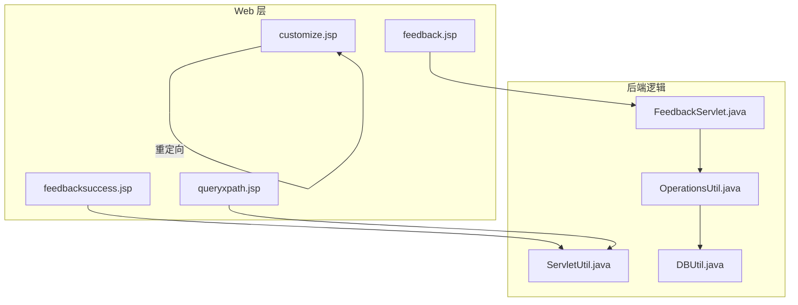
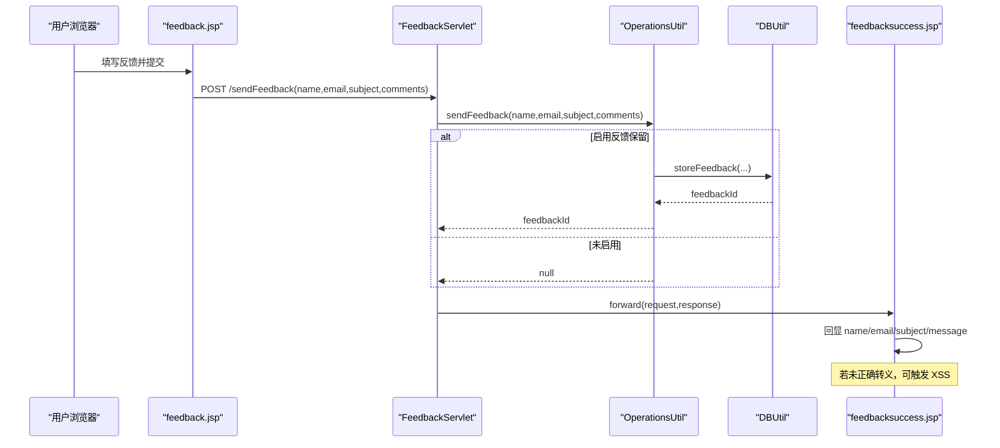
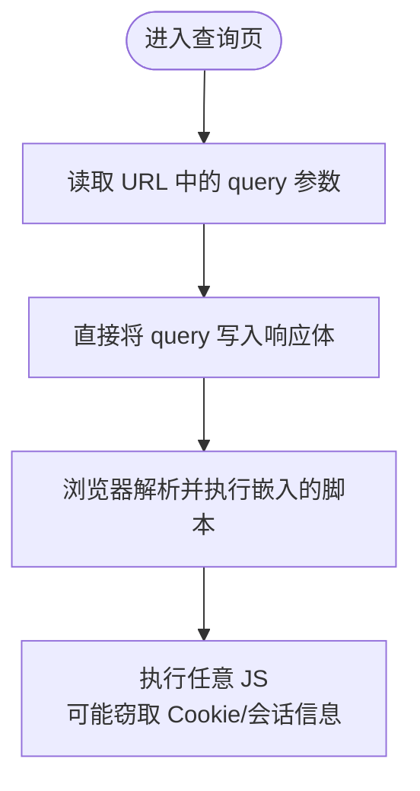
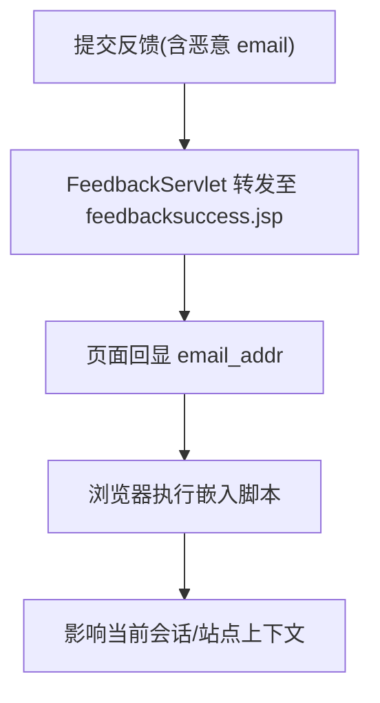
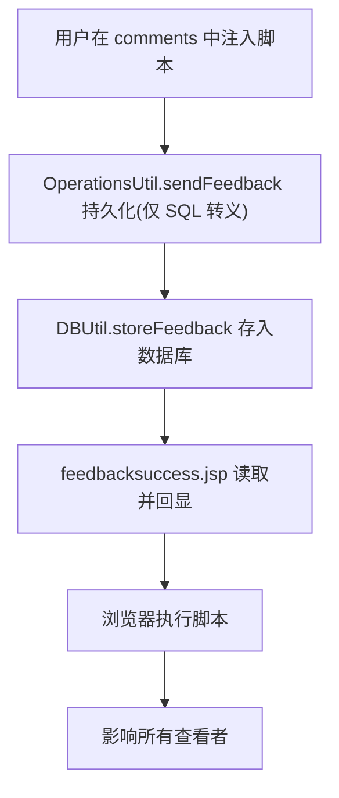
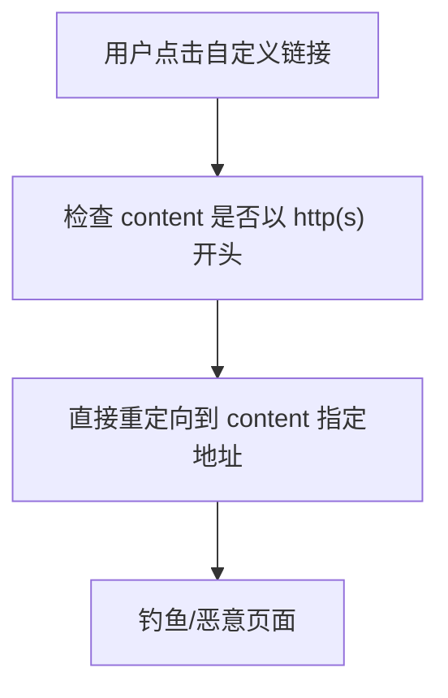
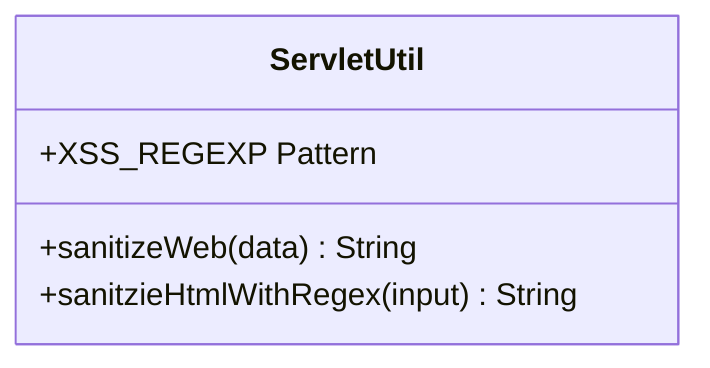
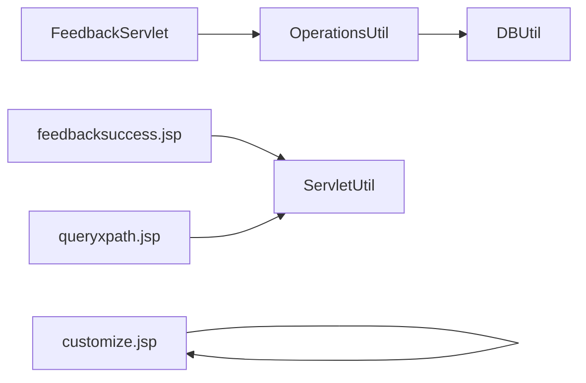

# 跨站脚本攻击(XSS)演示

<cite>
**本文引用的文件**   
- [README.md](file://README.md)
- [feedback.jsp](file://WebContent/feedback.jsp)
- [feedbacksuccess.jsp](file://WebContent/feedbacksuccess.jsp)
- [FeedbackServlet.java](file://src/com/ibm/security/appscan/altoromutual/servlet/FeedbackServlet.java)
- [OperationsUtil.java](file://src/com/ibm/security/appscan/altoromutual/util/OperationsUtil.java)
- [DBUtil.java](file://src/com/ibm/security/appscan/altoromutual/util/DBUtil.java)
- [ServletUtil.java](file://src/com/ibm/security/appscan/altoromutual/util/ServletUtil.java)
- [queryxpath.jsp](file://WebContent/bank/queryxpath.jsp)
- [customize.jsp](file://WebContent/bank/customize.jsp)
</cite>

## 目录
1. [简介](#简介)
2. [项目结构](#项目结构)
3. [核心组件](#核心组件)
4. [架构总览](#架构总览)
5. [详细组件分析](#详细组件分析)
6. [依赖关系分析](#依赖关系分析)
7. [性能与安全性考量](#性能与安全性考量)
8. [故障排查指南](#故障排查指南)
9. [结论](#结论)
10. [附录：防护建议清单](#附录防护建议清单)

## 简介
本演示文档围绕 AltoroJ 中的跨站脚本（XSS）漏洞，聚焦反馈表单、用户输入等入口点，系统说明反射型与存储型 XSS 的攻击原理、载荷构造、浏览器端执行效果，以及相应的防护方法。AltoroJ 是一个用于教学与演示的示例银行应用，明确包含已知安全缺陷，适合在隔离环境中进行安全测试与学习。

## 项目结构
与 XSS 相关的代码主要分布在以下位置：
- Web 层 JSP：反馈页面与结果页、新闻查询页、语言定制页
- Servlet 控制器：处理反馈提交
- 工具类：数据库访问、输出清洗、属性读取
- 模型与配置：反馈数据模型与应用开关

图表来源
- [feedback.jsp:46-77](file://WebContent/feedback.jsp#L46-L77)
- [feedbacksuccess.jsp:42-89](file://WebContent/feedbacksuccess.jsp#L42-L89)
- [FeedbackServlet.java:42-68](file://src/com/ibm/security/appscan/altoromutual/servlet/FeedbackServlet.java#L42-L68)
- [OperationsUtil.java:119-132](file://src/com/ibm/security/appscan/altoromutual/util/OperationsUtil.java#L119-L132)
- [DBUtil.java:169-202](file://src/com/ibm/security/appscan/altoromutual/util/DBUtil.java#L169-L202)
- [ServletUtil.java:244-254](file://src/com/ibm/security/appscan/altoromutual/util/ServletUtil.java#L244-L254)
- [queryxpath.jsp:32-50](file://WebContent/bank/queryxpath.jsp#L32-L50)
- [customize.jsp:31-38](file://WebContent/bank/customize.jsp#L31-L38)

章节来源
- [README.md:1-10](file://README.md#L1-L10)

## 核心组件
- 反馈表单与结果页：接收用户输入并回显，是反射型与存储型 XSS 的主要载体
- FeedbackServlet：负责解析请求参数、持久化反馈（可选）、转发到结果页
- OperationsUtil.sendFeedback：根据应用开关决定是否持久化，并对部分字段做 SQL 转义
- DBUtil.getFeedback/storeFeedback：从数据库读写反馈记录
- ServletUtil.sanitizeWeb/sanitzieHtmlWithRegex：提供 HTML 转义与基于正则的 XSS 过滤
- queryxpath.jsp：将用户查询直接写入响应，存在反射型 XSS
- customize.jsp：对 content 参数进行不安全的重定向，存在开放重定向风险（常与 XSS 配合）

章节来源
- [FeedbackServlet.java:42-68](file://src/com/ibm/security/appscan/altoromutual/servlet/FeedbackServlet.java#L42-L68)
- [OperationsUtil.java:119-132](file://src/com/ibm/security/appscan/altoromutual/util/OperationsUtil.java#L119-L132)
- [DBUtil.java:169-202](file://src/com/ibm/security/appscan/altoromutual/util/DBUtil.java#L169-L202)
- [ServletUtil.java:244-254](file://src/com/ibm/security/appscan/altoromutmutual/util/ServletUtil.java#L244-L254)
- [queryxpath.jsp:32-50](file://WebContent/bank/queryxpath.jsp#L32-L50)
- [customize.jsp:31-38](file://WebContent/bank/customize.jsp#L31-L38)

## 架构总览
下图展示从用户提交到页面渲染的关键流程，标注了 XSS 注入点与数据流向。

图表来源
- [feedback.jsp:46-77](file://WebContent/feedback.jsp#L46-L77)
- [FeedbackServlet.java:42-68](file://src/com/ibm/security/appscan/altoromutual/servlet/FeedbackServlet.java#L42-L68)
- [OperationsUtil.java:119-132](file://src/com/ibm/security/appscan/altoromutual/util/OperationsUtil.java#L119-L132)
- [DBUtil.java:169-202](file://src/com/ibm/security/appscan/altoromutual/util/DBUtil.java#L169-L202)
- [feedbacksuccess.jsp:42-89](file://WebContent/feedbacksuccess.jsp#L42-L89)

## 详细组件分析

### 反射型 XSS：新闻查询页
- 入口：queryxpath.jsp 将用户传入的 query 参数直接写入响应文本
- 风险点：未对用户输入进行 HTML 转义或上下文编码
- 典型载荷思路：在 query 中插入脚本标签或事件处理器，使浏览器在执行页面时运行恶意脚本
- 浏览器端效果：页面加载即执行脚本，可弹出提示、读取 Cookie、发起网络请求等

图表来源
- [queryxpath.jsp:32-50](file://WebContent/bank/queryxpath.jsp#L32-L50)

章节来源
- [queryxpath.jsp:32-50](file://WebContent/bank/queryxpath.jsp#L32-L50)

### 反射型 XSS：反馈成功页（email 回显）
- 入口：feedbacksuccess.jsp 使用 request.getParameter("email_addr") 并在页面中回显
- 风险点：虽然尝试调用 sanitzieHtmlWithRegex，但仅匹配特定模式，绕过可能性高；且其他回显处（如 message_feedback）未统一转义
- 典型载荷思路：通过 email_addr 注入脚本片段，在结果页被浏览器执行
- 浏览器端效果：同反射型 XSS，可在当前站点上下文中执行任意 JS

图表来源
- [feedbacksuccess.jsp:42-49](file://WebContent/feedbacksuccess.jsp#L42-L49)
- [FeedbackServlet.java:49-60](file://src/com/ibm/security/appscan/altoromutual/servlet/FeedbackServlet.java#L49-L60)

章节来源
- [feedbacksuccess.jsp:42-49](file://WebContent/feedbacksuccess.jsp#L42-L49)
- [FeedbackServlet.java:49-60](file://src/com/ibm/security/appscan/altoromutual/servlet/FeedbackServlet.java#L49-L60)

### 存储型 XSS：反馈内容持久化后回显
- 入口：当启用“enableFeedbackRetention”时，FeedbackServlet 调用 OperationsUtil.sendFeedback 将 name/email/subject/comments 持久化
- 风险点：
  - 持久化阶段仅对 email/subject/comments 做了 SQL 转义，未做 HTML 转义
  - 回显阶段（feedbacksuccess.jsp）直接输出 name/email/subject/message，未统一转义
- 典型载荷思路：在 comments 或 subject 中注入脚本，保存后由管理员或其他用户查看时触发
- 浏览器端效果：任何查看该反馈的用户都会在当前站点上下文中执行脚本

图表来源
- [OperationsUtil.java:119-132](file://src/com/ibm/security/appscan/altoromutual/util/OperationsUtil.java#L119-L132)
- [DBUtil.java:169-202](file://src/com/ibm/security/appscan/altoromutual/util/DBUtil.java#L169-L202)
- [feedbacksuccess.jsp:66-89](file://WebContent/feedbacksuccess.jsp#L66-L89)

章节来源
- [OperationsUtil.java:119-132](file://src/com/ibm/security/appscan/altoromutmutual/util/OperationsUtil.java#L119-L132)
- [DBUtil.java:169-202](file://src/com/ibm/security/appscan/altoromutual/util/DBUtil.java#L169-L202)
- [feedbacksuccess.jsp:66-89](file://WebContent/feedbacksuccess.jsp#L66-L89)

### 开放重定向与 XSS 组合：语言定制页
- 入口：customize.jsp 对 content 参数进行判断，若以 http(s) 开头则直接重定向
- 风险点：未校验目标域名，易被利用进行钓鱼或结合 XSS 载荷进行跳转
- 典型载荷思路：构造恶意链接诱导用户点击，跳转到外部站点或携带 XSS 参数的站点
- 浏览器端效果：用户被重定向到攻击者控制的页面，可能进一步实施 XSS 或社会工程攻击

图表来源
- [customize.jsp:31-38](file://WebContent/bank/customize.jsp#L31-L38)

章节来源
- [customize.jsp:31-38](file://WebContent/bank/customize.jsp#L31-L38)

### 输出清洗与过滤机制
- sanitizeWeb：对数据进行 HTML 转义，是防御 XSS 的基础手段
- sanitzieHtmlWithRegex：基于正则表达式过滤疑似 XSS 的模式，但规则较窄，容易被绕过
- XSS_REGEXP：定义了一些常见标签和事件属性的匹配模式，但未覆盖所有上下文与编码变体

图表来源
- [ServletUtil.java:244-254](file://src/com/ibm/security/appscan/altoromutual/util/ServletUtil.java#L244-L254)
- [ServletUtil.java:74-77](file://src/com/ibm/security/appscan/altoromutual/util/ServletUtil.java#L74-L77)

章节来源
- [ServletUtil.java:244-254](file://src/com/ibm/security/appscan/altoromutual/util/ServletUtil.java#L244-L254)
- [ServletUtil.java:74-77](file://src/com/ibm/security/appscan/altoromutual/util/ServletUtil.java#L74-L77)

## 依赖关系分析
- FeedbackServlet 依赖 OperationsUtil 进行反馈持久化
- OperationsUtil 依赖 DBUtil 进行数据库操作
- feedbacksuccess.jsp 依赖 ServletUtil 进行输出清洗与属性读取
- queryxpath.jsp 依赖 ServletUtil.searchArticles 进行新闻搜索
- customize.jsp 直接处理请求参数并进行重定向

图表来源
- [FeedbackServlet.java:42-68](file://src/com/ibm/security/appscan/altoromutual/servlet/FeedbackServlet.java#L42-L68)
- [OperationsUtil.java:119-132](file://src/com/ibm/security/appscan/altoromutmutual/util/OperationsUtil.java#L119-L132)
- [DBUtil.java:169-202](file://src/com/ibm/security/appscan/altoromutmutual/util/DBUtil.java#L169-L202)
- [feedbacksuccess.jsp:42-89](file://WebContent/feedbacksuccess.jsp#L42-L89)
- [queryxpath.jsp:32-50](file://WebContent/bank/queryxpath.jsp#L32-L50)
- [customize.jsp:31-38](file://WebContent/bank/customize.jsp#L31-L38)

章节来源
- [FeedbackServlet.java:42-68](file://src/com/ibm/security/appscan/altoromutmutual/servlet/FeedbackServlet.java#L42-L68)
- [OperationsUtil.java:119-132](file://src/com/ibm/security/appscan/altoromutmutual/util/OperationsUtil.java#L119-L132)
- [DBUtil.java:169-202](file://src/com/ibm/security/appscan/altoromutmutual/util/DBUtil.java#L169-L202)
- [feedbacksuccess.jsp:42-89](file://WebContent/feedbacksuccess.jsp#L42-L89)
- [queryxpath.jsp:32-50](file://WebContent/bank/queryxpath.jsp#L32-L50)
- [customize.jsp:31-38](file://WebContent/bank/customize.jsp#L31-L38)

## 性能与安全性考量
- 输出转义应在视图层统一实现，避免多处遗漏导致的安全缺口
- 正则过滤不应替代上下文感知的 HTML 编码；应优先使用成熟的库进行转义
- 对重定向目标进行白名单校验，防止开放重定向被滥用
- 对持久化数据采用“存储时不转义、显示时按上下文转义”的策略，确保数据一致性与安全性

[本节为通用指导，不涉及具体文件分析]

## 故障排查指南
- 若启用反馈保留后仍无法看到反馈详情，检查应用属性 enableFeedbackRetention 是否正确设置
- 若 XSS 未被触发，确认页面是否调用了 sanitizeWeb 或 sanitzieHtmlWithRegex，以及是否在正确的上下文进行转义
- 若出现数据库相关错误，检查 DBUtil 的连接与权限，以及 app.properties 的配置

章节来源
- [OperationsUtil.java:119-132](file://src/com/ibm/security/appscan/altoromutmutual/util/OperationsUtil.java#L119-L132)
- [ServletUtil.java:244-254](file://src/com/ibm/security/appscan/altoromutmutual/util/ServletUtil.java#L244-L254)
- [DBUtil.java:169-202](file://src/com/ibm/security/appscan/altoromutmutual/util/DBUtil.java#L169-L202)

## 结论
AltoroJ 在反馈表单、新闻查询与语言定制等页面中存在明显的 XSS 与开放重定向风险。反射型 XSS 可通过即时回显的参数触发，存储型 XSS 则在持久化后对后续查看者造成影响。修复的核心在于：对所有用户输入进行严格的上下文感知转义、限制重定向目标、强化输出清洗策略，并在服务端与客户端共同建立纵深防御。

[本节为总结性内容，不涉及具体文件分析]

## 附录：防护建议清单
- 在所有输出点统一调用 HTML 转义函数（如 sanitizeWeb），并按上下文（HTML、JS、URL、CSS）选择合适编码
- 替换 sanitzieHtmlWithRegex 的正则过滤为更全面的上下文编码方案
- 对重定向目标进行域名白名单校验，拒绝任意外部链接
- 对持久化数据保持原始值，仅在渲染时转义，避免双重转义或转义丢失
- 启用 Content Security Policy（CSP）以减少 XSS 的影响面
- 定期使用静态扫描与动态渗透测试验证修复效果

[本节为通用指导，不涉及具体文件分析]