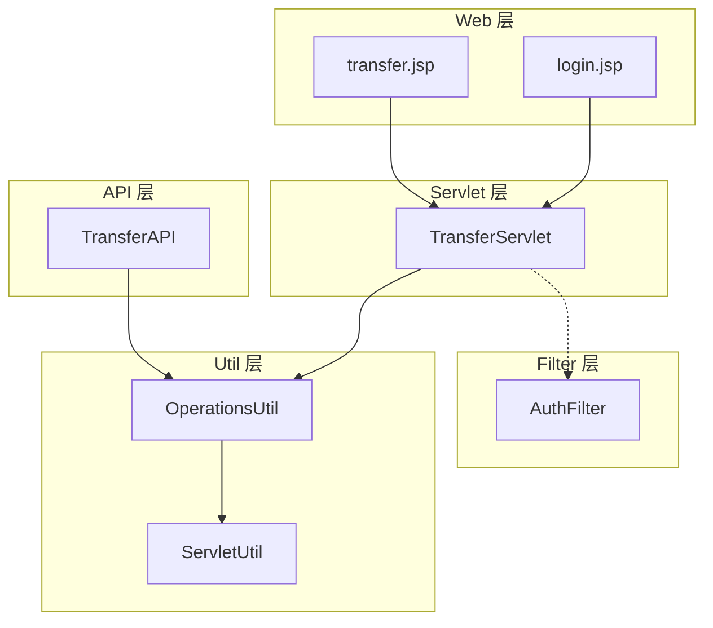
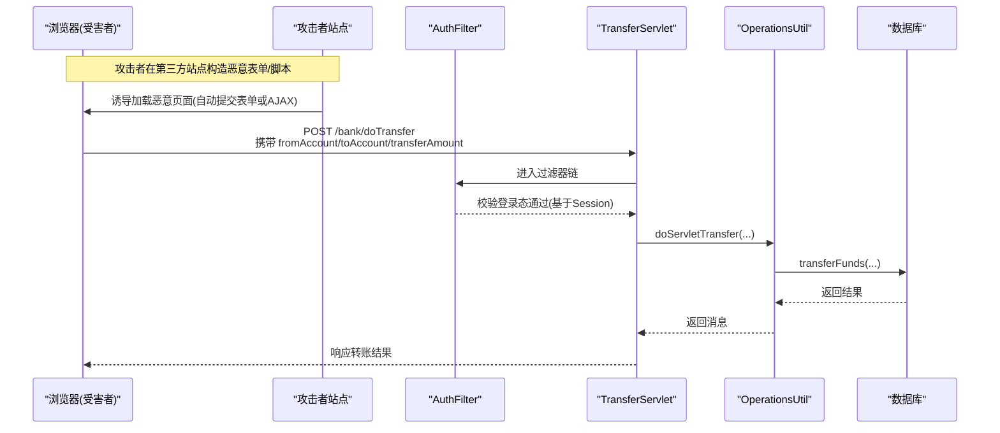
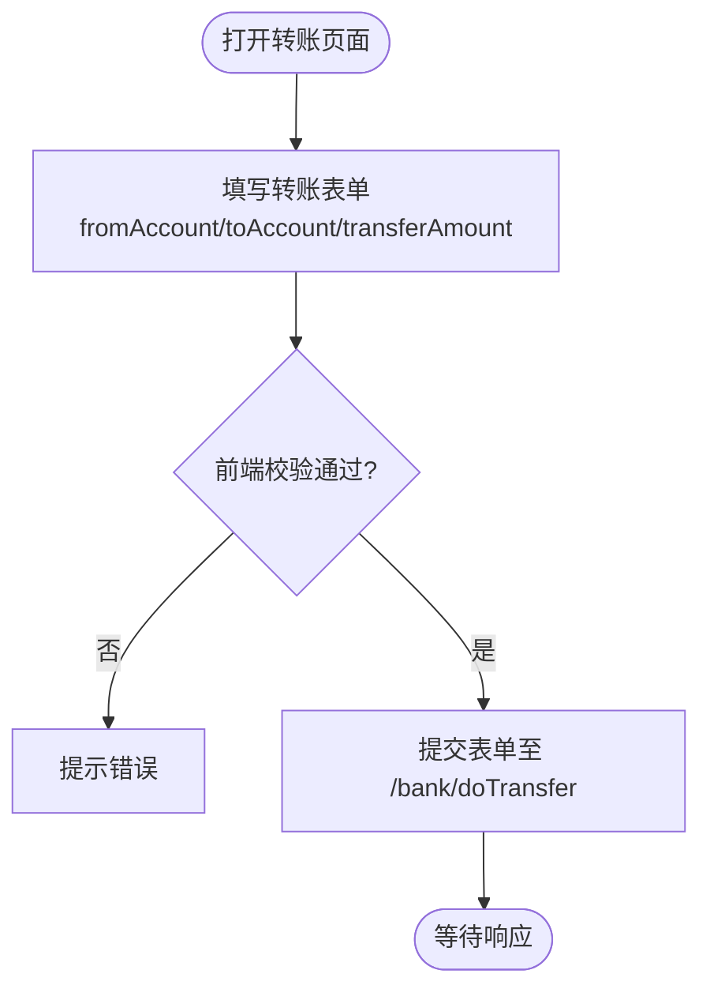
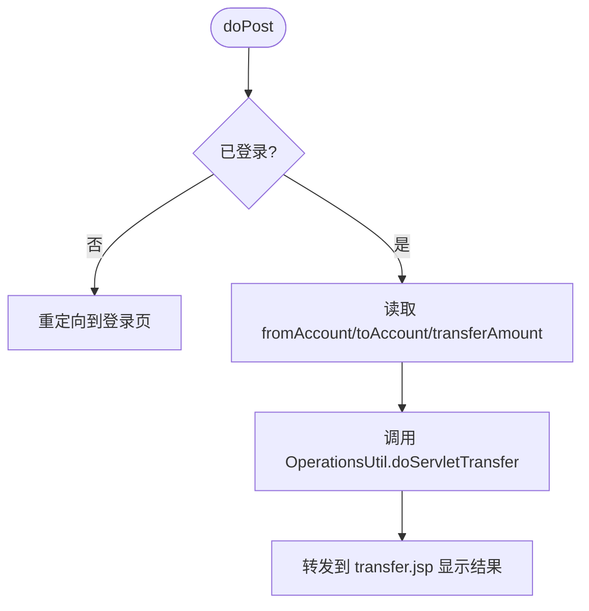
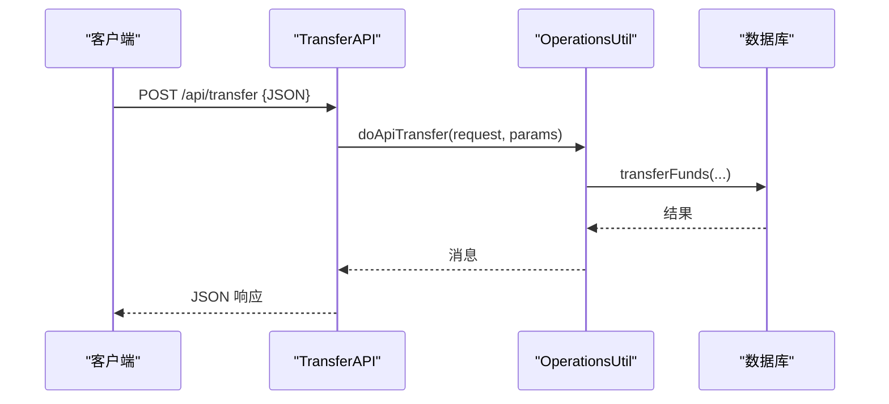
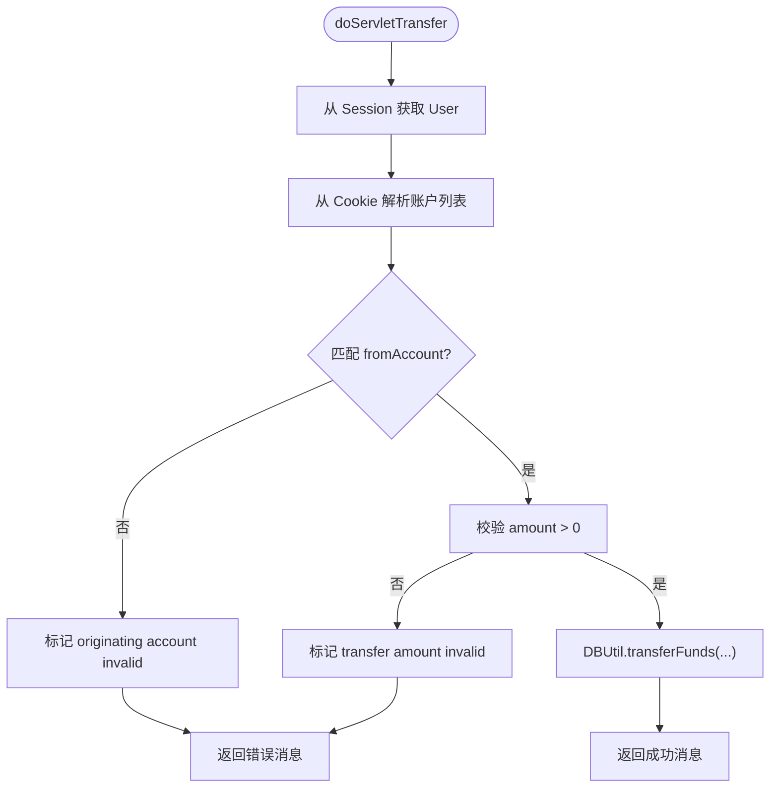
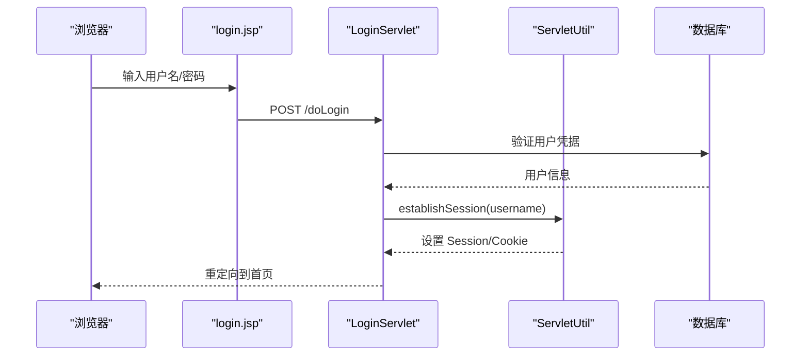
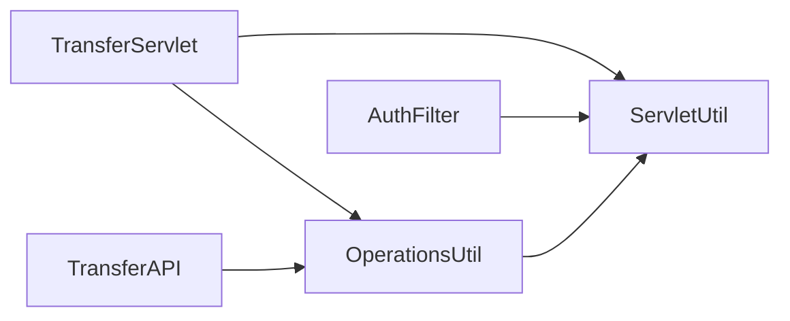
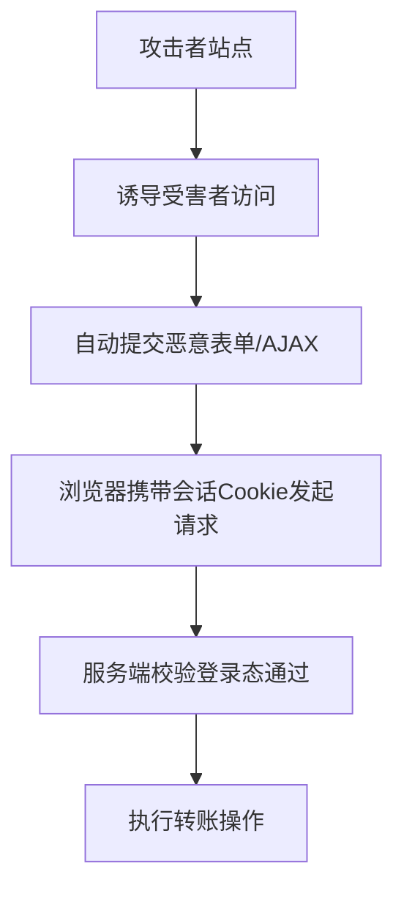

# 跨站请求伪造(CSRF)攻击演示

<cite>
**本文引用的文件**   
- [README.md](file://README.md)
- [TransferServlet.java](file://src/com/ibm/security/appscan/altoromutual/servlet/TransferServlet.java)
- [TransferAPI.java](file://src/com/ibm/security/appscan/altoromutual/api/TransferAPI.java)
- [OperationsUtil.java](file://src/com/ibm/security/appscan/altoromutual/util/OperationsUtil.java)
- [AuthFilter.java](file://src/com/ibm/security/appscan/altoromutual/filter/AuthFilter.java)
- [transfer.jsp](file://WebContent/bank/transfer.jsp)
- [login.jsp](file://WebContent/login.jsp)
- [ServletUtil.java](file://src/com/ibm/security/appscan/altoromutual/util/ServletUtil.java)
</cite>

## 目录
1. [简介](#简介)
2. [项目结构](#项目结构)
3. [核心组件](#核心组件)
4. [架构总览](#架构总览)
5. [详细组件分析](#详细组件分析)
6. [依赖关系分析](#依赖关系分析)
7. [性能与安全性考量](#性能与安全性考量)
8. [故障排查指南](#故障排查指南)
9. [结论](#结论)
10. [附录：攻击场景与防御建议](#附录攻击场景与防御建议)

## 简介
本演示文档聚焦于 AltoroJ 应用中的跨站请求伪造（CSRF）风险，围绕转账、账户信息修改等敏感操作展开。通过剖析现有代码实现，说明攻击者如何借助已认证用户的会话状态发起恶意请求，完成未经授权的资金转移或数据变更；同时指出当前 CSRF 令牌验证的缺失，并给出强化建议。

AltoroJ 是一个用于教学与演示的示例银行 Web 应用，明确包含已知安全漏洞，适合在隔离环境中进行安全测试与学习。

**章节来源**
- [README.md:1-10](file://README.md#L1-L10)

## 项目结构
该仓库采用典型的 J2EE 分层组织：
- Web 层：JSP 页面与静态资源
- Servlet 层：处理 HTTP 请求的业务入口
- API 层：RESTful 接口
- Filter 层：鉴权与访问控制
- Util 层：工具类与业务逻辑封装
- Model 层：领域模型

**图表来源**
- [transfer.jsp:58-106](file://WebContent/bank/transfer.jsp#L58-L106)
- [login.jsp:45-72](file://WebContent/login.jsp#L45-L72)
- [TransferServlet.java:51-67](file://src/com/ibm/security/appscan/altoromutual/servlet/TransferServlet.java#L51-L67)
- [TransferAPI.java:17-43](file://src/com/ibm/security/appscan/altoromutual/api/TransferAPI.java#L17-L43)
- [AuthFilter.java:58-69](file://src/com/ibm/security/appscan/altoromutual/filter/AuthFilter.java#L58-L69)
- [OperationsUtil.java:18-36](file://src/com/ibm/security/appscan/altoromutual/util/OperationsUtil.java#L18-L36)
- [ServletUtil.java:355-368](file://src/com/ibm/security/appscan/altoromutual/util/ServletUtil.java#L355-L368)

**章节来源**
- [transfer.jsp:58-106](file://WebContent/bank/transfer.jsp#L58-L106)
- [TransferServlet.java:51-67](file://src/com/ibm/security/appscan/altoromutual/servlet/TransferServlet.java#L51-L67)
- [TransferAPI.java:17-43](file://src/com/ibm/security/appscan/altoromutual/api/TransferAPI.java#L17-L43)
- [AuthFilter.java:58-69](file://src/com/ibm/security/appscan/altoromutual/filter/AuthFilter.java#L58-L69)
- [OperationsUtil.java:18-36](file://src/com/ibm/security/appscan/altoromutual/util/OperationsUtil.java#L18-L36)
- [ServletUtil.java:355-368](file://src/com/ibm/security/appscan/altoromutual/util/ServletUtil.java#L355-L368)

## 核心组件
- TransferServlet：处理转账表单提交，校验登录态后执行业务逻辑。
- TransferAPI：提供 REST 转账接口，解析 JSON 参数并调用业务逻辑。
- OperationsUtil：封装转账业务逻辑，包括从 Session/Cookie 获取用户与账户信息，最终调用数据库更新。
- AuthFilter：对受保护路径进行登录态检查，未登录则重定向到登录页。
- transfer.jsp：转账页面，包含表单字段与前端校验。
- login.jsp：登录页面，建立会话。

关键行为要点：
- 转账接口仅校验“是否已登录”，不校验请求来源站点（Referer/SameSite）与 CSRF Token。
- 转账金额与目标账户直接取自请求参数，存在被恶意构造的风险。
- 登录成功后，Session 中保存用户对象，Cookie 中可能包含账户列表，便于服务端快速识别可操作的账户。

**章节来源**
- [TransferServlet.java:51-67](file://src/com/ibm/security/appscan/altoromutual/servlet/TransferServlet.java#L51-L67)
- [TransferAPI.java:17-43](file://src/com/ibm/security/appscan/altoromutual/api/TransferAPI.java#L17-L43)
- [OperationsUtil.java:39-117](file://src/com/ibm/security/appscan/altoromutual/util/OperationsUtil.java#L39-L117)
- [AuthFilter.java:58-69](file://src/com/ibm/security/appscan/altoromutual/filter/AuthFilter.java#L58-L69)
- [transfer.jsp:58-106](file://WebContent/bank/transfer.jsp#L58-L106)
- [login.jsp:45-72](file://WebContent/login.jsp#L45-L72)

## 架构总览
下图展示了从浏览器发起转账请求到后端执行业务处理的完整流程，以及 CSRF 攻击点的位置。

**图表来源**
- [AuthFilter.java:58-69](file://src/com/ibm/security/appscan/altoromutual/filter/AuthFilter.java#L58-L69)
- [TransferServlet.java:51-67](file://src/com/ibm/security/appscan/altoromutual/servlet/TransferServlet.java#L51-L67)
- [OperationsUtil.java:39-117](file://src/com/ibm/security/appscan/altoromutual/util/OperationsUtil.java#L39-L117)

## 详细组件分析

### 转账表单与前端交互（transfer.jsp）
- 表单字段：fromAccount、toAccount、transferAmount。
- 前端校验：禁止转出与转入账户相同、金额必须大于 0。
- 无 CSRF Token 字段，无 SameSite Cookie 策略相关设置。

**图表来源**
- [transfer.jsp:58-106](file://WebContent/bank/transfer.jsp#L58-L106)

**章节来源**
- [transfer.jsp:58-106](file://WebContent/bank/transfer.jsp#L58-L106)

### 转账 Servlet（TransferServlet）
- 统一处理 GET/POST，实际逻辑在 doPost。
- 登录态校验：若未登录，重定向到登录页。
- 参数读取：fromAccount、toAccount、transferAmount。
- 调用 OperationsUtil.doServletTransfer 执行业务。
- 将结果回写至 transfer.jsp 展示。

**图表来源**
- [TransferServlet.java:51-67](file://src/com/ibm/security/appscan/altoromutual/servlet/TransferServlet.java#L51-L67)

**章节来源**
- [TransferServlet.java:51-67](file://src/com/ibm/security/appscan/altoromutual/servlet/TransferServlet.java#L51-L67)

### REST 转账接口（TransferAPI）
- 接收 JSON 体，解析 toAccount、fromAccount、transferAmount。
- 调用 OperationsUtil.doApiTransfer 执行业务。
- 返回 JSON 成功或错误消息。

**图表来源**
- [TransferAPI.java:17-43](file://src/com/ibm/security/appscan/altoromutual/api/TransferAPI.java#L17-L43)
- [OperationsUtil.java:18-36](file://src/com/ibm/security/appscan/altoromutual/util/OperationsUtil.java#L18-L36)

**章节来源**
- [TransferAPI.java:17-43](file://src/com/ibm/security/appscan/altoromutual/api/TransferAPI.java#L17-L43)

### 业务逻辑封装（OperationsUtil）
- doApiTransfer：从请求头 Authorization 解析用户身份，执行转账。
- doServletTransfer：从 Session 获取用户，从 Cookie 解析账户列表，匹配 fromAccount；校验目标账户与金额合法性后执行转账。
- 转账失败时返回错误消息，成功时返回成功消息。

**图表来源**
- [OperationsUtil.java:39-117](file://src/com/ibm/security/appscan/altoromutual/util/OperationsUtil.java#L39-L117)

**章节来源**
- [OperationsUtil.java:39-117](file://src/com/ibm/security/appscan/altoromutual/util/OperationsUtil.java#L39-L117)

### 登录与会话（login.jsp 与 ServletUtil）
- login.jsp：用户输入用户名与密码，提交到 doLogin。
- ServletUtil.isLoggedin：检查 Session 中是否存在用户对象。
- ServletUtil.establishSession：登录后建立 Session 与 Cookie（包含账户列表）。

**图表来源**
- [login.jsp:45-72](file://WebContent/login.jsp#L45-L72)
- [ServletUtil.java:340-353](file://src/com/ibm/security/appscan/altoromutual/util/ServletUtil.java#L340-L353)
- [ServletUtil.java:355-368](file://src/com/ibm/security/appscan/altoromutual/util/ServletUtil.java#L355-L368)

**章节来源**
- [login.jsp:45-72](file://WebContent/login.jsp#L45-L72)
- [ServletUtil.java:340-368](file://src/com/ibm/security/appscan/altoromutual/util/ServletUtil.java#L340-L368)

## 依赖关系分析
- TransferServlet 依赖 OperationsUtil 执行业务，依赖 ServletUtil 判断登录态。
- TransferAPI 同样依赖 OperationsUtil。
- AuthFilter 拦截受保护路径，依赖 ServletUtil 获取 Session 用户。
- OperationsUtil 依赖 DBUtil 执行数据库操作（转账），依赖 ServletUtil 获取用户。

**图表来源**
- [TransferServlet.java:51-67](file://src/com/ibm/security/appscan/altoromutual/servlet/TransferServlet.java#L51-L67)
- [TransferAPI.java:17-43](file://src/com/ibm/security/appscan/altoromutual/api/TransferAPI.java#L17-L43)
- [AuthFilter.java:58-69](file://src/com/ibm/security/appscan/altoromutual/filter/AuthFilter.java#L58-L69)
- [OperationsUtil.java:39-117](file://src/com/ibm/security/appscan/altoromutual/util/OperationsUtil.java#L39-L117)
- [ServletUtil.java:355-368](file://src/com/ibm/security/appscan/altoromutual/util/ServletUtil.java#L355-L368)

**章节来源**
- [TransferServlet.java:51-67](file://src/com/ibm/security/appscan/altoromutual/servlet/TransferServlet.java#L51-L67)
- [TransferAPI.java:17-43](file://src/com/ibm/security/appscan/altoromutual/api/TransferAPI.java#L17-L43)
- [AuthFilter.java:58-69](file://src/com/ibm/security/appscan/altoromutual/filter/AuthFilter.java#L58-L69)
- [OperationsUtil.java:39-117](file://src/com/ibm/security/appscan/altoromutual/util/OperationsUtil.java#L39-L117)
- [ServletUtil.java:355-368](file://src/com/ibm/security/appscan/altoromutual/util/ServletUtil.java#L355-L368)

## 性能与安全性考量
- 性能：转账流程简单直接，主要开销在数据库事务；前端校验减少无效请求。
- 安全性：当前实现缺少 CSRF 防护（无 Token、无 Referer/SameSite 校验），易被利用；建议引入 CSRF Token、严格校验请求来源、启用 SameSite Cookie 策略。

[本节为通用指导，不直接分析具体文件]

## 故障排查指南
- 转账失败：检查 fromAccount 是否属于当前用户账户列表；确认 toAccount 有效；确保 transferAmount > 0。
- 登录失败：检查 Session 是否建立；确认 Cookie 是否正确设置。
- 权限问题：确认 AuthFilter 是否放行；检查 Session 中用户对象是否存在。

**章节来源**
- [OperationsUtil.java:94-117](file://src/com/ibm/security/appscan/altoromutual/util/OperationsUtil.java#L94-L117)
- [AuthFilter.java:58-69](file://src/com/ibm/security/appscan/altoromutual/filter/AuthFilter.java#L58-L69)
- [ServletUtil.java:355-368](file://src/com/ibm/security/appscan/altoromutual/util/ServletUtil.java#L355-L368)

## 结论
AltoroJ 的转账功能在登录态校验上具备基础防护，但缺乏 CSRF 令牌验证与请求来源校验，导致攻击者可利用已认证用户的会话状态发起恶意转账。建议在所有写操作接口引入 CSRF Token 机制，并结合 SameSite Cookie 与 Referer 校验，以彻底阻断此类攻击。

[本节为总结性内容，不直接分析具体文件]

## 附录：攻击场景与防御建议

### 攻击场景模拟（概念性描述）
- 步骤一：诱使已登录用户访问攻击者控制的站点。
- 步骤二：攻击者站点自动提交恶意表单或 AJAX 请求至 /bank/doTransfer 或 /api/transfer，携带 fromAccount、toAccount、transferAmount。
- 步骤三：浏览器附带 Cookie（含会话标识）发起请求，服务端校验登录态通过后执行转账。
- 结果：资金被转移到攻击者指定账户。

注意：为避免泄露具体代码，此处不提供可直接运行的 HTML/JS 源码，仅提供概念性流程图与实现要点说明。

[此图为概念性示意，不对应具体源码文件]

### 防御机制缺失分析
- 缺失 CSRF Token：表单与 API 均未生成/校验一次性令牌。
- 缺失请求来源校验：未校验 Referer/Origin。
- Cookie 策略不足：未启用 SameSite 属性限制跨站携带。

**章节来源**
- [TransferServlet.java:51-67](file://src/com/ibm/security/appscan/altoromutual/servlet/TransferServlet.java#L51-L67)
- [TransferAPI.java:17-43](file://src/com/ibm/security/appscan/altoromutual/api/TransferAPI.java#L17-L43)
- [transfer.jsp:58-106](file://WebContent/bank/transfer.jsp#L58-L106)

### CSRF 令牌验证的重要性
- 唯一性与不可预测性：每次请求生成独立令牌，防止重放。
- 绑定会话：令牌与用户会话关联，避免跨用户滥用。
- 服务端强校验：拒绝缺失、过期或错误的令牌。
- 配合其他措施：SameSite Cookie、Referer/Origin 校验、严格的 Content-Type 校验。

[本节为通用指导，不直接分析具体文件]