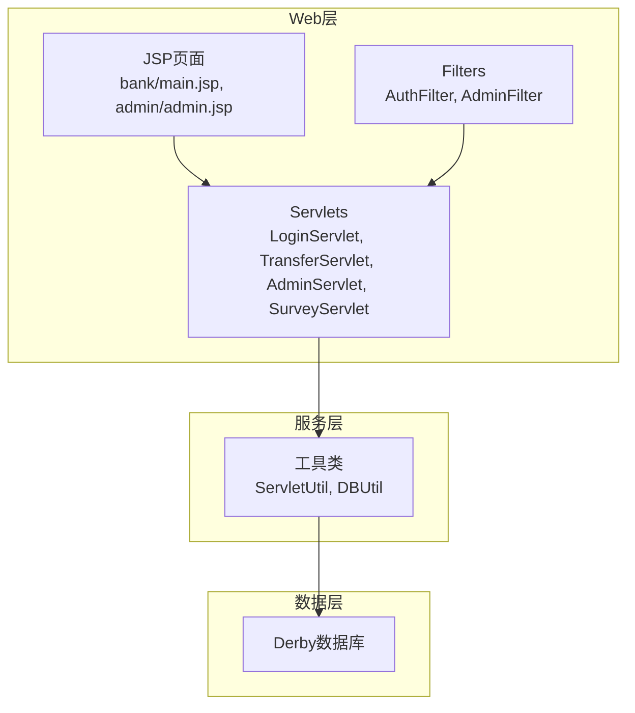
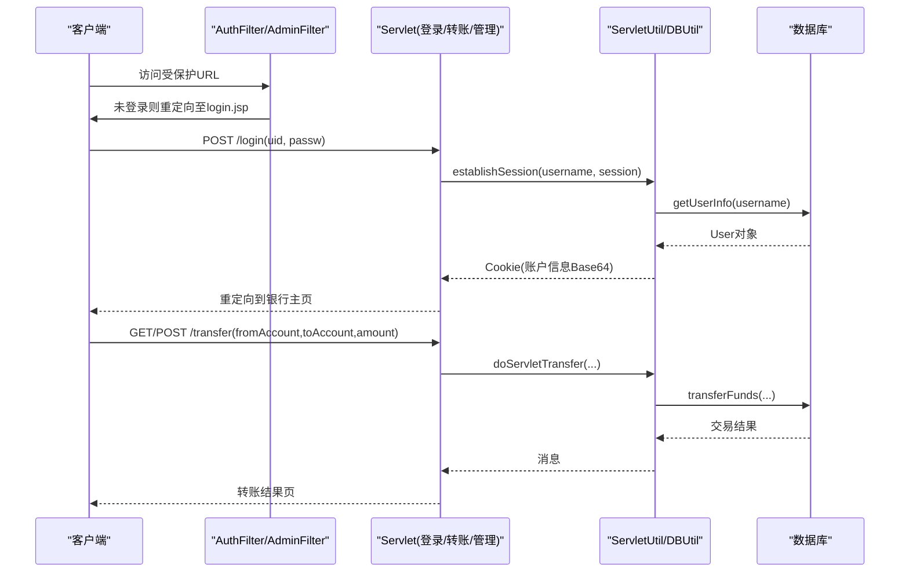
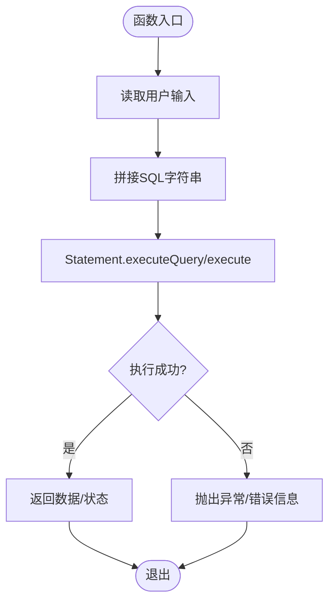
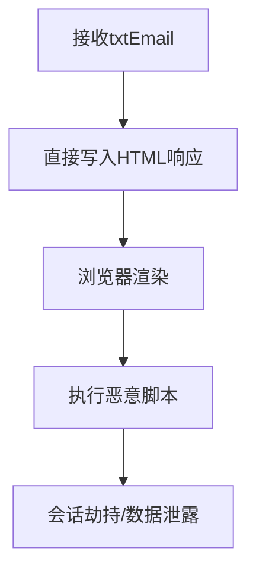
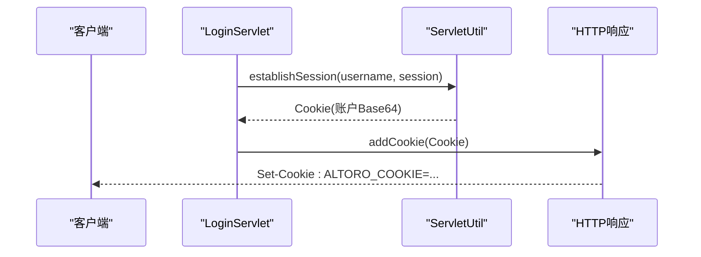
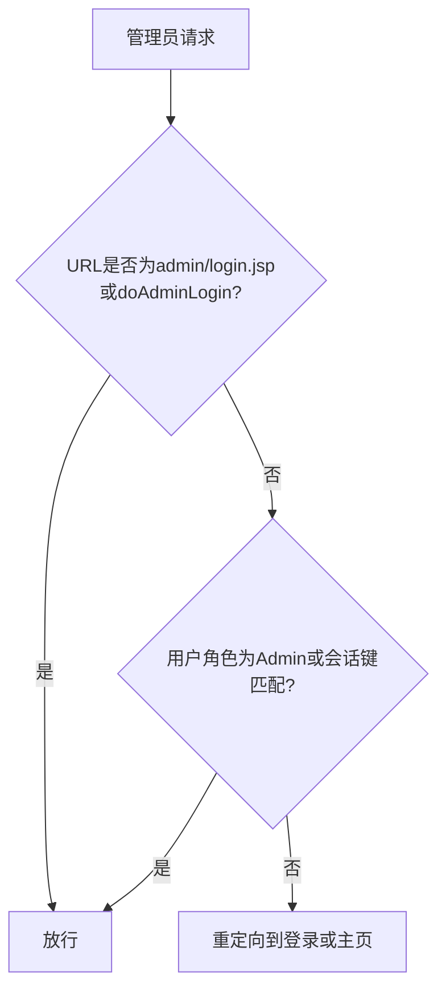
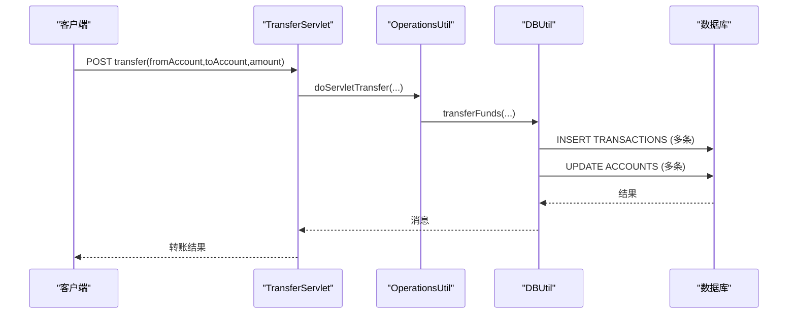
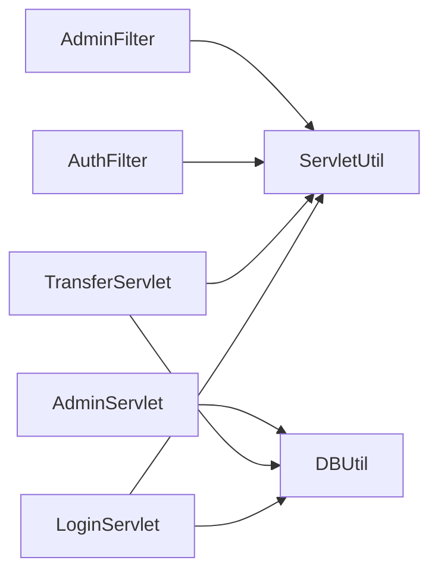

# 漏洞深度分析

<cite>
**本文引用的文件**   
- [README.md](file://README.md)
- [DBUtil.java](file://src/com/ibm/security/appscan/altoromutual/util/DBUtil.java)
- [ServletUtil.java](file://src/com/ibm/security/appscan/altoromutual/util/ServletUtil.java)
- [LoginServlet.java](file://src/com/ibm/security/appscan/altoromutual/servlet/LoginServlet.java)
- [TransferServlet.java](file://src/com/ibm/security/appscan/altoromutual/servlet/TransferServlet.java)
- [AdminServlet.java](file://src/com/ibm/security/appscan/altoromutual/servlet/AdminServlet.java)
- [SurveyServlet.java](file://src/com/ibm/security/appscan/altoromutual/servlet/SurveyServlet.java)
- [AuthFilter.java](file://src/com/ibm/security/appscan/altoromutual/filter/AuthFilter.java)
- [AdminFilter.java](file://src/com/ibm/security/appscan/altoromutual/filter/AdminFilter.java)
- [ApiAuthFilter.java](file://src/com/ibm/security/appscan/altoromutual/filter/ApiAuthFilter.java)
- [main.jsp](file://WebContent/bank/main.jsp)
- [admin.jsp](file://WebContent/admin/admin.jsp)
</cite>

## 目录
1. [引言](#引言)
2. [项目结构](#项目结构)
3. [核心组件](#核心组件)
4. [架构总览](#架构总览)
5. [详细组件与漏洞分析](#详细组件与漏洞分析)
6. [依赖关系分析](#依赖关系分析)
7. [性能与安全特性](#性能与安全特性)
8. [故障排查指南](#故障排查指南)
9. [结论](#结论)
10. [附录：静态检测与修复建议](#附录静态检测与修复建议)

## 引言
本文件对 AltoroJ 应用进行安全漏洞的深度分析，聚焦以下问题：输入验证缺失、输出编码不足、会话管理不当、权限控制薄弱。文档从代码层面解释漏洞根因、影响面和数据泄露风险，并提供检测方法、静态扫描技巧与修复建议。AltoroJ 是故意包含已知漏洞的示例银行应用，用于演示和教学，不应部署到生产环境。

## 项目结构
AltoroJ 采用传统 J2EE Web 应用结构：
- WebContent：JSP 页面与静态资源
- src：Java Servlet、过滤器、工具类、模型与 REST API
- WEB-INF：部署描述符与应用配置

图表来源
- [main.jsp:1-68](file://WebContent/bank/main.jsp#L1-L68)
- [admin.jsp:1-193](file://WebContent/admin/admin.jsp#L1-L193)
- [LoginServlet.java:1-108](file://src/com/ibm/security/appscan/altoromutual/servlet/LoginServlet.java#L1-L108)
- [TransferServlet.java:1-71](file://src/com/ibm/security/appscan/altoromutual/servlet/TransferServlet.java#L1-L71)
- [AdminServlet.java:1-124](file://src/com/ibm/security/appscan/altoromutual/servlet/AdminServlet.java#L1-L124)
- [SurveyServlet.java:1-106](file://src/com/ibm/security/appscan/altoromutual/servlet/SurveyServlet.java#L1-L106)
- [AuthFilter.java:1-79](file://src/com/ibm/security/appscan/altoromutual/filter/AuthFilter.java#L1-L79)
- [AdminFilter.java:1-90](file://src/com/ibm/security/appscan/altoromutual/filter/AdminFilter.java#L1-L90)
- [DBUtil.java:1-536](file://src/com/ibm/security/appscan/altoromutual/util/DBUtil.java#L1-L536)
- [ServletUtil.java:1-378](file://src/com/ibm/security/appscan/altoromutual/util/ServletUtil.java#L1-L378)

章节来源
- [README.md:1-63](file://README.md#L1-L63)

## 核心组件
- 认证与会话
  - LoginServlet：处理登录/登出，建立会话并设置 Cookie
  - AuthFilter：保护银行功能区域，检查用户是否已登录
  - AdminFilter：保护管理员功能，检查管理员角色或特定会话键
  - ServletUtil：会话属性常量、Cookie 建立、登录状态判断
- 数据访问
  - DBUtil：JDBC 操作（查询、插入、更新），存在多处 SQL 拼接
- 业务逻辑
  - TransferServlet：转账入口，调用 OperationsUtil 执行转账
  - AdminServlet：管理员账户/用户/密码操作
  - SurveyServlet：调查问卷流程，直接拼接响应内容
- 输出与编码
  - ServletUtil.sanitizeWeb：HTML 转义
  - 多处 JSP/Servlet 直接将请求参数写入响应，未统一编码

章节来源
- [LoginServlet.java:67-105](file://src/com/ibm/security/appscan/altoromutual/servlet/LoginServlet.java#L67-L105)
- [AuthFilter.java:58-70](file://src/com/ibm/security/appscan/altoromutual/filter/AuthFilter.java#L58-L70)
- [AdminFilter.java:58-80](file://src/com/ibm/security/appscan/altoromutual/filter/AdminFilter.java#L58-L80)
- [ServletUtil.java:340-373](file://src/com/ibm/security/appscan/altoromutual/util/ServletUtil.java#L340-L373)
- [DBUtil.java:212-232](file://src/com/ibm/security/appscan/altoromutual/util/DBUtil.java#L212-L232)
- [TransferServlet.java:51-67](file://src/com/ibm/security/appscan/altoromutual/servlet/TransferServlet.java#L51-L67)
- [AdminServlet.java:39-120](file://src/com/ibm/security/appscan/altoromutual/servlet/AdminServlet.java#L39-L120)
- [SurveyServlet.java:45-102](file://src/com/ibm/security/appscan/altoromutual/servlet/SurveyServlet.java#L45-L102)

## 架构总览
下图展示关键安全路径：登录、受保护访问、转账与管理操作。

图表来源
- [AuthFilter.java:58-70](file://src/com/ibm/security/appscan/altoromutual/filter/AuthFilter.java#L58-L70)
- [AdminFilter.java:58-80](file://src/com/ibm/security/appscan/altoromutual/filter/AdminFilter.java#L58-L80)
- [LoginServlet.java:67-105](file://src/com/ibm/security/appscan/altoromutual/servlet/LoginServlet.java#L67-L105)
- [ServletUtil.java:340-373](file://src/com/ibm/security/appscan/altoromutual/util/ServletUtil.java#L340-L373)
- [DBUtil.java:303-363](file://src/com/ibm/security/appscan/altoromutual/util/DBUtil.java#L303-L363)
- [TransferServlet.java:51-67](file://src/com/ibm/security/appscan/altoromutual/servlet/TransferServlet.java#L51-L67)

## 详细组件与漏洞分析

### 1) SQL注入（严重）
- 根因
  - DBUtil 使用 Statement 直接拼接用户输入到 SQL 语句中，包括登录校验、用户信息查询、账户查询、转账、新增用户/账户、修改密码等。
- 具体表现
  - 登录校验拼接 user/password
  - 获取用户信息、账户列表拼接 username
  - 转账时拼接账户ID、金额、日期
  - 新增/修改用户与账户拼接用户名、密码、姓名等
- 影响面
  - 可绕过认证、读取任意数据、篡改余额、创建/删除账户、提权为管理员
  - 数据泄露风险极高，可能暴露所有用户凭据与财务数据
- 检测方法
  - 静态扫描：搜索字符串拼接SQL模式；定位 Statement.execute/query 调用
  - 动态测试：在登录表单、转账表单、管理接口注入单引号、注释符、UNION 语句
- 修复建议
  - 全面改用 PreparedStatement 与参数绑定
  - 对所有输入做白名单校验（类型、长度、格式）
  - 最小权限原则运行数据库账号

图表来源
- [DBUtil.java:212-232](file://src/com/ibm/security/appscan/altoromutual/util/DBUtil.java#L212-L232)
- [DBUtil.java:241-267](file://src/com/ibm/security/appscan/altoromutual/util/DBUtil.java#L241-L267)
- [DBUtil.java:275-293](file://src/com/ibm/security/appscan/altoromutual/util/DBUtil.java#L275-L293)
- [DBUtil.java:303-363](file://src/com/ibm/security/appscan/altoromutual/util/DBUtil.java#L303-L363)
- [DBUtil.java:472-517](file://src/com/ibm/security/appscan/altoromutual/util/DBUtil.java#L472-L517)

章节来源
- [DBUtil.java:212-232](file://src/com/ibm/security/appscan/altoromutual/util/DBUtil.java#L212-L232)
- [DBUtil.java:241-267](file://src/com/ibm/security/appscan/altoromutual/util/DBUtil.java#L241-L267)
- [DBUtil.java:275-293](file://src/com/ibm/security/appscan/altoromutual/util/DBUtil.java#L275-L293)
- [DBUtil.java:303-363](file://src/com/ibm/security/appscan/altoromutual/util/DBUtil.java#L303-L363)
- [DBUtil.java:472-517](file://src/com/ibm/security/appscan/altoromutual/util/DBUtil.java#L472-L517)

### 2) 跨站脚本（XSS）（高）
- 根因
  - SurveyServlet 将请求参数 txtEmail 直接拼接到 HTML 响应中
  - 多处 JSP/Servlet 直接使用 out.print 或 response.getWriter().write 输出未经编码的用户输入
- 具体表现
  - 调查完成页显示邮箱地址，未进行 HTML 转义
  - 管理页面回显错误消息，可能包含用户输入
- 影响面
  - 可在受害者浏览器执行恶意脚本，窃取会话、劫持操作、钓鱼
- 检测方法
  - 静态扫描：搜索 response.getWriter().write/out.print 与 request.getParameter 组合
  - 动态测试：提交含 <script> 或事件属性的输入，观察是否执行
- 修复建议
  - 统一使用 ServletUtil.sanitizeWeb 或其他安全的 HTML 编码器
  - 在 JSP 中使用标准标签库自动编码输出

图表来源
- [SurveyServlet.java:79-82](file://src/com/ibm/security/appscan/altoromutual/servlet/SurveyServlet.java#L79-L82)
- [ServletUtil.java:244-247](file://src/com/ibm/security/appscan/altoromutual/util/ServletUtil.java#L244-L247)

章节来源
- [SurveyServlet.java:79-82](file://src/com/ibm/security/appscan/altoromutual/servlet/SurveyServlet.java#L79-L82)
- [ServletUtil.java:244-247](file://src/com/ibm/security/appscan/altoromutual/util/ServletUtil.java#L244-L247)

### 3) 不安全的会话管理与敏感数据存储（高）
- 根因
  - 登录后通过 Cookie 存储 Base64 编码的账户列表，且未设置 HttpOnly、Secure、SameSite
  - 会话属性中存放完整 User 对象，未做最小化
- 具体表现
  - ServletUtil.establishSession 将账户信息序列化为 Base64 放入 Cookie
  - LoginServlet 添加该 Cookie 到响应
- 影响面
  - 若 Cookie 被窃取或篡改，可导致账户信息泄露、越权访问
  - 缺少 SameSite 易受 CSRF 攻击
- 检测方法
  - 抓包查看 Set-Cookie 头，确认是否包含敏感数据与标志位
  - 静态扫描：查找 new Cookie 与 setAttribute 调用
- 修复建议
  - 不在 Cookie 中存储敏感数据；仅存会话标识
  - 设置 HttpOnly、Secure、SameSite=Strict/Lax
  - 会话失效后清理敏感属性

图表来源
- [LoginServlet.java:92-96](file://src/com/ibm/security/appscan/altoromutual/servlet/LoginServlet.java#L92-L96)
- [ServletUtil.java:340-353](file://src/com/ibm/security/appscan/altoromutual/util/ServletUtil.java#L340-L353)

章节来源
- [LoginServlet.java:92-96](file://src/com/ibm/security/appscan/altoromutual/servlet/LoginServlet.java#L92-L96)
- [ServletUtil.java:340-353](file://src/com/ibm/security/appscan/altoromutual/util/ServletUtil.java#L340-L353)

### 4) 权限控制薄弱与越权（高）
- 根因
  - 管理员过滤器的条件允许通过特定 URL 绕过鉴权
  - 某些功能仅依赖前端按钮或页面隐藏，未在服务端严格校验
- 具体表现
  - AdminFilter 允许访问 admin/login.jsp 与 doAdminLogin 而不强制鉴权
  - 管理员功能开关由 app.properties 控制，若开启则可直接访问管理接口
- 影响面
  - 非管理员可执行增删改查、修改密码、创建账户等高危操作
- 检测方法
  - 以普通用户身份尝试访问 /admin/* 接口
  - 静态扫描：查找过滤器中对 URL 的宽松匹配
- 修复建议
  - 统一基于角色的访问控制（RBAC），服务端强制校验
  - 移除基于 URL 的“白名单”绕过逻辑
  - 禁用或限制危险的管理功能开关

图表来源
- [AdminFilter.java:58-80](file://src/com/ibm/security/appscan/altoromutual/filter/AdminFilter.java#L58-L80)

章节来源
- [AdminFilter.java:58-80](file://src/com/ibm/security/appscan/altoromutual/filter/AdminFilter.java#L58-L80)

### 5) 硬编码凭据与弱口令（高）
- 根因
  - DBUtil 中存在针对 jsmith/demo1234 的硬编码校验逻辑
  - README 提供默认管理员凭据
- 具体表现
  - isValidUser 方法对特定用户进行特殊处理
  - 初始数据包含多个弱口令
- 影响面
  - 攻击者可轻易获得高权限账户
- 检测方法
  - 静态扫描：搜索常见默认用户名/密码、硬编码字符串
  - 配置审计：检查配置文件中的默认凭据
- 修复建议
  - 移除硬编码逻辑，使用强口令策略与哈希存储
  - 初始化脚本中避免弱口令

章节来源
- [DBUtil.java:212-232](file://src/com/ibm/security/appscan/altoromutual/util/DBUtil.java#L212-L232)
- [README.md:27-31](file://README.md#L27-L31)

### 6) 转账业务逻辑缺陷（高）
- 根因
  - TransferServlet 直接解析 fromAccount/toAccount/amount，未做严格的业务校验与防重放
  - DBUtil.transferFunds 使用字符串拼接构建 SQL，且余额更新非原子事务
- 具体表现
  - 转账金额与账户ID来自用户输入，无范围与合法性校验
  - 转账记录与余额更新分多条语句执行
- 影响面
  - 可能导致余额不一致、资金转移、重复转账
- 检测方法
  - 动态测试：构造负数金额、超大金额、非法账户ID
  - 静态扫描：查找转账相关逻辑与未加锁的更新语句
- 修复建议
  - 输入白名单校验（正数、上限、账户归属）
  - 使用数据库事务保证一致性
  - 引入幂等性与防重放机制

图表来源
- [TransferServlet.java:51-67](file://src/com/ibm/security/appscan/altoromutual/servlet/TransferServlet.java#L51-L67)
- [DBUtil.java:303-363](file://src/com/ibm/security/appscan/altoromutual/util/DBUtil.java#L303-L363)

章节来源
- [TransferServlet.java:51-67](file://src/com/ibm/security/appscan/altoromutful/servlet/TransferServlet.java#L51-L67)
- [DBUtil.java:303-363](file://src/com/ibm/security/appscan/altoromutual/util/DBUtil.java#L303-L363)

### 7) 管理功能开放与输入验证缺失（高）
- 根因
  - AdminServlet 根据 URL 后缀路由到不同操作，未在服务端严格校验操作权限
  - 输入字段仅做空值检查，未进行类型与长度校验
- 具体表现
  - 新增账户、新增用户、修改密码均直接调用 DBUtil 拼接 SQL
- 影响面
  - 任意用户可创建账户、修改他人密码、注入 SQL
- 检测方法
  - 动态测试：直接调用 /addAccount、/addUser、/changePassword
  - 静态扫描：查找 Servlet 中按 URL 路由的逻辑
- 修复建议
  - 统一权限校验，禁止基于 URL 的功能路由
  - 对所有输入进行严格校验与编码

章节来源
- [AdminServlet.java:39-120](file://src/com/ibm/security/appscan/altoromutual/servlet/AdminServlet.java#L39-L120)
- [DBUtil.java:472-517](file://src/com/ibm/security/appscan/altoromutual/util/DBUtil.java#L472-L517)

### 8) API 鉴权机制脆弱（中高）
- 根因
  - ApiAuthFilter 使用 Base64 编码的 token，未签名、未加密，且校验逻辑简单
- 具体表现
  - Authorization 头替换 Bearer 前缀后解码，正则匹配冒号分隔
- 影响面
  - Token 可被伪造或重放，导致未授权访问
- 检测方法
  - 抓包分析 Authorization 头，尝试伪造 token
  - 静态扫描：查找 Base64.decodeBase64 与简单正则校验
- 修复建议
  - 使用 JWT 或 OAuth2 标准方案，启用签名与有效期
  - 增加速率限制与防重放

章节来源
- [ApiAuthFilter.java:22-60](file://src/com/ibm/security/appscan/altoromutual/filter/ApiAuthFilter.java#L22-L60)

## 依赖关系分析
- Servlet 与工具类耦合度高：LoginServlet、TransferServlet、AdminServlet 均依赖 ServletUtil 与 DBUtil
- 过滤器与 Servlet 解耦：AuthFilter/AdminFilter 通过会话属性进行鉴权
- 数据访问集中在 DBUtil，但缺乏统一的参数化封装

图表来源
- [LoginServlet.java:1-108](file://src/com/ibm/security/appscan/altoromutual/servlet/LoginServlet.java#L1-L108)
- [TransferServlet.java:1-71](file://src/com/ibm/security/appscan/altoromutual/servlet/TransferServlet.java#L1-L71)
- [AdminServlet.java:1-124](file://src/com/ibm/security/appscan/altoromutual/servlet/AdminServlet.java#L1-L124)
- [AuthFilter.java:1-79](file://src/com/ibm/security/appscan/altoromutual/filter/AuthFilter.java#L1-L79)
- [AdminFilter.java:1-90](file://src/com/ibm/security/appscan/altoromutual/filter/AdminFilter.java#L1-L90)
- [DBUtil.java:1-536](file://src/com/ibm/security/appscan/altoromutual/util/DBUtil.java#L1-L536)
- [ServletUtil.java:1-378](file://src/com/ibm/security/appscan/altoromutual/util/ServletUtil.java#L1-L378)

章节来源
- [DBUtil.java:1-536](file://src/com/ibm/security/appscan/altoromutual/util/DBUtil.java#L1-L536)
- [ServletUtil.java:1-378](file://src/com/ibm/security/appscan/altoromutual/util/ServletUtil.java#L1-L378)

## 性能与安全特性
- 连接池与数据源
  - DBUtil 支持外部 DataSource 与内置 Derby，但未实现连接池优化
- 事务与一致性
  - 转账操作未使用事务，存在并发与一致性问题
- 日志与审计
  - 登录失败、数据库初始化有日志记录，但敏感信息可能泄露（如打印错误堆栈）

[本节为通用指导，不直接分析具体文件]

## 故障排查指南
- 数据库初始化失败
  - 检查 user.home 目录权限与 derby.system.home 配置
  - 查看 Tomcat 日志 catalina.out 中 user.home 路径
- 编译错误
  - 使用 Gradle 构建下载依赖并编译
- 登录失败提示
  - 检查 DBUtil.isValidUser 的硬编码逻辑与数据库表结构

章节来源
- [README.md:44-56](file://README.md#L44-L56)
- [DBUtil.java:117-133](file://src/com/ibm/security/appscan/altoromutual/util/DBUtil.java#L117-L133)

## 结论
AltoroJ 存在多类高危漏洞：SQL注入、XSS、会话管理不当、权限控制薄弱、硬编码凭据、转账业务逻辑缺陷、API 鉴权脆弱。这些问题集中体现在数据访问层与服务层的安全缺失。修复应优先解决 SQL 参数化、输出编码、会话安全、权限校验与事务一致性，同时加强输入校验与审计日志。

[本节为总结性内容，不直接分析具体文件]

## 附录：静态检测与修复建议

### 静态扫描规则建议
- SQL注入
  - 搜索 Pattern：Statement.*executeQuery.*\".*\".*\+
  - 目标文件：DBUtil.java
- XSS
  - 搜索 Pattern：response\.getWriter\(\)\.write|out\.print.*request\.getParameter
  - 目标文件：SurveyServlet.java、admin.jsp
- 会话敏感数据
  - 搜索 Pattern：new Cookie.*setAttribute.*getSession
  - 目标文件：LoginServlet.java、ServletUtil.java
- 权限绕过
  - 搜索 Pattern：endsWith.*admin|getRequestURL
  - 目标文件：AdminFilter.java、AdminServlet.java
- 硬编码凭据
  - 搜索 Pattern：demo1234|admin.*admin
  - 目标文件：DBUtil.java、README.md

### 修复优先级
1. 将所有 SQL 改为 PreparedStatement 参数绑定
2. 统一输出编码，禁用直接拼接 HTML
3. 会话 Cookie 设置 HttpOnly/Secure/SameSite，移除敏感数据
4. 强化权限控制，移除基于 URL 的绕过逻辑
5. 移除硬编码凭据，实施强口令策略
6. 转账逻辑加入事务与输入校验

[本节为通用指导，不直接分析具体文件]