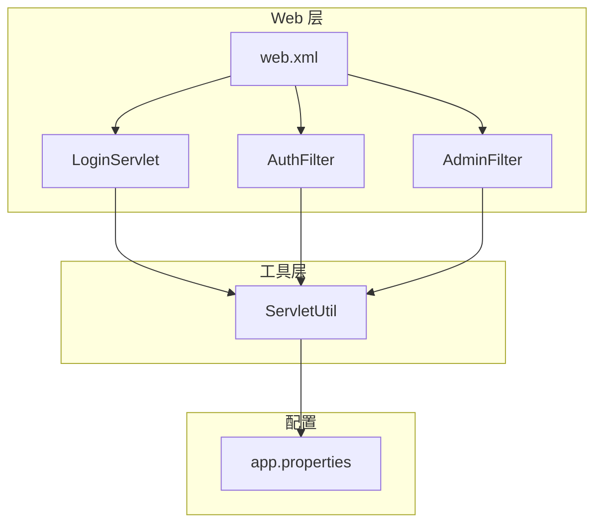
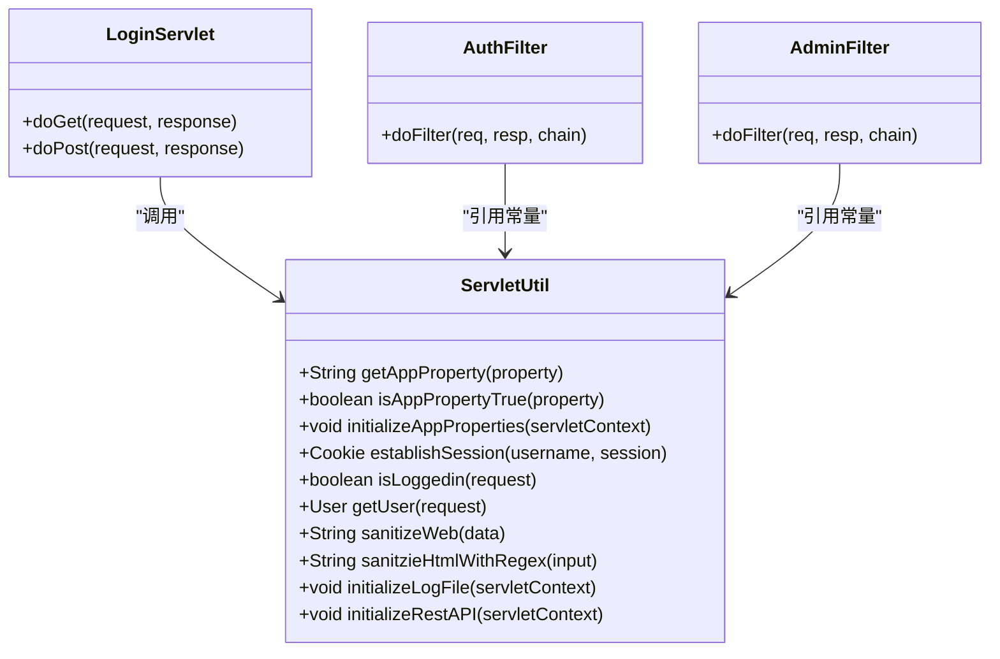
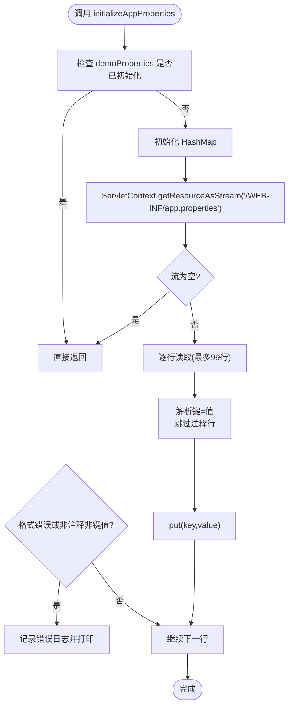
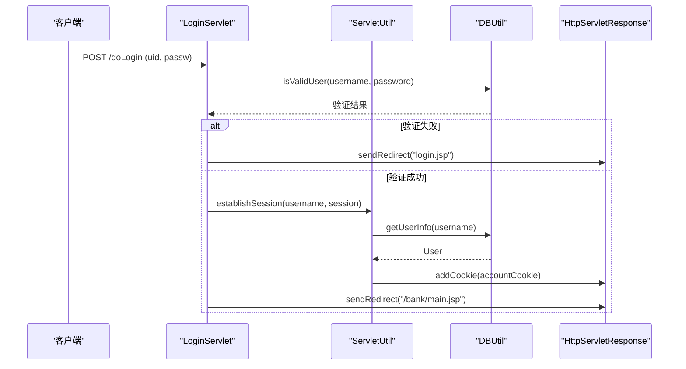
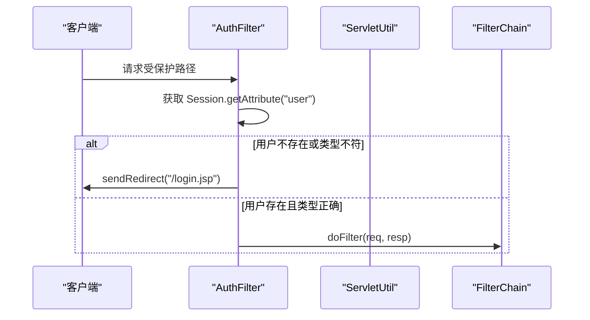
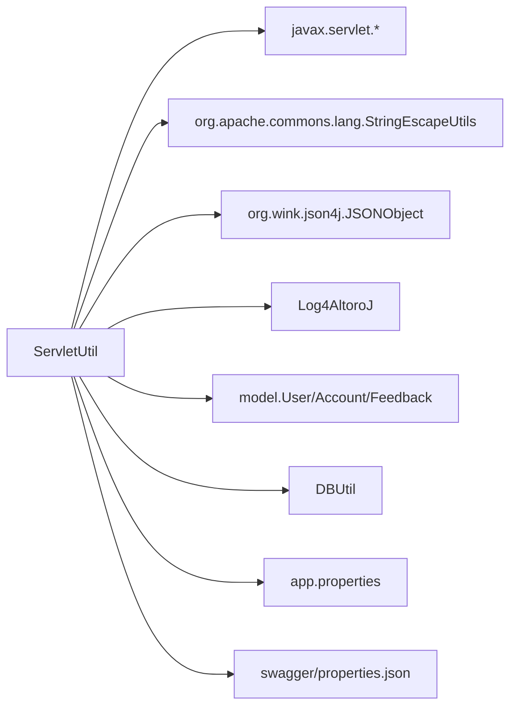

# Servlet工具类(ServletUtil)

<cite>
**本文引用的文件**   
- [ServletUtil.java](file://src/com/ibm/security/appscan/altoromutual/util/ServletUtil.java)
- [app.properties](file://WebContent/WEB-INF/app.properties)
- [web.xml](file://WebContent/WEB-INF/web.xml)
- [LoginServlet.java](file://src/com/ibm/security/appscan/altoromutual/servlet/LoginServlet.java)
- [AuthFilter.java](file://src/com/ibm/security/appscan/altoromutual/filter/AuthFilter.java)
- [AdminFilter.java](file://src/com/ibm/security/appscan/altoromutual/filter/AdminFilter.java)
</cite>

## 目录
1. [简介](#简介)
2. [项目结构](#项目结构)
3. [核心组件](#核心组件)
4. [架构总览](#架构总览)
5. [详细组件分析](#详细组件分析)
6. [依赖关系分析](#依赖关系分析)
7. [性能与并发考虑](#性能与并发考虑)
8. [故障排查指南](#故障排查指南)
9. [结论](#结论)
10. [附录：配置规范与最佳实践](#附录配置规范与最佳实践)

## 简介
本文件为 AltoroJ 的 Servlet 工具类 ServletUtil 提供深入的技术文档。重点覆盖以下方面：
- 应用属性配置管理：配置文件读取、布尔属性解析、初始化流程
- 请求与响应辅助方法：会话建立、登录状态判断、用户获取
- 安全与输出净化：HTML 转义、XSS 正则过滤
- 与 web.xml、app.properties 等配置文件的关联关系
- 在 Servlet 和 Filter 中的正确使用方式
- 常见配置问题与错误处理机制
- 生命周期管理与初始化策略

## 项目结构
ServletUtil 位于 util 包，作为横切工具被多个 Servlet 与 Filter 复用；应用属性通过 WEB-INF/app.properties 提供；Web 层入口与过滤器映射由 web.xml 定义。

图表来源
- [web.xml:1-227](file://WebContent/WEB-INF/web.xml#L1-L227)
- [ServletUtil.java:200-299](file://src/com/ibm/security/appscan/altoromutual/util/ServletUtil.java#L200-L299)
- [LoginServlet.java:67-105](file://src/com/ibm/security/appscan/altoromutual/servlet/LoginServlet.java#L67-L105)
- [AuthFilter.java:58-70](file://src/com/ibm/security/appscan/altoromutual/filter/AuthFilter.java#L58-L70)
- [AdminFilter.java:58-80](file://src/com/ibm/security/appscan/altoromutual/filter/AdminFilter.java#L58-L80)

章节来源
- [web.xml:1-227](file://WebContent/WEB-INF/web.xml#L1-L227)
- [ServletUtil.java:1-412](file://src/com/ibm/security/appscan/altoromutual/util/ServletUtil.java#L1-L412)

## 核心组件
- 应用属性配置管理
  - getAppProperty：从内存缓存中读取属性值，未初始化或未命中返回空字符串
  - isAppPropertyTrue：将属性值规范化后判断是否为“true”
  - initializeAppProperties：启动时加载 app.properties 到静态 HashMap
- 会话与认证辅助
  - establishSession：根据用户名创建 Cookie（账户列表 Base64）并写入 Session
  - isLoggedin：检查 Session 中是否存在用户对象
  - getUser：从 Session 获取当前用户
- 输出净化与安全
  - sanitizeWeb：使用 HTML 转义库进行输出净化
  - sanitzieHtmlWithRegex：基于 XSS 正则表达式进行输入过滤
- 其他工具
  - searchArticles/searchSite：演示用搜索功能
  - addSpecialBankUsers：添加特殊银行用户
  - initializeLogFile：初始化日志文件
  - initializeRestAPI：自动更新 Swagger basePath

章节来源
- [ServletUtil.java:200-299](file://src/com/ibm/security/appscan/altoromutual/util/ServletUtil.java#L200-L299)
- [ServletUtil.java:340-373](file://src/com/ibm/security/appscan/altoromutual/util/ServletUtil.java#L340-L373)
- [ServletUtil.java:244-254](file://src/com/ibm/security/appscan/altoromutual/util/ServletUtil.java#L244-L254)

## 架构总览
ServletUtil 作为工具类，不持有业务状态，但维护了进程内静态缓存（demoProperties、logFile、swaggerInitialized）。其职责包括：
- 在应用启动阶段初始化配置与资源
- 为 Servlet/Filter 提供统一的会话与认证辅助
- 提供输出净化与基础安全校验能力

图表来源
- [ServletUtil.java:58-412](file://src/com/ibm/security/appscan/altoromutual/util/ServletUtil.java#L58-L412)
- [LoginServlet.java:67-105](file://src/com/ibm/security/appscan/altoromutual/servlet/LoginServlet.java#L67-L105)
- [AuthFilter.java:58-70](file://src/com/ibm/security/appscan/altoromutual/filter/AuthFilter.java#L58-L70)
- [AdminFilter.java:58-80](file://src/com/ibm/security/appscan/altoromutual/filter/AdminFilter.java#L58-L80)

## 详细组件分析

### 应用属性配置管理
- 初始化流程
  - 通过 initializeAppProperties 读取 /WEB-INF/app.properties，按行解析键值对，忽略注释行（以 # 或 // 开头），并将有效条目存入静态 HashMap demoProperties
  - 若文件不存在或 IO 异常，记录错误日志并返回
  - 限制最多读取 99 行，避免超大文件影响启动时间
- 读取与布尔解析
  - getAppProperty 直接从 demoProperties 取值，未命中返回空字符串
  - isAppPropertyTrue 将值转为小写并使用 StringTokenizer 去除引号与空格，仅当唯一 token 为 "true" 时返回 true
- 典型属性键
  - enableAdminFunctions、specialLink、advancedStaticPageProcessing、enableFeedbackRetention、database.alternateDataSource、database.reinitializeOnStart

图表来源
- [ServletUtil.java:256-299](file://src/com/ibm/security/appscan/altoromutual/util/ServletUtil.java#L256-L299)

章节来源
- [ServletUtil.java:200-299](file://src/com/ibm/security/appscan/altoromutual/util/ServletUtil.java#L200-L299)
- [app.properties:19-74](file://WebContent/WEB-INF/app.properties#L19-L74)

### 会话与认证辅助
- establishSession
  - 根据用户名查询用户信息，序列化账户列表为 Base64 字符串，创建 Cookie（名称固定为 ALTORO_COOKIE），并将 User 对象放入 Session（键为 SESSION_ATTR_USER）
  - 捕获 SQL 异常并返回 null
- isLoggedin
  - 从 Session 中取用户对象，若为空或类型不符则返回 false
- getUser
  - 从 Session 中取用户对象

图表来源
- [LoginServlet.java:67-105](file://src/com/ibm/security/appscan/altoromutual/servlet/LoginServlet.java#L67-L105)
- [ServletUtil.java:340-353](file://src/com/ibm/security/appscan/altoromutual/util/ServletUtil.java#L340-L353)

章节来源
- [LoginServlet.java:67-105](file://src/com/ibm/security/appscan/altoromutual/servlet/LoginServlet.java#L67-L105)
- [ServletUtil.java:340-373](file://src/com/ibm/security/appscan/altoromutual/util/ServletUtil.java#L340-L373)

### 过滤器中的使用
- AuthFilter
  - 检查 Session 中是否存在有效的 User 对象，否则重定向至登录页
  - 使用 ServletUtil.SESSION_ATTR_USER 常量
- AdminFilter
  - 允许管理员角色或通过特定 admin 标志的用户访问
  - 使用 ServletUtil.SESSION_ATTR_ADMIN_KEY 与 SESSION_ATTR_ADMIN_VALUE 常量

图表来源
- [AuthFilter.java:58-70](file://src/com/ibm/security/appscan/altoromutual/filter/AuthFilter.java#L58-L70)
- [ServletUtil.java:60-62](file://src/com/ibm/security/appscan/altoromutual/util/ServletUtil.java#L60-L62)

章节来源
- [AuthFilter.java:58-70](file://src/com/ibm/security/appscan/altoromutual/filter/AuthFilter.java#L58-L70)
- [AdminFilter.java:58-80](file://src/com/ibm/security/appscan/altoromutual/filter/AdminFilter.java#L58-L80)
- [ServletUtil.java:60-62](file://src/com/ibm/security/appscan/altoromutual/util/ServletUtil.java#L60-L62)

### 输出净化与安全
- sanitizeWeb：使用 StringEscapeUtils.escapeHtml 对输出进行 HTML 转义，防止 XSS
- sanitzieHtmlWithRegex：基于预定义的正则表达式检测潜在 XSS 模式，匹配则清空输入

章节来源
- [ServletUtil.java:244-254](file://src/com/ibm/security/appscan/altoromutual/util/ServletUtil.java#L244-L254)

### REST API 初始化
- initializeRestAPI：读取 swagger/properties.json，动态设置 basePath 为 contextPath+"/api"，并写回文件；若已一致则跳过；异常时记录错误日志

章节来源
- [ServletUtil.java:375-409](file://src/com/ibm/security/appscan/altoromutual/util/ServletUtil.java#L375-L409)

## 依赖关系分析
- ServletUtil 依赖
  - javax.servlet.*：ServletContext、HttpServletRequest、HttpSession、Cookie
  - org.apache.commons.lang.StringEscapeUtils：HTML 转义
  - org.wink.json4j.JSONObject：Swagger 属性 JSON 操作
  - com.ibm.security.appscan.Log4AltoroJ：日志记录
  - com.ibm.security.appscan.altoromutual.model.*：User、Account、Feedback
  - com.ibm.security.appscan.altoromutual.util.DBUtil：数据库访问封装
- 外部配置
  - WebContent/WEB-INF/app.properties：应用行为与数据库连接相关开关
  - WebContent/swagger/properties.json：REST API 元数据（basePath）
  - WebContent/WEB-INF/web.xml：Servlet/Filter 映射与监听器

图表来源
- [ServletUtil.java:21-51](file://src/com/ibm/security/appscan/altoromutual/util/ServletUtil.java#L21-L51)
- [ServletUtil.java:256-409](file://src/com/ibm/security/appscan/altoromutual/util/ServletUtil.java#L256-L409)

章节来源
- [ServletUtil.java:21-51](file://src/com/ibm/security/appscan/altoromutual/util/ServletUtil.java#L21-L51)
- [ServletUtil.java:256-409](file://src/com/ibm/security/appscan/altoromutual/util/ServletUtil.java#L256-L409)

## 性能与并发考虑
- 静态缓存
  - demoProperties、logFile、swaggerInitialized 为静态字段，首次初始化后复用，减少重复 IO
  - 注意：多线程环境下对静态 Map 的读写需保证线程安全；当前实现仅在初始化阶段写入，后续只读，风险较低
- 文件读取限制
  - 初始化属性与日志文件均限制最多 99 行，避免大文件导致启动缓慢
- 正则匹配
  - XSS 正则用于快速拒绝可疑输入，但复杂场景下可能误判；建议结合白名单与更严格的净化策略

[本节为通用指导，不直接分析具体文件]

## 故障排查指南
- 属性文件无法加载
  - 现象：getAppProperty 始终返回空字符串
  - 排查：确认 /WEB-INF/app.properties 存在且可被 ServletContext 读取；检查 initializeAppProperties 是否被调用；查看日志中是否有初始化失败的错误
- 属性格式错误
  - 现象：控制台打印“Failed to process property line...”
  - 原因：行不是注释也不是键=值格式
  - 解决：修正为 propertyName=propertyValue，确保每行只有一个等号分隔键值
- 布尔属性解析不符合预期
  - 现象：isAppPropertyTrue 返回 false
  - 原因：值不为 "true"（大小写敏感前会统一小写），或包含多余 token
  - 解决：确保值为 "true"，不要带引号或额外字符
- 会话未建立或用户为空
  - 现象：isLoggedin 返回 false，过滤器重定向到登录页
  - 排查：确认 LoginServlet.doPost 成功调用了 ServletUtil.establishSession；检查 Session 中是否存在 user 属性
- Swagger basePath 未更新
  - 现象：REST API 路径不正确
  - 排查：检查 initializeRestAPI 是否执行；查看 swagger/properties.json 是否被写入；关注日志中的错误信息

章节来源
- [ServletUtil.java:256-299](file://src/com/ibm/security/appscan/altoromutual/util/ServletUtil.java#L256-L299)
- [ServletUtil.java:375-409](file://src/com/ibm/security/appscan/altoromutual/util/ServletUtil.java#L375-L409)
- [LoginServlet.java:67-105](file://src/com/ibm/security/appscan/altoromutual/servlet/LoginServlet.java#L67-L105)

## 结论
ServletUtil 提供了 AltoroJ 的核心工具能力：应用属性配置管理、会话与认证辅助、输出净化与安全校验、以及 REST API 初始化。它通过静态缓存提升性能，并通过日志记录增强可观测性。在实际使用中，应遵循配置文件规范，谨慎启用危险特性，并确保在 Servlet 与 Filter 中正确使用这些工具方法，以保证系统的安全性与稳定性。

[本节为总结性内容，不直接分析具体文件]

## 附录：配置规范与最佳实践
- app.properties 格式
  - 支持注释：以 # 或 // 开头的行视为注释
  - 键值对：propertyName=propertyValue，每行一个
  - 示例键：
    - enableAdminFunctions=true
    - specialLink=http://example.com
    - advancedStaticPageProcessing=true
    - enableFeedbackRetention=true
    - database.alternateDataSource=jdbc/AltoroDB
    - database.reinitializeOnStart=true
- 默认值
  - 所有属性在未设置时，getAppProperty 返回空字符串；isAppPropertyTrue 返回 false
- 安全性建议
  - 在生产环境禁用危险开关（如 advancedStaticPageProcessing、enableAdminFunctions）
  - 对外部数据库连接需谨慎配置，并在首次运行时启用 reinitializeOnStart 以初始化数据
- 与 web.xml 的关系
  - web.xml 定义了 Servlet 与 Filter 的映射与监听器，确保应用启动时能正确加载 ServletUtil 所需的上下文资源
- 生命周期管理
  - 建议在应用启动阶段（例如 Listener 或 Servlet init）调用 initializeAppProperties 与 initializeRestAPI，确保配置与 Swagger 元数据就绪

章节来源
- [app.properties:19-74](file://WebContent/WEB-INF/app.properties#L19-L74)
- [web.xml:1-227](file://WebContent/WEB-INF/web.xml#L1-L227)
- [ServletUtil.java:256-299](file://src/com/ibm/security/appscan/altoromutual/util/ServletUtil.java#L256-L299)
- [ServletUtil.java:375-409](file://src/com/ibm/security/appscan/altoromutual/util/ServletUtil.java#L375-L409)