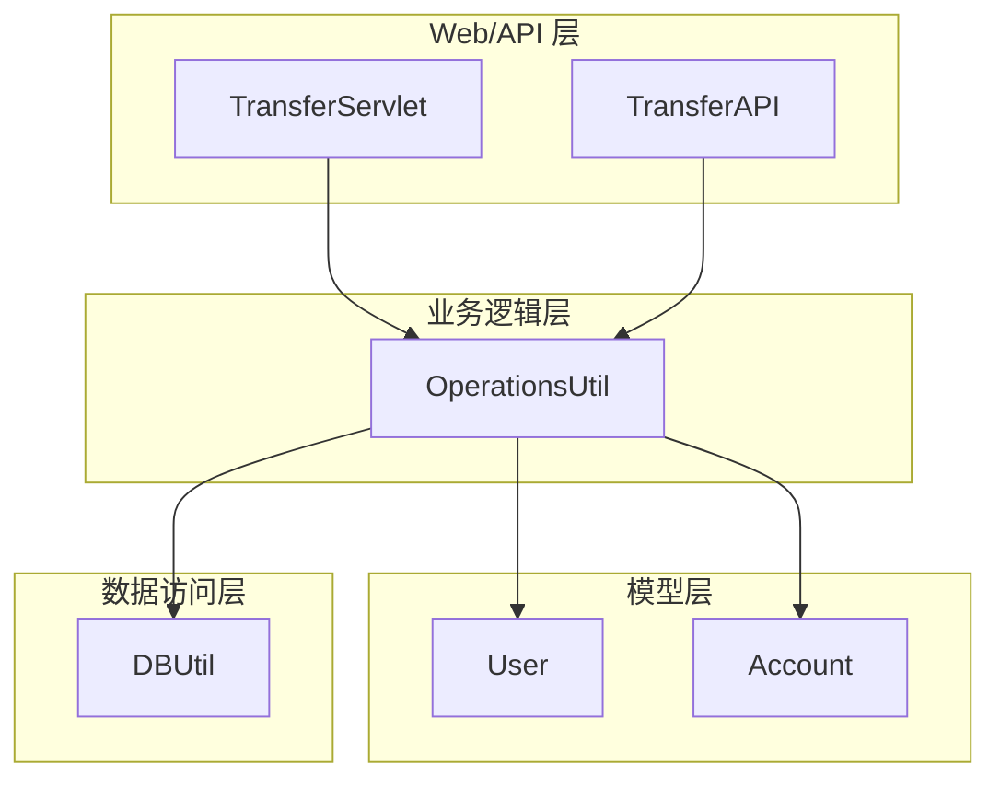
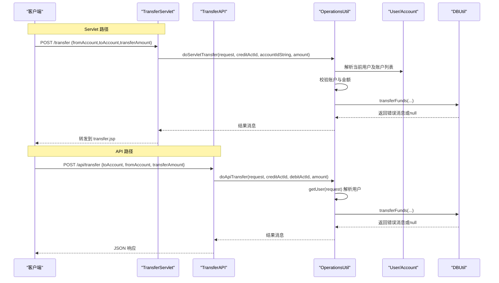
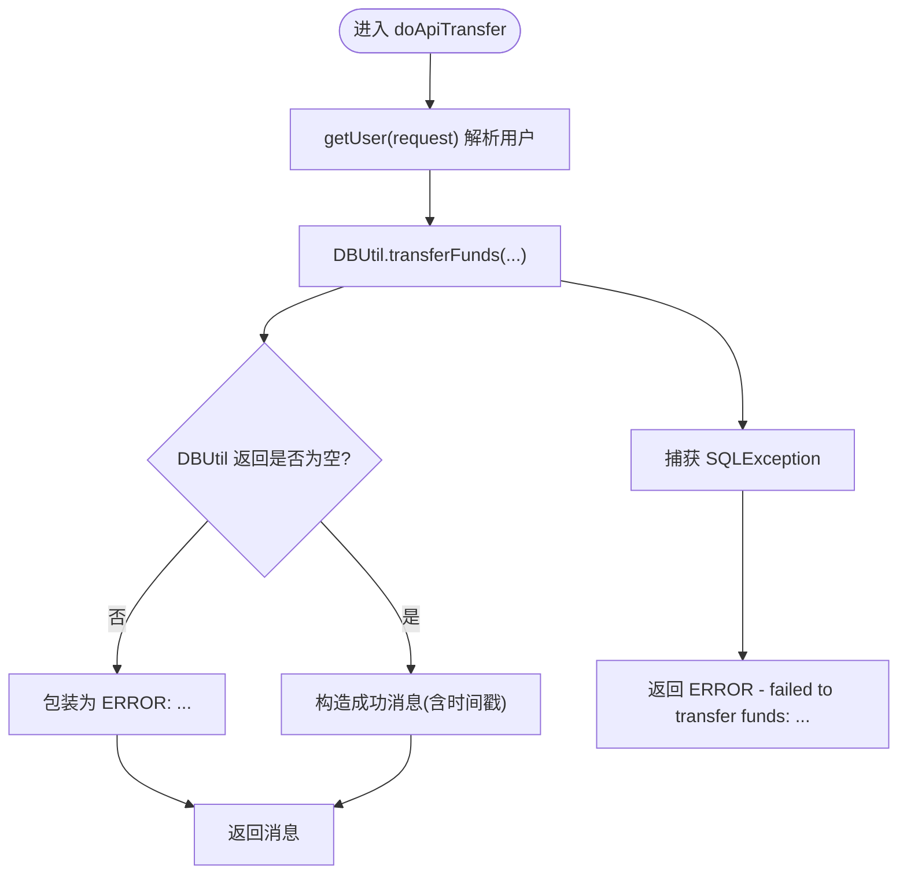
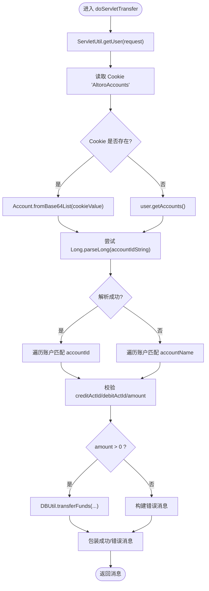
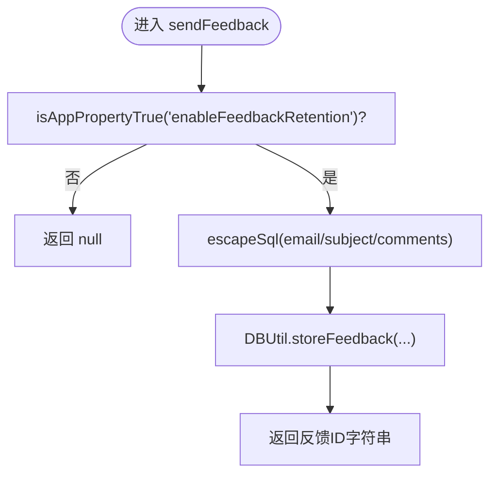
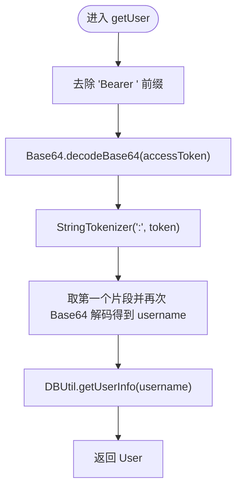
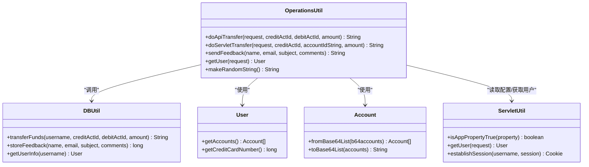

# 业务逻辑工具类(OperationsUtil)

<cite>
**本文引用的文件**   
- [OperationsUtil.java](file://src/com/ibm/security/appscan/altoromutual/util/OperationsUtil.java)
- [DBUtil.java](file://src/com/ibm/security/appscan/altoromutual/util/DBUtil.java)
- [ServletUtil.java](file://src/com/ibm/security/appscan/altoromutual/util/ServletUtil.java)
- [User.java](file://src/com/ibm/security/appscan/altoromutual/model/User.java)
- [Account.java](file://src/com/ibm/security/appscan/altoromutual/model/Account.java)
- [TransferServlet.java](file://src/com/ibm/security/appscan/altoromutual/servlet/TransferServlet.java)
- [LoginServlet.java](file://src/com/ibm/security/appscan/altoromutual/servlet/LoginServlet.java)
- [TransferAPI.java](file://src/com/ibm/security/appscan/altoromutual/api/TransferAPI.java)
</cite>

## 目录
1. [引言](#引言)
2. [项目结构](#项目结构)
3. [核心组件](#核心组件)
4. [架构总览](#架构总览)
5. [详细组件分析](#详细组件分析)
6. [依赖关系分析](#依赖关系分析)
7. [性能与并发特性](#性能与并发特性)
8. [故障排查指南](#故障排查指南)
9. [结论](#结论)
10. [附录：调用示例与最佳实践](#附录调用示例与最佳实践)

## 引言
本文件聚焦于 AltoroJ 的业务逻辑工具类 OperationsUtil，系统梳理其业务封装、数据校验、业务规则实现、异常处理以及与 DBUtil、Model 层的协作方式。文档同时给出 Servlet 层和 API 层的调用路径、输入输出规范、配置开关与安全注意事项，帮助读者快速理解并安全使用该类提供的转账、反馈存储、用户解析等能力。

## 项目结构
OperationsUtil 位于 util 包，承担“业务编排”职责：从请求中解析上下文（用户、账户），执行参数校验与业务规则判断，再委托 DBUtil 完成持久化操作；同时提供面向 API 的转账入口与通用的随机字符串生成方法。

图表来源
- [TransferServlet.java:51-67](file://src/com/ibm/security/appscan/altoromutual/servlet/TransferServlet.java#L51-L67)
- [TransferAPI.java:17-43](file://src/com/ibm/security/appscan/altoromutual/api/TransferAPI.java#L17-L43)
- [OperationsUtil.java:18-117](file://src/com/ibm/security/appscan/altoromutual/util/OperationsUtil.java#L18-L117)
- [DBUtil.java:303-364](file://src/com/ibm/security/appscan/altoromutual/util/DBUtil.java#L303-L364)
- [User.java:76-99](file://src/com/ibm/security/appscan/altoromutual/model/User.java#L76-L99)
- [Account.java:37-48](file://src/com/ibm/security/appscan/altoromutual/model/Account.java#L37-L48)

章节来源
- [OperationsUtil.java:1-155](file://src/com/ibm/security/appscan/altoromutual/util/OperationsUtil.java#L1-L155)

## 核心组件
- 转账编排
  - doApiTransfer：面向 REST API 的转账入口，基于 Authorization 头解析用户，直接调用 DBUtil.transferFunds。
  - doServletTransfer：面向传统 Servlet 的转账入口，从 Cookie 或 Session 解析当前用户的账户列表，进行账户合法性校验后调用 DBUtil.transferFunds。
- 反馈存储
  - sendFeedback：根据应用配置决定是否落库，并对 SQL 注入风险做基础转义。
- 用户解析
  - getUser：从 Authorization Bearer 头中解码 Base64 令牌，提取用户名并查询用户信息。
- 辅助方法
  - makeRandomString：生成随机字符串（用于演示用途）。

章节来源
- [OperationsUtil.java:18-152](file://src/com/ibm/security/appscan/altoromutual/util/OperationsUtil.java#L18-L152)

## 架构总览
OperationsUtil 在整体架构中的角色是“业务编排器”，它不直接操作数据库，而是协调 Model 与 DBUtil，并在必要时结合 ServletUtil 获取会话与配置。

图表来源
- [TransferServlet.java:51-67](file://src/com/ibm/security/appscan/altoromutual/servlet/TransferServlet.java#L51-L67)
- [TransferAPI.java:17-43](file://src/com/ibm/security/appscan/altoromutual/api/TransferAPI.java#L17-L43)
- [OperationsUtil.java:18-117](file://src/com/ibm/security/appscan/altoromutual/util/OperationsUtil.java#L18-L117)
- [DBUtil.java:303-364](file://src/com/ibm/security/appscan/altoromutual/util/DBUtil.java#L303-L364)

## 详细组件分析

### 转账方法：doApiTransfer
- 功能概述
  - 从请求头 Authorization 中解析用户身份，调用 DBUtil.transferFunds 完成转账，统一包装成功/失败消息。
- 参数说明
  - request：HTTP 请求对象，需包含 Authorization: Bearer <Base64(token)> 头。
  - creditActId：收款账户ID（long）。
  - debitActId：付款账户ID（long）。
  - amount：转账金额（double）。
- 返回值
  - String：成功时返回包含时间戳的成功消息；失败时以“ERROR: ...”前缀返回错误消息。
- 关键流程
  - 通过 getUser(request) 解析用户；
  - 调用 DBUtil.transferFunds；
  - 捕获 SQLException 并返回错误消息。
- 业务规则与校验
  - 未对 amount 的正负性进行前置校验，交由 DBUtil 内部处理；
  - 未检查余额是否充足（注释明确说明）。
- 异常处理
  - 捕获 SQLException，返回“ERROR - failed to transfer funds: ...”。

图表来源
- [OperationsUtil.java:18-36](file://src/com/ibm/security/appscan/altoromutual/util/OperationsUtil.java#L18-L36)
- [OperationsUtil.java:134-143](file://src/com/ibm/security/appscan/altoromutual/util/OperationsUtil.java#L134-L143)
- [DBUtil.java:303-364](file://src/com/ibm/security/appscan/altoromutual/util/DBUtil.java#L303-L364)

章节来源
- [OperationsUtil.java:18-36](file://src/com/ibm/security/appscan/altoromutual/util/OperationsUtil.java#L18-L36)

### 转账方法：doServletTransfer
- 功能概述
  - 面向传统 Servlet 的转账入口，从 Cookie 或 Session 获取当前用户账户列表，支持按账户ID或账户名称匹配付款账户，再进行合法性校验后调用 DBUtil.transferFunds。
- 参数说明
  - request：HTTP 请求对象。
  - creditActId：收款账户ID（long）。
  - accountIdString：付款账户标识，可为数字ID或账户名称（String）。
  - amount：转账金额（double）。
- 返回值
  - String：成功时返回包含时间戳的成功消息；失败时以“ERROR: ...”前缀返回错误消息。
- 关键流程
  - 从 ServletUtil.getUser(request) 获取当前用户；
  - 读取 Cookie AltoroAccounts，若存在则反序列化为 Account[]，否则使用 user.getAccounts()；
  - 尝试将 accountIdString 解析为 long，若失败则按账户名匹配；
  - 校验 creditActId、debitActId、amount 的合法性；
  - 调用 DBUtil.transferFunds 并包装结果。
- 业务规则与校验
  - 目标账户无效、来源账户无效、金额为负均会返回错误；
  - 金额为 0 时不做转账；
  - 未检查余额是否充足（注释明确说明）。
- 异常处理
  - 捕获 NumberFormatException 与通用 Exception（吞掉异常继续处理）；
  - 最终统一包装错误消息。

图表来源
- [OperationsUtil.java:39-117](file://src/com/ibm/security/appscan/altoromutual/util/OperationsUtil.java#L39-L117)
- [Account.java:76-103](file://src/com/ibm/security/appscan/altoromutual/model/Account.java#L76-L103)
- [DBUtil.java:303-364](file://src/com/ibm/security/appscan/altoromutual/util/DBUtil.java#L303-L364)

章节来源
- [OperationsUtil.java:39-117](file://src/com/ibm/security/appscan/altoromutual/util/OperationsUtil.java#L39-L117)

### 反馈存储：sendFeedback
- 功能概述
  - 根据应用配置 enableFeedbackRetention 决定是否存储反馈；若开启，对 email、subject、comments 进行 SQL 转义后写入数据库，返回生成的反馈ID；否则返回 null。
- 参数说明
  - name：提交者姓名。
  - email：邮箱地址。
  - subject：主题。
  - comments：评论内容。
- 返回值
  - String：存储成功时返回反馈ID字符串；未启用存储时返回 null。
- 业务规则与校验
  - 通过 ServletUtil.isAppPropertyTrue("enableFeedbackRetention") 控制是否启用；
  - 使用 StringEscapeUtils.escapeSql 对输入进行 SQL 转义。
- 异常处理
  - 未显式捕获异常，底层 DBUtil.storeFeedback 会记录日志并返回 -1。

图表来源
- [OperationsUtil.java:119-132](file://src/com/ibm/security/appscan/altoromutual/util/OperationsUtil.java#L119-L132)
- [DBUtil.java:520-535](file://src/com/ibm/security/appscan/altoromutual/util/DBUtil.java#L520-L535)

章节来源
- [OperationsUtil.java:119-132](file://src/com/ibm/security/appscan/altoromutual/util/OperationsUtil.java#L119-L132)

### 用户解析：getUser
- 功能概述
  - 从 Authorization 头中移除 “Bearer ” 前缀，对剩余内容进行 Base64 解码，再以 “:” 分割，取第一部分作为用户名，最后通过 DBUtil.getUserInfo 获取用户信息。
- 参数说明
  - request：HTTP 请求对象，必须包含 Authorization: Bearer <Base64(token)>。
- 返回值
  - User：用户对象。
- 异常处理
  - 未捕获异常，可能抛出 RuntimeException（如 Base64 解码失败、头部缺失等）。

图表来源
- [OperationsUtil.java:134-143](file://src/com/ibm/security/appscan/altoromutual/util/OperationsUtil.java#L134-L143)
- [DBUtil.java:241-267](file://src/com/ibm/security/appscan/altoromutual/util/DBUtil.java#L241-L267)

章节来源
- [OperationsUtil.java:134-143](file://src/com/ibm/security/appscan/altoromutual/util/OperationsUtil.java#L134-L143)

### 辅助方法：makeRandomString
- 功能概述
  - 生成长度为 7 的随机字节数组，转为 UTF-8 字符串并返回。
- 用途
  - 演示用途，无业务约束。

章节来源
- [OperationsUtil.java:146-152](file://src/com/ibm/security/appscan/altoromutual/util/OperationsUtil.java#L146-L152)

## 依赖关系分析
- 与 DBUtil 的协作
  - 转账：DBUtil.transferFunds 负责账户有效性检查、交易记录插入、余额更新与费用计算（信用卡预借现金手续费）。
  - 反馈：DBUtil.storeFeedback 负责插入反馈并返回自增ID。
  - 用户：DBUtil.getUserInfo 根据用户名查询用户基本信息。
- 与 Model 的协作
  - User：提供 getAccounts、getCreditCardNumber 等方法，供业务层识别信用卡账户。
  - Account：提供 fromBase64List/toBase64List 序列化/反序列化账户列表，配合 Cookie 传递账户上下文。
- 与 ServletUtil 的协作
  - isAppPropertyTrue：读取 app.properties 中的布尔开关。
  - getUser：从 Session 获取已登录用户。
  - establishSession：登录后建立会话与 Cookie。

图表来源
- [OperationsUtil.java:18-152](file://src/com/ibm/security/appscan/altoromutual/util/OperationsUtil.java#L18-L152)
- [DBUtil.java:241-267](file://src/com/ibm/security/appscan/altoromutual/util/DBUtil.java#L241-L267)
- [DBUtil.java:303-364](file://src/com/ibm/security/appscan/altoromutual/util/DBUtil.java#L303-L364)
- [DBUtil.java:520-535](file://src/com/ibm/security/appscan/altoromutual/util/DBUtil.java#L520-L535)
- [User.java:76-99](file://src/com/ibm/security/appscan/altoromutual/model/User.java#L76-L99)
- [Account.java:76-103](file://src/com/ibm/security/appscan/altoromutual/model/Account.java#L76-L103)
- [ServletUtil.java:210-218](file://src/com/ibm/security/appscan/altoromutual/util/ServletUtil.java#L210-L218)
- [ServletUtil.java:340-353](file://src/com/ibm/security/appscan/altoromutual/util/ServletUtil.java#L340-L353)

章节来源
- [OperationsUtil.java:18-152](file://src/com/ibm/security/appscan/altoromutual/util/OperationsUtil.java#L18-L152)
- [DBUtil.java:241-267](file://src/com/ibm/security/appscan/altoromutual/util/DBUtil.java#L241-L267)
- [DBUtil.java:303-364](file://src/com/ibm/security/appscan/altoromutual/util/DBUtil.java#L303-L364)
- [DBUtil.java:520-535](file://src/com/ibm/security/appscan/altoromutual/util/DBUtil.java#L520-L535)
- [User.java:76-99](file://src/com/ibm/security/appscan/altoromutual/model/User.java#L76-L99)
- [Account.java:76-103](file://src/com/ibm/security/appscan/altoromutual/model/Account.java#L76-L103)
- [ServletUtil.java:210-218](file://src/com/ibm/security/appscan/altoromutual/util/ServletUtil.java#L210-L218)
- [ServletUtil.java:340-353](file://src/com/ibm/security/appscan/altoromutual/util/ServletUtil.java#L340-L353)

## 性能与并发特性
- 数据库连接
  - DBUtil 维护单例 Connection，首次获取时初始化 Derby 或外部 DataSource；当启用 reinitializeOnStart 时会重建表与初始数据。
- 转账事务
  - 代码注释指出理想情况下应将余额更新与交易记录创建合并为原子事务，但当前实现为多条语句顺序执行，存在一致性风险。
- 性能建议
  - 使用 PreparedStatement 替代字符串拼接 SQL，避免 SQL 注入与重复编译开销。
  - 引入真正的事务边界（Connection.setAutoCommit(false) + commit/rollback）。
  - 对频繁访问的用户/账户数据进行缓存（如本地缓存或分布式缓存），减少 DB 压力。

[本节为通用指导，不直接分析具体文件]

## 故障排查指南
- 转账失败常见原因
  - 目标账户无效：creditActId 不存在。
  - 来源账户无效：debitActId 不存在或无法匹配。
  - 金额为负：amount < 0。
  - 余额不足：当前实现未检查余额，可能导致负余额；需在业务层增加校验。
  - 数据库异常：SQLException 被捕获后返回错误消息。
- 反馈存储问题
  - 未启用存储：enableFeedbackRetention 未设置为 true，sendFeedback 返回 null。
  - 存储失败：DBUtil.storeFeedback 返回 -1，应检查数据库连接与权限。
- 用户解析失败
  - Authorization 头缺失或格式不正确：getUser 可能抛出异常。
  - Base64 解码失败：token 非合法 Base64 编码。

章节来源
- [OperationsUtil.java:39-117](file://src/com/ibm/security/appscan/altoromutual/util/OperationsUtil.java#L39-L117)
- [OperationsUtil.java:119-132](file://src/com/ibm/security/appscan/altoromutual/util/OperationsUtil.java#L119-L132)
- [OperationsUtil.java:134-143](file://src/com/ibm/security/appscan/altoromutual/util/OperationsUtil.java#L134-L143)
- [DBUtil.java:303-364](file://src/com/ibm/security/appscan/altoromutual/util/DBUtil.java#L303-L364)
- [DBUtil.java:520-535](file://src/com/ibm/security/appscan/altoromutual/util/DBUtil.java#L520-L535)

## 结论
OperationsUtil 提供了简洁的业务编排接口，屏蔽了底层 DB 细节，并通过配置开关控制反馈存储行为。然而，当前实现存在若干安全与一致性问题，包括 SQL 注入风险、缺少事务边界、未校验余额、以及部分异常被吞掉。建议在后续迭代中引入参数化查询、强类型校验、事务管理、完善的异常传播与审计日志，以提升安全性与可靠性。

[本节为总结性内容，不直接分析具体文件]

## 附录：调用示例与最佳实践

### Servlet 层调用示例
- 入口
  - TransferServlet.doPost：校验登录状态，解析参数，调用 OperationsUtil.doServletTransfer，并将结果转发至 transfer.jsp。
- 典型流程
  - 前端表单提交 fromAccount、toAccount、transferAmount；
  - Servlet 调用 doServletTransfer；
  - 页面展示 message。

章节来源
- [TransferServlet.java:51-67](file://src/com/ibm/security/appscan/altoromutual/servlet/TransferServlet.java#L51-L67)

### API 层调用示例
- 入口
  - TransferAPI.trasnfer：解析 JSON 参数，调用 OperationsUtil.doApiTransfer，返回 JSON 响应。
- 典型流程
  - 客户端发送 POST /api/transfer，Body 包含 toAccount、fromAccount、transferAmount；
  - API 调用 doApiTransfer；
  - 根据消息前缀返回不同 HTTP 状态码与 JSON。

章节来源
- [TransferAPI.java:17-43](file://src/com/ibm/security/appscan/altoromutual/api/TransferAPI.java#L17-L43)

### 登录与会话建立
- LoginServlet.doPost：验证用户凭据，调用 ServletUtil.establishSession 建立会话与 Cookie，重定向至银行主页。

章节来源
- [LoginServlet.java:67-105](file://src/com/ibm/security/appscan/altoromutual/servlet/LoginServlet.java#L67-L105)

### 业务规则配置选项
- enableFeedbackRetention：布尔值，控制是否存储反馈。
- database.reinitializeOnStart：布尔值，控制启动时是否重建数据库。
- database.alternateDataSource：外部 DataSource JNDI 名称（可选）。

章节来源
- [ServletUtil.java:210-218](file://src/com/ibm/security/appscan/altoromutual/util/ServletUtil.java#L210-L218)
- [DBUtil.java:71-96](file://src/com/ibm/security/appscan/altoromutual/util/DBUtil.java#L71-L96)

### 输入输出参数与异常处理要点
- doApiTransfer
  - 输入：request（Authorization）、creditActId、debitActId、amount。
  - 输出：String 消息。
  - 异常：捕获 SQLException，返回错误消息。
- doServletTransfer
  - 输入：request、creditActId、accountIdString、amount。
  - 输出：String 消息。
  - 异常：吞掉 NumberFormatException 与通用 Exception，继续处理。
- sendFeedback
  - 输入：name、email、subject、comments。
  - 输出：String（反馈ID 或 null）。
  - 异常：未显式捕获，底层返回 -1。
- getUser
  - 输入：request（Authorization）。
  - 输出：User。
  - 异常：未捕获，可能抛出运行时异常。

章节来源
- [OperationsUtil.java:18-152](file://src/com/ibm/security/appscan/altoromutual/util/OperationsUtil.java#L18-L152)

### 安全性考虑与最佳实践
- 防止 SQL 注入
  - 使用 PreparedStatement 替代字符串拼接；
  - 对输入进行严格白名单校验（如账户ID仅允许数字）。
- 确保事务一致性
  - 将余额更新与交易记录插入放入同一事务；
  - 出现异常时回滚。
- 余额校验
  - 在业务层增加余额检查，避免透支。
- 认证与授权
  - 对 API 端点强制校验 Authorization 头；
  - 对 Servlet 端点强制校验登录状态。
- 日志与审计
  - 记录关键业务事件（转账、登录、反馈提交）；
  - 脱敏敏感信息（密码、卡号等）。
- 输入输出编码
  - 对 Web 输出进行 HTML 转义，防止 XSS；
  - 对数据库输入进行 SQL 转义或参数化。

[本节为通用指导，不直接分析具体文件]