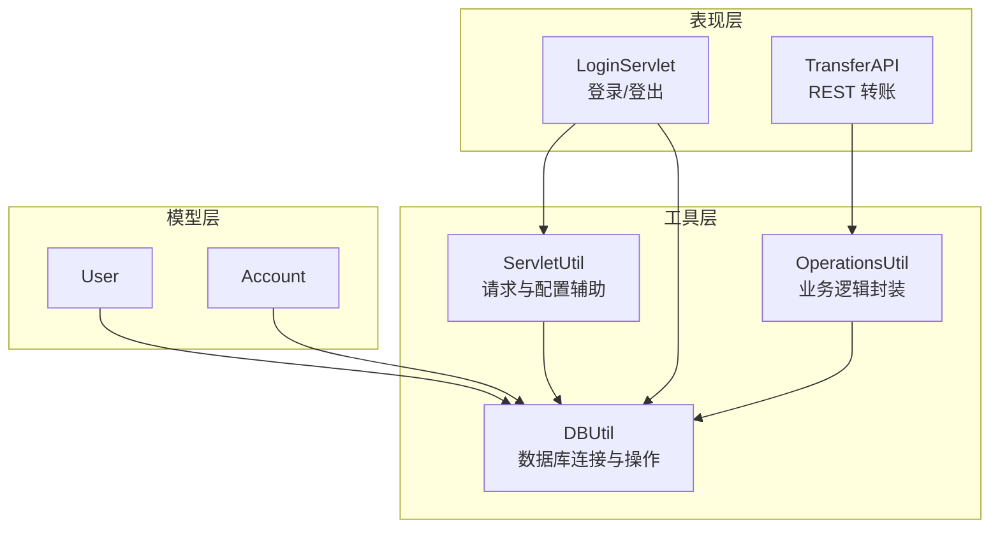
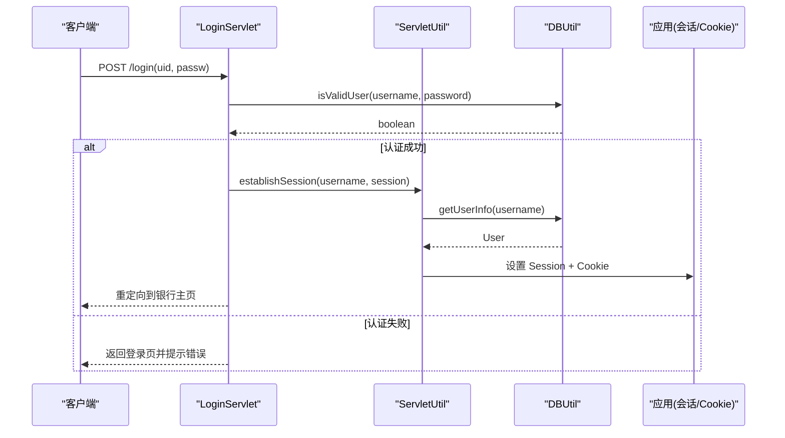
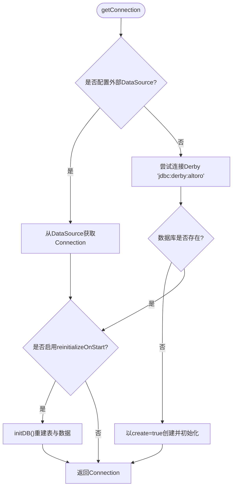
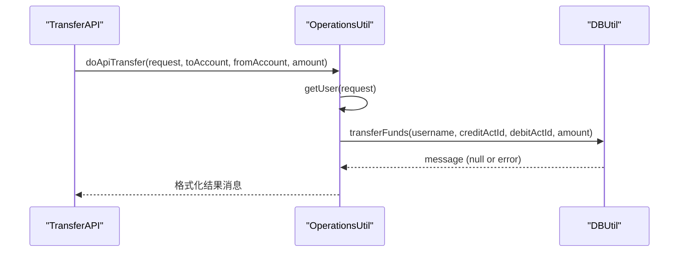
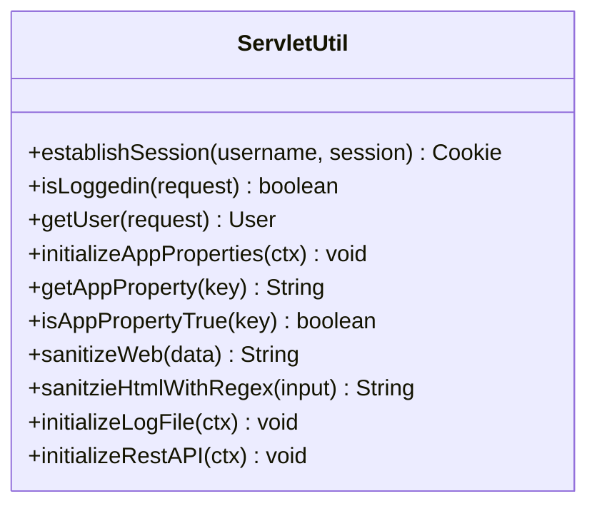
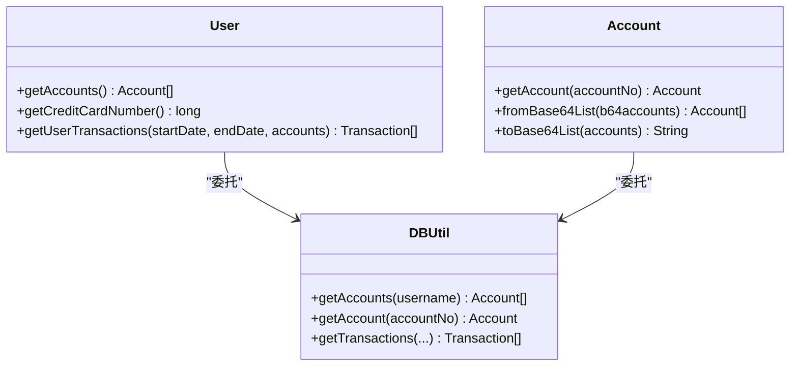
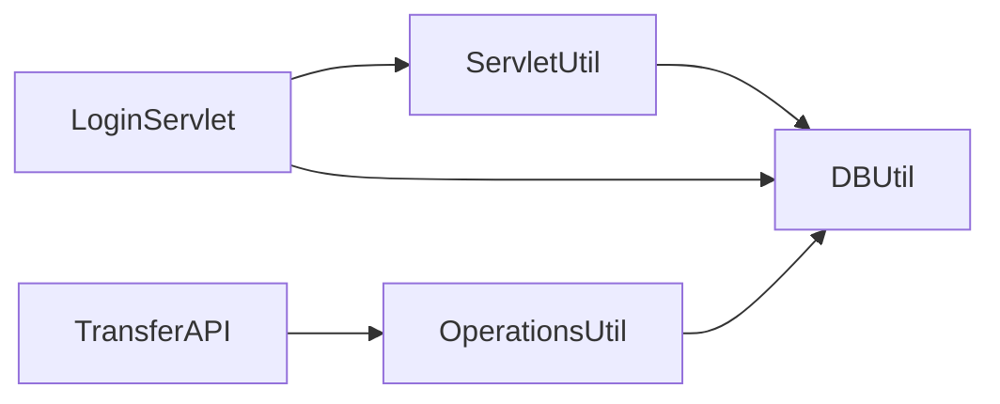

# 工具类与辅助功能

<cite>
**本文引用的文件**   
- [DBUtil.java](file://src/com/ibm/security/appscan/altoromutual/util/DBUtil.java)
- [OperationsUtil.java](file://src/com/ibm/security/appscan/altoromutual/util/OperationsUtil.java)
- [ServletUtil.java](file://src/com/ibm/security/appscan/altoromutual/util/ServletUtil.java)
- [app.properties](file://WebContent/WEB-INF/app.properties)
- [README.md](file://README.md)
- [LoginServlet.java](file://src/com/ibm/security/appscan/altoromutual/servlet/LoginServlet.java)
- [TransferAPI.java](file://src/com/ibm/security/appscan/altoromutual/api/TransferAPI.java)
- [User.java](file://src/com/ibm/security/appscan/altoromutual/model/User.java)
- [Account.java](file://src/com/ibm/security/appscan/altoromutual/model/Account.java)
</cite>

## 目录
1. [引言](#引言)
2. [项目结构](#项目结构)
3. [核心组件](#核心组件)
4. [架构总览](#架构总览)
5. [详细组件分析](#详细组件分析)
6. [依赖关系分析](#依赖关系分析)
7. [性能考虑](#性能考虑)
8. [故障排查指南](#故障排查指南)
9. [结论](#结论)
10. [附录](#附录)

## 引言
本文件聚焦 AltoroJ 的三大工具类与辅助功能：数据库工具类 DBUtil、业务逻辑封装 OperationsUtil、以及请求处理辅助 ServletUtil。文档将深入解释其实现细节、调用关系、接口和使用模式，并结合实际代码库给出具体示例路径，记录配置选项、参数和返回值，说明与其他组件的关系，并总结常见问题及解决方案。

## 项目结构
AltoroJ 采用传统 J2EE 分层组织方式：
- util 包提供通用工具（DBUtil、OperationsUtil、ServletUtil）
- servlet 包处理 Web 请求（如登录）
- api 包暴露 REST API（如转账）
- model 包定义领域模型（User、Account 等）
- WEB-INF/app.properties 提供应用级配置项

图表来源
- [DBUtil.java:45-138](file://src/com/ibm/security/appscan/altoromutual/util/DBUtil.java#L45-L138)
- [OperationsUtil.java:16-155](file://src/com/ibm/security/appscan/altoromutual/util/OperationsUtil.java#L16-L155)
- [ServletUtil.java:58-412](file://src/com/ibm/security/appscan/altoromutual/util/ServletUtil.java#L58-L412)
- [LoginServlet.java:38-108](file://src/com/ibm/security/appscan/altoromutual/servlet/LoginServlet.java#L38-L108)
- [TransferAPI.java:14-44](file://src/com/ibm/security/appscan/altoromutual/api/TransferAPI.java#L14-L44)
- [User.java:30-108](file://src/com/ibm/security/appscan/altoromutual/model/User.java#L30-L108)
- [Account.java:32-122](file://src/com/ibm/security/appscan/altoromutual/model/Account.java#L32-L122)

章节来源
- [README.md:1-63](file://README.md#L1-L63)

## 核心组件
- DBUtil：负责数据库连接管理（Derby 内嵌或外部 DataSource）、表结构与初始数据初始化、用户认证、账户与交易查询、转账、反馈存储等。
- OperationsUtil：封装面向 API 与 Servlet 的业务流程，如转账校验、反馈提交、基于 Authorization 头的用户解析等。
- ServletUtil：提供会话建立、登录状态检查、应用属性读取、日志与 Swagger 初始化、XSS 过滤等通用能力。

章节来源
- [DBUtil.java:45-536](file://src/com/ibm/security/appscan/altoromutual/util/DBUtil.java#L45-L536)
- [OperationsUtil.java:16-155](file://src/com/ibm/security/appscan/altoromutual/util/OperationsUtil.java#L16-L155)
- [ServletUtil.java:58-412](file://src/com/ibm/security/appscan/altoromutual/util/ServletUtil.java#L58-L412)

## 架构总览
整体交互遵循“表现层 -> 工具层 -> 数据层”的模式：
- LoginServlet 使用 ServletUtil 建立会话，并通过 DBUtil 验证用户。
- TransferAPI 通过 OperationsUtil 完成转账业务编排，最终由 DBUtil 执行持久化。
- User/Account 模型在需要时委托 DBUtil 获取数据。

图表来源
- [LoginServlet.java:67-101](file://src/com/ibm/security/appscan/altoromutual/servlet/LoginServlet.java#L67-L101)
- [DBUtil.java:212-232](file://src/com/ibm/security/appscan/altoromutual/util/DBUtil.java#L212-L232)
- [ServletUtil.java:340-353](file://src/com/ibm/security/appscan/altoromutual/util/ServletUtil.java#L340-L353)

## 详细组件分析

### DBUtil：数据库连接管理与数据访问
- 连接管理
  - 支持两种模式：
    - 外部 DataSource：通过 JNDI 查找配置的 DataSource（由 app.properties 中 database.alternateDataSource 指定）。
    - 内嵌 Derby：默认使用 user.home/altoro 作为数据库目录，首次连接失败时自动创建并初始化。
  - 单例连接：内部维护静态实例与 Connection，避免重复创建。
  - 启动初始化：当配置 database.reinitializeOnStart=true 时，每次获取连接都会重建表与初始数据。
- 数据访问方法
  - 用户认证：isValidUser 支持硬编码回退（jsmith/demo1234），否则查询 PEOPLE 表。
  - 用户信息：getUserInfo 返回 User 对象，包含角色映射。
  - 账户查询：getAccounts、getAccount 返回 Account 数组或单个账户。
  - 转账：transferFunds 处理借记/贷记账户、信用卡特殊逻辑、现金预借费用、交易日志。
  - 交易查询：getTransactions 支持按账户集合与日期范围筛选，限制最大行数。
  - 反馈：storeFeedback 插入 FEEDBACK 表并返回自增 ID；getFeedback 查询反馈列表。
  - 其他：addUser/addSpecialUser/changePassword/getBankUsernames 等。

图表来源
- [DBUtil.java:99-138](file://src/com/ibm/security/appscan/altoromutual/util/DBUtil.java#L99-L138)
- [DBUtil.java:143-167](file://src/com/ibm/security/appscan/altoromutual/util/DBUtil.java#L143-L167)

关键方法与行为要点
- transferFunds
  - 输入：用户名、贷方账户ID、借方账户ID、金额。
  - 输出：null 表示成功，非空字符串表示错误信息。
  - 逻辑：根据是否为信用卡账户调整金额正负；插入两条交易记录；若为信用卡借记则追加现金预借费用；更新两账户余额。
- getTransactions
  - 输入：开始/结束时间、账户数组、最大行数。
  - 输出：Transaction[]。
  - 注意：日期格式错误会抛出特定异常信息。

章节来源
- [DBUtil.java:45-536](file://src/com/ibm/security/appscan/altoromutual/util/DBUtil.java#L45-L536)

### OperationsUtil：业务逻辑封装
- doApiTransfer
  - 从 Authorization 头解析用户（Base64 Bearer token），调用 DBUtil.transferFunds 完成转账，返回格式化消息。
- doServletTransfer
  - 从 Session 或 Cookie 解析当前用户与账户，校验输入（目标账户、来源账户、金额），再调用 DBUtil.transferFunds。
- sendFeedback
  - 根据 enableFeedbackRetention 开关决定是否持久化反馈；必要时对 SQL 注入进行基础转义。
- getUser
  - 解析 Authorization 头中的 Base64 凭证，提取用户名后通过 DBUtil.getUserInfo 获取用户。
- makeRandomString
  - 生成随机字符串（用于测试或令牌等场景）。

图表来源
- [TransferAPI.java:17-43](file://src/com/ibm/security/appscan/altoromutual/api/TransferAPI.java#L17-L43)
- [OperationsUtil.java:18-36](file://src/com/ibm/security/appscan/altoromutual/util/OperationsUtil.java#L18-L36)
- [DBUtil.java:303-364](file://src/com/ibm/security/appscan/altoromutual/util/DBUtil.java#L303-L364)

章节来源
- [OperationsUtil.java:16-155](file://src/com/ibm/security/appscan/altoromutual/util/OperationsUtil.java#L16-L155)

### ServletUtil：请求处理与配置辅助
- 会话与会话属性
  - establishSession：加载用户及其账户，写入 Session，并生成包含账户信息的 Cookie（Base64 序列化）。
  - isLoggedin/getUser：从 Session 中判断登录状态与获取用户。
- 应用属性
  - initializeAppProperties：从 WEB-INF/app.properties 加载键值对。
  - getAppProperty/isAppPropertyTrue：读取属性并判断布尔值。
- 安全与输出
  - sanitizeWeb：HTML 转义。
  - sanitzieHtmlWithRegex：基于正则的 XSS 检测与过滤。
- 日志与 Swagger
  - initializeLogFile：初始化日志文件内容。
  - initializeRestAPI：根据上下文路径自动修正 Swagger basePath。

图表来源
- [ServletUtil.java:340-412](file://src/com/ibm/security/appscan/altoromutual/util/ServletUtil.java#L340-L412)

章节来源
- [ServletUtil.java:58-412](file://src/com/ibm/security/appscan/altoromutual/util/ServletUtil.java#L58-L412)

### 模型与工具协作
- User
  - getAccounts：委托 DBUtil.getAccounts 获取账户数组。
  - getCreditCardNumber：遍历账户匹配信用卡名称常量。
  - getUserTransactions：委托 DBUtil.getTransactions 获取交易。
- Account
  - getAccount(long)：委托 DBUtil.getAccount。
  - fromBase64List/toBase64List：账户列表的 Base64 编解码，便于 Cookie 传输。

图表来源
- [User.java:76-106](file://src/com/ibm/security/appscan/altoromutual/model/User.java#L76-L106)
- [Account.java:37-48](file://src/com/ibm/security/appscan/altoromutual/model/Account.java#L37-L48)
- [Account.java:76-120](file://src/com/ibm/security/appscan/altoromutual/model/Account.java#L76-L120)
- [DBUtil.java:275-293](file://src/com/ibm/security/appscan/altoromutual/util/DBUtil.java#L275-L293)
- [DBUtil.java:452-470](file://src/com/ibm/security/appscan/altoromutual/util/DBUtil.java#L452-L470)
- [DBUtil.java:375-427](file://src/com/ibm/security/appscan/altoromutual/util/DBUtil.java#L375-L427)

章节来源
- [User.java:30-108](file://src/com/ibm/security/appscan/altoromutual/model/User.java#L30-L108)
- [Account.java:32-122](file://src/com/ibm/security/appscan/altoromutual/model/Account.java#L32-L122)

## 依赖关系分析
- DBUtil 依赖 ServletUtil 读取配置（alternateDataSource、reinitializeOnStart）。
- OperationsUtil 依赖 ServletUtil 解析用户（Authorization 头）与 DBUtil 执行业务。
- ServletUtil 依赖 DBUtil 获取用户与账户信息。
- LoginServlet 依赖 ServletUtil 与 DBUtil。
- TransferAPI 依赖 OperationsUtil。

图表来源
- [LoginServlet.java:30-31](file://src/com/ibm/security/appscan/altoromutual/servlet/LoginServlet.java#L30-L31)
- [TransferAPI.java:12](file://src/com/ibm/security/appscan/altoromutual/api/TransferAPI.java#L12)
- [OperationsUtil.java:13-14](file://src/com/ibm/security/appscan/altoromutual/util/OperationsUtil.java#L13-L14)
- [DBUtil.java:71-96](file://src/com/ibm/security/appscan/altoromutual/util/DBUtil.java#L71-L96)

章节来源
- [LoginServlet.java:38-108](file://src/com/ibm/security/appscan/altoromutual/servlet/LoginServlet.java#L38-L108)
- [TransferAPI.java:14-44](file://src/com/ibm/security/appscan/altoromutual/api/TransferAPI.java#L14-L44)
- [OperationsUtil.java:16-155](file://src/com/ibm/security/appscan/altoromutual/util/OperationsUtil.java#L16-L155)
- [DBUtil.java:45-138](file://src/com/ibm/security/appscan/altoromutual/util/DBUtil.java#L45-L138)

## 性能考虑
- 连接复用：DBUtil 使用单例 Connection，减少频繁创建连接的开销。
- 批量与限制：getTransactions 支持 maxRows 限制，控制返回集大小。
- 初始化策略：reinitializeOnStart 仅在开发/测试环境开启，生产环境应避免频繁重建表与数据。
- 外部 DataSource：在生产环境中建议使用容器提供的连接池（如 Tomcat JNDI DataSource），提升并发与稳定性。

[本节为通用指导，不直接分析具体文件]

## 故障排查指南
- 无法创建 Derby 数据库
  - 现象：登录时报错“Failed to create database 'altoro'”。
  - 原因：user.home 目录权限不足导致无法创建 altoro 子目录。
  - 解决：赋予运行用户对 user.home 的读写权限，或通过 JVM 参数修改 user.home 指向可写目录。
- 外部数据库未初始化
  - 现象：切换 external DataSource 后首次登录失败。
  - 原因：未启用 reinitializeOnStart 或未手动初始化数据。
  - 解决：首次运行时设置 database.reinitializeOnStart=true 并重启应用，之后可关闭该选项。
- 转账失败
  - 现象：返回错误消息或事务未生效。
  - 原因：账户无效、金额为负、或数据库异常。
  - 解决：检查传入账户 ID 与金额合法性；查看日志定位 SQL 异常。

章节来源
- [README.md:44-57](file://README.md#L44-L57)
- [DBUtil.java:124-133](file://src/com/ibm/security/appscan/altoromutual/util/DBUtil.java#L124-L133)
- [DBUtil.java:361-363](file://src/com/ibm/security/appscan/altoromutual/util/DBUtil.java#L361-L363)

## 结论
DBUtil、OperationsUtil、ServletUtil 构成了 AltoroJ 的工具基石：DBUtil 统一了数据库访问与初始化策略；OperationsUtil 将跨层的业务编排收敛为清晰的方法；ServletUtil 提供了会话、配置与安全相关的通用能力。三者协同支撑了登录、转账、反馈等核心业务流程。建议在生产环境中优先使用外部 DataSource 与连接池，谨慎开启 reinitializeOnStart，并对所有 SQL 拼接进行加固（当前代码多处存在 SQL 注入风险）。

[本节为总结性内容，不直接分析具体文件]

## 附录

### 配置选项（来自 app.properties）
- behavior 相关
  - enableAdminFunctions：启用管理员功能（谨慎开启）。
  - specialLink：替换导航链接（演示恶意站点检测）。
  - advancedStaticPageProcessing：启用高级页面搜索（可能引入命令执行与路径穿越）。
  - enableFeedbackRetention：启用反馈持久化（演示持久型 XSS）。
- database 相关
  - database.alternateDataSource：外部 DataSource 名称（需配合 JNDI 配置与 JDBC 驱动）。
  - database.reinitializeOnStart：每次启动重建数据库（首次使用外部 DB 必须开启一次）。

章节来源
- [app.properties:25-74](file://WebContent/WEB-INF/app.properties#L25-L74)

### 关键接口与用法速查
- DBUtil
  - isValidUser(user, password): boolean
  - getUserInfo(username): User
  - getAccounts(username): Account[]
  - getAccount(accountNo): Account
  - transferFunds(username, creditActId, debitActId, amount): String|null
  - getTransactions(startDate, endDate, accounts, rowCount): Transaction[]
  - storeFeedback(name, email, subject, comments): long
- OperationsUtil
  - doApiTransfer(request, creditActId, debitActId, amount): String
  - doServletTransfer(request, creditActId, accountIdString, amount): String
  - sendFeedback(name, email, subject, comments): String|null
  - getUser(request): User
- ServletUtil
  - establishSession(username, session): Cookie
  - isLoggedin(request): boolean
  - getUser(request): User
  - initializeAppProperties(ctx): void
  - getAppProperty(key): String
  - isAppPropertyTrue(key): boolean
  - sanitizeWeb(data): String
  - sanitzieHtmlWithRegex(input): String
  - initializeLogFile(ctx): void
  - initializeRestAPI(ctx): void

章节来源
- [DBUtil.java:173-536](file://src/com/ibm/security/appscan/altoromutual/util/DBUtil.java#L173-L536)
- [OperationsUtil.java:18-155](file://src/com/ibm/security/appscan/altoromutual/util/OperationsUtil.java#L18-L155)
- [ServletUtil.java:200-412](file://src/com/ibm/security/appscan/altoromutual/util/ServletUtil.java#L200-L412)