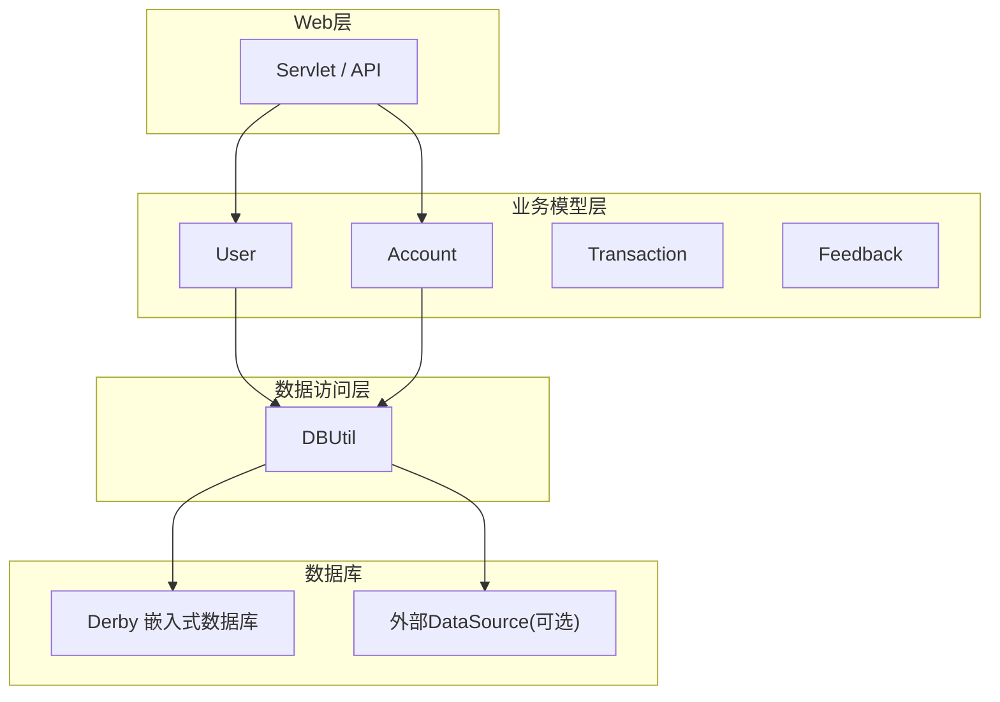
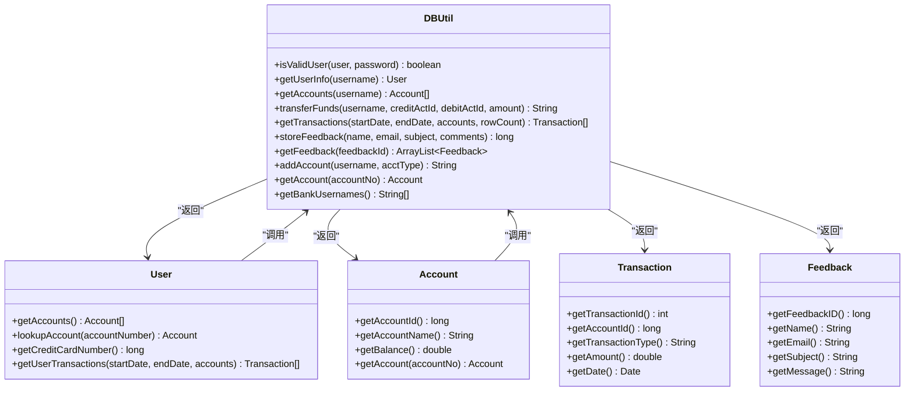
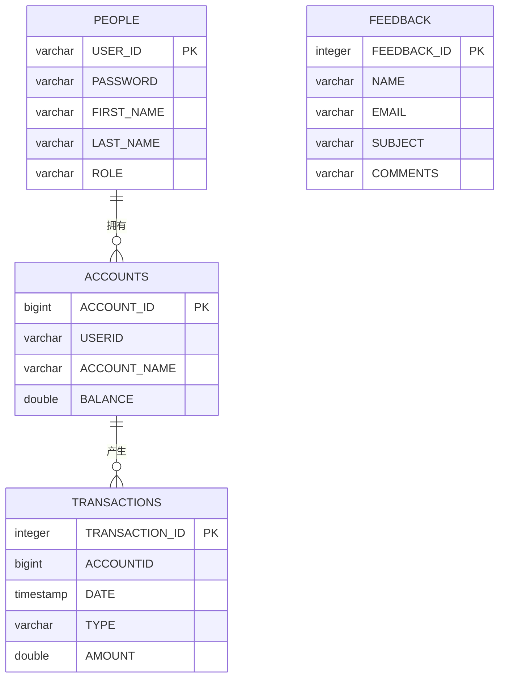
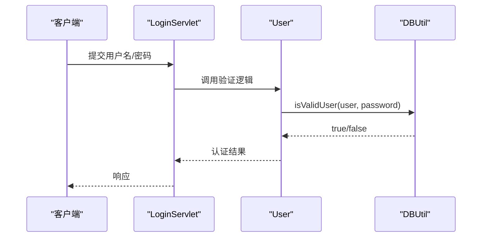
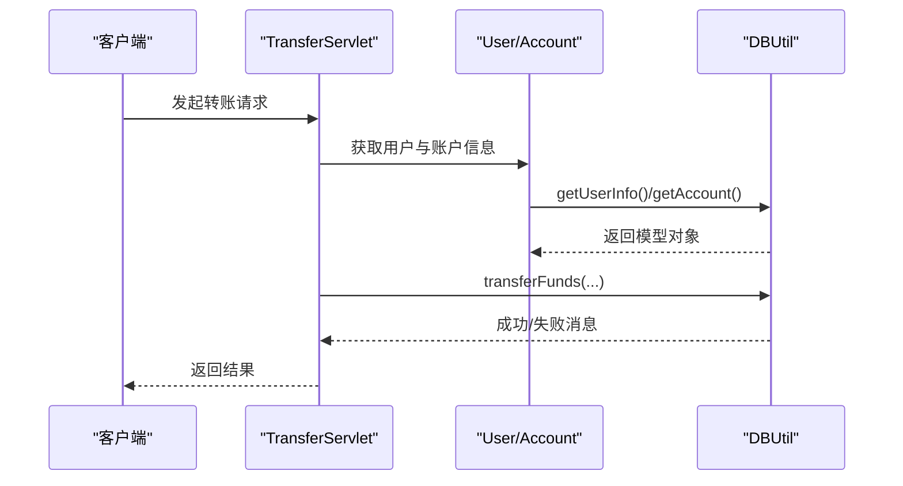

# 数据库工具类(DBUtil)

<cite>
**本文引用的文件**   
- [DBUtil.java](file://src/com/ibm/security/appscan/altoromutual/util/DBUtil.java)
- [User.java](file://src/com/ibm/security/appscan/altoromutual/model/User.java)
- [Account.java](file://src/com/ibm/security/appscan/altoromutual/model/Account.java)
- [Transaction.java](file://src/com/ibm/security/appscan/altoromutual/model/Transaction.java)
- [Feedback.java](file://src/com/ibm/security/appscan/altoromutual/model/Feedback.java)
</cite>

## 目录
1. [简介](#简介)
2. [项目结构](#项目结构)
3. [核心组件](#核心组件)
4. [架构总览](#架构总览)
5. [详细组件分析](#详细组件分析)
6. [依赖关系分析](#依赖关系分析)
7. [性能考虑](#性能考虑)
8. [故障排查指南](#故障排查指南)
9. [结论](#结论)
10. [附录](#附录)

## 简介
本文件为 AltoroJ 项目的数据库工具类 DBUtil 的详细技术文档。内容涵盖：
- 数据库连接管理（Derby 嵌入式与外部 DataSource）
- 单例模式实现
- Derby 嵌入式数据库初始化与表结构
- 所有数据库操作方法（用户认证、用户信息查询、账户管理、资金转账、交易查询、反馈管理等）
- SQL 注入安全漏洞分析与修复建议
- 与其他组件的集成关系
- 常见问题处理与性能优化建议

## 项目结构
DBUtil 位于 util 包，作为数据访问层的核心工具类，被 model 层的 User、Account 等实体类以及上层 Servlet/API 调用。其职责包括：
- 提供统一的数据库连接获取逻辑
- 封装常用 SQL 操作
- 在需要时初始化内置 Derby 数据库及初始数据



图表来源
- [DBUtil.java:45-138](file://src/com/ibm/security/appscan/altoromutual/util/DBUtil.java#L45-L138)
- [User.java:76-106](file://src/com/ibm/security/appscan/altoromutual/model/User.java#L76-L106)
- [Account.java:37-48](file://src/com/ibm/security/appscan/altoromutual/model/Account.java#L37-L48)

章节来源
- [DBUtil.java:45-138](file://src/com/ibm/security/appscan/altoromutual/util/DBUtil.java#L45-L138)

## 核心组件
- DBUtil：数据库连接与操作工具类，包含连接管理、初始化、CRUD 方法
- User/Account/Transaction/Feedback：领域模型对象，封装数据字段并提供简单行为
- ServletUtil（外部依赖）：读取应用属性，控制是否重新初始化数据库

关键特性
- 单例模式：通过私有构造器与静态 getInstance/getConnection 保证唯一实例
- 双路径连接：优先使用外部 DataSource；否则回退到嵌入式 Derby
- 自动建库：当 Derby 不存在时自动创建并初始化表结构与基础数据
- 配置开关：支持通过 application.properties 控制是否启动时重建数据库

章节来源
- [DBUtil.java:45-138](file://src/com/ibm/security/appscan/altoromutual/util/DBUtil.java#L45-L138)

## 架构总览
DBUtil 的连接生命周期如下：
- 首次调用 getConnection() 时创建单例实例
- 若配置了 external DataSource，则从 JNDI 获取连接
- 否则加载 Derby 驱动并连接至嵌入式数据库
- 根据配置决定是否执行 initDB() 进行表结构重建与数据填充

```mermaid
sequenceDiagram
participant Caller as "调用方"
participant DBU as "DBUtil.getConnection()"
participant DS as "DataSource(可选)"
participant Derby as "Derby 嵌入式"
participant Init as "initDB()"
Caller->>DBU : getConnection()
alt 已配置外部DataSource
DBU->>DS : getConnection()
DS-->>DBU : Connection
DBU->>DBU : 检查 reinitializeOnStart
DBU->>Init : 条件执行
Init-->>DBU : 完成
DBU-->>Caller : Connection
else 使用嵌入式Derby
DBU->>Derby : DriverManager.getConnection("jdbc : derby : altoro")
alt 数据库不存在
DBU->>Derby : DriverManager.getConnection("...;create=true")
DBU->>Init : 初始化表与数据
Init-->>DBU : 完成
end
DBU-->>Caller : Connection
end
```

图表来源
- [DBUtil.java:99-138](file://src/com/ibm/security/appscan/altoromutual/util/DBUtil.java#L99-L138)
- [DBUtil.java:143-167](file://src/com/ibm/security/appscan/altoromutual/util/DBUtil.java#L143-L167)

## 详细组件分析

### 连接管理与单例模式
- 单例实现：私有构造器 + 静态 instance 字段 + getConnection() 中惰性初始化
- 连接复用：缓存 connection 并在关闭后重建
- 外部 DataSource：通过 JNDI 查找 java:comp/env 下的数据源名称
- Derby 嵌入式：设置 derby.system.home，加载 org.apache.derby.jdbc.EmbeddedDriver，连接 jdbc:derby:altoro
- 自动建库：捕获错误码 40000 表示数据库不存在，以 create=true 方式创建并初始化

章节来源
- [DBUtil.java:56-97](file://src/com/ibm/security/appscan/altoromutual/util/DBUtil.java#L56-L97)
- [DBUtil.java:99-138](file://src/com/ibm/security/appscan/altoromutual/util/DBUtil.java#L99-L138)

### Derby 嵌入式数据库初始化(initDB)
- 删除旧表：PEOPLE、ACCOUNTS、TRANSACTIONS、FEEDBACK
- 创建表结构：
  - PEOPLE：用户信息（USER_ID, PASSWORD, FIRST_NAME, LAST_NAME, ROLE）
  - FEEDBACK：反馈（FEEDBACK_ID, NAME, EMAIL, SUBJECT, COMMENTS）
  - ACCOUNTS：账户（ACCOUNT_ID, USERID, ACCOUNT_NAME, BALANCE）
  - TRANSACTIONS：交易（TRANSACTION_ID, ACCOUNTID, DATE, TYPE, AMOUNT）
- 插入初始数据：默认管理员与普通用户、若干账户与交易记录

章节来源
- [DBUtil.java:143-167](file://src/com/ibm/security/appscan/altoromutual/util/DBUtil.java#L143-L167)

### 用户认证(isValidUser)
- 功能：校验用户名与密码是否匹配
- 特殊逻辑：对 jsmith 用户硬编码密码 demo1234，确保演示可用
- 风险：直接拼接用户输入到 SQL，存在 SQL 注入漏洞
- 返回值：true/false

章节来源
- [DBUtil.java:212-232](file://src/com/ibm/security/appscan/altoromutual/util/DBUtil.java#L212-L232)

### 用户信息查询(getUserInfo)
- 功能：根据用户名查询用户基本信息（姓名、角色）
- 风险：SQL 拼接，存在 SQL 注入漏洞
- 返回值：User 对象或 null

章节来源
- [DBUtil.java:241-267](file://src/com/ibm/security/appscan/altoromutual/util/DBUtil.java#L241-L267)

### 账户管理(getAccounts, addAccount)
- getAccounts(username)：查询指定用户的所有账户
  - 风险：SQL 拼接，存在 SQL 注入漏洞
  - 返回值：Account[]
- addAccount(username, acctType)：为用户新增账户
  - 风险：SQL 拼接，存在 SQL 注入漏洞
  - 返回值：null 或错误字符串

章节来源
- [DBUtil.java:275-293](file://src/com/ibm/security/appscan/altoromutual/util/DBUtil.java#L275-L293)
- [DBUtil.java:472-481](file://src/com/ibm/security/appscan/altoromutual/util/DBUtil.java#L472-L481)

### 资金转账(transferFunds)
- 功能：在两个账户之间转账，记录交易流水，必要时收取取现手续费
- 流程要点：
  - 校验来源与目标账户有效性
  - 计算借方/贷方金额，信用卡账户余额方向相反
  - 插入两条交易记录（借方与贷方），如从信用卡转出则追加“取现手续费”
  - 更新两账户余额
- 风险：多处 SQL 拼接，存在 SQL 注入漏洞；事务未原子化，并发下可能不一致
- 返回值：null 表示成功，否则返回错误消息

章节来源
- [DBUtil.java:303-364](file://src/com/ibm/security/appscan/altoromutual/util/DBUtil.java#L303-L364)

### 交易查询(getTransactions)
- 功能：按账户列表与日期范围查询交易记录
- 参数：startDate、endDate、accounts、rowCount
- 行为：
  - 构建账户 ID 的 OR 条件
  - 可选日期过滤（BETWEEN 或 > / <）
  - 限制返回行数
- 风险：SQL 拼接，存在 SQL 注入漏洞
- 返回值：Transaction[]

章节来源
- [DBUtil.java:375-427](file://src/com/ibm/security/appscan/altoromutual/util/DBUtil.java#L375-L427)

### 反馈管理(storeFeedback, getFeedback)
- storeFeedback(name, email, subject, comments)：插入反馈并返回自增 ID
  - 风险：SQL 拼接，存在 SQL 注入漏洞
  - 返回值：反馈 ID 或 -1（失败）
- getFeedback(feedbackId)：按 ID 或常量 FEEDBACK_ALL 查询反馈列表
  - 风险：当 feedbackId != FEEDBACK_ALL 时拼接 SQL，存在 SQL 注入漏洞
  - 返回值：ArrayList<Feedback>

章节来源
- [DBUtil.java:520-535](file://src/com/ibm/security/appscan/altoromutual/util/DBUtil.java#L520-L535)
- [DBUtil.java:173-202](file://src/com/ibm/security/appscan/altoromutual/util/DBUtil.java#L173-L202)

### 其他辅助方法
- getBankUsernames()：获取所有银行用户名列表
- getAccount(accountNo)：根据账号查询账户信息
- addUser/addSpecialUser/changePassword：用户相关写入操作（均存在 SQL 注入风险）

章节来源
- [DBUtil.java:429-450](file://src/com/ibm/security/appscan/altoromutual/util/DBUtil.java#L429-L450)
- [DBUtil.java:452-470](file://src/com/ibm/security/appscan/altoromutual/util/DBUtil.java#L452-L470)
- [DBUtil.java:483-517](file://src/com/ibm/security/appscan/altoromutual/util/DBUtil.java#L483-L517)

## 依赖关系分析
DBUtil 与模型类的协作关系如下：



图表来源
- [DBUtil.java:45-536](file://src/com/ibm/security/appscan/altoromutual/util/DBUtil.java#L45-L536)
- [User.java:30-108](file://src/com/ibm/security/appscan/altoromutual/model/User.java#L30-L108)
- [Account.java:32-122](file://src/com/ibm/security/appscan/altoromutual/model/Account.java#L32-L122)
- [Transaction.java:28-64](file://src/com/ibm/security/appscan/altoromutual/model/Transaction.java#L28-L64)
- [Feedback.java:6-48](file://src/com/ibm/security/appscan/altoromutual/model/Feedback.java#L6-L48)

章节来源
- [DBUtil.java:45-536](file://src/com/ibm/security/appscan/altoromutual/util/DBUtil.java#L45-L536)
- [User.java:30-108](file://src/com/ibm/security/appscan/altoromutual/model/User.java#L30-L108)
- [Account.java:32-122](file://src/com/ibm/security/appscan/altoromutual/model/Account.java#L32-L122)
- [Transaction.java:28-64](file://src/com/ibm/security/appscan/altoromutual/model/Transaction.java#L28-L64)
- [Feedback.java:6-48](file://src/com/ibm/security/appscan/altoromutual/model/Feedback.java#L6-L48)

## 性能考虑
- 连接复用：DBUtil 内部缓存 Connection，避免频繁创建连接
- 外部 DataSource：在生产环境建议使用容器提供的连接池（如 Tomcat JDBC Pool、HikariCP），减少连接开销
- 语句复用：当前大量使用 Statement，建议迁移到 PreparedStatement 以提升解析效率与安全性
- 结果集限制：getTransactions 支持 maxRows，合理设置可避免大结果集
- 索引优化：建议在 ACCOUNTID、DATE、USERID 等高频查询列建立索引
- 事务边界：transferFunds 应使用显式事务确保原子性，避免部分更新导致的数据不一致

[本节为通用指导，不直接分析具体文件]

## 故障排查指南
- 无法连接 Derby
  - 检查 derby.system.home 是否正确设置
  - 确认数据库是否存在，若不存在将自动创建
- 外部 DataSource 不可用
  - 检查 JNDI 名称与 web.xml/context.xml 配置是否一致
  - 查看日志中的异常堆栈定位 NamingException
- SQL 语法错误
  - 检查日期格式是否符合 yyyy-mm-dd HH:mm:ss
  - 注意 getTransactions 的错误码 30000 提示
- 权限与表结构
  - 确认 initDB 是否成功执行，表是否存在
  - 检查初始数据是否插入成功

章节来源
- [DBUtil.java:117-133](file://src/com/ibm/security/appscan/altoromutual/util/DBUtil.java#L117-L133)
- [DBUtil.java:407-415](file://src/com/ibm/security/appscan/altoromutual/util/DBUtil.java#L407-L415)
- [DBUtil.java:143-167](file://src/com/ibm/security/appscan/altoromutual/util/DBUtil.java#L143-L167)

## 结论
DBUtil 提供了 AltoroJ 的数据库访问能力，具备连接管理、嵌入式数据库初始化与常用 CRUD 操作。然而，当前实现存在严重的 SQL 注入风险与事务一致性隐患。建议：
- 全面替换为 PreparedStatement 与参数绑定
- 引入连接池与外部 DataSource
- 对关键写操作使用显式事务
- 完善错误处理与日志记录
- 增加单元测试与回归测试覆盖

[本节为总结性内容，不直接分析具体文件]

## 附录

### 数据库表结构


图表来源
- [DBUtil.java:156-164](file://src/com/ibm/security/appscan/altoromutual/util/DBUtil.java#L156-L164)

### SQL 注入安全漏洞分析
- 受影响方法：isValidUser、getUserInfo、getAccounts、transferFunds、getTransactions、storeFeedback、getFeedback、addAccount、getAccount、addUser、changePassword 等
- 风险点：直接使用字符串拼接用户输入到 SQL 语句
- 影响：攻击者可绕过认证、读取/修改任意数据、执行任意 SQL
- 修复建议：
  - 全部改用 PreparedStatement 与参数占位符
  - 对输入进行白名单校验与长度限制
  - 最小权限原则运行数据库账户
  - 审计与监控敏感操作

章节来源
- [DBUtil.java:212-232](file://src/com/ibm/security/appscan/altoromutual/util/DBUtil.java#L212-L232)
- [DBUtil.java:241-267](file://src/com/ibm/security/appscan/altoromutual/util/DBUtil.java#L241-L267)
- [DBUtil.java:275-293](file://src/com/ibm/security/appscan/altoromutual/util/DBUtil.java#L275-L293)
- [DBUtil.java:303-364](file://src/com/ibm/security/appscan/altoromutual/util/DBUtil.java#L303-L364)
- [DBUtil.java:375-427](file://src/com/ibm/security/appscan/altoromutual/util/DBUtil.java#L375-L427)
- [DBUtil.java:472-481](file://src/com/ibm/security/appscan/altoromutual/util/DBUtil.java#L472-L481)
- [DBUtil.java:452-470](file://src/com/ibm/security/appscan/altoromutual/util/DBUtil.java#L452-L470)
- [DBUtil.java:483-517](file://src/com/ibm/security/appscan/altoromutual/util/DBUtil.java#L483-L517)
- [DBUtil.java:520-535](file://src/com/ibm/security/appscan/altoromutual/util/DBUtil.java#L520-L535)
- [DBUtil.java:173-202](file://src/com/ibm/security/appscan/altoromutual/util/DBUtil.java#L173-L202)

### 使用示例与调用模式
- 用户登录流程（概念示意）


- 转账流程（概念示意）


[以上序列图为概念流程，不对应具体源码行号]