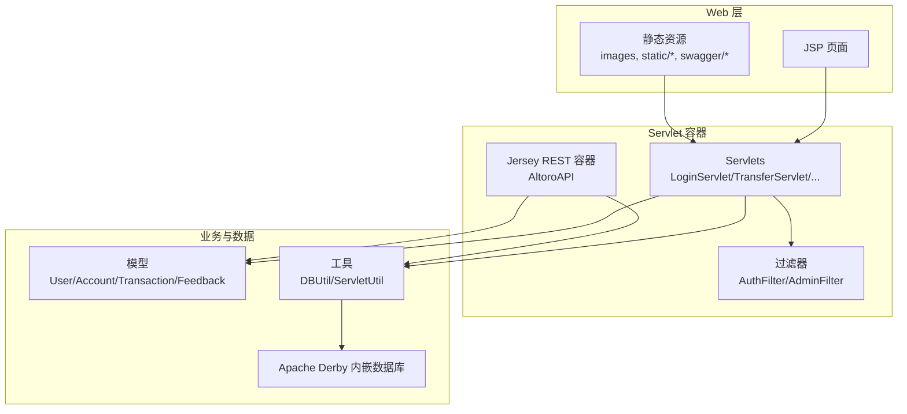
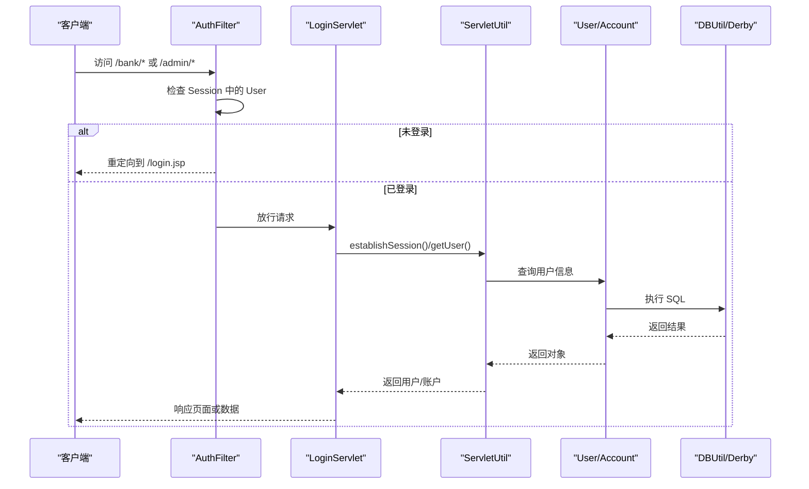
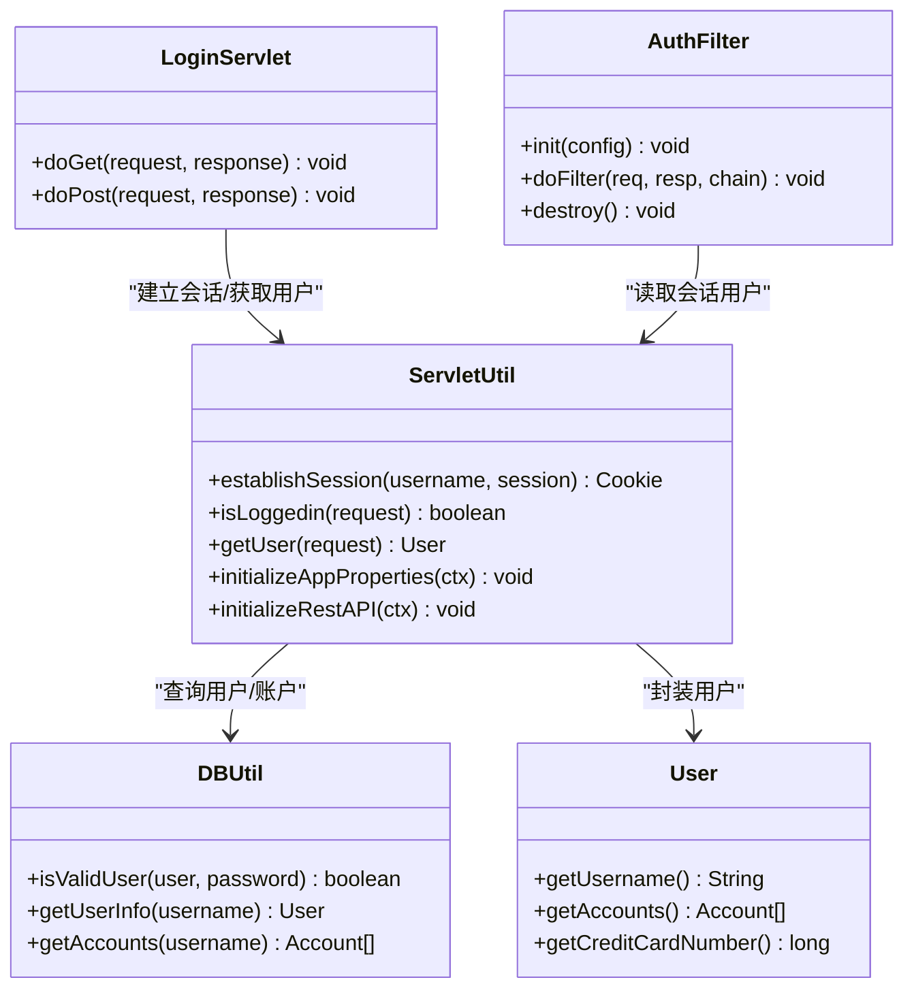
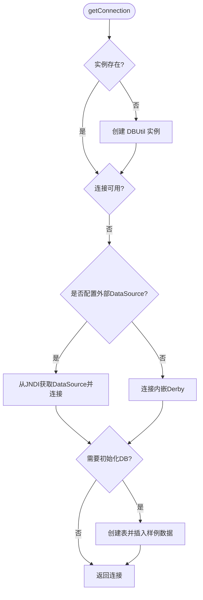
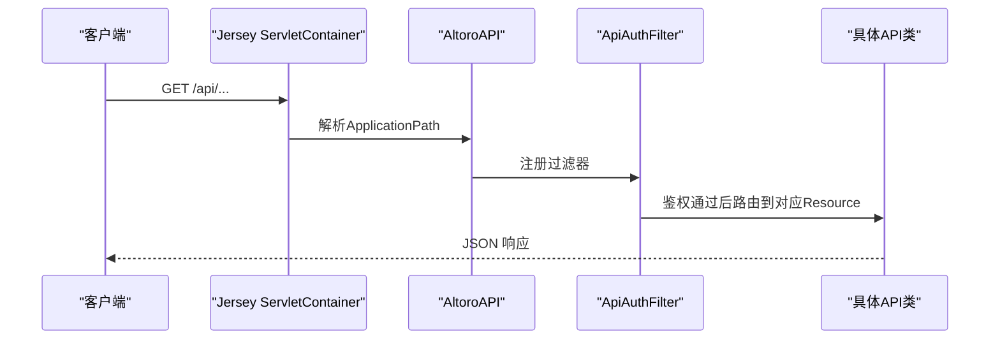
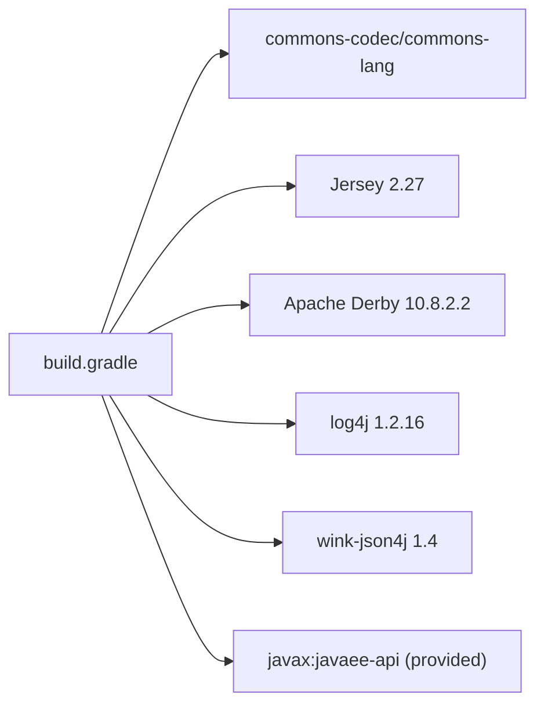

# 开发者指南

<cite>
**本文引用的文件**   
- [README.md](file://README.md)
- [build.gradle](file://build.gradle)
- [web.xml](file://WebContent/WEB-INF/web.xml)
- [app.properties](file://WebContent/WEB-INF/app.properties)
- [LoginServlet.java](file://src/com/ibm/security/appscan/altoromutual/servlet/LoginServlet.java)
- [AuthFilter.java](file://src/com/ibm/security/appscan/altoromutual/filter/AuthFilter.java)
- [AltoroAPI.java](file://src/com/ibm/security/appscan/altoromutual/api/AltoroAPI.java)
- [DBUtil.java](file://src/com/ibm/security/appscan/altoromutual/util/DBUtil.java)
- [User.java](file://src/com/ibm/security/appscan/altoromutual/model/User.java)
- [ServletUtil.java](file://src/com/ibm/security/appscan/altoromutual/util/ServletUtil.java)
</cite>

## 目录
1. [简介](#简介)
2. [项目结构](#项目结构)
3. [核心组件](#核心组件)
4. [架构总览](#架构总览)
5. [详细组件分析](#详细组件分析)
6. [依赖分析](#依赖分析)
7. [性能与可扩展性](#性能与可扩展性)
8. [开发环境与构建](#开发环境与构建)
9. [代码规范与安全基线](#代码规范与安全基线)
10. [调试技巧与常见问题](#调试技巧与常见问题)
11. [测试策略与持续集成](#测试策略与持续集成)
12. [Git 工作流、分支与发布流程](#git-工作流分支与发布流程)
13. [贡献指南与代码审查标准](#贡献指南与代码审查标准)
14. [结论](#结论)

## 简介
本指南面向 AltoroJ 的开发者与维护者，涵盖代码规范、开发环境搭建、调试技巧、扩展新功能的步骤、第三方库集成、代码审查标准、测试策略与持续集成流程，以及 Git 工作流、分支策略和发布流程。AltoroJ 是一个用于演示 Web 应用安全漏洞的示例银行 J2EE 应用，使用标准 Java/JSP 技术栈，内置 Apache Derby 数据库，并提供基于 Jersey 的 REST API（Swagger 文档）。

## 项目结构
- Web 资源位于 WebContent，包含 JSP、静态页面、Swagger UI 等。
- 后端 Java 源码位于 src，按功能分层：api（REST）、filter（过滤器）、listener（启动监听）、model（领域模型）、servlet（传统 MVC 控制器）、util（工具类）。
- 构建脚本为 Gradle，打包为 WAR。
- 运行时配置集中在 WEB-INF/web.xml 与 app.properties。

**图表来源**
- [web.xml:1-227](file://WebContent/WEB-INF/web.xml#L1-L227)
- [build.gradle:1-43](file://build.gradle#L1-L43)

**章节来源**
- [README.md:1-63](file://README.md#L1-L63)
- [web.xml:1-227](file://WebContent/WEB-INF/web.xml#L1-L227)
- [build.gradle:1-43](file://build.gradle#L1-L43)

## 核心组件
- 认证与会话：LoginServlet 负责登录/登出；AuthFilter 对受保护路径进行鉴权；ServletUtil 提供会话建立与用户获取等通用方法。
- 数据访问：DBUtil 封装 JDBC 操作，支持内嵌 Derby 或外部 DataSource，并提供账户、交易、反馈等数据操作。
- REST API：通过 Jersey 暴露 REST 接口，AltoroAPI 注册包扫描与 ApiAuthFilter。
- 配置：web.xml 定义 Servlet、Filter、Listener 及映射；app.properties 提供行为开关与数据库配置。

**章节来源**
- [LoginServlet.java:1-108](file://src/com/ibm/security/appscan/altoromutual/servlet/LoginServlet.java#L1-L108)
- [AuthFilter.java:1-79](file://src/com/ibm/security/appscan/altoromutual/filter/AuthFilter.java#L1-L79)
- [ServletUtil.java:1-412](file://src/com/ibm/security/appscan/altoromutual/util/ServletUtil.java#L1-L412)
- [DBUtil.java:1-536](file://src/com/ibm/security/appscan/altoromutual/util/DBUtil.java#L1-L536)
- [AltoroAPI.java:1-16](file://src/com/ibm/security/appscan/altoromutual/api/AltoroAPI.java#L1-L16)
- [web.xml:1-227](file://WebContent/WEB-INF/web.xml#L1-L227)
- [app.properties:1-74](file://WebContent/WEB-INF/app.properties#L1-L74)

## 架构总览
下图展示请求从浏览器到 Servlet/Filter、再到模型与数据库的典型调用链，以及 REST API 的入口。

**图表来源**
- [AuthFilter.java:58-70](file://src/com/ibm/security/appscan/altoromutual/filter/AuthFilter.java#L58-L70)
- [LoginServlet.java:67-104](file://src/com/ibm/security/appscan/altoromutual/servlet/LoginServlet.java#L67-L104)
- [ServletUtil.java:340-353](file://src/com/ibm/security/appscan/altoromutual/util/ServletUtil.java#L340-L353)
- [DBUtil.java:212-232](file://src/com/ibm/security/appscan/altoromutual/util/DBUtil.java#L212-L232)

## 详细组件分析

### 认证与会话（LoginServlet + AuthFilter + ServletUtil）
- LoginServlet 处理 GET（登出）与 POST（登录），校验用户名密码后建立会话并设置 Cookie。
- AuthFilter 拦截 /bank/* 与 /admin/* 等路径，若 Session 中无有效 User，则重定向至登录页。
- ServletUtil 提供会话建立、用户读取、属性加载、日志初始化、Swagger 基础路径更新等能力。

**图表来源**
- [LoginServlet.java:38-107](file://src/com/ibm/security/appscan/altoromutual/servlet/LoginServlet.java#L38-L107)
- [AuthFilter.java:40-79](file://src/com/ibm/security/appscan/altoromutual/filter/AuthFilter.java#L40-L79)
- [ServletUtil.java:340-373](file://src/com/ibm/security/appscan/altoromutual/util/ServletUtil.java#L340-L373)
- [DBUtil.java:212-267](file://src/com/ibm/security/appscan/altoromutual/util/DBUtil.java#L212-L267)
- [User.java:30-107](file://src/com/ibm/security/appscan/altoromutual/model/User.java#L30-L107)

**章节来源**
- [LoginServlet.java:1-108](file://src/com/ibm/security/appscan/altoromutual/servlet/LoginServlet.java#L1-L108)
- [AuthFilter.java:1-79](file://src/com/ibm/security/appscan/altoromutual/filter/AuthFilter.java#L1-L79)
- [ServletUtil.java:1-412](file://src/com/ibm/security/appscan/altoromutual/util/ServletUtil.java#L1-L412)
- [User.java:1-108](file://src/com/ibm/security/appscan/altoromutual/model/User.java#L1-L108)

### 数据访问层（DBUtil）
- 支持两种数据源：内嵌 Derby 或通过 JNDI 的外部 DataSource。
- 首次连接时根据配置决定是否初始化数据库表结构与样例数据。
- 提供用户认证、账户查询、转账、交易记录、反馈存储等常用方法。

**图表来源**
- [DBUtil.java:99-138](file://src/com/ibm/security/appscan/altoromutual/util/DBUtil.java#L99-L138)
- [DBUtil.java:143-167](file://src/com/ibm/security/appscan/altoromutual/util/DBUtil.java#L143-L167)

**章节来源**
- [DBUtil.java:1-536](file://src/com/ibm/security/appscan/altoromutual/util/DBUtil.java#L1-L536)

### REST API（Jersey + Swagger）
- AltoroAPI 作为 ResourceConfig，启用包扫描 com.ibm.security.appscan.altoromutual.api，并注册 ApiAuthFilter。
- web.xml 将 org.glassfish.jersey.servlet.ServletContainer 映射到 /api，并通过 init-param 指定 Application 类。
- ServletUtil.initializeRestAPI 在启动时自动更新 Swagger 的 basePath 以匹配当前上下文路径。

**图表来源**
- [web.xml:60-68](file://WebContent/WEB-INF/web.xml#L60-L68)
- [AltoroAPI.java:9-15](file://src/com/ibm/security/appscan/altoromutual/api/AltoroAPI.java#L9-L15)
- [ServletUtil.java:375-409](file://src/com/ibm/security/appscan/altoromutual/util/ServletUtil.java#L375-L409)

**章节来源**
- [AltoroAPI.java:1-16](file://src/com/ibm/security/appscan/altoromutual/api/AltoroAPI.java#L1-L16)
- [web.xml:60-68](file://WebContent/WEB-INF/web.xml#L60-L68)
- [ServletUtil.java:375-409](file://src/com/ibm/security/appscan/altoromutual/util/ServletUtil.java#L375-L409)

## 依赖分析
- 构建与运行依赖：
  - 编译目标 Java 1.7（Gradle 配置），但 README 推荐 Eclipse 4.6+ 与 Java 8。
  - 依赖包括 commons-codec、commons-lang、Jersey 2.27、Derby、Log4j、Wink JSON。
  - 提供 javax:javaee-api 作为 providedCompile。
- 运行时依赖：
  - Tomcat 7.x（Servlet 2.5 规范）。
  - Derby 内嵌数据库或外部 DataSource（通过 JNDI）。

**图表来源**
- [build.gradle:23-37](file://build.gradle#L23-L37)

**章节来源**
- [build.gradle:1-43](file://build.gradle#L1-L43)
- [README.md:16-25](file://README.md#L16-L25)

## 性能与可扩展性
- 连接管理：DBUtil 单例持有 Connection，避免频繁创建连接；对外部 DataSource 的支持便于引入连接池。
- 初始化控制：通过 app.properties 的 database.reinitializeOnStart 控制是否每次启动重建数据库，适合开发与演示场景。
- 可扩展点：
  - 新增 Servlet：在 web.xml 中声明并映射 URL。
  - 新增 Filter：在 web.xml 中声明并映射 URL 模式。
  - 新增 REST API：在 api 包下添加 Resource，并在 AltoroAPI 中注册过滤器或扩展包扫描。
  - 数据源切换：通过 database.alternateDataSource 指向 Tomcat JNDI 数据源。

[本节为通用指导，不直接分析具体文件]

## 开发环境与构建
- 环境要求：
  - IDE：Eclipse 4.6+（推荐），Java 8。
  - 服务器：Tomcat 7.x。
  - 构建：Gradle 3.0+，Buildship 插件。
- 导入与构建：
  - 使用 Gradle 下载依赖并构建 WAR。
  - 在 Eclipse 中通过 Buildship 自动管理依赖与运行。
- 运行：
  - 部署到 Tomcat，首次登录会初始化 Derby 数据库。
  - 可通过 app.properties 开启高级选项（如管理员功能、反馈持久化等）。

**章节来源**
- [README.md:16-25](file://README.md#L16-L25)
- [README.md:44-57](file://README.md#L44-L57)
- [build.gradle:1-43](file://build.gradle#L1-L43)

## 代码规范与安全基线
- 输入验证与输出编码：
  - 对用户输入进行必要校验（如邮箱正则）。
  - 输出到 HTML 时使用 sanitizeWeb 等方法进行转义。
- SQL 注入防护：
  - 避免字符串拼接 SQL，优先使用 PreparedStatement 与参数绑定。
- 会话与权限：
  - 统一通过 AuthFilter 进行鉴权，敏感操作需二次校验。
- 日志与审计：
  - 关键操作记录日志，注意脱敏敏感信息。
- 配置管理：
  - 所有可配置项集中到 app.properties，避免硬编码。

**章节来源**
- [ServletUtil.java:244-254](file://src/com/ibm/security/appscan/altoromutual/util/ServletUtil.java#L244-L254)
- [DBUtil.java:212-232](file://src/com/ibm/security/appscan/altoromutual/util/DBUtil.java#L212-L232)
- [app.properties:25-74](file://WebContent/WEB-INF/app.properties#L25-L74)

## 调试技巧与常见问题
- 数据库无法创建：
  - 检查 user.home 目录权限，确保 Tomcat 进程有写权限。
  - 可在 Tomcat 启动参数中添加 -Duser.home 指向可写目录。
- 编译错误：
  - 先运行 Gradle 构建以拉取依赖并编译。
- 日志位置：
  - 查看 Tomcat 日志（如 catalina.out）或应用自定义日志文件。
- 常见错误码：
  - Derby 错误码 40000 表示数据库不存在，会自动创建。
  - 日期时间格式错误会抛出特定异常提示。

**章节来源**
- [README.md:44-57](file://README.md#L44-L57)
- [DBUtil.java:124-133](file://src/com/ibm/security/appscan/altoromutual/util/DBUtil.java#L124-L133)
- [DBUtil.java:407-415](file://src/com/ibm/security/appscan/altoromutual/util/DBUtil.java#L407-L415)

## 测试策略与持续集成
- 单元测试：
  - 针对 DBUtil 的数据访问方法编写隔离测试，使用内存 Derby 或 H2 替代真实数据库。
  - 针对 Servlet 与 Filter 使用 Mockito 模拟 Request/Response，验证鉴权逻辑与重定向行为。
- 集成测试：
  - 使用嵌入式 Tomcat 或 Testcontainers 启动应用，端到端验证登录、转账、REST API。
- 持续集成：
  - 在 CI 中执行 Gradle 构建与测试，生成覆盖率报告。
  - 对安全相关代码进行静态扫描（如 SonarQube、OWASP Dependency-Check）。

[本节为通用指导，不直接分析具体文件]

## Git 工作流、分支与发布流程
- 分支策略：
  - main：稳定版本。
  - develop：集成开发分支。
  - feature/*：新功能分支。
  - hotfix/*：紧急修复分支。
- 提交规范：
  - 使用语义化提交信息（feat/fix/docs/style/refactor/test/chore）。
- 发布流程：
  - 合并 develop 到 main，打标签（vX.Y.Z）。
  - 构建 WAR 并部署到预生产环境进行验收。
  - 回滚策略：保留上一个稳定标签对应的构建产物。

[本节为通用指导，不直接分析具体文件]

## 贡献指南与代码审查标准
- 提交流程：
  - Fork 仓库，创建 feature 分支，提交变更并推送。
  - 发起 Pull Request，描述变更动机与影响范围。
- 代码审查要点：
  - 安全性：输入校验、SQL 注入、XSS、CSRF、权限控制。
  - 可维护性：命名清晰、职责单一、注释充分。
  - 性能：避免 N+1 查询、合理使用缓存。
  - 测试：覆盖关键路径与边界条件。
- 自动化检查：
  - 在 PR 中触发 CI 流水线，确保构建与测试通过。

[本节为通用指导，不直接分析具体文件]

## 结论
AltoroJ 提供了一个贴近现实的 J2EE 应用骨架，便于学习与应用安全实践。通过遵循本指南的代码规范、安全基线与工作流程，开发者可以高效地扩展功能、集成第三方库，并确保代码质量与安全性。建议在开发过程中始终关注输入验证、SQL 注入防护与权限控制，利用 Gradle 与 CI 提升交付效率与稳定性。