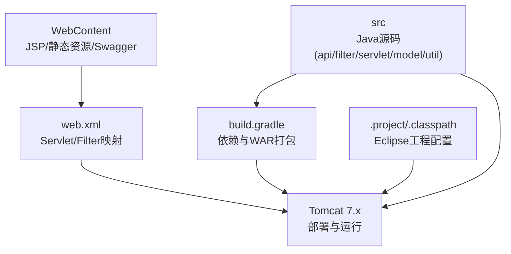
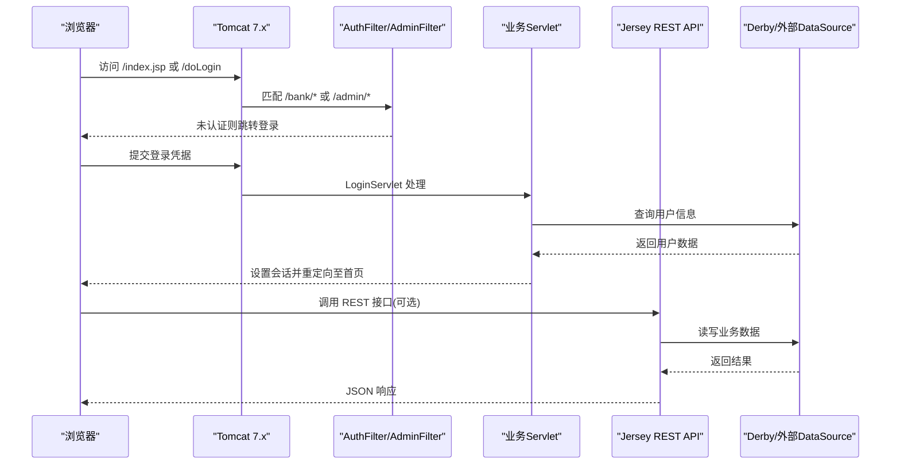
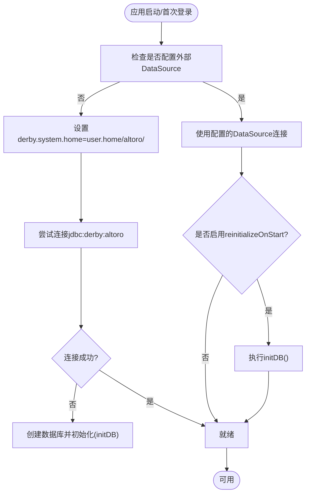
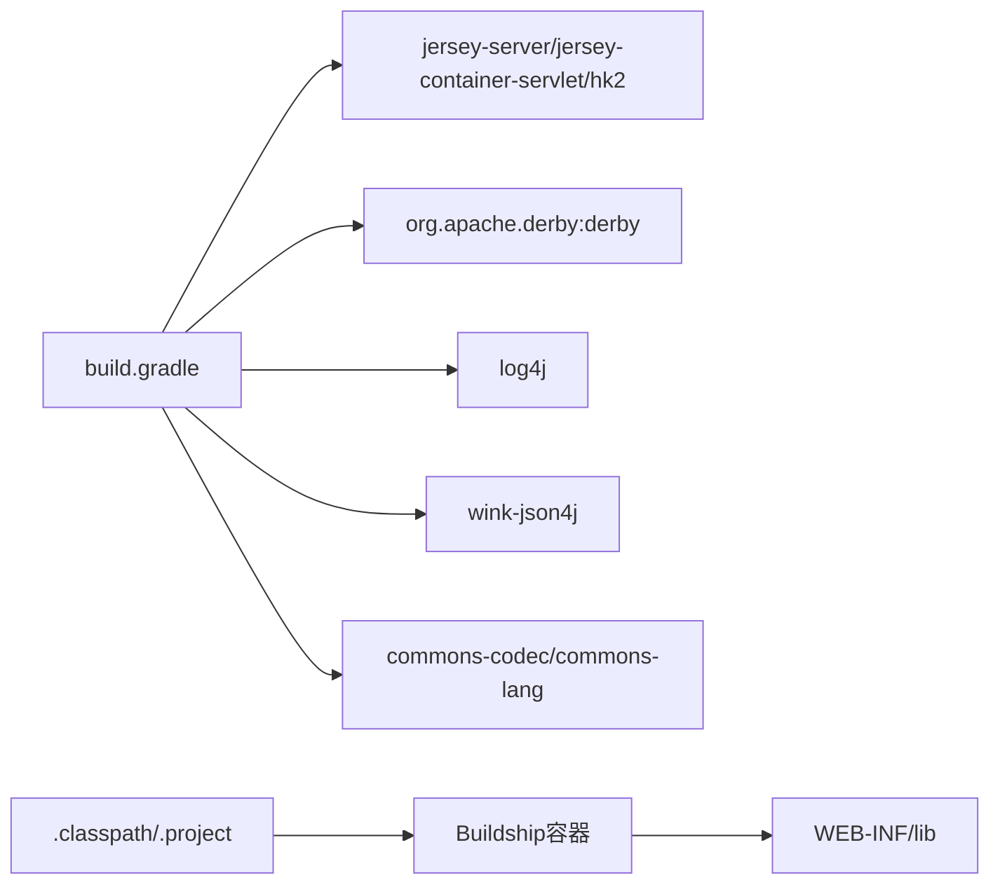

# 快速开始

<cite>
**本文引用的文件**   
- [README.md](file://README.md)
- [Importing AltoroJ into Eclipse from GitHub.md](file://Importing AltoroJ into Eclipse from GitHub.md)
- [build.gradle](file://build.gradle)
- [.classpath](file://.classpath)
- [.project](file://.project)
- [WebContent/WEB-INF/web.xml](file://WebContent/WEB-INF/web.xml)
- [WebContent/WEB-INF/app.properties](file://WebContent/WEB-INF/app.properties)
- [src/com/ibm/security/appscan/altoromutual/util/DBUtil.java](file://src/com/ibm/security/appscan/altoromutual/util/DBUtil.java)
</cite>

## 目录
1. [简介](#简介)
2. [项目结构](#项目结构)
3. [核心组件](#核心组件)
4. [架构总览](#架构总览)
5. [详细组件分析](#详细组件分析)
6. [依赖关系分析](#依赖关系分析)
7. [性能考虑](#性能考虑)
8. [故障排除指南](#故障排除指南)
9. [结论](#结论)
10. [附录](#附录)

## 简介
AltoroJ 是一个用于演示 Web 应用安全漏洞的示例银行 J2EE Web 应用。它使用标准 Java/JSP，不依赖额外框架，便于学习真实场景中的安全问题。内置 Apache Derby 数据库会在首次通过 Web 界面登录时自动初始化；所有交易与操作将保存在该数据库中，直到删除用户主目录下的 altoro 仓库或启用“每次启动重新初始化”的高级选项。

重要安全提示：本应用包含已知安全漏洞，仅应在受保护环境（如带快照的虚拟机、主机专用网络）中运行，并自行承担风险。

**章节来源**
- [README.md:1-10](file://README.md#L1-L10)

## 项目结构
- Web 内容位于 WebContent，包含 JSP、静态资源、Swagger UI 等。
- Java 源码位于 src，按功能模块组织（api、filter、listener、model、servlet、util）。
- 构建配置由 Gradle 管理，输出 WAR 包名为 altoromutual.war。
- Eclipse 工程元数据包含 .project 与 .classpath，支持 Buildship 集成。

**图表来源**
- [WebContent/WEB-INF/web.xml:1-227](file://WebContent/WEB-INF/web.xml#L1-L227)
- [build.gradle:1-43](file://build.gradle#L1-L43)
- [.project:1-42](file://.project#L1-L42)
- [.classpath:1-17](file://.classpath#L1-L17)

**章节来源**
- [build.gradle:1-43](file://build.gradle#L1-L43)
- [.project:1-42](file://.project#L1-L42)
- [.classpath:1-17](file://.classpath#L1-L17)
- [WebContent/WEB-INF/web.xml:1-227](file://WebContent/WEB-INF/web.xml#L1-L227)

## 核心组件
- Servlet 层：处理登录、转账、账户查看、反馈、订阅、调查、信用卡申请、管理员操作等请求。
- Filter 层：AuthFilter 对 /bank/* 与 /admin/* 进行认证拦截；AdminFilter 对管理员路径进行权限控制。
- Listener 层：StartupListener 在应用启动时执行初始化逻辑。
- API 层：基于 Jersey 的 REST API，提供账户、管理员、反馈、登录/登出、转账等接口。
- 模型层：Account、Transaction、Feedback、User 等业务实体。
- 工具层：DBUtil 负责数据库连接与初始化；OperationsUtil、ServletUtil 提供通用方法。

**章节来源**
- [WebContent/WEB-INF/web.xml:10-227](file://WebContent/WEB-INF/web.xml#L10-L227)
- [src/com/ibm/security/appscan/altoromutual/util/DBUtil.java:47-159](file://src/com/ibm/security/appscan/altoromutual/util/DBUtil.java#L47-L159)

## 架构总览
下图展示了从浏览器到后端 Servlet/Filter、REST API 以及数据库的整体交互流程。

**图表来源**
- [WebContent/WEB-INF/web.xml:12-68](file://WebContent/WEB-INF/web.xml#L12-L68)
- [WebContent/WEB-INF/web.xml:159-227](file://WebContent/WEB-INF/web.xml#L159-L227)
- [src/com/ibm/security/appscan/altoromutual/util/DBUtil.java:99-138](file://src/com/ibm/security/appscan/altoromutual/util/DBUtil.java#L99-L138)

## 详细组件分析

### 开发环境与安装步骤（从零到首次登录）
- 推荐环境
  - IDE：Eclipse 4.6+（建议使用 Oxygen 4.7），需 Java 8（项目类路径为 JavaSE-1.7，但 README 要求 Java 8）
  - 服务器：Apache Tomcat 7.x
  - 构建工具：Gradle 3.0+（命令行构建）
  - Eclipse 插件：Buildship（用于自动下载第三方库并在 Eclipse 内运行）
- 安装顺序
  1) 安装 JDK（确保与 Eclipse 位数一致）
  2) 安装 Tomcat 7.x
  3) 安装 Eclipse 并安装 Buildship 插件
  4) 安装 Gradle（可选，命令行构建用）
- 导入项目到 Eclipse
  - 通过 Git 克隆 https://github.com/AppSecDev/AltoroJ/
  - 选择“导入现有 Eclipse 项目”完成导入
  - 若出现构建问题，右键项目 -> Replace With -> Index 以修复索引
- 配置 Tomcat 服务器
  - 在 Eclipse 中添加 Apache Tomcat v7.0 Server
  - 将 AltoroJ 项目部署到该服务器
- 运行与验证
  - 右键项目 -> Run As -> Run on Server
  - 使用默认账号 jsmith/demo1234 登录验证初始化成功

**章节来源**
- [README.md:16-25](file://README.md#L16-L25)
- [Importing AltoroJ into Eclipse from GitHub.md:6-55](file://Importing AltoroJ into Eclipse from GitHub.md#L6-L55)
- [.classpath:9-15](file://.classpath#L9-L15)

### 数据库初始化过程
- 内置 Derby 数据库
  - 首次登录时自动创建并初始化表结构（PEOPLE、ACCOUNTS、TRANSACTIONS、FEEDBACK）
  - 数据库位置默认为 user.home/altoro/
- 外部 DataSource（可选）
  - 可通过 app.properties 指定 external DataSource 名称（例如 jdbc/AltoroDB）
  - 首次运行必须启用 database.reinitializeOnStart=true 以完成初始化，之后可关闭
- 初始化流程要点
  - 连接失败且错误码为 40000 时，自动创建数据库并执行建表与初始数据插入
  - 若启用 reinitializeOnStart，则在每次获取连接时触发 initDB()

**图表来源**
- [src/com/ibm/security/appscan/altoromutual/util/DBUtil.java:71-96](file://src/com/ibm/security/appscan/altoromutual/util/DBUtil.java#L71-L96)
- [src/com/ibm/security/appscan/altoromutual/util/DBUtil.java:99-138](file://src/com/ibm/security/appscan/altoromutual/util/DBUtil.java#L99-L138)
- [src/com/ibm/security/appscan/altoromutual/util/DBUtil.java:143-159](file://src/com/ibm/security/appscan/altoromutual/util/DBUtil.java#L143-L159)
- [WebContent/WEB-INF/app.properties:57-74](file://WebContent/WEB-INF/app.properties#L57-L74)

**章节来源**
- [src/com/ibm/security/appscan/altoromutual/util/DBUtil.java:47-159](file://src/com/ibm/security/appscan/altoromutual/util/DBUtil.java#L47-L159)
- [WebContent/WEB-INF/app.properties:57-74](file://WebContent/WEB-INF/app.properties#L57-L74)

### 在受保护环境中运行（虚拟机与网络）
- 强烈建议在虚拟机中运行，并使用主机专用网络（Host-only）隔离
- 避免在生产环境部署；演示结束后请彻底卸载和删除应用及数据库
- 如需启用高级功能（如远程命令执行、持久化 XSS 演示），务必仅在隔离环境中开启相关属性

**章节来源**
- [README.md:1-10](file://README.md#L1-L10)
- [WebContent/WEB-INF/app.properties:25-53](file://WebContent/WEB-INF/app.properties#L25-L53)

### 基本使用方法
- 登录
  - 默认账号：jsmith/demo1234
  - 管理员账号：admin/admin
- 常用功能
  - 查看账户余额与交易记录
  - 转账
  - 反馈提交（可结合高级选项演示持久化 XSS）
  - 订阅与调查问卷
  - 信用卡申请
- REST API
  - 通过 Swagger UI 查看与测试接口（页脚链接）
  - 主要接口包括账户、管理员、反馈、登录/登出、转账等

**章节来源**
- [README.md:27-41](file://README.md#L27-L41)
- [WebContent/WEB-INF/web.xml:60-227](file://WebContent/WEB-INF/web.xml#L60-L227)

## 依赖关系分析
- 构建与依赖
  - Gradle 定义 WAR 打包与依赖，包含 Jersey、Derby、Log4j、Wink 等
  - 第三方库可从 Maven Central 下载
  - 提供的编译目标为 Java 1.7，但 README 要求 Java 8
- Eclipse 集成
  - .classpath 指向 JavaSE-1.7 容器与 WST J2EE 容器
  - Buildship 容器将 WEB-INF/lib 作为依赖源

**图表来源**
- [build.gradle:23-43](file://build.gradle#L23-L43)
- [.classpath:1-17](file://.classpath#L1-L17)
- [.project:1-42](file://.project#L1-L42)

**章节来源**
- [build.gradle:1-43](file://build.gradle#L1-L43)
- [.classpath:1-17](file://.classpath#L1-L17)
- [.project:1-42](file://.project#L1-L42)

## 性能考虑
- 内置 Derby 适合演示与本地开发；生产环境建议切换到外部数据库并通过 DataSource 配置
- 合理控制 reinitializeOnStart 的使用频率，避免频繁重建数据库影响性能
- 合理使用日志级别，避免过多日志写入影响吞吐

[本节为通用指导，不涉及具体文件分析]

## 故障排除指南
- 登录时报错“Failed to create database 'altoro'”
  - 原因：数据库目录无写权限
  - 解决：确认 Tomcat 运行用户对 user.home 有读写权限，或在 Tomcat 启动参数中添加 -Duser.home="<新路径>"
- 在 Tomcat 上无法运行（编译错误）
  - 原因：Eclipse 构建路径异常
  - 解决：执行 Gradle 构建以下载第三方库并重新构建项目
- 构建后仍报错
  - 在 Eclipse 中右键项目 -> Replace With -> Index 以重建索引

**章节来源**
- [README.md:44-57](file://README.md#L44-L57)

## 结论
按照本指南准备环境、导入项目、初始化数据库并完成首次登录后，即可在受保护的虚拟机环境中体验 AltoroJ 的各项功能与 REST API。请始终遵循安全警告，不在生产环境部署，并在演示结束后清理应用与数据。

[本节为总结性内容，不涉及具体文件分析]

## 附录
- 默认账号密码
  - 普通用户：jsmith/demo1234
  - 管理员：admin/admin
- 关键配置文件说明
  - web.xml：Servlet/Filter 映射与欢迎页面
  - app.properties：高级行为与数据库初始化开关
  - build.gradle：依赖与 WAR 打包配置

**章节来源**
- [README.md:27-31](file://README.md#L27-L31)
- [WebContent/WEB-INF/web.xml:1-227](file://WebContent/WEB-INF/web.xml#L1-L227)
- [WebContent/WEB-INF/app.properties:1-74](file://WebContent/WEB-INF/app.properties#L1-L74)
- [build.gradle:1-43](file://build.gradle#L1-L43)