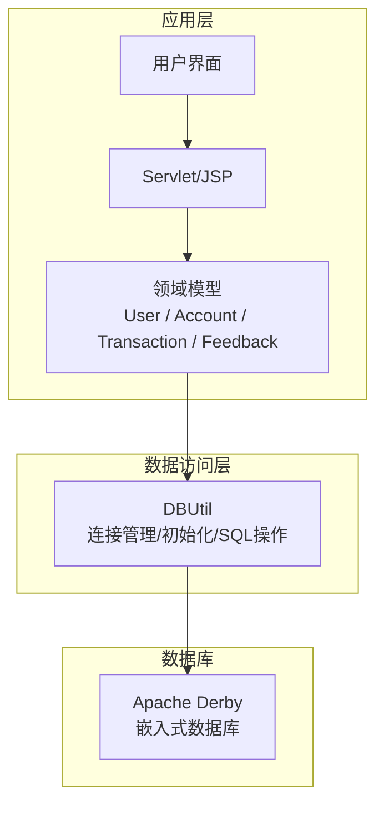
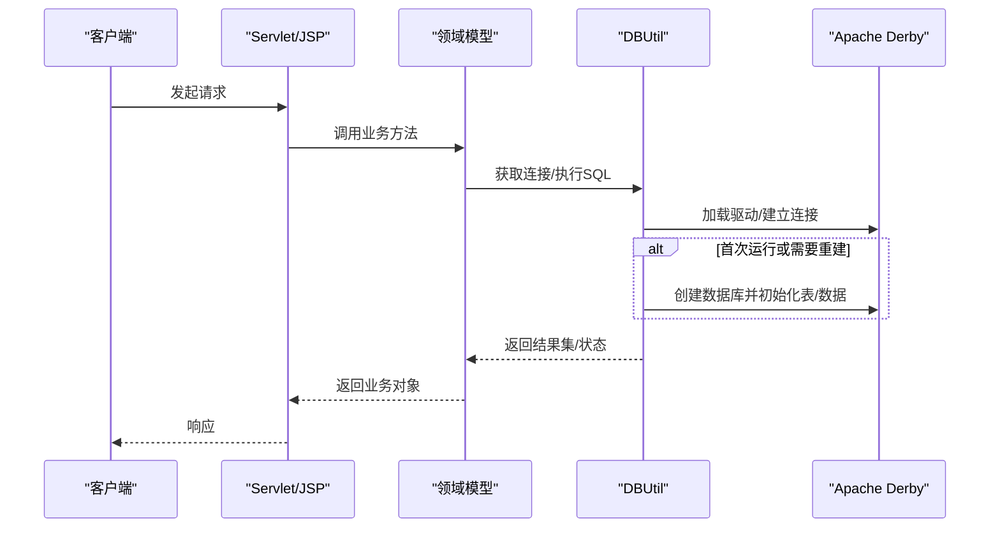
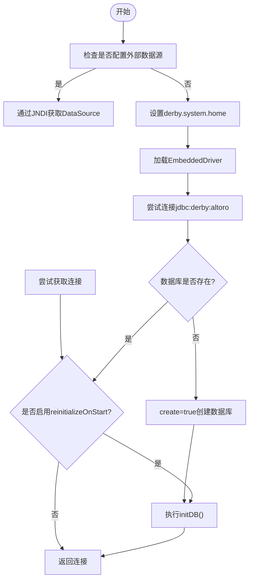
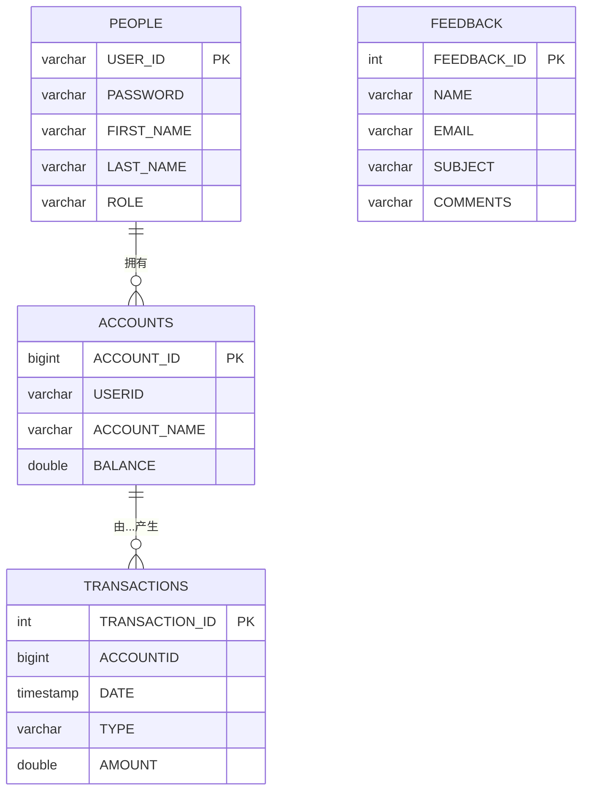
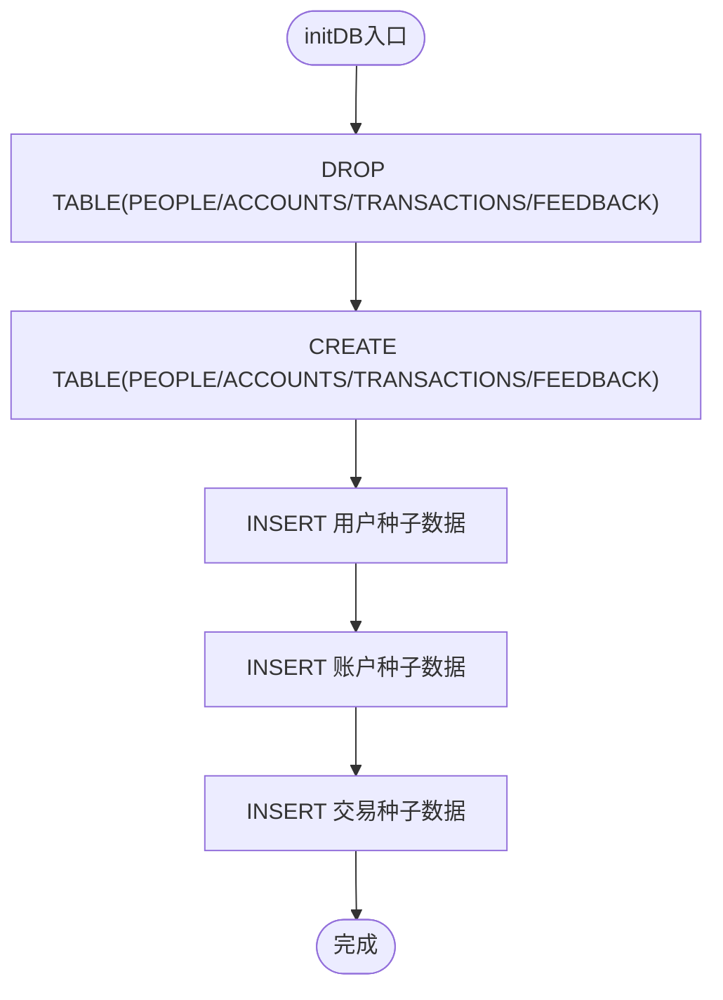
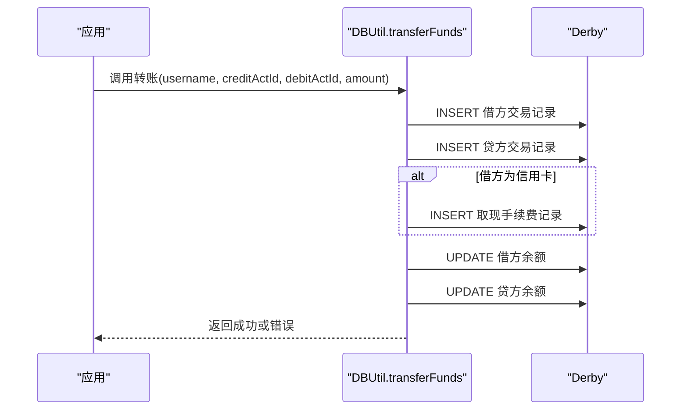
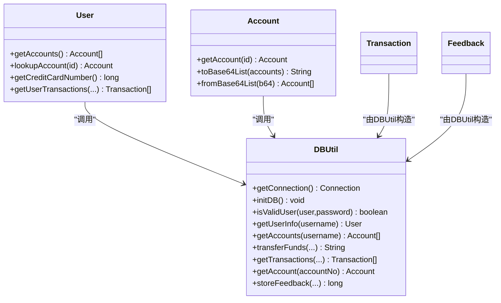

# 数据库设计

<cite>
**本文引用的文件**   
- [DBUtil.java](file://src/com/ibm/security/appscan/altoromutual/util/DBUtil.java)
- [app.properties](file://WebContent/WEB-INF/app.properties)
- [User.java](file://src/com/ibm/security/appscan/altoromutual/model/User.java)
- [Account.java](file://src/com/ibm/security/appscan/altoromutual/model/Account.java)
- [Transaction.java](file://src/com/ibm/security/appscan/altoromutual/model/Transaction.java)
- [Feedback.java](file://src/com/ibm/security/appscan/altoromutual/model/Feedback.java)
</cite>

## 目录
1. [简介](#简介)
2. [项目结构](#项目结构)
3. [核心组件](#核心组件)
4. [架构总览](#架构总览)
5. [详细组件分析](#详细组件分析)
6. [依赖关系分析](#依赖关系分析)
7. [性能与优化](#性能与优化)
8. [故障排查指南](#故障排查指南)
9. [结论](#结论)
10. [附录](#附录)

## 简介
本文件为 AltoroJ 的数据库设计文档，聚焦于 Apache Derby 嵌入式数据库在应用中的使用方式、表结构设计、数据初始化脚本、连接管理、事务处理与性能优化策略。同时给出完整的实体关系图（ER 图）、约束说明以及备份恢复与维护最佳实践，帮助读者快速理解并安全地运维该数据库。

## 项目结构
AltoroJ 将数据库访问逻辑集中在工具类中，并通过模型对象映射到业务领域概念。关键路径如下：
- 数据库工具与初始化：src/com/ibm/security/appscan/altoromutual/util/DBUtil.java
- 应用配置（含数据库相关开关）：WebContent/WEB-INF/app.properties
- 领域模型：model/User.java, model/Account.java, model/Transaction.java, model/Feedback.java

图表来源
- [DBUtil.java:47-133](file://src/com/ibm/security/appscan/altoromutual/util/DBUtil.java#L47-L133)
- [app.properties:57-73](file://WebContent/WEB-INF/app.properties#L57-L73)

章节来源
- [DBUtil.java:47-133](file://src/com/ibm/security/appscan/altoromutual/util/DBUtil.java#L47-L133)
- [app.properties:57-73](file://WebContent/WEB-INF/app.properties#L57-L73)

## 核心组件
- DBUtil：负责 JDBC 驱动加载、Derby 连接管理、数据源切换、数据库初始化（建表与种子数据）、常用 SQL 封装。
- app.properties：提供数据库行为开关，如是否启用外部数据源、是否在启动时重新初始化数据库等。
- 领域模型：User、Account、Transaction、Feedback 对应数据库表结构，承载业务语义。

章节来源
- [DBUtil.java:47-133](file://src/com/ibm/security/appscan/altoromutual/util/DBUtil.java#L47-L133)
- [app.properties:57-73](file://WebContent/WEB-INF/app.properties#L57-L73)
- [User.java:30-108](file://src/com/ibm/security/appscan/altoromutual/model/User.java#L30-L108)
- [Account.java:32-122](file://src/com/ibm/security/appscan/altoromutual/model/Account.java#L32-L122)
- [Transaction.java:28-64](file://src/com/ibm/security/appscan/altoromutual/model/Transaction.java#L28-L64)
- [Feedback.java:6-48](file://src/com/ibm/security/appscan/altoromutual/model/Feedback.java#L6-L48)

## 架构总览
下图展示从 Web 请求到数据库的调用链，以及 Derby 嵌入式数据库的连接与初始化流程。

图表来源
- [DBUtil.java:84-133](file://src/com/ibm/security/appscan/altoromutual/util/DBUtil.java#L84-L133)
- [DBUtil.java:143-167](file://src/com/ibm/security/appscan/altoromutual/util/DBUtil.java#L143-L167)

## 详细组件分析

### 数据库连接管理与初始化
- 驱动与协议：使用 org.apache.derby.jdbc.EmbeddedDriver，协议 jdbc:derby:。
- 连接选择：
  - 若配置了外部数据源（database.alternateDataSource），通过 JNDI 获取 DataSource。
  - 否则使用内置 Derby 嵌入式数据库，设置 derby.system.home 指向 user.home/altoro/。
- 自动建库：当连接失败且错误码为 40000（数据库不存在）时，以 create=true 模式创建数据库并执行初始化。
- 初始化逻辑：删除旧表后重建 PEOPLE、FEEDBACK、ACCOUNTS、TRANSACTIONS，并插入初始用户、账户与交易数据。

图表来源
- [DBUtil.java:84-133](file://src/com/ibm/security/appscan/altoromutual/util/DBUtil.java#L84-L133)
- [DBUtil.java:143-167](file://src/com/ibm/security/appscan/altoromutual/util/DBUtil.java#L143-L167)

章节来源
- [DBUtil.java:47-133](file://src/com/ibm/security/appscan/altoromutual/util/DBUtil.java#L47-L133)
- [DBUtil.java:143-167](file://src/com/ibm/security/appscan/altoromutual/util/DBUtil.java#L143-L167)
- [app.properties:57-73](file://WebContent/WEB-INF/app.properties#L57-L73)

### 表结构与数据模型
- PEOPLE：用户信息表，主键 USER_ID。
- ACCOUNTS：账户表，主键 ACCOUNT_ID（自增），包含 USERID、ACCOUNT_NAME、BALANCE。
- TRANSACTIONS：交易流水表，主键 TRANSACTION_ID（自增），包含 ACCOUNTID、DATE、TYPE、AMOUNT。
- FEEDBACK：反馈表，主键 FEEDBACK_ID（自增），包含 NAME、EMAIL、SUBJECT、COMMENTS。

图表来源
- [DBUtil.java:156-159](file://src/com/ibm/security/appscan/altoromutual/util/DBUtil.java#L156-L159)

章节来源
- [DBUtil.java:156-159](file://src/com/ibm/security/appscan/altoromutual/util/DBUtil.java#L156-L159)
- [User.java:30-108](file://src/com/ibm/security/appscan/altoromutual/model/User.java#L30-L108)
- [Account.java:32-122](file://src/com/ibm/security/appscan/altoromutual/model/Account.java#L32-L122)
- [Transaction.java:28-64](file://src/com/ibm/security/appscan/altoromutual/model/Transaction.java#L28-L64)
- [Feedback.java:6-48](file://src/com/ibm/security/appscan/altoromutual/model/Feedback.java#L6-L48)

### 数据完整性与约束
- 主键约束：所有表均定义主键，确保记录唯一性。
- 非空约束：关键字段（如 USER_ID、PASSWORD、ACCOUNT_NAME、BALANCE、TYPE、AMOUNT、DATE）均定义为 NOT NULL。
- 自增列：FEEDBACK.FEEDBACK_ID、ACCOUNTS.ACCOUNT_ID、TRANSACTIONS.TRANSACTION_ID 使用 IDENTITY 生成。
- 外键约束：当前 DDL 未显式定义外键；账户与用户的关联通过业务逻辑保证一致性。
- 触发器与存储过程：未发现触发器或存储过程的定义。

章节来源
- [DBUtil.java:156-159](file://src/com/ibm/security/appscan/altoromutual/util/DBUtil.java#L156-L159)

### 数据初始化脚本
- 初始化入口：DBUtil.initDB() 在首次连接或显式重初始化时被调用。
- 清理与重建：先 DROP 现有表，再 CREATE 新表，最后 INSERT 种子数据。
- 种子数据：
  - 用户：admin、jsmith、jdoe、sspeed、tuser 等。
  - 账户：企业账户、Checking、Savings、Credit Card 等。
  - 交易：多笔历史交易记录用于演示查询与转账功能。

图表来源
- [DBUtil.java:143-167](file://src/com/ibm/security/appscan/altoromutual/util/DBUtil.java#L143-L167)

章节来源
- [DBUtil.java:143-167](file://src/com/ibm/security/appscan/altoromutual/util/DBUtil.java#L143-L167)

### 事务处理与转账流程
- 转账逻辑：transferFunds() 会写入两条交易记录（借方与贷方），必要时追加取现手续费记录，随后更新两个账户余额。
- 事务语义：代码注释指出应作为原子操作，但当前实现未显式开启事务或使用保存点；异常捕获仅返回错误消息，未回滚。
- 建议：在生产环境中应将多条 UPDATE/INSERT 包裹在一个事务中，确保一致性。

图表来源
- [DBUtil.java:303-364](file://src/com/ibm/security/appscan/altoromutual/util/DBUtil.java#L303-L364)

章节来源
- [DBUtil.java:303-364](file://src/com/ibm/security/appscan/altoromutual/util/DBUtil.java#L303-L364)

### 查询与分页
- 交易查询：getTransactions() 支持按账户列表与日期范围过滤，并按日期降序排序；可通过 setMaxRows 限制返回行数。
- 反馈查询：getFeedback() 支持按 ID 或全部查询。
- 用户与账户查询：getUserInfo()、getAccounts()、getAccount() 分别提供用户信息与账户信息查询。

章节来源
- [DBUtil.java:173-202](file://src/com/ibm/security/appscan/altoromutual/util/DBUtil.java#L173-L202)
- [DBUtil.java:375-427](file://src/com/ibm/security/appscan/altoromutual/util/DBUtil.java#L375-L427)
- [DBUtil.java:241-293](file://src/com/ibm/security/appscan/altoromutual/util/DBUtil.java#L241-L293)
- [DBUtil.java:452-470](file://src/com/ibm/security/appscan/altoromutual/util/DBUtil.java#L452-L470)

## 依赖关系分析
- DBUtil 依赖：
  - javax.sql.DataSource（可选，外部数据源）
  - javax.naming.Context（JNDI 查找）
  - java.sql.*（JDBC API）
  - 日志组件 Log4AltoroJ
- 模型依赖：
  - User、Account、Transaction、Feedback 通过 DBUtil 访问数据库。

图表来源
- [DBUtil.java:47-536](file://src/com/ibm/security/appscan/altoromutual/util/DBUtil.java#L47-L536)
- [User.java:30-108](file://src/com/ibm/security/appscan/altoromutual/model/User.java#L30-L108)
- [Account.java:32-122](file://src/com/ibm/security/appscan/altoromutual/model/Account.java#L32-L122)

章节来源
- [DBUtil.java:47-536](file://src/com/ibm/security/appscan/altoromutual/util/DBUtil.java#L47-L536)
- [User.java:30-108](file://src/com/ibm/security/appscan/altoromutual/model/User.java#L30-L108)
- [Account.java:32-122](file://src/com/ibm/security/appscan/altoromutual/model/Account.java#L32-L122)

## 性能与优化
- 索引策略
  - 当前 DDL 仅定义主键，未显式创建其他索引。
  - 建议：
    - ACCOUNTS.USERID：频繁按用户查询账户，建议添加索引。
    - TRANSACTIONS.ACCOUNTID：按账户查询交易频繁，建议添加索引。
    - TRANSACTIONS.DATE：按时间范围查询交易频繁，建议添加复合索引 (ACCOUNTID, DATE)。
- 查询优化
  - getTransactions() 已使用 ORDER BY DATE DESC 与最大行数限制，有助于减少网络传输与内存占用。
  - 避免动态拼接 SQL 导致的解析开销，建议使用 PreparedStatement（注意当前代码存在 SQL 注入风险）。
- 连接与事务
  - 当前 getConnection() 维护单例连接，适合嵌入式 Derby；在高并发场景可考虑连接池（如 Tomcat JDBC Pool）。
  - 转账应使用显式事务，确保多语句原子性。
- Derby 参数
  - 可通过 JVM 参数调整 derby.system.home、缓存大小等；生产环境建议固定路径并监控磁盘空间。

[本节为通用指导，不直接分析具体文件]

## 故障排查指南
- 常见错误
  - 数据库不存在（错误码 40000）：会自动以 create=true 创建数据库并初始化；若仍失败，检查 derby.system.home 权限与路径。
  - 日期格式错误（错误码 30000）：getTransactions() 对日期格式有严格校验，需使用 yyyy-mm-dd HH:mm:ss。
- 配置问题
  - 外部数据源未正确配置：确认 database.alternateDataSource 与 Tomcat context.xml 一致，并确保首次运行时开启 database.reinitializeOnStart。
- 数据不一致
  - 转账未使用事务可能导致部分更新；建议在业务层引入事务边界，或在数据库层使用存储过程/触发器保障一致性。

章节来源
- [DBUtil.java:124-133](file://src/com/ibm/security/appscan/altoromutual/util/DBUtil.java#L124-L133)
- [DBUtil.java:407-415](file://src/com/ibm/security/appscan/altoromutual/util/DBUtil.java#L407-L415)
- [app.properties:57-73](file://WebContent/WEB-INF/app.properties#L57-L73)

## 结论
AltoroJ 使用 Apache Derby 嵌入式数据库，通过 DBUtil 统一管理连接与初始化，并提供基础的用户、账户、交易与反馈数据模型。当前设计简洁，便于演示与安全测试；但在生产环境中需补充索引、事务、参数化查询与更严格的约束，以提升性能与安全性。

[本节为总结性内容，不直接分析具体文件]

## 附录

### Derby 嵌入式数据库配置与使用要点
- 驱动类：org.apache.derby.jdbc.EmbeddedDriver
- 协议：jdbc:derby:
- 数据库位置：derby.system.home=user.home/altoro/
- 首次连接：若数据库不存在，自动以 create=true 创建并初始化
- 外部数据源：通过 JNDI 配置 DataSource，并在 app.properties 中指定名称

章节来源
- [DBUtil.java:47-96](file://src/com/ibm/security/appscan/altoromutual/util/DBUtil.java#L47-L96)
- [app.properties:57-73](file://WebContent/WEB-INF/app.properties#L57-L73)

### 备份、恢复与维护最佳实践
- 备份
  - Derby 嵌入式数据库采用文件系统存储，可直接复制 derby.system.home 下的数据库目录进行冷备。
  - 建议在停机窗口内备份，确保一致性。
- 恢复
  - 停止应用后，将备份目录恢复到 derby.system.home 指定路径，重启应用即可。
- 维护
  - 定期清理日志与临时文件，监控磁盘空间。
  - 谨慎使用 reinitializeOnStart，避免误删生产数据。
  - 逐步迁移至外部数据库（如 DB2/MySQL）时，先导出 DDL 与数据，再进行导入与验证。

[本节为通用指导，不直接分析具体文件]