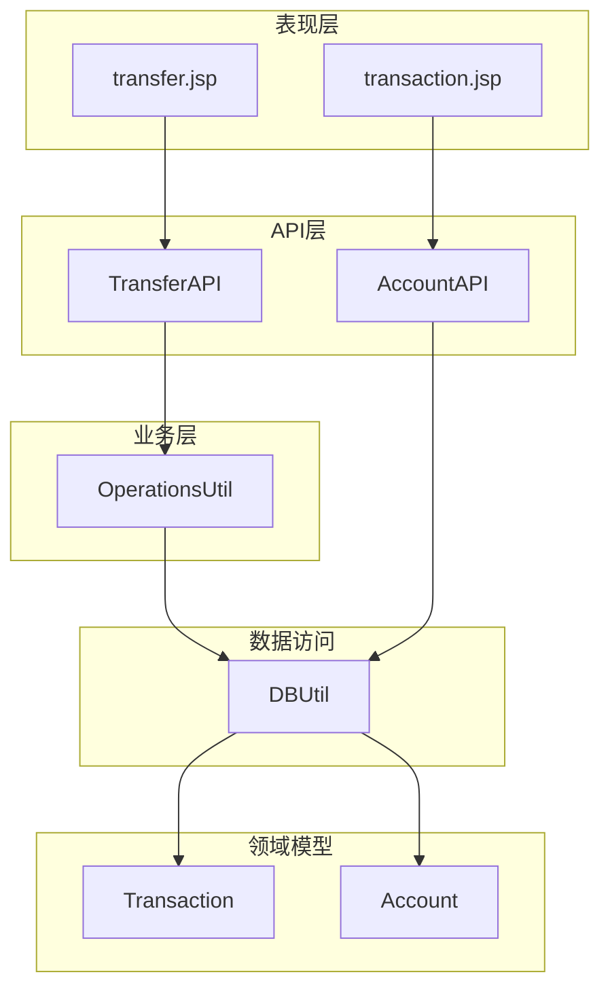
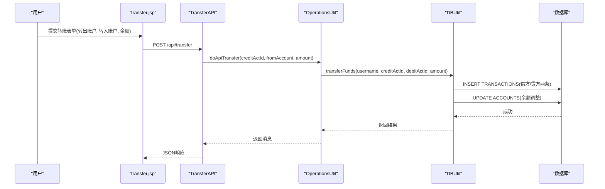
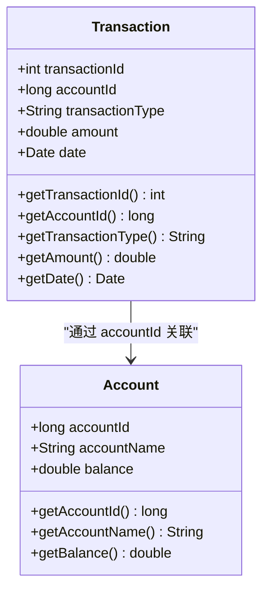
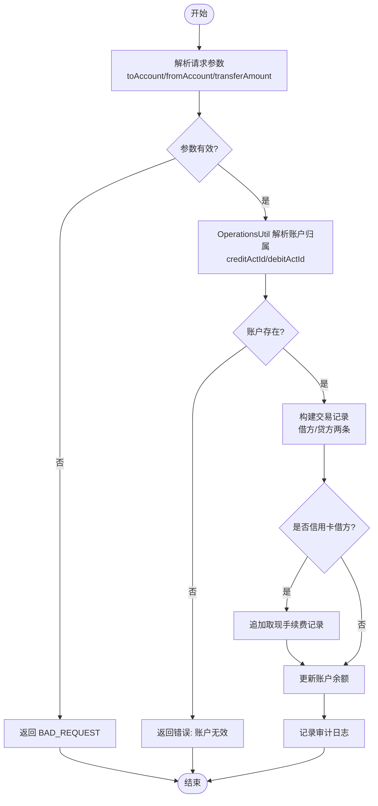
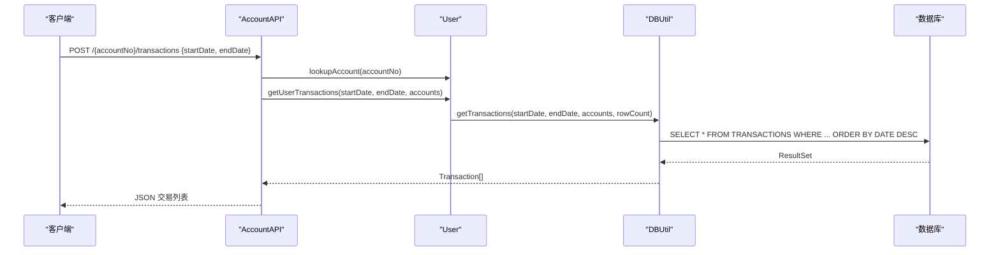
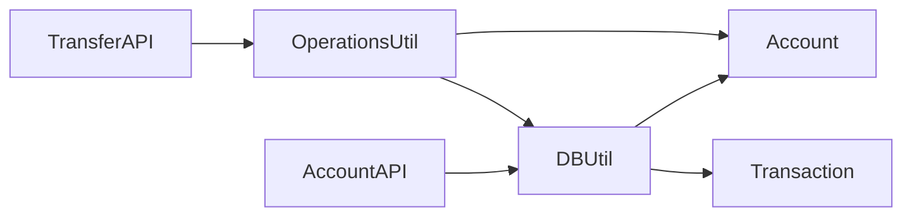

# 交易模型(Transaction)

<cite>
**本文引用的文件**   
- [Transaction.java](file://src/com/ibm/security/appscan/altoromutual/model/Transaction.java)
- [Account.java](file://src/com/ibm/security/appscan/altoromutual/model/Account.java)
- [DBUtil.java](file://src/com/ibm/security/appscan/altoromutual/util/DBUtil.java)
- [OperationsUtil.java](file://src/com/ibm/security/appscan/altoromutual/util/OperationsUtil.java)
- [TransferAPI.java](file://src/com/ibm/security/appscan/altoromutual/api/TransferAPI.java)
- [AccountAPI.java](file://src/com/ibm/security/appscan/altoromutual/api/AccountAPI.java)
- [transfer.jsp](file://WebContent/bank/transfer.jsp)
- [transaction.jsp](file://WebContent/bank/transaction.jsp)
</cite>

## 目录
1. [引言](#引言)
2. [项目结构](#项目结构)
3. [核心组件](#核心组件)
4. [架构总览](#架构总览)
5. [详细组件分析](#详细组件分析)
6. [依赖关系分析](#依赖关系分析)
7. [性能考虑](#性能考虑)
8. [故障排查指南](#故障排查指南)
9. [结论](#结论)
10. [附录](#附录)

## 引言
本文围绕 AltoroJ 中的交易模型，系统性梳理 Transaction 数据模型、与账户 Account 的双向关系映射、交易类型与业务规则、金额校验、时间戳与日期格式处理、流水号生成与唯一性保证、创建/查询/历史追溯流程、审计日志与归档策略等。文档面向技术与非技术读者，力求以循序渐进的方式呈现代码级实现细节与可操作的最佳实践。

## 项目结构
AltoroJ 的交易相关能力分布在以下位置：
- 领域模型：Transaction、Account
- 数据访问与持久化：DBUtil（建表、转账写入、交易查询）
- 业务编排：OperationsUtil（参数校验、账户归属判定）
- API 层：TransferAPI（转账接口）、AccountAPI（交易查询接口）
- Web 页面：transfer.jsp（转账表单）、transaction.jsp（交易历史展示）

图表来源
- [TransferAPI.java:14-44](file://src/com/ibm/security/appscan/altoromutual/api/TransferAPI.java#L14-L44)
- [AccountAPI.java:140-238](file://src/com/ibm/security/appscan/altoromutual/api/AccountAPI.java#L140-L238)
- [OperationsUtil.java:44-98](file://src/com/ibm/security/appscan/altoromutual/util/OperationsUtil.java#L44-L98)
- [DBUtil.java:303-364](file://src/com/ibm/security/appscan/altoromutual/util/DBUtil.java#L303-L364)
- [DBUtil.java:375-427](file://src/com/ibm/security/appscan/altoromutual/util/DBUtil.java#L375-L427)
- [Transaction.java:28-63](file://src/com/ibm/security/appscan/altoromutual/model/Transaction.java#L28-L63)
- [Account.java:32-74](file://src/com/ibm/security/appscan/altoromutual/model/Account.java#L32-L74)

章节来源
- [TransferAPI.java:14-44](file://src/com/ibm/security/appscan/altoromutual/api/TransferAPI.java#L14-L44)
- [AccountAPI.java:140-238](file://src/com/ibm/security/appscan/altoromutual/api/AccountAPI.java#L140-L238)
- [OperationsUtil.java:44-98](file://src/com/ibm/security/appscan/altoromutual/util/OperationsUtil.java#L44-L98)
- [DBUtil.java:303-364](file://src/com/ibm/security/appscan/altoromutual/util/DBUtil.java#L303-L364)
- [DBUtil.java:375-427](file://src/com/ibm/security/appscan/altoromutual/util/DBUtil.java#L375-L427)
- [Transaction.java:28-63](file://src/com/ibm/security/appscan/altoromutual/model/Transaction.java#L28-L63)
- [Account.java:32-74](file://src/com/ibm/security/appscan/altoromutual/model/Account.java#L32-L74)

## 核心组件
- Transaction：交易记录的数据载体，包含交易标识、关联账户、交易类型、金额、时间戳。
- Account：账户信息，用于与交易建立双向关系（交易通过 accountId 指向账户）。
- DBUtil：数据库初始化、转账事务写入、交易查询封装。
- OperationsUtil：转账前参数校验与账户归属判定。
- TransferAPI / AccountAPI：对外暴露的转账与交易查询 REST 接口。
- transfer.jsp / transaction.jsp：前端转账表单与交易历史展示。

章节来源
- [Transaction.java:28-63](file://src/com/ibm/security/appscan/altoromutual/model/Transaction.java#L28-L63)
- [Account.java:32-74](file://src/com/ibm/security/appscan/altoromutual/model/Account.java#L32-L74)
- [DBUtil.java:303-364](file://src/com/ibm/security/appscan/altoromutual/util/DBUtil.java#L303-L364)
- [DBUtil.java:375-427](file://src/com/ibm/security/appscan/altoromutual/util/DBUtil.java#L375-L427)
- [OperationsUtil.java:44-98](file://src/com/ibm/security/appscan/altoromutual/util/OperationsUtil.java#L44-L98)
- [TransferAPI.java:14-44](file://src/com/ibm/security/appscan/altoromutual/api/TransferAPI.java#L14-L44)
- [AccountAPI.java:140-238](file://src/com/ibm/security/appscan/altoromutual/api/AccountAPI.java#L140-L238)

## 架构总览
下图展示了从前端到数据库的交易流转路径，以及关键组件的职责边界。

图表来源
- [transfer.jsp:35-52](file://WebContent/bank/transfer.jsp#L35-L52)
- [TransferAPI.java:17-43](file://src/com/ibm/security/appscan/altoromutual/api/TransferAPI.java#L17-L43)
- [OperationsUtil.java:44-98](file://src/com/ibm/security/appscan/altoromutual/util/OperationsUtil.java#L44-L98)
- [DBUtil.java:303-364](file://src/com/ibm/security/appscan/altoromutual/util/DBUtil.java#L303-L364)

## 详细组件分析

### Transaction 数据模型
- 字段定义与数据类型
  - transactionId：int，交易主键（数据库侧为自增 INTEGER）
  - accountId：long，关联账户 ID（数据库侧 BIGINT）
  - transactionType：String，交易类型（如 Deposit、Withdrawal、Payment、Cash Advance Fee）
  - amount：double，交易金额（正负表示方向；信用卡场景特殊处理）
  - date：Date/Timestamp，交易时间戳（数据库侧 TIMESTAMP）

- 业务含义与交易类型
  - Deposit：存款（贷方账户增加）
  - Withdrawal：取款（借方账户减少）
  - Payment：还款（信用卡账户作为贷方时记为 Payment）
  - Cash Advance Fee：取现手续费（信用卡借方产生额外费用）

- 金额验证与业务规则
  - 前端校验：金额必须大于 0，且转出与转入账户不能相同
  - 后端校验：目标账户与源账户有效性检查；若涉及信用卡，需按反向逻辑处理余额并追加取现手续费
  - 金额符号：借方为负，贷方为正；信用卡账户余额语义相反，需对 debitAmount/creditAmount 进行符号修正

- 与账户(Account)的双向关系映射
  - 交易通过 accountId 指向账户；账户可通过交易列表回溯其流水
  - 在查询接口中，先根据账户编号解析出 Account，再据此查询该账户的交易序列

- 交易记录的创建、查询与历史追溯
  - 创建：DBUtil.transferFunds 插入两条交易记录（借方与贷方），必要时追加手续费记录
  - 查询：DBUtil.getTransactions 支持按账户集合与日期范围筛选，并按时间倒序返回
  - 历史追溯：AccountAPI.getTransactions 提供最近 N 条或指定区间的交易历史

- 时间戳管理与日期格式处理
  - 写入：使用 java.sql.Timestamp 精确到毫秒
  - 查询：SQL 拼接采用 yyyy-mm-dd HH:mm:ss 格式；错误码 30000 提示格式不正确
  - 展示：AccountAPI 将 Date 格式化为 yyyy-MM-dd HH:mm 或 yyyy-MM-dd

- 流水号生成规则与唯一性保证
  - 数据库侧 TRANSACTION_ID 为自增整数，起始值 2311，增量 1，天然保证唯一性

- 审计追踪与日志记录机制
  - 每次转账成功后调用 Log4AltoroJ.logTransaction 记录借贷双方账户及金额
  - 信用卡取现手续费单独记录

- 数据归档策略与历史数据管理
  - 当前仓库未实现显式归档逻辑；建议基于 DATE 字段进行冷热分层归档（例如按月/年分表或分区）
  - 查询接口已限制最大返回行数（服务端最多返回 100 条），有助于控制历史数据读取规模

图表来源
- [Transaction.java:28-63](file://src/com/ibm/security/appscan/altoromutual/model/Transaction.java#L28-L63)
- [Account.java:32-74](file://src/com/ibm/security/appscan/altoromutual/model/Account.java#L32-L74)

章节来源
- [Transaction.java:28-63](file://src/com/ibm/security/appscan/altoromutual/model/Transaction.java#L28-L63)
- [DBUtil.java:303-364](file://src/com/ibm/security/appscan/altoromutual/util/DBUtil.java#L303-L364)
- [DBUtil.java:375-427](file://src/com/ibm/security/appscan/altoromutual/util/DBUtil.java#L375-L427)
- [AccountAPI.java:140-238](file://src/com/ibm/security/appscan/altoromutual/api/AccountAPI.java#L140-L238)
- [transfer.jsp:35-52](file://WebContent/bank/transfer.jsp#L35-L52)

### 转账业务流程（API 与持久化）

图表来源
- [TransferAPI.java:17-43](file://src/com/ibm/security/appscan/altoromutual/api/TransferAPI.java#L17-L43)
- [OperationsUtil.java:44-98](file://src/com/ibm/security/appscan/altoromutual/util/OperationsUtil.java#L44-L98)
- [DBUtil.java:303-364](file://src/com/ibm/security/appscan/altoromutual/util/DBUtil.java#L303-L364)

章节来源
- [TransferAPI.java:17-43](file://src/com/ibm/security/appscan/altoromutual/api/TransferAPI.java#L17-L43)
- [OperationsUtil.java:44-98](file://src/com/ibm/security/appscan/altoromutual/util/OperationsUtil.java#L44-L98)
- [DBUtil.java:303-364](file://src/com/ibm/security/appscan/altoromutual/util/DBUtil.java#L303-L364)

### 交易查询与历史追溯
- 查询入口：AccountAPI.getTransactions
- 输入：accountNo、startDate、endDate
- 输出：JSON 数组，包含 id、date、account、type、amount
- 限制：最多返回 100 条；日期格式要求严格（yyyy-mm-dd HH:mm:ss）

图表来源
- [AccountAPI.java:140-238](file://src/com/ibm/security/appscan/altoromutual/api/AccountAPI.java#L140-L238)
- [DBUtil.java:375-427](file://src/com/ibm/security/appscan/altoromutual/util/DBUtil.java#L375-L427)

章节来源
- [AccountAPI.java:140-238](file://src/com/ibm/security/appscan/altoromutual/api/AccountAPI.java#L140-L238)
- [DBUtil.java:375-427](file://src/com/ibm/security/appscan/altoromutual/util/DBUtil.java#L375-L427)

## 依赖关系分析
- 组件耦合
  - TransferAPI 依赖 OperationsUtil 进行参数校验与账户解析
  - OperationsUtil 依赖 Account 与 User 上下文
  - DBUtil 直接操作数据库，负责建表、转账写入与交易查询
  - AccountAPI 依赖 User 与 DBUtil 完成交易查询
- 外部依赖
  - 数据库：TRANSACTIONS 表结构由 DBUtil.initDB 创建
  - 日志：Log4AltoroJ 用于审计记录

图表来源
- [TransferAPI.java:14-44](file://src/com/ibm/security/appscan/altoromutual/api/TransferAPI.java#L14-L44)
- [OperationsUtil.java:44-98](file://src/com/ibm/security/appscan/altoromutual/util/OperationsUtil.java#L44-L98)
- [AccountAPI.java:140-238](file://src/com/ibm/security/appscan/altoromutual/api/AccountAPI.java#L140-L238)
- [DBUtil.java:303-364](file://src/com/ibm/security/appscan/altoromutual/util/DBUtil.java#L303-L364)
- [DBUtil.java:375-427](file://src/com/ibm/security/appscan/altoromutual/util/DBUtil.java#L375-L427)

章节来源
- [TransferAPI.java:14-44](file://src/com/ibm/security/appscan/altoromutual/api/TransferAPI.java#L14-L44)
- [OperationsUtil.java:44-98](file://src/com/ibm/security/appscan/altoromutual/util/OperationsUtil.java#L44-L98)
- [AccountAPI.java:140-238](file://src/com/ibm/security/appscan/altoromutual/api/AccountAPI.java#L140-L238)
- [DBUtil.java:303-364](file://src/com/ibm/security/appscan/altoromutual/util/DBUtil.java#L303-L364)
- [DBUtil.java:375-427](file://src/com/ibm/security/appscan/altoromutual/util/DBUtil.java#L375-L427)

## 性能考虑
- 查询分页与上限：AccountAPI 限制返回最多 100 条，避免一次性拉取大量历史数据
- 索引建议：建议在 TRANSACTIONS.ACCOUNTID、TRANSACTIONS.DATE 上建立复合索引以提升按账户与时间范围查询的性能
- 批量写入：当前转账写入为多条独立 SQL；在高并发下建议使用事务包裹以减少锁竞争与不一致风险
- 格式化开销：频繁使用 DecimalFormat/SimpleDateFormat 可能带来对象分配压力，建议复用格式化器或使用线程安全方案

[本节为通用指导，不直接分析具体文件]

## 故障排查指南
- 日期格式错误
  - 现象：查询抛出特定错误码（30000），提示日期时间格式必须为 yyyy-mm-dd HH:mm:ss
  - 排查：检查传入 startDate/endDate 是否符合要求
  - 参考：[DBUtil.java:375-427](file://src/com/ibm/security/appscan/altoromutual/util/DBUtil.java#L375-L427)
- 账户无效
  - 现象：返回“目标账户无效”或“源账户无效”
  - 排查：确认 toAccount/fromAccount 是否存在且属于当前用户
  - 参考：[OperationsUtil.java:44-98](file://src/com/ibm/security/appscan/altoromutual/util/OperationsUtil.java#L44-L98)、[DBUtil.java:303-364](file://src/com/ibm/security/appscan/altoromutual/util/DBUtil.java#L303-L364)
- 金额校验失败
  - 现象：前端提示金额必须大于 0
  - 排查：确保 transferAmount > 0
  - 参考：[transfer.jsp:35-52](file://WebContent/bank/transfer.jsp#L35-L52)
- 信用卡取现手续费异常
  - 现象：出现额外的 Cash Advance Fee 记录
  - 排查：确认借方是否为信用卡账户
  - 参考：[DBUtil.java:303-364](file://src/com/ibm/security/appscan/altoromutual/util/DBUtil.java#L303-L364)

章节来源
- [DBUtil.java:375-427](file://src/com/ibm/security/appscan/altoromutual/util/DBUtil.java#L375-L427)
- [OperationsUtil.java:44-98](file://src/com/ibm/security/appscan/altoromutual/util/OperationsUtil.java#L44-L98)
- [DBUtil.java:303-364](file://src/com/ibm/security/appscan/altoromutual/util/DBUtil.java#L303-L364)
- [transfer.jsp:35-52](file://WebContent/bank/transfer.jsp#L35-L52)

## 结论
AltoroJ 的交易模型以 Transaction 为核心，结合 Account 形成清晰的账户-交易关系。系统通过 API 层与业务层协作完成转账与查询，底层由 DBUtil 统一负责持久化与数据访问。现有实现提供了基本的金额校验、时间戳处理与审计日志，但在事务一致性、索引优化与归档策略方面仍有改进空间。建议在生产环境中引入强一致事务、完善索引与审计增强，并制定明确的历史数据归档策略。

[本节为总结性内容，不直接分析具体文件]

## 附录

### 数据模型与数据库映射
- 表结构（TRANSACTIONS）
  - TRANSACTION_ID：INTEGER，自增主键
  - ACCOUNTID：BIGINT，外键指向账户
  - DATE：TIMESTAMP，交易时间
  - TYPE：VARCHAR，交易类型
  - AMOUNT：DOUBLE，交易金额

- 字段映射
  - Transaction.transactionId ↔ TRANSACTIONS.TRANSACTION_ID
  - Transaction.accountId ↔ TRANSACTIONS.ACCOUNTID
  - Transaction.date ↔ TRANSACTIONS.DATE
  - Transaction.transactionType ↔ TRANSACTIONS.TYPE
  - Transaction.amount ↔ TRANSACTIONS.AMOUNT

章节来源
- [DBUtil.java:143-167](file://src/com/ibm/security/appscan/altoromutual/util/DBUtil.java#L143-L167)
- [DBUtil.java:375-427](file://src/com/ibm/security/appscan/altoromutual/util/DBUtil.java#L375-L427)

### 代码示例（路径引用）
- 创建交易（转账）
  - 参考：[DBUtil.java:303-364](file://src/com/ibm/security/appscan/altoromutual/util/DBUtil.java#L303-L364)
- 查询交易历史
  - 参考：[DBUtil.java:375-427](file://src/com/ibm/security/appscan/altoromutual/util/DBUtil.java#L375-L427)
- API 调用（转账）
  - 参考：[TransferAPI.java:17-43](file://src/com/ibm/security/appscan/altoromutual/api/TransferAPI.java#L17-L43)
- API 调用（交易查询）
  - 参考：[AccountAPI.java:140-238](file://src/com/ibm/security/appscan/altoromutual/api/AccountAPI.java#L140-L238)