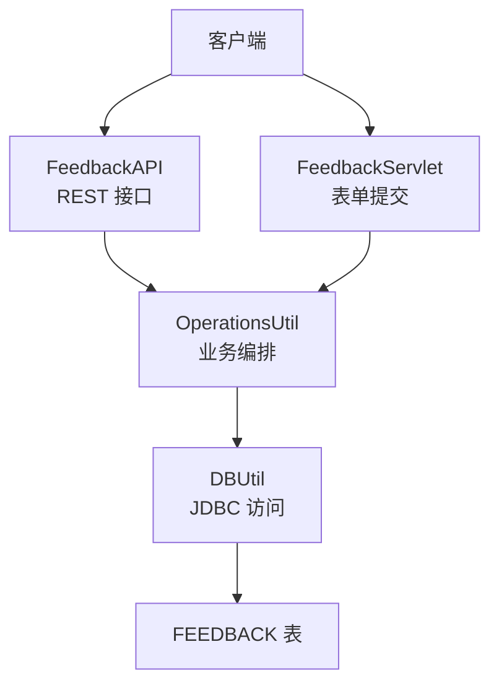
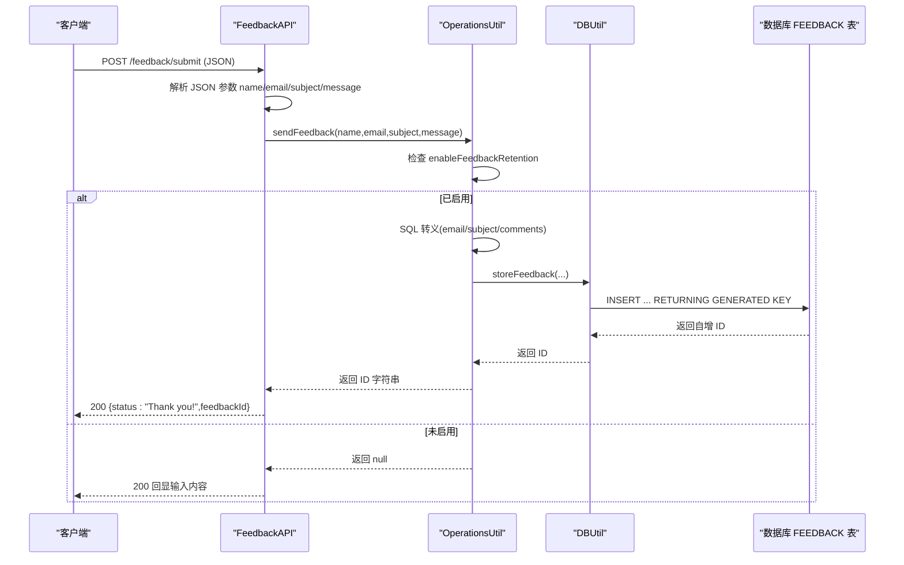
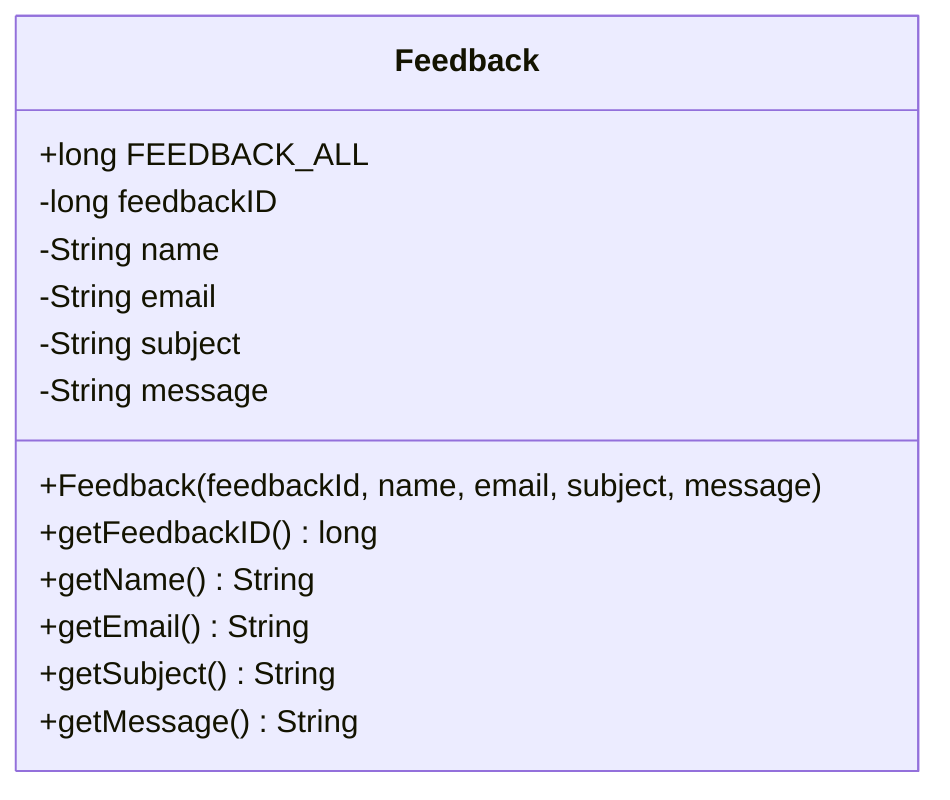
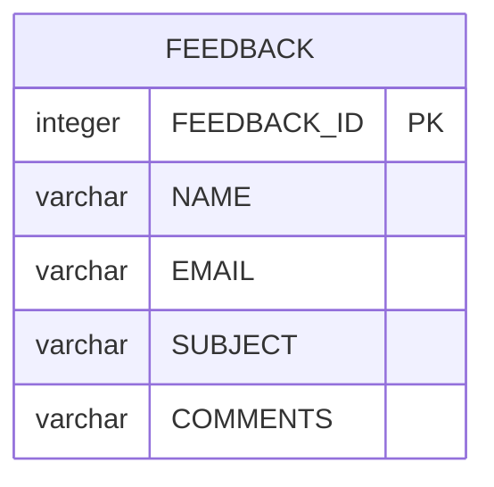
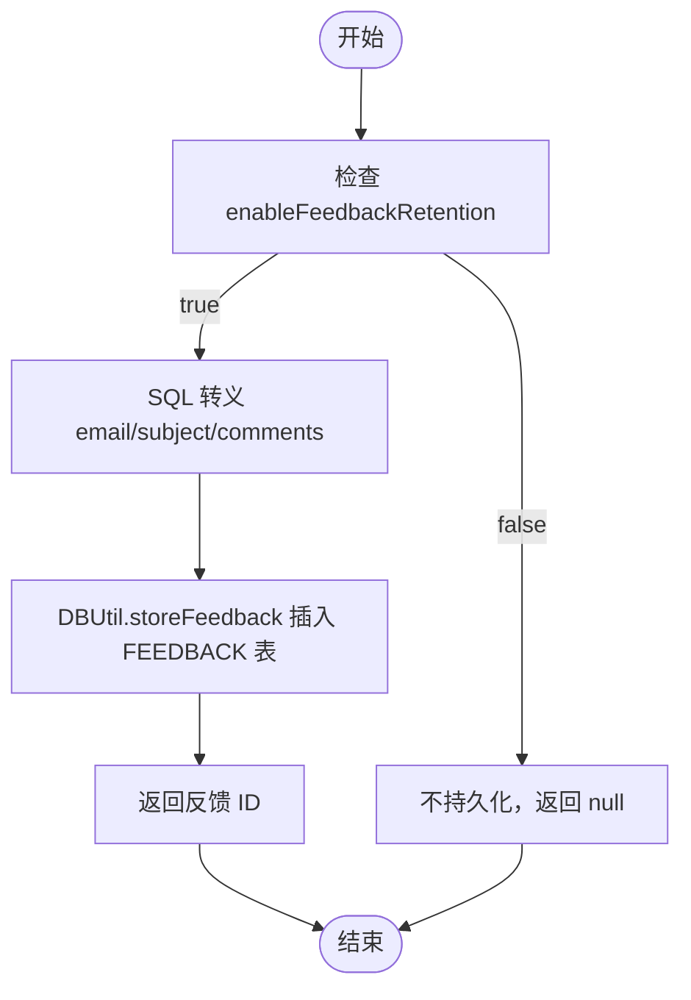
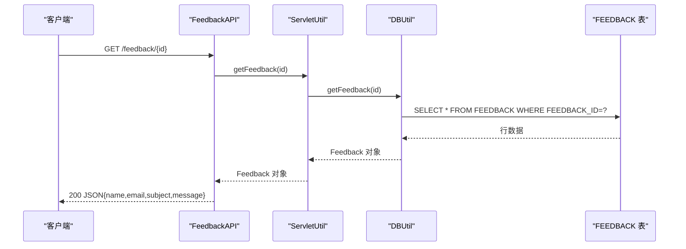
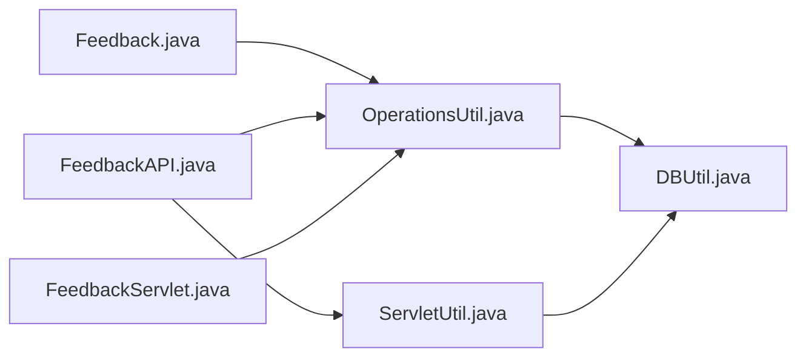

# 反馈模型(Feedback)

<cite>
**本文引用的文件**   
- [Feedback.java](file://src/com/ibm/security/appscan/altoromutual/model/Feedback.java)
- [OperationsUtil.java](file://src/com/ibm/security/appscan/altoromutual/util/OperationsUtil.java)
- [DBUtil.java](file://src/com/ibm/security/appscan/altoromutual/util/DBUtil.java)
- [ServletUtil.java](file://src/com/ibm/security/appscan/altoromutual/util/ServletUtil.java)
- [FeedbackAPI.java](file://src/com/ibm/security/appscan/altoromutual/api/FeedbackAPI.java)
- [FeedbackServlet.java](file://src/com/ibm/security/appscan/altoromutual/servlet/FeedbackServlet.java)
- [feedbacksuccess.jsp](file://WebContent/feedbacksuccess.jsp)
- [properties.json](file://WebContent/swagger/properties.json)
</cite>

## 目录
1. [简介](#简介)
2. [项目结构](#项目结构)
3. [核心组件](#核心组件)
4. [架构总览](#架构总览)
5. [详细组件分析](#详细组件分析)
6. [依赖关系分析](#依赖关系分析)
7. [性能与可扩展性](#性能与可扩展性)
8. [故障排查指南](#故障排查指南)
9. [结论](#结论)
10. [附录](#附录)

## 简介
本文档围绕 AltoroJ 应用中的“反馈”功能，系统化梳理 Feedback 数据模型、字段定义、存储策略、查询检索、提交流程、验证规则、隐私保护与保留策略等。目标是帮助开发者与维护者准确理解反馈数据的结构与流转，并在后续现代化改造中保持行为一致性与安全性。

## 项目结构
与反馈相关的代码分布在以下模块：
- 领域模型：model/Feedback.java
- 业务工具：util/OperationsUtil.java（封装反馈提交逻辑）
- 数据访问：util/DBUtil.java（数据库建表、CRUD）
- 服务层：api/FeedbackAPI.java（REST 接口）、servlet/FeedbackServlet.java（传统表单提交）
- 视图层：WebContent/feedbacksuccess.jsp（提交成功页）
- API 文档：WebContent/swagger/properties.json（OpenAPI 描述）

图表来源
- [FeedbackAPI.java:19-92](file://src/com/ibm/security/appscan/altoromutual/api/FeedbackAPI.java#L19-L92)
- [FeedbackServlet.java:35-68](file://src/com/ibm/security/appscan/altoromutual/servlet/FeedbackServlet.java#L35-L68)
- [OperationsUtil.java:119-132](file://src/com/ibm/security/appscan/altoromutual/util/OperationsUtil.java#L119-L132)
- [DBUtil.java:143-164](file://src/com/ibm/security/appscan/altoromutual/util/DBUtil.java#L143-L164)

章节来源
- [FeedbackAPI.java:19-92](file://src/com/ibm/security/appscan/altoromutual/api/FeedbackAPI.java#L19-L92)
- [FeedbackServlet.java:35-68](file://src/com/ibm/security/appscan/altoromutual/servlet/FeedbackServlet.java#L35-L68)
- [OperationsUtil.java:119-132](file://src/com/ibm/security/appscan/altoromutual/util/OperationsUtil.java#L119-L132)
- [DBUtil.java:143-164](file://src/com/ibm/security/appscan/altoromutual/util/DBUtil.java#L143-L164)

## 核心组件
- Feedback 领域对象：承载反馈实体属性与常量。
- OperationsUtil.sendFeedback：统一入口，负责在启用保留策略时进行 SQL 转义并持久化。
- DBUtil：负责数据库连接、建表、插入与查询。
- FeedbackAPI：提供 RESTful 的提交与按 ID 查询接口。
- FeedbackServlet：处理传统 JSP 表单提交。
- feedbacksuccess.jsp：展示提交结果与反馈详情（受配置开关控制）。

章节来源
- [Feedback.java:6-47](file://src/com/ibm/security/appscan/altoromutual/model/Feedback.java#L6-L47)
- [OperationsUtil.java:119-132](file://src/com/ibm/security/appscan/altoromutual/util/OperationsUtil.java#L119-L132)
- [DBUtil.java:173-202](file://src/com/ibm/security/appscan/altoromutual/util/DBUtil.java#L173-L202)
- [DBUtil.java:520-535](file://src/com/ibm/security/appscan/altoromutual/util/DBUtil.java#L520-L535)
- [FeedbackAPI.java:22-90](file://src/com/ibm/security/appscan/altoromutual/api/FeedbackAPI.java#L22-L90)
- [FeedbackServlet.java:42-68](file://src/com/ibm/security/appscan/altoromutual/servlet/FeedbackServlet.java#L42-L68)

## 架构总览
反馈提交流程（REST）：

图表来源
- [FeedbackAPI.java:22-76](file://src/com/ibm/security/appscan/altoromutual/api/FeedbackAPI.java#L22-L76)
- [OperationsUtil.java:119-132](file://src/com/ibm/security/appscan/altoromutual/util/OperationsUtil.java#L119-L132)
- [DBUtil.java:520-535](file://src/com/ibm/security/appscan/altoromutual/util/DBUtil.java#L520-L535)

## 详细组件分析

### Feedback 数据模型
- 字段与类型
  - feedbackID: long（主键标识）
  - name: String（提交者姓名）
  - email: String（提交者邮箱）
  - subject: String（反馈主题）
  - message: String（反馈正文；对应数据库 COMMENTS 列）
- 常量
  - FEEDBACK_ALL: long = -999，用于查询所有反馈记录
- 构造器
  - 使用全参构造器初始化上述字段
- 访问器
  - getFeedbackID/getName/getEmail/getSubject/getMessage

注意：Feedback 类本身不包含 submittedBy/submittedDate 字段；当前实现仅持久化 name/email/subject/message。

图表来源
- [Feedback.java:6-47](file://src/com/ibm/security/appscan/altoromutual/model/Feedback.java#L6-L47)

章节来源
- [Feedback.java:6-47](file://src/com/ibm/security/appscan/altoromutual/model/Feedback.java#L6-L47)

### 数据库映射与约束
- 表名：FEEDBACK
- 列定义与约束
  - FEEDBACK_ID: INTEGER，自增（GENERATED ALWAYS AS IDENTITY），起始值 1022，增量 1，主键
  - NAME: VARCHAR(100)，非空
  - EMAIL: VARCHAR(50)，非空
  - SUBJECT: VARCHAR(100)，非空
  - COMMENTS: VARCHAR(500)，非空（对应 Feedback.message）
- 建表时机：应用启动时通过 DBUtil.initDB 执行（会先 DROP 再 CREATE）

图表来源
- [DBUtil.java:143-164](file://src/com/ibm/security/appscan/altoromutual/util/DBUtil.java#L143-L164)

章节来源
- [DBUtil.java:143-164](file://src/com/ibm/security/appscan/altoromutual/util/DBUtil.java#L143-L164)

### 反馈提交流程与状态管理
- 两种入口
  - REST：POST /feedback/submit（FeedbackAPI）
  - 表单：FeedbackServlet.doPost
- 统一业务编排：OperationsUtil.sendFeedback
  - 若 enableFeedbackRetention 为 true：对 email/subject/comments 进行 SQL 转义后调用 DBUtil.storeFeedback，返回生成的反馈 ID
  - 否则：返回 null（不持久化）
- 响应语义
  - REST 提交成功：返回 {status:"Thank you!",feedbackId}
  - 未启用保留：返回原始输入内容（便于调试或前端提示）
- “状态”说明
  - 当前实现无显式状态字段；“成功/失败”以返回值与 HTTP 状态码表达
  - 如需引入状态机（如待审核/已处理），需扩展模型与表结构

图表来源
- [OperationsUtil.java:119-132](file://src/com/ibm/security/appscan/altoromutual/util/OperationsUtil.java#L119-L132)
- [DBUtil.java:520-535](file://src/com/ibm/security/appscan/altoromutual/util/DBUtil.java#L520-L535)

章节来源
- [OperationsUtil.java:119-132](file://src/com/ibm/security/appscan/altoromutual/util/OperationsUtil.java#L119-L132)
- [FeedbackAPI.java:22-76](file://src/com/ibm/security/appscan/altoromutual/api/FeedbackAPI.java#L22-L76)
- [FeedbackServlet.java:42-68](file://src/com/ibm/security/appscan/altoromutual/servlet/FeedbackServlet.java#L42-L68)

### 查询与检索
- 按 ID 查询
  - REST：GET /feedback/{feedbackId}（FeedbackAPI）
  - 内部调用 ServletUtil.getFeedback -> DBUtil.getFeedback
- 查询全部
  - ServletUtil.getAllFeedback -> DBUtil.getFeedback(Feedback.FEEDBACK_ALL)
- 数据映射
  - DBUtil.getFeedback 将数据库列映射到 Feedback 对象：NAME->name, EMAIL->email, SUBJECT->subject, COMMENTS->message, FEEDBACK_ID->feedbackID

图表来源
- [FeedbackAPI.java:78-90](file://src/com/ibm/security/appscan/altoromutual/api/FeedbackAPI.java#L78-L90)
- [ServletUtil.java:220-235](file://src/com/ibm/security/appscan/altoromutual/util/ServletUtil.java#L220-L235)
- [DBUtil.java:173-202](file://src/com/ibm/security/appscan/altoromutual/util/DBUtil.java#L173-L202)

章节来源
- [FeedbackAPI.java:78-90](file://src/com/ibm/security/appscan/altoromutual/api/FeedbackAPI.java#L78-L90)
- [ServletUtil.java:220-235](file://src/com/ibm/security/appscan/altoromutual/util/ServletUtil.java#L220-L235)
- [DBUtil.java:173-202](file://src/com/ibm/security/appscan/altoromutual/util/DBUtil.java#L173-L202)

### 验证规则与长度限制
- 必填字段（REST 请求体）
  - name、email、subject、message（OpenAPI 定义为 required）
- 长度限制（数据库约束）
  - NAME: ≤100
  - EMAIL: ≤50
  - SUBJECT: ≤100
  - COMMENTS(message): ≤500
- 其他校验
  - 表单页面中对邮箱做基础正则匹配（feedbacksuccess.jsp 中使用 ServletUtil.EMAIL_REGEXP）
  - REST 层未对字段长度做额外校验，依赖数据库约束报错

建议
- 在服务层增加长度与格式校验，避免直接依赖数据库错误码
- 对 message 进行 HTML/脚本注入防护（见“隐私与安全”）

章节来源
- [properties.json:561-588](file://WebContent/swagger/properties.json#L561-L588)
- [DBUtil.java:157](file://src/com/ibm/security/appscan/altoromutual/util/DBUtil.java#L157)
- [feedbacksuccess.jsp:43-49](file://WebContent/feedbacksuccess.jsp#L43-L49)

### 提交者信息存储方式
- 当前仅存储 name 与 email，不存储登录用户身份或提交时间
- 如需审计追踪，建议在模型与表中新增 submittedBy（用户标识）与 submittedDate（时间戳）

章节来源
- [Feedback.java:10-14](file://src/com/ibm/security/appscan/altoromutual/model/Feedback.java#L10-L14)
- [DBUtil.java:157](file://src/com/ibm/security/appscan/altoromutual/util/DBUtil.java#L157)

### 反馈内容的结构与格式要求
- 结构
  - name: 提交者姓名
  - email: 联系邮箱
  - subject: 主题
  - message: 正文（COMMENTS）
- 格式
  - 文本字符串；REST 接口以 application/json 传输
  - 数据库层面为可变长字符，存在长度上限

章节来源
- [FeedbackAPI.java:37-50](file://src/com/ibm/security/appscan/altoromutual/api/FeedbackAPI.java#L37-L50)
- [DBUtil.java:157](file://src/com/ibm/security/appscan/altoromutual/util/DBUtil.java#L157)

### 反馈对象的创建与提交示例（路径指引）
- REST 提交
  - 端点：POST /feedback/submit
  - 请求体：包含 name、email、subject、message
  - 参考：[FeedbackAPI.java:22-76](file://src/com/ibm/security/appscan/altoromutual/api/FeedbackAPI.java#L22-L76)
- 表单提交
  - 入口：FeedbackServlet.doPost
  - 参考：[FeedbackServlet.java:42-68](file://src/com/ibm/security/appscan/altoromutual/servlet/FeedbackServlet.java#L42-L68)

章节来源
- [FeedbackAPI.java:22-76](file://src/com/ibm/security/appscan/altoromutual/api/FeedbackAPI.java#L22-L76)
- [FeedbackServlet.java:42-68](file://src/com/ibm/security/appscan/altoromutual/servlet/FeedbackServlet.java#L42-L68)

### 数据存储策略与数据库映射
- 存储位置：FEEDBACK 表
- 写入路径：OperationsUtil.sendFeedback -> DBUtil.storeFeedback
- 读取路径：ServletUtil.getFeedback -> DBUtil.getFeedback
- 映射关系：Feedback.message <-> FEEDBACK.COMMENTS

章节来源
- [OperationsUtil.java:119-132](file://src/com/ibm/security/appscan/altoromutual/util/OperationsUtil.java#L119-L132)
- [DBUtil.java:173-202](file://src/com/ibm/security/appscan/altoromutual/util/DBUtil.java#L173-L202)
- [DBUtil.java:520-535](file://src/com/ibm/security/appscan/altoromutual/util/DBUtil.java#L520-L535)

### 隐私保护与敏感信息处理
- 保留开关
  - enableFeedbackRetention：控制是否持久化反馈
- 安全处理
  - 当启用保留时，对 email/subject/comments 进行 SQL 转义（防止 SQL 注入）
- 输出显示
  - feedbacksuccess.jsp 对邮箱进行 HTML 清洗后再展示
- 风险与建议
  - 当前未对 message 进行 XSS 防护；建议在入库前进行 HTML 转义或白名单过滤
  - 对敏感字段（如 email）在日志与响应中脱敏

章节来源
- [OperationsUtil.java:119-132](file://src/com/ibm/security/appscan/altoromutual/util/OperationsUtil.java#L119-L132)
- [feedbacksuccess.jsp:43-49](file://WebContent/feedbacksuccess.jsp#L43-L49)

### 保留策略与清理机制
- 保留策略
  - 由 enableFeedbackRetention 控制是否保存
- 清理机制
  - 当前未发现自动清理逻辑；如需归档/删除，应新增定时任务或管理接口
- 建议
  - 引入生命周期字段（如 created_at、retention_until）与清理作业

章节来源
- [OperationsUtil.java:119-132](file://src/com/ibm/security/appscan/altoromutual/util/OperationsUtil.java#L119-L132)

## 依赖关系分析

图表来源
- [Feedback.java:6-47](file://src/com/ibm/security/appscan/altoromutual/model/Feedback.java#L6-L47)
- [OperationsUtil.java:119-132](file://src/com/ibm/security/appscan/altoromutual/util/OperationsUtil.java#L119-L132)
- [DBUtil.java:173-202](file://src/com/ibm/security/appscan/altoromutual/util/DBUtil.java#L173-L202)
- [ServletUtil.java:220-235](file://src/com/ibm/security/appscan/altoromutual/util/ServletUtil.java#L220-L235)
- [FeedbackAPI.java:22-90](file://src/com/ibm/security/appscan/altoromutual/api/FeedbackAPI.java#L22-L90)
- [FeedbackServlet.java:42-68](file://src/com/ibm/security/appscan/altoromutual/servlet/FeedbackServlet.java#L42-L68)

章节来源
- [FeedbackAPI.java:22-90](file://src/com/ibm/security/appscan/altoromutual/api/FeedbackAPI.java#L22-L90)
- [OperationsUtil.java:119-132](file://src/com/ibm/security/appscan/altoromutual/util/OperationsUtil.java#L119-L132)
- [DBUtil.java:173-202](file://src/com/ibm/security/appscan/altoromutual/util/DBUtil.java#L173-L202)
- [ServletUtil.java:220-235](file://src/com/ibm/security/appscan/altoromutual/util/ServletUtil.java#L220-L235)
- [FeedbackServlet.java:42-68](file://src/com/ibm/security/appscan/altoromutual/servlet/FeedbackServlet.java#L42-L68)

## 性能与可扩展性
- 性能
  - 单条插入简单高效；批量导入可考虑批处理
  - 查询按主键或全表扫描，未来可按主题/时间建立索引
- 可扩展性
  - 建议扩展 Feedback 模型与 FEEDBACK 表，增加 submittedBy、submittedDate、status 等字段
  - 引入分页与条件查询接口，提升管理效率

[本节为通用指导，无需具体文件引用]

## 故障排查指南
- 常见问题
  - 提交后未持久化：检查 enableFeedbackRetention 配置
  - 数据库插入失败：查看 DBUtil.storeFeedback 异常日志
  - 查询为空：确认传入的 feedbackId 有效且存在
- 定位要点
  - REST 层 JSON 解析异常会返回 500
  - 缺少必填字段会返回 400
  - 数据库异常会被记录到日志

章节来源
- [FeedbackAPI.java:25-50](file://src/com/ibm/security/appscan/altoromutual/api/FeedbackAPI.java#L25-L50)
- [DBUtil.java:197-199](file://src/com/ibm/security/appscan/altoromutual/util/DBUtil.java#L197-L199)
- [DBUtil.java:531-534](file://src/com/ibm/security/appscan/altoromutual/util/DBUtil.java#L531-L534)

## 结论
AltoroJ 的反馈模型以 Feedback 为核心，配合 OperationsUtil 与 DBUtil 完成提交与查询。当前实现简洁，但缺少审计字段与显式状态管理。建议在后续迭代中完善字段与约束、增强输入校验与输出净化，并补充保留与清理策略，以提升安全性与可维护性。

[本节为总结性内容，无需具体文件引用]

## 附录
- OpenAPI 定义参考：[properties.json:308-343](file://WebContent/swagger/properties.json#L308-L343), [properties.json:561-588](file://WebContent/swagger/properties.json#L561-L588)
- 关键实现路径
  - 模型：[Feedback.java:6-47](file://src/com/ibm/security/appscan/altoromutual/model/Feedback.java#L6-L47)
  - 业务：[OperationsUtil.java:119-132](file://src/com/ibm/security/appscan/altoromutual/util/OperationsUtil.java#L119-L132)
  - 数据：[DBUtil.java:173-202](file://src/com/ibm/security/appscan/altoromutual/util/DBUtil.java#L173-L202), [DBUtil.java:520-535](file://src/com/ibm/security/appscan/altoromutual/util/DBUtil.java#L520-L535)
  - 接口：[FeedbackAPI.java:22-90](file://src/com/ibm/security/appscan/altoromutual/api/FeedbackAPI.java#L22-L90)
  - 表单：[FeedbackServlet.java:42-68](file://src/com/ibm/security/appscan/altoromutual/servlet/FeedbackServlet.java#L42-L68)
  - 视图：[feedbacksuccess.jsp:43-60](file://WebContent/feedbacksuccess.jsp#L43-L60)