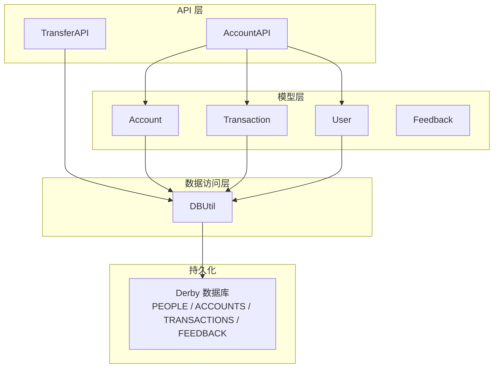
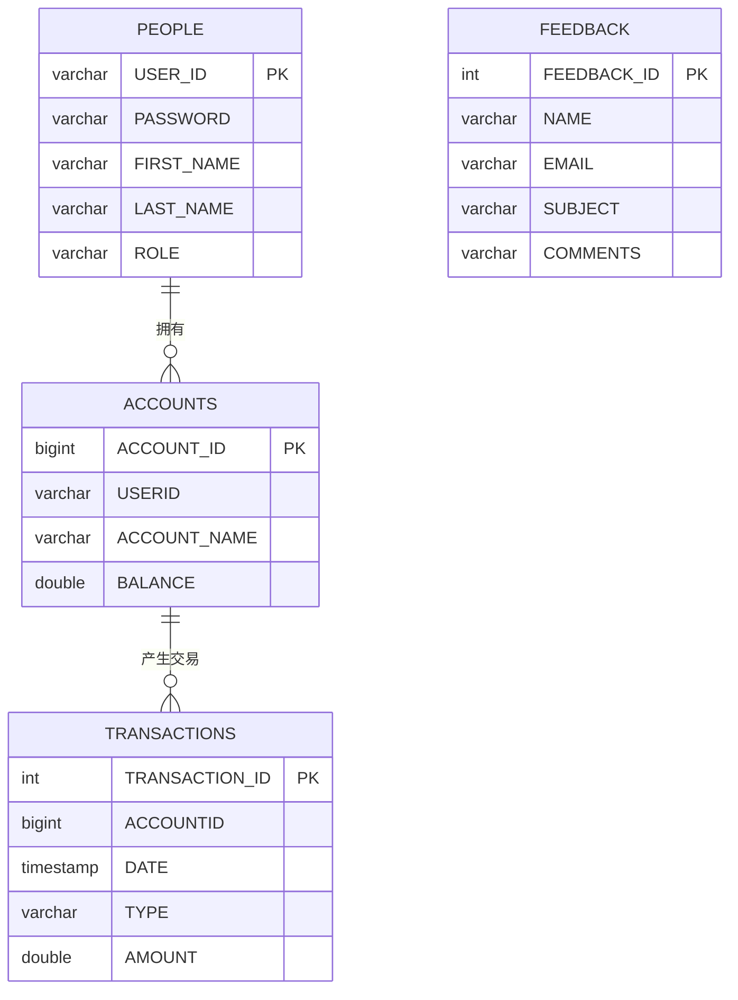
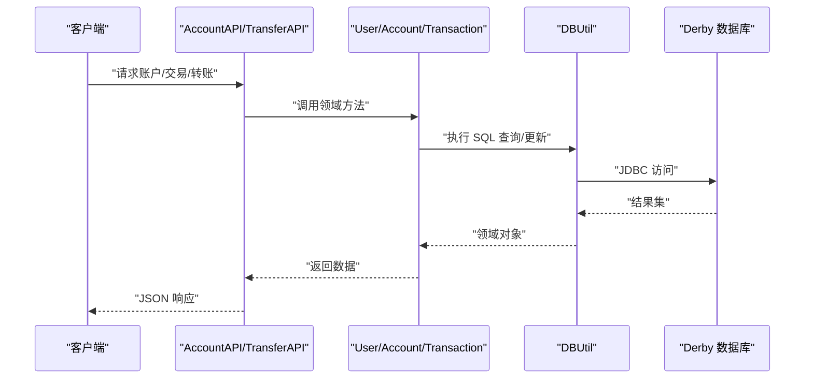
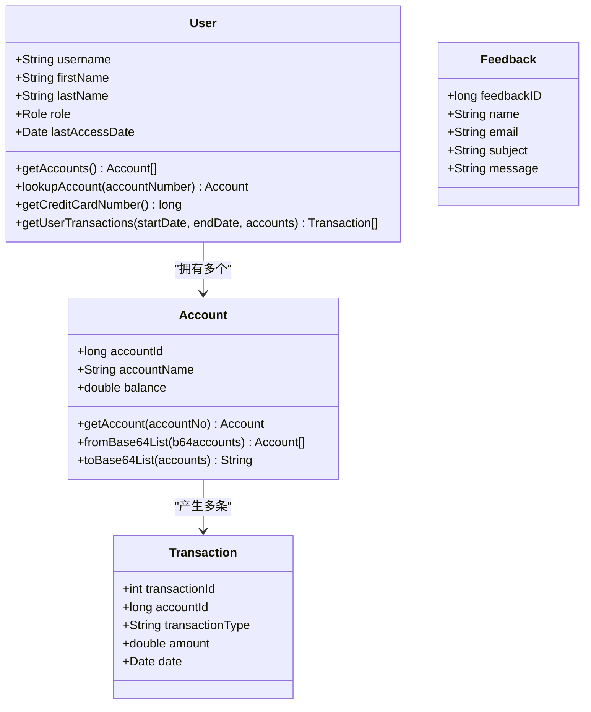
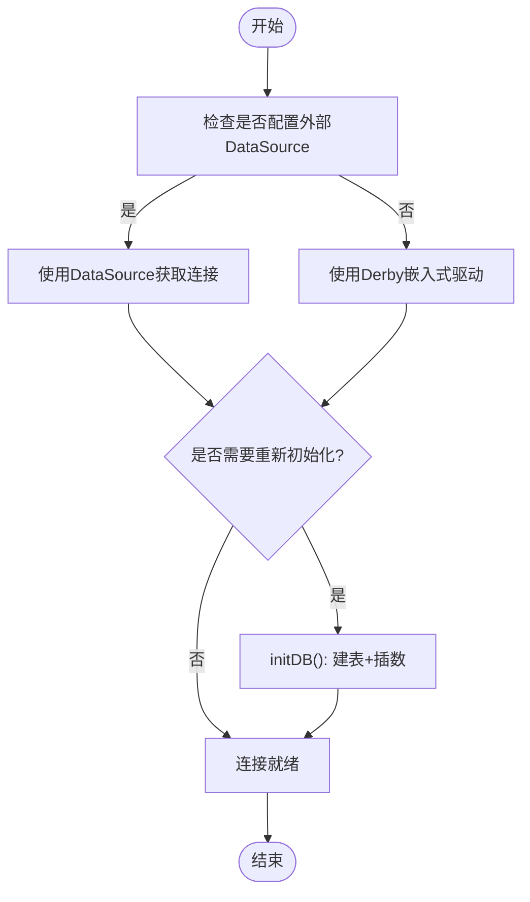
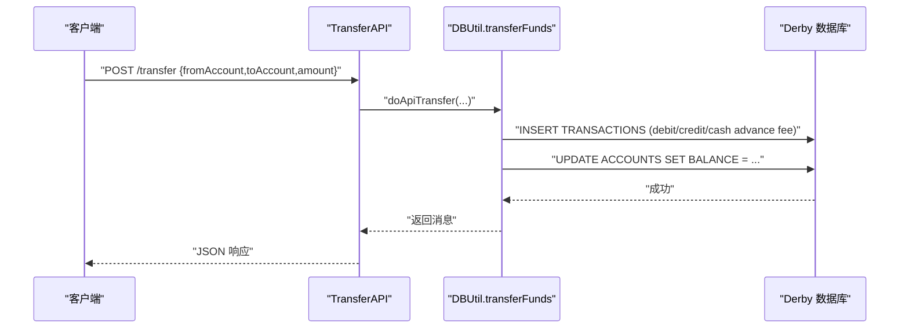
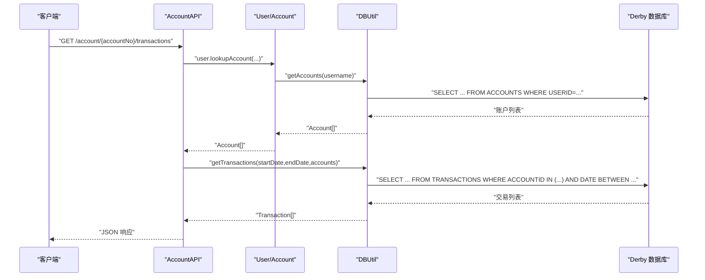
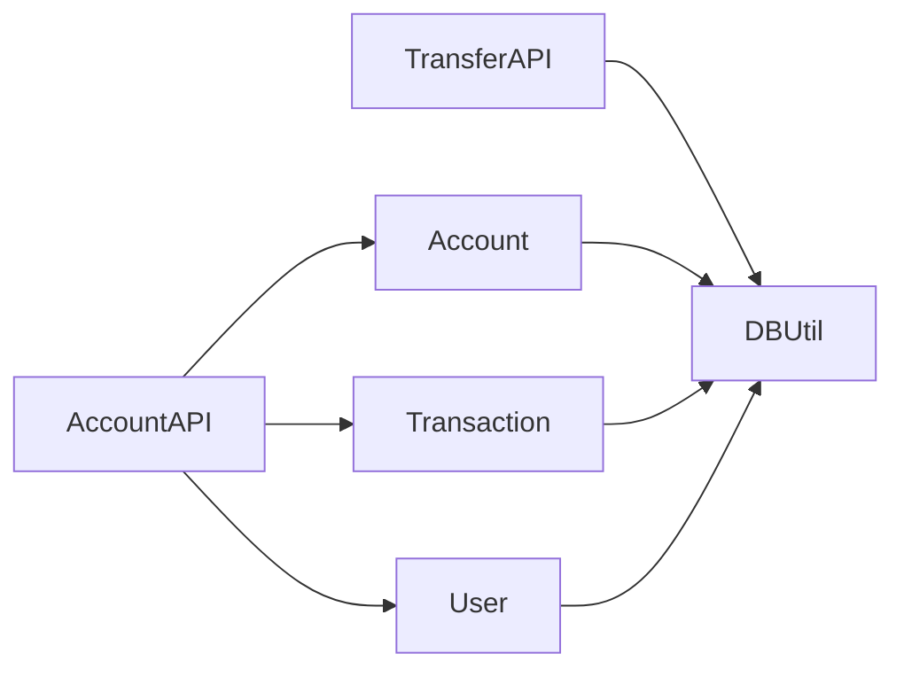

# 数据模型

<cite>
**本文引用的文件**   
- [DBUtil.java](file://src/com/ibm/security/appscan/altoromutual/util/DBUtil.java)
- [User.java](file://src/com/ibm/security/appscan/altoromutual/model/User.java)
- [Account.java](file://src/com/ibm/security/appscan/altoromutual/model/Account.java)
- [Transaction.java](file://src/com/ibm/security/appscan/altoromutual/model/Transaction.java)
- [Feedback.java](file://src/com/ibm/security/appscan/altoromutual/model/Feedback.java)
- [AccountAPI.java](file://src/com/ibm/security/appscan/altoromutual/api/AccountAPI.java)
- [TransferAPI.java](file://src/com/ibm/security/appscan/altoromutual/api/TransferAPI.java)
</cite>

## 目录
1. [引言](#引言)
2. [项目结构](#项目结构)
3. [核心实体与关系](#核心实体与关系)
4. [架构总览](#架构总览)
5. [详细组件分析](#详细组件分析)
6. [依赖关系分析](#依赖关系分析)
7. [性能考虑](#性能考虑)
8. [故障排查指南](#故障排查指南)
9. [结论](#结论)
10. [附录：示例数据与迁移建议](#附录示例数据与迁移建议)

## 引言
本文件为 AltoroJ 的数据模型提供全面文档，覆盖实体关系、字段定义、数据类型、主键/外键、索引与约束、数据验证规则与业务规则、数据库模式图与示例数据、数据访问模式、缓存策略与性能考量、数据生命周期与归档策略、数据迁移路径与版本管理、数据安全与隐私要求、访问控制等。重点涵盖 User、Account、Transaction、Feedback 四个核心实体。

## 项目结构
AltoroJ 采用分层结构：
- 模型层（model）：User、Account、Transaction、Feedback 领域对象
- 数据访问层（util）：DBUtil 封装 JDBC 连接、建库建表、CRUD 操作
- API 层（api）：REST 接口 AccountAPI、TransferAPI 暴露账户与转账能力
- 其他：过滤器、监听器、Servlet 等用于认证、路由与页面渲染

图表来源
- [AccountAPI.java:23-237](file://src/com/ibm/security/appscan/altoromutual/api/AccountAPI.java#L23-L237)
- [TransferAPI.java:14-44](file://src/com/ibm/security/appscan/altoromutual/api/TransferAPI.java#L14-L44)
- [User.java:30-107](file://src/com/ibm/security/appscan/altoromutual/model/User.java#L30-L107)
- [Account.java:32-121](file://src/com/ibm/security/appscan/altoromutual/model/Account.java#L32-L121)
- [Transaction.java:28-63](file://src/com/ibm/security/appscan/altoromutual/model/Transaction.java#L28-L63)
- [DBUtil.java:45-167](file://src/com/ibm/security/appscan/altoromutual/util/DBUtil.java#L45-L167)

章节来源
- [AccountAPI.java:23-237](file://src/com/ibm/security/appscan/altoromutual/api/AccountAPI.java#L23-L237)
- [TransferAPI.java:14-44](file://src/com/ibm/security/appscan/altoromutual/api/TransferAPI.java#L14-L44)
- [DBUtil.java:45-167](file://src/com/ibm/security/appscan/altoromutual/util/DBUtil.java#L45-L167)

## 核心实体与关系
本节给出实体关系与字段定义，并说明主键、外键、索引与约束。

### 实体关系图（ERD）

图表来源
- [DBUtil.java:156-159](file://src/com/ibm/security/appscan/altoromutual/util/DBUtil.java#L156-L159)

### 字段定义与类型
- PEOPLE（用户）
  - USER_ID：VARCHAR(50)，主键，非空
  - PASSWORD：VARCHAR(20)，非空
  - FIRST_NAME：VARCHAR(100)，非空
  - LAST_NAME：VARCHAR(100)，非空
  - ROLE：VARCHAR(50)，非空（如 admin/user）
- ACCOUNTS（账户）
  - ACCOUNT_ID：BIGINT，自增，主键，非空
  - USERID：VARCHAR(50)，非空（逻辑外键指向 PEOPLE.USER_ID）
  - ACCOUNT_NAME：VARCHAR(100)，非空（如 Checking/Savings/Credit Card）
  - BALANCE：DOUBLE，非空
- TRANSACTIONS（交易）
  - TRANSACTION_ID：INTEGER，自增，主键，非空
  - ACCOUNTID：BIGINT，非空（逻辑外键指向 ACCOUNTS.ACCOUNT_ID）
  - DATE：TIMESTAMP，非空
  - TYPE：VARCHAR(100)，非空（如 Deposit/Withdrawal/Payment/Cash Advance Fee）
  - AMOUNT：DOUBLE，非空
- FEEDBACK（反馈）
  - FEEDBACK_ID：INTEGER，自增，主键，非空
  - NAME：VARCHAR(100)，非空
  - EMAIL：VARCHAR(50)，非空
  - SUBJECT：VARCHAR(100)，非空
  - COMMENTS：VARCHAR(500)，非空

注意：
- 当前 DDL 未显式声明 FOREIGN KEY 约束；USERID、ACCOUNTID 为逻辑外键，由应用层维护一致性。
- 未定义唯一索引或检查约束（例如余额非负、金额正负语义）。

章节来源
- [DBUtil.java:156-159](file://src/com/ibm/security/appscan/altoromutual/util/DBUtil.java#L156-L159)

## 架构总览
数据访问通过 DBUtil 统一封装，模型类负责领域语义，API 层对外暴露 REST 接口。

图表来源
- [AccountAPI.java:23-237](file://src/com/ibm/security/appscan/altoromutual/api/AccountAPI.java#L23-L237)
- [TransferAPI.java:14-44](file://src/com/ibm/security/appscan/altoromutual/api/TransferAPI.java#L14-L44)
- [DBUtil.java:99-138](file://src/com/ibm/security/appscan/altoromutual/util/DBUtil.java#L99-L138)

## 详细组件分析

### 实体类与领域行为
- User
  - 包含用户名、姓名、角色、最近访问时间
  - 提供获取账户列表、按账号查找账户、信用卡号识别、按日期范围获取交易等方法
  - 依赖 DBUtil 进行数据访问
- Account
  - 包含账户编号、名称、余额
  - 提供静态工厂方法从字符串/数字获取账户
  - 支持 Base64 序列化/反序列化为传输格式
- Transaction
  - 包含交易编号、账户编号、类型、金额、时间
- Feedback
  - 包含反馈编号、姓名、邮箱、主题、内容

图表来源
- [User.java:30-107](file://src/com/ibm/security/appscan/altoromutual/model/User.java#L30-L107)
- [Account.java:32-121](file://src/com/ibm/security/appscan/altoromutual/model/Account.java#L32-L121)
- [Transaction.java:28-63](file://src/com/ibm/security/appscan/altoromutual/model/Transaction.java#L28-L63)
- [Feedback.java:6-47](file://src/com/ibm/security/appscan/altoromutual/model/Feedback.java#L6-L47)

章节来源
- [User.java:30-107](file://src/com/ibm/security/appscan/altoromutual/model/User.java#L30-L107)
- [Account.java:32-121](file://src/com/ibm/security/appscan/altoromutual/model/Account.java#L32-L121)
- [Transaction.java:28-63](file://src/com/ibm/security/appscan/altoromutual/model/Transaction.java#L28-L63)
- [Feedback.java:6-47](file://src/com/ibm/security/appscan/altoromutual/model/Feedback.java#L6-L47)

### 数据访问与初始化
- DBUtil 负责：
  - 连接管理：优先使用外部 DataSource，否则使用内嵌 Derby
  - 数据库初始化：DROP/CREATE 表并插入初始数据
  - CRUD 操作：用户认证、账户查询、转账、交易查询、反馈存储
- 关键流程：
  - initDB：创建 PEOPLE/ACCOUNTS/TRANSACTIONS/FEEDBACK 表并填充样例数据
  - transferFunds：记录交易、计算手续费、更新余额
  - getTransactions：按账户集合与日期范围查询交易

图表来源
- [DBUtil.java:61-138](file://src/com/ibm/security/appscan/altoromutual/util/DBUtil.java#L61-L138)
- [DBUtil.java:143-167](file://src/com/ibm/security/appscan/altoromutual/util/DBUtil.java#L143-L167)

章节来源
- [DBUtil.java:61-138](file://src/com/ibm/security/appscan/altoromutual/util/DBUtil.java#L61-L138)
- [DBUtil.java:143-167](file://src/com/ibm/security/appscan/altoromutual/util/DBUtil.java#L143-L167)

### 转账业务流程

图表来源
- [TransferAPI.java:14-44](file://src/com/ibm/security/appscan/altoromutual/api/TransferAPI.java#L14-L44)
- [DBUtil.java:303-364](file://src/com/ibm/security/appscan/altoromutual/util/DBUtil.java#L303-L364)

章节来源
- [TransferAPI.java:14-44](file://src/com/ibm/security/appscan/altoromutual/api/TransferAPI.java#L14-L44)
- [DBUtil.java:303-364](file://src/com/ibm/security/appscan/altoromutual/util/DBUtil.java#L303-L364)

### 账户与交易查询
- AccountAPI 提供：
  - GET /account：列出当前用户的所有账户
  - GET /account/{accountNo}：获取账户余额与最近交易
  - POST /account/{accountNo}/transactions：按日期范围查询交易
- 内部调用链：
  - AccountAPI -> OperationsUtil.getUser -> User.getAccounts -> DBUtil.getAccounts
  - AccountAPI -> DBUtil.getTransactions

图表来源
- [AccountAPI.java:141-207](file://src/com/ibm/security/appscan/altoromutual/api/AccountAPI.java#L141-L207)
- [DBUtil.java:275-293](file://src/com/ibm/security/appscan/altoromutual/util/DBUtil.java#L275-L293)
- [DBUtil.java:375-427](file://src/com/ibm/security/appscan/altoromutual/util/DBUtil.java#L375-L427)

章节来源
- [AccountAPI.java:141-207](file://src/com/ibm/security/appscan/altoromutual/api/AccountAPI.java#L141-L207)
- [DBUtil.java:275-293](file://src/com/ibm/security/appscan/altoromutual/util/DBUtil.java#L275-L293)
- [DBUtil.java:375-427](file://src/com/ibm/security/appscan/altoromutual/util/DBUtil.java#L375-L427)

## 依赖关系分析
- 耦合性
  - 模型类直接依赖 DBUtil 进行数据访问，导致模型与持久化实现紧耦合
  - API 层同时依赖模型与工具类，职责边界不够清晰
- 外部依赖
  - Apache Derby 嵌入式数据库
  - JNDI DataSource（可选）
- 潜在循环依赖
  - 当前未见循环导入，但模型对 DBUtil 的强依赖不利于测试与替换持久化实现

图表来源
- [AccountAPI.java:23-237](file://src/com/ibm/security/appscan/altoromutual/api/AccountAPI.java#L23-L237)
- [TransferAPI.java:14-44](file://src/com/ibm/security/appscan/altoromutual/api/TransferAPI.java#L14-L44)
- [DBUtil.java:45-167](file://src/com/ibm/security/appscan/altoromutual/util/DBUtil.java#L45-L167)

章节来源
- [AccountAPI.java:23-237](file://src/com/ibm/security/appscan/altoromutual/api/AccountAPI.java#L23-L237)
- [TransferAPI.java:14-44](file://src/com/ibm/security/appscan/altoromutual/api/TransferAPI.java#L14-L44)
- [DBUtil.java:45-167](file://src/com/ibm/security/appscan/altoromutual/util/DBUtil.java#L45-L167)

## 性能考虑
- 连接管理
  - 单例 DBUtil 持有 Connection，避免频繁创建连接
  - 支持外部 DataSource，便于连接池集成
- 查询优化
  - getTransactions 支持限制返回行数（setMaxRows），减少网络与内存开销
  - 建议在 ACCOUNTS.USERID、TRANSACTIONS.ACCOUNTID、TRANSACTIONS.DATE 上建立索引以提升查询性能
- 事务与原子性
  - 当前转账逻辑分多步 INSERT/UPDATE，未使用数据库事务包裹，存在不一致风险
  - 建议将转账相关语句放入单一事务中，确保原子性
- 序列化与传输
  - Account 提供 Base64 序列化，适合简单传输场景，但应避免在敏感环境中明文传输余额信息

[本节为通用指导，不直接分析具体文件]

## 故障排查指南
- 常见错误
  - 日期时间格式错误：getTransactions 对日期格式有严格校验，需遵循 yyyy-mm-dd HH:mm:ss
  - 账户无效：transferFunds 会校验来源与目标账户是否存在
  - 数据库初始化失败：若未正确设置 derby.system.home 或未触发 reinitializeOnStart，可能导致表不存在
- 日志与诊断
  - 使用 Log4AltoroJ 记录错误与交易日志
  - 检查 Servlet 配置与应用属性 database.alternateDataSource、database.reinitializeOnStart

章节来源
- [DBUtil.java:375-427](file://src/com/ibm/security/appscan/altoromutual/util/DBUtil.java#L375-L427)
- [DBUtil.java:303-364](file://src/com/ibm/security/appscan/altoromutual/util/DBUtil.java#L303-L364)
- [DBUtil.java:61-138](file://src/com/ibm/security/appscan/altoromutual/util/DBUtil.java#L61-L138)

## 结论
AltoroJ 的数据模型以简单的四张表支撑核心银行业务演示。模型层与数据访问层耦合较深，缺少外键约束与事务保护，存在安全与一致性问题。建议引入 ORM、参数化查询、事务管理、索引优化与审计日志，提升可维护性与安全性。

[本节为总结性内容，不直接分析具体文件]

## 附录：示例数据与迁移建议

### 示例数据
- PEOPLE：包含管理员与普通用户若干条记录
- ACCOUNTS：为不同用户创建 Checking/Savings/Credit Card 账户，并预置余额
- TRANSACTIONS：为部分账户生成历史交易记录，涵盖存款、取款、转账与手续费
- FEEDBACK：预留反馈表，自增 ID 起始值较高

章节来源
- [DBUtil.java:161-164](file://src/com/ibm/security/appscan/altoromutual/util/DBUtil.java#L161-L164)

### 数据生命周期与归档
- 交易归档
  - 建议按年份或季度归档 TRANSACTIONS 到历史表，保留活跃期数据在主表
- 反馈清理
  - 定期清理过期或重复反馈，保留审计所需的最小数据集
- 用户与账户
  - 长期不活跃账户标记为休眠，限制写入，仅允许查询

[本节为通用指导，不直接分析具体文件]

### 数据迁移路径与版本管理
- 现状
  - 初始化逻辑集中在 DBUtil.initDB，使用 DROP/CREATE 重建表并插入样例数据
- 建议
  - 引入迁移脚本（如 Flyway/Liquibase），按版本号管理 DDL/DML
  - 生产环境禁用自动 DROP/CREATE，改为增量变更脚本
  - 将初始数据拆分为 seed 脚本，与环境无关

章节来源
- [DBUtil.java:143-167](file://src/com/ibm/security/appscan/altoromutual/util/DBUtil.java#L143-L167)

### 数据安全、隐私与访问控制
- 密码存储
  - 当前 PASSWORD 明文存储，存在严重安全风险
  - 建议哈希加盐存储（如 bcrypt/scrypt），并在登录时比对
- SQL 注入
  - 多处拼接用户输入到 SQL，极易被注入攻击
  - 必须改用 PreparedStatement 与参数绑定
- 敏感数据传输
  - Account Base64 序列化不应作为安全传输机制
  - 建议使用 HTTPS 与最小必要字段返回
- 访问控制
  - API 层应校验会话与权限，确保用户只能访问自己的账户与交易
  - 转账接口需校验 fromAccount/toAccount 归属与额度限制

章节来源
- [DBUtil.java:212-232](file://src/com/ibm/security/appscan/altoromutual/util/DBUtil.java#L212-L232)
- [DBUtil.java:241-267](file://src/com/ibm/security/appscan/altoromutual/util/DBUtil.java#L241-L267)
- [DBUtil.java:275-293](file://src/com/ibm/security/appscan/altoromutual/util/DBUtil.java#L275-L293)
- [DBUtil.java:452-470](file://src/com/ibm/security/appscan/altoromutual/util/DBUtil.java#L452-L470)
- [AccountAPI.java:54-104](file://src/com/ibm/security/appscan/altoromutual/api/AccountAPI.java#L54-L104)