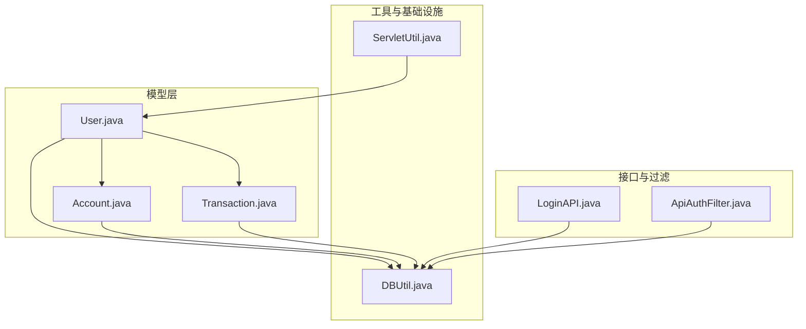
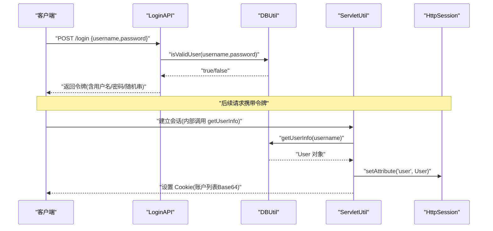
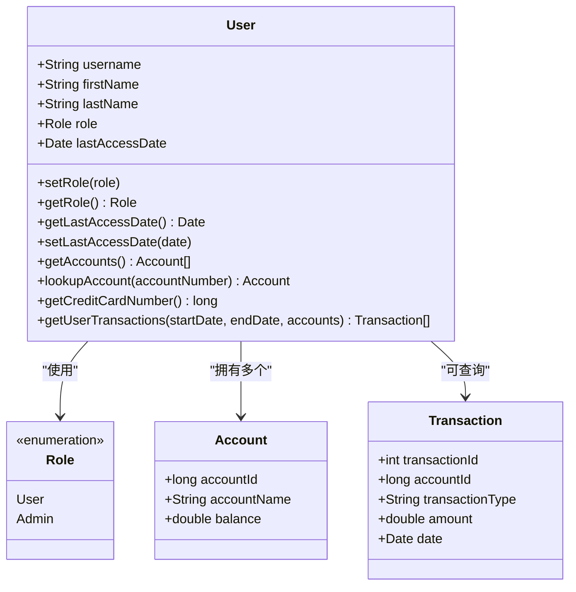
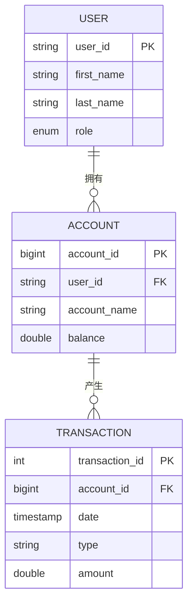
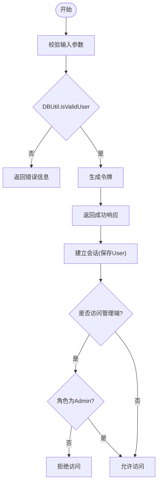
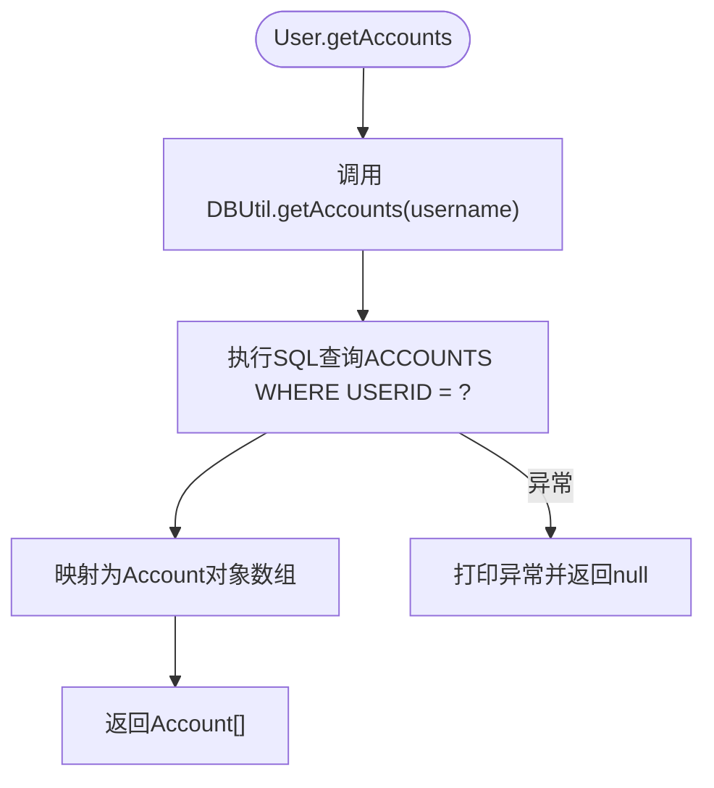
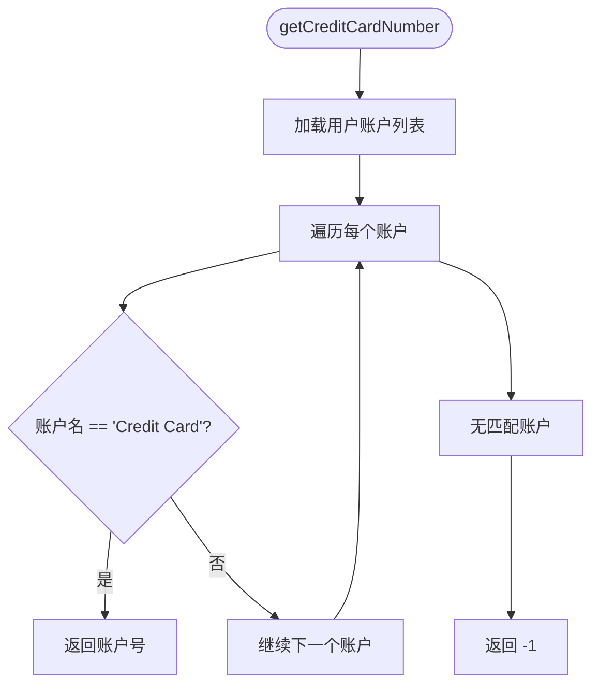
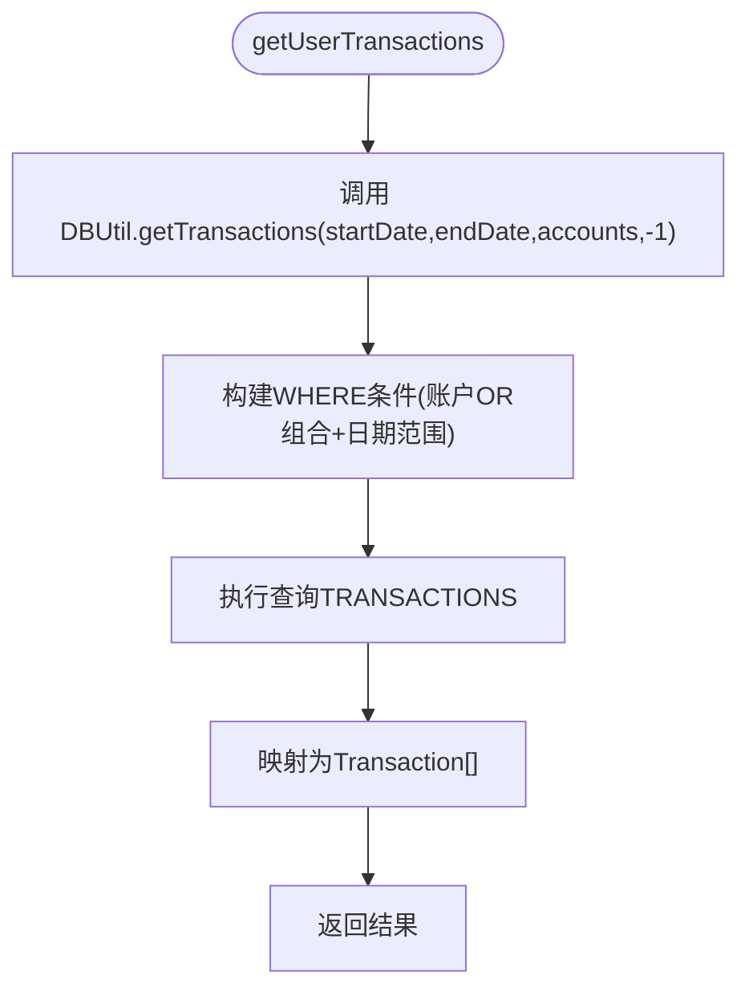
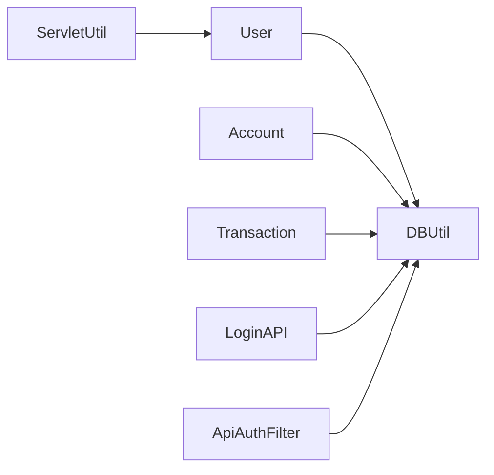

# 用户模型(User)

<cite>
**本文引用的文件**   
- [User.java](file://src/com/ibm/security/appscan/altoromutual/model/User.java)
- [Account.java](file://src/com/ibm/security/appscan/altoromutual/model/Account.java)
- [Transaction.java](file://src/com/ibm/security/appscan/altoromutual/model/Transaction.java)
- [DBUtil.java](file://src/com/ibm/security/appscan/altoromutual/util/DBUtil.java)
- [ServletUtil.java](file://src/com/ibm/security/appscan/altoromutual/util/ServletUtil.java)
- [LoginAPI.java](file://src/com/ibm/security/appscan/altoromutual/api/LoginAPI.java)
- [ApiAuthFilter.java](file://src/com/ibm/security/appscan/altoromutual/filter/ApiAuthFilter.java)
</cite>

## 目录
1. [简介](#简介)
2. [项目结构](#项目结构)
3. [核心组件](#核心组件)
4. [架构总览](#架构总览)
5. [详细组件分析](#详细组件分析)
6. [依赖关系分析](#依赖关系分析)
7. [性能考虑](#性能考虑)
8. [故障排查指南](#故障排查指南)
9. [结论](#结论)
10. [附录](#附录)

## 简介
本文档围绕 AltoroJ 应用中的用户模型 User，提供面向业务与实现的数据模型文档。内容涵盖：
- User 类的字段定义、数据类型与默认值
- Role 枚举的业务含义与使用场景
- lastAccessDate 字段的用途与更新机制
- User 与 Account、Transaction 等实体的关系映射
- 用户认证与权限控制相关规则
- 用户对象创建、查询、更新的代码示例路径
- getAccounts、getCreditCardNumber、getUserTransactions 等方法的行为说明
- 数据验证规则与安全性注意事项

## 项目结构
本项目的用户域模型位于 model 包中，数据库访问逻辑集中在 util.DBUtil，会话与登录流程在 servlet 工具类与 API 层协同完成。

图表来源
- [User.java:30-107](file://src/com/ibm/security/appscan/altoromutual/model/User.java#L30-L107)
- [Account.java:32-121](file://src/com/ibm/security/appscan/altoromutual/model/Account.java#L32-L121)
- [Transaction.java:28-63](file://src/com/ibm/security/appscan/altoromutual/model/Transaction.java#L28-L63)
- [DBUtil.java:45-536](file://src/com/ibm/security/appscan/altoromutual/util/DBUtil.java#L45-L536)
- [ServletUtil.java:340-373](file://src/com/ibm/security/appscan/altoromutual/util/ServletUtil.java#L340-L373)
- [LoginAPI.java:43-83](file://src/com/ibm/security/appscan/altoromutual/api/LoginAPI.java#L43-L83)
- [ApiAuthFilter.java:56-75](file://src/com/ibm/security/appscan/altoromutual/filter/ApiAuthFilter.java#L56-L75)

章节来源
- [User.java:30-107](file://src/com/ibm/security/appscan/altoromutual/model/User.java#L30-L107)
- [DBUtil.java:45-536](file://src/com/ibm/security/appscan/altoromutual/util/DBUtil.java#L45-L536)

## 核心组件
- User：用户实体，包含身份、姓名、角色、最近访问时间，以及账户与交易查询能力。
- Account：账户实体，包含账户号、账户名、余额，并提供序列化/反序列化工具方法。
- Transaction：交易记录实体，包含交易ID、账户ID、类型、金额、时间。
- DBUtil：数据库访问工具，封装用户认证、信息查询、转账与交易查询等逻辑。
- ServletUtil：会话建立与用户获取的工具方法，用于 Web 层持有当前用户上下文。
- LoginAPI：REST 登录接口，负责参数校验、调用认证并返回令牌。
- ApiAuthFilter：API 鉴权过滤器，基于令牌校验用户有效性。

章节来源
- [User.java:30-107](file://src/com/ibm/security/appscan/altoromutual/model/User.java#L30-L107)
- [Account.java:32-121](file://src/com/ibm/security/appscan/altoromutual/model/Account.java#L32-L121)
- [Transaction.java:28-63](file://src/com/ibm/security/appscan/altoromutual/model/Transaction.java#L28-L63)
- [DBUtil.java:45-536](file://src/com/ibm/security/appscan/altoromutual/util/DBUtil.java#L45-L536)
- [ServletUtil.java:340-373](file://src/com/ibm/security/appscan/altoromutual/util/ServletUtil.java#L340-L373)
- [LoginAPI.java:43-83](file://src/com/ibm/security/appscan/altoromutual/api/LoginAPI.java#L43-L83)
- [ApiAuthFilter.java:56-75](file://src/com/ibm/security/appscan/altoromutual/filter/ApiAuthFilter.java#L56-L75)

## 架构总览
下图展示了用户认证与授权的关键交互流程：客户端通过 REST 登录接口进行认证，服务端调用 DBUtil 校验凭据；成功登录后，Web 层将 User 放入 Session，并在后续请求中通过过滤器或工具类获取当前用户以进行权限判断。

图表来源
- [LoginAPI.java:43-83](file://src/com/ibm/security/appscan/altoromutual/api/LoginAPI.java#L43-L83)
- [DBUtil.java:212-267](file://src/com/ibm/security/appscan/altoromutual/util/DBUtil.java#L212-L267)
- [ServletUtil.java:340-373](file://src/com/ibm/security/appscan/altoromutual/util/ServletUtil.java#L340-L373)

## 详细组件分析

### User 类数据模型
- 字段定义与类型
  - username: String，用户标识（主键对应 PEOPLE.USER_ID）
  - firstName: String，用户名字
  - lastName: String，用户姓氏
  - role: Role 枚举，默认值为 User；Role 取值包括 User、Admin
  - lastAccessDate: Date，最近访问时间，构造时初始化为当前时间
- 行为与方法
  - setRole/getRole：设置与读取角色
  - getLastAccessDate/setLastAccessDate：读取与设置最近访问时间
  - getAccounts：根据 username 查询该用户的所有账户（委托 DBUtil.getAccounts）
  - lookupAccount：在用户账户列表中按账户号查找账户
  - getCreditCardNumber：从用户账户中找到信用卡账户并返回其账户号；未找到返回 -1
  - getUserTransactions：根据起止日期与账户数组查询交易记录（委托 DBUtil.getTransactions）

图表来源
- [User.java:30-107](file://src/com/ibm/security/appscan/altoromutual/model/User.java#L30-L107)
- [Account.java:32-121](file://src/com/ibm/security/appscan/altoromutual/model/Account.java#L32-L121)
- [Transaction.java:28-63](file://src/com/ibm/security/appscan/altoromutual/model/Transaction.java#L28-L63)

章节来源
- [User.java:30-107](file://src/com/ibm/security/appscan/altoromutual/model/User.java#L30-L107)

### Role 枚举的业务含义与使用场景
- Role.User：普通用户，具备基础银行功能访问权限。
- Role.Admin：管理员，具备管理功能访问权限（例如后台管理页面）。
- 使用场景
  - 在 JSP 视图层根据角色显示不同菜单或链接
  - 在过滤器中限制对管理端接口的访问

章节来源
- [User.java:34-37](file://src/com/ibm/security/appscan/altoromutual/model/User.java#L34-L37)
- [DBUtil.java:261-266](file://src/com/ibm/security/appscan/altoromutual/util/DBUtil.java#L261-L266)

### lastAccessDate 的用途与更新机制
- 用途：记录用户最近一次访问的时间点，可用于审计或统计。
- 更新机制：在 User 构造时设置为当前时间；可通过 setLastAccessDate 手动更新。当前代码未在登录或访问关键操作后自动刷新该字段。

章节来源
- [User.java:39-46](file://src/com/ibm/security/appscan/altoromutual/model/User.java#L39-L46)
- [User.java:56-62](file://src/com/ibm/security/appscan/altoromutual/model/User.java#L56-L62)

### User 与 Account、Transaction 的关系映射
- User 与 Account：一对多关系，一个用户可拥有多个账户（储蓄、支票、信用卡等）。
- Account 与 Transaction：一对多关系，一个账户有多条交易记录。
- User 与 Transaction：间接关系，通过账户关联到交易。

图表来源
- [DBUtil.java:156-164](file://src/com/ibm/security/appscan/altoromutual/util/DBUtil.java#L156-L164)

章节来源
- [DBUtil.java:156-164](file://src/com/ibm/security/appscan/altoromutual/util/DBUtil.java#L156-L164)

### 用户认证与权限控制规则
- 认证流程
  - REST 登录接口接收 username/password，调用 DBUtil.isValidUser 校验。
  - 成功后生成令牌（包含用户名、密码与随机串），返回给客户端。
  - Web 层通过 ServletUtil.establishSession 将 User 放入 Session，并设置账户列表 Cookie。
- 权限控制
  - 管理端访问需检查用户角色是否为 Admin。
  - API 过滤器 ApiAuthFilter 解析令牌并再次校验用户有效性。

图表来源
- [LoginAPI.java:43-83](file://src/com/ibm/security/appscan/altoromutual/api/LoginAPI.java#L43-L83)
- [DBUtil.java:212-232](file://src/com/ibm/security/appscan/altoromutual/util/DBUtil.java#L212-L232)
- [ServletUtil.java:340-373](file://src/com/ibm/security/appscan/altoromutual/util/ServletUtil.java#L340-L373)
- [ApiAuthFilter.java:56-75](file://src/com/ibm/security/appscan/altoromutual/filter/ApiAuthFilter.java#L56-L75)

章节来源
- [LoginAPI.java:43-83](file://src/com/ibm/security/appscan/altoromutual/api/LoginAPI.java#L43-L83)
- [DBUtil.java:212-232](file://src/com/ibm/security/appscan/altoromutual/util/DBUtil.java#L212-L232)
- [ServletUtil.java:340-373](file://src/com/ibm/security/appscan/altoromutual/util/ServletUtil.java#L340-L373)
- [ApiAuthFilter.java:56-75](file://src/com/ibm/security/appscan/altoromutual/filter/ApiAuthFilter.java#L56-L75)

### 用户对象创建、查询、更新的代码示例路径
- 创建用户对象
  - 通过构造函数创建 User 实例（包含用户名、姓名，并初始化 lastAccessDate）
  - 参考路径：[User.java:41-46](file://src/com/ibm/security/appscan/altoromutual/model/User.java#L41-L46)
- 查询用户信息
  - 通过 DBUtil.getUserInfo 根据用户名获取 User 对象（包含角色解析）
  - 参考路径：[DBUtil.java:241-267](file://src/com/ibm/security/appscan/altoromutual/util/DBUtil.java#L241-L267)
- 更新用户信息
  - 修改角色：User.setRole
    - 参考路径：[User.java:48-50](file://src/com/ibm/security/appscan/altoromutual/model/User.java#L48-L50)
  - 修改最近访问时间：User.setLastAccessDate
    - 参考路径：[User.java:60-62](file://src/com/ibm/security/appscan/altoromutual/model/User.java#L60-L62)
  - 修改密码：DBUtil.changePassword（注意：该方法直接拼接 SQL，存在安全风险）
    - 参考路径：[DBUtil.java:507-517](file://src/com/ibm/security/appscan/altoromutual/util/DBUtil.java#L507-L517)

章节来源
- [User.java:41-62](file://src/com/ibm/security/appscan/altoromutual/model/User.java#L41-L62)
- [DBUtil.java:241-267](file://src/com/ibm/security/appscan/altoromutual/util/DBUtil.java#L241-L267)
- [DBUtil.java:507-517](file://src/com/ibm/security/appscan/altoromutual/util/DBUtil.java#L507-L517)

### 用户账户关联查询(getAccounts)的实现逻辑
- 行为：根据当前用户的 username 查询所有账户，返回 Account 数组。
- 实现：委托 DBUtil.getAccounts，执行 SQL 查询 ACCOUNTS 表并按 USERID 过滤。
- 异常处理：捕获 SQLException 并打印堆栈，返回 null。

图表来源
- [User.java:76-83](file://src/com/ibm/security/appscan/altoromutual/model/User.java#L76-L83)
- [DBUtil.java:275-293](file://src/com/ibm/security/appscan/altoromutual/util/DBUtil.java#L275-L293)

章节来源
- [User.java:76-83](file://src/com/ibm/security/appscan/altoromutual/model/User.java#L76-L83)
- [DBUtil.java:275-293](file://src/com/ibm/security/appscan/altoromutual/util/DBUtil.java#L275-L293)

### 信用卡账户查找(getCreditCardNumber)的业务逻辑
- 行为：遍历用户的所有账户，匹配账户名为“Credit Card”的账户，返回其账户号；若不存在则返回 -1。
- 关键点：账户名常量由 DBUtil.CREDIT_CARD_ACCOUNT_NAME 提供，确保一致性。

图表来源
- [User.java:93-99](file://src/com/ibm/security/appscan/altoromutual/model/User.java#L93-L99)
- [DBUtil.java:50](file://src/com/ibm/security/appscan/altoromutual/util/DBUtil.java#L50)

章节来源
- [User.java:93-99](file://src/com/ibm/security/appscan/altoromutual/model/User.java#L93-L99)
- [DBUtil.java:50](file://src/com/ibm/security/appscan/altoromutual/util/DBUtil.java#L50)

### 用户交易查询(getUserTransactions)的参数与返回值
- 参数
  - startDate: 起始日期字符串（可选）
  - endDate: 结束日期字符串（可选）
  - accounts: 账户数组（必须非空）
- 返回值
  - Transaction[]：满足条件的交易记录数组
- 实现要点
  - 委托 DBUtil.getTransactions，内部构建动态 SQL 条件，支持仅 startDate、仅 endDate 或同时指定。
  - 当 accounts 为空时，DBUtil 直接返回 null。

图表来源
- [User.java:101-106](file://src/com/ibm/security/appscan/altoromutual/model/User.java#L101-L106)
- [DBUtil.java:375-427](file://src/com/ibm/security/appscan/altoromutual/util/DBUtil.java#L375-L427)

章节来源
- [User.java:101-106](file://src/com/ibm/security/appscan/altoromutual/model/User.java#L101-L106)
- [DBUtil.java:375-427](file://src/com/ibm/security/appscan/altoromutual/util/DBUtil.java#L375-L427)

### 用户数据验证规则与安全性考虑
- 输入校验
  - 登录接口对 username/password 的存在性进行基本校验。
  - DBUtil.isValidUser 对空输入进行快速返回。
- 安全风险提示
  - 多处 SQL 拼接用户输入，存在 SQL 注入风险（如 isValidUser、getUserInfo、getAccounts、getAccount、addUser、changePassword 等）。
  - 密码明文存储与传输（令牌中包含用户名与密码的 Base64 编码），应改为哈希与加密传输。
  - 角色判定依赖字符串比较，建议统一使用枚举并避免大小写敏感问题。
- 建议改进
  - 使用预编译语句与参数化查询替代字符串拼接。
  - 引入密码哈希算法（如 bcrypt）与安全的令牌机制（如 JWT）。
  - 对所有外部输入进行严格的白名单校验与长度限制。

章节来源
- [LoginAPI.java:43-83](file://src/com/ibm/security/appscan/altoromutual/api/LoginAPI.java#L43-L83)
- [DBUtil.java:212-232](file://src/com/ibm/security/appscan/altoromutual/util/DBUtil.java#L212-L232)
- [DBUtil.java:241-267](file://src/com/ibm/security/appscan/altoromutual/util/DBUtil.java#L241-L267)
- [DBUtil.java:275-293](file://src/com/ibm/security/appscan/altoromutual/util/DBUtil.java#L275-L293)
- [DBUtil.java:452-470](file://src/com/ibm/security/appscan/altoromutual/util/DBUtil.java#L452-L470)
- [DBUtil.java:495-517](file://src/com/ibm/security/appscan/altoromutual/util/DBUtil.java#L495-L517)

## 依赖关系分析
- User 依赖 DBUtil 进行账户与交易数据的持久化访问。
- Account 与 Transaction 作为领域模型被 User 与 DBUtil 共同使用。
- ServletUtil 在 Web 层持有 User 会话上下文，便于控制器与过滤器访问当前用户。
- LoginAPI 与 ApiAuthFilter 分别负责登录认证与请求级鉴权，均依赖 DBUtil 进行用户有效性校验。

图表来源
- [User.java:30-107](file://src/com/ibm/security/appscan/altoromutual/model/User.java#L30-L107)
- [Account.java:32-121](file://src/com/ibm/security/appscan/altoromutual/model/Account.java#L32-L121)
- [Transaction.java:28-63](file://src/com/ibm/security/appscan/altoromutual/model/Transaction.java#L28-L63)
- [DBUtil.java:45-536](file://src/com/ibm/security/appscan/altoromutual/util/DBUtil.java#L45-L536)
- [ServletUtil.java:340-373](file://src/com/ibm/security/appscan/altoromutual/util/ServletUtil.java#L340-L373)
- [LoginAPI.java:43-83](file://src/com/ibm/security/appscan/altoromutual/api/LoginAPI.java#L43-L83)
- [ApiAuthFilter.java:56-75](file://src/com/ibm/security/appscan/altoromutual/filter/ApiAuthFilter.java#L56-L75)

## 性能考虑
- 账户与交易查询采用简单 SQL 扫描，建议在高频查询场景下增加索引（如 ACCOUNTS.USERID、TRANSACTIONS.ACCOUNTID、TRANSACTIONS.DATE）。
- getUserTransactions 的动态 SQL 拼接可能引发重复解析，建议使用预编译语句与分页限制（rowCount 已支持但当前调用传入 -1）。
- 会话中缓存账户列表可减少重复查询，但需注意数据一致性与过期策略。

## 故障排查指南
- 登录失败
  - 检查 DBUtil.isValidUser 的输入校验与数据库连接状态。
  - 确认数据库中是否存在对应用户且密码匹配（注意硬编码回退逻辑）。
- 账户查询为空
  - 检查 DBUtil.getAccounts 的 SQL 条件是否正确绑定 username。
  - 确认 SESSION 中 User.username 是否与数据库一致。
- 交易查询异常
  - 检查日期格式是否符合 yyyy-mm-dd HH:mm:ss，否则 DBUtil 会抛出特定错误码。
  - 确认传入的 accounts 数组非空。

章节来源
- [DBUtil.java:212-232](file://src/com/ibm/security/appscan/altoromutual/util/DBUtil.java#L212-L232)
- [DBUtil.java:275-293](file://src/com/ibm/security/appscan/altoromutual/util/DBUtil.java#L275-L293)
- [DBUtil.java:375-427](file://src/com/ibm/security/appscan/altoromutual/util/DBUtil.java#L375-L427)

## 结论
User 模型作为 AltoroJ 的核心领域对象，承载了用户身份、角色与账户/交易的关联查询能力。当前实现简洁直观，但在安全性方面存在明显隐患（SQL 注入、明文密码、弱令牌）。建议在保持现有接口契约的前提下，逐步引入参数化查询、密码哈希、令牌签名与更严格的输入校验，以提升系统的安全性与可维护性。

## 附录
- 常用常量
  - CREDIT_CARD_ACCOUNT_NAME：信用卡账户名常量，用于识别信用卡账户
    - 参考路径：[DBUtil.java:50](file://src/com/ibm/security/appscan/altoromutual/util/DBUtil.java#L50)
- 典型调用链
  - 登录 -> 认证 -> 会话建立 -> 账户列表缓存
    - 参考路径：[LoginAPI.java:43-83](file://src/com/ibm/security/appscan/altoromutual/api/LoginAPI.java#L43-L83), [ServletUtil.java:340-373](file://src/com/ibm/security/appscan/altoromutual/util/ServletUtil.java#L340-L373)